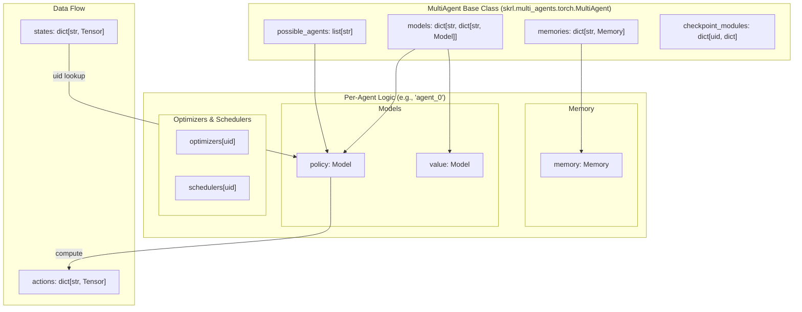
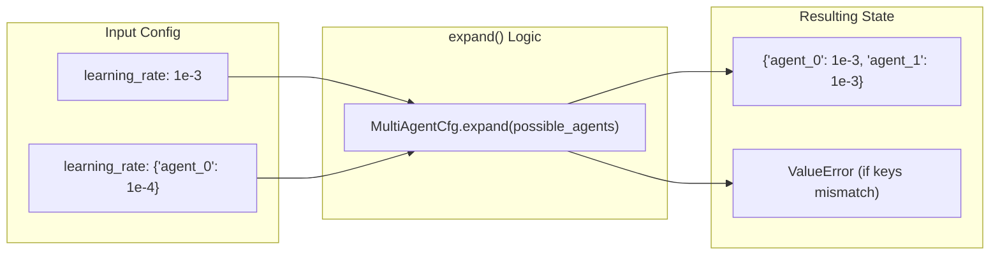

<!-- source: DeepWiki mcp.deepwiki.com · repo Toni-SM/skrl · page 7 Multi-Agent Systems · fetched 2026-10-30 -->

# Multi-Agent Systems

Relevant source files

The following files were used as context for generating this wiki page:

- [docs/source/api/multi_agents/ippo.rst](docs/source/api/multi_agents/ippo.rst)
- [docs/source/api/multi_agents/mappo.rst](docs/source/api/multi_agents/mappo.rst)
- [docs/source/snippets/multi_agents_basic_usage.py](docs/source/snippets/multi_agents_basic_usage.py)
- [skrl/agents/jax/base.py](skrl/agents/jax/base.py)
- [skrl/agents/torch/base.py](skrl/agents/torch/base.py)
- [skrl/agents/warp/base.py](skrl/agents/warp/base.py)
- [skrl/multi_agents/__init__.py](skrl/multi_agents/__init__.py)
- [skrl/multi_agents/jax/base.py](skrl/multi_agents/jax/base.py)
- [skrl/multi_agents/jax/ippo/ippo.py](skrl/multi_agents/jax/ippo/ippo.py)
- [skrl/multi_agents/jax/mappo/mappo.py](skrl/multi_agents/jax/mappo/mappo.py)
- [skrl/multi_agents/torch/__init__.py](skrl/multi_agents/torch/__init__.py)
- [skrl/multi_agents/torch/base.py](skrl/multi_agents/torch/base.py)
- [skrl/multi_agents/torch/ippo/ippo.py](skrl/multi_agents/torch/ippo/ippo.py)
- [skrl/multi_agents/torch/mappo/mappo.py](skrl/multi_agents/torch/mappo/mappo.py)

Multi-agent reinforcement learning (MARL) capabilities in `skrl` enable coordination and competition between multiple learning agents in shared environments. The library provides high-performance implementations of **Independent Proximal Policy Optimization (IPPO)** and **Multi-Agent Proximal Policy Optimization (MAPPO)** for both **PyTorch** and **JAX** backends.

## Architecture Overview

The multi-agent system is built around the `MultiAgent` base class, which orchestrates multiple agents identified by unique identifiers (`uid`). Unlike single-agent systems, the multi-agent infrastructure manages collections of models and memories, dispatching environment data to the appropriate agent sub-modules.

### Core Multi-Agent Structure

Sources: [skrl/multi_agents/torch/base.py:95-132](), [skrl/multi_agents/jax/base.py:99-136]()

### Configuration Management

Multi-agent configurations use a specialized expansion mechanism. The `MultiAgentCfg.expand` method processes fields to ensure every agent has a dedicated configuration entry. If a scalar is provided, it is duplicated for all `possible_agents`; if a dictionary is provided, it is validated against the agent list.

Sources: [skrl/multi_agents/torch/base.py:78-92](), [skrl/multi_agents/jax/base.py:79-97]()

## Algorithm Implementations

### Independent Proximal Policy Optimization (IPPO)
IPPO follows a Decentralized Training, Decentralized Execution (DTDE) approach. Each agent learns independently using its own local observations and an independent critic to estimate its specific value function.

*   **PyTorch**: Uses `torch.optim.Adam` and supports `torch.amp.GradScaler` for mixed precision [skrl/multi_agents/torch/ippo/ippo.py:125-130]().
*   **JAX**: Utilizes functional updates via `jax.value_and_grad` and `@jax.jit` compiled helper functions like `_update_policy` and `_update_value` [skrl/multi_agents/jax/ippo/ippo.py:55-116]().

### Multi-Agent Proximal Policy Optimization (MAPPO)
MAPPO implements Centralized Training, Decentralized Execution (CTDE). While policies only see local observations during execution, the value function (critic) can access a global "state" or concatenated observations of all agents to improve coordination.

*   **Centralized Value Function**: The value models are trained using `state_spaces` (global information) while policies use `observation_spaces` [skrl/multi_agents/torch/mappo/mappo.py:68-105]().
*   **GAE Computation**: Both backends implement Generalized Advantage Estimation to normalize advantages and compute returns [skrl/multi_agents/torch/mappo/mappo.py:23-64](), [skrl/multi_agents/jax/mappo/mappo.py:24-52]().

## Data Flow and Interaction

Multi-agent agents override the core RL lifecycle methods to handle dictionary-based inputs and outputs.

| Method | Role | Multi-Agent Specific Behavior |
| :--- | :--- | :--- |
| `act()` | Action selection | Iterates through `possible_agents`, passing local observations to each policy [skrl/multi_agents/torch/ippo/ippo.py:204-215](). |
| `record_transition()` | Experience storage | Unpacks dictionaries of rewards, terminated, and truncated signals into per-agent memories [skrl/multi_agents/torch/ippo/ippo.py:217-234](). |
| `_update()` | Optimization | Computes GAE and performs mini-batch gradient descent for each agent's policy and value networks [skrl/multi_agents/torch/ippo/ippo.py:236-267](). |

### Distributed Parameter Synchronization
In distributed runs (e.g., using `torch.distributed` or JAX distributed), agents automatically synchronize parameters.
*   **PyTorch**: Calls `model.broadcast_parameters()` during initialization [skrl/multi_agents/torch/base.py:204-207]().
*   **JAX**: Uses `model.broadcast_parameters()` to ensure all nodes start with the same weights [skrl/multi_agents/jax/ippo/ippo.py:169-175]().

## Implementation Details by Backend

### PyTorch Backend
The PyTorch implementation leverages `itertools.chain` to optimize policy and value networks together if they share parameters [skrl/multi_agents/torch/ippo/ippo.py:138-146](). It also integrates `KLAdaptiveLR` to dynamically adjust learning rates based on KL divergence [skrl/multi_agents/torch/ippo/ippo.py:17-18]().

### JAX Backend
The JAX implementation focuses on performance through XLA. The `_compute_gae` and update functions are JIT-compiled with `static_argnames` to handle configuration flags like `time_limit_bootstrap` without re-compilation [skrl/multi_agents/jax/mappo/mappo.py:24-34](). It uses a custom `Adam` optimizer designed for Flax models [skrl/multi_agents/jax/mappo/mappo.py:186-191]().

Sources: [skrl/multi_agents/torch/base.py:1-21](), [skrl/multi_agents/jax/base.py:1-21](), [skrl/multi_agents/torch/ippo/ippo.py:1-94](), [skrl/multi_agents/jax/mappo/mappo.py:1-157]()

---

