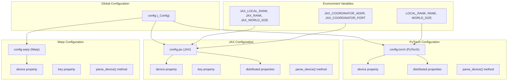
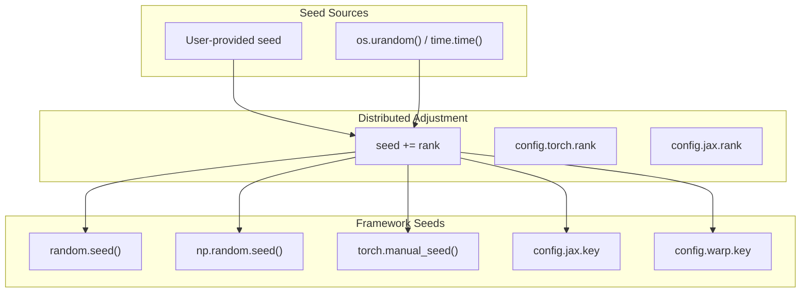
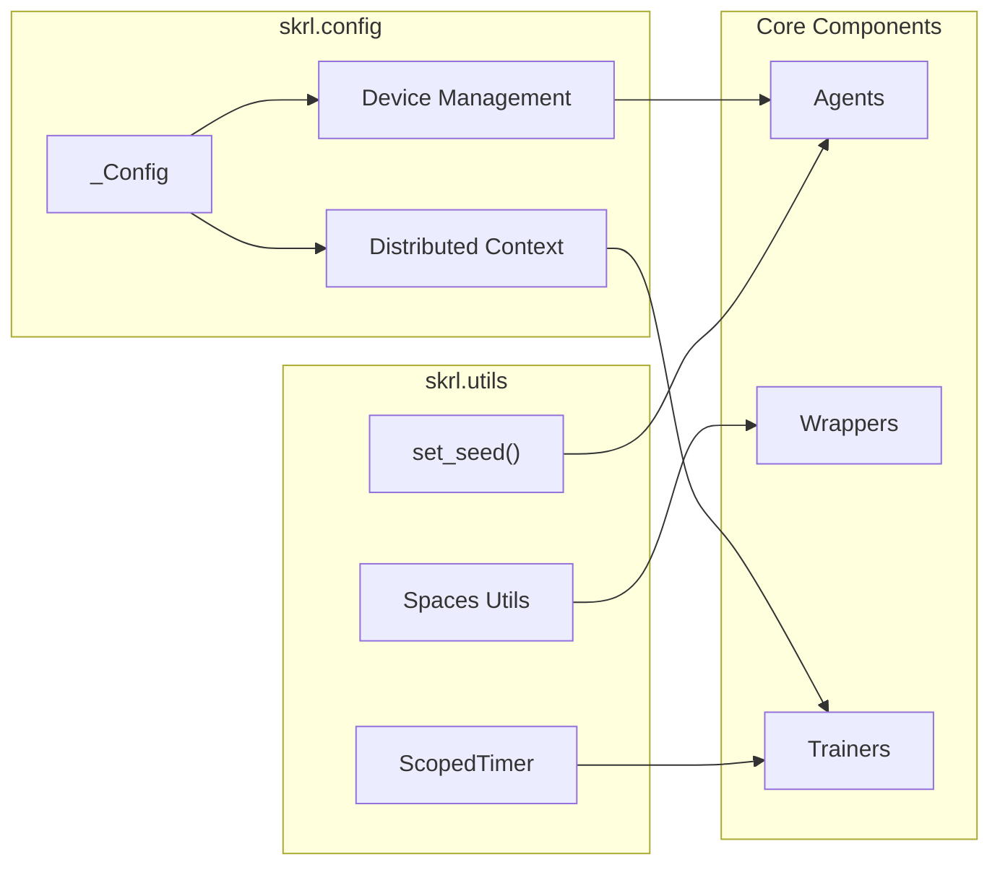

<!-- source: DeepWiki mcp.deepwiki.com · repo Toni-SM/skrl · page 8 Configuration and Utilities · fetched 2026-10-30 -->

# Configuration and Utilities

Relevant source files

The following files were used as context for generating this wiki page:

- [.github/ISSUE_TEMPLATE/bug_report.yaml](.github/ISSUE_TEMPLATE/bug_report.yaml)
- [.pre-commit-config.yaml](.pre-commit-config.yaml)
- [CHANGELOG.md](CHANGELOG.md)
- [docs/source/api/config/frameworks.rst](docs/source/api/config/frameworks.rst)
- [docs/source/conf.py](docs/source/conf.py)
- [pyproject.toml](pyproject.toml)
- [skrl/__init__.py](skrl/__init__.py)
- [skrl/envs/wrappers/jax/gym_envs.py](skrl/envs/wrappers/jax/gym_envs.py)
- [skrl/envs/wrappers/jax/gymnasium_envs.py](skrl/envs/wrappers/jax/gymnasium_envs.py)
- [skrl/envs/wrappers/jax/pettingzoo_envs.py](skrl/envs/wrappers/jax/pettingzoo_envs.py)
- [skrl/envs/wrappers/torch/gym_envs.py](skrl/envs/wrappers/torch/gym_envs.py)
- [skrl/envs/wrappers/torch/gymnasium_envs.py](skrl/envs/wrappers/torch/gymnasium_envs.py)
- [skrl/envs/wrappers/torch/pettingzoo_envs.py](skrl/envs/wrappers/torch/pettingzoo_envs.py)
- [skrl/envs/wrappers/warp/gymnasium_envs.py](skrl/envs/wrappers/warp/gymnasium_envs.py)
- [skrl/utils/__init__.py](skrl/utils/__init__.py)

This document covers skrl's configuration system and utility functions that support the core reinforcement learning functionality. The configuration system manages device selection, distributed training setup, and framework-specific settings for PyTorch, JAX, and Warp backends. The utilities provide helper functions for random seed management, data processing, and specialized simulation support.

For information about the Runner system that orchestrates complete RL experiments, see [Runner System](#8.2). For details about environment wrappers that use the configuration system, see [Environment Wrappers](#4.1).

## Configuration System

The configuration system provides a unified interface for managing framework-specific settings, device selection, and distributed training parameters. It is accessible through the global `config` object defined in [skrl/__init__.py:47-360]().

### Framework Configuration Architecture

Sources: [skrl/__init__.py:47-360]()

### Framework Specifics

The configuration system supports three primary backends, each managing its own device state and PRNG keys.

| Framework | Device Property | Key Type | Distributed Detection |
|-----------|-----------------|----------|-----------------------|
| **PyTorch** | `torch.device` | `int` | `RANK`, `WORLD_SIZE` |
| **JAX** | `jax.Device` | `jax.Array` | `JAX_RANK`, `JAX_WORLD_SIZE` |
| **Warp** | `warp.Device` | `int` | N/A |

Each configuration class implements a `parse_device()` static method to normalize strings or objects into framework-specific device instances [skrl/__init__.py:74-105](), [skrl/__init__.py:199-231]().

For details, see [Configuration System](#8.1).

## Runner System

The Runner system is a high-level utility for orchestrating complete RL experiments from configuration files (YAML) or dictionaries. It automates the instantiation of agents, models, and trainers.

| Runner Implementation | File Path | Purpose |
|-----------------------|-----------|---------|
| `Runner` (PyTorch) | `skrl/utils/runner/torch.py` | Standard PyTorch experiment runner |
| `Runner` (JAX) | `skrl/utils/runner/jax.py` | JIT-optimized JAX experiment runner |
| `Runner` (Warp) | `skrl/utils/runner/warp.py` | NVIDIA Warp kernel-based runner |

For details, see [Runner System](#8.2).

## Utility Functions

The utility functions provide essential support functionality across the library, organized into several categories.

### Seed Management

The `set_seed()` function provides comprehensive random seed management across all supported frameworks and distributed environments [skrl/utils/__init__.py:13-116]().

The function handles distributed training by automatically incrementing seeds based on process rank, ensuring different random streams across workers while maintaining reproducibility [skrl/utils/__init__.py:76-81]().

Sources: [skrl/utils/__init__.py:13-116]()

### Space Utilities

Introduced in version 1.4.0, these utilities operate on Gymnasium spaces (`Box`, `Discrete`, `MultiDiscrete`, `Tuple`, and `Dict`) to facilitate tensorization and flattening [CHANGELOG.md:88-91]().

- `tensorize_space`: Converts environment observations/actions to backend tensors.
- `flatten_tensorized_space`: Flattens complex spaces (like `Dict` or `Tuple`) into a single tensor for model input.
- `unflatten_tensorized_space`: Reverses flattening for environment compatibility.

These are used extensively in environment wrappers like `GymnasiumWrapper` [skrl/envs/wrappers/torch/gymnasium_envs.py:63-75]().

### Logging and Monitoring

skrl includes a custom `SummaryWriter` to log data to TensorBoard without relying on heavy third-party libraries [CHANGELOG.md:32](). Additionally, the `ScopedTimer` utility is used to measure and log execution time for agent updates and environment steps [skrl/utils/__init__.py:119-160]().

For details, see [Utilities](#8.3).

## Integration Summary

The configuration and utilities serve as the glue between the core RL components and the underlying ML frameworks.

Sources: [skrl/__init__.py:47-360](), [skrl/utils/__init__.py:13-160](), [skrl/envs/wrappers/torch/gymnasium_envs.py:11-16]()

---

