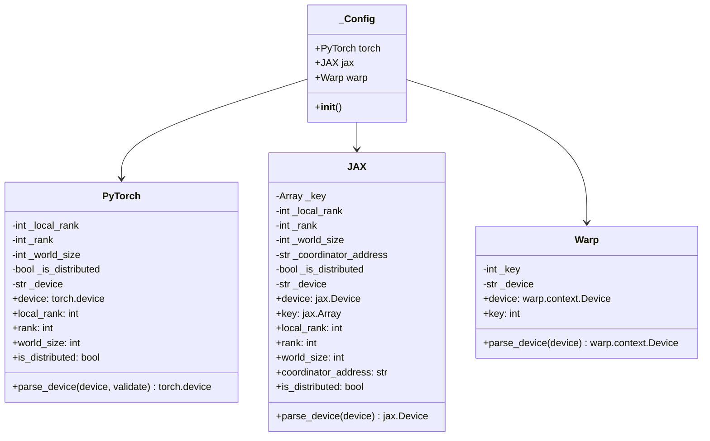

<!-- source: DeepWiki mcp.deepwiki.com · repo Toni-SM/skrl · page 8.1 Configuration System · fetched 2026-10-30 -->

# Configuration System

<details>
<summary>Relevant source files</summary>

The following files were used as context for generating this wiki page:

- [.github/ISSUE_TEMPLATE/bug_report.yaml](.github/ISSUE_TEMPLATE/bug_report.yaml)
- [.pre-commit-config.yaml](.pre-commit-config.yaml)
- [CHANGELOG.md](CHANGELOG.md)
- [docs/source/api/config/frameworks.rst](docs/source/api/config/frameworks.rst)
- [docs/source/conf.py](docs/source/conf.py)
- [pyproject.toml](pyproject.toml)
- [skrl/__init__.py](skrl/__init__.py)
- [skrl/agents/jax/base.py](skrl/agents/jax/base.py)
- [skrl/agents/torch/base.py](skrl/agents/torch/base.py)
- [skrl/agents/warp/base.py](skrl/agents/warp/base.py)
- [skrl/envs/wrappers/jax/gym_envs.py](skrl/envs/wrappers/jax/gym_envs.py)
- [skrl/envs/wrappers/jax/gymnasium_envs.py](skrl/envs/wrappers/jax/gymnasium_envs.py)
- [skrl/envs/wrappers/jax/pettingzoo_envs.py](skrl/envs/wrappers/jax/pettingzoo_envs.py)
- [skrl/envs/wrappers/torch/gym_envs.py](skrl/envs/wrappers/torch/gym_envs.py)
- [skrl/envs/wrappers/torch/gymnasium_envs.py](skrl/envs/wrappers/torch/gymnasium_envs.py)
- [skrl/envs/wrappers/torch/pettingzoo_envs.py](skrl/envs/wrappers/torch/pettingzoo_envs.py)
- [skrl/envs/wrappers/warp/gymnasium_envs.py](skrl/envs/wrappers/warp/gymnasium_envs.py)
- [skrl/multi_agents/jax/base.py](skrl/multi_agents/jax/base.py)
- [skrl/multi_agents/torch/base.py](skrl/multi_agents/torch/base.py)
- [skrl/utils/__init__.py](skrl/utils/__init__.py)

</details>


The Configuration System provides centralized management of machine learning framework settings, device allocation, and distributed training parameters for PyTorch, JAX, and Warp backends in skrl. This system handles framework-specific configurations, automatic device detection, and distributed training setup through environment variables.

For information about utility functions and general system configuration, see [Utilities](8.3). For details about the Runner system that uses these configurations, see [Runner System](8.2).

## Architecture Overview

The configuration system is built around a global `config` object that provides framework-specific configuration through the `_Config` class and its nested backend classes.

Title: skrl Configuration Hierarchy

```mermaid
graph TB
    subgraph "Global Configuration"
        Config["_Config"]
        GlobalConfig["config (global instance)"]
        Config --> GlobalConfig
    end
    
    subgraph "PyTorch Backend"
        PyTorchConfig["PyTorch"]
        TorchDevice["device: torch.device"]
        TorchDistrib["Distributed Config"]
        TorchRank["rank, local_rank, world_size"]
        TorchParser["parse_device()"]
        
        PyTorchConfig --> TorchDevice
        PyTorchConfig --> TorchDistrib
        PyTorchConfig --> TorchRank
        PyTorchConfig --> TorchParser
    end
    
    subgraph "JAX Backend"
        JAXConfig["JAX"]
        JAXDevice["device: jax.Device"]
        JAXDistrib["Distributed Config"]
        JAXRank["rank, local_rank, world_size"]
        JAXParser["parse_device()"]
        JAXKey["key: jax.Array (PRNG)"]
        
        JAXConfig --> JAXDevice
        JAXConfig --> JAXDistrib
        JAXConfig --> JAXRank
        JAXConfig --> JAXParser
        JAXConfig --> JAXKey
    end

    subgraph "Warp Backend"
        WarpConfig["Warp"]
        WarpDevice["device: warp.context.Device"]
        WarpKey["key: int"]
        WarpParser["parse_device()"]

        WarpConfig --> WarpDevice
        WarpConfig --> WarpKey
        WarpConfig --> WarpParser
    end
    
    subgraph "Environment Variables"
        TorchEnvVars["RANK, LOCAL_RANK, WORLD_SIZE"]
        JAXEnvVars["JAX_RANK, JAX_LOCAL_RANK, JAX_WORLD_SIZE<br/>JAX_COORDINATOR_ADDR, JAX_COORDINATOR_PORT"]
    end
    
    GlobalConfig --> PyTorchConfig
    GlobalConfig --> JAXConfig
    GlobalConfig --> WarpConfig
    
    TorchEnvVars --> TorchDistrib
    JAXEnvVars --> JAXDistrib
    
    subgraph "Component Usage"
        Wrappers["Environment Wrappers"]
        Agents["Agents"]
        Models["Models"]
        Trainers["Trainers"]
    end
    
    GlobalConfig --> Wrappers
    GlobalConfig --> Agents
    GlobalConfig --> Models
    GlobalConfig --> Trainers
```


**Sources:** [skrl/__init__.py:47-170](), [skrl/agents/torch/base.py:113](), [skrl/agents/jax/base.py:114]()

## Configuration Class Structure

The configuration system is implemented through a hierarchical class structure that separates framework-specific settings while providing a unified interface.

Title: skrl Config Entity Mapping


**Sources:** [skrl/__init__.py:47-230](), [docs/source/api/config/frameworks.rst:1-168]()

## PyTorch Configuration

The PyTorch configuration handles device management and distributed training setup using standard PyTorch distributed environment variables.

### Device Management

The `PyTorch` class provides automatic device detection and parsing functionality through the `parse_device` method [skrl/__init__.py:74-105](). The default device is determined by CUDA availability and distributed training context.

| Property | Type | Default | Description |
|----------|------|---------|-------------|
| `device` | `torch.device` | `cuda:0` or `cpu` | Default device, uses `cuda:LOCAL_RANK` in distributed mode [skrl/__init__.py:108-115]() |
| `parse_device()` | Method | - | Parses device specifications with validation [skrl/__init__.py:74-105]() |

### Distributed Training

Distributed training configuration is automatically initialized based on environment variables [skrl/__init__.py:56-71]():

| Property | Environment Variable | Default | Description |
|----------|---------------------|---------|-------------|
| `local_rank` | `LOCAL_RANK` | 0 | Rank within local worker group [skrl/__init__.py:131-138]() |
| `rank` | `RANK` | 0 | Global rank across all workers [skrl/__init__.py:141-148]() |
| `world_size` | `WORLD_SIZE` | 1 | Total number of workers [skrl/__init__.py:151-158]() |
| `is_distributed` | - | `False` | Computed as `world_size > 1` [skrl/__init__.py:161-168]() |

When `world_size > 1`, the system automatically initializes `torch.distributed` with the NCCL backend [skrl/__init__.py:64-71]().

**Sources:** [skrl/__init__.py:51-169](), [docs/source/api/config/frameworks.rst:13-75]()

## JAX Configuration

The JAX configuration provides PRNG key management and custom distributed training setup.

### PRNG Key Management

The JAX backend manages pseudo-random number generation through a global key [skrl/__init__.py:173](). The key is initialized as a 32-bit unsigned integer array `[0, 0]` [skrl/__init__.py:173]().

### Distributed Training

JAX distributed training uses custom environment variables since JAX requires explicit process management [skrl/__init__.py:177-182]():

| Property | Environment Variable | Default | Description |
|----------|---------------------|---------|-------------|
| `local_rank` | `JAX_LOCAL_RANK` | 0 | Local rank within node [docs/source/api/config/frameworks.rst:99-107]() |
| `rank` | `JAX_RANK` | 0 | Global process rank [docs/source/api/config/frameworks.rst:109-117]() |
| `world_size` | `JAX_WORLD_SIZE` | 1 | Total number of processes [docs/source/api/config/frameworks.rst:119-127]() |
| `coordinator_address` | `JAX_COORDINATOR_ADDR:JAX_COORDINATOR_PORT` | `127.0.0.1:1234` | Coordinator service address [docs/source/api/config/frameworks.rst:129-137]() |

**Sources:** [skrl/__init__.py:170-210](), [docs/source/api/config/frameworks.rst:77-149]()

## Experiment Configuration

The library uses the `ExperimentCfg` dataclass to manage logging and checkpointing settings for agents.

| Parameter | Type | Default | Description |
|-----------|------|---------|-------------|
| `directory` | `str` | `""` | Root path for run data [skrl/agents/torch/base.py:27-28]() |
| `experiment_name` | `str` | `""` | Unique run identifier [skrl/agents/torch/base.py:30-34]() |
| `write_interval` | `int \| "auto"` | `"auto"` | TensorBoard logging frequency [skrl/agents/torch/base.py:36-41]() |
| `checkpoint_interval` | `int \| "auto"` | `"auto"` | Checkpoint saving frequency [skrl/agents/torch/base.py:43-48]() |
| `wandb` | `bool` | `False` | Enable Weights & Biases logging [skrl/agents/torch/base.py:57-58]() |

### Logging and Visualization
- **TensorBoard**: Managed via `skrl.utils.tensorboard.SummaryWriter` [skrl/agents/torch/base.py:20]().
- **Weights & Biases**: Integrated via `wandb_kwargs` in `ExperimentCfg` [skrl/agents/torch/base.py:60-64]().
- **Interval Handling**: If set to `"auto"`, `write_interval` defaults to 100 samples and `checkpoint_interval` to 10 samples throughout training [skrl/agents/torch/base.py:36-48]().

**Sources:** [skrl/agents/torch/base.py:23-65](), [skrl/agents/jax/base.py:24-66]()

## Device Management Integration

The configuration system integrates with environment wrappers and agents to provide consistent device handling across the library.

Title: Device Resolution Logic


**Sources:** [skrl/agents/torch/base.py:113](), [skrl/envs/wrappers/jax/gymnasium_envs.py:28](), [skrl/multi_agents/torch/base.py:130]()

## Usage Patterns

### Distributed Detection
Agents automatically adjust logging behavior in distributed environments to prevent duplicate outputs [skrl/agents/torch/base.py:200-201]():
```python
# From skrl/agents/torch/base.py
if config.torch.is_distributed and config.torch.rank:
    self.write_interval = 0
    self.checkpoint_interval = 0
```

### PRNG Seeding
The `skrl.utils.set_seed` function synchronizes seeds across all backends and ensures distributed processes have unique offsets [skrl/utils/__init__.py:76-80]():
```python
# From skrl/utils/__init__.py
if config.torch.is_distributed:
    seed += config.torch.rank
if config.jax.is_distributed:
    seed += config.jax.rank
```

**Sources:** [skrl/agents/torch/base.py:199-201](), [skrl/utils/__init__.py:13-116]()

---

