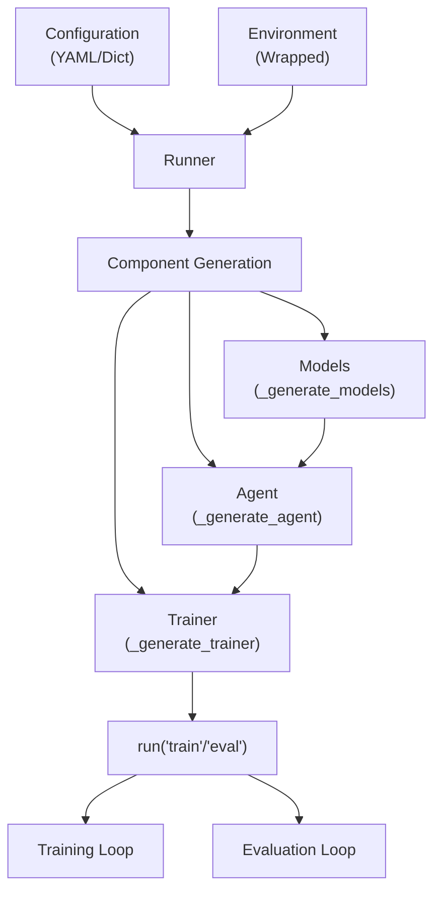
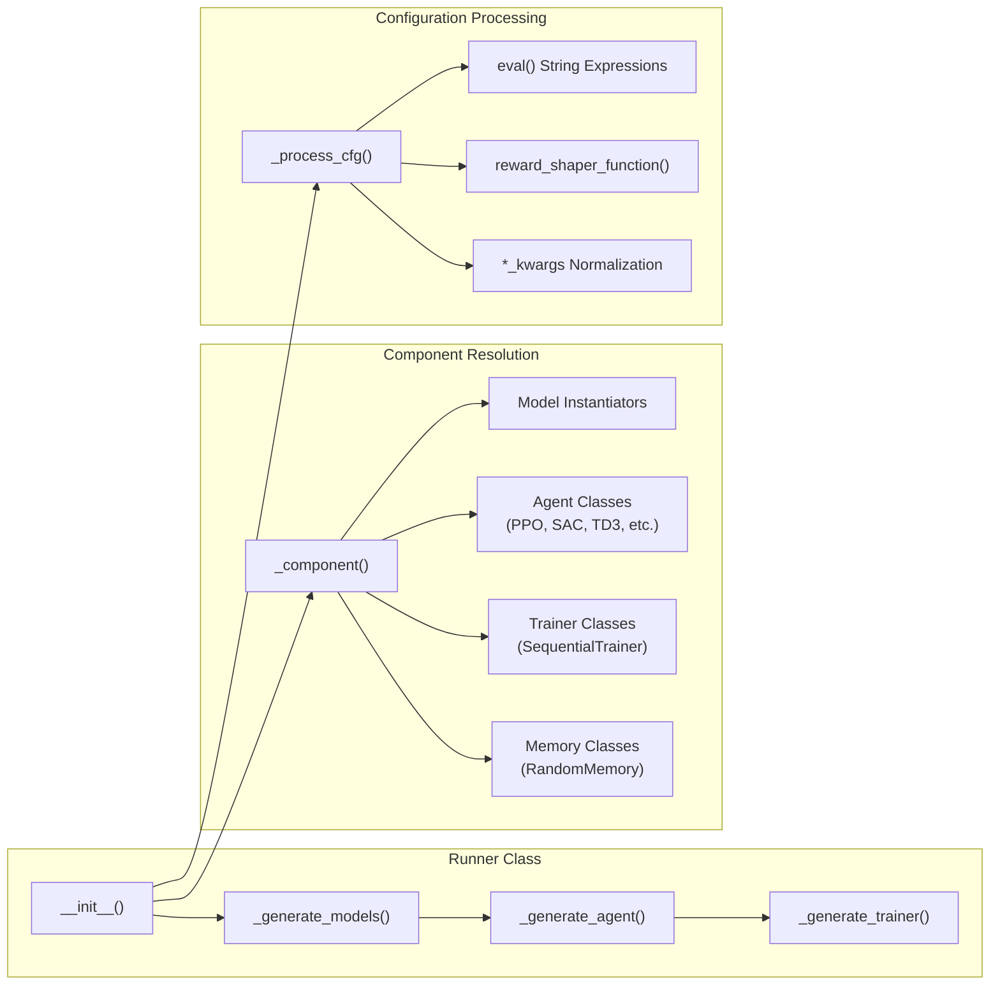
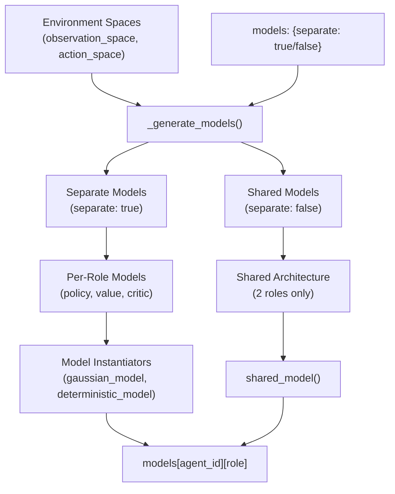
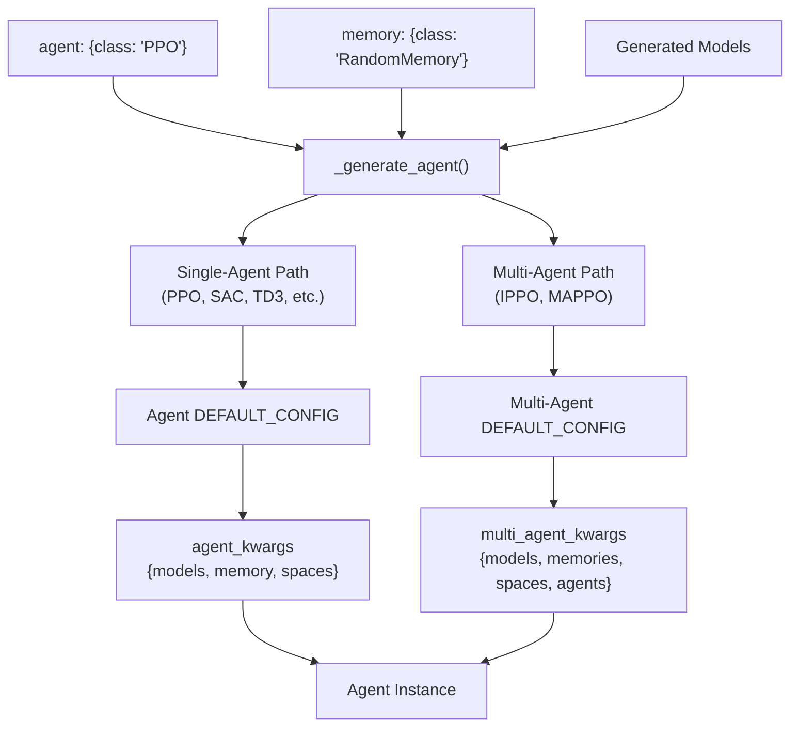
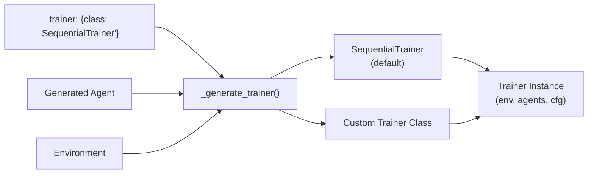
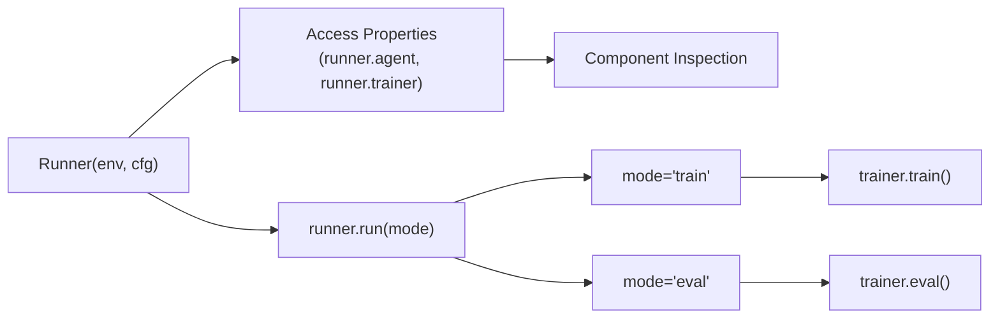

<!-- source: DeepWiki mcp.deepwiki.com · repo Toni-SM/skrl · page 8.2 Runner System · fetched 2026-10-30 -->

# Runner System

Relevant source files

The following files were used as context for generating this wiki page:

- [docs/source/api/utils/runner.rst](docs/source/api/utils/runner.rst)
- [docs/source/snippets/runner.txt](docs/source/snippets/runner.txt)
- [skrl/models/warp/base.py](skrl/models/warp/base.py)
- [skrl/utils/runner/__init__.py](skrl/utils/runner/__init__.py)
- [skrl/utils/runner/jax/__init__.py](skrl/utils/runner/jax/__init__.py)
- [skrl/utils/runner/jax/runner.py](skrl/utils/runner/jax/runner.py)
- [skrl/utils/runner/torch/__init__.py](skrl/utils/runner/torch/__init__.py)
- [skrl/utils/runner/torch/runner.py](skrl/utils/runner/torch/runner.py)
- [skrl/utils/runner/warp/__init__.py](skrl/utils/runner/warp/__init__.py)
- [skrl/utils/runner/warp/runner.py](skrl/utils/runner/warp/runner.py)

The Runner System provides a high-level orchestration utility that automatically configures and instantiates skrl components from configuration files to execute complete reinforcement learning experiments. It serves as the primary entry point for users who want to train RL agents without manually instantiating models, agents, and trainers.

For information about the underlying configuration system, see [Configuration System](#8.1). For details about model instantiation, see [Model Instantiators](#3.3). For trainer implementation details, see [Trainers](#5).

## Overview

The Runner System bridges the gap between high-level experiment configuration and low-level component instantiation. It takes an environment and configuration dictionary as input, then automatically generates and connects the necessary models, agents, memories, and trainers to execute training or evaluation workflows.

Sources: [skrl/utils/runner/torch/runner.py:20-42](), [skrl/utils/runner/jax/runner.py:20-42](), [skrl/utils/runner/warp/runner.py:21-42]()

## Core Architecture

The Runner System implements a three-stage generation pipeline that transforms configuration specifications into executable training workflows. PyTorch, JAX, and Warp backends follow identical interfaces with backend-specific implementations.

Sources: [skrl/utils/runner/torch/runner.py:20-42](), [skrl/utils/runner/jax/runner.py:20-42](), [skrl/utils/runner/warp/runner.py:21-42]()

## Component Generation Process

### Model Generation

The `_generate_models()` method creates neural network models based on configuration specifications and environment characteristics. It supports both separate and shared model architectures.

| Configuration Key | Purpose | Required |
|-------------------|---------|----------|
| `models.separate` | Whether to create separate models for each role | Yes |
| `models.<role>.class` | Model instantiator identifier (e.g., "GaussianMixin") | Yes |
| `models.<role>.<param>` | Model-specific parameters | Varies |

Sources: [skrl/utils/runner/torch/runner.py:192-317](), [skrl/utils/runner/jax/runner.py:180-266](), [skrl/utils/runner/warp/runner.py:176-249]()

### Agent Generation

The `_generate_agent()` method instantiates RL agents with appropriate configurations for single-agent and multi-agent scenarios. It handles memory instantiation and preprocessor configuration automatically.

The system supports specialized configurations for specific agents:

| Agent Type | Special Handling |
|------------|------------------|
| AMP | Requires `amp_observation_space`, motion dataset, and replay buffer [skrl/utils/runner/torch/runner.py:383-399]() |
| MAPPO | Uses shared observation spaces for value function [skrl/utils/runner/torch/runner.py:448-453]() |
| Standard | Basic configuration with preprocessors and noise |

Sources: [skrl/utils/runner/torch/runner.py:319-467](), [skrl/utils/runner/jax/runner.py:268-372](), [skrl/utils/runner/warp/runner.py:251-318]()

### Trainer Generation

The `_generate_trainer()` method creates trainer instances that orchestrate the training loop between agents and environments.

Sources: [skrl/utils/runner/torch/runner.py:469-488](), [skrl/utils/runner/jax/runner.py:374-393](), [skrl/utils/runner/warp/runner.py:320-339]()

## Configuration System Integration

The Runner System processes configuration dictionaries through several transformation steps to convert high-level specifications into component-ready parameters.

### Configuration Compatibility
The `_check_cfg_compatibility` method ensures backward compatibility by renaming deprecated fields:
*   `lambda` is renamed to `gae_lambda` [skrl/utils/runner/torch/runner.py:81-85]().
*   `clip_predicted_values` is converted to `value_clip` [skrl/utils/runner/torch/runner.py:87-94]().
*   `state_preprocessor` is replaced by `observation_preprocessor` [skrl/utils/runner/torch/runner.py:96-107]().

### Component Resolution

The `_component()` method maps string identifiers to actual classes, supporting:

| Component Type | Supported Classes |
|----------------|-------------------|
| Models | `GaussianMixin`, `CategoricalMixin`, `DeterministicMixin`, `Shared` |
| Agents | `PPO`, `SAC`, `TD3`, `DDPG`, `A2C`, `DQN`, `CEM`, `TRPO`, `RPO` |
| Multi-Agents | `IPPO`, `MAPPO` |
| Memories | `RandomMemory` |
| Trainers | `SequentialTrainer` |

Sources: [skrl/utils/runner/torch/runner.py:120-190](), [skrl/utils/runner/jax/runner.py:120-178](), [skrl/utils/runner/warp/runner.py:121-154]()

## Warp Model Base Class

The Warp backend introduces a specialized `Model` base class inheriting from `warp_nn.nn.Module` [skrl/models/warp/base.py:26]().

*   **Lazy Initialization**: `init_state_dict` handles parameter initialization for lazy modules using environment space samples [skrl/models/warp/base.py:54-92]().
*   **Polyak Averaging**: Implements target network updates via the `@wp.kernel` `_polyak_averaging` [skrl/models/warp/base.py:17-23]().
*   **Space Handling**: Automatically computes space sizes for observations, states, and actions [skrl/models/warp/base.py:48-50]().

Sources: [skrl/models/warp/base.py:16-53]()

## Usage Interface

The Runner System provides a simple three-method interface for experiment execution:

### Basic Usage Pattern

### Configuration Loading

| Method | Purpose | Parameters |
|--------|---------|------------|
| `load_cfg_from_yaml(path)` | Load configuration from YAML file | `path`: File path to configuration [skrl/utils/runner/torch/runner.py:54-72]() |
| `run(mode)` | Execute training or evaluation | `mode`: `"train"` or `"eval"` [skrl/utils/runner/torch/runner.py:490-502]() |

Sources: [skrl/utils/runner/torch/runner.py:43-72](), [skrl/utils/runner/torch/runner.py:490-502]()

## Backend Differences

While all runners share identical interfaces, they have implementation differences based on backend capabilities:

| Feature | PyTorch | JAX | Warp |
|---------|---------|-----|------|
| Shared Models | Supported | Not supported | Supported |
| Multi-Agent | IPPO, MAPPO | IPPO, MAPPO | Not supported |
| Trainer Support | Sequential, Parallel | Sequential | Sequential |
| Noise Classes | Gaussian, OU | Gaussian, OU | Gaussian, OU |

Sources: [skrl/utils/runner/torch/runner.py:120-190](), [skrl/utils/runner/jax/runner.py:120-178](), [skrl/utils/runner/warp/runner.py:121-154]()

---

