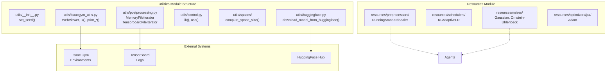

<!-- source: DeepWiki mcp.deepwiki.com · repo Toni-SM/skrl · page 8.3 Utilities · fetched 2026-10-30 -->

# Utilities

Relevant source files

The following files were used as context for generating this wiki page:

- [docs/source/api/resources.rst](docs/source/api/resources.rst)
- [docs/source/api/resources/noises/gaussian.rst](docs/source/api/resources/noises/gaussian.rst)
- [docs/source/api/resources/noises/ornstein_uhlenbeck.rst](docs/source/api/resources/noises/ornstein_uhlenbeck.rst)
- [docs/source/api/resources/preprocessors.rst](docs/source/api/resources/preprocessors.rst)
- [docs/source/api/resources/preprocessors/running_standard_scaler.rst](docs/source/api/resources/preprocessors/running_standard_scaler.rst)
- [docs/source/api/resources/schedulers.rst](docs/source/api/resources/schedulers.rst)
- [docs/source/api/resources/schedulers/kl_adaptive.rst](docs/source/api/resources/schedulers/kl_adaptive.rst)
- [skrl/resources/__init__.py](skrl/resources/__init__.py)
- [skrl/resources/noises/__init__.py](skrl/resources/noises/__init__.py)
- [skrl/resources/noises/jax/__init__.py](skrl/resources/noises/jax/__init__.py)
- [skrl/resources/noises/jax/base.py](skrl/resources/noises/jax/base.py)
- [skrl/resources/noises/jax/gaussian.py](skrl/resources/noises/jax/gaussian.py)
- [skrl/resources/noises/jax/ornstein_uhlenbeck.py](skrl/resources/noises/jax/ornstein_uhlenbeck.py)
- [skrl/resources/noises/torch/__init__.py](skrl/resources/noises/torch/__init__.py)
- [skrl/resources/noises/torch/base.py](skrl/resources/noises/torch/base.py)
- [skrl/resources/noises/torch/gaussian.py](skrl/resources/noises/torch/gaussian.py)
- [skrl/resources/noises/torch/ornstein_uhlenbeck.py](skrl/resources/noises/torch/ornstein_uhlenbeck.py)
- [skrl/resources/optimizers/__init__.py](skrl/resources/optimizers/__init__.py)
- [skrl/resources/optimizers/jax/__init__.py](skrl/resources/optimizers/jax/__init__.py)
- [skrl/resources/optimizers/jax/adam.py](skrl/resources/optimizers/jax/adam.py)
- [skrl/resources/preprocessors/jax/running_standard_scaler.py](skrl/resources/preprocessors/jax/running_standard_scaler.py)
- [skrl/resources/preprocessors/torch/running_standard_scaler.py](skrl/resources/preprocessors/torch/running_standard_scaler.py)
- [skrl/resources/schedulers/__init__.py](skrl/resources/schedulers/__init__.py)
- [skrl/resources/schedulers/jax/__init__.py](skrl/resources/schedulers/jax/__init__.py)
- [skrl/resources/schedulers/jax/kl_adaptive.py](skrl/resources/schedulers/jax/kl_adaptive.py)
- [skrl/resources/schedulers/torch/__init__.py](skrl/resources/schedulers/torch/__init__.py)
- [skrl/resources/schedulers/torch/kl_adaptive.py](skrl/resources/schedulers/torch/kl_adaptive.py)
- [skrl/utils/framework/warp/ops.py](skrl/utils/framework/warp/ops.py)
- [skrl/utils/huggingface.py](skrl/utils/huggingface.py)
- [skrl/utils/postprocessing.py](skrl/utils/postprocessing.py)
- [skrl/utils/spaces/jax/spaces.py](skrl/utils/spaces/jax/spaces.py)
- [skrl/utils/spaces/torch/spaces.py](skrl/utils/spaces/torch/spaces.py)

The utilities system provides supporting functions and classes that complement the core RL components of skrl. These utilities cover essential functionality including random number generator seeding, Isaac Gym integration tools, data post-processing capabilities, and robotics control algorithms. Furthermore, it includes the **Resources** sub-module, which provides noises, schedulers, preprocessors, and optimizers across PyTorch, JAX, and Warp backends.

## Overview

The utilities are organized into several focused modules that serve different aspects of the RL workflow:

Sources: [skrl/utils/__init__.py:1-113](), [skrl/utils/postprocessing.py:1-177](), [skrl/resources/preprocessors/torch/running_standard_scaler.py:12-50](), [skrl/resources/noises/jax/gaussian.py:20-38]()

## Resources

Resources are components designed to improve agent performance through data normalization, exploration noise, and adaptive optimization.

### Preprocessors: RunningStandardScaler
The `RunningStandardScaler` standardizes input data (typically observations) by removing the mean and scaling by the standard deviation. It uses a parallel algorithm for computing variance to handle batch updates efficiently [skrl/resources/preprocessors/torch/running_standard_scaler.py:50-58]().

| Feature | Description |
|:---|:---|
| **Standardization** | $\text{clip}((x - \bar{x}_t) / (\sqrt{\sigma^2} + \epsilon), -c, c)$ [skrl/resources/preprocessors/jax/running_standard_scaler.py:53-57]() |
| **Inverse** | Scales data back to original representation [skrl/resources/preprocessors/torch/running_standard_scaler.py:88-93]() |
| **Backends** | Supported in PyTorch, JAX, and Warp [docs/source/api/resources.rst:47-54]() |

### Noises
Exploration noises are primarily used for off-policy algorithms like DDPG and TD3.
- **GaussianNoise**: Samples from a normal distribution [skrl/resources/noises/jax/gaussian.py:20-31]().
- **OrnsteinUhlenbeckNoise**: Implements a mean-reverting process, useful for temporally correlated exploration [skrl/resources/noises/jax/ornstein_uhlenbeck.py:20-43]().

### Schedulers: KLAdaptiveLR
The `KLAdaptiveLR` adjusts the learning rate according to the KL divergence between old and new policies. It is specifically designed for algorithms like PPO and A2C [skrl/resources/schedulers/torch/kl_adaptive.py:26-30]().
- If $KL > threshold \times factor$, the learning rate is decreased [skrl/resources/schedulers/torch/kl_adaptive.py:82-83]().
- If $KL < threshold / factor$, the learning rate is increased [skrl/resources/schedulers/torch/kl_adaptive.py:84-85]().

### Optimizers (JAX)
While PyTorch uses standard `torch.optim` classes, skrl provides a custom `Adam` wrapper for JAX to integrate with the library's `Model` state management. It wraps `optax` transformations and supports custom scaling (learning rate) during optimization steps [skrl/resources/optimizers/jax/adam.py:34-60]().

Sources: [skrl/resources/preprocessors/torch/running_standard_scaler.py:12-136](), [skrl/resources/noises/jax/gaussian.py:20-60](), [skrl/resources/schedulers/torch/kl_adaptive.py:9-87](), [skrl/resources/optimizers/jax/adam.py:34-106]()

## Random Number Generator Seeding

The core seeding functionality ensures reproducible experiments across different ML frameworks and distributed training scenarios.

### set_seed Function
The `set_seed()` function provides centralized random number generator seeding with support for both PyTorch and JAX backends. It handles distributed training by incrementing the seed based on process rank and supports deterministic operations through PyTorch's deterministic algorithms.

Sources: [skrl/utils/__init__.py:13-112]()

## Data Post-Processing Utilities

### Memory File Iterator
The `MemoryFileIterator` class provides iteration over exported memory files in multiple formats (.pt, .npz, .csv) [skrl/utils/postprocessing.py:15-38](). It automatically handles the underlying data structure (Tensors for PyTorch, Ndarrays for NumPy) [skrl/utils/postprocessing.py:54-61]().

### TensorBoard File Iterator
The `TensorboardFileIterator` class extracts specific metrics from TensorBoard event files by filtering for provided tags [skrl/utils/postprocessing.py:126-140]().

Sources: [skrl/utils/postprocessing.py:15-177]()

## Isaac Gym and Control Utilities

### Isaac Gym Integration
The library provides tools to bridge skrl with NVIDIA Isaac Gym:
- **WebViewer**: A Flask-based server for remote visualization of simulation frames [skrl/utils/isaacgym_utils.py:28-386]().
- **Debug Printing**: Functions to inspect DOF properties, actor components, and simulation metadata [skrl/utils/isaacgym_utils.py:440-569]().

### Control
Robotics-specific control utilities include:
- **Inverse Kinematics (ik)**: Damped least squares implementation for mapping end-effector targets to joint space [skrl/utils/control.py:1-25]().
- **Operational Space Control (osc)**: Computes joint torques for operational space tasks [skrl/utils/control.py:27-56]().

## Space Utilities
The library includes utilities to handle observation and action spaces across backends. The `compute_space_size` function is used internally by preprocessors and agents to determine the flat or multidimensional size of a `gymnasium.Space` [skrl/resources/preprocessors/torch/running_standard_scaler.py:44]().

Sources: [skrl/utils/isaacgym_utils.py:28-569](), [skrl/utils/control.py:1-56](), [skrl/resources/preprocessors/torch/running_standard_scaler.py:44]()

---

