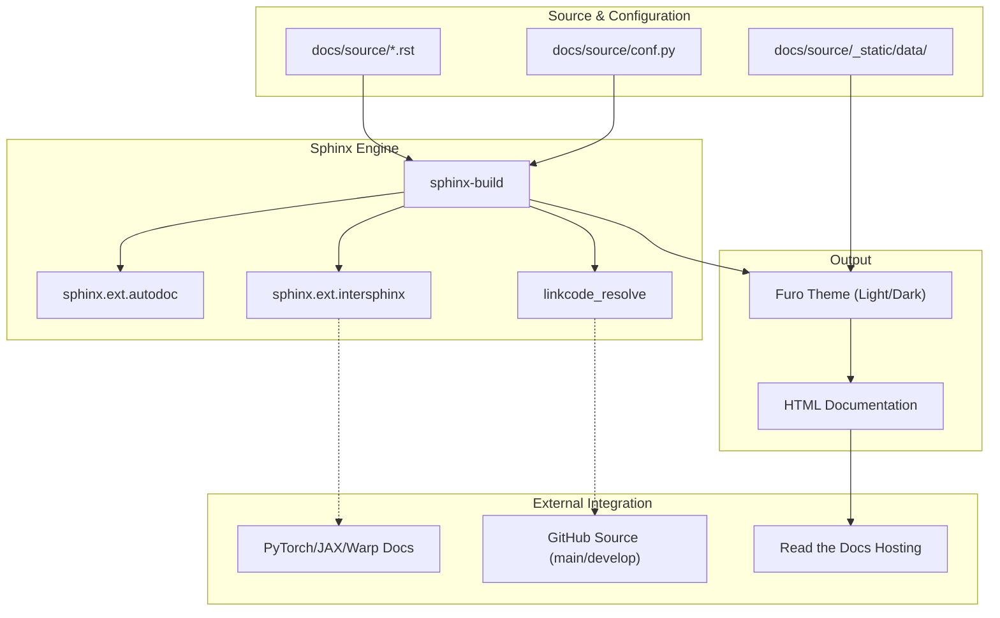
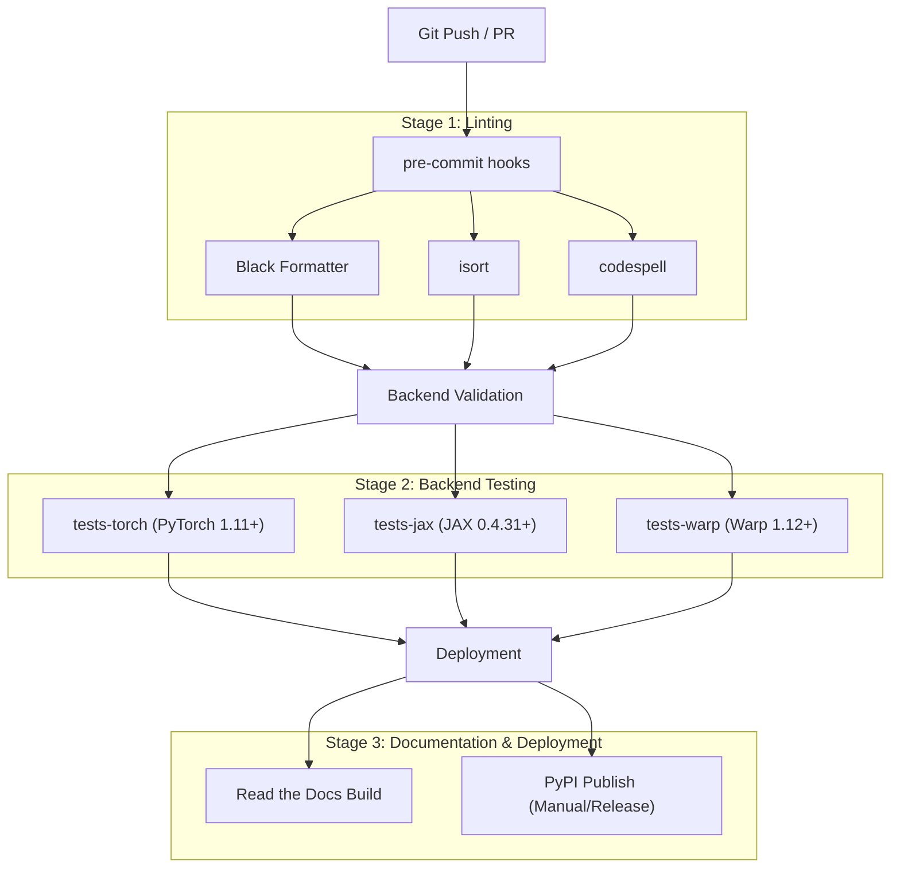

<!-- source: DeepWiki mcp.deepwiki.com · repo Toni-SM/skrl · page 9 Documentation System · fetched 2026-10-30 -->

# Documentation System

Relevant source files

The following files were used as context for generating this wiki page:

- [.github/GITHUB_ACTIONS.md](.github/GITHUB_ACTIONS.md)
- [.github/ISSUE_TEMPLATE/bug_report.yaml](.github/ISSUE_TEMPLATE/bug_report.yaml)
- [.github/workflows/pre-commit.yml](.github/workflows/pre-commit.yml)
- [.github/workflows/python-publish-manual.yml](.github/workflows/python-publish-manual.yml)
- [.github/workflows/tests-jax.yml](.github/workflows/tests-jax.yml)
- [.github/workflows/tests-torch.yml](.github/workflows/tests-torch.yml)
- [.github/workflows/tests-warp.yml](.github/workflows/tests-warp.yml)
- [.pre-commit-config.yaml](.pre-commit-config.yaml)
- [.readthedocs.yaml](.readthedocs.yaml)
- [CHANGELOG.md](CHANGELOG.md)
- [CONTRIBUTING.md](CONTRIBUTING.md)
- [docs/Makefile](docs/Makefile)
- [docs/README.md](docs/README.md)
- [docs/make.bat](docs/make.bat)
- [docs/requirements.txt](docs/requirements.txt)
- [docs/source/404.rst](docs/source/404.rst)
- [docs/source/conf.py](docs/source/conf.py)
- [pyproject.toml](pyproject.toml)

## Purpose

The skrl documentation system is a sophisticated infrastructure built on Sphinx and Read the Docs, designed to maintain high-quality API documentation and user guides. It integrates automated source code linking to GitHub, cross-referencing with external libraries (Intersphinx), and rigorous quality control through pre-commit hooks and CI/CD workflows.

## Documentation Architecture

The system utilizes Sphinx as the core engine, configured to process reStructuredText (RST) files and docstrings into a responsive HTML interface using the Furo theme.

Sources: [docs/source/conf.py:28-39](), [docs/source/conf.py:97-123](), [.readthedocs.yaml:1-26]()

## Sphinx Configuration (`conf.py`)

The `conf.py` file orchestrates the documentation build process, defining project metadata, extensions, and custom logic for source linking.

### Project Metadata and Theme
The project identifies itself as `skrl` and dynamically retrieves the version from the library itself [docs/source/conf.py:15-23](). It uses the `furo` theme with custom CSS and brand colors (#FF4800 for light mode, #EAA000 for dark mode) [docs/source/conf.py:97-123]().

### Core Extensions
The documentation leverages several powerful extensions:
*   `autodoc` & `autosummary`: Automatically generate documentation from Python docstrings [docs/source/conf.py:32-33]().
*   `intersphinx`: Generates links to external project documentation (e.g., PyTorch, JAX, Warp) [docs/source/conf.py:42-52]().
*   `sphinx_tabs`: Provides tabbed interfaces for multi-backend examples [docs/source/conf.py:36]().
*   `sphinx_copybutton`: Adds "copy" buttons to code snippets [docs/source/conf.py:37]().

### Source Code Linking (`linkcode_resolve`)
A custom `linkcode_resolve` function maps documentation entities directly to their source code on GitHub. It uses `inspect` to find the file and line numbers of Python objects and constructs a URL pointing to the specific lines in the `main` or `develop` branch [docs/source/conf.py:168-190]().

Sources: [docs/source/conf.py:15-52](), [docs/source/conf.py:97-123](), [docs/source/conf.py:168-190]()

## Quality Control and CI/CD

Documentation quality is maintained through a multi-layered approach involving local hooks, automated testing, and standardized publishing.

### Pre-commit Hooks
Before code is committed, several hooks ensure stylistic and structural integrity:
*   **Black**: Enforces a 120-character line length for code consistency [pyproject.toml:75-81]().
*   **isort**: Standardizes import sorting, with specific sections for frameworks like `torch`, `jax`, and `warp` [pyproject.toml:91-122]().
*   **codespell**: Scans for common misspellings in the source and documentation [pyproject.toml:84-89]().

### Automated Testing (GitHub Actions)
The repository runs extensive test suites across different backends to ensure the library (and by extension, its documented behavior) remains functional:
*   `tests-torch.yml`: Validates PyTorch agents and environments [ .github/workflows/tests-torch.yml:1-32]().
*   `tests-jax.yml`: Validates JAX/Flax/Optax implementations [ .github/workflows/tests-jax.yml:1-31]().
*   `tests-warp.yml`: Validates NVIDIA Warp kernel-based agents [ .github/workflows/tests-warp.yml:1-31]().

### CI/CD Pipeline Flow

Sources: [.github/workflows/pre-commit.yml:1-33](), [.github/workflows/tests-torch.yml:1-32](), [.github/workflows/python-publish-manual.yml:1-71](), [pyproject.toml:31-52]()

## Read the Docs and Publishing

### Read the Docs Configuration
The `.readthedocs.yaml` file defines the build environment, using `ubuntu-24.04` and `Python 3.12` [.readthedocs.yaml:9-11](). It installs dependencies from `docs/requirements.txt`, which includes `furo`, `sphinx-tabs`, and `autodocsumm` [docs/requirements.txt:1-7]().

### PyPI Publishing
The project uses a manually triggered GitHub Action (`pypi (manually triggered workflow)`) to build and upload the package to PyPI or TestPyPI [.github/workflows/python-publish-manual.yml:1-9](). The process uses the `build` module and `pypa/gh-action-pypi-publish` with API tokens for security [.github/workflows/python-publish-manual.yml:34-42]().

Sources: [.readthedocs.yaml:1-26](), [docs/requirements.txt:1-9](), [.github/workflows/python-publish-manual.yml:1-71]()

## Build Commands

For local development, the documentation can be built using the provided `Makefile` or `make.bat`.

| Command | Action |
|:---|:---|
| `pip install -r docs/requirements.txt` | Install documentation dependencies [docs/README.md:7]() |
| `make html` | Generate a static HTML build in `docs/build/html` [docs/README.md:14]() |
| `sphinx-autobuild ./source/ _build/html` | Start a live-reloading server for documentation editing [docs/README.md:21]() |

Sources: [docs/README.md:1-27](), [docs/Makefile:1-20]()

---

