# Page: Overview

# Overview

<details>
<summary>Relevant source files</summary>

The following files were used as context for generating this wiki page:

- [.github/ISSUE_TEMPLATE/bug_report.yaml](.github/ISSUE_TEMPLATE/bug_report.yaml)
- [.pre-commit-config.yaml](.pre-commit-config.yaml)
- [CHANGELOG.md](CHANGELOG.md)
- [README.md](README.md)
- [docs/source/_static/imgs/data_tensorboard.jpg](docs/source/_static/imgs/data_tensorboard.jpg)
- [docs/source/_static/imgs/example_parallel.jpg](docs/source/_static/imgs/example_parallel.jpg)
- [docs/source/api/config/frameworks.rst](docs/source/api/config/frameworks.rst)
- [docs/source/conf.py](docs/source/conf.py)
- [docs/source/index.rst](docs/source/index.rst)
- [docs/source/intro/data.rst](docs/source/intro/data.rst)
- [docs/source/intro/examples.rst](docs/source/intro/examples.rst)
- [docs/source/intro/getting_started.rst](docs/source/intro/getting_started.rst)
- [docs/source/intro/installation.rst](docs/source/intro/installation.rst)
- [docs/source/snippets/data.py](docs/source/snippets/data.py)
- [pyproject.toml](pyproject.toml)
- [skrl/__init__.py](skrl/__init__.py)
- [skrl/envs/wrappers/jax/gym_envs.py](skrl/envs/wrappers/jax/gym_envs.py)
- [skrl/envs/wrappers/jax/gymnasium_envs.py](skrl/envs/wrappers/jax/gymnasium_envs.py)
- [skrl/envs/wrappers/jax/pettingzoo_envs.py](skrl/envs/wrappers/jax/pettingzoo_envs.py)
- [skrl/envs/wrappers/torch/gym_envs.py](skrl/envs/wrappers/torch/gym_envs.py)
- [skrl/envs/wrappers/torch/gymnasium_envs.py](skrl/envs/wrappers/torch/gymnasium_envs.py)
- [skrl/envs/wrappers/torch/pettingzoo_envs.py](skrl/envs/wrappers/torch/pettingzoo_envs.py)
- [skrl/envs/wrappers/warp/gymnasium_envs.py](skrl/envs/wrappers/warp/gymnasium_envs.py)
- [skrl/utils/__init__.py](skrl/utils/__init__.py)

</details>


This document provides an overview of the **skrl** reinforcement learning library architecture, core components, and design principles. It covers the high-level system structure, multi-backend support (PyTorch, JAX, and NVIDIA Warp), and how the major components interact to enable modular RL algorithm implementation.

For specific implementation details of individual components, see their respective documentation pages: [Installation and Setup](#1.1), [Quick Start](#1.2), Agents, Models, Environments, Trainers, Memories, and Multi-Agent Systems.

## Library Purpose and Design Philosophy

**skrl** is an open-source modular library for Reinforcement Learning written in Python and implemented in **PyTorch**, **JAX**, and **NVIDIA Warp**. It is designed with a focus on modularity, readability, simplicity, and transparency of algorithm implementation. The library provides a unified interface for various RL algorithms while supporting multiple ML frameworks and environment interfaces, including NVIDIA Isaac Lab and MuJoCo Playground.

**Core Design Principles:**
- **Modularity**: Components (Agents, Models, Memories, Trainers) can be mixed and matched independently [docs/source/intro/getting_started.rst:96-98]().
- **Multi-Backend Support**: Full implementations in PyTorch, JAX, and Warp with consistent APIs [docs/source/index.rst:37-39]().
- **Environment Agnostic**: Unified wrappers for diverse simulation platforms like Gymnasium, ManiSkill, and Isaac Lab [docs/source/index.rst:40-48]().
- **Algorithm Transparency**: Clean, readable implementations that avoid "hidden" templates [docs/source/intro/getting_started.rst:126-130]().

Sources: [docs/source/index.rst:37-58](), [README.md:24-35](), [pyproject.toml:4](), [skrl/__init__.py:47-50]()

## High-Level System Architecture

The library follows a layered architecture with clear separation between core components, environment integration, and backend implementations.

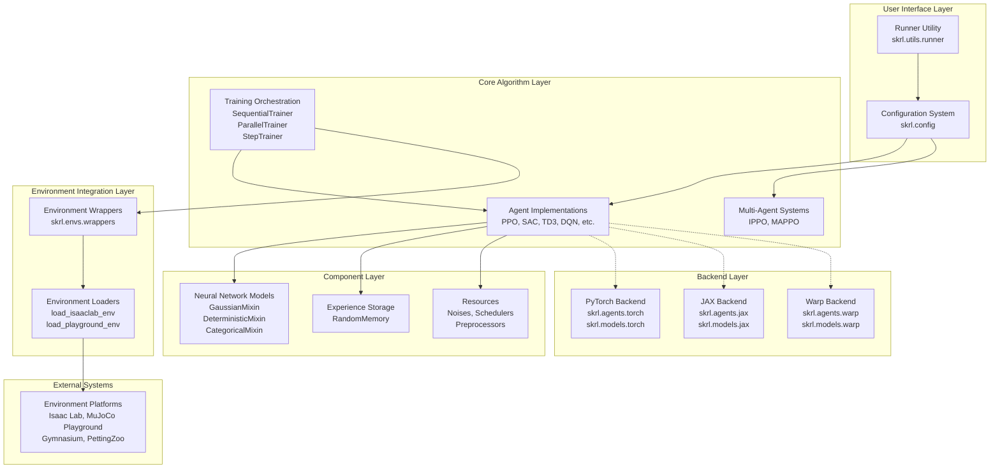

Sources: [docs/source/index.rst:101-211](), [docs/source/intro/getting_started.rst:44-124](), [pyproject.toml:30-52]()

## Core Component Abstractions

The library is built around four primary abstractions that interact to form the RL loop.

### 1. Agents
The `Agent` is the central component implementing the RL algorithm (e.g., PPO, SAC). It handles the optimization loop, action selection, and data tracking. All agents inherit from a base class that defines a uniform interface: `act()`, `record_transition()`, and `update()`.
*   **Source:** [docs/source/index.rst:117-124]()

### 2. Models
Models represent the neural networks (policies and value functions). `skrl` uses a **Mixin** pattern (e.g., `GaussianMixin`, `CategoricalMixin`) to add specific probability distribution logic to user-defined network architectures.
*   **Source:** [docs/source/intro/getting_started.rst:120-132]()

### 3. Memories
Memories are storage components (rollout or replay buffers). The library provides `RandomMemory` which is backend-agnostic in its interface but optimized for the specific ML framework in its implementation.
*   **Source:** [docs/source/intro/getting_started.rst:102-116]()

### 4. Trainers
Trainers orchestrate the interaction between the Agent and the Environment.
*   `SequentialTrainer`: Standard single-process training.
*   `ParallelTrainer`: Multi-process training for vectorized environments.
*   `StepTrainer`: Manual control over the training steps.
*   **Source:** [docs/source/index.rst:196-202]()

## Multi-Backend Support

`skrl` differentiates itself by providing deep integration with three major backends. Configuration is managed globally via `skrl.config`.

| Feature | PyTorch | JAX | NVIDIA Warp |
| :--- | :--- | :--- | :--- |
| **Backend Path** | `skrl.agents.torch` | `skrl.agents.jax` | `skrl.agents.warp` |
| **Optimization** | Native Autograd | JIT Compilation (`@jax.jit`) | Kernel-based (Warp JIT) |
| **Distributed** | `torch.distributed` | `jax.distributed` | Supported via Runner |
| **Config Object** | `skrl.config.torch` | `skrl.config.jax` | `skrl.config.warp` |

Sources: [skrl/__init__.py:51-183](), [pyproject.toml:30-52](), [CHANGELOG.md:19-24]()

## System Entity Mapping

The following diagram maps high-level library concepts to their specific code entities and file locations.

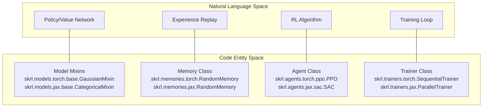

Sources: [docs/source/index.rst:108-211](), [docs/source/intro/getting_started.rst:102-163]()

## Installation and Quick Start

For detailed instructions on setting up the library and running your first experiment, please refer to the child pages:

*   **[Installation and Setup](#1.1)**: Detailed guide on installing backend-specific dependencies (PyTorch, JAX, Warp) and configuring distributed training.
*   **[Quick Start](#1.2)**: Minimal examples using Gymnasium and MuJoCo Playground to get a training loop running in minutes.

Sources: [docs/source/intro/installation.rst:1-45](), [docs/source/intro/getting_started.rst:1-8]()

## Key Features Summary

*   **Multi-Agent RL**: Support for IPPO and MAPPO [docs/source/index.rst:139-149]().
*   **Environment Support**: Wrappers for Gymnasium, ManiSkill, MuJoCo Playground, and Isaac Lab [docs/source/index.rst:55-57]().
*   **Logging & Checkpointing**: Integrated TensorBoard and Weights & Biases support [docs/source/intro/data.rst:9-105]().
*   **Model Instantiators**: Utilities to programmatically create models from configuration [CHANGELOG.md:89-98]().
*   **Mixed Precision**: Support for Automatic Mixed Precision (AMP) in PyTorch [CHANGELOG.md:93]().

Sources: [CHANGELOG.md:16-34](), [pyproject.toml:1-29]()

---

# Page: Installation and Setup

# Installation and Setup

<details>
<summary>Relevant source files</summary>

The following files were used as context for generating this wiki page:

- [.github/ISSUE_TEMPLATE/bug_report.yaml](.github/ISSUE_TEMPLATE/bug_report.yaml)
- [.pre-commit-config.yaml](.pre-commit-config.yaml)
- [.readthedocs.yaml](.readthedocs.yaml)
- [CHANGELOG.md](CHANGELOG.md)
- [README.md](README.md)
- [docs/Makefile](docs/Makefile)
- [docs/README.md](docs/README.md)
- [docs/make.bat](docs/make.bat)
- [docs/requirements.txt](docs/requirements.txt)
- [docs/source/404.rst](docs/source/404.rst)
- [docs/source/_static/imgs/data_tensorboard.jpg](docs/source/_static/imgs/data_tensorboard.jpg)
- [docs/source/_static/imgs/example_parallel.jpg](docs/source/_static/imgs/example_parallel.jpg)
- [docs/source/conf.py](docs/source/conf.py)
- [docs/source/index.rst](docs/source/index.rst)
- [docs/source/intro/data.rst](docs/source/intro/data.rst)
- [docs/source/intro/examples.rst](docs/source/intro/examples.rst)
- [docs/source/intro/getting_started.rst](docs/source/intro/getting_started.rst)
- [docs/source/intro/installation.rst](docs/source/intro/installation.rst)
- [docs/source/snippets/data.py](docs/source/snippets/data.py)
- [pyproject.toml](pyproject.toml)

</details>


This document covers the installation and initial configuration of the **skrl** reinforcement learning library, including dependency management, backend-specific setup for PyTorch, JAX, and NVIDIA Warp, and the configuration system exposed via `skrl.config`.

## System Requirements and Dependencies

The **skrl** library supports a multi-backend architecture. Since version 2.0.0, it requires Python 3.10 or higher [pyproject.toml:6](). The library differentiates between general dependencies and framework-specific extras.

```mermaid
graph TB
    subgraph "Python Requirements"
        "Python_3_10"["Python >= 3.10"]
    end
    
    subgraph "Core Dependencies"
        "General"["gymnasium<br/>packaging<br/>tensorboard<br/>tqdm"]
    end
    
    subgraph "Backend Extras"
        "PyTorch_Deps"["torch >= 1.11"]
        "JAX_Deps"["jax/jaxlib >= 0.4.31<br/>flax >= 0.9.0<br/>optax"]
        "Warp_Deps"["warp-lang >= 1.12<br/>warp-nn >= 0.1"]
    end
    
    "Python_3_10" --> "General"
    "General" --> "skrl_core"["skrl Core Library"]
    
    "PyTorch_Deps" -.-> "skrl_core"
    "JAX_Deps" -.-> "skrl_core"
    "Warp_Deps" -.-> "skrl_core"
```

**Core Dependencies:**
- `gymnasium`: Primary environment interface [pyproject.toml:25]().
- `packaging`: Version management [pyproject.toml:26]().
- `tensorboard`: Native logging support [pyproject.toml:27]().
- `tqdm`: Progress visualization [pyproject.toml:28]().

**Framework-Specific Requirements:**
- **PyTorch Backend**: `torch` ≥ 1.11 [pyproject.toml:32]().
- **JAX Backend**: `jax`/`jaxlib` ≥ 0.4.31, `flax` ≥ 0.9.0, and `optax` [pyproject.toml:35-38]().
- **Warp Backend**: `warp-lang` ≥ 1.12 and `warp-nn` ≥ 0.1 [pyproject.toml:41-42]().

Sources: [pyproject.toml:1-52](), [docs/source/intro/installation.rst:8-34]()

## Installation Methods

### Python Package Index (PyPI)
The most common way to install **skrl** is via `pip` using framework-specific extras:

| Target Backend | Command |
| :--- | :--- |
| **PyTorch** | `pip install skrl[torch]` |
| **JAX** | `pip install skrl[jax]` |
| **NVIDIA Warp** | `pip install skrl[warp]` |
| **All Backends** | `pip install skrl[all]` |
| **Core Only** | `pip install skrl` |

*Note: It is recommended to install JAX manually before the library to ensure correct CUDA/CUDNN support [docs/source/intro/installation.rst:37-39]().*

### Development and Editable Installation
For users wishing to modify the library or use the latest features from the `develop` branch:

```bash
# Clone the repository
git clone https://github.com/Toni-SM/skrl.git
cd skrl

# Install in editable mode
pip install -e .[all]
```

Sources: [docs/source/intro/installation.rst:43-246](), [pyproject.toml:30-52]()

## Configuration and Device Management

**skrl** provides a unified configuration system via `skrl.config`. This system handles device parsing, distributed training detection, and backend-specific global settings.

### The Config System
The `skrl.config` module exposes configuration objects for each backend:
- `skrl.config.torch`: Configuration for PyTorch.
- `skrl.config.jax`: Configuration for JAX.
- `skrl.config.warp`: Configuration for NVIDIA Warp.

A key utility is `parse_device`, which normalizes device strings across frameworks [CHANGELOG.md:90-91]().

### Distributed Training Setup
The library automatically detects distributed environments (e.g., multi-GPU setups). In JAX, the library forces the use of the device local to the process in distributed runs [CHANGELOG.md:84-85]().

```mermaid
graph TD
    subgraph "skrl.config Utility Flow"
        "User_Input"["Device String (e.g. 'cuda:0')"] --> "parse_device"["skrl.config.parse_device()"]
        "parse_device" --> "Backend_Logic"{"Backend Type?"}
        
        "Backend_Logic" -- "PyTorch" --> "Torch_Dev"["torch.device"]
        "Backend_Logic" -- "JAX" --> "JAX_Dev"["jax.devices()"]
        "Backend_Logic" -- "Warp" --> "Warp_Dev"["wp.get_device()"]
    end

    subgraph "Distributed Logic"
        "is_distributed"["skrl.config.is_distributed"] --> "Check_Env"["Check RANK/WORLD_SIZE"]
        "Check_Env" -- "True" --> "Sync_Params"["Synchronize Parameters"]
    end
```

### JAX Memory Management
When running JAX alongside other GPU-intensive applications (like Isaac Lab), it is often necessary to limit JAX's memory pre-allocation [docs/source/intro/installation.rst:240-244]():

```bash
export XLA_PYTHON_CLIENT_MEM_FRACTION=.50
```

Sources: [CHANGELOG.md:84-93](), [docs/source/intro/installation.rst:230-244](), [pyproject.toml:101-110]()

## Logging and Experiment Setup

**skrl** integrates with TensorBoard and Weights & Biases (wandb) for experiment tracking.

### Experiment Configuration
Each agent is configured via an `ExperimentCfg` dataclass (or dictionary in older versions) [CHANGELOG.md:42](). Key parameters include:
- `directory`: Root folder for logs [docs/source/intro/data.rst:29-31]().
- `write_interval`: Frequency of writing to TensorBoard [docs/source/intro/data.rst:36-38]().
- `checkpoint_interval`: Frequency of saving model weights [docs/source/intro/data.rst:158-160]().

### TensorBoard Implementation
Since version 2.0.0, **skrl** includes a custom `SummaryWriter` implementation to log data without requiring large third-party library dependencies [CHANGELOG.md:32]().

Sources: [docs/source/intro/data.rst:9-40](), [CHANGELOG.md:32-33]()

## Verification

To verify the installation, ensure the library version and backend imports function correctly:

```python
import skrl
print(f"skrl version: {skrl.__version__}")

# Check backends
try:
    import torch
    from skrl.agents.torch.ppo import PPO
    print("PyTorch backend: OK")
except ImportError:
    pass

try:
    import jax
    from skrl.agents.jax.ppo import PPO
    print("JAX backend: OK")
except ImportError:
    pass
```

Sources: [docs/source/conf.py:20-23](), [docs/source/intro/installation.rst:187-200]()

---

# Page: Quick Start

# Quick Start

<details>
<summary>Relevant source files</summary>

The following files were used as context for generating this wiki page:

- [README.md](README.md)
- [docs/source/_static/imgs/data_tensorboard.jpg](docs/source/_static/imgs/data_tensorboard.jpg)
- [docs/source/_static/imgs/example_parallel.jpg](docs/source/_static/imgs/example_parallel.jpg)
- [docs/source/index.rst](docs/source/index.rst)
- [docs/source/intro/data.rst](docs/source/intro/data.rst)
- [docs/source/intro/examples.rst](docs/source/intro/examples.rst)
- [docs/source/intro/getting_started.rst](docs/source/intro/getting_started.rst)
- [docs/source/intro/installation.rst](docs/source/intro/installation.rst)
- [docs/source/snippets/data.py](docs/source/snippets/data.py)
- [examples/gym/jax_gym_pendulum_ppo.py](examples/gym/jax_gym_pendulum_ppo.py)
- [examples/gym/torch_gym_pendulum_ppo.py](examples/gym/torch_gym_pendulum_ppo.py)
- [examples/gym/torch_gym_pendulum_trpo.py](examples/gym/torch_gym_pendulum_trpo.py)
- [examples/gym/torch_gym_pendulumnovel_ppo.py](examples/gym/torch_gym_pendulumnovel_ppo.py)
- [examples/gym/torch_gym_pendulumnovel_ppo_gru.py](examples/gym/torch_gym_pendulumnovel_ppo_gru.py)
- [examples/gym/torch_gym_pendulumnovel_ppo_lstm.py](examples/gym/torch_gym_pendulumnovel_ppo_lstm.py)
- [examples/gym/torch_gym_pendulumnovel_ppo_rnn.py](examples/gym/torch_gym_pendulumnovel_ppo_rnn.py)
- [examples/gym/torch_gym_pendulumnovel_trpo.py](examples/gym/torch_gym_pendulumnovel_trpo.py)
- [examples/gym/torch_gym_pendulumnovel_trpo_gru.py](examples/gym/torch_gym_pendulumnovel_trpo_gru.py)
- [examples/gym/torch_gym_pendulumnovel_trpo_lstm.py](examples/gym/torch_gym_pendulumnovel_trpo_lstm.py)
- [examples/playground/jax_playground_cartpole_balance_ppo.py](examples/playground/jax_playground_cartpole_balance_ppo.py)
- [examples/playground/torch_playground_cartpole_balance_ppo.py](examples/playground/torch_playground_cartpole_balance_ppo.py)
- [examples/playground/warp_playground_cartpole_balance_ppo.py](examples/playground/warp_playground_cartpole_balance_ppo.py)

</details>


This page provides a practical introduction to training reinforcement learning agents using **skrl**. It covers the essential workflow from environment setup to agent training, with simple examples to get you started quickly. The library supports multiple backends including **PyTorch**, **JAX**, and **NVIDIA Warp** [docs/source/index.rst:37-39]().

For detailed installation instructions, see **1.1 Installation and Setup**. For comprehensive examples across different environments, see the full [Examples documentation](docs/source/intro/examples.rst:1-13)().

## Basic Training Workflow

The core **skrl** training workflow follows these steps: environment wrapping, model definition, agent configuration, and training execution. This pattern remains consistent across all supported ML frameworks and environments [docs/source/intro/getting_started.rst:40-41]().

### RL Loop Data Flow
The following diagram illustrates how components interact during a typical training session.

```mermaid
graph TD
    subgraph ["1. Environment Setup"]
        ENV["Environment<br/>(Gymnasium, Isaac Lab, etc.)"]
        WRAP["wrap_env()"]
        ENV --> WRAP
    end
    
    subgraph ["2. Model Definition"]
        MODEL["Model Class"]
        MIXIN["Mixins<br/>(Gaussian, Deterministic, etc.)"]
        MODEL --> MIXIN
    end
    
    subgraph ["3. Agent Configuration"]
        MEMORY["Memory<br/>(RandomMemory)"]
        CONFIG["Agent CFG Dataclass"]
        AGENT["Agent Instance<br/>(PPO, SAC, TD3)"]
        MEMORY --> AGENT
        CONFIG --> AGENT
        MIXIN --> AGENT
    end
    
    subgraph ["4. Training Execution"]
        TRAINER["Trainer<br/>(SequentialTrainer)"]
        TRAIN["trainer.train()"]
        TRAINER --> TRAIN
        AGENT --> TRAINER
        WRAP --> TRAINER
    end
```
**Sources:** [docs/source/intro/getting_started.rst:12-116](), [docs/source/intro/getting_started.rst:180-186]()

## Essential Code Components

The following diagram bridges natural language concepts to actual **skrl** code entities.

### Code Entity Mapping
```mermaid
graph TB
    subgraph ["Environment Layer"]
        wrap_env["skrl.envs.wrappers.[backend].wrap_env"]
        env_wrapped["Wrapped Environment"]
        wrap_env --> env_wrapped
    end
    
    subgraph ["Model Layer"] 
        Model["skrl.models.[backend].Model"]
        GaussianMixin["skrl.models.[backend].GaussianMixin"]
        DeterministicMixin["skrl.models.[backend].DeterministicMixin"]
        Policy["Policy(Model, GaussianMixin)"]
        Value["Value(Model, DeterministicMixin)"]
        Model --> Policy
        GaussianMixin --> Policy
        Model --> Value
        DeterministicMixin --> Value
    end
    
    subgraph ["Memory Layer"]
        RandomMemory["skrl.memories.[backend].RandomMemory"]
    end
    
    subgraph ["Agent Layer"]
        PPO["skrl.agents.[backend].ppo.PPO"]
        PPO_CFG["skrl.agents.[backend].ppo.PPO_CFG"]
        models_dict["models = {'policy': Policy, 'value': Value}"]
        models_dict --> PPO
        PPO_CFG --> PPO
        RandomMemory --> PPO
    end
    
    subgraph ["Training Layer"]
        SequentialTrainer["skrl.trainers.[backend].SequentialTrainer"]
        train_method["trainer.train()"]
        SequentialTrainer --> train_method
    end
    
    env_wrapped --> SequentialTrainer
    PPO --> SequentialTrainer
```
**Sources:** [examples/playground/torch_playground_cartpole_balance_ppo.py:8-18](), [examples/playground/jax_playground_cartpole_balance_ppo.py:7-17](), [examples/playground/warp_playground_cartpole_balance_ppo.py:7-17]()

## Simple Training Example

The following snippets demonstrate the implementation of a PPO agent training in the **MuJoCo Playground** environment. Note that while the model definition syntax varies by backend, the overall structure is identical.

### PyTorch, JAX, and Warp Comparison

| Feature | PyTorch | JAX (Flax) | NVIDIA Warp |
| :--- | :--- | :--- | :--- |
| **Base Model** | `skrl.models.torch.Model` | `skrl.models.jax.Model` | `skrl.models.warp.Model` |
| **Mixins** | `GaussianMixin`, `DeterministicMixin` | `GaussianMixin`, `DeterministicMixin` | `GaussianMixin`, `DeterministicMixin` |
| **Layer Def** | `torch.nn.Sequential` | `@nn.compact` method | `warp_nn.nn.Sequential` |
| **Config** | `PPO_CFG()` | `PPO_CFG()` | `PPO_CFG()` |

**Sources:** [examples/playground/torch_playground_cartpole_balance_ppo.py:30-85](), [examples/playground/jax_playground_cartpole_balance_ppo.py:29-87](), [examples/playground/warp_playground_cartpole_balance_ppo.py:29-87]()

### Implementation Example (Conceptual)

1.  **Wrap Environment**: Use `wrap_env` to normalize the environment API [examples/playground/torch_playground_cartpole_balance_ppo.py:91-93]().
2.  **Define Models**: Inherit from `Model` and relevant mixins (e.g., `GaussianMixin` for stochastic policies) [examples/playground/torch_playground_cartpole_balance_ppo.py:30-42]().
3.  **Instantiate Components**:
    *   `RandomMemory` serves as a rollout buffer [examples/playground/torch_playground_cartpole_balance_ppo.py:105]().
    *   `PPO_CFG` handles hyperparameters like `learning_rate` and `discount_factor` [examples/playground/torch_playground_cartpole_balance_ppo.py:118-141]().
4.  **Run Trainer**: `SequentialTrainer` manages the training loop for a specified number of `timesteps` [examples/playground/torch_playground_cartpole_balance_ppo.py:153-156]().

## Key Configuration Parameters

Each agent offers an `experiment` configuration key within its configuration dataclass (e.g., `ExperimentCfg`) to control data persistence and logging [docs/source/intro/data.rst:21-27]().

| Parameter | Default | Description |
| :--- | :--- | :--- |
| `directory` | `"runs"` | Parent directory for experiment data [docs/source/intro/data.rst:29-31](). |
| `write_interval` | `"auto"` | Interval for writing metrics to TensorBoard/WandB [docs/source/intro/data.rst:36-38](). |
| `checkpoint_interval` | `"auto"` | Interval for saving agent state to disk [docs/source/intro/data.rst:158-160](). |
| `store_separately` | `False` | Whether to save models/optimizers in separate files [docs/source/intro/data.rst:162-164](). |

**Sources:** [docs/source/intro/data.rst:8-165](), [docs/source/snippets/data.py:8-18]()

## Next Steps

- **Explore Examples**: The `examples/` directory contains scripts for **Gymnasium**, **Gym**, and **MuJoCo Playground** [docs/source/intro/examples.rst:14-150]().
- **Checkpointing**: Use `agent.load(path)` to resume training or evaluate saved models [docs/source/intro/data.rst:178-186]().
- **Logging**: Visualize training progress by launching TensorBoard: `tensorboard --logdir=runs` [docs/source/intro/data.rst:42-50]().
- **Hugging Face**: Download pre-trained models using `download_model_from_huggingface` [docs/source/snippets/data.py:48-54]().

**Sources:** [docs/source/intro/examples.rst:1-13](), [docs/source/intro/data.rst:1-7]()

---

# Page: Agents

# Agents

<details>
<summary>Relevant source files</summary>

The following files were used as context for generating this wiki page:

- [skrl/agents/jax/base.py](skrl/agents/jax/base.py)
- [skrl/agents/torch/a2c/a2c.py](skrl/agents/torch/a2c/a2c.py)
- [skrl/agents/torch/amp/amp.py](skrl/agents/torch/amp/amp.py)
- [skrl/agents/torch/base.py](skrl/agents/torch/base.py)
- [skrl/agents/torch/cem/cem.py](skrl/agents/torch/cem/cem.py)
- [skrl/agents/torch/ddpg/ddpg.py](skrl/agents/torch/ddpg/ddpg.py)
- [skrl/agents/torch/dqn/dqn.py](skrl/agents/torch/dqn/dqn.py)
- [skrl/agents/torch/ppo/ppo.py](skrl/agents/torch/ppo/ppo.py)
- [skrl/agents/torch/q_learning/q_learning.py](skrl/agents/torch/q_learning/q_learning.py)
- [skrl/agents/torch/sac/sac.py](skrl/agents/torch/sac/sac.py)
- [skrl/agents/torch/sarsa/sarsa.py](skrl/agents/torch/sarsa/sarsa.py)
- [skrl/agents/torch/td3/td3.py](skrl/agents/torch/td3/td3.py)
- [skrl/agents/torch/trpo/trpo.py](skrl/agents/torch/trpo/trpo.py)
- [skrl/agents/warp/base.py](skrl/agents/warp/base.py)
- [skrl/multi_agents/jax/base.py](skrl/multi_agents/jax/base.py)
- [skrl/multi_agents/torch/base.py](skrl/multi_agents/torch/base.py)

</details>


Agents are the core decision-making components in **skrl** that implement reinforcement learning algorithms. They encapsulate the policy learning logic, interact with environments, and manage the training process. Each agent implements a specific RL algorithm and provides a unified interface for training and evaluation across multiple backends.

For information about the models that agents use, see [Models](#3). For details about memory systems that store agent experiences, see [Memories](#6). For training orchestration, see [Trainers](#5).

## Agent Architecture

The agent system in **skrl** follows a modular design with support for **PyTorch**, **JAX**, and **Warp** backends. All agents inherit from a base class that defines the training lifecycle.

### Core Agent Lifecycle

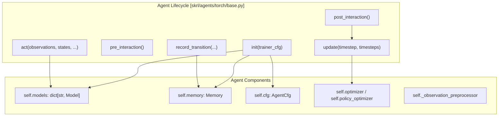

Sources: [skrl/agents/torch/base.py:83-264](), [skrl/agents/torch/ppo/ppo.py:67-165](), [skrl/agents/torch/sac/sac.py:23-155]()

### Agent Hierarchy and Backends

The codebase organizes agents by backend and algorithm family.

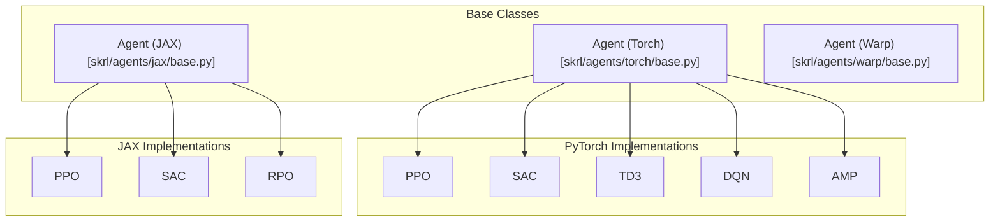

Sources: [skrl/agents/torch/base.py:83](), [skrl/agents/jax/base.py:1](), [skrl/agents/warp/base.py:1]()

## Common Agent Interface

All agents implement a standardized interface that enables consistent interaction with trainers and environments.

### Core Methods

| Method | Purpose | Implementation Detail |
|--------|---------|-----------------------|
| `init()` | Initializes memory tensors and experiment directories. | [skrl/agents/torch/base.py:187-228]() |
| `act()` | Processes observations to produce actions. | [skrl/agents/torch/ppo/ppo.py:254-278]() |
| `record_transition()` | Stores transitions in the `Memory` buffer. | [skrl/agents/torch/base.py:245-264]() |
| `update()` | Triggers the optimization step (loss calculation and backprop). | [skrl/agents/torch/ppo/ppo.py:353-370]() |
| `post_interaction()` | Handles logging to TensorBoard/WandB and checkpointing. | [skrl/agents/torch/base.py:297-332]() |

### Action Generation Process

The `act()` method typically handles state preprocessing and exploration noise. For value-based agents like `DQN`, it also manages the epsilon-greedy schedule [skrl/agents/torch/dqn/dqn.py:144-184](). For actor-critic agents like `TD3`, it applies exploration noise to deterministic actions [skrl/agents/torch/td3/td3.py:248-262]().

## Configuration and Experiment Tracking

Each agent is configured using a specialized dataclass (e.g., `PPO_CFG`, `SAC_CFG`) which inherits from `AgentCfg`.

### Experiment Configuration
The `ExperimentCfg` class within the base agent defines how data is saved and logged:
- `directory`: Root path for experiment runs [skrl/agents/torch/base.py:27]().
- `write_interval`: Frequency of logging to TensorBoard [skrl/agents/torch/base.py:36]().
- `checkpoint_interval`: Frequency of saving model weights [skrl/agents/torch/base.py:43]().
- `wandb`: Toggle for Weights & Biases integration [skrl/agents/torch/base.py:57]().

Sources: [skrl/agents/torch/base.py:23-65](), [skrl/agents/torch/ppo/ppo_cfg.py:1-20]()

## Multi-Agent Systems

**skrl** supports Multi-Agent Reinforcement Learning (MARL) through the `MultiAgent` base class. Unlike single agents, multi-agents manage dictionaries of models and memories keyed by agent identifiers (`uid`).

- **IPPO / MAPPO**: Independent and Multi-Agent PPO implementations.
- **Shared Parameters**: Support for shared or independent networks across agents.
- **GAE for MARL**: Specialized advantage estimation for multi-agent trajectories.

For details, see [Multi-Agent Systems](#7).

Sources: [skrl/multi_agents/torch/base.py:95-135]()

## Backend-Specific Details

### PyTorch Agents
PyTorch agents implement standard optimization loops using `torch.optim`. They feature support for **Automatic Mixed Precision (AMP)** using `torch.amp.GradScaler` [skrl/agents/torch/ppo/ppo.py:122-125]() and **Distributed Data Parallel** synchronization via `broadcast_parameters()` [skrl/agents/torch/ppo/ppo.py:113-119]().

For details, see [PyTorch Agents](#2.1).

### JAX Agents
JAX agents utilize functional programming patterns and JIT compilation. They often rely on the `optax` library for optimization and handle state management through Flax-like state dictionaries.

For details, see [JAX Agents](#2.2).

### Warp Agents
Specialized agents optimized for NVIDIA Warp, allowing for high-performance simulations where the RL update step can be tightly integrated with the simulation kernels.

Sources: [skrl/agents/jax/base.py:1](), [skrl/agents/warp/base.py:1]()

---

# Page: PyTorch Agents

# PyTorch Agents

<details>
<summary>Relevant source files</summary>

The following files were used as context for generating this wiki page:

- [docs/source/api/agents/a2c.rst](docs/source/api/agents/a2c.rst)
- [docs/source/api/agents/amp.rst](docs/source/api/agents/amp.rst)
- [docs/source/api/agents/cem.rst](docs/source/api/agents/cem.rst)
- [docs/source/api/agents/ddpg.rst](docs/source/api/agents/ddpg.rst)
- [docs/source/api/agents/ddqn.rst](docs/source/api/agents/ddqn.rst)
- [docs/source/api/agents/dqn.rst](docs/source/api/agents/dqn.rst)
- [docs/source/api/agents/ppo.rst](docs/source/api/agents/ppo.rst)
- [docs/source/api/agents/q_learning.rst](docs/source/api/agents/q_learning.rst)
- [docs/source/api/agents/rpo.rst](docs/source/api/agents/rpo.rst)
- [docs/source/api/agents/sac.rst](docs/source/api/agents/sac.rst)
- [docs/source/api/agents/sarsa.rst](docs/source/api/agents/sarsa.rst)
- [docs/source/api/agents/td3.rst](docs/source/api/agents/td3.rst)
- [docs/source/api/agents/trpo.rst](docs/source/api/agents/trpo.rst)
- [docs/source/snippets/agents_basic_usage.py](docs/source/snippets/agents_basic_usage.py)
- [skrl/agents/jax/cem/cem.py](skrl/agents/jax/cem/cem.py)
- [skrl/agents/jax/ddpg/ddpg.py](skrl/agents/jax/ddpg/ddpg.py)
- [skrl/agents/jax/ddqn/__init__.py](skrl/agents/jax/ddqn/__init__.py)
- [skrl/agents/jax/ddqn/ddqn.py](skrl/agents/jax/ddqn/ddqn.py)
- [skrl/agents/jax/ddqn/ddqn_cfg.py](skrl/agents/jax/ddqn/ddqn_cfg.py)
- [skrl/agents/jax/dqn/__init__.py](skrl/agents/jax/dqn/__init__.py)
- [skrl/agents/jax/dqn/dqn.py](skrl/agents/jax/dqn/dqn.py)
- [skrl/agents/jax/sac/sac.py](skrl/agents/jax/sac/sac.py)
- [skrl/agents/jax/td3/td3.py](skrl/agents/jax/td3/td3.py)
- [skrl/agents/torch/a2c/a2c.py](skrl/agents/torch/a2c/a2c.py)
- [skrl/agents/torch/a2c/a2c_rnn.py](skrl/agents/torch/a2c/a2c_rnn.py)
- [skrl/agents/torch/amp/amp.py](skrl/agents/torch/amp/amp.py)
- [skrl/agents/torch/cem/cem.py](skrl/agents/torch/cem/cem.py)
- [skrl/agents/torch/ddpg/ddpg.py](skrl/agents/torch/ddpg/ddpg.py)
- [skrl/agents/torch/ddpg/ddpg_rnn.py](skrl/agents/torch/ddpg/ddpg_rnn.py)
- [skrl/agents/torch/ddqn/__init__.py](skrl/agents/torch/ddqn/__init__.py)
- [skrl/agents/torch/ddqn/ddqn.py](skrl/agents/torch/ddqn/ddqn.py)
- [skrl/agents/torch/ddqn/ddqn_cfg.py](skrl/agents/torch/ddqn/ddqn_cfg.py)
- [skrl/agents/torch/dqn/__init__.py](skrl/agents/torch/dqn/__init__.py)
- [skrl/agents/torch/dqn/dqn.py](skrl/agents/torch/dqn/dqn.py)
- [skrl/agents/torch/ppo/ppo.py](skrl/agents/torch/ppo/ppo.py)
- [skrl/agents/torch/ppo/ppo_rnn.py](skrl/agents/torch/ppo/ppo_rnn.py)
- [skrl/agents/torch/q_learning/q_learning.py](skrl/agents/torch/q_learning/q_learning.py)
- [skrl/agents/torch/rpo/rpo.py](skrl/agents/torch/rpo/rpo.py)
- [skrl/agents/torch/rpo/rpo_rnn.py](skrl/agents/torch/rpo/rpo_rnn.py)
- [skrl/agents/torch/sac/sac.py](skrl/agents/torch/sac/sac.py)
- [skrl/agents/torch/sac/sac_rnn.py](skrl/agents/torch/sac/sac_rnn.py)
- [skrl/agents/torch/sarsa/sarsa.py](skrl/agents/torch/sarsa/sarsa.py)
- [skrl/agents/torch/td3/td3.py](skrl/agents/torch/td3/td3.py)
- [skrl/agents/torch/td3/td3_rnn.py](skrl/agents/torch/td3/td3_rnn.py)
- [skrl/agents/torch/trpo/trpo.py](skrl/agents/torch/trpo/trpo.py)
- [skrl/agents/torch/trpo/trpo_rnn.py](skrl/agents/torch/trpo/trpo_rnn.py)

</details>


PyTorch Agents are the core decision-making components in the skrl reinforcement learning library that implement various RL algorithms using PyTorch as the backend. This page covers the architecture, lifecycle, and specific implementations of PyTorch-based agents, including configuration dataclasses, GAE computation, and optimization loops.

For JAX-based agent implementations, see [JAX Agents](#2.2). For the base model classes used by agents, see [Model Base Classes](#3.1). For training orchestration, see [Trainers](#5).

## Agent Architecture Overview

PyTorch agents in skrl follow a unified architecture where all concrete agent implementations inherit from a base `Agent` class and implement specific RL algorithms. Each agent manages models, memory, optimizers, and handles the full training lifecycle.

### Agent Class Hierarchy

```mermaid
graph TB
    subgraph "Base Infrastructure"
        Agent["Agent<br/>(skrl.agents.torch.Agent)"]
    end
    
    subgraph "Policy Gradient Agents"
        PPO["PPO<br/>(skrl.agents.torch.ppo.ppo.PPO)"]
        A2C["A2C<br/>(skrl.agents.torch.a2c.a2c.A2C)"]
        TRPO["TRPO<br/>(skrl.agents.torch.trpo.trpo.TRPO)"]
        AMP["AMP<br/>(skrl.agents.torch.amp.amp.AMP)"]
        RPO["RPO<br/>(skrl.agents.torch.rpo.rpo.RPO)"]
    end
    
    subgraph "Actor-Critic Agents"
        SAC["SAC<br/>(skrl.agents.torch.sac.sac.SAC)"]
        TD3["TD3<br/>(skrl.agents.torch.td3.td3.TD3)"]
        DDPG["DDPG<br/>(skrl.agents.torch.ddpg.ddpg.DDPG)"]
    end
    
    subgraph "Value-Based Agents"
        DQN["DQN<br/>(skrl.agents.torch.dqn.dqn.DQN)"]
        DDQN["DDQN<br/>(skrl.agents.torch.ddqn.ddqn.DDQN)"]
    end
    
    subgraph "Other Algorithms"
        CEM["CEM<br/>(skrl.agents.torch.cem.cem.CEM)"]
        SARSA["SARSA<br/>(skrl.agents.torch.sarsa.sarsa.SARSA)"]
        QLearning["Q_LEARNING<br/>(skrl.agents.torch.q_learning.q_learning.QLearning)"]
    end
    
    Agent --> PPO
    Agent --> A2C
    Agent --> TRPO
    Agent --> AMP
    Agent --> RPO
    Agent --> SAC
    Agent --> TD3
    Agent --> DDPG
    Agent --> DQN
    Agent --> DDQN
    Agent --> CEM
    Agent --> SARSA
    Agent --> QLearning
```

Sources: [skrl/agents/torch/ppo/ppo.py:67-78](), [skrl/agents/torch/td3/td3.py:23-34](), [skrl/agents/torch/sac/sac.py:23-34](), [skrl/agents/torch/ddpg/ddpg.py:22-33](), [skrl/agents/torch/trpo/trpo.py:186-197](), [skrl/agents/torch/a2c/a2c.py:67-78](), [skrl/agents/torch/dqn/dqn.py:20-31](), [skrl/agents/torch/cem/cem.py:20-31](), [skrl/agents/torch/amp/amp.py:68-83](), [skrl/agents/torch/sarsa/sarsa.py:17-28]()

### Agent Component Architecture

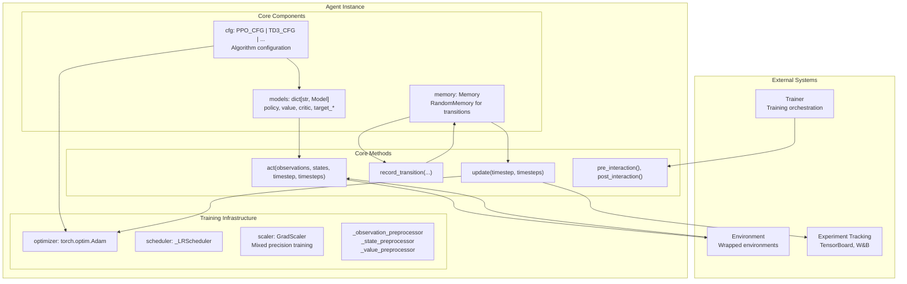

Sources: [skrl/agents/torch/ppo/ppo.py:104-164](), [skrl/agents/torch/td3/td3.py:60-156](), [skrl/agents/torch/sac/sac.py:60-155]()

## Base Agent Interface

All PyTorch agents inherit from the base `Agent` class and implement a common interface for environment interaction and training. The key methods define the agent lifecycle:

### Core Interface Methods

| Method | Purpose | Implementation |
|--------|---------|----------------|
| `init()` | Initialize agent and create memory tensors | [skrl/agents/torch/ppo/ppo.py:166-198]() |
| `act()` | Process states and return actions | [skrl/agents/torch/ppo/ppo.py:200-221]() |
| `record_transition()` | Store environment transitions in memory | [skrl/agents/torch/ppo/ppo.py:223-263]() |
| `pre_interaction()` | Called before environment step | [skrl/agents/torch/sarsa/sarsa.py:154-160]() |
| `post_interaction()` | Called after environment step; triggers `update()` | [skrl/agents/torch/ppo/ppo.py:280-302]() |
| `update()` | Main algorithm update step (optimization loop) | [skrl/agents/torch/ppo/ppo.py:304-444]() |

### Training Lifecycle Flow

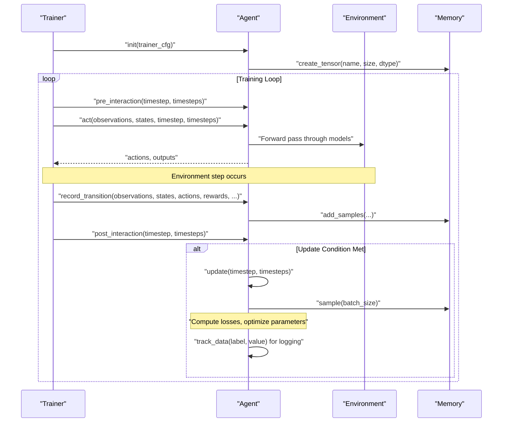

Sources: [skrl/agents/torch/ppo/ppo.py:175-188](), [skrl/agents/torch/ppo/ppo.py:280-302](), [skrl/agents/torch/td3/td3.py:287-306]()

## Generalized Advantage Estimation (GAE)

Many policy gradient agents (PPO, A2C, TRPO, AMP, RPO) utilize the `compute_gae` helper function to calculate advantages and returns. This function implements the recursive advantage calculation based on rewards and value estimates.

```python
def compute_gae(
    *,
    rewards: torch.Tensor,
    terminated: torch.Tensor,
    truncated: torch.Tensor,
    values: torch.Tensor,
    last_values: torch.Tensor,
    discount_factor: float = 0.99,
    lambda_coefficient: float = 0.95,
    time_limit_bootstrap: bool = False,
) -> torch.Tensor:
    # ... computation logic ...
    return returns, advantages
```

Sources: [skrl/agents/torch/ppo/ppo.py:23-64](), [skrl/agents/torch/a2c/a2c.py:23-64](), [skrl/agents/torch/trpo/trpo.py:22-63]()

## Configuration and Mixed Precision

Each agent uses a specific configuration dataclass (e.g., `PPO_CFG`, `TD3_CFG`) to define hyperparameters. Mixed precision is supported via `torch.amp.GradScaler`.

| Feature | Description | Implementation |
|---------|-------------|----------------|
| **Mixed Precision** | Uses `GradScaler` and `autocast` for FP16 training. | [skrl/agents/torch/ppo/ppo.py:121-125]() |
| **Optimization** | Typically uses `torch.optim.Adam` with algorithm-specific parameters. | [skrl/agents/torch/sac/sac.py:113-118]() |
| **Schedulers** | Supports learning rate schedulers and specialized ones like `KLAdaptiveLR`. | [skrl/agents/torch/ppo/ppo.py:138-142]() |

Sources: [skrl/agents/torch/ppo/ppo.py:20-20](), [skrl/agents/torch/td3/td3.py:20-20](), [skrl/agents/torch/amp/amp.py:21-21]()

## Individual Agent Implementations

### Policy Gradient Agents

*   **PPO (Proximal Policy Optimization)**: Implements clipped surrogate objectives. Supports multiple epochs and mini-batches per update. [skrl/agents/torch/ppo/ppo.py:67-78]()
*   **A2C (Advantage Actor Critic)**: A synchronous, deterministic version of A3C using GAE for advantage estimation. [skrl/agents/torch/a2c/a2c.py:67-78]()
*   **TRPO (Trust Region Policy Optimization)**: Uses natural policy gradient with a KL-divergence constraint, implemented via conjugate gradient and line search. [skrl/agents/torch/trpo/trpo.py:186-197]()
*   **AMP (Adversarial Motion Priors)**: Combines PPO with a discriminator trained on reference motions to imitation movement patterns. [skrl/agents/torch/amp/amp.py:68-83]()
*   **RPO (Relaxed Proximal Policy Optimization)**: A variant of PPO that modifies the policy update to handle complex action distributions.

### Actor-Critic Agents

*   **SAC (Soft Actor-Critic)**: Off-policy algorithm that maximizes entropy for better exploration. Features automatic entropy coefficient tuning. [skrl/agents/torch/sac/sac.py:23-34]()
*   **TD3 (Twin Delayed DDPG)**: Improves DDPG by using twin critics, delayed policy updates, and target policy smoothing. [skrl/agents/torch/td3/td3.py:23-34]()
*   **DDPG (Deep Deterministic Policy Gradient)**: An off-policy algorithm for continuous action spaces using target networks and exploration noise. [skrl/agents/torch/ddpg/ddpg.py:22-33]()

### Value-Based and Tabular Agents

*   **DQN (Deep Q-Network)**: Standard off-policy Q-learning using neural networks and experience replay. [skrl/agents/torch/dqn/dqn.py:20-31]()
*   **DDQN (Double Deep Q-Network)**: Mitigates overestimation bias in DQN by decoupling action selection from action evaluation. [skrl/agents/torch/ddqn/ddqn.py:20-31]()
*   **CEM (Cross-Entropy Method)**: An evolutionary strategy that samples actions and updates the policy based on "elite" trajectories. [skrl/agents/torch/cem/cem.py:20-31]()
*   **SARSA**: A tabular on-policy algorithm that updates Q-values based on the action actually taken in the next state. [skrl/agents/torch/sarsa/sarsa.py:17-28]()
*   **Q-Learning**: A tabular off-policy algorithm that updates Q-values based on the maximum possible next-state value.

### RNN Variants

Most PyTorch agents have RNN variants (e.g., `PPO_RNN`, `SAC_RNN`, `TD3_RNN`) designed to handle sequences and maintain hidden states across environment steps. These variants typically include logic to handle sequence sampling and hidden state management in the `update()` loop.

Sources: [skrl/agents/torch/ppo/ppo_rnn.py](), [skrl/agents/torch/sac/sac_rnn.py](), [skrl/agents/torch/td3/td3_rnn.py]()

---

# Page: JAX Agents

# JAX Agents

<details>
<summary>Relevant source files</summary>

The following files were used as context for generating this wiki page:

- [examples/gymnasium/warp_gymnasium_pendulum_ppo.py](examples/gymnasium/warp_gymnasium_pendulum_ppo.py)
- [examples/isaaclab/warp_cartpole_direct_box_box_ppo.py](examples/isaaclab/warp_cartpole_direct_box_box_ppo.py)
- [examples/mani_skill/jax_mani_skill_push_cube_ppo.py](examples/mani_skill/jax_mani_skill_push_cube_ppo.py)
- [examples/mani_skill/torch_mani_skill_push_cube_ppo.py](examples/mani_skill/torch_mani_skill_push_cube_ppo.py)
- [examples/mani_skill/warp_mani_skill_push_cube_ppo.py](examples/mani_skill/warp_mani_skill_push_cube_ppo.py)
- [skrl/agents/jax/a2c/a2c.py](skrl/agents/jax/a2c/a2c.py)
- [skrl/agents/jax/base.py](skrl/agents/jax/base.py)
- [skrl/agents/jax/cem/cem.py](skrl/agents/jax/cem/cem.py)
- [skrl/agents/jax/ddpg/ddpg.py](skrl/agents/jax/ddpg/ddpg.py)
- [skrl/agents/jax/dqn/dqn.py](skrl/agents/jax/dqn/dqn.py)
- [skrl/agents/jax/ppo/ppo.py](skrl/agents/jax/ppo/ppo.py)
- [skrl/agents/jax/rpo/rpo.py](skrl/agents/jax/rpo/rpo.py)
- [skrl/agents/jax/sac/sac.py](skrl/agents/jax/sac/sac.py)
- [skrl/agents/jax/td3/td3.py](skrl/agents/jax/td3/td3.py)
- [skrl/agents/torch/base.py](skrl/agents/torch/base.py)
- [skrl/agents/torch/ddpg/ddpg_rnn.py](skrl/agents/torch/ddpg/ddpg_rnn.py)
- [skrl/agents/torch/sac/sac_rnn.py](skrl/agents/torch/sac/sac_rnn.py)
- [skrl/agents/torch/td3/td3_rnn.py](skrl/agents/torch/td3/td3_rnn.py)
- [skrl/agents/warp/base.py](skrl/agents/warp/base.py)
- [skrl/agents/warp/ddpg/ddpg.py](skrl/agents/warp/ddpg/ddpg.py)
- [skrl/agents/warp/ppo/ppo.py](skrl/agents/warp/ppo/ppo.py)
- [skrl/agents/warp/sac/sac.py](skrl/agents/warp/sac/sac.py)
- [skrl/multi_agents/jax/base.py](skrl/multi_agents/jax/base.py)
- [skrl/multi_agents/torch/base.py](skrl/multi_agents/torch/base.py)
- [tests/agents/warp/test_ppo.py](tests/agents/warp/test_ppo.py)

</details>


This document covers the JAX backend implementation of reinforcement learning agents in the skrl library. JAX agents provide high-performance implementations of various RL algorithms with JIT compilation, XLA acceleration, and distributed training support.

For information about PyTorch-based agent implementations, see [PyTorch Agents](2.1). For details about the model system used by these agents, see [Model Base Classes](3.1).

## Architecture Overview

JAX agents form one of the three main backend implementations in skrl (PyTorch, JAX, Warp). They inherit from a common base class and implement the same interface while leveraging JAX's functional programming paradigm and XLA compilation for performance optimization.

### Agent Hierarchy and Structure

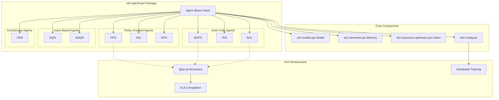

**Sources:** [skrl/agents/jax/base.py:84-95](), [skrl/agents/jax/ppo/ppo.py:118-129](), [skrl/agents/jax/ddpg/ddpg.py:71-82](), [skrl/agents/jax/sac/sac.py:96-107]()

## Base Agent Interface

All JAX agents inherit from the base `Agent` class `[skrl/agents/jax/base.py:84]()` and implement a common lifecycle interface for interaction with environments and training orchestration.

### Lifecycle Methods
- `init()`: Initializes the agent, TensorBoard writer, and distributed communication `[skrl/agents/jax/base.py:184-245]()`.
- `act()`: Returns actions for the given environment states `[skrl/agents/jax/base.py:314-332]()`.
- `record_transition()`: Stores transitions in the agent's memory `[skrl/agents/jax/base.py:334-353]()`.
- `pre_interaction()` and `post_interaction()`: Lifecycle hooks called before and after environment steps `[skrl/agents/jax/base.py:355-374]()`.
- `_update()`: Internal method implementing the algorithm-specific update logic `[skrl/agents/jax/base.py:431-440]()`.

### Code Entity Association

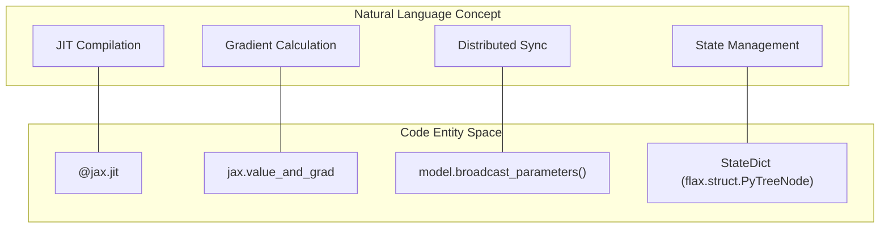

**Sources:** [skrl/agents/jax/ppo/ppo.py:24](), [skrl/agents/jax/ppo/ppo.py:88](), [skrl/agents/jax/ppo/ppo.py:167](), [skrl/agents/jax/sac/sac.py:171]()

## Functional Update Pipeline

Unlike PyTorch's imperative style, skrl's JAX agents use a functional pipeline for updates. The state of the models (parameters) is stored in a `StateDict` and passed to JIT-compiled helper functions.

### Gradient Computation
Agents use `jax.value_and_grad` to compute losses and gradients simultaneously. For example, in PPO, the `_update_policy` function returns both the gradient and auxiliary metrics like KL divergence:
`[skrl/agents/jax/ppo/ppo.py:88-92]()`.

### Parameter Synchronization
In distributed settings (`config.jax.is_distributed`), agents broadcast initial parameters from the rank 0 process to all other processes:
`[skrl/agents/jax/ppo/ppo.py:164-169]()`. During updates, gradients are reduced across devices before being applied by the optimizer.

## Available Algorithms

The JAX backend implements the following algorithms:

| Algorithm | Type | Implementation Features |
|-----------|------|-------------------------|
| `PPO` | Policy Gradient | GAE computation `[skrl/agents/jax/ppo/ppo.py:25-52]()`, clipped surrogate objective `[skrl/agents/jax/ppo/ppo.py:78-79]()`. |
| `RPO` | Policy Gradient | Robust Policy Optimization with perturbations `[skrl/agents/jax/rpo/rpo.py:130]()`. |
| `A2C` | Actor-Critic | Advantage Actor-Critic with entropy regularization `[skrl/agents/jax/a2c/a2c.py:103]()`. |
| `DDPG` | Actor-Critic | Deterministic policy updates `[skrl/agents/jax/ddpg/ddpg.py:71]()` and exploration noise `[skrl/agents/jax/ddpg/ddpg.py:25]()`. |
| `TD3` | Actor-Critic | Twin critics `[skrl/agents/jax/td3/td3.py:133-134]()` and smooth regularization noise `[skrl/agents/jax/td3/td3.py:33-41]()`. |
| `SAC` | Actor-Critic | Automatic entropy adjustment `[skrl/agents/jax/sac/sac.py:159-181]()` and twin Q-networks. |
| `DQN` | Value-Based | Deep Q-Learning with target network synchronization. |
| `DDQN` | Value-Based | Double DQN for reduced overestimation. |
| `CEM` | Evolutionary | Cross-Entropy Method for derivative-free optimization. |

**Sources:** [skrl/agents/jax/ppo/ppo.py:118]() , [skrl/agents/jax/ddpg/ddpg.py:71](), [skrl/agents/jax/sac/sac.py:96](), [skrl/agents/jax/td3/td3.py:92](), [skrl/agents/jax/rpo/rpo.py:118](), [skrl/agents/jax/a2c/a2c.py:103]()

## Warp-Backend Agents

Skrl includes specialized agents that use NVIDIA Warp as a compute backend, allowing RL updates to happen entirely on the GPU via Warp kernels.

### Warp Kernel Optimization
Warp agents like `PPO` `[skrl/agents/warp/ppo/ppo.py:172]()` use `@wp.kernel` to implement high-performance logic:
- `_compute_gae`: Parallel GAE calculation across environments `[skrl/agents/warp/ppo/ppo.py:45-82]()`.
- `_policy_value_loss`: Atomic additions for loss accumulation `[skrl/agents/warp/ppo/ppo.py:104-157]()`.

### Data Flow in Warp Agents

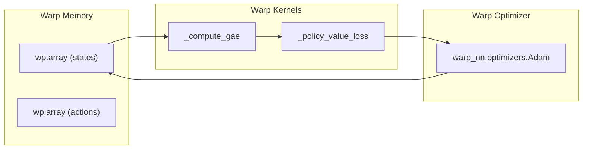

**Sources:** [skrl/agents/warp/ppo/ppo.py:9](), [skrl/agents/warp/ppo/ppo.py:45](), [skrl/agents/warp/ppo/ppo.py:104]()

## Distributed Training Optimization

JAX agents are optimized for multi-device execution using the `skrl.config.jax` settings.

- **Parameter Broadcasting:** At initialization, `model.broadcast_parameters()` ensures all workers start with identical weights `[skrl/agents/jax/ppo/ppo.py:167]()`.
- **Gradient Reduction:** During the update step, gradients are averaged across all participating devices before the optimizer step is taken.
- **Device Management:** Agents respect the `device` parameter, mapping it to a `jax.Device` for memory allocation `[skrl/agents/jax/base.py:114]()`.

**Sources:** [skrl/agents/jax/base.py:114](), [skrl/agents/jax/ppo/ppo.py:164-169](), [skrl/agents/jax/ddpg/ddpg.py:121-127]()

---

# Page: Models

# Models

<details>
<summary>Relevant source files</summary>

The following files were used as context for generating this wiki page:

- [skrl/memories/jax/__init__.py](skrl/memories/jax/__init__.py)
- [skrl/memories/jax/base.py](skrl/memories/jax/base.py)
- [skrl/memories/jax/random.py](skrl/memories/jax/random.py)
- [skrl/memories/torch/base.py](skrl/memories/torch/base.py)
- [skrl/memories/torch/random.py](skrl/memories/torch/random.py)
- [skrl/memories/warp/random.py](skrl/memories/warp/random.py)
- [skrl/models/jax/__init__.py](skrl/models/jax/__init__.py)
- [skrl/models/jax/base.py](skrl/models/jax/base.py)
- [skrl/models/torch/base.py](skrl/models/torch/base.py)
- [skrl/models/torch/categorical.py](skrl/models/torch/categorical.py)
- [skrl/models/torch/deterministic.py](skrl/models/torch/deterministic.py)
- [skrl/models/torch/gaussian.py](skrl/models/torch/gaussian.py)
- [skrl/models/torch/multivariate_gaussian.py](skrl/models/torch/multivariate_gaussian.py)

</details>


Models in **skrl** are neural network-based function approximators that represent policies, value functions, and other decision-making components used by reinforcement learning agents. The model system provides a flexible architecture supporting **PyTorch**, **JAX**, and **Warp** backends, with a mixin-based design that allows users to combine different action space behaviors with custom network architectures.

For information about how models are used within RL agents, see [Agents](#2). For details about training these models, see [Trainers](#5).

## Architecture Overview

The model system is built around a dual-backend architecture with base classes and behavioral mixins that can be composed to create models for different action spaces and domains.

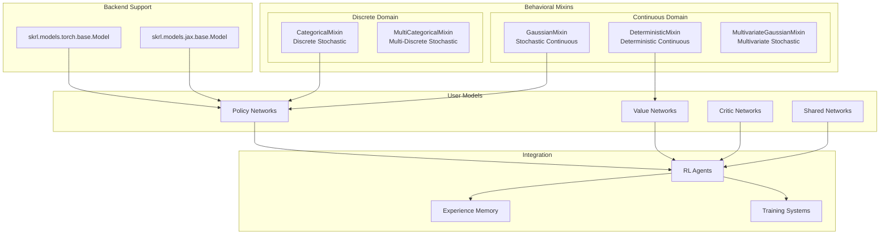
Sources: [skrl/models/torch/base.py:15-30](), [skrl/models/jax/base.py:40-64](), [skrl/models/torch/gaussian.py:15-26](), [skrl/models/torch/categorical.py:13-21]()

## Model Base Classes

The foundation of the model system consists of backend-specific base classes that provide common functionality for neural network operations, device management, and state handling.

### PyTorch Base Class
The PyTorch `Model` class extends `torch.nn.Module` and introduces high-level methods for RL workflows, such as `init_state_dict` for lazy modules [skrl/models/torch/base.py:42-58]() and `update_parameters` for Polyak averaging [skrl/models/torch/base.py:419](). It manages observation and action space metadata to ensure compatibility with environments [skrl/models/torch/base.py:35-40]().

For details, see [Model Base Classes](#3.1).

### JAX Base Class
The JAX `Model` class extends `flax.linen.Module` [skrl/models/jax/base.py:40](). Because JAX is functional, it uses a `StateDict` [skrl/models/jax/base.py:31-37]() to store `apply_fn` and `params`. It supports distributed operations like `reduce_parameters` [skrl/models/jax/base.py:419]() and `broadcast_parameters` [skrl/models/jax/base.py:419]().

For details, see [Model Base Classes](#3.1).

## Model Mixins System

Mixins provide standardized implementations for different action types. By inheriting from both a `Model` base class and a `Mixin`, users can define the network architecture in `compute()` while the mixin handles the RL-specific `act()` logic.

### Mixin Inheritance Pattern

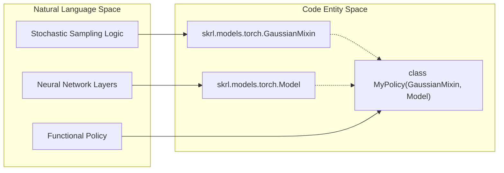
Sources: [skrl/models/torch/gaussian.py:15-60](), [skrl/models/torch/base.py:15-30]()

### Available Mixins
*   **GaussianMixin**: For continuous actions using a Normal distribution [skrl/models/torch/gaussian.py:15-60]().
*   **DeterministicMixin**: For deterministic continuous actions, often used in DDPG/TD3 or Value functions [skrl/models/torch/deterministic.py:10-20]().
*   **CategoricalMixin**: For discrete actions using a Categorical distribution [skrl/models/torch/categorical.py:13-23]().
*   **MultivariateGaussianMixin**: For continuous actions with multivariate normal distributions [skrl/models/torch/multivariate_gaussian.py:15-46]().

For details, see [Model Mixins](#3.2).

## Model Instantiators

The instantiator system allows for the dynamic creation of models from configuration dictionaries or simple helper functions. This is particularly useful for standard architectures like MLPs or CNNs without writing boilerplate class definitions.

For details, see [Model Instantiators](#3.3).

## Integration with Agents and Memory

Models are the primary interface for agents to interact with the environment. Agents use the `act()` method provided by mixins to generate actions [skrl/models/torch/gaussian.py:62-111](). The results, including metadata like `log_prob` or `log_std`, are then stored in `Memory` objects [skrl/memories/torch/base.py:20-48]().

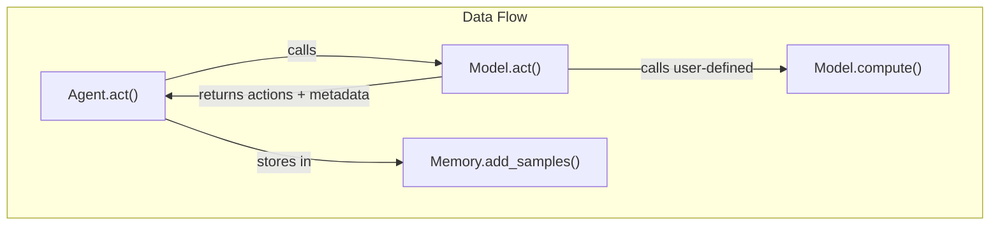
Sources: [skrl/models/torch/gaussian.py:62-111](), [skrl/memories/torch/base.py:121-171]()

---

# Page: Model Base Classes

# Model Base Classes

<details>
<summary>Relevant source files</summary>

The following files were used as context for generating this wiki page:

- [skrl/memories/__init__.py](skrl/memories/__init__.py)
- [skrl/memories/jax/__init__.py](skrl/memories/jax/__init__.py)
- [skrl/memories/jax/base.py](skrl/memories/jax/base.py)
- [skrl/memories/jax/random.py](skrl/memories/jax/random.py)
- [skrl/memories/torch/__init__.py](skrl/memories/torch/__init__.py)
- [skrl/memories/torch/base.py](skrl/memories/torch/base.py)
- [skrl/memories/torch/random.py](skrl/memories/torch/random.py)
- [skrl/memories/warp/random.py](skrl/memories/warp/random.py)
- [skrl/models/jax/__init__.py](skrl/models/jax/__init__.py)
- [skrl/models/jax/base.py](skrl/models/jax/base.py)
- [skrl/models/torch/__init__.py](skrl/models/torch/__init__.py)
- [skrl/models/torch/base.py](skrl/models/torch/base.py)
- [skrl/models/torch/categorical.py](skrl/models/torch/categorical.py)
- [skrl/models/torch/deterministic.py](skrl/models/torch/deterministic.py)
- [skrl/models/torch/gaussian.py](skrl/models/torch/gaussian.py)
- [skrl/models/torch/multivariate_gaussian.py](skrl/models/torch/multivariate_gaussian.py)
- [skrl/models/torch/tabular.py](skrl/models/torch/tabular.py)
- [skrl/models/warp/deterministic.py](skrl/models/warp/deterministic.py)
- [skrl/models/warp/gaussian.py](skrl/models/warp/gaussian.py)
- [skrl/utils/model_instantiators/warp/gaussian.py](skrl/utils/model_instantiators/warp/gaussian.py)
- [skrl/utils/model_instantiators/warp/shared.py](skrl/utils/model_instantiators/warp/shared.py)
- [tests/utils/model_instantiators/jax/test_models.py](tests/utils/model_instantiators/jax/test_models.py)
- [tests/utils/model_instantiators/torch/test_models.py](tests/utils/model_instantiators/torch/test_models.py)
- [tests/utils/model_instantiators/warp/test_models.py](tests/utils/model_instantiators/warp/test_models.py)

</details>


This page covers the foundational `Model` classes that serve as the base classes for all neural network models in skrl. These classes provide the common interface, properties, and core functionality that is inherited by all policy networks, value functions, and other neural network components across both PyTorch and JAX backends.

For information about the mixin system that extends these base classes with specific action distribution behaviors, see [Model Mixins](#3.2). For details about dynamic model creation from configuration, see [Model Instantiators](#3.3).

## Overview

The skrl library implements a dual backend architecture with separate but functionally equivalent `Model` base classes for PyTorch and JAX. Both classes provide the same core interface while leveraging the specific features and conventions of their respective machine learning frameworks.

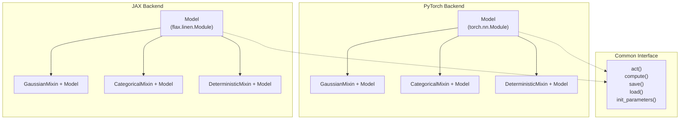

**Model Base Class Architecture**

Sources: [skrl/models/torch/base.py:15-15]() [skrl/models/jax/base.py:40-40]()

## Common Model Interface

Both PyTorch and JAX `Model` classes provide a standardized interface with core properties and methods for reinforcement learning tasks.

### Core Properties

| Property | Type | Description |
|----------|------|-------------|
| `device` | `torch.device` or `jax.Device` | Computation device |
| `observation_space` | `gymnasium.Space` | Environment observation space |
| `state_space` | `gymnasium.Space` | Environment state space (for asymmetric actor-critic) |
| `action_space` | `gymnasium.Space` | Environment action space |
| `num_observations` | `int` | Flattened size of observation space |
| `num_actions` | `int` | Flattened size of action space |

Sources: [skrl/models/torch/base.py:33-40]() [skrl/models/jax/base.py:65-72]()

### Essential Methods

| Method | Purpose |
|--------|---------|
| `act()` | Generate actions from environment states (abstract) |
| `compute()` | Perform forward computation (abstract) |
| `random_act()` | Sample random actions from action space |
| `init_parameters()` | Initialize model parameters using backend initializers |
| `init_state_dict()` | Initialize lazy modules or internal state structures |
| `update_parameters()` | Perform hard or soft (Polyak) parameter updates |

Sources: [skrl/models/torch/base.py:42-100]() [skrl/models/jax/base.py:81-146]()

## PyTorch Model Class

The PyTorch `Model` class inherits from `torch.nn.Module` and provides the foundation for all PyTorch-based neural networks in skrl.

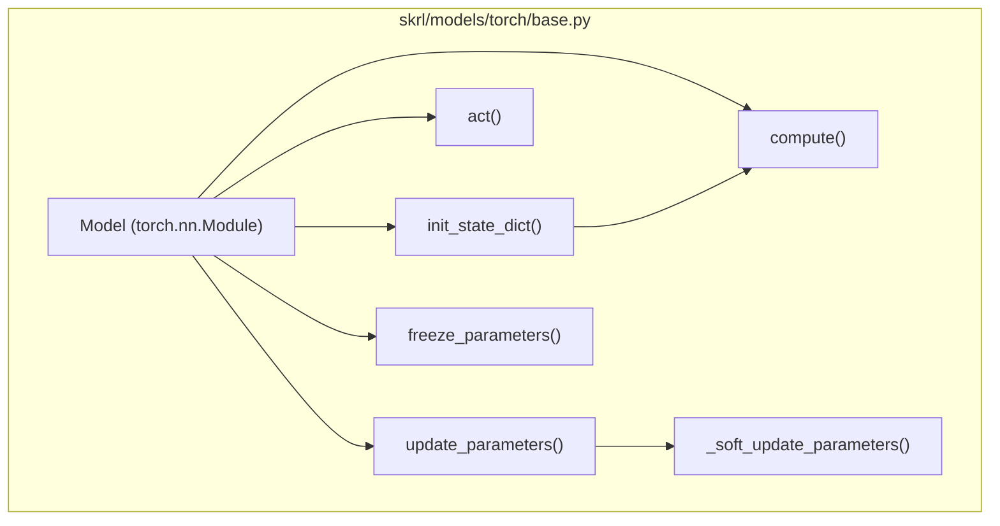

**PyTorch Model Class Method Overview**

### Lazy Module Initialization
skrl supports models with lazy modules (e.g., `torch.nn.LazyLinear`). The `init_state_dict` method facilitates this by performing a forward pass with dummy inputs sampled from the environment spaces to determine parameter shapes before training begins [skrl/models/torch/base.py:42-74]().

### Parameter Updates and Freezing
- **update_parameters**: Implements both hard updates (copying weights) and soft updates (Polyak averaging) using a `tau` coefficient [skrl/models/torch/base.py:419]().
- **freeze_parameters**: Disables gradient calculation for the entire model by setting `requires_grad = False` on all parameters [skrl/models/torch/base.py:419]().

### Distributed Support
The base class includes methods for distributed training, such as `reduce_parameters` to average gradients across processes and `broadcast_parameters` to synchronize weights [skrl/models/torch/base.py:419]().

Sources: [skrl/models/torch/base.py:15-15]() [skrl/models/torch/base.py:42-74]() [skrl/models/torch/base.py:419]()

## JAX Model Class

The JAX `Model` class inherits from `flax.linen.Module`. Because JAX is functional, state management is handled via an immutable `StateDict` structure.

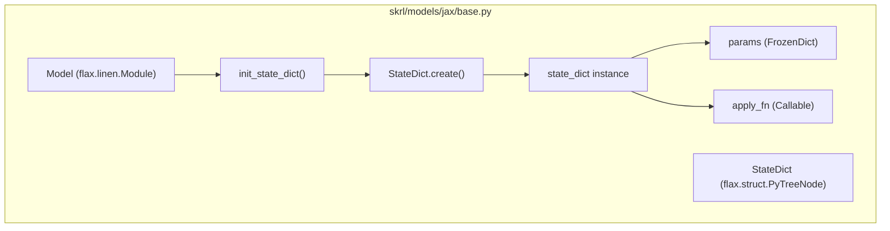

**JAX Model Architecture and StateDict Pattern**

### StateDict Pattern
In skrl's JAX implementation, a model's weights and its apply function are encapsulated in a `StateDict` which is a `flax.struct.PyTreeNode` [skrl/models/jax/base.py:31-38](). This allows the model state to be passed through JIT-compiled functions easily.

### Functional act and compute
Unlike PyTorch, the `act` and `compute` methods in JAX take an optional `params` argument. If not provided, they use the internal `state_dict.params` [skrl/models/jax/base.py:179-183](). This design supports the functional update pipeline required by JAX.

### Distributed Utilities
JAX models utilize `jax.lax.psum` for parameter reduction across devices and `jax.experimental.multihost_utils.broadcast_one_to_all` for weight synchronization in multi-host setups [skrl/models/jax/base.py:419]().

Sources: [skrl/models/jax/base.py:31-40]() [skrl/models/jax/base.py:81-117]() [skrl/models/jax/base.py:419]()

## Key Implementation Details

### Action Generation Flow
The `act` method is the primary entry point for agents to interact with the model. While `act` is abstract in the base `Model`, it is typically implemented by Mixins (Gaussian, Categorical, etc.) which call the user-defined `compute` method.

```mermaid
sequenceDiagram
    participant Agent
    participant Mixin
    participant Model
    
    Agent->>Mixin: act(inputs)
    Note over Mixin, Model: Role-based dispatch
    Mixin->>Model: compute(inputs, role)
    Model-->>Mixin: net_output, extra_data
    Note over Mixin: Process distribution (e.g. Normal)
    Mixin-->>Agent: actions, log_prob, etc.
```

**Action Generation Sequence**

Sources: [skrl/models/torch/gaussian.py:62-80]() [skrl/models/torch/categorical.py:25-42]() [skrl/models/torch/deterministic.py:22-36]()

### Random Action Sampling
The `random_act` method provides a backend-agnostic way to sample actions from the environment's action space. It uses `sample_space` utilities to ensure the sampled actions match the expected batch size and device [skrl/models/torch/base.py:75-98]() [skrl/models/jax/base.py:118-144]().

### Polyak Averaging (Soft Updates)
Both backends support soft updates, typically used for target networks in algorithms like SAC or TD3. The update follows the formula:
$$\theta_{target} = \tau \theta_{source} + (1 - \tau) \theta_{target}$$

Sources: [skrl/models/torch/base.py:419]() [skrl/models/jax/base.py:419]()

---

# Page: Model Mixins

# Model Mixins

<details>
<summary>Relevant source files</summary>

The following files were used as context for generating this wiki page:

- [docs/source/api/models.rst](docs/source/api/models.rst)
- [docs/source/api/models/categorical.rst](docs/source/api/models/categorical.rst)
- [docs/source/api/models/deterministic.rst](docs/source/api/models/deterministic.rst)
- [docs/source/api/models/gaussian.rst](docs/source/api/models/gaussian.rst)
- [docs/source/api/models/multicategorical.rst](docs/source/api/models/multicategorical.rst)
- [docs/source/api/models/multivariate_gaussian.rst](docs/source/api/models/multivariate_gaussian.rst)
- [docs/source/api/models/shared_model.rst](docs/source/api/models/shared_model.rst)
- [docs/source/api/models/tabular.rst](docs/source/api/models/tabular.rst)
- [docs/source/snippets/categorical_model.py](docs/source/snippets/categorical_model.py)
- [docs/source/snippets/deterministic_model.py](docs/source/snippets/deterministic_model.py)
- [docs/source/snippets/gaussian_model.py](docs/source/snippets/gaussian_model.py)
- [docs/source/snippets/multicategorical_model.py](docs/source/snippets/multicategorical_model.py)
- [docs/source/snippets/multivariate_gaussian_model.py](docs/source/snippets/multivariate_gaussian_model.py)
- [docs/source/snippets/shared_model.py](docs/source/snippets/shared_model.py)
- [skrl/models/jax/categorical.py](skrl/models/jax/categorical.py)
- [skrl/models/jax/deterministic.py](skrl/models/jax/deterministic.py)
- [skrl/models/jax/gaussian.py](skrl/models/jax/gaussian.py)
- [skrl/models/jax/multicategorical.py](skrl/models/jax/multicategorical.py)
- [skrl/models/torch/base.py](skrl/models/torch/base.py)
- [skrl/models/torch/categorical.py](skrl/models/torch/categorical.py)
- [skrl/models/torch/deterministic.py](skrl/models/torch/deterministic.py)
- [skrl/models/torch/gaussian.py](skrl/models/torch/gaussian.py)
- [skrl/models/torch/multicategorical.py](skrl/models/torch/multicategorical.py)
- [skrl/models/torch/multivariate_gaussian.py](skrl/models/torch/multivariate_gaussian.py)

</details>


Model mixins provide a flexible architecture for defining neural network models with different action sampling behaviors in reinforcement learning. They implement the strategy pattern through Python multiple inheritance, allowing users to combine domain-specific action sampling logic with custom neural network architectures.

## Overview

The mixin system separates action sampling behavior from neural network architecture definition. Each mixin implements a specific type of policy behavior by providing an `act()` method that defines how actions are computed from neural network outputs. Users combine mixins with the base `Model` class to create complete model implementations.

```mermaid
graph TB
    subgraph "Mixin Pattern"
        UserModel["User Model Class"]
        Mixin["Specific Mixin<br/>(GaussianMixin, etc.)"]
        BaseModel["Model Base Class"]
        
        UserModel --> Mixin
        UserModel --> BaseModel
        Mixin -.-> ActMethod["act() method"]
        BaseModel -.-> ComputeMethod["compute() method"]
    end
    
    subgraph "Implementation"
        UserModel --> NetworkDef["Neural Network Definition<br/>(compute method)"]
        UserModel --> ActionSampling["Action Sampling Logic<br/>(from mixin)"]
    end
```

Sources: [skrl/models/torch/base.py:15-41](), [docs/source/api/models.rst:17-19]()

## Available Mixins

The library provides mixins for different action space types and sampling strategies across PyTorch, JAX, and Warp backends.

| Mixin | Action Space | Sampling | PyTorch | JAX | Warp |
|-------|-------------|----------|---------|-----|------|
| `GaussianMixin` | Continuous | Stochastic | ✓ | ✓ | ✓ |
| `CategoricalMixin` | Discrete | Stochastic | ✓ | ✓ | ✗ |
| `DeterministicMixin` | Continuous | Deterministic | ✓ | ✓ | ✓ |
| `MultivariateGaussianMixin` | Continuous | Stochastic | ✓ | ✗ | ✗ |
| `MultiCategoricalMixin` | Multi-Discrete | Stochastic | ✓ | ✓ | ✗ |

Sources: [docs/source/api/models.rst:30-62](), [skrl/models/torch/gaussian.py:15](), [skrl/models/torch/categorical.py:13](), [skrl/models/torch/deterministic.py:10](), [skrl/models/torch/multivariate_gaussian.py:15]()

## Mixin Architecture

The following diagram bridges the natural language concept of "Mixins" to the specific code entities in the `skrl` repository.

```mermaid
graph TB
    subgraph "skrl.models.torch"
        TorchModel["Model [base.py]"]
        TorchGaussian["GaussianMixin [gaussian.py]"]
        TorchCategorical["CategoricalMixin [categorical.py]"] 
        TorchDeterministic["DeterministicMixin [deterministic.py]"]
        TorchMultivariate["MultivariateGaussianMixin [multivariate_gaussian.py]"]
    end
    
    subgraph "skrl.models.jax"
        JaxModel["Model [base.py]"]
        JaxGaussian["GaussianMixin [gaussian.py]"]
        JaxCategorical["CategoricalMixin [categorical.py]"]
        JaxDeterministic["DeterministicMixin [deterministic.py]"] 
    end
    
    subgraph "User Implementation Space"
        PolicyModel["class MLP(GaussianMixin, Model)"]
        ValueModel["class MLP(DeterministicMixin, Model)"]
    end
    
    PolicyModel -- "Inherits" --> TorchGaussian
    PolicyModel -- "Inherits" --> TorchModel
    ValueModel -- "Inherits" --> TorchDeterministic
    ValueModel -- "Inherits" --> TorchModel
```

Sources: [skrl/models/torch/gaussian.py:15](), [skrl/models/jax/gaussian.py:68](), [skrl/models/torch/base.py:15](), [docs/source/snippets/gaussian_model.py:81]()

## Mixin Implementation Pattern

### Inheritance Order

Mixins must be specified before the base `Model` class in the inheritance list. The mixin constructor must be called after the base `Model` constructor to ensure proper initialization of attributes like `device` and `action_space`.

```python
class GaussianModel(GaussianMixin, Model):
    def __init__(self, observation_space, state_space, action_space, device):
        # 1. Base class constructor
        Model.__init__(self, observation_space, state_space, action_space, device)
        # 2. Mixin constructor
        GaussianMixin.__init__(self, clip_actions=True)
```

Sources: [docs/source/snippets/gaussian_model.py:2-32](), [docs/source/api/models/gaussian.rst:12-18]()

### Core Data Flow

The `act()` method in a mixin orchestrates the flow from network output to sampled actions.

```mermaid
graph LR
    subgraph "Model.act() Workflow"
        Input["inputs dict"] --> Compute["compute(inputs, role)"]
        Compute --> NetOut["Network Outputs<br/>(e.g. mean, log_std)"]
        NetOut --> DistSetup["Setup Distribution<br/>(Normal, Categorical, etc.)"]
        DistSetup --> Sample["Sample Action<br/>(rsample/sample)"]
        Sample --> PostProcess["Clip Actions<br/>(if enabled)"]
        PostProcess --> Final["Return (actions, outputs)"]
    end
```

Sources: [skrl/models/torch/gaussian.py:62-111](), [skrl/models/torch/categorical.py:25-57](), [skrl/models/torch/deterministic.py:22-42]()

## Gaussian Mixin

The `GaussianMixin` implements continuous stochastic policies. It uses the **reparameterization trick** via `rsample()` in PyTorch to allow gradients to flow through the sampling process.

- **Reparameterization**: Samples are generated as `mean + std * epsilon` [skrl/models/jax/gaussian.py:46]().
- **Action Clipping**: Actions can be clipped to the action space limits defined by `_g_min_actions` and `_g_max_actions` [skrl/models/torch/gaussian.py:99-100]().
- **Log-Std Handling**: Log standard deviations are typically clipped to a range (default -20 to 2) to ensure numerical stability [skrl/models/torch/gaussian.py:22-23]().
- **Taken Actions**: If `taken_actions` is provided in the `inputs` dictionary, the mixin computes the log probability of those specific actions instead of the sampled ones, which is essential for off-policy updates [skrl/models/torch/gaussian.py:103]().

Sources: [skrl/models/torch/gaussian.py:15-60](), [skrl/models/torch/gaussian.py:62-111](), [skrl/models/jax/gaussian.py:23-60]()

## Categorical Mixin

The `CategoricalMixin` handles discrete action spaces.

- **Unnormalized Log Prob**: If `unnormalized_log_prob` is `True`, the model output is treated as logits [skrl/models/torch/categorical.py:45-46]().
- **Entropy**: Provides `get_entropy()` to return the Shannon entropy of the discrete distribution, often used as a regularizer in algorithms like PPO or A2C [skrl/models/torch/categorical.py:59-68]().

Sources: [skrl/models/torch/categorical.py:13-24](), [skrl/models/torch/categorical.py:25-57]()

## Deterministic Mixin

The `DeterministicMixin` is used for continuous policies that do not involve sampling (e.g., DDPG, TD3) or for value functions (Critics).

- **Direct Mapping**: The `act()` method directly returns the output of `compute()` after optional clipping [skrl/models/torch/deterministic.py:36-42]().
- **Clipping**: Uses `compute_space_limits` to determine bounds from the `action_space` [skrl/models/torch/deterministic.py:18-20]().

Sources: [skrl/models/torch/deterministic.py:10-20](), [skrl/models/torch/deterministic.py:22-42]()

## Multivariate Gaussian Mixin

Unlike the standard `GaussianMixin` which assumes a diagonal covariance matrix (independent actions), the `MultivariateGaussianMixin` can represent correlations between action dimensions.

- **Covariance**: It constructs a `MultivariateNormal` distribution. In the current implementation, it still uses a diagonal covariance derived from `log_std`, but through the `MultivariateNormal` API [skrl/models/torch/multivariate_gaussian.py:79-80]().

Sources: [skrl/models/torch/multivariate_gaussian.py:15-47](), [skrl/models/torch/multivariate_gaussian.py:49-96]()

## Backend Specifics: PyTorch vs. JAX

### PyTorch Mixins
PyTorch mixins (e.g., in `skrl/models/torch/gaussian.py`) rely on the `torch.distributions` module. They maintain an internal `_distribution` object after `act()` is called, which can be accessed via the `distribution()` method [skrl/models/torch/gaussian.py:124-131]().

### JAX Mixins
JAX mixins (e.g., in `skrl/models/jax/gaussian.py`) are designed for functional purity and JIT compatibility.
- **JIT Compilation**: They use `jax.jit` on helper functions like `_gaussian` to optimize the sampling and log-prob calculation [skrl/models/jax/gaussian.py:22-35]().
- **Random Keys**: They handle JAX's explicit PRNG state by folding in a counter `_g_i` to the base `config.jax.key` during every `act()` call [skrl/models/jax/gaussian.py:142-145]().

Sources: [skrl/models/torch/gaussian.py:93](), [skrl/models/jax/gaussian.py:22](), [skrl/models/jax/gaussian.py:117](), [skrl/models/jax/gaussian.py:143-145]()

---

# Page: Model Instantiators

# Model Instantiators

<details>
<summary>Relevant source files</summary>

The following files were used as context for generating this wiki page:

- [docs/source/api/utils/model_instantiators.rst](docs/source/api/utils/model_instantiators.rst)
- [docs/source/snippets/model_instantiators.txt](docs/source/snippets/model_instantiators.txt)
- [docs/source/snippets/tabular_model.py](docs/source/snippets/tabular_model.py)
- [examples/gym/torch_gym_frozen_lake_q_learning.py](examples/gym/torch_gym_frozen_lake_q_learning.py)
- [examples/gym/torch_gym_taxi_sarsa.py](examples/gym/torch_gym_taxi_sarsa.py)
- [examples/gymnasium/torch_gymnasium_frozen_lake_q_learning.py](examples/gymnasium/torch_gymnasium_frozen_lake_q_learning.py)
- [examples/gymnasium/torch_gymnasium_taxi_sarsa.py](examples/gymnasium/torch_gymnasium_taxi_sarsa.py)
- [skrl/utils/model_instantiators/__init__.py](skrl/utils/model_instantiators/__init__.py)
- [skrl/utils/model_instantiators/jax/__init__.py](skrl/utils/model_instantiators/jax/__init__.py)
- [skrl/utils/model_instantiators/jax/categorical.py](skrl/utils/model_instantiators/jax/categorical.py)
- [skrl/utils/model_instantiators/jax/common.py](skrl/utils/model_instantiators/jax/common.py)
- [skrl/utils/model_instantiators/jax/deterministic.py](skrl/utils/model_instantiators/jax/deterministic.py)
- [skrl/utils/model_instantiators/jax/gaussian.py](skrl/utils/model_instantiators/jax/gaussian.py)
- [skrl/utils/model_instantiators/jax/multicategorical.py](skrl/utils/model_instantiators/jax/multicategorical.py)
- [skrl/utils/model_instantiators/torch/__init__.py](skrl/utils/model_instantiators/torch/__init__.py)
- [skrl/utils/model_instantiators/torch/categorical.py](skrl/utils/model_instantiators/torch/categorical.py)
- [skrl/utils/model_instantiators/torch/common.py](skrl/utils/model_instantiators/torch/common.py)
- [skrl/utils/model_instantiators/torch/deterministic.py](skrl/utils/model_instantiators/torch/deterministic.py)
- [skrl/utils/model_instantiators/torch/gaussian.py](skrl/utils/model_instantiators/torch/gaussian.py)
- [skrl/utils/model_instantiators/torch/multicategorical.py](skrl/utils/model_instantiators/torch/multicategorical.py)
- [skrl/utils/model_instantiators/torch/multivariate_gaussian.py](skrl/utils/model_instantiators/torch/multivariate_gaussian.py)
- [skrl/utils/model_instantiators/torch/shared.py](skrl/utils/model_instantiators/torch/shared.py)
- [skrl/utils/model_instantiators/torch/tabular.py](skrl/utils/model_instantiators/torch/tabular.py)
- [tests/agents/torch/test_q_learning.py](tests/agents/torch/test_q_learning.py)

</details>


Model instantiators provide a dynamic model generation system that creates neural network models from configuration specifications. They enable programmatic creation of models with different action types (Gaussian, deterministic, categorical) and network architectures without requiring manual class definitions.

For information about the base model classes and mixins that instantiators generate, see [Model Base Classes](#3.1) and [Model Mixins](#3.2).

## System Overview

The model instantiator system transforms declarative network configurations into executable model classes through code generation. It supports PyTorch, JAX, and Warp backends with unified configuration schemas.

```mermaid
graph TD
    Config["Network Configuration<br/>{network: [...], output: '...'}"] --> Parser["Configuration Parser<br/>generate_containers()"]
    Parser --> CodeGen["Code Generator<br/>Template System"]
    CodeGen --> Template["Generated Class Template<br/>Python Source Code"]
    Template --> Exec["Dynamic Execution<br/>exec()"]
    Exec --> Model["Model Instance<br/>Mixin + Model"]
    
    subgraph "Available Instantiators"
        GaussianInst["gaussian_model()"]
        DeterministicInst["deterministic_model()"] 
        CategoricalInst["categorical_model()"]
        SharedInst["shared_model()"]
        MultivariateInst["multivariate_gaussian_model()"]
        TabularInst["tabular_model()"]
    end
    
    Config --> GaussianInst
    Config --> DeterministicInst
    Config --> CategoricalInst
    Config --> SharedInst
    Config --> MultivariateInst
    Config --> TabularInst
```

**Sources:** [skrl/utils/model_instantiators/torch/gaussian.py:62-135](), [skrl/utils/model_instantiators/torch/common.py:273-312](), [skrl/utils/model_instantiators/torch/__init__.py:1-7]()

## Core Instantiator Functions

Each instantiator function follows a consistent pattern, accepting configuration parameters and returning either a model instance or generated source code string.

| Function | Purpose | Backend Support |
|----------|---------|----------------|
| `gaussian_model()` | Continuous action models with Gaussian distributions | PyTorch, JAX, Warp |
| `deterministic_model()` | Deterministic action models | PyTorch, JAX, Warp |
| `categorical_model()` | Discrete action models with categorical distributions | PyTorch, JAX |
| `multicategorical_model()` | Discrete action models with multiple categorical distributions | PyTorch, JAX |
| `multivariate_gaussian_model()` | Multivariate Gaussian distributions | PyTorch |
| `shared_model()` | Multi-role models with shared network layers | PyTorch, Warp |
| `tabular_model()` | Models for discrete domains using look-up tables | PyTorch |

### Function Signature Pattern

The primary interface for creating models involves passing the observation and action spaces alongside the network architecture.

```mermaid
graph LR
    Params["Common Parameters"] --> ObsSpace["observation_space"]
    Params --> ActionSpace["action_space"] 
    Params --> Device["device"]
    Params --> Network["network: list[dict]"]
    Params --> Output["output: str | list[str]"]
    Params --> ReturnSource["return_source: bool"]
    
    Specific["Model-Specific Parameters"] --> ClipActions["clip_actions"]
    Specific --> LogStdParams["initial_log_std / fixed_log_std"]
    Specific --> UnnormalizedLogProb["unnormalized_log_prob"]
```

**Sources:** [skrl/utils/model_instantiators/torch/gaussian.py:18-35](), [skrl/utils/model_instantiators/jax/gaussian.py:19-36](), [skrl/utils/model_instantiators/torch/shared.py:24-35]()

## Network Definition System

The network definition system uses structured configurations to specify model architectures. Networks are defined as sequences of containers, each containing layers and activation functions.

### Inputs and Tokens
Inputs are specified using tokens that represent the data forwarded to the model during the RL loop.

| Token | Description |
|-------|-------------|
| `OBSERVATIONS` | Unflattened tensorized input `observations`. |
| `STATES` | Unflattened tensorized input `states`. |
| `ACTIONS` | Unflattened tensorized input `taken_actions`. |
| `OBSERVATION_SPACE` | Token indicating the `observation_space` of the model. |
| `ACTION_SPACE` | Token indicating the `action_space` of the model. |

**Sources:** [docs/source/api/utils/model_instantiators.rst:96-103](), [skrl/utils/model_instantiators/torch/common.py:89-95]()

### Network Configuration Structure

The system uses `ast.NodeTransformer` to parse input/output expressions, allowing for operations like `concatenate`, `permute`, and slicing within the configuration string.

```mermaid
graph TD
    NetworkDef["Network Definition"] --> Container1["Container 1"]
    NetworkDef --> Container2["Container N"]
    
    Container1 --> Name1["name: 'net'"]
    Container1 --> Input1["input: 'concatenate([OBSERVATIONS, ACTIONS])'"]
    Container1 --> Layers1["layers: [256, 128]"]
    Container1 --> Activations1["activations: 'relu'"]
    
    subgraph "Supported Layer Types"
        Linear["linear: 256"]
        Conv2D["conv2d: {out_channels: 32, kernel_size: 3}"]
        Flatten["flatten: {}"]
    end
    
    subgraph "Output Tokens"
        OutActions["ACTIONS (Action space size)"]
        One["ONE (Size 1)"]
    end
```

**Sources:** [skrl/utils/model_instantiators/torch/common.py:73-83](), [skrl/utils/model_instantiators/torch/common.py:165-180](), [docs/source/api/utils/model_instantiators.rst:112-127]()

## Shared Models

The `shared_model()` instantiator creates models with multiple roles (e.g., policy and value) that share common network layers. This is implemented by generating a class that initializes multiple mixins.

### Shared Model Architecture

```mermaid
graph TD
    Input["Input Observations"] --> SharedLayers["Shared Network Layers<br/>self.net_container"]
    
    SharedLayers --> Role1Branch["Role 1 Layer<br/>self.policy_layer"]
    SharedLayers --> Role2Branch["Role 2 Layer<br/>self.value_layer"]
    
    Role1Branch --> Mixin1["GaussianMixin<br/>Policy Output"]
    Role2Branch --> Mixin2["DeterministicMixin<br/>Value Output"]
    
    subgraph "Single Forward Pass Mode"
        SharedOutput["self._shared_output<br/>Cached Result"]
    end
```

**Sources:** [skrl/utils/model_instantiators/torch/shared.py:135-153](), [skrl/utils/model_instantiators/torch/shared.py:225-246]()

### Role-Based Dispatch
In PyTorch, the generated `compute` method handles the role-based dispatching. If `single_forward_pass` is enabled, the shared containers are executed once and the result is stored in `self._shared_output` to be reused by subsequent role calls within the same step.

**Sources:** [skrl/utils/model_instantiators/torch/shared.py:225-252](), [skrl/utils/model_instantiators/torch/shared.py:193-207]()

## Backend-Specific Implementation

### PyTorch Implementation
PyTorch instantiators use `nn.Sequential` for containers and `nn.LazyLinear` for layers to avoid manual input feature calculation. Learnable parameters like `log_std` are wrapped in `nn.Parameter`.

**Sources:** [skrl/utils/model_instantiators/torch/gaussian.py:83-127](), [skrl/utils/model_instantiators/torch/common.py:128-133]()

### JAX Implementation
JAX instantiators generate `flax.linen.Module` classes. They use the `setup()` method to define submodules and `self.param()` for stateful parameters. The forward pass is defined in the `__call__()` method.

**Sources:** [skrl/utils/model_instantiators/jax/gaussian.py:88-133](), [skrl/utils/model_instantiators/jax/common.py:179-185]()

### Tabular Models
The `tabular_model()` (PyTorch only) creates a `TabularMixin`-based model typically used for discrete environments. It provides a simple base for Q-learning or SARSA where the model maps observations to actions via a look-up table.

**Sources:** [docs/source/snippets/tabular_model.py:2-12](), [skrl/utils/model_instantiators/torch/tabular.py:1-10]()

## Dynamic Code Execution

The core of the system is the use of Python's `exec()` function. The instantiator:
1.  Constructs a string containing the class definition (`template`).
2.  Populates the string with network architecture logic generated by `generate_containers()`.
3.  Executes the string in a local namespace.
4.  Returns the resulting class instance.

**Sources:** [skrl/utils/model_instantiators/torch/gaussian.py:133-146](), [skrl/utils/model_instantiators/jax/gaussian.py:139-152]()

---

# Page: Environments

# Environments

<details>
<summary>Relevant source files</summary>

The following files were used as context for generating this wiki page:

- [docs/source/api/config/frameworks.rst](docs/source/api/config/frameworks.rst)
- [docs/source/api/envs.rst](docs/source/api/envs.rst)
- [docs/source/api/envs/multi_agents_wrapping.rst](docs/source/api/envs/multi_agents_wrapping.rst)
- [docs/source/api/envs/wrapping.rst](docs/source/api/envs/wrapping.rst)
- [docs/source/api/multi_agents.rst](docs/source/api/multi_agents.rst)
- [docs/source/api/utils.rst](docs/source/api/utils.rst)
- [docs/source/snippets/loaders.py](docs/source/snippets/loaders.py)
- [docs/source/snippets/wrapping.py](docs/source/snippets/wrapping.py)
- [skrl/__init__.py](skrl/__init__.py)
- [skrl/envs/wrappers/jax/gym_envs.py](skrl/envs/wrappers/jax/gym_envs.py)
- [skrl/envs/wrappers/jax/gymnasium_envs.py](skrl/envs/wrappers/jax/gymnasium_envs.py)
- [skrl/envs/wrappers/jax/pettingzoo_envs.py](skrl/envs/wrappers/jax/pettingzoo_envs.py)
- [skrl/envs/wrappers/torch/gym_envs.py](skrl/envs/wrappers/torch/gym_envs.py)
- [skrl/envs/wrappers/torch/gymnasium_envs.py](skrl/envs/wrappers/torch/gymnasium_envs.py)
- [skrl/envs/wrappers/torch/pettingzoo_envs.py](skrl/envs/wrappers/torch/pettingzoo_envs.py)
- [skrl/envs/wrappers/warp/gymnasium_envs.py](skrl/envs/wrappers/warp/gymnasium_envs.py)
- [skrl/utils/__init__.py](skrl/utils/__init__.py)

</details>


The environment system provides a unified interface for integrating diverse reinforcement learning simulation platforms with the skrl library. This system handles environment loading, wrapping, and standardization across PyTorch, JAX, and Warp backends, enabling seamless interoperability between incompatible RL environment APIs.

For information about training orchestration, see [Trainers](#5). For multi-agent specific algorithms, see [Multi-Agent Systems](#7).

## Environment System Architecture

The environment system operates through two main components: **loaders** that instantiate specific environment types (like Isaac Lab or MuJoCo Playground) and **wrappers** that normalize diverse APIs (Gym, Gymnasium, PettingZoo) to a consistent interface.

```mermaid
graph TD
    subgraph "External Simulation Platforms"
        Gym["OpenAI Gym"]
        Gymnasium["Farama Gymnasium"]
        IsaacLab["NVIDIA Isaac Lab"]
        ManiSkill["ManiSkill"]
        Playground["MuJoCo Playground"]
        PettingZoo["PettingZoo (Multi-Agent)"]
    end

    subgraph "skrl Environment System"
        subgraph "Loaders [skrl.envs.loaders]"
            LoadIsaac["load_isaaclab_env"]
            LoadPlayground["load_playground_env"]
        end

        subgraph "Wrappers [skrl.envs.wrappers]"
            WrapEnv["wrap_env (Dispatcher)"]
            BaseWrap["Wrapper / MultiAgentEnvWrapper"]
            
            subgraph "Specific Implementations"
                GymWrap["GymWrapper"]
                GymnasiumWrap["GymnasiumWrapper"]
                IsaacWrap["IsaacLabWrapper"]
                PZWrap["PettingZooWrapper"]
            end
        end
    end

    subgraph "Agent Interaction"
        Agent["skrl Agent"]
    end

    %% Flow
    IsaacLab --> LoadIsaac
    Playground --> LoadPlayground
    
    LoadIsaac --> WrapEnv
    LoadPlayground --> WrapEnv
    Gym --> WrapEnv
    Gymnasium --> WrapEnv
    PettingZoo --> WrapEnv
    
    WrapEnv --> GymWrap
    WrapEnv --> GymnasiumWrap
    WrapEnv --> IsaacWrap
    WrapEnv --> PZWrap
    
    GymWrap --> Agent
    GymnasiumWrap --> Agent
    IsaacWrap --> Agent
    PZWrap --> Agent
```
**Environment Integration Flow**

Sources: [docs/source/api/envs.rst:12-37](), [docs/source/api/envs/wrapping.rst:8-17](), [docs/source/api/envs/multi_agents_wrapping.rst:8-14]()

## Environment Wrappers

The wrapping mechanism normalizes environment responses (observations, rewards, terminations) into the appropriate tensor format for the selected backend (PyTorch, JAX, or Warp). This allows agents to interact with any supported environment using a single `step()` and `reset()` API.

### Supported Platforms and Backends
skrl provides comprehensive support across different frameworks:

| Platform | PyTorch | JAX | Warp |
|----------|:-------:|:---:|:----:|
| **Gym** | ✅ | ✅ | ❌ |
| **Gymnasium** | ✅ | ✅ | ✅ |
| **Isaac Lab** | ✅ | ✅ | ✅ |
| **ManiSkill** | ✅ | ✅ | ✅ |
| **PettingZoo** | ✅ | ✅ | ❌ |
| **Playground** | ✅ | ✅ | ✅ |
| **Shimmy** | ✅ | ✅ | ✅ |

### Implementation Details
Wrappers like `GymnasiumWrapper` [skrl/envs/wrappers/torch/gymnasium_envs.py:19-127]() and `GymWrapper` [skrl/envs/wrappers/jax/gym_envs.py:32-161]() handle:
* **Observation/Action Space Normalization**: Converting between framework-specific spaces and Gymnasium-compatible spaces.
* **Tensorization**: Automatically moving data to the correct device and converting to `torch.Tensor` or `jax.Array`.
* **Vectorization**: Detecting and handling `VectorEnv` instances for parallel execution [skrl/envs/wrappers/jax/gymnasium_envs.py:29-41]().

For details, see [Environment Wrappers](#4.1).

Sources: [docs/source/api/envs.rst:20-73](), [skrl/envs/wrappers/jax/gymnasium_envs.py:20-127](), [skrl/envs/wrappers/torch/gymnasium_envs.py:19-127]()

## Isaac Lab and Playground Integration

skrl provides specialized loaders for high-performance simulation platforms. These loaders simplify the complex setup required for NVIDIA Isaac Lab and MuJoCo Playground.

```mermaid
graph LR
    subgraph "Code Entities [skrl.envs.loaders]"
        L_Torch["torch.load_isaaclab_env"]
        L_JAX["jax.load_isaaclab_env"]
        L_Warp["warp.load_isaaclab_env"]
        P_Torch["torch.load_playground_env"]
    end

    subgraph "Simulation Targets"
        IL["Isaac Lab Task"]
        MP["MuJoCo Playground Task"]
    end

    L_Torch -- "task_name" --> IL
    L_JAX -- "task_name" --> IL
    P_Torch -- "task_name" --> MP
```
**Loader-to-Simulation Mapping**

### Isaac Lab
Integration with Isaac Lab supports both single-agent and multi-agent robotics tasks. Loaders like `load_isaaclab_env` [docs/source/snippets/wrapping.py:4-7]() handle task registration and environment instantiation, which are then passed to `wrap_env` for API standardization.

### MuJoCo Playground
MuJoCo Playground environments are loaded via `load_playground_env` [docs/source/snippets/wrapping.py:116-119](), providing high-speed simulation for tasks like `CartpoleBalance`.

For details, see [Isaac Gym Integration](#4.2).

Sources: [docs/source/api/envs.rst:18-34](), [docs/source/snippets/wrapping.py:1-63](), [docs/source/snippets/wrapping.py:113-149]()

## Multi-Agent Wrapping

Multi-agent environments, such as those from PettingZoo or Isaac Lab Multi-Agent, require a different wrapping strategy to handle multiple observation and action streams.

The `MultiAgentEnvWrapper` base class [skrl/envs/wrappers/jax/pettingzoo_envs.py:20-103]() provides the necessary interface:
* **Agent UIDs**: Managing dictionaries of observations and actions keyed by agent ID.
* **Shared State**: Providing global environment state via the `state()` method [skrl/envs/wrappers/jax/pettingzoo_envs.py:65-75]().
* **Parallel API**: Supporting the PettingZoo Parallel API for simultaneous agent steps.

For details, see [Environment Wrappers](#4.1).

Sources: [docs/source/api/envs/multi_agents_wrapping.rst:1-179](), [skrl/envs/wrappers/jax/pettingzoo_envs.py:20-103]()

---

# Page: Environment Wrappers

# Environment Wrappers

<details>
<summary>Relevant source files</summary>

The following files were used as context for generating this wiki page:

- [docs/source/api/config/frameworks.rst](docs/source/api/config/frameworks.rst)
- [docs/source/api/envs.rst](docs/source/api/envs.rst)
- [docs/source/api/envs/multi_agents_wrapping.rst](docs/source/api/envs/multi_agents_wrapping.rst)
- [docs/source/api/envs/wrapping.rst](docs/source/api/envs/wrapping.rst)
- [docs/source/api/multi_agents.rst](docs/source/api/multi_agents.rst)
- [docs/source/api/utils.rst](docs/source/api/utils.rst)
- [docs/source/snippets/loaders.py](docs/source/snippets/loaders.py)
- [docs/source/snippets/wrapping.py](docs/source/snippets/wrapping.py)
- [skrl/__init__.py](skrl/__init__.py)
- [skrl/envs/loaders/torch/isaaclab_envs.py](skrl/envs/loaders/torch/isaaclab_envs.py)
- [skrl/envs/wrappers/jax/__init__.py](skrl/envs/wrappers/jax/__init__.py)
- [skrl/envs/wrappers/jax/base.py](skrl/envs/wrappers/jax/base.py)
- [skrl/envs/wrappers/jax/gym_envs.py](skrl/envs/wrappers/jax/gym_envs.py)
- [skrl/envs/wrappers/jax/gymnasium_envs.py](skrl/envs/wrappers/jax/gymnasium_envs.py)
- [skrl/envs/wrappers/jax/pettingzoo_envs.py](skrl/envs/wrappers/jax/pettingzoo_envs.py)
- [skrl/envs/wrappers/torch/__init__.py](skrl/envs/wrappers/torch/__init__.py)
- [skrl/envs/wrappers/torch/base.py](skrl/envs/wrappers/torch/base.py)
- [skrl/envs/wrappers/torch/gym_envs.py](skrl/envs/wrappers/torch/gym_envs.py)
- [skrl/envs/wrappers/torch/gymnasium_envs.py](skrl/envs/wrappers/torch/gymnasium_envs.py)
- [skrl/envs/wrappers/torch/pettingzoo_envs.py](skrl/envs/wrappers/torch/pettingzoo_envs.py)
- [skrl/envs/wrappers/warp/__init__.py](skrl/envs/wrappers/warp/__init__.py)
- [skrl/envs/wrappers/warp/gymnasium_envs.py](skrl/envs/wrappers/warp/gymnasium_envs.py)
- [skrl/utils/__init__.py](skrl/utils/__init__.py)
- [tests/envs/wrappers/jax/test_pettingzoo_envs.py](tests/envs/wrappers/jax/test_pettingzoo_envs.py)
- [tests/envs/wrappers/torch/test_isaaclab_envs.py](tests/envs/wrappers/torch/test_isaaclab_envs.py)
- [tests/envs/wrappers/torch/test_pettingzoo_envs.py](tests/envs/wrappers/torch/test_pettingzoo_envs.py)
- [tests/utilities.py](tests/utilities.py)

</details>


Environment wrappers provide a unified interface for integrating diverse reinforcement learning environments with `skrl` agents. This system abstracts away the differences between various environment APIs (Isaac Lab, Gymnasium, ManiSkill, PettingZoo, MuJoCo Playground, etc.) and presents them through a common interface that works seamlessly across PyTorch, JAX, and Warp backends.

## Architecture Overview

The wrapper system acts as an adapter layer between external RL environments and `skrl`'s internal agent infrastructure. It automatically detects environment types and applies appropriate transformations to observations, actions, and episode lifecycle management.

### Data Flow and Normalization
The wrappers ensure that all environments, regardless of their native format (NumPy, PyTorch tensors, JAX arrays), return data in the format expected by the selected `skrl` backend.

Title: Environment Wrapping System Data Flow
```mermaid
graph TD
    subgraph "External Env Space"
        Env["Raw Environment<br/>(Gym, Isaac Lab, ManiSkill, etc.)"]
        RawObs["Raw Observation<br/>(Dict, NumPy, etc.)"]
        RawAct["Raw Action"]
    end
    
    subgraph "skrl Wrapper Layer"
        Base["Wrapper / MultiAgentEnvWrapper"]
        SpaceUtil["Space Utilities<br/>(tensorize_space, flatten_tensorized_space)"]
        DeviceMgmt["Device Management<br/>(config.torch.device / config.jax.device)"]
    end
    
    subgraph "skrl Agent Space"
        Agent["skrl Agent<br/>(PPO, SAC, etc.)"]
        TensObs["Tensorized/Flattened Obs"]
        TensAct["Tensor Action"]
    end

    Agent -- "step(actions)" --> Base
    Base -- "untensorize_space()" --> RawAct
    RawAct --> Env
    Env --> RawObs
    RawObs -- "tensorize_space()" --> SpaceUtil
    SpaceUtil --> TensObs
    TensObs -- "device placement" --> DeviceMgmt
    DeviceMgmt --> Agent
```
Sources: [skrl/envs/wrappers/jax/gymnasium_envs.py:57-84](), [skrl/envs/wrappers/torch/gymnasium_envs.py:56-84](), [docs/source/api/envs/wrapping.rst:8-17]()

## Wrapper Class Hierarchy

The wrapper system is built around common base classes with specialized implementations for each environment type.

Title: Wrapper Class Entity Relationship
```mermaid
classDiagram
    class Wrapper {
        <<abstract>>
        +env
        +unwrapped
        +device
        +num_envs
        +observation_space
        +action_space
        +reset()*
        +step(actions)*
        +render()*
        +close()*
    }
    
    class MultiAgentEnvWrapper {
        <<abstract>>
        +agents
        +possible_agents
        +num_agents
        +max_num_agents
        +observation_spaces
        +action_spaces
    }

    class GymnasiumWrapper {
        +_vectorized: bool
        +_seed: int
        +reset()
        +step()
    }

    class GymWrapper {
        +_deprecated_api: bool
        +reset()
        +step()
    }

    class PettingZooWrapper {
        +reset()
        +step()
    }

    Wrapper <|-- GymnasiumWrapper
    Wrapper <|-- GymWrapper
    MultiAgentEnvWrapper <|-- PettingZooWrapper
```
Sources: [skrl/envs/wrappers/jax/base.py:14-130](), [skrl/envs/wrappers/jax/base.py:132-250](), [skrl/envs/wrappers/jax/gymnasium_envs.py:20-127](), [skrl/envs/wrappers/jax/pettingzoo_envs.py:20-103]()

## Core Interface Standardization

All wrappers implement a consistent interface to handle the following:

### Observation and Action Handling
Wrappers use utility functions from `skrl.utils.spaces` to normalize data:
- **`tensorize_space`**: Converts environment output to the backend's tensor format [skrl/envs/wrappers/jax/gymnasium_envs.py:75]().
- **`flatten_tensorized_space`**: Flattens complex spaces (like Dict or Tuple) into a single vector for the agent [skrl/envs/wrappers/jax/gymnasium_envs.py:75]().
- **`untensorize_space`**: Converts agent actions back to the format expected by the environment [skrl/envs/wrappers/jax/gymnasium_envs.py:64-68]().

### Vectorized Environment Support
Wrappers automatically detect if an environment is vectorized (e.g., `gymnasium.vector.VectorEnv`) and adjust the `observation_space` and `action_space` to return the `single_` space versions [skrl/envs/wrappers/torch/gymnasium_envs.py:42-55]().

### Device Management
The `Wrapper` base class parses the environment's device or defaults to the framework's configured device using `config.torch.parse_device` or `config.jax.parse_device` [skrl/envs/wrappers/jax/base.py:27-30]().

## Usage Patterns

### Single and Vectorized Environments
The `wrap_env` function is the primary entry point. It automatically identifies the environment type and applies the correct wrapper.

```python
# PyTorch Example
from skrl.envs.wrappers.torch import wrap_env
import gymnasium as gym

# Single environment
env = gym.make("Pendulum-v1")
env = wrap_env(env) 

# Vectorized environment
env = gym.make_vec("Pendulum-v1", num_envs=10)
env = wrap_env(env)
```
Sources: [docs/source/snippets/wrapping.py:206-216](), [docs/source/snippets/wrapping.py:232-242]()

### Multi-Agent Environments
Multi-agent environments (like PettingZoo) return dictionaries mapping agent IDs to observations/rewards. The `PettingZooWrapper` standardizes this into the format required by `MultiAgent` agents.

```python
from skrl.envs.wrappers.jax import wrap_env
from pettingzoo.butterfly import pistonball_v6

env = pistonball_v6.parallel_env()
env = wrap_env(env) # Automatically uses PettingZooWrapper
```
Sources: [skrl/envs/wrappers/jax/pettingzoo_envs.py:20-32](), [docs/source/api/envs.rst:36-37]()

## Backend Support Matrix

| Environment Interface | PyTorch | JAX | Warp |
| :--- | :---: | :---: | :---: |
| **Gym** | ✓ | ✓ | - |
| **Gymnasium** | ✓ | ✓ | ✓ |
| **Isaac Lab** | ✓ | ✓ | ✓ |
| **ManiSkill** | ✓ | ✓ | ✓ |
| **PettingZoo** | ✓ | ✓ | - |
| **MuJoCo Playground** | ✓ | ✓ | ✓ |
| **Shimmy** | ✓ | ✓ | ✓ |

Sources: [docs/source/api/envs.rst:39-73]()

## Implementation Details

### Gymnasium Wrapper
The `GymnasiumWrapper` handles modern Gymnasium APIs, including the `terminated` and `truncated` signal separation [skrl/envs/wrappers/jax/gymnasium_envs.py:77-78](). It also manages auto-resetting logic for vectorized environments by storing the last observation and info when a reset is triggered internally by the environment [skrl/envs/wrappers/jax/gymnasium_envs.py:103-112]().

### Gym Wrapper (Legacy)
The `GymWrapper` provides backward compatibility for OpenAI Gym. It includes a "hack" to handle the `TimeLimit.truncated` info key from older Gym versions to maintain the `terminated`/`truncated` API expected by `skrl` [skrl/envs/wrappers/jax/gym_envs.py:84-95]().

### PettingZoo Wrapper
This wrapper supports the PettingZoo **Parallel API**. It converts dictionary-based multi-agent responses into tensorized dictionaries and handles the global `state()` view by duplicating it across all possible agents if necessary [skrl/envs/wrappers/jax/pettingzoo_envs.py:44-75]().

Sources: [skrl/envs/wrappers/jax/gymnasium_envs.py:1-127](), [skrl/envs/wrappers/jax/gym_envs.py:1-161](), [skrl/envs/wrappers/jax/pettingzoo_envs.py:1-103]()

---

# Page: Isaac Gym Integration

# Isaac Gym Integration

<details>
<summary>Relevant source files</summary>

The following files were used as context for generating this wiki page:

- [docs/source/api/envs/isaaclab.rst](docs/source/api/envs/isaaclab.rst)
- [skrl/envs/loaders/jax/__init__.py](skrl/envs/loaders/jax/__init__.py)
- [skrl/envs/loaders/jax/isaaclab_envs.py](skrl/envs/loaders/jax/isaaclab_envs.py)
- [skrl/envs/loaders/jax/playground_envs.py](skrl/envs/loaders/jax/playground_envs.py)
- [skrl/envs/loaders/torch/__init__.py](skrl/envs/loaders/torch/__init__.py)
- [skrl/envs/loaders/torch/playground_envs.py](skrl/envs/loaders/torch/playground_envs.py)
- [skrl/envs/loaders/warp/playground_envs.py](skrl/envs/loaders/warp/playground_envs.py)
- [skrl/envs/wrappers/jax/isaaclab_envs.py](skrl/envs/wrappers/jax/isaaclab_envs.py)
- [skrl/envs/wrappers/jax/mani_skill_envs.py](skrl/envs/wrappers/jax/mani_skill_envs.py)
- [skrl/envs/wrappers/torch/isaaclab_envs.py](skrl/envs/wrappers/torch/isaaclab_envs.py)
- [skrl/envs/wrappers/torch/mani_skill_envs.py](skrl/envs/wrappers/torch/mani_skill_envs.py)
- [skrl/envs/wrappers/warp/isaaclab_envs.py](skrl/envs/wrappers/warp/isaaclab_envs.py)
- [skrl/envs/wrappers/warp/mani_skill_envs.py](skrl/envs/wrappers/warp/mani_skill_envs.py)
- [tests/envs/wrappers/jax/test_isaaclab_envs.py](tests/envs/wrappers/jax/test_isaaclab_envs.py)
- [tests/envs/wrappers/jax/test_playground_envs.py](tests/envs/wrappers/jax/test_playground_envs.py)
- [tests/envs/wrappers/torch/test_playground_envs.py](tests/envs/wrappers/torch/test_playground_envs.py)
- [tests/envs/wrappers/warp/test_playground_envs.py](tests/envs/wrappers/warp/test_playground_envs.py)

</details>


The Isaac Gym integration system provides comprehensive support for NVIDIA's Isaac Gym physics simulation environments, including Isaac Gym Preview releases, Isaac Lab, and Omniverse Isaac Gym. This system includes specialized environment wrappers, loaders, and utilities for visualization, control, and debugging that enable seamless integration of Isaac Gym-based robotic simulations with **skrl**'s reinforcement learning framework across PyTorch, JAX, and Warp backends.

For information about environment wrappers that provide unified interfaces to Isaac Gym environments, see [Environment Wrappers](#4.1). For details about the broader environment integration system, see [Environments](#4).

## Supported Isaac Gym Variants

The integration system supports multiple variants of NVIDIA's Isaac Gym ecosystem through specialized utility modules and environment loaders.

```mermaid
graph TB
    subgraph "Isaac Gym Ecosystem"
        IsaacGym["Isaac Gym Preview<br/>Versions 2, 3, 4"]
        IsaacLab["Isaac Lab<br/>isaac-sim.github.io"]
        OmniIsaac["Omniverse Isaac Gym<br/>Multi-threaded Support"]
    end
    
    subgraph "skrl Integration Utilities"
        IsaacGymUtils["isaacgym_utils.py<br/>WebViewer, IK, Debugging"]
        OmniUtils["omniverse_isaacgym_utils.py<br/>Environment Instance, Enhanced IK"]
        ControlUtils["control.py<br/>IK, OSC Controllers"]
    end
    
    subgraph "Environment Loaders"
        LabLoader["load_isaaclab_env()<br/>skrl.envs.loaders.jax.isaaclab_envs"]
        PlaygroundLoader["load_playground_env()<br/>MuJoCo Playground support"]
    end
    
    subgraph "Core Integration Functions"
        WebViewer["WebViewer<br/>Web-based Visualization"]
        EnvInstance["get_env_instance()<br/>Environment Factory"]
        IKSolver["ik()<br/>Inverse Kinematics"]
        DebugUtils["Debug Utilities<br/>Asset/Env Inspection"]
    end
    
    IsaacGym --> IsaacGymUtils
    IsaacLab --> IsaacGymUtils
    IsaacLab --> LabLoader
    OmniIsaac --> OmniUtils
    
    IsaacGymUtils --> WebViewer
    IsaacGymUtils --> IKSolver
    IsaacGymUtils --> DebugUtils
    OmniUtils --> EnvInstance
    OmniUtils --> IKSolver
    ControlUtils --> IKSolver
```

Sources: [skrl/utils/isaacgym_utils.py:1-569](), [skrl/utils/omniverse_isaacgym_utils.py:1-362](), [skrl/utils/control.py:1-56](), [skrl/envs/loaders/jax/isaaclab_envs.py:1-47]()

## Isaac Lab Integration

Isaac Lab environments are integrated using specialized wrappers and loaders that handle the conversion between simulation tensors (typically PyTorch) and the agent's backend (PyTorch, JAX, or Warp).

### Isaac Lab Wrapper Implementation

The `IsaacLabWrapper` normalizes Isaac Lab's dictionary-based observation and action spaces into flattened tensors compatible with RL agents. It supports both single-agent and multi-agent configurations.

| Feature | PyTorch Wrapper | JAX Wrapper | Warp Wrapper |
|---------|-----------------|-------------|--------------|
| **Class** | `IsaacLabWrapper` [skrl/envs/wrappers/torch/isaaclab_envs.py:14]() | `IsaacLabWrapper` [skrl/envs/wrappers/jax/isaaclab_envs.py:38]() | `IsaacLabWrapper` [skrl/envs/wrappers/warp/isaaclab_envs.py:15]() |
| **Data Flow** | Direct PyTorch tensors | DLPack conversion (`_torch2jax`) | Warp-Torch interop (`wp.from_torch`) |
| **Space Handling** | `flatten_tensorized_space` | `flatten_tensorized_space` | `flatten_tensorized_space` |
| **Device Sync** | Same device | Cross-backend (GPU/CPU) | Shared GPU memory |

### Multi-Agent Support

The `IsaacLabMultiAgentWrapper` provides a dictionary-based interface for multi-agent environments, mapping agent UIDs to their respective observation and action tensors [skrl/envs/wrappers/torch/isaaclab_envs.py:105-179]().

```mermaid
graph TD
    subgraph "Isaac Lab Env"
        ILEnv["Isaac Lab Environment"]
        ObsDict["Observations Dict<br/>'policy', 'critic'"]
        ActDict["Actions Dict"]
    end

    subgraph "skrl Wrapper Layer"
        ILWrapper["IsaacLabWrapper / IsaacLabMultiAgentWrapper"]
        Tensorize["tensorize_space()"]
        Flatten["flatten_tensorized_space()"]
        Interop["ML Framework Interop<br/>DLPack / wp.from_torch"]
    end

    subgraph "skrl Agent"
        Agent["Agent.act()"]
        AgentUpdate["Agent.update()"]
    end

    ILEnv --> ObsDict
    ObsDict --> ILWrapper
    ILWrapper --> Tensorize
    Tensorize --> Flatten
    Flatten --> Interop
    Interop --> Agent
    Agent --> AgentUpdate
    AgentUpdate --> ILWrapper
    ILWrapper --> ActDict
    ActDict --> ILEnv
```

Sources: [skrl/envs/wrappers/jax/isaaclab_envs.py:38-143](), [skrl/envs/wrappers/torch/isaaclab_envs.py:14-103](), [skrl/envs/wrappers/warp/isaaclab_envs.py:15-115]()

## MuJoCo Playground Integration

MuJoCo Playground environments are supported through a common loader that bridges JAX-based simulations to PyTorch or Warp backends.

### MuJoCo Playground Loader

The `load_playground_env` function provides a unified interface for loading tasks like `CartpoleBalance` or `LeapCubeReorient`. It handles command-line argument parsing for `num_envs`, `episode_length`, and `randomization` [skrl/envs/loaders/jax/playground_envs.py:8-150]().

| Backend | Loader Function | Implementation Detail |
|---------|-----------------|-----------------------|
| **JAX** | `load_playground_env` | Uses `mujoco_playground.registry` and `wrapper.wrap_for_brax_training` [skrl/envs/loaders/jax/playground_envs.py:65-132]() |
| **PyTorch** | `load_playground_env` | Imports and calls the JAX loader, then wraps with `PlaygroundWrapper` [skrl/envs/loaders/torch/playground_envs.py:61-73]() |
| **Warp** | `load_playground_env` | Bridges via JAX loader with Warp-compatible device management [skrl/envs/loaders/warp/playground_envs.py:61-73]() |

Sources: [skrl/envs/loaders/jax/playground_envs.py:8-150](), [skrl/envs/loaders/torch/playground_envs.py:4-73](), [skrl/envs/loaders/warp/playground_envs.py:4-73]()

## ManiSkill Integration

ManiSkill environments are supported across all backends, featuring automatic environment resets and tensorized space handling.

- **JAX Wrapper**: Uses DLPack for zero-copy tensor transfer between ManiSkill (PyTorch) and JAX [skrl/envs/wrappers/jax/mani_skill_envs.py:19-36]().
- **Warp Wrapper**: Uses `wp.to_torch` and `wp.from_torch` for efficient GPU memory sharing [skrl/envs/wrappers/warp/mani_skill_envs.py:64-74]().
- **Auto-Reset**: The wrappers automatically detect terminated/truncated environments and call `env.reset(options={"env_idx": ...})` to maintain parallel execution [skrl/envs/wrappers/jax/mani_skill_envs.py:94-98]().

Sources: [skrl/envs/wrappers/jax/mani_skill_envs.py:38-139](), [skrl/envs/wrappers/warp/mani_skill_envs.py:15-113]()

## Web-Based Visualization System

The `WebViewer` class provides real-time web-based visualization for Isaac Gym environments, enabling remote monitoring and interactive camera control through a browser interface.

### WebViewer Usage Pattern

| Component | Function | Parameters |
|-----------|----------|------------|
| Initialization | `WebViewer(host, port)` | Host address, port number |
| Setup | `setup(gym, sim, envs, cameras)` | Gym instance, simulation, environment/camera handles |
| Rendering | `render(fetch_results, step_graphics, render_all_camera_sensors)` | Control Isaac Gym API calls |

Sources: [skrl/utils/isaacgym_utils.py:28-386]()

## Inverse Kinematics Solutions

The integration provides multiple inverse kinematics implementations optimized for different Isaac Gym variants and use cases.

### Isaac Gym IK Implementation

The standard Isaac Gym IK solver uses damped least squares method for end-effector control, utilizing `quat_mul` and `quat_conjugate` for orientation error calculation [skrl/utils/isaacgym_utils.py:388-437]().

### Omniverse IK Enhancement

The Omniverse Isaac Gym version provides multiple IK methods with enhanced configurability:

| Method | Description | Configuration |
|--------|-------------|---------------|
| `"damped least-squares"` | Standard damped least squares | `{"damping": 0.05, "scale": 1}` |
| `"transpose"` | Jacobian transpose method | `{"scale": 1}` |
| `"pseudoinverse"` | Moore-Penrose pseudoinverse | `{"scale": 1}` |
| `"singular-vale decomposition"` | SVD-based solution | `{"min_singular_value": 1e-5, "scale": 1}` |

Sources: [skrl/utils/isaacgym_utils.py:388-437](), [skrl/utils/omniverse_isaacgym_utils.py:65-182](), [skrl/utils/control.py:6-24]()

## Environment Instance Creation

The `get_env_instance` function provides a factory pattern for creating Omniverse Isaac Gym environment instances with proper configuration, supporting both single-threaded (`_OmniIsaacGymVecEnv`) and multi-threaded (`_OmniIsaacGymVecEnvMT`) modes [skrl/utils/omniverse_isaacgym_utils.py:184-362]().

### Multi-threaded Environment Features

The multi-threaded variant (`_OmniIsaacGymVecEnvMT`) includes additional components for concurrent operation:

- **Action Queue**: `queue.Queue(1)` for action buffering.
- **Data Queue**: `queue.Queue(1)` for observation buffering.
- **Trainer Integration**: `_OmniIsaacGymTrainerMT` for training coordination.

Sources: [skrl/utils/omniverse_isaacgym_utils.py:184-362]()

## Debugging and Inspection Utilities

The Isaac Gym integration provides comprehensive debugging utilities for inspecting simulation components and configurations, such as `print_asset_options`, `print_links_and_dofs`, and `print_dof_properties` [skrl/utils/isaacgym_utils.py:440-569]().

| Function | Purpose | Key Metrics |
|----------|---------|-------------|
| `print_sim_components()` | Simulation overview | env_count, actor_count, rigid_body_count, dof_count |
| `print_env_components()` | Environment details | Per-environment component counts |
| `print_actor_components()` | Actor specifics | rigid_body_count, joint_count, actuator_count |
| `print_dof_properties()` | DOF configuration | limits, drive_mode, stiffness, damping |

Sources: [skrl/utils/isaacgym_utils.py:440-569]()

---

# Page: Trainers

# Trainers

<details>
<summary>Relevant source files</summary>

The following files were used as context for generating this wiki page:

- [docs/source/api/trainers.rst](docs/source/api/trainers.rst)
- [docs/source/api/trainers/parallel.rst](docs/source/api/trainers/parallel.rst)
- [docs/source/api/trainers/sequential.rst](docs/source/api/trainers/sequential.rst)
- [docs/source/api/trainers/step.rst](docs/source/api/trainers/step.rst)
- [docs/source/api/utils/huggingface.rst](docs/source/api/utils/huggingface.rst)
- [docs/source/api/utils/postprocessing.rst](docs/source/api/utils/postprocessing.rst)
- [docs/source/snippets/trainer.py](docs/source/snippets/trainer.py)
- [skrl/trainers/jax/__init__.py](skrl/trainers/jax/__init__.py)
- [skrl/trainers/jax/base.py](skrl/trainers/jax/base.py)
- [skrl/trainers/jax/sequential.py](skrl/trainers/jax/sequential.py)
- [skrl/trainers/jax/step.py](skrl/trainers/jax/step.py)
- [skrl/trainers/torch/__init__.py](skrl/trainers/torch/__init__.py)
- [skrl/trainers/torch/base.py](skrl/trainers/torch/base.py)
- [skrl/trainers/torch/parallel.py](skrl/trainers/torch/parallel.py)
- [skrl/trainers/torch/sequential.py](skrl/trainers/torch/sequential.py)
- [skrl/trainers/torch/step.py](skrl/trainers/torch/step.py)
- [skrl/trainers/warp/base.py](skrl/trainers/warp/base.py)

</details>


Trainers are the orchestration components responsible for managing the complete reinforcement learning training and evaluation loops. They coordinate interactions between agents and environments, handle multi-agent scenarios, manage parallel execution, and provide different execution strategies (sequential, parallel, and step-by-step control).

For information about the agents that trainers orchestrate, see [Agents](#2). For environment integration details, see [Environments](#4).

## Architecture Overview

The trainer system is built around a base `Trainer` class with specialized implementations for different execution strategies. Each trainer type supports PyTorch, JAX, and Warp backends with consistent APIs.

### Trainer Class Hierarchy

```mermaid
classDiagram
    class TrainerCfg {
        <<ABC>>
        +timesteps: int
        +headless: bool
        +render_interval: int
        +disable_progressbar: bool
        +close_environment_at_exit: bool
        +environment_info: str
        +stochastic_evaluation: bool
    }

    class Trainer {
        <<ABC>>
        +env: Wrapper
        +agents: Union[Agent, List[Agent]]
        +scopes: List[Tuple]
        +cfg: TrainerCfg
        +num_simultaneous_agents: int
        +_setup_agents()
        +train()
        +eval()
    }
    
    class SequentialTrainer {
        +train()
        +eval()
    }
    
    class ParallelTrainer {
        +train()
        +eval()
    }
    
    class StepTrainer {
        +_timestep: int
        +_progress: tqdm
        +observations: Any
        +states: Any
        +train(timestep, timesteps)
        +eval(timestep, timesteps)
    }
    
    TrainerCfg <|-- SequentialTrainerCfg
    TrainerCfg <|-- ParallelTrainerCfg
    TrainerCfg <|-- StepTrainerCfg

    Trainer <|-- SequentialTrainer
    Trainer <|-- ParallelTrainer
    Trainer <|-- StepTrainer
    
    note for ParallelTrainer "PyTorch only\nUses multiprocessing"
    note for StepTrainer "Manual control\nSingle iteration execution"
```

Sources: [skrl/trainers/torch/base.py:38-130](), [skrl/trainers/torch/sequential.py:17-54](), [skrl/trainers/torch/parallel.py:135-167](), [skrl/trainers/torch/step.py:19-64]()

### Backend Support Matrix

| Trainer Type | PyTorch | JAX | Warp | Key Features |
|-------------|---------|-----|------|--------------|
| `SequentialTrainer` | ✓ | ✓ | ✓ | Standard training loop |
| `ParallelTrainer` | ✓ | ✗ | ✗ | Multi-process execution |
| `StepTrainer` | ✓ | ✓ | ✗ | Manual step control |

Sources: [skrl/trainers/torch/__init__.py:1-5](), [skrl/trainers/jax/__init__.py:1-4](), [docs/source/snippets/trainer.py:1-112]()

## Training Loop Orchestration

All trainers follow a consistent interaction pattern that coordinates agents and environments through standardized phases. The base `Trainer` class provides the default `train()` and `eval()` logic for single-agent scenarios, while subclasses override these for multi-agent or parallel execution.

### Core Training Flow

```mermaid
flowchart TD
    Start["start"] --> Reset["env.reset()"]
    Reset --> PreInt["agent.pre_interaction()"]
    PreInt --> Act["agent.act()"]
    Act --> Step["env.step(actions)"]
    Step --> Render{"headless?"}
    Render -->|No| DoRender["env.render()"]
    Render -->|Yes| Record["agent.record_transition()"]
    DoRender --> Record
    Record --> LogInfo["log environment info"]
    LogInfo --> PostInt["agent.post_interaction()"]
    PostInt --> CheckDone{"terminated or\ntruncated?"}
    CheckDone -->|Yes| Reset
    CheckDone -->|No| UpdateStates["states = next_states"]
    UpdateStates --> CheckTimestep{"timestep <\ntimesteps?"}
    CheckTimestep -->|Yes| PreInt
    CheckTimestep -->|No| End["end"]
```

Sources: [skrl/trainers/torch/base.py:177-245](), [skrl/trainers/jax/base.py:176-241]()

### Agent Scope Management

Trainers support multiple simultaneous agents by partitioning environments using agent scopes. The `scopes` parameter defines the range of environment indices each agent operates on.

```mermaid
graph LR
    subgraph "Environment Partitioning"
        Env0["env[0]"] --> Agent1["Agent 1"]
        Env1["env[1]"] --> Agent1
        Env2["env[2]"] --> Agent2["Agent 2"]
        Env3["env[3]"] --> Agent2
        Env4["env[4]"] --> Agent3["Agent 3"]
        Env5["env[5]"] --> Agent3
    end
    
    subgraph "Scope Configuration"
        Scope1["scopes[0] = (0, 2)"]
        Scope2["scopes[1] = (2, 4)"]
        Scope3["scopes[2] = (4, 6)"]
    end
    
    Agent1 -.-> Scope1
    Agent2 -.-> Scope2
    Agent3 -.-> Scope3
```

The `generate_equally_spaced_scopes()` function automatically distributes environments when scopes are not explicitly provided:

Sources: [skrl/trainers/torch/base.py:18-35](), [skrl/trainers/torch/base.py:131-171]()

## Trainer Types

### SequentialTrainer

The `SequentialTrainer` executes agents sequentially within each timestep, processing all agents before stepping the environment.

**Key characteristics:**
- Agents process states and generate actions one after another.
- Single environment step per timestep after all agents act [skrl/trainers/torch/sequential.py:108]().
- Supports both single-agent and multi-agent scenarios.
- Available in PyTorch, JAX, and Warp backends.

Sources: [skrl/trainers/torch/sequential.py:22-47](), [skrl/trainers/torch/sequential.py:55-152]()

### ParallelTrainer

The `ParallelTrainer` uses multiprocessing to execute multiple agents in parallel, providing performance improvements for CPU-bound computations.

```mermaid
graph TB
    subgraph "Main Process"
        MainEnv["Environment"]
        Coordinator["ParallelTrainer.train()"]
        ProgressBar["tqdm"]
    end
    
    subgraph "Worker Processes"
        Worker1["fn_processor(0)"]
        Worker2["fn_processor(1)"]
    end
    
    subgraph "IPC Components"
        Pipes["producer_pipes / consumer_pipes"]
        Queues["mp.Queue()"]
        Barrier["mp.Barrier()"]
    end
    
    Coordinator --> Pipes
    Pipes --> Worker1
    Pipes --> Worker2
    
    Worker1 --> Queues
    Worker2 --> Queues
    Queues --> Coordinator
    
    Barrier --> Worker1
    Barrier --> Worker2
    Barrier --> Coordinator
```

**Key features:**
- Uses `torch.multiprocessing` with `spawn` method [skrl/trainers/torch/parallel.py:166]().
- Agents share memory for models and experience buffers via `share_memory_()` [skrl/trainers/torch/parallel.py:70]().
- Synchronization via barriers and message passing pipes [skrl/trainers/torch/parallel.py:36-132]().
- PyTorch backend only.

**Processor tasks (`fn_processor`):**
- `"init"`: Initialize agent in worker process [skrl/trainers/torch/parallel.py:44]().
- `"pre_interaction"`: Execute pre-interaction phase [skrl/trainers/torch/parallel.py:51]().
- `"act"`: Compute actions [skrl/trainers/torch/parallel.py:56]().
- `"record_transition"`: Store experience [skrl/trainers/torch/parallel.py:75]().
- `"post_interaction"`: Execute post-interaction phase [skrl/trainers/torch/parallel.py:102]().
- `"terminate"`: Shutdown worker process [skrl/trainers/torch/parallel.py:40]().

Sources: [skrl/trainers/torch/parallel.py:18-134](), [skrl/trainers/torch/parallel.py:140-431]()

### StepTrainer

The `StepTrainer` provides manual control over the training loop, executing single iterations on demand.

**Key characteristics:**
- Single-step execution via `train()` and `eval()` methods [skrl/trainers/torch/step.py:63-183]().
- Manual timestep management with internal `_timestep` counter [skrl/trainers/torch/step.py:57]().
- Returns environment transition data (observations, rewards, terminated, truncated, info) for external processing [skrl/trainers/torch/step.py:81]().
- Suitable for custom training logic and debugging.

Sources: [skrl/trainers/torch/step.py:24-61](), [skrl/trainers/jax/step.py:27-65]()

## Multi-Agent Support

Trainers automatically detect and handle multi-agent environments through specialized logic in the base `Trainer` class and specific overrides in subclasses.

### Multi-Agent Interaction Sequence

```mermaid
sequenceDiagram
    participant T as Trainer
    participant A as Agent (List)
    participant E as Environment
    
    T->>E: reset()
    E->>T: observations, infos
    T->>E: state() # Global state
    E->>T: states
    
    loop Training Step
        T->>A: pre_interaction()
        T->>A: act(observations[scope], states[scope])
        A->>T: actions[scope]
        T->>E: step(combined_actions)
        E->>T: next_obs, rewards, terminated, truncated, infos
        T->>E: state()
        E->>T: next_states
        
        T->>A: record_transition(scope_data)
        T->>A: post_interaction()
    end
```

Sources: [skrl/trainers/torch/sequential.py:87-143](), [skrl/trainers/torch/base.py:313-363]()

## Configuration System

All trainers use the `TrainerCfg` dataclass for parameter management.

### Common Configuration Parameters

| Parameter | Type | Default | Description |
|-----------|------|---------|-------------|
| `timesteps` | int | 100000 | Total training/evaluation timesteps [skrl/trainers/torch/base.py:42](). |
| `headless` | bool | False | Whether to disable environment rendering [skrl/trainers/torch/base.py:45](). |
| `render_interval` | int | 1 | Timestep interval for rendering [skrl/trainers/torch/base.py:48](). |
| `disable_progressbar` | bool | False | Whether to hide the progress bar [skrl/trainers/torch/base.py:51](). |
| `environment_info` | str | "episode" | Key for logging environment info [skrl/trainers/torch/base.py:57](). |
| `stochastic_evaluation` | bool | False | Use stochastic actions during evaluation [skrl/trainers/torch/base.py:60](). |

Sources: [skrl/trainers/torch/base.py:38-70](), [skrl/trainers/jax/base.py:37-68]()

## Backend Differences

### PyTorch Implementation
- Uses `torch.no_grad()` for inference [skrl/trainers/torch/sequential.py:90]().
- Supports distributed training via `config.torch.is_distributed` [skrl/trainers/torch/base.py:109]().
- Includes `ParallelTrainer` using `torch.multiprocessing`.

### JAX Implementation
- Uses `contextlib.nullcontext()` instead of `torch.no_grad()` [skrl/trainers/jax/sequential.py:91]().
- Uses `jax.numpy` for array operations [skrl/trainers/jax/sequential.py:105]().
- Supports distributed training via `config.jax.is_distributed` [skrl/trainers/jax/base.py:108]().

### Warp Implementation
- Focused on `SequentialTrainer` for high-performance vectorized environments.
- API mirrors the PyTorch implementation for consistency.

Sources: [skrl/trainers/torch/base.py:109-111](), [skrl/trainers/jax/base.py:108-110](), [docs/source/snippets/trainer.py:37-52]()

---

# Page: Memories

# Memories

<details>
<summary>Relevant source files</summary>

The following files were used as context for generating this wiki page:

- [docs/source/api/agents.rst](docs/source/api/agents.rst)
- [docs/source/api/memories.rst](docs/source/api/memories.rst)
- [docs/source/api/memories/random.rst](docs/source/api/memories/random.rst)
- [docs/source/api/resources/noises.rst](docs/source/api/resources/noises.rst)
- [docs/source/snippets/memories.py](docs/source/snippets/memories.py)
- [docs/source/snippets/noises.py](docs/source/snippets/noises.py)
- [skrl/memories/__init__.py](skrl/memories/__init__.py)
- [skrl/memories/jax/__init__.py](skrl/memories/jax/__init__.py)
- [skrl/memories/jax/base.py](skrl/memories/jax/base.py)
- [skrl/memories/jax/random.py](skrl/memories/jax/random.py)
- [skrl/memories/torch/__init__.py](skrl/memories/torch/__init__.py)
- [skrl/memories/torch/base.py](skrl/memories/torch/base.py)
- [skrl/memories/torch/random.py](skrl/memories/torch/random.py)
- [skrl/memories/warp/random.py](skrl/memories/warp/random.py)
- [skrl/models/jax/__init__.py](skrl/models/jax/__init__.py)
- [skrl/models/jax/base.py](skrl/models/jax/base.py)
- [skrl/models/torch/__init__.py](skrl/models/torch/__init__.py)
- [skrl/models/torch/tabular.py](skrl/models/torch/tabular.py)

</details>


The Memories system provides experience replay functionality for reinforcement learning agents in skrl. This system stores and manages transitions (state, action, reward, next state, etc.) collected during environment interaction, enabling agents to learn from past experiences through batch sampling. The memory system supports PyTorch, JAX, and Warp backends with standardized APIs.

For information about agents that use these memories, see [Agents](#2). For details about models and neural networks, see [Models](#3).

## Architecture Overview

The memory system follows a multi-backend architecture with shared interfaces and backend-specific implementations. All memory classes inherit from a `Memory` base class that provides core functionality for tensor storage, circular buffering, and data sampling.

```mermaid
graph TB
    subgraph "Memory System Architecture"
        subgraph "PyTorch Backend"
            PT_Base["Memory<br/>(skrl/memories/torch/base.py)"]
            PT_Random["RandomMemory<br/>(skrl/memories/torch/random.py)"]
        end
        
        subgraph "JAX Backend"
            JAX_Base["Memory<br/>(skrl/memories/jax/base.py)"]
            JAX_Random["RandomMemory<br/>(skrl/memories/jax/random.py)"]
        end

        subgraph "Warp Backend"
            Warp_Base["Memory<br/>(skrl/memories/warp/base.py)"]
            Warp_Random["RandomMemory<br/>(skrl/memories/warp/random.py)"]
        end
        
        subgraph "Core Functionality"
            TensorStorage["Tensor Storage<br/>create_tensor()<br/>add_samples()"]
            DataSampling["Data Sampling<br/>sample()<br/>sample_by_index()<br/>sample_all()"]
            CircularBuffer["Circular Buffering<br/>memory_index<br/>env_index<br/>filled"]
            Export["Export/Import<br/>save()<br/>load()"]
        end
    end
    
    %% Inheritance relationships
    PT_Base --> PT_Random
    JAX_Base --> JAX_Random
    Warp_Base --> Warp_Random
    
    %% Functionality connections
    PT_Base --> TensorStorage
    JAX_Base --> TensorStorage
    Warp_Base --> TensorStorage
```

Sources: [skrl/memories/torch/base.py:20-30](), [skrl/memories/jax/base.py:38-48](), [skrl/memories/torch/random.py:10-21](), [skrl/memories/jax/random.py:11-22](), [skrl/memories/warp/random.py:11-22]()

## Base Memory Class

The `Memory` base class implements a circular buffer mechanism. Buffers are allocated as tensors with shape `(memory_size, num_envs, data_size)` [skrl/memories/torch/base.py:33-35]().

### Core Components

| Component | Purpose | Key Methods |
|-----------|---------|-------------|
| **Tensor Storage** | Dynamic tensor creation and management | `create_tensor()`, `get_tensor_by_name()`, `set_tensor_by_name()` |
| **Circular Buffering** | Efficient memory usage with fixed-size buffers | `add_samples()`, `reset()` |
| **Data Sampling** | Batch generation for training | `sample()`, `sample_by_index()`, `sample_all()` |
| **Export/Import** | Persistence and data sharing | `save()`, `load()` |

### Tensor Management

The `create_tensor` API allows agents to define the specific data fields they need to store (e.g., "states", "actions", "rewards"). It handles dimension flattening unless `keep_dimensions` is enabled [skrl/memories/torch/base.py:121-171]().

```mermaid
graph LR
    subgraph "skrl.memories.torch.Memory"
        Tensors["self.tensors<br/>Dict[str, torch.Tensor]"]
        Views["self.tensors_view<br/>Flattened views"]
        Idx["self.memory_index<br/>(Dimension 0)"]
        EnvIdx["self.env_index<br/>(Dimension 1)"]
    end
    
    subgraph "Tensor Layout"
        Layout["(memory_size, num_envs, data_size)"]
    end

    Tensors --> Layout
    Idx --> Layout
    EnvIdx --> Layout
```

Sources: [skrl/memories/torch/base.py:59-65](), [skrl/memories/torch/base.py:162-166](), [skrl/memories/jax/base.py:77-85]()

## Data Addition and Circular Buffering

The `add_samples()` method supports multi-environment data collection. It automatically manages the transition between environments and memory slots. If the memory is full and `export=True`, it triggers an automatic export before overwriting data [skrl/memories/torch/base.py:40-41]().

Sources: [skrl/memories/torch/base.py:202-283](), [skrl/memories/jax/base.py:247-346]()

## RandomMemory Implementation

`RandomMemory` is the standard implementation for experience replay. It supports sampling with or without replacement [skrl/memories/torch/random.py:33-36]().

### Sampling Mechanisms

- **Random Sampling**: Generates random indexes using `torch.randperm` (PyTorch) or `np.random.permutation` (JAX/Warp) [skrl/memories/torch/random.py:75](), [skrl/memories/jax/random.py:74]().
- **Sequence Sampling**: If `sequence_length > 1`, the memory generates contiguous blocks of indexes to support Recurrent Neural Networks (RNNs) [skrl/memories/torch/random.py:77-79]().
- **Mini-batches**: The `sample` method can return data partitioned into `mini_batches` for optimization loops [skrl/memories/torch/random.py:58]().

Sources: [skrl/memories/torch/random.py:51-81](), [skrl/memories/jax/random.py:52-80](), [skrl/memories/warp/random.py:52-80]()

## Data Export and Import

Memories can be exported to several formats for offline RL or debugging. Supported formats include:
- **PyTorch (`.pt`)**: Saves the internal tensor dictionary using `torch.save` [skrl/memories/torch/base.py:28]().
- **NumPy (`.npz`)**: Exports as a compressed NumPy archive [skrl/memories/torch/base.py:28]().
- **CSV (`.csv`)**: A flattened comma-separated representation [skrl/memories/torch/base.py:28]().

Sources: [skrl/memories/torch/base.py:365-414](), [skrl/memories/jax/base.py:372]()

## Backend-Specific Implementations

### PyTorch Backend
Uses `torch.Tensor` and supports `share_memory()` for multiprocessing scenarios, allowing tensors to be shared across processes without duplication [skrl/memories/torch/base.py:86-90]().

### JAX Backend
Uses `jax.Array` and `jax.jit` for performance. Since JAX arrays are immutable, updates are performed using functional helpers like `_copyto` which utilize the `.at[:].set()` syntax [skrl/memories/jax/base.py:22-35]().

### Warp Backend
Implements memory using `wp.array`. Sampling logic follows the NumPy-based index generation similar to JAX but returns Warp arrays for GPU-accelerated agents [skrl/memories/warp/random.py:52-80]().

```mermaid
graph TB
    subgraph "skrl.memories.jax.base"
        CopyTO["_copyto(dst, src)"]
        CopyTO_I["_copyto_i(dst, src, i)"]
    end

    subgraph "skrl.memories.torch.base"
        PT_Copy["tensor.copy_(source)"]
        PT_Share["tensor.share_memory_()"]
    end

    JAX_Set["dst.at[:].set(src)"]
    PT_Inplace["In-place copy"]

    CopyTO --> JAX_Set
    PT_Copy --> PT_Inplace
```

Sources: [skrl/memories/jax/base.py:22-35](), [skrl/memories/torch/base.py:86-90](), [skrl/memories/torch/base.py:118-119]()

---

# Page: Multi-Agent Systems

# Multi-Agent Systems

<details>
<summary>Relevant source files</summary>

The following files were used as context for generating this wiki page:

- [docs/source/api/multi_agents/ippo.rst](docs/source/api/multi_agents/ippo.rst)
- [docs/source/api/multi_agents/mappo.rst](docs/source/api/multi_agents/mappo.rst)
- [docs/source/snippets/multi_agents_basic_usage.py](docs/source/snippets/multi_agents_basic_usage.py)
- [skrl/agents/jax/base.py](skrl/agents/jax/base.py)
- [skrl/agents/torch/base.py](skrl/agents/torch/base.py)
- [skrl/agents/warp/base.py](skrl/agents/warp/base.py)
- [skrl/multi_agents/__init__.py](skrl/multi_agents/__init__.py)
- [skrl/multi_agents/jax/base.py](skrl/multi_agents/jax/base.py)
- [skrl/multi_agents/jax/ippo/ippo.py](skrl/multi_agents/jax/ippo/ippo.py)
- [skrl/multi_agents/jax/mappo/mappo.py](skrl/multi_agents/jax/mappo/mappo.py)
- [skrl/multi_agents/torch/__init__.py](skrl/multi_agents/torch/__init__.py)
- [skrl/multi_agents/torch/base.py](skrl/multi_agents/torch/base.py)
- [skrl/multi_agents/torch/ippo/ippo.py](skrl/multi_agents/torch/ippo/ippo.py)
- [skrl/multi_agents/torch/mappo/mappo.py](skrl/multi_agents/torch/mappo/mappo.py)

</details>


Multi-agent reinforcement learning (MARL) capabilities in `skrl` enable coordination and competition between multiple learning agents in shared environments. The library provides high-performance implementations of **Independent Proximal Policy Optimization (IPPO)** and **Multi-Agent Proximal Policy Optimization (MAPPO)** for both **PyTorch** and **JAX** backends.

## Architecture Overview

The multi-agent system is built around the `MultiAgent` base class, which orchestrates multiple agents identified by unique identifiers (`uid`). Unlike single-agent systems, the multi-agent infrastructure manages collections of models and memories, dispatching environment data to the appropriate agent sub-modules.

### Core Multi-Agent Structure

```mermaid
graph TB
    subgraph "MultiAgent Base Class (skrl.multi_agents.torch.MultiAgent)"
        PossibleAgents["possible_agents: list[str]"]
        ModelsDict["models: dict[str, dict[str, Model]]"]
        MemoriesDict["memories: dict[str, Memory]"]
        CheckpointModules["checkpoint_modules: dict[uid, dict]"]
    end
    
    subgraph "Per-Agent Logic (e.g., 'agent_0')"
        subgraph "Models"
            Policy0["policy: Model"]
            Value0["value: Model"]
        end
        
        subgraph "Memory"
            Memory0["memory: Memory"]
        end
        
        subgraph "Optimizers & Schedulers"
            Optim0["optimizers[uid]"]
            Sched0["schedulers[uid]"]
        end
    end
    
    subgraph "Data Flow"
        States["states: dict[str, Tensor]"]
        Actions["actions: dict[str, Tensor]"]
    end
    
    PossibleAgents --> Policy0
    ModelsDict --> Policy0
    ModelsDict --> Value0
    MemoriesDict --> Memory0
    
    States -- "uid lookup" --> Policy0
    Policy0 -- "compute" --> Actions
```
Sources: [skrl/multi_agents/torch/base.py:95-132](), [skrl/multi_agents/jax/base.py:99-136]()

### Configuration Management

Multi-agent configurations use a specialized expansion mechanism. The `MultiAgentCfg.expand` method processes fields to ensure every agent has a dedicated configuration entry. If a scalar is provided, it is duplicated for all `possible_agents`; if a dictionary is provided, it is validated against the agent list.

```mermaid
graph LR
    subgraph "Input Config"
        Scalar["learning_rate: 1e-3"]
        PartialDict["learning_rate: {'agent_0': 1e-4}"]
    end
    
    subgraph "expand() Logic"
        Expansion["MultiAgentCfg.expand(possible_agents)"]
    end
    
    subgraph "Resulting State"
        Uniform["{'agent_0': 1e-3, 'agent_1': 1e-3}"]
        Error["ValueError (if keys mismatch)"]
    end
    
    Scalar --> Expansion
    PartialDict --> Expansion
    Expansion --> Uniform
    Expansion --> Error
```
Sources: [skrl/multi_agents/torch/base.py:78-92](), [skrl/multi_agents/jax/base.py:79-97]()

## Algorithm Implementations

### Independent Proximal Policy Optimization (IPPO)
IPPO follows a Decentralized Training, Decentralized Execution (DTDE) approach. Each agent learns independently using its own local observations and an independent critic to estimate its specific value function.

*   **PyTorch**: Uses `torch.optim.Adam` and supports `torch.amp.GradScaler` for mixed precision [skrl/multi_agents/torch/ippo/ippo.py:125-130]().
*   **JAX**: Utilizes functional updates via `jax.value_and_grad` and `@jax.jit` compiled helper functions like `_update_policy` and `_update_value` [skrl/multi_agents/jax/ippo/ippo.py:55-116]().

### Multi-Agent Proximal Policy Optimization (MAPPO)
MAPPO implements Centralized Training, Decentralized Execution (CTDE). While policies only see local observations during execution, the value function (critic) can access a global "state" or concatenated observations of all agents to improve coordination.

*   **Centralized Value Function**: The value models are trained using `state_spaces` (global information) while policies use `observation_spaces` [skrl/multi_agents/torch/mappo/mappo.py:68-105]().
*   **GAE Computation**: Both backends implement Generalized Advantage Estimation to normalize advantages and compute returns [skrl/multi_agents/torch/mappo/mappo.py:23-64](), [skrl/multi_agents/jax/mappo/mappo.py:24-52]().

## Data Flow and Interaction

Multi-agent agents override the core RL lifecycle methods to handle dictionary-based inputs and outputs.

| Method | Role | Multi-Agent Specific Behavior |
| :--- | :--- | :--- |
| `act()` | Action selection | Iterates through `possible_agents`, passing local observations to each policy [skrl/multi_agents/torch/ippo/ippo.py:204-215](). |
| `record_transition()` | Experience storage | Unpacks dictionaries of rewards, terminated, and truncated signals into per-agent memories [skrl/multi_agents/torch/ippo/ippo.py:217-234](). |
| `_update()` | Optimization | Computes GAE and performs mini-batch gradient descent for each agent's policy and value networks [skrl/multi_agents/torch/ippo/ippo.py:236-267](). |

### Distributed Parameter Synchronization
In distributed runs (e.g., using `torch.distributed` or JAX distributed), agents automatically synchronize parameters.
*   **PyTorch**: Calls `model.broadcast_parameters()` during initialization [skrl/multi_agents/torch/base.py:204-207]().
*   **JAX**: Uses `model.broadcast_parameters()` to ensure all nodes start with the same weights [skrl/multi_agents/jax/ippo/ippo.py:169-175]().

## Implementation Details by Backend

### PyTorch Backend
The PyTorch implementation leverages `itertools.chain` to optimize policy and value networks together if they share parameters [skrl/multi_agents/torch/ippo/ippo.py:138-146](). It also integrates `KLAdaptiveLR` to dynamically adjust learning rates based on KL divergence [skrl/multi_agents/torch/ippo/ippo.py:17-18]().

### JAX Backend
The JAX implementation focuses on performance through XLA. The `_compute_gae` and update functions are JIT-compiled with `static_argnames` to handle configuration flags like `time_limit_bootstrap` without re-compilation [skrl/multi_agents/jax/mappo/mappo.py:24-34](). It uses a custom `Adam` optimizer designed for Flax models [skrl/multi_agents/jax/mappo/mappo.py:186-191]().

Sources: [skrl/multi_agents/torch/base.py:1-21](), [skrl/multi_agents/jax/base.py:1-21](), [skrl/multi_agents/torch/ippo/ippo.py:1-94](), [skrl/multi_agents/jax/mappo/mappo.py:1-157]()

---

# Page: Configuration and Utilities

# Configuration and Utilities

<details>
<summary>Relevant source files</summary>

The following files were used as context for generating this wiki page:

- [.github/ISSUE_TEMPLATE/bug_report.yaml](.github/ISSUE_TEMPLATE/bug_report.yaml)
- [.pre-commit-config.yaml](.pre-commit-config.yaml)
- [CHANGELOG.md](CHANGELOG.md)
- [docs/source/api/config/frameworks.rst](docs/source/api/config/frameworks.rst)
- [docs/source/conf.py](docs/source/conf.py)
- [pyproject.toml](pyproject.toml)
- [skrl/__init__.py](skrl/__init__.py)
- [skrl/envs/wrappers/jax/gym_envs.py](skrl/envs/wrappers/jax/gym_envs.py)
- [skrl/envs/wrappers/jax/gymnasium_envs.py](skrl/envs/wrappers/jax/gymnasium_envs.py)
- [skrl/envs/wrappers/jax/pettingzoo_envs.py](skrl/envs/wrappers/jax/pettingzoo_envs.py)
- [skrl/envs/wrappers/torch/gym_envs.py](skrl/envs/wrappers/torch/gym_envs.py)
- [skrl/envs/wrappers/torch/gymnasium_envs.py](skrl/envs/wrappers/torch/gymnasium_envs.py)
- [skrl/envs/wrappers/torch/pettingzoo_envs.py](skrl/envs/wrappers/torch/pettingzoo_envs.py)
- [skrl/envs/wrappers/warp/gymnasium_envs.py](skrl/envs/wrappers/warp/gymnasium_envs.py)
- [skrl/utils/__init__.py](skrl/utils/__init__.py)

</details>


This document covers skrl's configuration system and utility functions that support the core reinforcement learning functionality. The configuration system manages device selection, distributed training setup, and framework-specific settings for PyTorch, JAX, and Warp backends. The utilities provide helper functions for random seed management, data processing, and specialized simulation support.

For information about the Runner system that orchestrates complete RL experiments, see [Runner System](#8.2). For details about environment wrappers that use the configuration system, see [Environment Wrappers](#4.1).

## Configuration System

The configuration system provides a unified interface for managing framework-specific settings, device selection, and distributed training parameters. It is accessible through the global `config` object defined in [skrl/__init__.py:47-360]().

### Framework Configuration Architecture

```mermaid
graph TB
    subgraph "Global Configuration"
        config["config (_Config)"]
    end
    
    subgraph "PyTorch Configuration"
        torch_config["config.torch (PyTorch)"]
        torch_device["device property"]
        torch_distributed["distributed properties"]
        torch_parse["parse_device() method"]
    end
    
    subgraph "JAX Configuration"
        jax_config["config.jax (JAX)"]
        jax_device["device property"]
        jax_key["key property"]
        jax_distributed["distributed properties"]
        jax_parse["parse_device() method"]
    end

    subgraph "Warp Configuration"
        warp_config["config.warp (Warp)"]
        warp_device["device property"]
        warp_key["key property"]
        warp_parse["parse_device() method"]
    end
    
    subgraph "Environment Variables"
        env_torch["LOCAL_RANK, RANK, WORLD_SIZE"]
        env_jax["JAX_LOCAL_RANK, JAX_RANK, JAX_WORLD_SIZE"]
        env_coord["JAX_COORDINATOR_ADDR, JAX_COORDINATOR_PORT"]
    end
    
    config --> torch_config
    config --> jax_config
    config --> warp_config
    
    torch_config --> torch_device
    torch_config --> torch_distributed
    
    jax_config --> jax_device
    jax_config --> jax_distributed
    
    warp_config --> warp_device
    
    env_torch --> torch_config
    env_jax --> jax_config
    env_coord --> jax_config
```

Sources: [skrl/__init__.py:47-360]()

### Framework Specifics

The configuration system supports three primary backends, each managing its own device state and PRNG keys.

| Framework | Device Property | Key Type | Distributed Detection |
|-----------|-----------------|----------|-----------------------|
| **PyTorch** | `torch.device` | `int` | `RANK`, `WORLD_SIZE` |
| **JAX** | `jax.Device` | `jax.Array` | `JAX_RANK`, `JAX_WORLD_SIZE` |
| **Warp** | `warp.Device` | `int` | N/A |

Each configuration class implements a `parse_device()` static method to normalize strings or objects into framework-specific device instances [skrl/__init__.py:74-105](), [skrl/__init__.py:199-231]().

For details, see [Configuration System](#8.1).

## Runner System

The Runner system is a high-level utility for orchestrating complete RL experiments from configuration files (YAML) or dictionaries. It automates the instantiation of agents, models, and trainers.

| Runner Implementation | File Path | Purpose |
|-----------------------|-----------|---------|
| `Runner` (PyTorch) | `skrl/utils/runner/torch.py` | Standard PyTorch experiment runner |
| `Runner` (JAX) | `skrl/utils/runner/jax.py` | JIT-optimized JAX experiment runner |
| `Runner` (Warp) | `skrl/utils/runner/warp.py` | NVIDIA Warp kernel-based runner |

For details, see [Runner System](#8.2).

## Utility Functions

The utility functions provide essential support functionality across the library, organized into several categories.

### Seed Management

The `set_seed()` function provides comprehensive random seed management across all supported frameworks and distributed environments [skrl/utils/__init__.py:13-116]().

```mermaid
graph TB
    subgraph "Seed Sources"
        user_seed["User-provided seed"]
        random_seed["os.urandom() / time.time()"]
    end
    
    subgraph "Distributed Adjustment"
        rank_offset["seed += rank"]
        torch_rank["config.torch.rank"]
        jax_rank["config.jax.rank"]
    end
    
    subgraph "Framework Seeds"
        python_random["random.seed()"]
        numpy_seed["np.random.seed()"]
        torch_seed["torch.manual_seed()"]
        jax_key["config.jax.key"]
        warp_key["config.warp.key"]
    end
    
    user_seed --> rank_offset
    random_seed --> rank_offset
    
    rank_offset --> python_random
    rank_offset --> numpy_seed
    rank_offset --> torch_seed
    rank_offset --> jax_key
    rank_offset --> warp_key
```

The function handles distributed training by automatically incrementing seeds based on process rank, ensuring different random streams across workers while maintaining reproducibility [skrl/utils/__init__.py:76-81]().

Sources: [skrl/utils/__init__.py:13-116]()

### Space Utilities

Introduced in version 1.4.0, these utilities operate on Gymnasium spaces (`Box`, `Discrete`, `MultiDiscrete`, `Tuple`, and `Dict`) to facilitate tensorization and flattening [CHANGELOG.md:88-91]().

- `tensorize_space`: Converts environment observations/actions to backend tensors.
- `flatten_tensorized_space`: Flattens complex spaces (like `Dict` or `Tuple`) into a single tensor for model input.
- `unflatten_tensorized_space`: Reverses flattening for environment compatibility.

These are used extensively in environment wrappers like `GymnasiumWrapper` [skrl/envs/wrappers/torch/gymnasium_envs.py:63-75]().

### Logging and Monitoring

skrl includes a custom `SummaryWriter` to log data to TensorBoard without relying on heavy third-party libraries [CHANGELOG.md:32](). Additionally, the `ScopedTimer` utility is used to measure and log execution time for agent updates and environment steps [skrl/utils/__init__.py:119-160]().

For details, see [Utilities](#8.3).

## Integration Summary

The configuration and utilities serve as the glue between the core RL components and the underlying ML frameworks.

```mermaid
graph LR
    subgraph "skrl.config"
        Config["_Config"] --> Device["Device Management"]
        Config --> Dist["Distributed Context"]
    end

    subgraph "skrl.utils"
        Seed["set_seed()"]
        Space["Spaces Utils"]
        Timer["ScopedTimer"]
    end

    subgraph "Core Components"
        Agent["Agents"]
        Env["Wrappers"]
        Trainer["Trainers"]
    end

    Device --> Agent
    Dist --> Trainer
    Space --> Env
    Seed --> Agent
    Timer --> Trainer
```

Sources: [skrl/__init__.py:47-360](), [skrl/utils/__init__.py:13-160](), [skrl/envs/wrappers/torch/gymnasium_envs.py:11-16]()

---

# Page: Configuration System

# Configuration System

<details>
<summary>Relevant source files</summary>

The following files were used as context for generating this wiki page:

- [.github/ISSUE_TEMPLATE/bug_report.yaml](.github/ISSUE_TEMPLATE/bug_report.yaml)
- [.pre-commit-config.yaml](.pre-commit-config.yaml)
- [CHANGELOG.md](CHANGELOG.md)
- [docs/source/api/config/frameworks.rst](docs/source/api/config/frameworks.rst)
- [docs/source/conf.py](docs/source/conf.py)
- [pyproject.toml](pyproject.toml)
- [skrl/__init__.py](skrl/__init__.py)
- [skrl/agents/jax/base.py](skrl/agents/jax/base.py)
- [skrl/agents/torch/base.py](skrl/agents/torch/base.py)
- [skrl/agents/warp/base.py](skrl/agents/warp/base.py)
- [skrl/envs/wrappers/jax/gym_envs.py](skrl/envs/wrappers/jax/gym_envs.py)
- [skrl/envs/wrappers/jax/gymnasium_envs.py](skrl/envs/wrappers/jax/gymnasium_envs.py)
- [skrl/envs/wrappers/jax/pettingzoo_envs.py](skrl/envs/wrappers/jax/pettingzoo_envs.py)
- [skrl/envs/wrappers/torch/gym_envs.py](skrl/envs/wrappers/torch/gym_envs.py)
- [skrl/envs/wrappers/torch/gymnasium_envs.py](skrl/envs/wrappers/torch/gymnasium_envs.py)
- [skrl/envs/wrappers/torch/pettingzoo_envs.py](skrl/envs/wrappers/torch/pettingzoo_envs.py)
- [skrl/envs/wrappers/warp/gymnasium_envs.py](skrl/envs/wrappers/warp/gymnasium_envs.py)
- [skrl/multi_agents/jax/base.py](skrl/multi_agents/jax/base.py)
- [skrl/multi_agents/torch/base.py](skrl/multi_agents/torch/base.py)
- [skrl/utils/__init__.py](skrl/utils/__init__.py)

</details>


The Configuration System provides centralized management of machine learning framework settings, device allocation, and distributed training parameters for PyTorch, JAX, and Warp backends in skrl. This system handles framework-specific configurations, automatic device detection, and distributed training setup through environment variables.

For information about utility functions and general system configuration, see [Utilities](8.3). For details about the Runner system that uses these configurations, see [Runner System](8.2).

## Architecture Overview

The configuration system is built around a global `config` object that provides framework-specific configuration through the `_Config` class and its nested backend classes.

Title: skrl Configuration Hierarchy
```mermaid
graph TB
    subgraph "Global Configuration"
        Config["_Config"]
        GlobalConfig["config (global instance)"]
        Config --> GlobalConfig
    end
    
    subgraph "PyTorch Backend"
        PyTorchConfig["PyTorch"]
        TorchDevice["device: torch.device"]
        TorchDistrib["Distributed Config"]
        TorchRank["rank, local_rank, world_size"]
        TorchParser["parse_device()"]
        
        PyTorchConfig --> TorchDevice
        PyTorchConfig --> TorchDistrib
        PyTorchConfig --> TorchRank
        PyTorchConfig --> TorchParser
    end
    
    subgraph "JAX Backend"
        JAXConfig["JAX"]
        JAXDevice["device: jax.Device"]
        JAXDistrib["Distributed Config"]
        JAXRank["rank, local_rank, world_size"]
        JAXParser["parse_device()"]
        JAXKey["key: jax.Array (PRNG)"]
        
        JAXConfig --> JAXDevice
        JAXConfig --> JAXDistrib
        JAXConfig --> JAXRank
        JAXConfig --> JAXParser
        JAXConfig --> JAXKey
    end

    subgraph "Warp Backend"
        WarpConfig["Warp"]
        WarpDevice["device: warp.context.Device"]
        WarpKey["key: int"]
        WarpParser["parse_device()"]

        WarpConfig --> WarpDevice
        WarpConfig --> WarpKey
        WarpConfig --> WarpParser
    end
    
    subgraph "Environment Variables"
        TorchEnvVars["RANK, LOCAL_RANK, WORLD_SIZE"]
        JAXEnvVars["JAX_RANK, JAX_LOCAL_RANK, JAX_WORLD_SIZE<br/>JAX_COORDINATOR_ADDR, JAX_COORDINATOR_PORT"]
    end
    
    GlobalConfig --> PyTorchConfig
    GlobalConfig --> JAXConfig
    GlobalConfig --> WarpConfig
    
    TorchEnvVars --> TorchDistrib
    JAXEnvVars --> JAXDistrib
    
    subgraph "Component Usage"
        Wrappers["Environment Wrappers"]
        Agents["Agents"]
        Models["Models"]
        Trainers["Trainers"]
    end
    
    GlobalConfig --> Wrappers
    GlobalConfig --> Agents
    GlobalConfig --> Models
    GlobalConfig --> Trainers
```

**Sources:** [skrl/__init__.py:47-170](), [skrl/agents/torch/base.py:113](), [skrl/agents/jax/base.py:114]()

## Configuration Class Structure

The configuration system is implemented through a hierarchical class structure that separates framework-specific settings while providing a unified interface.

Title: skrl Config Entity Mapping
```mermaid
classDiagram
    class _Config {
        +PyTorch torch
        +JAX jax
        +Warp warp
        +__init__()
    }
    
    class PyTorch {
        -int _local_rank
        -int _rank
        -int _world_size
        -bool _is_distributed
        -str _device
        +device: torch.device
        +local_rank: int
        +rank: int
        +world_size: int
        +is_distributed: bool
        +parse_device(device, validate) torch.device
    }
    
    class JAX {
        -Array _key
        -int _local_rank
        -int _rank
        -int _world_size
        -str _coordinator_address
        -bool _is_distributed
        -str _device
        +device: jax.Device
        +key: jax.Array
        +local_rank: int
        +rank: int
        +world_size: int
        +coordinator_address: str
        +is_distributed: bool
        +parse_device(device) jax.Device
    }

    class Warp {
        -int _key
        -str _device
        +device: warp.context.Device
        +key: int
        +parse_device(device) warp.context.Device
    }
    
    _Config --> PyTorch
    _Config --> JAX
    _Config --> Warp
```

**Sources:** [skrl/__init__.py:47-230](), [docs/source/api/config/frameworks.rst:1-168]()

## PyTorch Configuration

The PyTorch configuration handles device management and distributed training setup using standard PyTorch distributed environment variables.

### Device Management

The `PyTorch` class provides automatic device detection and parsing functionality through the `parse_device` method [skrl/__init__.py:74-105](). The default device is determined by CUDA availability and distributed training context.

| Property | Type | Default | Description |
|----------|------|---------|-------------|
| `device` | `torch.device` | `cuda:0` or `cpu` | Default device, uses `cuda:LOCAL_RANK` in distributed mode [skrl/__init__.py:108-115]() |
| `parse_device()` | Method | - | Parses device specifications with validation [skrl/__init__.py:74-105]() |

### Distributed Training

Distributed training configuration is automatically initialized based on environment variables [skrl/__init__.py:56-71]():

| Property | Environment Variable | Default | Description |
|----------|---------------------|---------|-------------|
| `local_rank` | `LOCAL_RANK` | 0 | Rank within local worker group [skrl/__init__.py:131-138]() |
| `rank` | `RANK` | 0 | Global rank across all workers [skrl/__init__.py:141-148]() |
| `world_size` | `WORLD_SIZE` | 1 | Total number of workers [skrl/__init__.py:151-158]() |
| `is_distributed` | - | `False` | Computed as `world_size > 1` [skrl/__init__.py:161-168]() |

When `world_size > 1`, the system automatically initializes `torch.distributed` with the NCCL backend [skrl/__init__.py:64-71]().

**Sources:** [skrl/__init__.py:51-169](), [docs/source/api/config/frameworks.rst:13-75]()

## JAX Configuration

The JAX configuration provides PRNG key management and custom distributed training setup.

### PRNG Key Management

The JAX backend manages pseudo-random number generation through a global key [skrl/__init__.py:173](). The key is initialized as a 32-bit unsigned integer array `[0, 0]` [skrl/__init__.py:173]().

### Distributed Training

JAX distributed training uses custom environment variables since JAX requires explicit process management [skrl/__init__.py:177-182]():

| Property | Environment Variable | Default | Description |
|----------|---------------------|---------|-------------|
| `local_rank` | `JAX_LOCAL_RANK` | 0 | Local rank within node [docs/source/api/config/frameworks.rst:99-107]() |
| `rank` | `JAX_RANK` | 0 | Global process rank [docs/source/api/config/frameworks.rst:109-117]() |
| `world_size` | `JAX_WORLD_SIZE` | 1 | Total number of processes [docs/source/api/config/frameworks.rst:119-127]() |
| `coordinator_address` | `JAX_COORDINATOR_ADDR:JAX_COORDINATOR_PORT` | `127.0.0.1:1234` | Coordinator service address [docs/source/api/config/frameworks.rst:129-137]() |

**Sources:** [skrl/__init__.py:170-210](), [docs/source/api/config/frameworks.rst:77-149]()

## Experiment Configuration

The library uses the `ExperimentCfg` dataclass to manage logging and checkpointing settings for agents.

| Parameter | Type | Default | Description |
|-----------|------|---------|-------------|
| `directory` | `str` | `""` | Root path for run data [skrl/agents/torch/base.py:27-28]() |
| `experiment_name` | `str` | `""` | Unique run identifier [skrl/agents/torch/base.py:30-34]() |
| `write_interval` | `int \| "auto"` | `"auto"` | TensorBoard logging frequency [skrl/agents/torch/base.py:36-41]() |
| `checkpoint_interval` | `int \| "auto"` | `"auto"` | Checkpoint saving frequency [skrl/agents/torch/base.py:43-48]() |
| `wandb` | `bool` | `False` | Enable Weights & Biases logging [skrl/agents/torch/base.py:57-58]() |

### Logging and Visualization
- **TensorBoard**: Managed via `skrl.utils.tensorboard.SummaryWriter` [skrl/agents/torch/base.py:20]().
- **Weights & Biases**: Integrated via `wandb_kwargs` in `ExperimentCfg` [skrl/agents/torch/base.py:60-64]().
- **Interval Handling**: If set to `"auto"`, `write_interval` defaults to 100 samples and `checkpoint_interval` to 10 samples throughout training [skrl/agents/torch/base.py:36-48]().

**Sources:** [skrl/agents/torch/base.py:23-65](), [skrl/agents/jax/base.py:24-66]()

## Device Management Integration

The configuration system integrates with environment wrappers and agents to provide consistent device handling across the library.

Title: Device Resolution Logic
```mermaid
graph TB
    subgraph "Agent Initialization"
        AgentInit["Agent.__init__(device=...)"]
        AgentParse["config.torch.parse_device(device)"]
        AgentDevice["self.device assigned"]
        
        AgentInit --> AgentParse
        AgentParse --> AgentDevice
    end
    
    subgraph "Wrapper Initialization"
        WrapperInit["GymnasiumWrapper.__init__()"]
        ConfigKey["config.jax.key access"]
        SeedLogic["Seed derived from key"]
        
        WrapperInit --> ConfigKey
        ConfigKey --> SeedLogic
    end
```

**Sources:** [skrl/agents/torch/base.py:113](), [skrl/envs/wrappers/jax/gymnasium_envs.py:28](), [skrl/multi_agents/torch/base.py:130]()

## Usage Patterns

### Distributed Detection
Agents automatically adjust logging behavior in distributed environments to prevent duplicate outputs [skrl/agents/torch/base.py:200-201]():
```python
# From skrl/agents/torch/base.py
if config.torch.is_distributed and config.torch.rank:
    self.write_interval = 0
    self.checkpoint_interval = 0
```

### PRNG Seeding
The `skrl.utils.set_seed` function synchronizes seeds across all backends and ensures distributed processes have unique offsets [skrl/utils/__init__.py:76-80]():
```python
# From skrl/utils/__init__.py
if config.torch.is_distributed:
    seed += config.torch.rank
if config.jax.is_distributed:
    seed += config.jax.rank
```

**Sources:** [skrl/agents/torch/base.py:199-201](), [skrl/utils/__init__.py:13-116]()

---

# Page: Runner System

# Runner System

<details>
<summary>Relevant source files</summary>

The following files were used as context for generating this wiki page:

- [docs/source/api/utils/runner.rst](docs/source/api/utils/runner.rst)
- [docs/source/snippets/runner.txt](docs/source/snippets/runner.txt)
- [skrl/models/warp/base.py](skrl/models/warp/base.py)
- [skrl/utils/runner/__init__.py](skrl/utils/runner/__init__.py)
- [skrl/utils/runner/jax/__init__.py](skrl/utils/runner/jax/__init__.py)
- [skrl/utils/runner/jax/runner.py](skrl/utils/runner/jax/runner.py)
- [skrl/utils/runner/torch/__init__.py](skrl/utils/runner/torch/__init__.py)
- [skrl/utils/runner/torch/runner.py](skrl/utils/runner/torch/runner.py)
- [skrl/utils/runner/warp/__init__.py](skrl/utils/runner/warp/__init__.py)
- [skrl/utils/runner/warp/runner.py](skrl/utils/runner/warp/runner.py)

</details>


The Runner System provides a high-level orchestration utility that automatically configures and instantiates skrl components from configuration files to execute complete reinforcement learning experiments. It serves as the primary entry point for users who want to train RL agents without manually instantiating models, agents, and trainers.

For information about the underlying configuration system, see [Configuration System](#8.1). For details about model instantiation, see [Model Instantiators](#3.3). For trainer implementation details, see [Trainers](#5).

## Overview

The Runner System bridges the gap between high-level experiment configuration and low-level component instantiation. It takes an environment and configuration dictionary as input, then automatically generates and connects the necessary models, agents, memories, and trainers to execute training or evaluation workflows.

```mermaid
graph TB
    Config["Configuration<br/>(YAML/Dict)"] --> Runner["Runner"]
    Env["Environment<br/>(Wrapped)"] --> Runner
    
    Runner --> Generate["Component Generation"]
    Generate --> Models["Models<br/>(_generate_models)"]
    Generate --> Agent["Agent<br/>(_generate_agent)"]  
    Generate --> Trainer["Trainer<br/>(_generate_trainer)"]
    
    Models --> Agent
    Agent --> Trainer
    
    Trainer --> Execute["run('train'/'eval')"]
    Execute --> Training["Training Loop"]
    Execute --> Evaluation["Evaluation Loop"]
```

Sources: [skrl/utils/runner/torch/runner.py:20-42](), [skrl/utils/runner/jax/runner.py:20-42](), [skrl/utils/runner/warp/runner.py:21-42]()

## Core Architecture

The Runner System implements a three-stage generation pipeline that transforms configuration specifications into executable training workflows. PyTorch, JAX, and Warp backends follow identical interfaces with backend-specific implementations.

```mermaid
graph LR
    subgraph "Runner Class"
        Init["__init__()"] --> GenModels["_generate_models()"]
        GenModels --> GenAgent["_generate_agent()"]
        GenAgent --> GenTrainer["_generate_trainer()"]
    end
    
    subgraph "Component Resolution"
        Component["_component()"] --> ModelInst["Model Instantiators"]
        Component --> AgentClasses["Agent Classes<br/>(PPO, SAC, TD3, etc.)"]
        Component --> TrainerClasses["Trainer Classes<br/>(SequentialTrainer)"]
        Component --> MemoryClasses["Memory Classes<br/>(RandomMemory)"]
    end
    
    subgraph "Configuration Processing"
        ProcessCfg["_process_cfg()"] --> EvalStrings["eval() String Expressions"]
        ProcessCfg --> RewardShaper["reward_shaper_function()"]
        ProcessCfg --> KwargsNormalization["*_kwargs Normalization"]
    end
    
    Init --> Component
    Init --> ProcessCfg
```

Sources: [skrl/utils/runner/torch/runner.py:20-42](), [skrl/utils/runner/jax/runner.py:20-42](), [skrl/utils/runner/warp/runner.py:21-42]()

## Component Generation Process

### Model Generation

The `_generate_models()` method creates neural network models based on configuration specifications and environment characteristics. It supports both separate and shared model architectures.

| Configuration Key | Purpose | Required |
|-------------------|---------|----------|
| `models.separate` | Whether to create separate models for each role | Yes |
| `models.<role>.class` | Model instantiator identifier (e.g., "GaussianMixin") | Yes |
| `models.<role>.<param>` | Model-specific parameters | Varies |

```mermaid
graph TB
    EnvSpaces["Environment Spaces<br/>(observation_space, action_space)"] --> ModelGen["_generate_models()"]
    ModelsCfg["models: {separate: true/false}"] --> ModelGen
    
    ModelGen --> SeparateModels["Separate Models<br/>(separate: true)"]
    ModelGen --> SharedModels["Shared Models<br/>(separate: false)"]
    
    SeparateModels --> RoleModels["Per-Role Models<br/>(policy, value, critic)"]
    SharedModels --> SharedArch["Shared Architecture<br/>(2 roles only)"]
    
    RoleModels --> Instantiator["Model Instantiators<br/>(gaussian_model, deterministic_model)"]
    SharedArch --> SharedInst["shared_model()"]
    
    Instantiator --> ModelDict["models[agent_id][role]"]
    SharedInst --> ModelDict
```

Sources: [skrl/utils/runner/torch/runner.py:192-317](), [skrl/utils/runner/jax/runner.py:180-266](), [skrl/utils/runner/warp/runner.py:176-249]()

### Agent Generation

The `_generate_agent()` method instantiates RL agents with appropriate configurations for single-agent and multi-agent scenarios. It handles memory instantiation and preprocessor configuration automatically.

```mermaid
graph TB
    AgentCfg["agent: {class: 'PPO'}"] --> AgentGen["_generate_agent()"]
    MemoryCfg["memory: {class: 'RandomMemory'}"] --> AgentGen
    Models["Generated Models"] --> AgentGen
    
    AgentGen --> SingleAgent["Single-Agent Path<br/>(PPO, SAC, TD3, etc.)"]
    AgentGen --> MultiAgent["Multi-Agent Path<br/>(IPPO, MAPPO)"]
    
    SingleAgent --> DefaultConfig["Agent DEFAULT_CONFIG"]
    MultiAgent --> MultiConfig["Multi-Agent DEFAULT_CONFIG"]
    
    DefaultConfig --> AgentKwargs["agent_kwargs<br/>{models, memory, spaces}"]
    MultiConfig --> MultiKwargs["multi_agent_kwargs<br/>{models, memories, spaces, agents}"]
    
    AgentKwargs --> AgentInst["Agent Instance"]
    MultiKwargs --> AgentInst
```

The system supports specialized configurations for specific agents:

| Agent Type | Special Handling |
|------------|------------------|
| AMP | Requires `amp_observation_space`, motion dataset, and replay buffer [skrl/utils/runner/torch/runner.py:383-399]() |
| MAPPO | Uses shared observation spaces for value function [skrl/utils/runner/torch/runner.py:448-453]() |
| Standard | Basic configuration with preprocessors and noise |

Sources: [skrl/utils/runner/torch/runner.py:319-467](), [skrl/utils/runner/jax/runner.py:268-372](), [skrl/utils/runner/warp/runner.py:251-318]()

### Trainer Generation

The `_generate_trainer()` method creates trainer instances that orchestrate the training loop between agents and environments.

```mermaid
graph LR
    TrainerCfg["trainer: {class: 'SequentialTrainer'}"] --> TrainerGen["_generate_trainer()"]
    Agent["Generated Agent"] --> TrainerGen
    Env["Environment"] --> TrainerGen
    
    TrainerGen --> DefaultTrainer["SequentialTrainer<br/>(default)"]
    TrainerGen --> CustomTrainer["Custom Trainer Class"]
    
    DefaultTrainer --> TrainerInst["Trainer Instance<br/>(env, agents, cfg)"]
    CustomTrainer --> TrainerInst
```

Sources: [skrl/utils/runner/torch/runner.py:469-488](), [skrl/utils/runner/jax/runner.py:374-393](), [skrl/utils/runner/warp/runner.py:320-339]()

## Configuration System Integration

The Runner System processes configuration dictionaries through several transformation steps to convert high-level specifications into component-ready parameters.

### Configuration Compatibility
The `_check_cfg_compatibility` method ensures backward compatibility by renaming deprecated fields:
*   `lambda` is renamed to `gae_lambda` [skrl/utils/runner/torch/runner.py:81-85]().
*   `clip_predicted_values` is converted to `value_clip` [skrl/utils/runner/torch/runner.py:87-94]().
*   `state_preprocessor` is replaced by `observation_preprocessor` [skrl/utils/runner/torch/runner.py:96-107]().

### Component Resolution

The `_component()` method maps string identifiers to actual classes, supporting:

| Component Type | Supported Classes |
|----------------|-------------------|
| Models | `GaussianMixin`, `CategoricalMixin`, `DeterministicMixin`, `Shared` |
| Agents | `PPO`, `SAC`, `TD3`, `DDPG`, `A2C`, `DQN`, `CEM`, `TRPO`, `RPO` |
| Multi-Agents | `IPPO`, `MAPPO` |
| Memories | `RandomMemory` |
| Trainers | `SequentialTrainer` |

Sources: [skrl/utils/runner/torch/runner.py:120-190](), [skrl/utils/runner/jax/runner.py:120-178](), [skrl/utils/runner/warp/runner.py:121-154]()

## Warp Model Base Class

The Warp backend introduces a specialized `Model` base class inheriting from `warp_nn.nn.Module` [skrl/models/warp/base.py:26]().

*   **Lazy Initialization**: `init_state_dict` handles parameter initialization for lazy modules using environment space samples [skrl/models/warp/base.py:54-92]().
*   **Polyak Averaging**: Implements target network updates via the `@wp.kernel` `_polyak_averaging` [skrl/models/warp/base.py:17-23]().
*   **Space Handling**: Automatically computes space sizes for observations, states, and actions [skrl/models/warp/base.py:48-50]().

Sources: [skrl/models/warp/base.py:16-53]()

## Usage Interface

The Runner System provides a simple three-method interface for experiment execution:

### Basic Usage Pattern

```mermaid
graph LR
    Create["Runner(env, cfg)"] --> Access["Access Properties<br/>(runner.agent, runner.trainer)"]
    Create --> Run["runner.run(mode)"]
    
    Access --> Inspect["Component Inspection"]
    Run --> Train["mode='train'"]
    Run --> Eval["mode='eval'"]
    
    Train --> TrainerTrain["trainer.train()"]
    Eval --> TrainerEval["trainer.eval()"]
```

### Configuration Loading

| Method | Purpose | Parameters |
|--------|---------|------------|
| `load_cfg_from_yaml(path)` | Load configuration from YAML file | `path`: File path to configuration [skrl/utils/runner/torch/runner.py:54-72]() |
| `run(mode)` | Execute training or evaluation | `mode`: `"train"` or `"eval"` [skrl/utils/runner/torch/runner.py:490-502]() |

Sources: [skrl/utils/runner/torch/runner.py:43-72](), [skrl/utils/runner/torch/runner.py:490-502]()

## Backend Differences

While all runners share identical interfaces, they have implementation differences based on backend capabilities:

| Feature | PyTorch | JAX | Warp |
|---------|---------|-----|------|
| Shared Models | Supported | Not supported | Supported |
| Multi-Agent | IPPO, MAPPO | IPPO, MAPPO | Not supported |
| Trainer Support | Sequential, Parallel | Sequential | Sequential |
| Noise Classes | Gaussian, OU | Gaussian, OU | Gaussian, OU |

Sources: [skrl/utils/runner/torch/runner.py:120-190](), [skrl/utils/runner/jax/runner.py:120-178](), [skrl/utils/runner/warp/runner.py:121-154]()

---

# Page: Utilities

# Utilities

<details>
<summary>Relevant source files</summary>

The following files were used as context for generating this wiki page:

- [docs/source/api/resources.rst](docs/source/api/resources.rst)
- [docs/source/api/resources/noises/gaussian.rst](docs/source/api/resources/noises/gaussian.rst)
- [docs/source/api/resources/noises/ornstein_uhlenbeck.rst](docs/source/api/resources/noises/ornstein_uhlenbeck.rst)
- [docs/source/api/resources/preprocessors.rst](docs/source/api/resources/preprocessors.rst)
- [docs/source/api/resources/preprocessors/running_standard_scaler.rst](docs/source/api/resources/preprocessors/running_standard_scaler.rst)
- [docs/source/api/resources/schedulers.rst](docs/source/api/resources/schedulers.rst)
- [docs/source/api/resources/schedulers/kl_adaptive.rst](docs/source/api/resources/schedulers/kl_adaptive.rst)
- [skrl/resources/__init__.py](skrl/resources/__init__.py)
- [skrl/resources/noises/__init__.py](skrl/resources/noises/__init__.py)
- [skrl/resources/noises/jax/__init__.py](skrl/resources/noises/jax/__init__.py)
- [skrl/resources/noises/jax/base.py](skrl/resources/noises/jax/base.py)
- [skrl/resources/noises/jax/gaussian.py](skrl/resources/noises/jax/gaussian.py)
- [skrl/resources/noises/jax/ornstein_uhlenbeck.py](skrl/resources/noises/jax/ornstein_uhlenbeck.py)
- [skrl/resources/noises/torch/__init__.py](skrl/resources/noises/torch/__init__.py)
- [skrl/resources/noises/torch/base.py](skrl/resources/noises/torch/base.py)
- [skrl/resources/noises/torch/gaussian.py](skrl/resources/noises/torch/gaussian.py)
- [skrl/resources/noises/torch/ornstein_uhlenbeck.py](skrl/resources/noises/torch/ornstein_uhlenbeck.py)
- [skrl/resources/optimizers/__init__.py](skrl/resources/optimizers/__init__.py)
- [skrl/resources/optimizers/jax/__init__.py](skrl/resources/optimizers/jax/__init__.py)
- [skrl/resources/optimizers/jax/adam.py](skrl/resources/optimizers/jax/adam.py)
- [skrl/resources/preprocessors/jax/running_standard_scaler.py](skrl/resources/preprocessors/jax/running_standard_scaler.py)
- [skrl/resources/preprocessors/torch/running_standard_scaler.py](skrl/resources/preprocessors/torch/running_standard_scaler.py)
- [skrl/resources/schedulers/__init__.py](skrl/resources/schedulers/__init__.py)
- [skrl/resources/schedulers/jax/__init__.py](skrl/resources/schedulers/jax/__init__.py)
- [skrl/resources/schedulers/jax/kl_adaptive.py](skrl/resources/schedulers/jax/kl_adaptive.py)
- [skrl/resources/schedulers/torch/__init__.py](skrl/resources/schedulers/torch/__init__.py)
- [skrl/resources/schedulers/torch/kl_adaptive.py](skrl/resources/schedulers/torch/kl_adaptive.py)
- [skrl/utils/framework/warp/ops.py](skrl/utils/framework/warp/ops.py)
- [skrl/utils/huggingface.py](skrl/utils/huggingface.py)
- [skrl/utils/postprocessing.py](skrl/utils/postprocessing.py)
- [skrl/utils/spaces/jax/spaces.py](skrl/utils/spaces/jax/spaces.py)
- [skrl/utils/spaces/torch/spaces.py](skrl/utils/spaces/torch/spaces.py)

</details>


The utilities system provides supporting functions and classes that complement the core RL components of skrl. These utilities cover essential functionality including random number generator seeding, Isaac Gym integration tools, data post-processing capabilities, and robotics control algorithms. Furthermore, it includes the **Resources** sub-module, which provides noises, schedulers, preprocessors, and optimizers across PyTorch, JAX, and Warp backends.

## Overview

The utilities are organized into several focused modules that serve different aspects of the RL workflow:

```mermaid
graph TD
    subgraph "Utilities Module Structure"
        UtilsInit["utils/__init__.py<br/>set_seed()"]
        IsaacGymUtils["utils/isaacgym_utils.py<br/>WebViewer, ik(), print_*()"]
        PostProcessing["utils/postprocessing.py<br/>MemoryFileIterator<br/>TensorboardFileIterator"]
        Control["utils/control.py<br/>ik(), osc()"]
        Spaces["utils/spaces/<br/>compute_space_size()"]
        HF["utils/huggingface.py<br/>download_model_from_huggingface()"]
    end
    
    subgraph "Resources Module"
        Noises["resources/noises/<br/>Gaussian, Ornstein-Uhlenbeck"]
        Schedulers["resources/schedulers/<br/>KLAdaptiveLR"]
        Preprocessors["resources/preprocessors/<br/>RunningStandardScaler"]
        Optimizers["resources/optimizers/jax/<br/>Adam"]
    end
    
    subgraph "External Systems"
        IsaacGym["Isaac Gym<br/>Environments"]
        TensorBoard["TensorBoard<br/>Logs"]
        HuggingFace["HuggingFace Hub"]
    end
    
    IsaacGymUtils --> IsaacGym
    PostProcessing --> TensorBoard
    HF --> HuggingFace
    Preprocessors -.-> Agents["Agents"]
    Noises -.-> Agents
```

Sources: [skrl/utils/__init__.py:1-113](), [skrl/utils/postprocessing.py:1-177](), [skrl/resources/preprocessors/torch/running_standard_scaler.py:12-50](), [skrl/resources/noises/jax/gaussian.py:20-38]()

## Resources

Resources are components designed to improve agent performance through data normalization, exploration noise, and adaptive optimization.

### Preprocessors: RunningStandardScaler
The `RunningStandardScaler` standardizes input data (typically observations) by removing the mean and scaling by the standard deviation. It uses a parallel algorithm for computing variance to handle batch updates efficiently [skrl/resources/preprocessors/torch/running_standard_scaler.py:50-58]().

| Feature | Description |
|:---|:---|
| **Standardization** | $\text{clip}((x - \bar{x}_t) / (\sqrt{\sigma^2} + \epsilon), -c, c)$ [skrl/resources/preprocessors/jax/running_standard_scaler.py:53-57]() |
| **Inverse** | Scales data back to original representation [skrl/resources/preprocessors/torch/running_standard_scaler.py:88-93]() |
| **Backends** | Supported in PyTorch, JAX, and Warp [docs/source/api/resources.rst:47-54]() |

### Noises
Exploration noises are primarily used for off-policy algorithms like DDPG and TD3.
- **GaussianNoise**: Samples from a normal distribution [skrl/resources/noises/jax/gaussian.py:20-31]().
- **OrnsteinUhlenbeckNoise**: Implements a mean-reverting process, useful for temporally correlated exploration [skrl/resources/noises/jax/ornstein_uhlenbeck.py:20-43]().

### Schedulers: KLAdaptiveLR
The `KLAdaptiveLR` adjusts the learning rate according to the KL divergence between old and new policies. It is specifically designed for algorithms like PPO and A2C [skrl/resources/schedulers/torch/kl_adaptive.py:26-30]().
- If $KL > threshold \times factor$, the learning rate is decreased [skrl/resources/schedulers/torch/kl_adaptive.py:82-83]().
- If $KL < threshold / factor$, the learning rate is increased [skrl/resources/schedulers/torch/kl_adaptive.py:84-85]().

### Optimizers (JAX)
While PyTorch uses standard `torch.optim` classes, skrl provides a custom `Adam` wrapper for JAX to integrate with the library's `Model` state management. It wraps `optax` transformations and supports custom scaling (learning rate) during optimization steps [skrl/resources/optimizers/jax/adam.py:34-60]().

Sources: [skrl/resources/preprocessors/torch/running_standard_scaler.py:12-136](), [skrl/resources/noises/jax/gaussian.py:20-60](), [skrl/resources/schedulers/torch/kl_adaptive.py:9-87](), [skrl/resources/optimizers/jax/adam.py:34-106]()

## Random Number Generator Seeding

The core seeding functionality ensures reproducible experiments across different ML frameworks and distributed training scenarios.

### set_seed Function
The `set_seed()` function provides centralized random number generator seeding with support for both PyTorch and JAX backends. It handles distributed training by incrementing the seed based on process rank and supports deterministic operations through PyTorch's deterministic algorithms.

Sources: [skrl/utils/__init__.py:13-112]()

## Data Post-Processing Utilities

### Memory File Iterator
The `MemoryFileIterator` class provides iteration over exported memory files in multiple formats (.pt, .npz, .csv) [skrl/utils/postprocessing.py:15-38](). It automatically handles the underlying data structure (Tensors for PyTorch, Ndarrays for NumPy) [skrl/utils/postprocessing.py:54-61]().

### TensorBoard File Iterator
The `TensorboardFileIterator` class extracts specific metrics from TensorBoard event files by filtering for provided tags [skrl/utils/postprocessing.py:126-140]().

Sources: [skrl/utils/postprocessing.py:15-177]()

## Isaac Gym and Control Utilities

### Isaac Gym Integration
The library provides tools to bridge skrl with NVIDIA Isaac Gym:
- **WebViewer**: A Flask-based server for remote visualization of simulation frames [skrl/utils/isaacgym_utils.py:28-386]().
- **Debug Printing**: Functions to inspect DOF properties, actor components, and simulation metadata [skrl/utils/isaacgym_utils.py:440-569]().

### Control
Robotics-specific control utilities include:
- **Inverse Kinematics (ik)**: Damped least squares implementation for mapping end-effector targets to joint space [skrl/utils/control.py:1-25]().
- **Operational Space Control (osc)**: Computes joint torques for operational space tasks [skrl/utils/control.py:27-56]().

## Space Utilities
The library includes utilities to handle observation and action spaces across backends. The `compute_space_size` function is used internally by preprocessors and agents to determine the flat or multidimensional size of a `gymnasium.Space` [skrl/resources/preprocessors/torch/running_standard_scaler.py:44]().

Sources: [skrl/utils/isaacgym_utils.py:28-569](), [skrl/utils/control.py:1-56](), [skrl/resources/preprocessors/torch/running_standard_scaler.py:44]()

---

# Page: Documentation System

# Documentation System

<details>
<summary>Relevant source files</summary>

The following files were used as context for generating this wiki page:

- [.github/GITHUB_ACTIONS.md](.github/GITHUB_ACTIONS.md)
- [.github/ISSUE_TEMPLATE/bug_report.yaml](.github/ISSUE_TEMPLATE/bug_report.yaml)
- [.github/workflows/pre-commit.yml](.github/workflows/pre-commit.yml)
- [.github/workflows/python-publish-manual.yml](.github/workflows/python-publish-manual.yml)
- [.github/workflows/tests-jax.yml](.github/workflows/tests-jax.yml)
- [.github/workflows/tests-torch.yml](.github/workflows/tests-torch.yml)
- [.github/workflows/tests-warp.yml](.github/workflows/tests-warp.yml)
- [.pre-commit-config.yaml](.pre-commit-config.yaml)
- [.readthedocs.yaml](.readthedocs.yaml)
- [CHANGELOG.md](CHANGELOG.md)
- [CONTRIBUTING.md](CONTRIBUTING.md)
- [docs/Makefile](docs/Makefile)
- [docs/README.md](docs/README.md)
- [docs/make.bat](docs/make.bat)
- [docs/requirements.txt](docs/requirements.txt)
- [docs/source/404.rst](docs/source/404.rst)
- [docs/source/conf.py](docs/source/conf.py)
- [pyproject.toml](pyproject.toml)

</details>


## Purpose

The skrl documentation system is a sophisticated infrastructure built on Sphinx and Read the Docs, designed to maintain high-quality API documentation and user guides. It integrates automated source code linking to GitHub, cross-referencing with external libraries (Intersphinx), and rigorous quality control through pre-commit hooks and CI/CD workflows.

## Documentation Architecture

The system utilizes Sphinx as the core engine, configured to process reStructuredText (RST) files and docstrings into a responsive HTML interface using the Furo theme.

```mermaid
graph TB
    subgraph "Source & Configuration"
        SourceFiles["docs/source/*.rst"]
        ConfPy["docs/source/conf.py"]
        StaticData["docs/source/_static/data/"]
    end
    
    subgraph "Sphinx Engine"
        Sphinx["sphinx-build"]
        Autodoc["sphinx.ext.autodoc"]
        Intersphinx["sphinx.ext.intersphinx"]
        LinkCode["linkcode_resolve"]
    end
    
    subgraph "External Integration"
        GitHub["GitHub Source (main/develop)"]
        RTD["Read the Docs Hosting"]
        ExtDocs["PyTorch/JAX/Warp Docs"]
    end
    
    subgraph "Output"
        FuroTheme["Furo Theme (Light/Dark)"]
        HTML["HTML Documentation"]
    end
    
    SourceFiles --> Sphinx
    ConfPy --> Sphinx
    StaticData --> FuroTheme
    
    Sphinx --> Autodoc
    Sphinx --> Intersphinx
    Sphinx --> LinkCode
    
    LinkCode -.-> GitHub
    Intersphinx -.-> ExtDocs
    
    Sphinx --> FuroTheme
    FuroTheme --> HTML
    HTML --> RTD
```

Sources: [docs/source/conf.py:28-39](), [docs/source/conf.py:97-123](), [.readthedocs.yaml:1-26]()

## Sphinx Configuration (`conf.py`)

The `conf.py` file orchestrates the documentation build process, defining project metadata, extensions, and custom logic for source linking.

### Project Metadata and Theme
The project identifies itself as `skrl` and dynamically retrieves the version from the library itself [docs/source/conf.py:15-23](). It uses the `furo` theme with custom CSS and brand colors (#FF4800 for light mode, #EAA000 for dark mode) [docs/source/conf.py:97-123]().

### Core Extensions
The documentation leverages several powerful extensions:
*   `autodoc` & `autosummary`: Automatically generate documentation from Python docstrings [docs/source/conf.py:32-33]().
*   `intersphinx`: Generates links to external project documentation (e.g., PyTorch, JAX, Warp) [docs/source/conf.py:42-52]().
*   `sphinx_tabs`: Provides tabbed interfaces for multi-backend examples [docs/source/conf.py:36]().
*   `sphinx_copybutton`: Adds "copy" buttons to code snippets [docs/source/conf.py:37]().

### Source Code Linking (`linkcode_resolve`)
A custom `linkcode_resolve` function maps documentation entities directly to their source code on GitHub. It uses `inspect` to find the file and line numbers of Python objects and constructs a URL pointing to the specific lines in the `main` or `develop` branch [docs/source/conf.py:168-190]().

Sources: [docs/source/conf.py:15-52](), [docs/source/conf.py:97-123](), [docs/source/conf.py:168-190]()

## Quality Control and CI/CD

Documentation quality is maintained through a multi-layered approach involving local hooks, automated testing, and standardized publishing.

### Pre-commit Hooks
Before code is committed, several hooks ensure stylistic and structural integrity:
*   **Black**: Enforces a 120-character line length for code consistency [pyproject.toml:75-81]().
*   **isort**: Standardizes import sorting, with specific sections for frameworks like `torch`, `jax`, and `warp` [pyproject.toml:91-122]().
*   **codespell**: Scans for common misspellings in the source and documentation [pyproject.toml:84-89]().

### Automated Testing (GitHub Actions)
The repository runs extensive test suites across different backends to ensure the library (and by extension, its documented behavior) remains functional:
*   `tests-torch.yml`: Validates PyTorch agents and environments [ .github/workflows/tests-torch.yml:1-32]().
*   `tests-jax.yml`: Validates JAX/Flax/Optax implementations [ .github/workflows/tests-jax.yml:1-31]().
*   `tests-warp.yml`: Validates NVIDIA Warp kernel-based agents [ .github/workflows/tests-warp.yml:1-31]().

### CI/CD Pipeline Flow

```mermaid
flowchart TD
    Push["Git Push / PR"]
    
    subgraph "Stage 1: Linting"
        PreCommit["pre-commit hooks"]
        Black["Black Formatter"]
        Isort["isort"]
        Codespell["codespell"]
    end
    
    subgraph "Stage 2: Backend Testing"
        TorchTest["tests-torch (PyTorch 1.11+)"]
        JaxTest["tests-jax (JAX 0.4.31+)"]
        WarpTest["tests-warp (Warp 1.12+)"]
    end
    
    subgraph "Stage 3: Documentation & Deployment"
        RTDBuild["Read the Docs Build"]
        PyPIPublish["PyPI Publish (Manual/Release)"]
    end
    
    Push --> PreCommit
    PreCommit --> Black & Isort & Codespell
    
    Black & Isort & Codespell --> Stage2["Backend Validation"]
    Stage2 --> TorchTest & JaxTest & WarpTest
    
    TorchTest & JaxTest & WarpTest --> Stage3["Deployment"]
    Stage3 --> RTDBuild
    Stage3 --> PyPIPublish
```

Sources: [.github/workflows/pre-commit.yml:1-33](), [.github/workflows/tests-torch.yml:1-32](), [.github/workflows/python-publish-manual.yml:1-71](), [pyproject.toml:31-52]()

## Read the Docs and Publishing

### Read the Docs Configuration
The `.readthedocs.yaml` file defines the build environment, using `ubuntu-24.04` and `Python 3.12` [.readthedocs.yaml:9-11](). It installs dependencies from `docs/requirements.txt`, which includes `furo`, `sphinx-tabs`, and `autodocsumm` [docs/requirements.txt:1-7]().

### PyPI Publishing
The project uses a manually triggered GitHub Action (`pypi (manually triggered workflow)`) to build and upload the package to PyPI or TestPyPI [.github/workflows/python-publish-manual.yml:1-9](). The process uses the `build` module and `pypa/gh-action-pypi-publish` with API tokens for security [.github/workflows/python-publish-manual.yml:34-42]().

Sources: [.readthedocs.yaml:1-26](), [docs/requirements.txt:1-9](), [.github/workflows/python-publish-manual.yml:1-71]()

## Build Commands

For local development, the documentation can be built using the provided `Makefile` or `make.bat`.

| Command | Action |
|:---|:---|
| `pip install -r docs/requirements.txt` | Install documentation dependencies [docs/README.md:7]() |
| `make html` | Generate a static HTML build in `docs/build/html` [docs/README.md:14]() |
| `sphinx-autobuild ./source/ _build/html` | Start a live-reloading server for documentation editing [docs/README.md:21]() |

Sources: [docs/README.md:1-27](), [docs/Makefile:1-20]()

---

# Page: Glossary

# Glossary

<details>
<summary>Relevant source files</summary>

The following files were used as context for generating this wiki page:

- [.github/ISSUE_TEMPLATE/bug_report.yaml](.github/ISSUE_TEMPLATE/bug_report.yaml)
- [.pre-commit-config.yaml](.pre-commit-config.yaml)
- [CHANGELOG.md](CHANGELOG.md)
- [README.md](README.md)
- [docs/source/_static/imgs/data_tensorboard.jpg](docs/source/_static/imgs/data_tensorboard.jpg)
- [docs/source/_static/imgs/example_parallel.jpg](docs/source/_static/imgs/example_parallel.jpg)
- [docs/source/conf.py](docs/source/conf.py)
- [docs/source/index.rst](docs/source/index.rst)
- [docs/source/intro/data.rst](docs/source/intro/data.rst)
- [docs/source/intro/examples.rst](docs/source/intro/examples.rst)
- [docs/source/intro/getting_started.rst](docs/source/intro/getting_started.rst)
- [docs/source/intro/installation.rst](docs/source/intro/installation.rst)
- [docs/source/snippets/data.py](docs/source/snippets/data.py)
- [pyproject.toml](pyproject.toml)
- [skrl/agents/jax/base.py](skrl/agents/jax/base.py)
- [skrl/agents/torch/a2c/a2c.py](skrl/agents/torch/a2c/a2c.py)
- [skrl/agents/torch/amp/amp.py](skrl/agents/torch/amp/amp.py)
- [skrl/agents/torch/base.py](skrl/agents/torch/base.py)
- [skrl/agents/torch/cem/cem.py](skrl/agents/torch/cem/cem.py)
- [skrl/agents/torch/ddpg/ddpg.py](skrl/agents/torch/ddpg/ddpg.py)
- [skrl/agents/torch/dqn/dqn.py](skrl/agents/torch/dqn/dqn.py)
- [skrl/agents/torch/ppo/ppo.py](skrl/agents/torch/ppo/ppo.py)
- [skrl/agents/torch/q_learning/q_learning.py](skrl/agents/torch/q_learning/q_learning.py)
- [skrl/agents/torch/sac/sac.py](skrl/agents/torch/sac/sac.py)
- [skrl/agents/torch/sarsa/sarsa.py](skrl/agents/torch/sarsa/sarsa.py)
- [skrl/agents/torch/td3/td3.py](skrl/agents/torch/td3/td3.py)
- [skrl/agents/torch/trpo/trpo.py](skrl/agents/torch/trpo/trpo.py)
- [skrl/agents/warp/base.py](skrl/agents/warp/base.py)
- [skrl/memories/jax/__init__.py](skrl/memories/jax/__init__.py)
- [skrl/memories/jax/base.py](skrl/memories/jax/base.py)
- [skrl/memories/jax/random.py](skrl/memories/jax/random.py)
- [skrl/memories/torch/base.py](skrl/memories/torch/base.py)
- [skrl/memories/torch/random.py](skrl/memories/torch/random.py)
- [skrl/memories/warp/random.py](skrl/memories/warp/random.py)
- [skrl/models/jax/__init__.py](skrl/models/jax/__init__.py)
- [skrl/models/jax/base.py](skrl/models/jax/base.py)
- [skrl/models/torch/base.py](skrl/models/torch/base.py)
- [skrl/models/torch/categorical.py](skrl/models/torch/categorical.py)
- [skrl/models/torch/deterministic.py](skrl/models/torch/deterministic.py)
- [skrl/models/torch/gaussian.py](skrl/models/torch/gaussian.py)
- [skrl/models/torch/multivariate_gaussian.py](skrl/models/torch/multivariate_gaussian.py)
- [skrl/multi_agents/jax/base.py](skrl/multi_agents/jax/base.py)
- [skrl/multi_agents/jax/ippo/ippo.py](skrl/multi_agents/jax/ippo/ippo.py)
- [skrl/multi_agents/jax/mappo/mappo.py](skrl/multi_agents/jax/mappo/mappo.py)
- [skrl/multi_agents/torch/base.py](skrl/multi_agents/torch/base.py)
- [skrl/multi_agents/torch/ippo/ippo.py](skrl/multi_agents/torch/ippo/ippo.py)
- [skrl/multi_agents/torch/mappo/mappo.py](skrl/multi_agents/torch/mappo/mappo.py)
- [skrl/trainers/jax/base.py](skrl/trainers/jax/base.py)
- [skrl/trainers/jax/sequential.py](skrl/trainers/jax/sequential.py)
- [skrl/trainers/jax/step.py](skrl/trainers/jax/step.py)
- [skrl/trainers/torch/base.py](skrl/trainers/torch/base.py)
- [skrl/trainers/torch/parallel.py](skrl/trainers/torch/parallel.py)
- [skrl/trainers/torch/sequential.py](skrl/trainers/torch/sequential.py)
- [skrl/trainers/torch/step.py](skrl/trainers/torch/step.py)
- [skrl/trainers/warp/base.py](skrl/trainers/warp/base.py)

</details>


This glossary defines technical terms, architectural components, and domain-specific jargon used throughout the **skrl** codebase. It serves as a reference for onboarding engineers to understand how reinforcement learning concepts are mapped to specific code entities across the supported backends (PyTorch, JAX, and Warp).

## Core Abstractions

### Agent
The high-level entity implementing a reinforcement learning algorithm. It manages models, memories, and the optimization logic.
*   **Base Class**: `skrl.agents.torch.base.Agent` [skrl/agents/torch/base.py:83-104]()
*   **Key Lifecycle Methods**:
    *   `act()`: Computes actions given observations [skrl/agents/torch/base.py:279-299]().
    *   `record_transition()`: Stores environment transitions in memory [skrl/agents/torch/base.py:328-356]().
    *   `pre_interaction()` / `post_interaction()`: Hooks for logic before/after environment steps [skrl/agents/torch/base.py:263-277](), [skrl/agents/torch/base.py:382-396]().

### Model
A neural network or tabular representation used by an agent (e.g., Policy, Value function). Models in **skrl** use a mixin-based architecture to handle different action distributions.
*   **Base Class**: `skrl.models.torch.base.Model` [skrl/models/torch/base.py:15-40]()
*   **Initialization**: Lazy modules are initialized via `init_state_dict()` [skrl/models/torch/base.py:42-74]().

### Memory
A storage system for experience transitions.
*   **Base Class**: `skrl.memories.torch.base.Memory` [skrl/memories/torch/base.py:12-14]() (implied by usage in agents).
*   **Random Memory**: Implements experience replay with circular buffers [skrl/memories/torch/random.py:13-15]().

### Trainer
Orchestrates the RL loop, managing interactions between agents and environments.
*   **Base Class**: `skrl.trainers.torch.base.Trainer` [skrl/trainers/torch/base.py:72-87]()
*   **Sequential Trainer**: Executes agent steps one after another [skrl/trainers/torch/sequential.py:22-39]().

---

## Domain Concepts & Jargon

### GAE (Generalized Advantage Estimator)
A method to compute advantages by balancing bias and variance, used extensively in on-policy agents like PPO.
*   **Implementation**: `compute_gae` function [skrl/agents/torch/ppo/ppo.py:23-64]().
*   **Parameters**: Uses `gae_lambda` (lambda coefficient) and `discount_factor` (gamma) [skrl/agents/torch/ppo/ppo.py:30-31]().

### Polyak Averaging (Soft Update)
A technique for updating target networks by slowly tracking the weights of the online networks.
*   **Method**: `Model.update_parameters(source_model, polyak)` [skrl/models/torch/base.py:246-261]().
*   **Usage**: Common in off-policy algorithms like TD3 [skrl/agents/torch/td3/td3.py:137-139]() and SAC [skrl/agents/torch/sac/sac.py:137-138]().

### Scopes
A mechanism to partition a vectorized environment so that different agents can operate on specific subsets of parallel environments simultaneously.
*   **Logic**: Handled in the `Trainer._setup_agents()` method [skrl/trainers/torch/base.py:131-171]().
*   **Generation**: `generate_equally_spaced_scopes` [skrl/trainers/torch/base.py:18-35]().

### Mixed Precision (AMP)
The use of both 16-bit and 32-bit floating-point types during training to speed up computation and reduce memory usage.
*   **Implementation**: Agents utilize `torch.amp.GradScaler` [skrl/agents/torch/ppo/ppo.py:121-125]().

---

## Technical Mapping Diagrams

### Training Loop Data Flow
The following diagram bridges the natural language "RL Loop" to specific method calls within the `Trainer` and `Agent` classes.

**Diagram: RL Loop to Code Entity Space**
```mermaid
graph TD
    subgraph "Trainer Logic (SequentialTrainer.train)"
        A["env.reset()"] --> B["agent.pre_interaction()"]
        B --> C["agent.act()"]
        C --> D["env.step(actions)"]
        D --> E["agent.record_transition()"]
        E --> F["agent.post_interaction()"]
        F --> G["env.render()"]
        G --> B
    end

    subgraph "Agent Internal Space"
        C1["Model.compute()"] -.-> C
        E1["Memory.add_samples()"] -.-> E
        F1["Agent._update()"] -.-> F
    end

    style A stroke-dasharray: 5 5
    style D stroke-dasharray: 5 5
```
**Sources**: [skrl/trainers/torch/sequential.py:55-152](), [skrl/agents/torch/base.py:279-396]()

### Model Architecture & Mixins
This diagram shows how RL policy concepts (like Gaussian or Categorical distributions) are mapped to the Mixin architecture in the codebase.

**Diagram: Policy Concepts to Mixin Classes**
```mermaid
graph BT
    subgraph "Natural Language Concepts"
        P1["Continuous Actions"]
        P2["Discrete Actions"]
        P3["Deterministic Mapping"]
    end

    subgraph "Code Entity Space (Mixins)"
        M1["GaussianMixin"]
        M2["CategoricalMixin"]
        M3["DeterministicMixin"]
    end

    M1 --- P1
    M2 --- P2
    M3 --- P3

    subgraph "Final Model Implementation"
        CustomModel["CustomModel(Model, GaussianMixin)"]
    end

    CustomModel --> M1
    CustomModel --> Base["skrl.models.torch.base.Model"]
```
**Sources**: [skrl/models/torch/base.py:15-40](), [skrl/models/torch/gaussian.py:14-16](), [skrl/models/torch/categorical.py:14-16](), [skrl/models/torch/deterministic.py:14-16]()

---

## Abbreviation Reference Table

| Abbreviation | Full Term | skrl Code Pointer |
| :--- | :--- | :--- |
| **PPO** | Proximal Policy Optimization | `skrl.agents.torch.ppo.ppo.PPO` [skrl/agents/torch/ppo/ppo.py:67]() |
| **SAC** | Soft Actor-Critic | `skrl.agents.torch.sac.sac.SAC` [skrl/agents/torch/sac/sac.py:23]() |
| **TD3** | Twin Delayed DDPG | `skrl.agents.torch.td3.td3.TD3` [skrl/agents/torch/td3/td3.py:23]() |
| **GAE** | Generalized Advantage Estimator | `compute_gae` [skrl/agents/torch/ppo/ppo.py:23]() |
| **AMP** | Adversarial Motion Priors | `skrl.agents.torch.amp.amp.AMP` [skrl/agents/torch/amp/amp.py:22]() |
| **IPPO** | Independent PPO | `skrl.multi_agents.torch.ippo.ippo.IPPO` [skrl/multi_agents/torch/ippo/ippo.py:22]() |
| **MAPPO** | Multi-Agent PPO | `skrl.multi_agents.torch.mappo.mappo.MAPPO` [skrl/multi_agents/torch/mappo/mappo.py:22]() |

---

## Configuration & Utilities

### ExperimentCfg
A dataclass defining how an experiment is logged and saved.
*   **Pointer**: `skrl.agents.torch.base.ExperimentCfg` [skrl/agents/torch/base.py:24-66]()
*   **Key Fields**: `write_interval`, `checkpoint_interval`, `wandb` [skrl/agents/torch/base.py:36-64]().

### ScopedTimer
A utility for measuring execution time of code blocks, often used for profiling inference and environment stepping.
*   **Pointer**: `skrl.utils.ScopedTimer` [skrl/utils/__init__.py]() (referenced in [skrl/trainers/torch/sequential.py:94]()).

### Space Utilities
Functions for manipulating Gymnasium spaces, such as computing sizes or limits.
*   **Pointer**: `compute_space_size` [skrl/utils/spaces/torch.py]() (referenced in [skrl/models/torch/base.py:38]()).
*   **Pointer**: `compute_space_limits` [skrl/utils/spaces/torch.py]() (referenced in [skrl/agents/torch/td3/td3.py:166]()).

**Sources**: [skrl/agents/torch/base.py:24-66](), [skrl/trainers/torch/sequential.py:94-112](), [skrl/models/torch/base.py:38-40]()