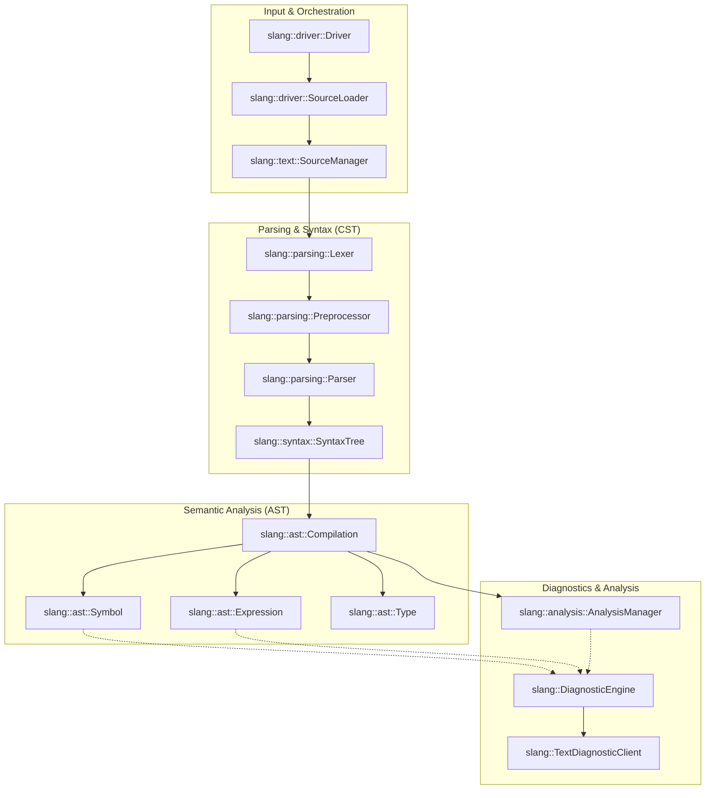
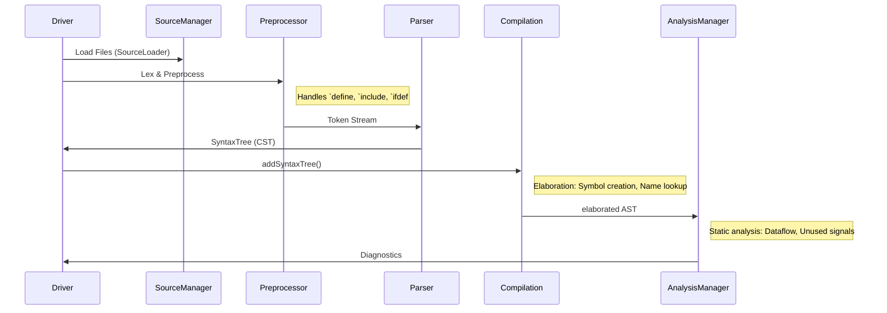

<!-- source: DeepWiki mcp.deepwiki.com · repo MikePopoloski/slang · page 1 Overview · fetched 2026-10-30 -->

# Overview

Relevant source files

The following files were used as context for generating this wiki page:

- [CHANGELOG.md](CHANGELOG.md)
- [CMakeLists.txt](CMakeLists.txt)
- [LICENSE](LICENSE)
- [README.md](README.md)
- [bindings/python/CompBindings.cpp](bindings/python/CompBindings.cpp)
- [docs/CMakeLists.txt](docs/CMakeLists.txt)
- [docs/Doxyfile.in](docs/Doxyfile.in)
- [docs/command-line-ref.dox](docs/command-line-ref.dox)
- [docs/index.html](docs/index.html)
- [docs/language-support.dox](docs/language-support.dox)
- [docs/namespaces.dox](docs/namespaces.dox)
- [docs/user-manual.dox](docs/user-manual.dox)
- [include/slang/driver/Driver.h](include/slang/driver/Driver.h)
- [include/slang/driver/SourceLoader.h](include/slang/driver/SourceLoader.h)
- [include/slang/syntax/SyntaxPrinter.h](include/slang/syntax/SyntaxPrinter.h)
- [pyproject.toml](pyproject.toml)
- [source/CMakeLists.txt](source/CMakeLists.txt)
- [source/driver/Driver.cpp](source/driver/Driver.cpp)
- [source/driver/SourceLoader.cpp](source/driver/SourceLoader.cpp)
- [source/syntax/SyntaxPrinter.cpp](source/syntax/SyntaxPrinter.cpp)
- [tests/regression/CMakeLists.txt](tests/regression/CMakeLists.txt)
- [tests/regression/delayed_reg.v](tests/regression/delayed_reg.v)
- [tests/regression/wire_module.v](tests/regression/wire_module.v)
- [tests/unittests/CMakeLists.txt](tests/unittests/CMakeLists.txt)
- [tests/unittests/DriverTests.cpp](tests/unittests/DriverTests.cpp)
- [tests/unittests/Test.h](tests/unittests/Test.h)
- [tests/unittests/main.cpp](tests/unittests/main.cpp)
- [tools/CMakeLists.txt](tools/CMakeLists.txt)
- [tools/driver/slang_main.cpp](tools/driver/slang_main.cpp)

slang is a high-performance SystemVerilog compiler and language services library. It provides a complete implementation of the IEEE 1800-2023 standard, offering components for lexical analysis, parsing, semantic elaboration, and static analysis. Beyond being a standalone compiler and linter, slang is designed as a modular library to power synthesis tools, simulators, IDE language servers, and refactoring engines.

For specific language feature support, see [SystemVerilog Language Support](#1.1). For build instructions, see [Build and Installation](#1.2). For using the command-line tool, see [Command Line Usage](#1.3).

## Purpose and Scope

slang is engineered to be the fastest and most compliant SystemVerilog frontend. It addresses the complexity of the SystemVerilog language by providing a robust pipeline that transforms source text into a fully elaborated Abstract Syntax Tree (AST).

Key design goals include:
- **Standard Compliance**: Full support for IEEE 1800-2023 [docs/language-support.dox:6-9]().
- **Resilience**: The parser is designed to handle malformed or incomplete code, essential for interactive editor features [README.md:15-16]().
- **High Fidelity**: The Concrete Syntax Tree (CST) supports round-tripping, allowing tools to reconstruct the original source including comments and whitespace [README.md:17-18]().
- **Extensibility**: Python bindings (`pyslang`) expose the internal AST and diagnostic engine for rapid tool development [README.md:49-54]().

Sources: [README.md:8-19](), [docs/language-support.dox:6-12]()

## High-Level Architecture

### System Component Map
The following diagram maps the logical compilation stages to the primary C++ classes and namespaces defined in the codebase.

Sources: [source/driver/Driver.cpp:40-44](), [include/slang/driver/Driver.h:110-134](), [source/CMakeLists.txt:67-119]()

### The Compilation Pipeline
The compilation process is managed by the `Driver` class, which orchestrates the transition from raw files to an elaborated design hierarchy.

Sources: [source/driver/Driver.cpp:40-44](), [include/slang/driver/Driver.h:84-100](), [bindings/python/CompBindings.cpp:98-125]()

## Major System Components

### Driver and Input Processing
The `slang::driver::Driver` class provides a high-level API for CLI tools. it manages the `SourceManager` for file tracking and `SourceLoader` for resolving include paths and library files [include/slang/driver/Driver.h:110-127](). It also populates `CompilationOptions` and `PreprocessorOptions` based on command-line arguments [source/driver/Driver.cpp:48-156]().

### Parsing and Syntax System
The `slang::parsing::Parser` is a recursive-descent parser that generates a `SyntaxTree` [source/CMakeLists.txt:91-95](). Unlike many compilers, slang maintains a full Concrete Syntax Tree (CST) where every token, including "trivia" (whitespace/comments), is preserved [README.md:17-18]().

### Semantic Analysis (AST)
The `slang::ast::Compilation` object is the central hub for the semantic model [include/slang/ast/Compilation.h](). It manages:
- **Symbols**: Hierarchical representation of modules, interfaces, variables, and subroutines [bindings/python/CompBindings.cpp:24-36]().
- **Expressions**: Bound expressions with full type information and constant folding capabilities [bindings/python/CompBindings.cpp:79-81]().
- **Types**: A comprehensive type system covering nets, integers, arrays, classes, and user-defined types [docs/language-support.dox:42-78]().

### Analysis and Diagnostics
Diagnostics are handled by the `DiagnosticEngine`, which collects errors and warnings from all pipeline stages [include/slang/driver/Driver.h:118](). The `AnalysisManager` performs post-elaboration checks such as data-flow analysis to detect uninitialized variables or multiple drivers on a single net [source/CMakeLists.txt:68-76]().

## Code Generation and Build Infrastructure

slang uses Python scripts to generate repetitive C++ code for syntax nodes and diagnostics during the build process:
- **`syntax_gen.py`**: Processes `syntax.txt` to generate `AllSyntax.h`, `SyntaxKind.h`, and visitor patterns [source/CMakeLists.txt:35-51]().
- **`diagnostic_gen.py`**: Processes `diagnostics.txt` to generate unique `DiagCode` identifiers and formatting logic [source/CMakeLists.txt:9-32]().

The project uses CMake and requires a C++20 compliant compiler [CMakeLists.txt:143-145]().

Sources: [source/CMakeLists.txt:6-55](), [CMakeLists.txt:1-100]()

## Use Cases

1.  **Linter/Compiler**: Standalone usage via the `slang` driver for syntax and semantic verification [README.md:23-24]().
2.  **Language Server**: Providing the backend for IDE features like go-to-definition and real-time error reporting [README.md:27]().
3.  **Refactoring Tools**: Using the `SyntaxRewriter` to perform automated code transformations [README.md:26]().
4.  **Python Scripting**: Using `pyslang` to inspect design hierarchies or evaluate expressions for verification scripts [README.md:99-121]().

Sources: [README.md:21-30](), [bindings/python/CompBindings.cpp:117-121]()

---

