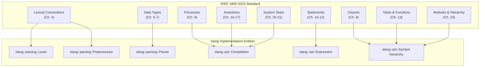
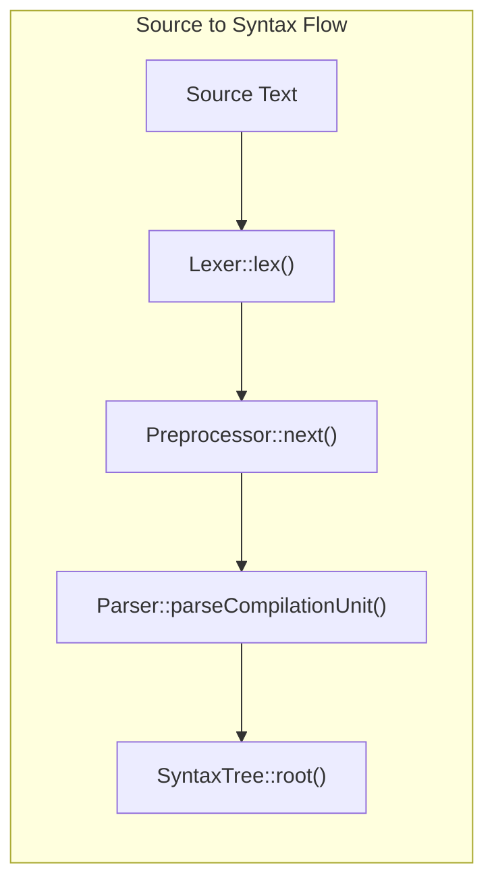

<!-- source: DeepWiki mcp.deepwiki.com · repo MikePopoloski/slang · page 1.1 SystemVerilog Language Support · fetched 2026-10-30 -->

# SystemVerilog Language Support

Relevant source files

The following files were used as context for generating this wiki page:

- [CHANGELOG.md](CHANGELOG.md)
- [CMakeLists.txt](CMakeLists.txt)
- [LICENSE](LICENSE)
- [README.md](README.md)
- [docs/CMakeLists.txt](docs/CMakeLists.txt)
- [docs/Doxyfile.in](docs/Doxyfile.in)
- [docs/index.html](docs/index.html)
- [docs/language-support.dox](docs/language-support.dox)
- [docs/namespaces.dox](docs/namespaces.dox)
- [docs/user-manual.dox](docs/user-manual.dox)
- [pyproject.toml](pyproject.toml)
- [source/CMakeLists.txt](source/CMakeLists.txt)
- [tests/regression/CMakeLists.txt](tests/regression/CMakeLists.txt)
- [tests/regression/delayed_reg.v](tests/regression/delayed_reg.v)
- [tests/regression/wire_module.v](tests/regression/wire_module.v)
- [tests/unittests/CMakeLists.txt](tests/unittests/CMakeLists.txt)
- [tests/unittests/Test.h](tests/unittests/Test.h)
- [tests/unittests/main.cpp](tests/unittests/main.cpp)
- [tools/CMakeLists.txt](tools/CMakeLists.txt)

This document details the SystemVerilog language features supported by slang and its compliance status with IEEE standards. It covers feature support across all major language constructs, standard compliance levels, and slang-specific extensions.

For information about building and installing slang, see [Build and Installation](#1.2). For details about the compilation pipeline that processes these language features, see [Compilation Pipeline](#2).

## Compliance Overview

slang provides complete support for the entirety of the IEEE 1800-2023 SystemVerilog language standard, covering all phases from lexical analysis through compilation and elaboration [docs/language-support.dox:6-9](). The implementation spans lexical conventions, data types, expressions, statements, modules, classes, assertions, and all other major language constructs.

**Language Coverage by Phase:**

Sources: [docs/language-support.dox:6-13](), [source/CMakeLists.txt:67-119]()

## Core Language Features

### Lexical and Syntactic Support

slang provides complete support for SystemVerilog lexical conventions and syntax parsing, implemented through a robust multi-stage pipeline [docs/language-support.dox:25-41]().

**Lexical Analysis Coverage:**

| Feature Category | LRM Section | Implementation | Status |
|------------------|-------------|----------------|--------|
| Tokens & Operators | 5.2-5.5 | `Lexer.cpp` | ✅ Complete |
| Identifiers & Keywords | 5.6 | `TokenKind.h` | ✅ Complete |
| Number Literals | 5.7 | `NumberParser.cpp` | ✅ Complete |
| Time Literals | 5.8 | `Time.cpp` | ✅ Complete |
| String & Array Literals | 5.9-5.11 | `Lexer.cpp` | ✅ Complete |
| Attributes | 5.12 | `Parser_members.cpp` | ✅ Complete |

Sources: [docs/language-support.dox:25-41](), [source/CMakeLists.txt:88-100]()

### Data Types and Expressions

The type system provides comprehensive support for all SystemVerilog data types, from basic integer types to complex aggregate structures [docs/language-support.dox:42-96]().

**Data Type Implementation:**

| Type Category | Key Classes | Features Supported |
|---------------|-------------|-------------------|
| Basic Types | `IntegralType`, `FloatingType` | All integer widths, real types, time |
| Aggregate Types | `StructType`, `UnionType`, `ArrayType` | Packed/unpacked structures, unions, arrays |
| Class Types | `ClassType` | Inheritance, polymorphism, interfaces |
| User-Defined | `TypedefType`, `NetType` | Custom types, user-defined nettypes |

Recent additions include support for **Generic Interconnect** (LRM 6.6.8) and **User-defined nettypes** (LRM 6.6.7) [docs/language-support.dox:50-52]().

Sources: [docs/language-support.dox:42-79](), [docs/language-support.dox:80-96]()

### Control Flow and Procedural Constructs

All SystemVerilog procedural programming constructs are fully supported, including process blocks, conditional statements, and loops [docs/language-support.dox:130-154]().

**Process and Statement Support:**

| Construct Type | LRM Section | Key Features |
|----------------|-------------|--------------|
| Process Blocks | 9.2 | initial, always (all variants), final |
| Control Flow | 12.4-12.5 | if-else, case/casex/casez |
| Loops | 12.7 | for, while, do-while, foreach, repeat |
| Timing | 9.4 | delays (#), event controls (@), wait |
| Parallel Blocks | 9.3.2 | fork-join, join_any, join_none |

Sources: [docs/language-support.dox:130-154](), [docs/language-support.dox:185-199]()

## Advanced Language Features

### Object-Oriented Programming (OOP)

slang provides complete support for SystemVerilog's object-oriented features, including classes, inheritance, polymorphism, and interface classes [docs/language-support.dox:97-129]().

**Class System Implementation:**

| Feature | LRM Section | Implementation Status |
|---------|-------------|-----------------------|
| Inheritance | 8.13 | ✅ Supported (v0.5) |
| Virtual Methods | 8.20 | ✅ Supported (v0.5) |
| Interface Classes | 8.26 | ✅ Supported (v0.5) |
| Out-of-block decls | 8.24 | ✅ Supported (v0.5) |
| Weak References | 8.30 | ✅ Supported (v6.0) |

Sources: [docs/language-support.dox:97-129](), [CHANGELOG.md:13-15]()

### Assertions and Temporal Logic

Full support for SystemVerilog Assertions (SVA) including immediate assertions, concurrent assertions, sequences, and properties [docs/language-support.dox:240-275]().

**Assertion System Architecture:**

| Component | LRM Section | Implementation |
|-----------|-------------|----------------|
| Immediate Assertions | 16.3 | `ImmediateAssertionStatement` |
| Concurrent Assertions | 16.12 | `ConcurrentAssertionStatement` |
| Sequences | 16.7 | `SequenceSymbol` |
| Properties | 16.12 | `PropertySymbol` |
| Checkers | 17 | `CheckerSymbol` |

Sources: [docs/language-support.dox:240-275](), [tests/unittests/CMakeLists.txt:8-16]()

## Language Extensions and Compatibility

### Compatibility Modes

slang includes a robust compatibility system to handle non-standard behaviors common in industrial tools like VCS [driver/CompatSettings.cpp:1-50]().

**Recent Compatibility Enhancements:**
- Added `--allow-virtual-iface-with-override` for bind/defparam targets [CHANGELOG.md:9-10]().
- Downgradeable errors for `std::randomize` arguments via `-Wnonstandard-randomize` [CHANGELOG.md:10-11]().
- Support for non-standard string concatenation with `+` operator [CHANGELOG.md:11-12]().
- Relaxed implementation for `extern` and `pure` method implicit return types [CHANGELOG.md:13-14]().

### Built-in Extensions
slang provides several non-standard but highly useful extensions:
- **`$static_assert`**: For compile-time elaboration checks.
- **`(* maybe_unknown *)` attribute**: Allows ignoring unknown module instantiations [CHANGELOG.md:35-36]().
- **`$deposit` system task**: Support for legacy codebases [CHANGELOG.md:26-27]().

Sources: [CHANGELOG.md:8-28](), [driver/CompatSettings.cpp:1-80]()

## Implementation Status

### Feature Completion Matrix

| Language Area | Chapters | Implementation Status |
|---------------|----------|----------------------|
| Lexical Conventions | 5 | ✅ Complete |
| Data Types | 6-7 | ✅ Complete |
| Classes | 8 | ✅ Complete |
| Processes | 9 | ✅ Complete |
| Assignment | 10 | ✅ Complete |
| Operators/Exprs | 11 | ✅ Complete |
| Tasks/Functions | 13 | ✅ Complete |
| Assertions | 16-17 | ✅ Complete |
| Hierarchy | 23 | ✅ Complete |

### Known Limitations
Current limitations are tracked via the `lang-compliance` label on GitHub [docs/language-support.dox:7-9]().
- **SDF backannotation** (Chapter 32): Partial support.
- **Strength modeling** (Chapter 28): Limited, as slang focuses on compilation/elaboration rather than gate-level simulation.

Sources: [docs/language-support.dox:6-9](), [docs/language-support.dox:482-529]()

---

