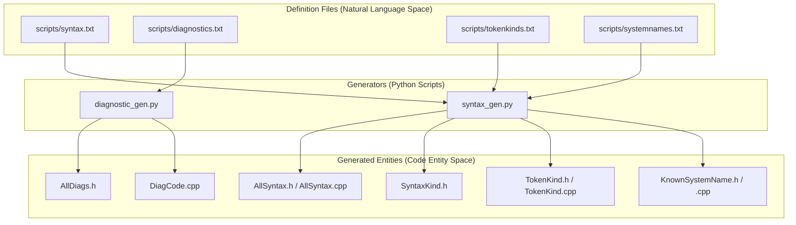
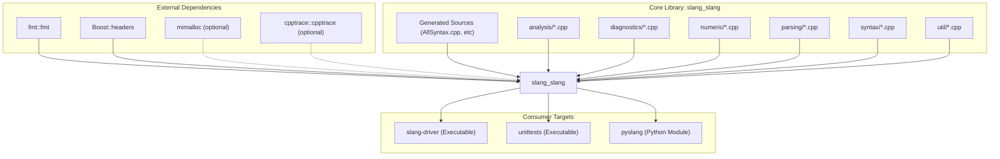

<!-- source: DeepWiki mcp.deepwiki.com · repo MikePopoloski/slang · page 1.2 Build and Installation · fetched 2026-10-30 -->

# Build and Installation

<details>
<summary>Relevant source files</summary>

The following files were used as context for generating this wiki page:

- [.clang-tidy](.clang-tidy)
- [.github/copilot-instructions.md](.github/copilot-instructions.md)
- [.github/workflows/build.yml](.github/workflows/build.yml)
- [.github/workflows/copilot-setup-steps.yml](.github/workflows/copilot-setup-steps.yml)
- [.github/workflows/coverage.yml](.github/workflows/coverage.yml)
- [.github/workflows/docs.yml](.github/workflows/docs.yml)
- [.github/workflows/python-build.yml](.github/workflows/python-build.yml)
- [.github/workflows/python-dist.yml](.github/workflows/python-dist.yml)
- [CMakeLists.txt](CMakeLists.txt)
- [CMakePresets.json](CMakePresets.json)
- [LICENSES/BSL-1.0.txt](LICENSES/BSL-1.0.txt)
- [LICENSES/CC-BY-SA-3.0.txt](LICENSES/CC-BY-SA-3.0.txt)
- [REUSE.toml](REUSE.toml)
- [bindings/CMakeLists.txt](bindings/CMakeLists.txt)
- [bindings/generate_stubs.cmake](bindings/generate_stubs.cmake)
- [bindings/python/pyslang.cpp](bindings/python/pyslang.cpp)
- [bindings/python/pyslang.h](bindings/python/pyslang.h)
- [cmake/install-rules.cmake](cmake/install-rules.cmake)
- [cmake/slangConfig.cmake.in](cmake/slangConfig.cmake.in)
- [docs/building.dox](docs/building.dox)
- [external/CMakeLists.txt](external/CMakeLists.txt)
- [pyslang/docs/conf.py](pyslang/docs/conf.py)
- [pyslang/docs/pages/index.rst](pyslang/docs/pages/index.rst)
- [pyslang/pyslang/__init__.py](pyslang/pyslang/__init__.py)
- [pyslang/pyslang/py.typed](pyslang/pyslang/py.typed)
- [pyslang/tests/test_accessing_spans.py](pyslang/tests/test_accessing_spans.py)
- [pyslang/tests/test_lexer.py](pyslang/tests/test_lexer.py)
- [pyslang/tests/test_syntax_factory.py](pyslang/tests/test_syntax_factory.py)
- [pyslang/tests/test_syntax_rewriter.py](pyslang/tests/test_syntax_rewriter.py)
- [source/CMakeLists.txt](source/CMakeLists.txt)
- [tests/CMakeLists.txt](tests/CMakeLists.txt)
- [tests/regression/CMakeLists.txt](tests/regression/CMakeLists.txt)
- [tests/regression/delayed_reg.v](tests/regression/delayed_reg.v)
- [tests/regression/wire_module.v](tests/regression/wire_module.v)
- [tests/unittests/CMakeLists.txt](tests/unittests/CMakeLists.txt)
- [tests/unittests/Test.h](tests/unittests/Test.h)
- [tests/unittests/main.cpp](tests/unittests/main.cpp)
- [tools/CMakeLists.txt](tools/CMakeLists.txt)

</details>


This page provides comprehensive instructions for building, installing, and integrating the slang SystemVerilog compiler and language services library into your projects. For information about command-line usage after installation, see [Command Line Usage](#1.3).

## Getting the Source Code

The slang source code is hosted on GitHub:

```bash
git clone https://github.com/MikePopoloski/slang.git
```

Sources: [docs/building.dox:7-12]()

## Build Requirements

Before building slang, ensure you have the following prerequisites installed:

- **Python 3**: Required for code generation scripts. [docs/building.dox:17-17]()
- **CMake 3.20 or later**: The primary build system. [docs/building.dox:18-18]()
- **C++20 compatible compiler**: slang uses modern C++20 features. [CMakeLists.txt:143-145]()
  - GCC 11 or later [docs/building.dox:20-20]()
  - Clang 17 or later [docs/building.dox:21-21]()
  - Xcode 16 or later [docs/building.dox:22-22]()
  - Visual Studio 2022 (latest update recommended) [docs/building.dox:23-23]()

Sources: [docs/building.dox:14-24](), [CMakeLists.txt:143-145]()

## Quick Start Building

The build process is designed to work consistently across all supported platforms:

```bash
cmake -B build
cmake --build build -j
```

To run the tests (included by default):

```bash
cd build && ctest --output-on-failure
```

Sources: [docs/building.dox:26-38]()

## Build Process Overview

The slang build involves a significant code generation phase before compiling the main library. Python scripts transform text definitions into C++ headers and source files to manage the complexity of SystemVerilog syntax and diagnostics.

### Code Generation Flow
The following diagram illustrates how "Natural Language Space" definitions in `.txt` files are mapped to "Code Entity Space" C++ files.

Title: Code Generation Pipeline


Sources: [source/CMakeLists.txt:9-51](), [docs/building.dox:82-90]()

### Library Target Structure
The primary output of the build is the `slang_slang` library, which is aliased as `slang::slang` for consumer use.

Title: slang Target Architecture


Sources: [source/CMakeLists.txt:58-123](), [source/CMakeLists.txt:148-165](), [tools/CMakeLists.txt:1-10](), [tests/unittests/CMakeLists.txt:56-56]()

## Dependencies

slang manages dependencies via `FetchContent`. If a dependency is not found on the system, it is automatically downloaded and built from source.

| Dependency | Minimum Version | Purpose |
|------------|-----------------|---------|
| `fmt` | 12.1 | Text formatting |
| `mimalloc` | 2.2 | High-performance memory allocation |
| `cpptrace` | 1.0 | Stack trace generation |
| `Catch2` | 3.13 | Unit testing framework |
| `pybind11` | 3.0 | Python bindings |
| `Boost` | 1.87.0 | Header-only utilities (unordered maps) |

Sources: [external/CMakeLists.txt:6-10](), [external/CMakeLists.txt:58-58](), [bindings/CMakeLists.txt:14-14]()

## Build Options

The following CMake options allow customization of the slang build:

| Option | Description | Default |
|--------|-------------|---------|
| `SLANG_INCLUDE_TOOLS` | Include tools like the `slang` driver | `ON` |
| `SLANG_INCLUDE_TESTS` | Include unit tests | `ON` |
| `SLANG_INCLUDE_PYLIB` | Build `pyslang` Python bindings | `OFF` |
| `SLANG_USE_MIMALLOC` | Use mimalloc for faster allocation | `ON` |
| `SLANG_USE_THREADS` | Enable multi-threading support | `ON` |
| `BUILD_SHARED_LIBS` | Build shared libraries instead of static | `OFF` |
| `SLANG_USE_CPPTRACE` | Enable stack traces on crashes | `OFF` |

Sources: [CMakeLists.txt:58-78](), [docs/building.dox:50-68]()

## CMake Presets

slang includes a `CMakePresets.json` file to simplify configuration for various environments.

### Key Presets:
- **Linux (GCC/Clang)**:
  - `gcc-release`: Standard optimized build. [CMakePresets.json:179-189]()
  - `clang-sanitize`: Build with AddressSanitizer and UndefinedBehaviorSanitizer. [CMakePresets.json:134-150]()
  - `gcc-coverage`: Build with code coverage instrumentation. [CMakePresets.json:203-212]()
- **Windows (MSVC)**:
  - `win64-release`: Optimized 64-bit Windows build. [CMakePresets.json:41-49]()
  - `win64-debug-noexcept`: Debug build with C++ exceptions disabled. [CMakePresets.json:72-80]()
- **Specialized**:
  - `wasi-sdk`: Build for WebAssembly via WASI. [CMakePresets.json:237-246]()

Sources: [CMakePresets.json:1-262]()

## Building Python Bindings

The `pyslang` module is built using `pybind11`. Note that `SLANG_USE_MIMALLOC` is automatically disabled when building Python bindings due to compatibility issues. [CMakeLists.txt:194-196]()

### Build via pip
To install `pyslang` into your current Python environment:
```bash
pip install .
```
Sources: [docs/building.dox:126-135]()

### Manual CMake Build
```bash
cmake -B build -DSLANG_INCLUDE_PYLIB=ON
cmake --build build --target pyslang
```
Sources: [bindings/CMakeLists.txt:41-59]()

## Installation and Integration

### Installing slang
```bash
cmake --install build --prefix /your/install/path
```
Sources: [docs/building.dox:153-157]()

### Integrating as a Library
Consumers can link against slang using the `slang::slang` target. If slang was installed via CMake, it can be found using `find_package(slang)`.

```cmake
find_package(slang 10.0 REQUIRED)
target_link_libraries(my_tool PRIVATE slang::slang)
```
Sources: [docs/building.dox:171-181](), [cmake/slangConfig.cmake.in:1-11]()

## Continuous Integration
slang uses GitHub Actions for CI, testing across multiple presets (Clang, GCC, MSVC, WASI) on every push to master. [build.yml:11-33]()

Sources: [.github/workflows/build.yml:1-74]()

---

