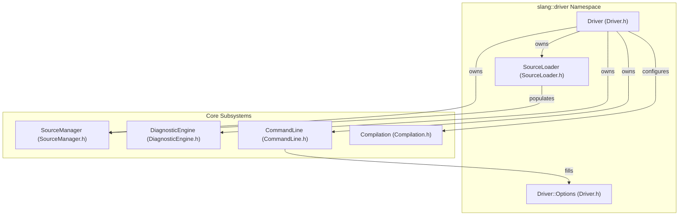
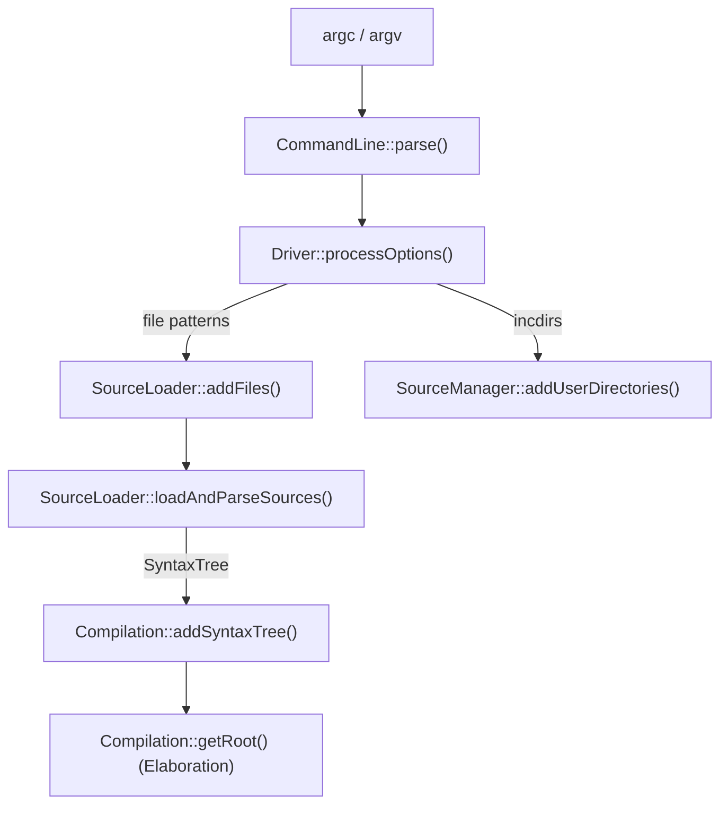

<!-- source: DeepWiki mcp.deepwiki.com · repo MikePopoloski/slang · page 1.3 Command Line Usage · fetched 2026-10-30 -->

# Command Line Usage

<details>
<summary>Relevant source files</summary>

The following files were used as context for generating this wiki page:

- [bindings/python/CompBindings.cpp](bindings/python/CompBindings.cpp)
- [docs/command-line-ref.dox](docs/command-line-ref.dox)
- [include/slang/diagnostics/DiagnosticClient.h](include/slang/diagnostics/DiagnosticClient.h)
- [include/slang/diagnostics/TextDiagnosticClient.h](include/slang/diagnostics/TextDiagnosticClient.h)
- [include/slang/driver/Driver.h](include/slang/driver/Driver.h)
- [include/slang/driver/SourceLoader.h](include/slang/driver/SourceLoader.h)
- [include/slang/syntax/SyntaxPrinter.h](include/slang/syntax/SyntaxPrinter.h)
- [include/slang/util/OS.h](include/slang/util/OS.h)
- [source/diagnostics/DiagnosticClient.cpp](source/diagnostics/DiagnosticClient.cpp)
- [source/diagnostics/JsonDiagnosticClient.cpp](source/diagnostics/JsonDiagnosticClient.cpp)
- [source/diagnostics/TextDiagnosticClient.cpp](source/diagnostics/TextDiagnosticClient.cpp)
- [source/driver/Driver.cpp](source/driver/Driver.cpp)
- [source/driver/SourceLoader.cpp](source/driver/SourceLoader.cpp)
- [source/syntax/SyntaxPrinter.cpp](source/syntax/SyntaxPrinter.cpp)
- [source/util/OS.cpp](source/util/OS.cpp)
- [tests/unittests/DriverTests.cpp](tests/unittests/DriverTests.cpp)
- [tools/driver/slang_main.cpp](tools/driver/slang_main.cpp)

</details>


This document explains how to use the slang command line interface, detailing available options, input file handling, and common usage patterns. slang provides a comprehensive command line interface for compiling, analyzing, and preprocessing SystemVerilog code, implemented primarily through the `Driver` class.

## Overview

The slang driver tool acts as a high-level orchestrator for the compiler pipeline. It handles argument parsing, source file discovery via globbing, and coordinates the transition from source text to an elaborated design hierarchy.

### Basic Command Line Structure

```bash
slang [options] [source_files...]
```

Where:
- `options` are command line flags that control compilation behavior.
- `source_files` are SystemVerilog source files (supports file patterns with wildcards).

Sources: [source/driver/Driver.cpp:48-336](), [docs/command-line-ref.dox:30-32]()

## Driver Architecture

The `slang::driver::Driver` class encapsulates the state required to run a compilation from the command line. It manages the `SourceManager` for file tracking, the `DiagnosticEngine` for error reporting, and the `SourceLoader` for file discovery.

### System Entity Map

The following diagram associates the primary C++ classes with their roles in the command-line execution flow.



Sources: [include/slang/driver/Driver.h:102-134](), [source/driver/Driver.cpp:40-44]()

## Command Line Processing Flow

Slang follows a multi-stage initialization process before starting the compilation pipeline.

1.  **Argument Registration**: The `Driver::addStandardArgs` function populates the `CommandLine` object with all supported SystemVerilog flags [source/driver/Driver.cpp:48-336]().
2.  **Parsing**: The `CommandLine::parse` method processes the `argc/argv` input [source/driver/Driver.cpp:372-380]().
3.  **Option Processing**: `Driver::processOptions` validates the input and configures internal state, such as language versions and include paths [source/driver/Driver.cpp:445-623]().
4.  **Source Loading**: The `SourceLoader` resolves file patterns and library mappings [source/driver/SourceLoader.cpp:172-190]().

### Data Flow Diagram



Sources: [source/driver/Driver.cpp:445-623](), [source/driver/SourceLoader.cpp:158-160](), [include/slang/driver/Driver.h:93-99]()

## Core Command Line Options

### General and Language Versioning
| Option | Description | Code Reference |
| :--- | :--- | :--- |
| `-h, --help` | Display help text and exit. | [docs/command-line-ref.dox:8-10]() |
| `--version` | Display version information. | [docs/command-line-ref.dox:12-14]() |
| `--std` | Set language version: `1364-2005`, `1800-2017`, `1800-2023`, or `latest`. | [source/driver/Driver.cpp:49-51]() |
| `-j, --threads` | Number of threads for parallel parsing. | [source/driver/Driver.cpp:136-137]() |

### Input File Handling
Slang supports several ways to organize input files:
- **Positional Arguments**: Treated as primary source files [docs/command-line-ref.dox:30-32]().
- **`--single-unit`**: Concatenates all input files into a single compilation unit [docs/command-line-ref.dox:34-39]().
- **`-v, --libfile`**: Adds files as source libraries. Modules within are only instantiated if referenced [docs/command-line-ref.dox:41-47]().
- **`-f / -F`**: Command files containing lists of arguments. `-F` makes paths relative to the command file itself [source/driver/Driver.cpp:338-356]().
- **`-C`**: Compilation unit listing files for independent unit definitions [source/driver/Driver.cpp:143-151]().

### Preprocessor and Include Paths
| Option | Description | Code Reference |
| :--- | :--- | :--- |
| `-I, +incdir` | Add directory to search for \`include "..."`. | [source/driver/Driver.cpp:54-62]() |
| `--isystem` | Add directory to search for \`include <...>`. | [source/driver/Driver.cpp:64-73]() |
| `-D, +define` | Define a macro for all source files. | [source/driver/Driver.cpp:80-82]() |
| `-U` | Undefine a macro. | [source/driver/Driver.cpp:83-85]() |

Sources: [source/driver/Driver.cpp:48-151](), [docs/command-line-ref.dox:1-150]()

## Action Modes

Slang can stop at various stages of the pipeline based on the provided flags:

- **Preprocess Only (`-E, --preprocess`)**: Runs the preprocessor and prints the result to stdout. Supports flags like `--comments` and `--directives` [docs/command-line-ref.dox:96-99]().
- **Macros Only (`--macros-only`)**: Prints all discovered macros and exits [docs/command-line-ref.dox:102-104]().
- **Parse Only (`--parse-only`)**: Stops after generating the Concrete Syntax Tree (CST); does not perform type checking or elaboration [docs/command-line-ref.dox:121-123]().
- **Lint Only (`--lint-only`)**: Performs semantic analysis but skips full design elaboration to save time [docs/command-line-ref.dox:126-128]().

Sources: [tools/driver/slang_main.cpp:149-164](), [docs/command-line-ref.dox:89-136]()

## Library Mapping and Search

Slang implements the standard Verilog library search mechanism:

1.  **Library Directories (`-y, --libdir`)**: Specifies directories to search for missing module definitions [source/driver/Driver.cpp:298-301]().
2.  **Library Extensions (`-Y, --libext`)**: Specifies file extensions to check during search (e.g., `.v`, `.sv`) [source/driver/Driver.cpp:302-305]().
3.  **Library Maps (`--libmap`)**: Supports Verilog Library Map files for mapping specific modules to files [source/driver/Driver.cpp:314-317]().

The `SourceLoader` class handles the logic for resolving these missing references by iterating through registered search directories and extensions [source/driver/SourceLoader.cpp:192-205]().

Sources: [source/driver/Driver.cpp:298-317](), [source/driver/SourceLoader.cpp:58-77]()

## Diagnostic Configuration

The diagnostic system is highly configurable via the command line:

- **Severity Control**: Use `-W<warning>` to enable or `-Wno-<warning>` to disable specific diagnostics. `-Werror` treats all warnings as errors [source/driver/Driver.cpp:239-242]().
- **Formatting**:
    - `--diag-column`: Include column numbers [source/driver/Driver.cpp:230]().
    - `--diag-source`: Show the source code snippet and caret [source/driver/Driver.cpp:232]().
    - `--diag-macro-expansion`: Show the backtrace of macro expansions [source/driver/Driver.cpp:236]().
- **JSON Output**: `--diag-json <file>` redirects diagnostics to a machine-readable JSON format via `JsonDiagnosticClient` [source/driver/Driver.cpp:253-257]().

Sources: [source/driver/Driver.cpp:223-257](), [source/diagnostics/TextDiagnosticClient.cpp:49-101]()

## Compatibility Modes

To ease migration from other tools, slang provides compatibility flags:

- **`--compat <tool>`**: Adjusts default behaviors to match specific vendors (e.g., `vcs`) [source/driver/Driver.cpp:164-167]().
- **`--allow-use-before-declare`**: Relaxes the requirement that names must be declared before use [source/driver/Driver.cpp:173-175]().
- **`--relax-enum-conversions`**: Allows implicit conversions from integers to enums [source/driver/Driver.cpp:170-172]().
- **`--cmd-ignore <cmd>,<N>`**: Allows the command-line parser to skip vendor-specific flags that slang does not recognize [source/driver/Driver.cpp:114-119]().

Sources: [source/driver/Driver.cpp:114-205](), [docs/command-line-ref.dox:402-509]()

---

