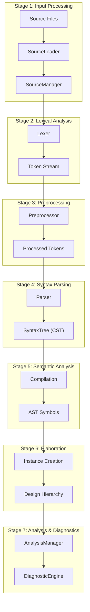
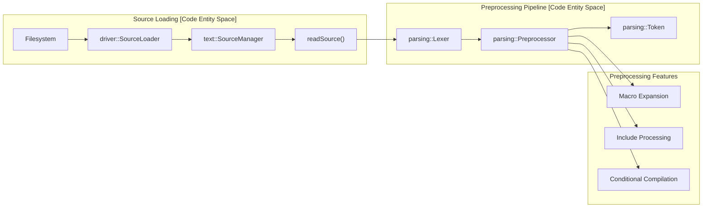
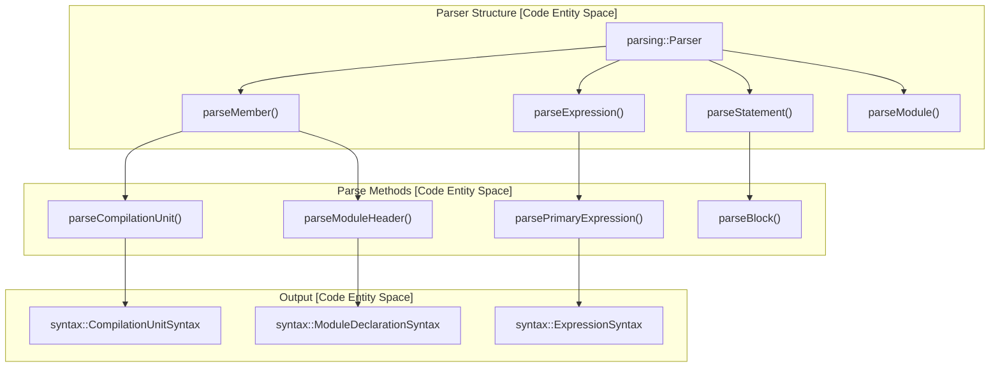
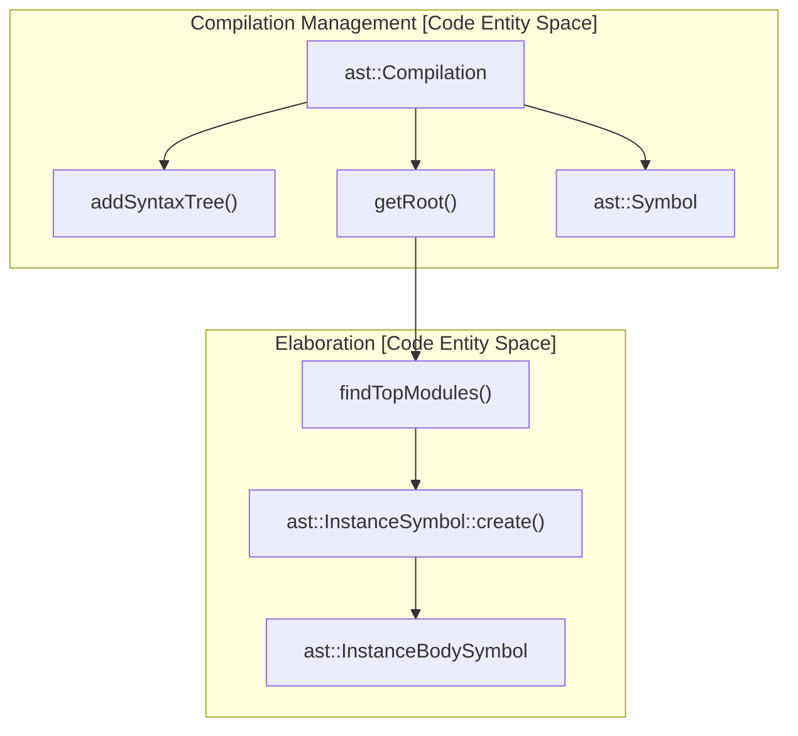

<!-- source: DeepWiki mcp.deepwiki.com · repo MikePopoloski/slang · page 2 Compilation Pipeline · fetched 2026-10-30 -->

# Compilation Pipeline

Relevant source files

The following files were used as context for generating this wiki page:

- [CMakeLists.txt](CMakeLists.txt)
- [bindings/python/CompBindings.cpp](bindings/python/CompBindings.cpp)
- [docs/command-line-ref.dox](docs/command-line-ref.dox)
- [include/slang/driver/Driver.h](include/slang/driver/Driver.h)
- [include/slang/driver/SourceLoader.h](include/slang/driver/SourceLoader.h)
- [include/slang/syntax/SyntaxPrinter.h](include/slang/syntax/SyntaxPrinter.h)
- [source/CMakeLists.txt](source/CMakeLists.txt)
- [source/driver/Driver.cpp](source/driver/Driver.cpp)
- [source/driver/SourceLoader.cpp](source/driver/SourceLoader.cpp)
- [source/syntax/SyntaxPrinter.cpp](source/syntax/SyntaxPrinter.cpp)
- [tests/regression/CMakeLists.txt](tests/regression/CMakeLists.txt)
- [tests/regression/delayed_reg.v](tests/regression/delayed_reg.v)
- [tests/regression/wire_module.v](tests/regression/wire_module.v)
- [tests/unittests/CMakeLists.txt](tests/unittests/CMakeLists.txt)
- [tests/unittests/DriverTests.cpp](tests/unittests/DriverTests.cpp)
- [tests/unittests/Test.h](tests/unittests/Test.h)
- [tests/unittests/main.cpp](tests/unittests/main.cpp)
- [tools/CMakeLists.txt](tools/CMakeLists.txt)
- [tools/driver/slang_main.cpp](tools/driver/slang_main.cpp)

This document details the multi-stage compilation process that transforms SystemVerilog source code into an elaborated design representation. The pipeline handles lexical analysis, syntax parsing, semantic analysis, module elaboration, and diagnostic reporting. For information about specific symbol types and their management, see [Symbol System](#3). For details about expression processing and evaluation, see [Expression System](#4).

## Overview

The slang compilation pipeline transforms SystemVerilog source files through several distinct stages to produce a fully elaborated design. The process is managed by the central `Compilation` class and involves multiple specialized components working together.

**Pipeline Flow Diagram**

Sources: [source/ast/Compilation.cpp:1-1000](), [include/slang/ast/Compilation.h:1-500](), [source/parsing/Parser.cpp:1-100]()

## Source Loading and Preprocessing

The compilation process begins with loading source files and preprocessing them to handle SystemVerilog's textual preprocessing features. The `Driver` class typically orchestrates this by using a `SourceLoader` to discover files via patterns and a `SourceManager` to maintain the buffers.

**Source Loading and Preprocessing Components**

The `SourceManager` tracks all source files and their contents [source/text/SourceManager.cpp:1-100](), while the `Preprocessor` handles SystemVerilog's textual preprocessing features including macro expansion, file inclusion, and conditional compilation directives like `` `ifdef`` [source/parsing/Preprocessor.cpp:1-100](). The `Lexer` tokenizes the raw source text before preprocessing occurs [source/parsing/Lexer.cpp:1-100]().

For details, see [Preprocessing and Lexical Analysis](#2.1).

Sources: [source/driver/SourceLoader.cpp:25-50](), [include/slang/driver/SourceLoader.h:61-90](), [source/driver/Driver.cpp:40-60](), [source/parsing/Preprocessor.cpp:1-100]()

## Syntax Parsing

The `Parser` class transforms the preprocessed token stream into a concrete syntax tree (CST) representation. The parser is implemented as a recursive descent parser with multiple specialized parsing methods for different language constructs.

**Parser Architecture and Methods**

The parser constructs `SyntaxNode` hierarchies that represent the structure of the source code. The main entry point `parseCompilationUnit()` builds a complete `CompilationUnitSyntax` tree [source/parsing/Parser_members.cpp:17-50]().

| Parse Method | Output Type | Purpose |
|--------------|-------------|---------|
| `parseCompilationUnit()` | `CompilationUnitSyntax` | Top-level compilation unit |
| `parseModule()` | `ModuleDeclarationSyntax` | Module, interface, or program |
| `parseExpression()` | `ExpressionSyntax` | Expressions and operators |
| `parseStatement()` | `StatementSyntax` | Procedural statements |

For details, see [Syntax Parsing](#2.2).

Sources: [source/parsing/Parser.cpp:17-100](), [include/slang/parsing/Parser.h:138-170](), [source/parsing/Parser_members.cpp:17-50](), [source/parsing/Parser_expressions.cpp:17-50]()

## Semantic Analysis and Elaboration

The `Compilation` class manages the transformation from concrete syntax trees to semantic Abstract Syntax Trees (AST). This process involves symbol creation, name resolution, and design elaboration where module instances are created and parameters are resolved.

**Semantic Analysis and Elaboration Pipeline**

The `addSyntaxTree()` method adds syntax trees to the compilation [include/slang/ast/Compilation.h:281-295](). The `getRoot()` method triggers finalization, which resolves all deferred symbols and creates the complete AST hierarchy, including identifying top-level modules and resolving parameter overrides [source/ast/Compilation.cpp:298-568]().

For details, see [Elaboration and Compilation](#2.3).

Sources: [source/ast/Compilation.cpp:178-256](), [source/ast/symbols/InstanceSymbols.cpp:350-500](), [include/slang/ast/Compilation.h:281-295]()

## Analysis and Diagnostics

The final stage involves running static analysis passes and generating diagnostic reports. The `DiagnosticEngine` collects and formats errors, warnings, and notes throughout the compilation process.

The `AnalysisManager` performs post-elaboration checks such as data flow analysis and driver tracking [source/analysis/AnalysisManager.cpp:1-50](). Diagnostics are reported via `DiagnosticEngine` and can be rendered by various clients, such as `TextDiagnosticClient` for console output or `JsonDiagnosticClient` for machine-readable formats [source/driver/Driver.cpp:40-45]().

Sources: [source/analysis/AnalysisManager.cpp:1-50](), [source/diagnostics/DiagnosticEngine.cpp:1-100](), [source/diagnostics/TextDiagnosticClient.cpp:1-100]()

## Key Classes and Control Flow

The compilation pipeline is orchestrated by several key classes:

| Class | File | Primary Responsibility |
|-------|------|----------------------|
| `Compilation` | [source/ast/Compilation.cpp]() | Central compilation manager, coordinates all phases |
| `Driver` | [source/driver/Driver.cpp]() | CLI entry point and high-level orchestrator |
| `SourceLoader` | [source/driver/SourceLoader.cpp]() | Discovers and loads source files from patterns |
| `Parser` | [source/parsing/Parser.cpp]() | Syntax parsing, CST construction |
| `Preprocessor` | [source/parsing/Preprocessor.cpp]() | Macro expansion, include processing |
| `SourceManager` | [source/text/SourceManager.cpp]() | Source file management, location tracking |
| `DiagnosticEngine` | [source/diagnostics/DiagnosticEngine.cpp]() | Error and warning management |

Sources: [source/driver/Driver.cpp:40-100](), [source/ast/Compilation.cpp:40-176](), [include/slang/driver/SourceLoader.h:61-100]()

---

