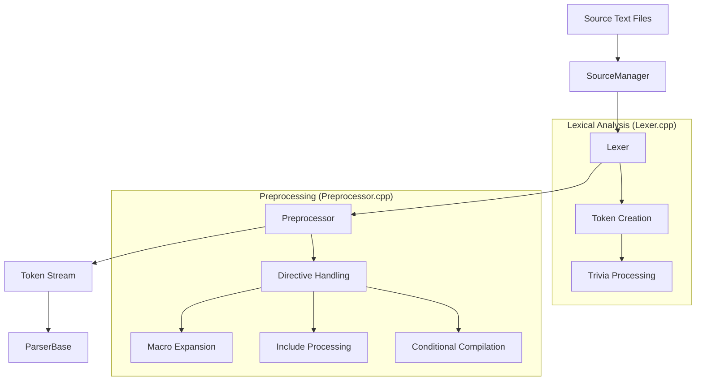
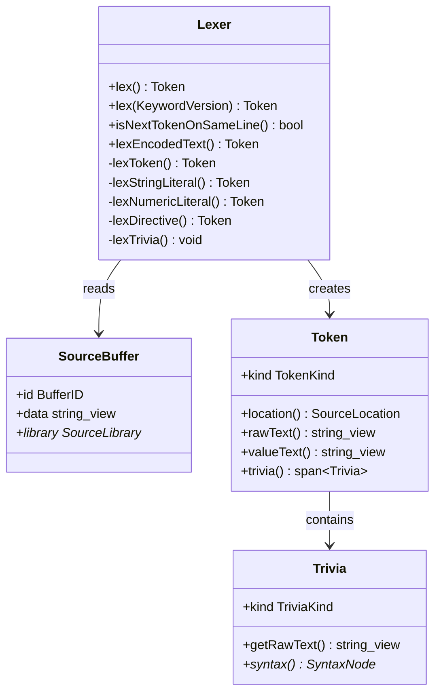
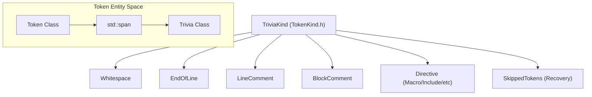
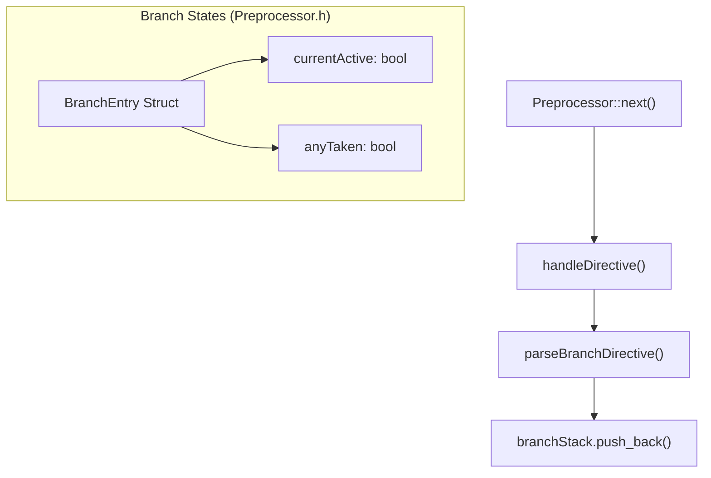

<!-- source: DeepWiki mcp.deepwiki.com · repo MikePopoloski/slang · page 2.1 Preprocessing and Lexical Analysis · fetched 2026-10-30 -->

# Preprocessing and Lexical Analysis

Relevant source files

The following files were used as context for generating this wiki page:

- [include/slang/parsing/Lexer.h](include/slang/parsing/Lexer.h)
- [include/slang/parsing/LexerFacts.h](include/slang/parsing/LexerFacts.h)
- [include/slang/parsing/NumberParser.h](include/slang/parsing/NumberParser.h)
- [include/slang/parsing/ParserBase.h](include/slang/parsing/ParserBase.h)
- [include/slang/parsing/Preprocessor.h](include/slang/parsing/Preprocessor.h)
- [include/slang/parsing/Token.h](include/slang/parsing/Token.h)
- [source/parsing/Lexer.cpp](source/parsing/Lexer.cpp)
- [source/parsing/LexerFacts.cpp](source/parsing/LexerFacts.cpp)
- [source/parsing/NumberParser.cpp](source/parsing/NumberParser.cpp)
- [source/parsing/ParserBase.cpp](source/parsing/ParserBase.cpp)
- [source/parsing/Preprocessor.cpp](source/parsing/Preprocessor.cpp)
- [source/parsing/Preprocessor_macros.cpp](source/parsing/Preprocessor_macros.cpp)
- [source/parsing/Token.cpp](source/parsing/Token.cpp)
- [tests/unittests/parsing/ExpressionParsingTests.cpp](tests/unittests/parsing/ExpressionParsingTests.cpp)
- [tests/unittests/parsing/LexerTests.cpp](tests/unittests/parsing/LexerTests.cpp)
- [tests/unittests/parsing/PreprocessorTests.cpp](tests/unittests/parsing/PreprocessorTests.cpp)

This document covers the first stage of the slang compilation pipeline: preprocessing and lexical analysis. This stage transforms raw source text into a stream of tokens, handling SystemVerilog preprocessing directives including macro expansion, file inclusion, and conditional compilation. For information about parsing these tokens into syntax trees, see [Syntax Parsing](2.2). For the overall compilation pipeline overview, see [Compilation Pipeline](2).

## Overview

The preprocessing and lexical analysis stage consists of two main phases that work together to process SystemVerilog source text:

1. **Lexical Analysis**: Converting raw source text into individual tokens via the `Lexer`.
2. **Preprocessing**: Handling directives like macro expansion, include processing, and conditional compilation via the `Preprocessor`.

### Architecture Flow

Sources: [source/parsing/Lexer.cpp:33-43](), [source/parsing/Preprocessor.cpp:26-32](), [include/slang/parsing/Preprocessor.h:88-92]()

## Core Components

### Lexer Class

The `Lexer` class is responsible for converting raw source text into tokens. It operates on a `SourceBuffer` and handles character-level processing, including Unicode BOM detection and encoding validation.

Sources: [include/slang/parsing/Lexer.h:95-119](), [source/parsing/Lexer.cpp:33-63](), [source/parsing/Lexer.cpp:107-108]()

### Preprocessor Class

The `Preprocessor` class acts as the interface between the `Lexer` and the `Parser`. It manages a stack of lexers (to handle includes) and performs macro expansion on the fly.

| Feature | Implementation |
|---------|----------------|
| **Macro Storage** | Uses a map of `MacroDef` (containing `DefineDirectiveSyntax*`) [source/parsing/Preprocessor_macros.cpp:27-31]() |
| **Include Stack** | Managed via `lexerStack` and `includeDepth` [source/parsing/Preprocessor.cpp:131-132]() |
| **Keyword Versioning** | Tracked via `keywordVersionStack` to support `` `begin_keywords `` [source/parsing/Preprocessor.cpp:34-35]() |

Sources: [include/slang/parsing/Preprocessor.h:88-167](), [source/parsing/Preprocessor.cpp:131-151]()

## Token and Trivia System

### Token Representation
Tokens in slang are lightweight, immutable structures. Most data is stored in a heap-allocated `Token::Info` block to keep the `Token` object small (typically just the `TokenKind` and a pointer).

- **Raw Text**: The exact characters from the source [source/parsing/Token.cpp:26-26]().
- **Value Text**: Processed text (e.g., string literals with escape sequences resolved) [include/slang/parsing/Token.h:164-164]().
- **Location**: A `SourceLocation` which can point to a physical file or a virtual macro expansion location [source/parsing/Token.cpp:28-30]().

### Trivia
Trivia represents source text that is not a functional token but must be preserved for tools like linters or formatters. This includes whitespace, comments, and preprocessor directives that were consumed.

Sources: [include/slang/parsing/Token.h:52-88](), [source/parsing/Token.cpp:87-120]()

## Macro System

The macro system handles definition, undefinition, and complex expansion involving arguments and operators.

### Macro Expansion Logic
When the `Preprocessor` encounters a `MacroUsage` token, it looks up the `MacroDef`. If the macro is function-like, it parses arguments before expanding.

- **Stringification**: Handled by `Lexer::stringify` [source/parsing/Lexer.cpp:110-112]().
- **Token Concatenation**: Handled by `Lexer::concatenateTokens`, which re-lexes the combined string [source/parsing/Lexer.cpp:65-67]().
- **Macro Operators**: The `MacroOpEvaluator` class in `Preprocessor_macros.cpp` applies `` `"` ``, `` `""" `` and `` `` `` during expansion [source/parsing/Preprocessor_macros.cpp:60-82]().

Sources: [source/parsing/Preprocessor_macros.cpp:60-129](), [source/parsing/Lexer.cpp:65-108]()

## Numeric Literal Parsing

Slang uses a dedicated `NumberParser` to handle the complexities of SystemVerilog number literals (e.g., `32'hdead_beef`, `1.2e3`).

| Component | Role |
|-----------|------|
| **Lexer** | Identifies the start of a number and slices the raw text [source/parsing/Lexer.cpp:162-162](). |
| **NumberParser** | Accumulates digits, handles bases (Binary, Octal, Decimal, Hex), and validates width [source/parsing/NumberParser.cpp:86-169](). |
| **SVInt** | Stores the resulting arbitrary-precision integer value [source/parsing/NumberParser.cpp:175-180](). |

Sources: [source/parsing/NumberParser.cpp:35-63](), [include/slang/parsing/NumberParser.h:18-50]()

## Include and Conditional Compilation

### File Inclusion
The `Preprocessor` handles `` `include `` by requesting a `SourceBuffer` from the `SourceManager`. It then pushes a new `Lexer` onto its stack [source/parsing/Preprocessor.cpp:131-132]().

### Conditional Branches
The preprocessor maintains a `branchStack` of `BranchEntry` objects to track nested `` `ifdef ``, `` `ifndef ``, and `` `elsif `` blocks.

Sources: [include/slang/parsing/Preprocessor.h:341-357](), [source/parsing/Preprocessor.cpp:134-134]()

## Pragmas and Protection

Slang supports standard pragmas and "protected envelopes" (encrypted/hidden source regions).
- **Pragma Once**: Optimized include handling via `headerGuardStack` [source/parsing/Preprocessor.cpp:134-134]().
- **Pragma Protect**: Handled by a table of handlers for directives like `begin`, `end`, `data_block` [source/parsing/Preprocessor.cpp:46-79]().

Sources: [source/parsing/Preprocessor.cpp:46-81](), [source/parsing/Preprocessor_pragmas.cpp:18-133]()

---

