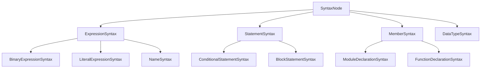
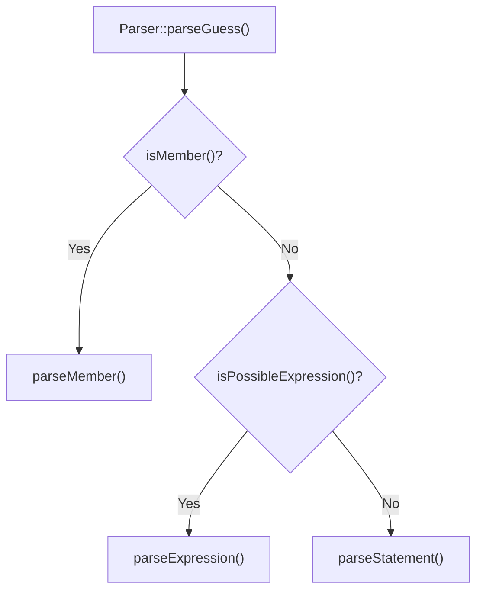

<!-- source: DeepWiki mcp.deepwiki.com · repo MikePopoloski/slang · page 2.2 Syntax Parsing · fetched 2026-10-30 -->

# Syntax Parsing

<details>
<summary>Relevant source files</summary>

The following files were used as context for generating this wiki page:

- [include/slang/parsing/Parser.h](include/slang/parsing/Parser.h)
- [include/slang/parsing/ParserMetadata.h](include/slang/parsing/ParserMetadata.h)
- [include/slang/syntax/SyntaxFacts.h](include/slang/syntax/SyntaxFacts.h)
- [include/slang/syntax/SyntaxNode.h](include/slang/syntax/SyntaxNode.h)
- [include/slang/syntax/SyntaxTree.h](include/slang/syntax/SyntaxTree.h)
- [include/slang/syntax/SyntaxVisitor.h](include/slang/syntax/SyntaxVisitor.h)
- [scripts/syntax.txt](scripts/syntax.txt)
- [scripts/syntax_gen.py](scripts/syntax_gen.py)
- [source/parsing/Parser.cpp](source/parsing/Parser.cpp)
- [source/parsing/ParserMetadata.cpp](source/parsing/ParserMetadata.cpp)
- [source/parsing/Parser_expressions.cpp](source/parsing/Parser_expressions.cpp)
- [source/parsing/Parser_members.cpp](source/parsing/Parser_members.cpp)
- [source/parsing/Parser_statements.cpp](source/parsing/Parser_statements.cpp)
- [source/syntax/SyntaxFacts.cpp](source/syntax/SyntaxFacts.cpp)
- [source/syntax/SyntaxNode.cpp](source/syntax/SyntaxNode.cpp)
- [source/syntax/SyntaxTree.cpp](source/syntax/SyntaxTree.cpp)
- [source/syntax/SyntaxVisitor.cpp](source/syntax/SyntaxVisitor.cpp)
- [tests/regression/all.sv](tests/regression/all.sv)
- [tests/unittests/parsing/MemberParsingTests.cpp](tests/unittests/parsing/MemberParsingTests.cpp)
- [tests/unittests/parsing/VisitorTests.cpp](tests/unittests/parsing/VisitorTests.cpp)

</details>


This document covers the syntax parsing subsystem of the slang SystemVerilog compiler, which transforms a stream of preprocessed tokens into a concrete syntax tree (CST). The parser implements a recursive-descent parsing algorithm with error recovery mechanisms and produces strongly-typed syntax nodes representing all language constructs.

## Parser Architecture

The syntax parsing system is built around the `Parser` class, which implements a recursive-descent parser with integrated error recovery. The parser consumes tokens from the `Preprocessor` and produces a concrete syntax tree using auto-generated syntax node classes.

### Parser Components and Data Flow
```mermaid
graph TD
    subgraph "Input Layer"
        PP["Preprocessor"]
    end

    subgraph "Parsing Engine (Recursive Descent)"
        P["Parser Class"]
        PB["ParserBase"]
        SF["SyntaxFacts (Utilities)"]
        NP["NumberParser"]
    end

    subgraph "Syntax Construction"
        Fac["SyntaxFactory"]
        Alloc["BumpAllocator"]
        Meta["ParserMetadata"]
    end

    subgraph "Output Space"
        CST["Concrete Syntax Tree (CST)"]
        CU["CompilationUnitSyntax"]
        Diag["Diagnostics"]
    end

    PP -->|Token Stream| P
    P --|> PB
    P --|> SF
    P -->|Uses| NP
    P -->|Allocates via| Fac
    Fac -->|Stores in| Alloc
    P -->|Records| Meta
    P -->|Produces| CU
    P -->|Reports| Diag
```
Sources: [include/slang/parsing/Parser.h:141-143](), [source/parsing/Parser.cpp:17-21](), [include/slang/syntax/SyntaxNode.h:89-95]()

The `Parser` class is initialized with a `Preprocessor` and a `Bag` of options. It uses a `BumpAllocator` for high-performance memory management of syntax nodes.

| Class | Responsibility | Source |
| :--- | :--- | :--- |
| `Parser` | Main entry point for recursive-descent parsing. | [include/slang/parsing/Parser.h:141]() |
| `ParserBase` | Base class providing token consumption and lookahead primitives (`peek`, `consume`, `expect`). | [include/slang/parsing/ParserBase.h:1-20]() |
| `SyntaxFactory` | Factory for creating specific `SyntaxNode` instances. | [source/parsing/Parser.cpp:18]() |
| `NumberParser` | Specialized logic for parsing SystemVerilog numeric literals. | [source/parsing/Parser.cpp:20]() |

Sources: [source/parsing/Parser.cpp:17-21](), [include/slang/parsing/Parser.h:141-143]()

## Syntax Tree Construction

The parser constructs a concrete syntax tree using auto-generated syntax node classes. All syntax nodes inherit from `SyntaxNode` and contain both tokens and child syntax nodes, preserving the complete source text structure including whitespace and comments (trivia).

### SyntaxNode Hierarchy

Sources: [include/slang/syntax/SyntaxNode.h:89-100](), [scripts/syntax.txt:1-50]()

### Token and Syntax Variants
To handle the heterogeneous nature of tree children, slang uses variant types to represent either a `Token` or a `SyntaxNode`.

*   **`TokenOrSyntax`**: A variant used for lists and children that can be either a leaf (token) or a subtree. [include/slang/syntax/SyntaxNode.h:75-87]()
*   **`SyntaxList<T>`**: A collection of syntax nodes of type `T`. [scripts/syntax_gen.py:154-161]()
*   **`SeparatedSyntaxList<T>`**: A collection of syntax nodes separated by tokens (usually commas). [scripts/syntax_gen.py:162-169]()

## Parsing Process

The `Parser` uses a recursive-descent approach, where methods correspond to grammar rules. It frequently employs "speculative" parsing using lookahead to disambiguate constructs.

### Entry Points
The primary entry point for a full file is `parseCompilationUnit`. For snippets or testing, `parseGuess` attempts to identify the construct based on lookahead.


Sources: [source/parsing/Parser.cpp:23-61](), [source/parsing/Parser_members.cpp:18-31]()

### Member and Module Parsing
Members include modules, interfaces, programs, and package items. The parser tracks the `currentDefinitionKind` to handle nested scopes correctly.

*   **`parseModule`**: Handles module, interface, and program declarations. It pushes a "design element stack" to the preprocessor to handle directives like `` `default_nettype ``. [source/parsing/Parser_members.cpp:52-102]()
*   **`parseMemberList`**: A template function that parses a sequence of members until a specific `endKind` token is found. [source/parsing/Parser_members.cpp:18-25]()

Sources: [source/parsing/Parser_members.cpp:52-102](), [source/parsing/Parser_members.cpp:158-165]()

### Expression Parsing
Expression parsing uses a precedence-climbing algorithm implemented in `parseBinaryExpression`.

| Function | Role | Source |
| :--- | :--- | :--- |
| `parseExpression` | Top-level expression entry point. | [source/parsing/Parser_expressions.cpp:17-19]() |
| `parseSubExpression` | Handles unary operators and primary expressions. | [source/parsing/Parser_expressions.cpp:50-105]() |
| `parseBinaryExpression` | Implements operator precedence and associativity. | [source/parsing/Parser_expressions.cpp:107-175]() |
| `getPrecedence` | Returns the precedence level for a `SyntaxKind`. | [source/parsing/Parser_expressions.cpp:146-147]() |

Sources: [source/parsing/Parser_expressions.cpp:17-175]()

## Error Recovery

The parser is designed to be resilient to malformed input. It uses several strategies to recover and continue parsing to find subsequent errors.

### Recovery Mechanisms
1.  **Missing Tokens**: When an expected token (like a semicolon) is missing, `expect()` creates a "missing" token at the current location and continues. [source/parsing/Parser_statements.cpp:122]()
2.  **Depth Guard**: To prevent stack overflow on deeply nested code, `setDepthGuard()` tracks recursion depth and throws a `RecursionException` if `maxRecursionDepth` is exceeded. [source/parsing/Parser_statements.cpp:17](), [include/slang/parsing/Parser.h:131-134]()
3.  **Synchronization Points**: In lists (like port lists), if a member fails to parse, the parser skips tokens until it finds a delimiter (e.g., a comma) or the end of the list. [source/parsing/Parser.cpp:84-87]()

Sources: [source/parsing/Parser_statements.cpp:16-25](), [include/slang/parsing/Parser.h:131-134](), [source/parsing/Parser_members.cpp:19-31]()

## Code Generation System

A significant portion of the syntax infrastructure is generated from `scripts/syntax.txt` using `scripts/syntax_gen.py`. This script produces:
*   `AllSyntax.h`: Definitions for all `SyntaxNode` subclasses.
*   `SyntaxKind.h`: The `SyntaxKind` enumeration.
*   Factory methods for `SyntaxFactory`.

### Syntax Definition Format
The `syntax.txt` file defines nodes using a domain-specific language:
```text
BinaryExpression base=Expression multiKind=true
    Expression left
    token operatorToken
    list<AttributeInstance> attributes
    Expression right
```
Sources: [scripts/syntax.txt:192-196](), [scripts/syntax_gen.py:121-145]()

The generator uses `TypeInfo` to track members, base classes, and whether a node is "final" (leaf in the class hierarchy). [scripts/syntax_gen.py:18-48]()

---

