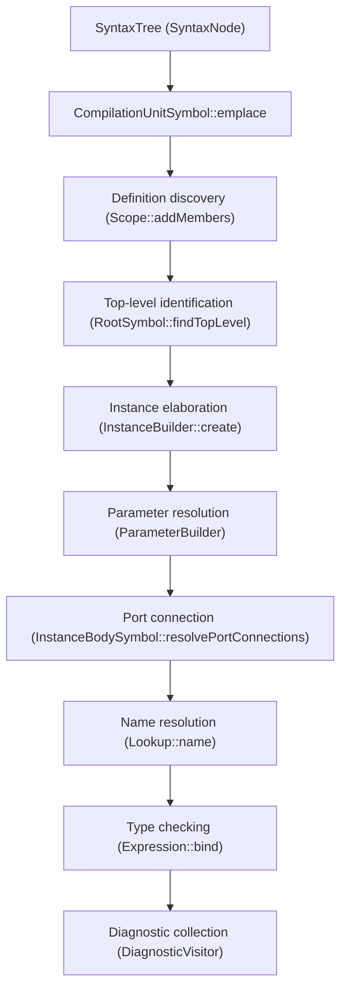
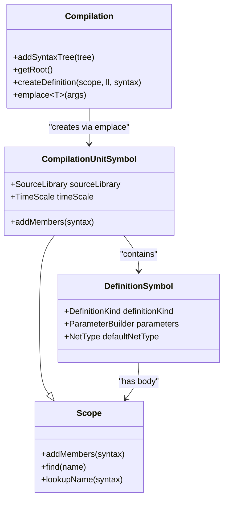
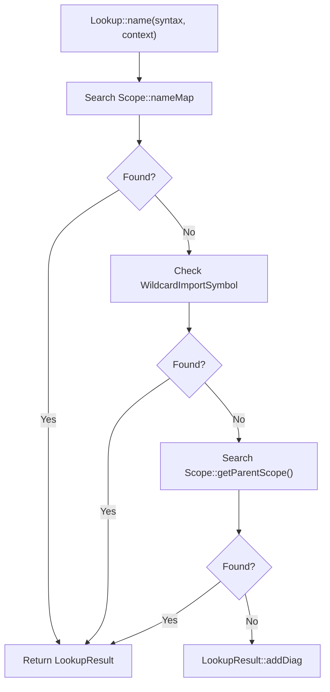
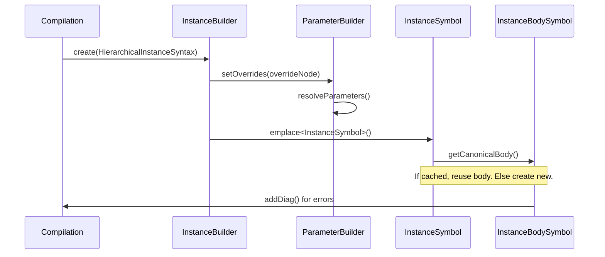
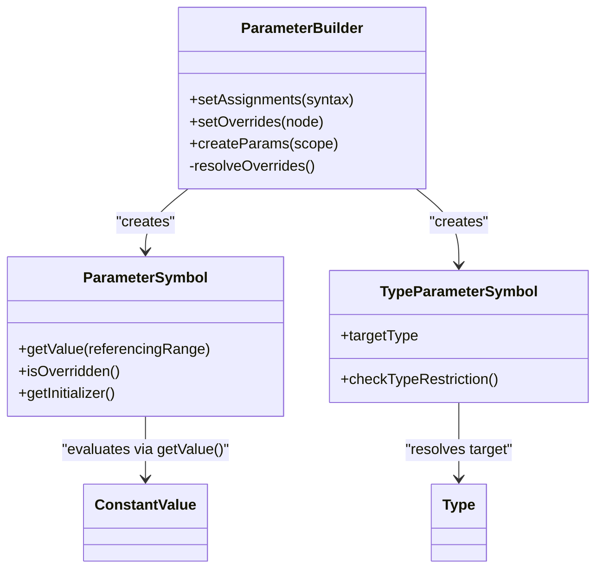
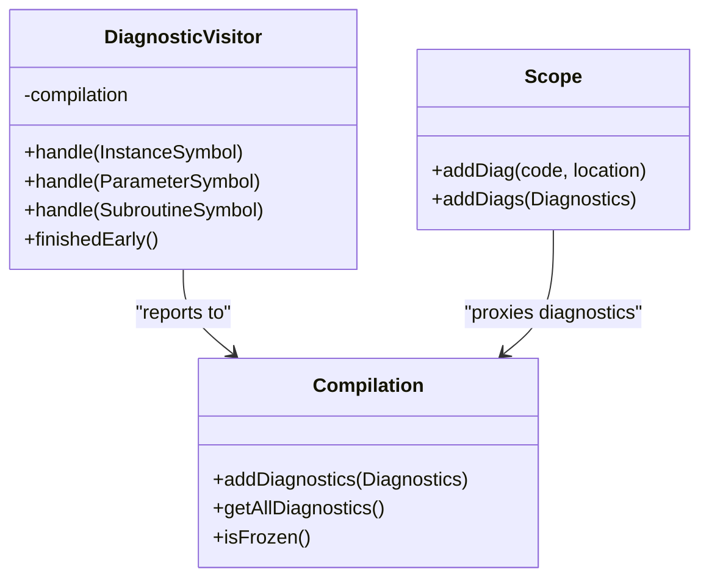

<!-- source: DeepWiki mcp.deepwiki.com · repo MikePopoloski/slang · page 2.3 Elaboration and Compilation · fetched 2026-10-30 -->

# Elaboration and Compilation

Relevant source files

The following files were used as context for generating this wiki page:

- [bindings/python/SymbolBindings.cpp](bindings/python/SymbolBindings.cpp)
- [include/slang/ast/Compilation.h](include/slang/ast/Compilation.h)
- [include/slang/ast/Lookup.h](include/slang/ast/Lookup.h)
- [include/slang/ast/Scope.h](include/slang/ast/Scope.h)
- [include/slang/ast/symbols/CompilationUnitSymbols.h](include/slang/ast/symbols/CompilationUnitSymbols.h)
- [include/slang/ast/symbols/InstanceSymbols.h](include/slang/ast/symbols/InstanceSymbols.h)
- [include/slang/ast/symbols/ParameterSymbols.h](include/slang/ast/symbols/ParameterSymbols.h)
- [source/ast/Compilation.cpp](source/ast/Compilation.cpp)
- [source/ast/ElabVisitors.h](source/ast/ElabVisitors.h)
- [source/ast/Lookup.cpp](source/ast/Lookup.cpp)
- [source/ast/Scope.cpp](source/ast/Scope.cpp)
- [source/ast/symbols/CompilationUnitSymbols.cpp](source/ast/symbols/CompilationUnitSymbols.cpp)
- [source/ast/symbols/InstanceSymbols.cpp](source/ast/symbols/InstanceSymbols.cpp)
- [source/ast/symbols/ParameterBuilder.cpp](source/ast/symbols/ParameterBuilder.cpp)
- [source/ast/symbols/ParameterSymbols.cpp](source/ast/symbols/ParameterSymbols.cpp)
- [tests/unittests/ast/ConfigTests.cpp](tests/unittests/ast/ConfigTests.cpp)
- [tests/unittests/ast/HierarchyTests.cpp](tests/unittests/ast/HierarchyTests.cpp)
- [tests/unittests/ast/LookupTests.cpp](tests/unittests/ast/LookupTests.cpp)
- [tests/unittests/ast/ParameterTests.cpp](tests/unittests/ast/ParameterTests.cpp)

This document explains the symbol creation, name resolution, type checking, and design elaboration processes that transform parsed syntax trees into a fully elaborated Abstract Syntax Tree (AST). This phase occurs after preprocessing and parsing (see [Elaboration and Compilation](#2.3)) and creates the symbol hierarchy used by static analysis (see [Static Analysis Framework](#5.1)).

## Overview

Elaboration transforms the collection of parsed syntax trees into a coherent design hierarchy with fully resolved symbols, types, and connections. The process is managed by the `Compilation` class and involves several key phases:

**Elaboration Flow**
Sources: [source/ast/Compilation.cpp:164-202](), [include/slang/ast/Compilation.h:130-195](), [source/ast/symbols/InstanceSymbols.cpp:43-88]()

The `Compilation::getRoot()` method triggers the elaboration process, which creates the final `RootSymbol` containing all top-level instances and compilation units.

## Symbol Creation from Syntax

The elaboration process begins by creating symbols from syntax nodes. Each `SyntaxTree` is wrapped in a `CompilationUnitSymbol` that manages the symbols defined in that compilation unit.

**Symbol Hierarchy**
Sources: [source/ast/Compilation.cpp:197-200](), [source/ast/Scope.cpp:62-83](), [source/ast/Scope.cpp:194-210]()

The `Scope::addMembers()` method processes `SyntaxNode` objects and creates appropriate symbol types:
- Module/interface/program declarations become `DefinitionSymbol` objects [source/ast/Scope.cpp:199-203]()
- Package declarations become `PackageSymbol` objects [source/ast/Scope.cpp:211-213]()
- Variable declarations become `VariableSymbol` objects [source/ast/Scope.cpp:235-237]()
- Function/task declarations become `SubroutineSymbol` objects [source/ast/Scope.cpp:222-224]()

## Scope Management and Name Resolution

Scopes provide hierarchical name lookup following SystemVerilog's scoping rules. Each scope maintains a `SymbolMap` for efficient symbol lookup and supports wildcard imports from packages.

**Name Resolution Process**
Sources: [source/ast/Lookup.cpp:34-80](), [source/ast/Scope.cpp:62-64](), [source/ast/Scope.cpp:106-114]()

The lookup process implements SystemVerilog's name resolution rules:
1. Search the local scope's `nameMap` [source/ast/Scope.cpp:63]()
2. Check wildcard imports for matching symbols [source/ast/Lookup.cpp:47-52]()
3. Recursively search parent scopes using `getParentScope()` [source/ast/Scope.cpp:118-125]()
4. Apply qualified name resolution for hierarchical references via `splitScopedName` [source/ast/Lookup.cpp:183-201]()

## Instance Elaboration and Caching

Instance elaboration creates `InstanceSymbol` objects from instantiation syntax and recursively elaborates their bodies. To optimize performance, slang uses an instance cache to skip duplicate bodies.

**Instance Creation Sequence**
Sources: [source/ast/symbols/InstanceSymbols.cpp:43-128](), [source/ast/symbols/InstanceSymbols.cpp:110-128](), [include/slang/ast/symbols/InstanceSymbols.h:120-128]()

The `InstanceBuilder::create()` method orchestrates instance creation:
1. Evaluates array dimensions if the instance is an array [source/ast/symbols/InstanceSymbols.cpp:143-158]().
2. Uses `ParameterBuilder` to resolve parameter assignments [source/ast/symbols/InstanceSymbols.cpp:112-115]().
3. Checks `CompilationFlags::DisableInstanceCaching` to decide whether to reuse an existing `InstanceBodySymbol` [include/slang/ast/Compilation.h:109]().
4. Resolves `resolvedConfig` based on any applicable configuration rules [source/ast/symbols/InstanceSymbols.cpp:120-126]().

## Parameter Resolution

Parameter resolution evaluates parameter assignments and creates specialized instance bodies. The `ParameterBuilder` class manages this process and handles both value and type parameters.

**Parameter System**
Sources: [source/ast/symbols/ParameterSymbols.cpp:94-121](), [source/ast/symbols/ParameterSymbols.cpp:123-174](), [source/ast/symbols/ParameterSymbols.cpp:53-92]()

Parameter resolution handles:
- Default value evaluation for unassigned parameters [source/ast/symbols/ParameterSymbols.cpp:146-150]().
- Detecting circular dependencies via `evaluating` flag in `getValue()` [source/ast/symbols/ParameterSymbols.cpp:132-142]().
- Type parameter specialization and restriction checking [source/ast/symbols/ParameterSymbols.cpp:126-133]().
- Name resolution within default expressions using `ParameterSymbolBase::checkDefaultExpression` [source/ast/symbols/ParameterSymbols.cpp:53-92]().

## Diagnostic Collection and Finalization

After the design is elaborated, slang performs a final pass to collect diagnostics and ensure all lazy members are realized.

**Diagnostic Collection System**
Sources: [source/ast/ElabVisitors.h:22-59](), [source/ast/Compilation.cpp:147-153](), [source/ast/Scope.cpp:176-192]()

The diagnostic collection process:
1. `DiagnosticVisitor` visits every symbol in the elaborated design [source/ast/ElabVisitors.h:22-31]().
2. Forces evaluation of lazy-evaluated constructs like `DeclaredType::getType()` and `getInitializer()` [source/ast/ElabVisitors.h:39-43]().
3. Checks for invalid initializers in nets and variables [source/ast/ElabVisitors.h:227-239]().
4. Validates interface port connections and modport exports [source/ast/ElabVisitors.h:79-102]().
5. Short-circuits if the `errorLimit` is exceeded [source/ast/ElabVisitors.h:23-26]().

This completes the elaboration process, producing a fully resolved AST ready for analysis.
Sources: [source/ast/Compilation.cpp:164-202](), [source/ast/ElabVisitors.h:22-59](), [source/ast/symbols/InstanceSymbols.cpp:43-128]()

---

