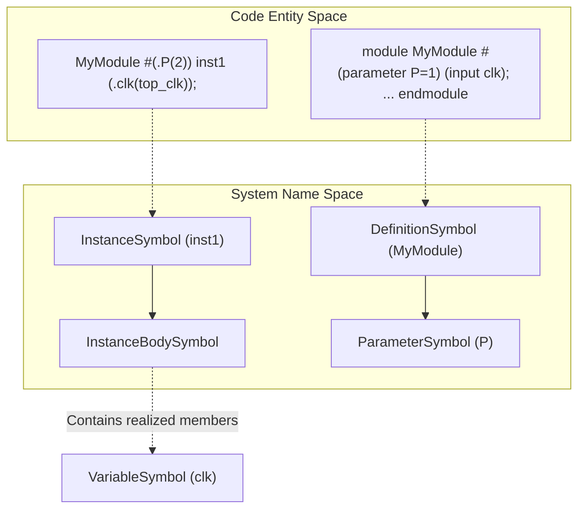
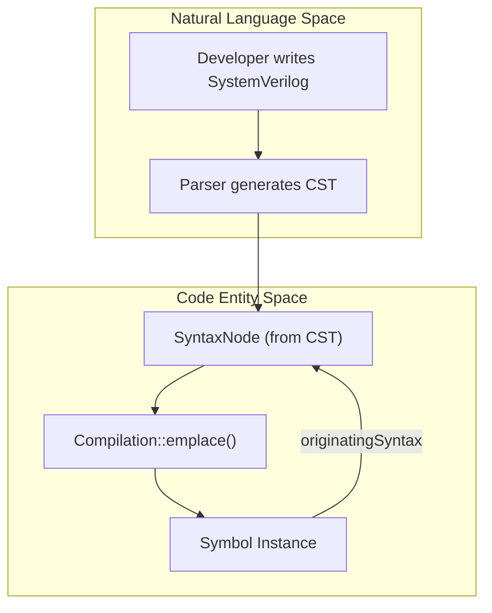

<!-- source: DeepWiki mcp.deepwiki.com · repo MikePopoloski/slang · page 3 Symbol System · fetched 2026-10-30 -->

# Symbol System

<details>
<summary>Relevant source files</summary>

The following files were used as context for generating this wiki page:

- [include/slang/ast/ASTVisitor.h](include/slang/ast/ASTVisitor.h)
- [include/slang/ast/Symbol.h](include/slang/ast/Symbol.h)
- [include/slang/ast/symbols/MemberSymbols.h](include/slang/ast/symbols/MemberSymbols.h)
- [source/ast/CMakeLists.txt](source/ast/CMakeLists.txt)
- [source/ast/symbols/MemberSymbols.cpp](source/ast/symbols/MemberSymbols.cpp)

</details>


The Symbol System provides the AST symbol hierarchy and symbol management for slang's SystemVerilog compiler. It represents all named entities in a SystemVerilog design through a hierarchical structure of symbol classes, manages their relationships, and enables name resolution and lookup operations throughout the compilation pipeline.

## AST Symbol Hierarchy

The Symbol System implements a hierarchical representation through the base `Symbol` class and specialized symbol types. The `SymbolKind` enum identifies over 100 different symbol types, from basic constructs like variables to complex structures like module instances.

### Core Symbol Architecture

```mermaid
classDiagram
    class "Symbol" {
        +name: string_view
        +kind: SymbolKind
        +location: SourceLocation
        +getParentScope(): Scope*
        +getSyntax(): SyntaxNode*
        +visit(TVisitor): void
    }
    
    class "Scope" {
        +find(name): Symbol*
        +lookupName(name, LookupLocation, LookupFlags): Symbol*
        +addMember(symbol): void
        +members(): iterator_range
        +getNameMap(): DenseMap
    }
    
    class "ValueSymbol" {
        +getType(): Type&
        +getInitializer(): Expression*
        +getDeclaredType(): DeclaredType*
    }
    
    class "MemberSymbols" {
        EmptyMemberSymbol
        ExplicitImportSymbol
        WildcardImportSymbol
        ModportPortSymbol
        ContinuousAssignSymbol
    }
    
    class "BlockSymbols" {
        StatementBlockSymbol
        ProceduralBlockSymbol
        GenerateBlockSymbol
        GenerateBlockArraySymbol
    }
    
    "Symbol" <|-- "Scope"
    "Symbol" <|-- "ValueSymbol" 
    "Symbol" <|-- "MemberSymbols"
    "Symbol" <|-- "BlockSymbols"
```

Sources:
- [include/slang/ast/Symbol.h:135-218]()
- [include/slang/ast/Scope.h:44-158]()
- [include/slang/ast/symbols/MemberSymbols.h:26-181]()

## Symbol Types and Categories

### Base Symbol Classes

The `Symbol` class provides fundamental functionality through a `SymbolKind` enum with over 100 distinct types. Key base classes include:

- **Symbol**: Base class with `name`, `kind`, `location`, and parent scope relationships. [include/slang/ast/Symbol.h:135-146]()
- **Scope**: Extends `Symbol` to contain other symbols and manage lookups via name maps. [include/slang/ast/Scope.h:44-50]()
- **ValueSymbol**: Base for symbols with types, including variables and parameters. [include/slang/ast/symbols/ValueSymbol.h:18-25]()

For a detailed breakdown of specific symbol types, see **[Symbol Creation and Management](#3.1)**.

### Member Symbols

Member symbols represent various declaration constructs within scopes, such as imports and port specifications.
- **ExplicitImportSymbol**: Represents an explicit `import pkg::name`. [include/slang/ast/symbols/MemberSymbols.h:57-66]()
- **WildcardImportSymbol**: Represents a `import pkg::*` declaration. [include/slang/ast/symbols/MemberSymbols.h:89-95]()
- **ModportPortSymbol**: Represents a port within a modport declaration. [include/slang/ast/symbols/MemberSymbols.h:109-123]()

### Block Symbols

Block symbols represent hierarchical and statement scopes, such as `initial` or `always` blocks and generate constructs.
- **StatementBlockSymbol**: Sequential and parallel statement blocks.
- **ProceduralBlockSymbol**: Procedural containers like `always_ff`.
- **GenerateBlockSymbol**: Blocks created by `if` or `for` generate constructs.

Sources:
- [include/slang/ast/Symbol.h:21-127]()
- [source/ast/symbols/MemberSymbols.cpp:40-164]()

## Scope Management and Lookup

The symbol system implements sophisticated name resolution through the `Lookup` class. It handles hierarchical references, package imports, and upward name searching.

### Lookup Process

The `Lookup::name()` function handles complex resolution:
1. **Unqualified Lookup**: Searching the current and parent lexical scopes.
2. **Qualified Lookup**: Resolving dotted names (e.g., `top.sub.signal`). [source/ast/Lookup.cpp:269-579]()
3. **Package Resolution**: Handling `::` operators and `import` directives. [source/ast/symbols/MemberSymbols.cpp:98-126]()

For details on scoping rules and the lookup engine, see **[Scope Management and Lookup](#3.2)**.

Sources:
- [source/ast/Lookup.cpp:39-83]()
- [include/slang/ast/Lookup.h:10-40]()

## Instance and Module Symbols

Module instantiation uses a two-level approach separating the definition (template) from the realization (instance).



### Instance Hierarchy
- **InstanceSymbol**: Represents the instantiation site. [include/slang/ast/symbols/InstanceSymbols.h:150-160]()
- **InstanceBodySymbol**: Contains the actual members of the instance, allowing different instances of the same module to have different parameter values. [include/slang/ast/symbols/InstanceSymbols.h:95-105]()
- **InstanceArraySymbol**: Represents an array of instances (e.g., `my_mod inst[4]();`). [include/slang/ast/symbols/InstanceSymbols.h:233-240]()

For details on elaboration and instance construction, see **[Instance and Module Symbols](#3.3)**.

Sources:
- [include/slang/ast/symbols/InstanceSymbols.h:30-254]()
- [source/ast/symbols/InstanceSymbols.cpp:417-632]()

## Symbol Management and Lifecycle

Symbols are managed by the `Compilation` object, which acts as a factory and owner.



### Allocation and Lifetime
- **Compilation::emplace<T>()**: Symbols are allocated in memory pools owned by the `Compilation` object. [source/ast/Compilation.cpp:23-40]()
- **ASTVisitor**: A template-based mechanism for traversing the symbol tree, statements, and expressions. [include/slang/ast/ASTVisitor.h:101-175]()

Sources:
- [include/slang/ast/ASTVisitor.h:56-81]()
- [source/ast/symbols/MemberSymbols.cpp:40-63]()

---

