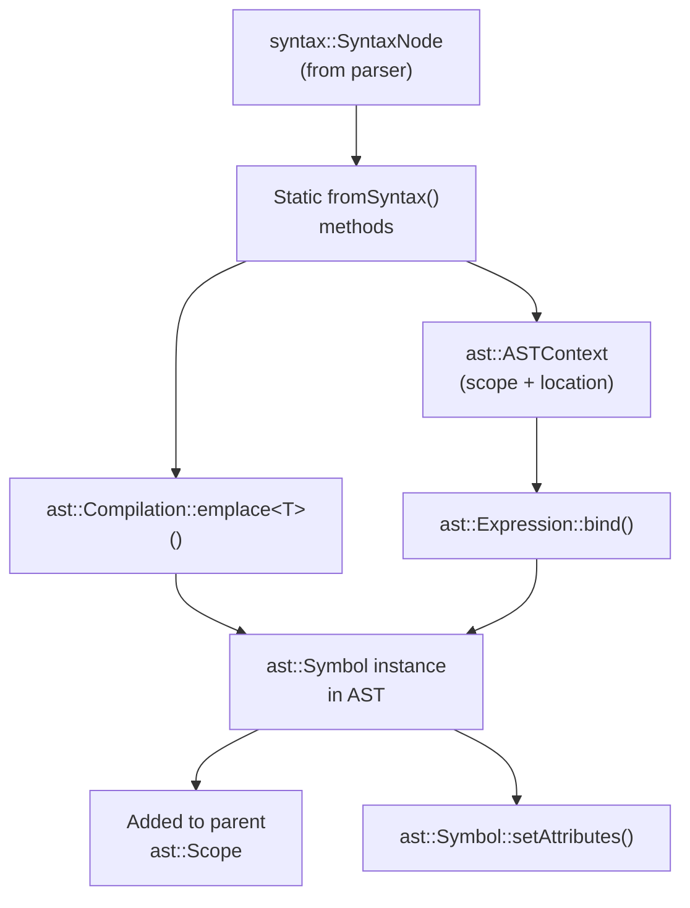
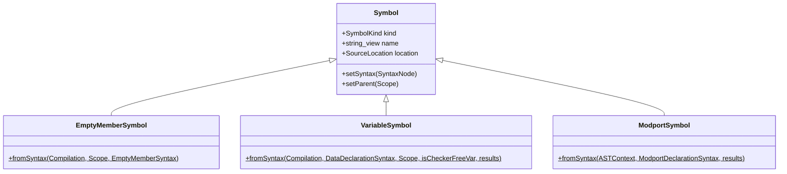
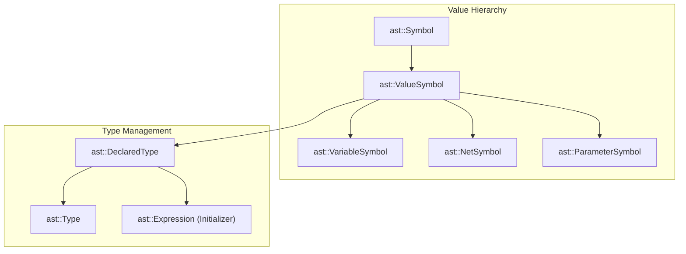
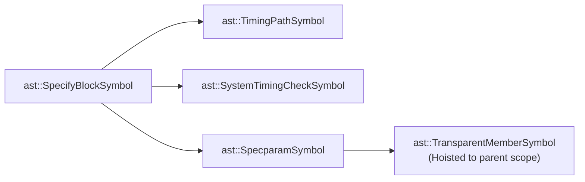
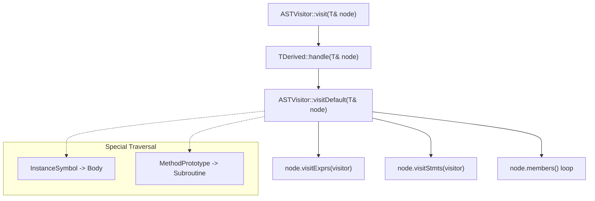

<!-- source: DeepWiki mcp.deepwiki.com · repo MikePopoloski/slang · page 3.1 Symbol Creation and Management · fetched 2026-10-30 -->

# Symbol Creation and Management

Relevant source files

The following files were used as context for generating this wiki page:

- [include/slang/ast/ASTVisitor.h](include/slang/ast/ASTVisitor.h)
- [include/slang/ast/LValue.h](include/slang/ast/LValue.h)
- [include/slang/ast/SFormat.h](include/slang/ast/SFormat.h)
- [include/slang/ast/SemanticFacts.h](include/slang/ast/SemanticFacts.h)
- [include/slang/ast/Symbol.h](include/slang/ast/Symbol.h)
- [include/slang/ast/expressions/CallExpression.h](include/slang/ast/expressions/CallExpression.h)
- [include/slang/ast/symbols/MemberSymbols.h](include/slang/ast/symbols/MemberSymbols.h)
- [include/slang/ast/symbols/SpecifySymbols.h](include/slang/ast/symbols/SpecifySymbols.h)
- [include/slang/ast/symbols/ValueSymbol.h](include/slang/ast/symbols/ValueSymbol.h)
- [include/slang/ast/symbols/VariableSymbols.h](include/slang/ast/symbols/VariableSymbols.h)
- [source/ast/CMakeLists.txt](source/ast/CMakeLists.txt)
- [source/ast/FmtHelpers.cpp](source/ast/FmtHelpers.cpp)
- [source/ast/FmtHelpers.h](source/ast/FmtHelpers.h)
- [source/ast/LValue.cpp](source/ast/LValue.cpp)
- [source/ast/SFormat.cpp](source/ast/SFormat.cpp)
- [source/ast/SemanticFacts.cpp](source/ast/SemanticFacts.cpp)
- [source/ast/expressions/CallExpression.cpp](source/ast/expressions/CallExpression.cpp)
- [source/ast/symbols/MemberSymbols.cpp](source/ast/symbols/MemberSymbols.cpp)
- [source/ast/symbols/ParameterBuilder.h](source/ast/symbols/ParameterBuilder.h)
- [source/ast/symbols/SpecifySymbols.cpp](source/ast/symbols/SpecifySymbols.cpp)
- [source/ast/symbols/ValueSymbol.cpp](source/ast/symbols/ValueSymbol.cpp)
- [source/ast/symbols/VariableSymbols.cpp](source/ast/symbols/VariableSymbols.cpp)
- [tests/unittests/ast/EvalTests.cpp](tests/unittests/ast/EvalTests.cpp)
- [tests/unittests/ast/MemberTests.cpp](tests/unittests/ast/MemberTests.cpp)

This document describes how symbols are created from syntax nodes and managed within the slang AST. It covers the symbol creation process, the various types of member symbols, variable symbols, value symbols, and the infrastructure for AST node construction.

For information about symbol lookup and scope resolution, see [Scope Management and Lookup](3.2). For details about specific instance and module symbols, see [Instance and Module Symbols](3.3).

## Symbol Creation Process

The symbol creation process transforms parsed syntax nodes into concrete AST symbol objects. This process occurs during the semantic analysis phase of compilation, after parsing has produced a complete syntax tree.

### From Syntax to Symbols

Symbol creation follows a consistent pattern where static factory methods on symbol classes accept syntax nodes and produce corresponding symbol instances:

Title: Symbol Creation Data Flow

Sources: [source/ast/symbols/MemberSymbols.cpp:40-63](), [include/slang/ast/symbols/MemberSymbols.h:26-37](), [source/ast/symbols/VariableSymbols.cpp:48-76]()

### Symbol Factory Pattern

Most symbols implement the factory pattern using static `fromSyntax` methods that handle the creation logic and diagnostic reporting:

Title: Symbol Factory Hierarchy

Sources: [source/ast/symbols/MemberSymbols.cpp:40-63](), [source/ast/symbols/VariableSymbols.cpp:48-118](), [source/ast/symbols/MemberSymbols.cpp:297-380]()

## Symbol Hierarchy and Base Classes

The symbol system is built around a deep hierarchy starting from the base `Symbol` class.

### Core Symbol Infrastructure

All symbols inherit from `slang::ast::Symbol`, which provides basic identification and structural properties.

| Property | Description | Source |
|----------|-------------|--------|
| `kind` | `SymbolKind` enum identifying the concrete type. | [include/slang/ast/Symbol.h:138-138]() |
| `name` | The identifier name or empty string for anonymous symbols. | [include/slang/ast/Symbol.h:142-142]() |
| `location` | `SourceLocation` where the symbol was declared. | [include/slang/ast/Symbol.h:146-146]() |
| `parentScope` | Pointer to the `Scope` containing this symbol. | [include/slang/ast/Symbol.h:152-152]() |

### Value and Variable Symbols

`ValueSymbol` is a base class for symbols that represent a value (variables, parameters, nets). It manages a `DeclaredType` which handles type resolution and initializers.

*   **ValueSymbol**: Base class for symbols with a type. [source/ast/symbols/ValueSymbol.cpp:20-23]()
*   **VariableSymbol**: Represents a SystemVerilog variable with a lifetime (Static/Automatic). [source/ast/symbols/VariableSymbols.cpp:138-140]()

Title: Value Symbol Implementation

Sources: [include/slang/ast/symbols/ValueSymbol.h:19-81](), [source/ast/symbols/ValueSymbol.cpp:20-42](), [source/ast/symbols/VariableSymbols.cpp:138-148]()

## Member Symbol Categories

Member symbols represent various declarative constructs that can appear within scopes.

### Variable Creation
`VariableSymbol::fromSyntax` handles the complexities of SystemVerilog variable declarations, including:
*   **Modifiers**: Handling `const`, `var`, `static`, and `automatic`. [source/ast/symbols/VariableSymbols.cpp:54-76]()
*   **Lifetimes**: Determining default lifetimes based on the parent scope (e.g., `Automatic` in subroutines, `Static` in modules). [source/ast/symbols/VariableSymbols.cpp:34-46]()
*   **Initializers**: Validating that constants have initializers and reporting self-referential initialization. [source/ast/symbols/VariableSymbols.cpp:114-117](), [source/ast/symbols/VariableSymbols.cpp:150-173]()

### Import and Export Symbols
*   **ExplicitImportSymbol**: Represents `import pkg::item;`. It lazily resolves the package and the imported symbol upon first access. [source/ast/symbols/MemberSymbols.cpp:98-126]()
*   **WildcardImportSymbol**: Represents `import pkg::*;`. These are handled specially during lookup and do not appear in the standard name map. [source/ast/symbols/MemberSymbols.cpp:141-153]()

### Interface and Modport Symbols
Modports define interface access patterns with directional port specifications:
*   **ModportSymbol**: A scope containing modport ports. [source/ast/symbols/MemberSymbols.cpp:297-300]()
*   **ModportPortSymbol**: Represents an individual port within a modport, tracking `ArgumentDirection` and internal symbol connections. [source/ast/symbols/MemberSymbols.cpp:161-164]()

## AST Node Construction and Memory

### Compilation and Allocators
Symbols are never allocated with `new`. Instead, they are created using `Compilation::emplace<T>`, which uses a `PoolAllocator` (specifically a `BumpAllocator` internally) to manage memory. This ensures that all AST nodes are destroyed together when the `Compilation` object is destroyed.

Sources: [source/ast/symbols/MemberSymbols.cpp:42](), [source/ast/symbols/VariableSymbols.cpp:91-92](), [source/ast/Compilation.cpp:57]()

### Specify and Timing Symbols
The `SpecifyBlockSymbol` manages SystemVerilog `specify` blocks. It creates `TransparentMemberSymbol` wrappers for `specparams` so they are visible in the parent module scope. [source/ast/symbols/SpecifySymbols.cpp:28-58]()

Title: Specify Block Symbol Structure

Sources: [source/ast/symbols/SpecifySymbols.cpp:28-58](), [include/slang/ast/symbols/SpecifySymbols.h:25-40]()

## Visitor Pattern Support

The AST supports traversal through the `ASTVisitor` template. The visitor automatically descends into scopes and follows links (like `MethodPrototypeSymbol` to its `SubroutineSymbol`).

Title: AST Traversal Logic

Sources: [include/slang/ast/ASTVisitor.h:101-175](), [source/ast/symbols/MemberSymbols.cpp:195-200]()

### Key Visitor Functions
*   `visitExprs`: Traverses expressions associated with a symbol (e.g., initializers, timing delays). [include/slang/ast/ASTVisitor.h:126-134]()
*   `visitStmts`: Traverses procedural statements (e.g., subroutine bodies). [include/slang/ast/ASTVisitor.h:136-138]()

Sources: [include/slang/ast/ASTVisitor.h:125-150](), [source/ast/symbols/MemberSymbols.cpp:211-216]()

---

