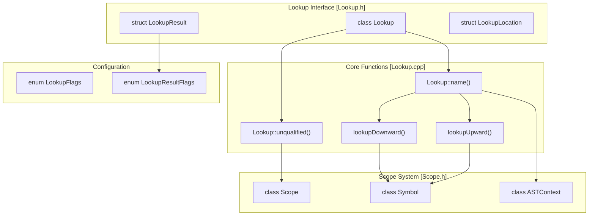
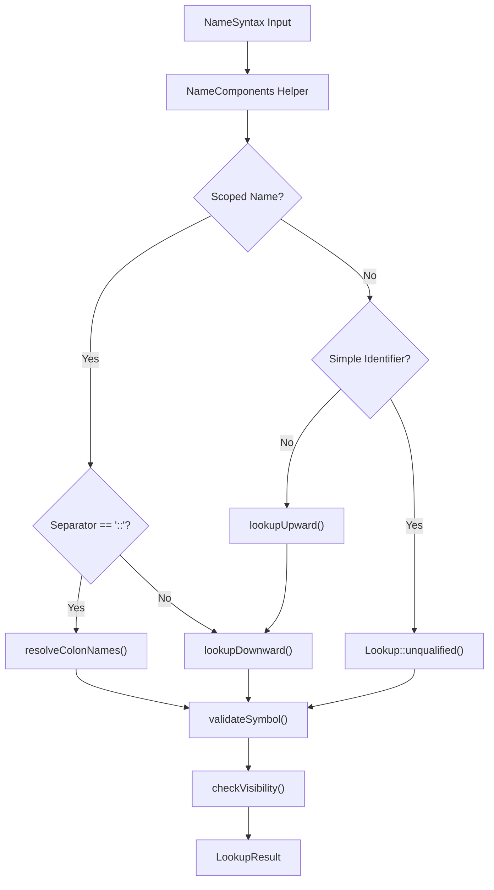
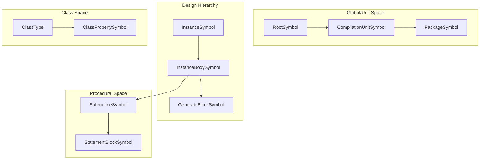

<!-- source: DeepWiki mcp.deepwiki.com · repo MikePopoloski/slang · page 3.2 Scope Management and Lookup · fetched 2026-10-30 -->

# Scope Management and Lookup

Relevant source files

The following files were used as context for generating this wiki page:

- [bindings/python/SymbolBindings.cpp](bindings/python/SymbolBindings.cpp)
- [include/slang/ast/Compilation.h](include/slang/ast/Compilation.h)
- [include/slang/ast/Lookup.h](include/slang/ast/Lookup.h)
- [include/slang/ast/Scope.h](include/slang/ast/Scope.h)
- [include/slang/ast/symbols/BlockSymbols.h](include/slang/ast/symbols/BlockSymbols.h)
- [include/slang/ast/symbols/ClassSymbols.h](include/slang/ast/symbols/ClassSymbols.h)
- [include/slang/ast/symbols/CompilationUnitSymbols.h](include/slang/ast/symbols/CompilationUnitSymbols.h)
- [include/slang/ast/symbols/InstanceSymbols.h](include/slang/ast/symbols/InstanceSymbols.h)
- [include/slang/ast/symbols/ParameterSymbols.h](include/slang/ast/symbols/ParameterSymbols.h)
- [include/slang/ast/symbols/SubroutineSymbols.h](include/slang/ast/symbols/SubroutineSymbols.h)
- [source/ast/Compilation.cpp](source/ast/Compilation.cpp)
- [source/ast/Constraints.cpp](source/ast/Constraints.cpp)
- [source/ast/ElabVisitors.h](source/ast/ElabVisitors.h)
- [source/ast/Lookup.cpp](source/ast/Lookup.cpp)
- [source/ast/Scope.cpp](source/ast/Scope.cpp)
- [source/ast/symbols/BlockSymbols.cpp](source/ast/symbols/BlockSymbols.cpp)
- [source/ast/symbols/ClassSymbols.cpp](source/ast/symbols/ClassSymbols.cpp)
- [source/ast/symbols/CompilationUnitSymbols.cpp](source/ast/symbols/CompilationUnitSymbols.cpp)
- [source/ast/symbols/InstanceSymbols.cpp](source/ast/symbols/InstanceSymbols.cpp)
- [source/ast/symbols/ParameterBuilder.cpp](source/ast/symbols/ParameterBuilder.cpp)
- [source/ast/symbols/ParameterSymbols.cpp](source/ast/symbols/ParameterSymbols.cpp)
- [source/ast/symbols/SubroutineSymbols.cpp](source/ast/symbols/SubroutineSymbols.cpp)
- [tests/unittests/ast/ClassTests.cpp](tests/unittests/ast/ClassTests.cpp)
- [tests/unittests/ast/ConfigTests.cpp](tests/unittests/ast/ConfigTests.cpp)
- [tests/unittests/ast/HierarchyTests.cpp](tests/unittests/ast/HierarchyTests.cpp)
- [tests/unittests/ast/LookupTests.cpp](tests/unittests/ast/LookupTests.cpp)
- [tests/unittests/ast/ParameterTests.cpp](tests/unittests/ast/ParameterTests.cpp)

This document describes the symbol lookup and scope management system in slang, which is responsible for resolving identifier names to their corresponding symbols within the SystemVerilog language hierarchy. The lookup system handles name resolution across different scopes, manages visibility rules, and supports complex SystemVerilog features like hierarchical references, package imports, and class member access.

## Core Lookup System Architecture

The lookup system is built around several key components that work together to resolve names according to SystemVerilog semantics. The central entry point for most resolution tasks is the `Lookup` class, which interacts with `Scope` objects and uses `ASTContext` to maintain state.

### Lookup System Components

**Sources:** [include/slang/ast/Lookup.h:242-347](), [source/ast/Lookup.cpp:34-98](), [include/slang/ast/Scope.h:35-50]()

### Key Data Structures

The lookup system uses several important data structures to manage the resolution process:

| Component | Purpose | Key Fields |
|-----------|---------|------------|
| `LookupResult` | Contains lookup results and diagnostics | `found`, `systemSubroutine`, `flags`, `selectors`, `diagnostics` |
| `LookupLocation` | Represents position within a scope for visibility | `scope`, `index` |
| `LookupFlags` | Modifies lookup behavior | `Type`, `AllowDeclaredAfter`, `NoUndeclaredError`, `Static` |
| `ASTContext` | Provides lookup context and scope information | `scope`, `lookupIndex`, `flags` |

**Sources:** [include/slang/ast/Lookup.h:165-240](), [include/slang/ast/Lookup.h:127-163](), [include/slang/ast/Lookup.h:30-92](), [source/ast/Lookup.cpp:39-84]()

## Lookup Process Flow

The name resolution process follows a systematic approach that handles different types of names (simple, scoped, hierarchical) and lookup contexts.

### Name Resolution Flow

**Sources:** [source/ast/Lookup.cpp:102-156](), [source/ast/Lookup.cpp:183-201](), [source/ast/Lookup.cpp:584-654](), [source/ast/Lookup.cpp:269-579]()

### Lookup Strategy Selection

The lookup system chooses different strategies based on the `SyntaxKind` of the name:

*   **Simple Names (`IdentifierName`):** Uses `Lookup::unqualified` to search up the scope chain starting from the current `LookupLocation`.
*   **Scoped Names (`ScopedName`):**
    *   If using `::`, it calls `resolveColonNames` for package or class-scoped lookup.
    *   If using `.`, it performs a hierarchical lookup (upward then downward).
*   **Special Handles:** `this`, `super`, `$root`, and `$unit` are resolved to their specific scope pointers.

**Sources:** [source/ast/Lookup.cpp:583-654](), [source/ast/Lookup.cpp:725-892](), [source/ast/Lookup.cpp:109-144]()

## Scope Hierarchy and Visibility

The `Scope` class is the base for any symbol that can contain other symbols. It manages a `SymbolMap` for fast identifier lookup and handles the rules of SystemVerilog lexical and hierarchical scoping.

### Scope Relationships and Navigation

**Sources:** [source/ast/Scope.cpp:62-83](), [include/slang/ast/Scope.h:35-60](), [source/ast/symbols/InstanceSymbols.cpp:110-128]()

### Visibility and Access Control

SystemVerilog visibility rules (local, protected, public) are enforced primarily during class member lookup.

*   **`Visibility` Enum:** Defines `Public`, `Protected`, and `Local`.
*   **`checkVisibility` function:** Validates if the current scope has permission to access a symbol. For example, `Local` members are only accessible if the lookup scope is the same class as the member's parent.
*   **Import Handling:** `LookupResultFlags::WasImported` tracks if a symbol was brought into scope via a package import.

**Sources:** [source/ast/symbols/ClassSymbols.cpp:34-37](), [source/ast/Lookup.cpp:656-723](), [source/ast/Lookup.cpp:60-69]()

## Name Resolution Strategies

### Hierarchical Lookup (`lookupUpward` and `lookupDownward`)

Hierarchical names like `top.sub.signal` are resolved in two phases:
1.  **Upward Search:** Find the first component of the name (`top`) by searching up the lexical scope chain and then searching for top-level instances.
2.  **Downward Search:** Once the base is found, traverse down through members (instances, blocks, variables) using `lookupDownward`.

**Sources:** [source/ast/Lookup.cpp:269-579](), [source/ast/Lookup.cpp:584-654]()

### Package and Class Resolution (`resolveColonNames`)

When a name contains `::`, the system resolves the left-hand side as a `PackageSymbol` or a `Type` (class).
*   **Packages:** Lookup continues in the package's scope.
*   **Classes:** Handles static members, parameters, and nested types. It also handles the `super` keyword to look into base classes.

**Sources:** [source/ast/Lookup.cpp:725-892](), [source/ast/symbols/ClassSymbols.cpp:141-180]()

## Special Lookup Cases

### Generate Blocks and Arrays

Generate blocks can be named or unnamed. Unnamed blocks are assigned internal names like `genblk01`.
*   **`GenerateBlockArraySymbol`:** Represents a loop generate. Lookup into an array requires an index selector.
*   **`getExternalName`:** Returns the name used for hierarchical lookup, handling the difference between internal names and user-defined labels.

**Sources:** [source/ast/symbols/BlockSymbols.cpp:499-566](), [source/ast/Lookup.cpp:447-483]()

### Class Properties and Methods

Classes introduce complex lookup rules involving inheritance and specialization.
*   **`ClassType`:** Inherits from `Scope`. Lookup in a class automatically searches its base classes.
*   **`GenericClassDefSymbol`:** Represents a parameterized class. Lookup here resolves to the generic definition until it is specialized.

**Sources:** [source/ast/symbols/ClassSymbols.cpp:141-180](), [source/ast/symbols/ClassSymbols.cpp:171-174]()

## Error Handling and Diagnostics

The lookup system populates a `Diagnostic` collection within the `LookupResult` if resolution fails or violates language rules.

| Diagnostic | Cause |
|-----------|-------|
| `diag::UndeclaredIdentifier` | Identifier not found in any valid scope. |
| `diag::NotAHierarchicalScope` | Attempting to dot-select into a non-scope symbol. |
| `diag::LocalMemberAccess` | Accessing a `local` class member from outside the class. |
| `diag::ImportNameCollision` | A wildcard import conflicts with a local declaration. |

**Sources:** [source/ast/Lookup.cpp:50-83](), [source/ast/Lookup.cpp:894-969](), [tests/unittests/ast/LookupTests.cpp:98-132]()

### Error Recovery
The system often continues lookup even after an error is found to provide more comprehensive diagnostics. If a lookup is entirely unsuccessful, it may return an `ErrorType` or a placeholder symbol to prevent cascading errors in the expression binder.

**Sources:** [source/ast/Compilation.cpp:55-95](), [source/ast/Lookup.cpp:71-80]()

---

