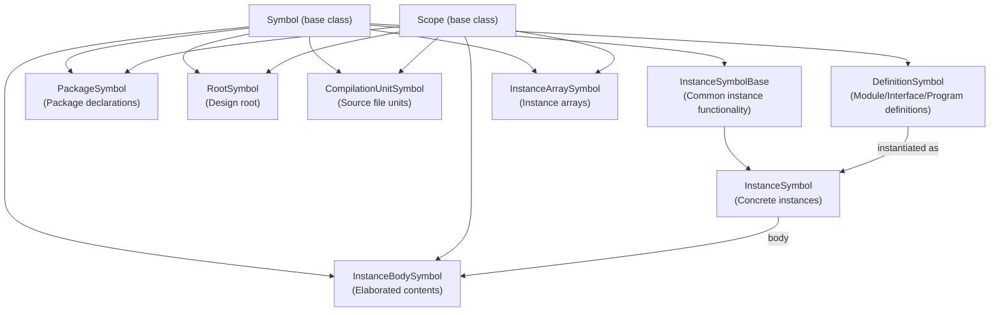
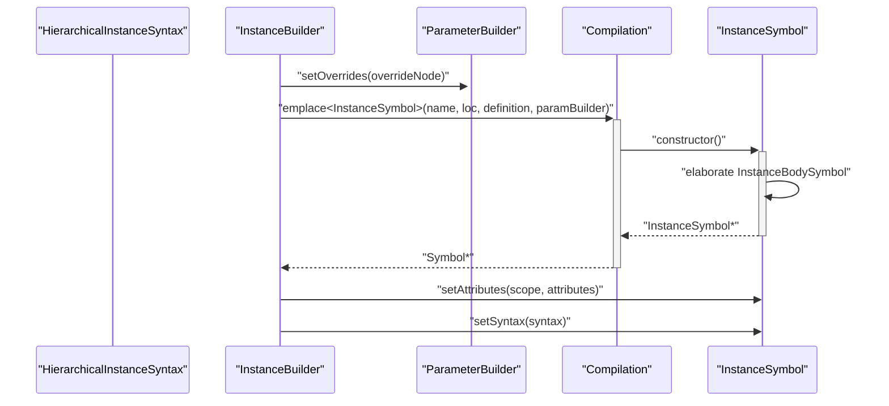

<!-- source: DeepWiki mcp.deepwiki.com · repo MikePopoloski/slang · page 3.3 Instance and Module Symbols · fetched 2026-10-30 -->

# Instance and Module Symbols

Relevant source files

The following files were used as context for generating this wiki page:

- [include/slang/ast/Compilation.h](include/slang/ast/Compilation.h)
- [include/slang/ast/HierarchicalReference.h](include/slang/ast/HierarchicalReference.h)
- [include/slang/ast/Scope.h](include/slang/ast/Scope.h)
- [include/slang/ast/symbols/CompilationUnitSymbols.h](include/slang/ast/symbols/CompilationUnitSymbols.h)
- [include/slang/ast/symbols/InstanceSymbols.h](include/slang/ast/symbols/InstanceSymbols.h)
- [include/slang/ast/symbols/PortSymbols.h](include/slang/ast/symbols/PortSymbols.h)
- [source/ast/Compilation.cpp](source/ast/Compilation.cpp)
- [source/ast/ElabVisitors.h](source/ast/ElabVisitors.h)
- [source/ast/HierarchicalReference.cpp](source/ast/HierarchicalReference.cpp)
- [source/ast/Scope.cpp](source/ast/Scope.cpp)
- [source/ast/symbols/CompilationUnitSymbols.cpp](source/ast/symbols/CompilationUnitSymbols.cpp)
- [source/ast/symbols/InstanceSymbols.cpp](source/ast/symbols/InstanceSymbols.cpp)
- [source/ast/symbols/PortSymbols.cpp](source/ast/symbols/PortSymbols.cpp)
- [tests/unittests/ast/ConfigTests.cpp](tests/unittests/ast/ConfigTests.cpp)
- [tests/unittests/ast/HierarchyTests.cpp](tests/unittests/ast/HierarchyTests.cpp)
- [tests/unittests/ast/InterfaceTests.cpp](tests/unittests/ast/InterfaceTests.cpp)
- [tests/unittests/ast/PortTests.cpp](tests/unittests/ast/PortTests.cpp)

This page covers the symbol types and mechanisms used to represent module definitions and their instantiations in the slang AST. Instance and module symbols form the backbone of the design hierarchy, representing both the definitions (templates) and their concrete instantiations throughout the design.

For information about symbol lookup and scoping mechanisms, see [Scope Management and Lookup](#3.2). For details about parameter resolution during instantiation, see [Symbol Creation and Management](#3.1).

## Core Symbol Types

The instance and module system in slang is built around several key symbol types that represent different aspects of SystemVerilog design hierarchy:

### Definition Symbols

`DefinitionSymbol` ([source/ast/symbols/CompilationUnitSymbols.cpp:207-217]()) represents the declaration of a module, interface, or program. It serves as a template that can be instantiated multiple times throughout the design. Key properties include:

- `definitionKind` - whether it's a module, interface, or program.
- `parameters` - list of parameter declarations.
- `portList` - port declarations from the definition.
- `defaultNetType` - default net type for the definition ([source/ast/Scope.cpp:66-83]()).
- `sourceLibrary` - which library contains this definition ([source/ast/symbols/CompilationUnitSymbols.cpp:27-29]()).

`PackageSymbol` ([source/ast/symbols/CompilationUnitSymbols.cpp:65-69]()) represents SystemVerilog packages, which provide a namespace for types, functions, and other declarations that can be imported into other scopes.

### Instance Symbols

`InstanceSymbol` ([include/slang/ast/symbols/InstanceSymbols.h:93-138]()) represents a concrete instantiation of a definition within the design hierarchy. Each instance has:

- Reference to its `InstanceBodySymbol` ([include/slang/ast/symbols/InstanceSymbols.h:95]()) containing the elaborated contents.
- `resolvedConfig` ([include/slang/ast/symbols/InstanceSymbols.h:99]()) pointing to any configuration rules that apply.
- `arrayPath` ([include/slang/ast/symbols/InstanceSymbols.h:73]()) for instances within generate arrays.
- `instanceDepth` ([include/slang/ast/symbols/InstanceSymbols.h:102]()) to detect infinite recursion during elaboration ([include/slang/ast/Compilation.h:134-136]()).

`InstanceBodySymbol` ([include/slang/ast/symbols/InstanceSymbols.h:176-232]()) contains the elaborated body of an instance, including all resolved parameters, ports, and child members. It acts as both a `Symbol` and a `Scope`.

`InstanceArraySymbol` ([include/slang/ast/symbols/InstanceSymbols.h:234-254]()) represents arrays of instances created through generate constructs or instance arrays.

Sources: [include/slang/ast/symbols/InstanceSymbols.h:1-260](), [source/ast/symbols/CompilationUnitSymbols.cpp:1-120](), [source/ast/symbols/InstanceSymbols.cpp:1-128]()

## Symbol Type Hierarchy

The following diagram maps the logical SystemVerilog entities to the specific C++ classes used in the slang implementation.

**Class Hierarchy and Entity Mapping**

Sources: [include/slang/ast/symbols/InstanceSymbols.h:66-93](), [include/slang/ast/Scope.h:15-30](), [source/ast/symbols/InstanceSymbols.cpp:110-128]()

## Instance Creation Process

Instance creation in slang follows a multi-step process that resolves definitions, applies parameter overrides, and builds the instance hierarchy.

### Definition Lookup and Resolution

The `Compilation` class manages the overall design state. The lookup process involves:

1. **Name Resolution**: `tryGetDefinition()` searches for definitions by name within the appropriate scope context.
2. **Library Priority**: When multiple definitions exist with the same name in different libraries, priority rules determine which one to use ([source/tests/unittests/ast/ConfigTests.cpp:13-44]()).
3. **Configuration Rules**: `ConfigBlockSymbol` can override which definition gets selected for specific instances ([source/tests/unittests/ast/ConfigTests.cpp:115-138]()).

### Parameter Resolution

Before instantiation, parameters must be resolved through the `ParameterBuilder` class ([source/ast/symbols/InstanceSymbols.cpp:10-11]()):

1. **Parameter Declarations**: Extracted from the definition.
2. **Value Assignment**: Parameter values are assigned from instantiation syntax or defaults.
3. **Hierarchy Overrides**: `HierarchyOverrideNode` handles overrides from `defparam` or CLI ([source/ast/symbols/InstanceSymbols.cpp:112]()).

### Instance Elaboration

The `InstanceBuilder::createInstance` method ([source/ast/symbols/InstanceSymbols.cpp:110-128]()) creates the instance by:

1. **Allocating Symbol**: Using `comp.emplace<InstanceSymbol>`.
2. **Setting Attributes**: Applying `AttributeInstanceSyntax` to the scope ([source/ast/symbols/InstanceSymbols.cpp:118]()).
3. **Resolving Config**: Applying `ResolvedConfig` if a configuration block is active ([source/ast/symbols/InstanceSymbols.cpp:120-125]()).

Sources: [source/ast/symbols/InstanceSymbols.cpp:43-128](), [source/ast/Compilation.cpp:122-160](), [source/ast/symbols/CompilationUnitSymbols.cpp:65-116]()

## Instance Creation Flow

This diagram illustrates the data flow from syntax nodes to the creation of internal AST symbols.

**Instantiation Data Flow**

Sources: [source/ast/symbols/InstanceSymbols.cpp:110-128](), [include/slang/ast/symbols/InstanceSymbols.h:104-109]()

## Port Symbols and Connections

Ports bridge the boundary between an instance and its parent scope.

### Port Types
- **PortSymbol**: Represents a standard logic port ([source/ast/ElabVisitors.h:104-109]()).
- **InterfacePortSymbol**: Represents a port that connects to an interface instance ([source/ast/ElabVisitors.h:79-102]()).
- **MultiPortSymbol**: Represents a port with multiple internal connections ([source/ast/ElabVisitors.h:111-115]()).

### ANSI Port Construction
The `AnsiPortListBuilder` ([source/ast/symbols/PortSymbols.cpp:94-98]()) manages the creation of ports from ANSI-style declarations:
1. **Direction Inheritance**: If direction/type are omitted, they are inherited from the previous port ([source/ast/symbols/PortSymbols.cpp:118-120]()).
2. **Interface Detection**: The builder checks if a port type identifier refers to an interface definition ([source/ast/symbols/PortSymbols.cpp:132-135]()).
3. **Implicit Nets**: Automatically creates implicit net symbols for ports when required ([source/ast/symbols/PortSymbols.cpp:127-130]()).

Sources: [source/ast/symbols/PortSymbols.cpp:94-156](), [source/ast/ElabVisitors.h:79-115]()

## Instantiation Context and Flags

Instance creation behavior is controlled through `InstanceFlags` ([include/slang/ast/symbols/InstanceSymbols.h:40-63]()):

| Flag | Purpose |
|------|---------|
| `Uninstantiated` | Instance exists for analysis but isn't part of the active design (e.g., inside an unselected `generate` branch). |
| `FromBind` | Instance was created from a `bind` directive. |
| `ParentFromBind` | The instance is nested within a bound hierarchy. |
| `TargetedByBind` | The instance is the target of a `bind` instantiation. |
| `PreventsCaching` | Combines flags that prevent the instance from being cached in the `Compilation` elaboration cache. |

Sources: [include/slang/ast/symbols/InstanceSymbols.h:40-63](), [source/ast/Scope.cpp:150-174](), [include/slang/ast/Compilation.h:107-109]()

---

