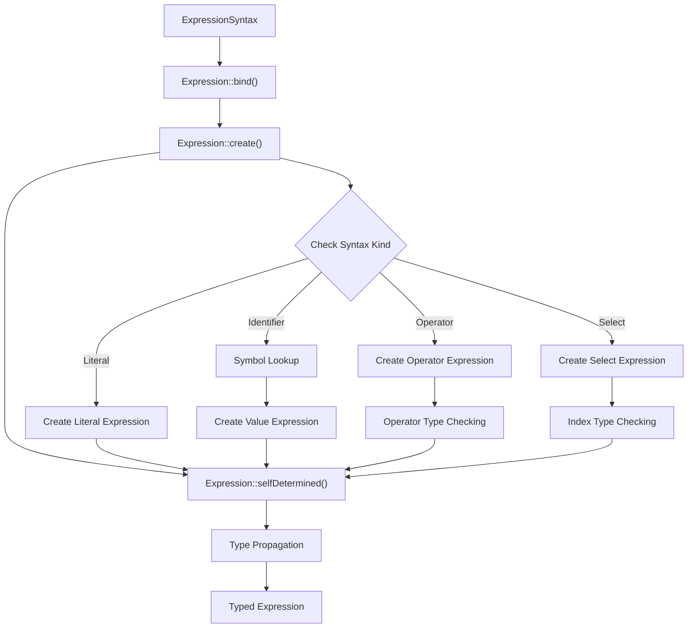
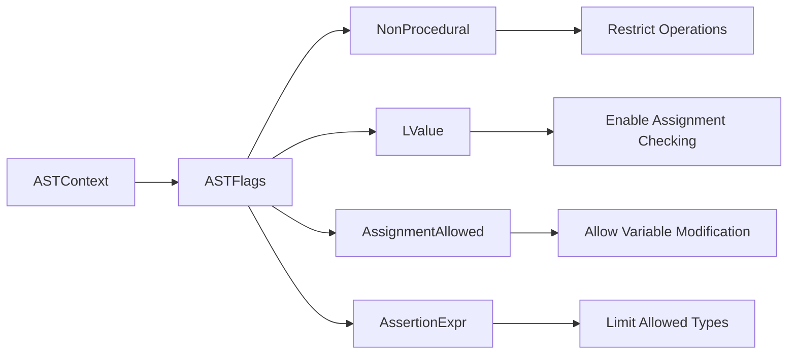
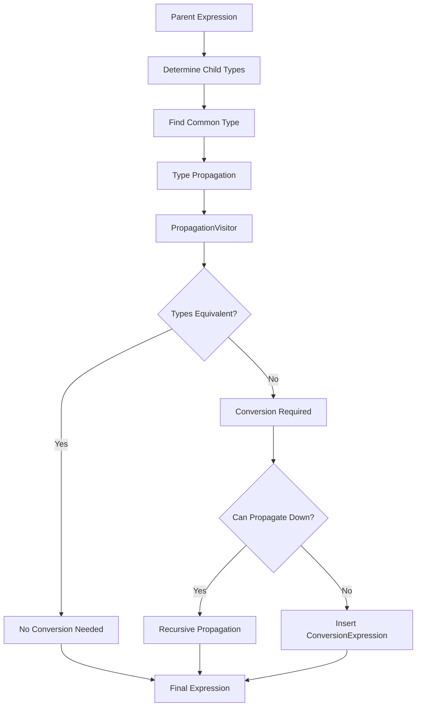
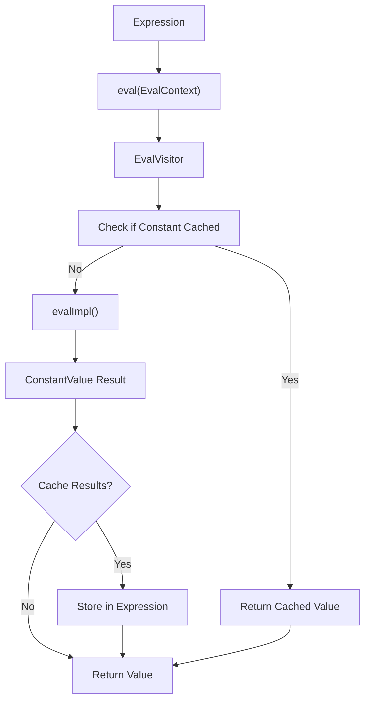
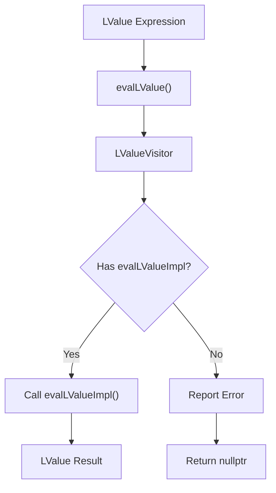
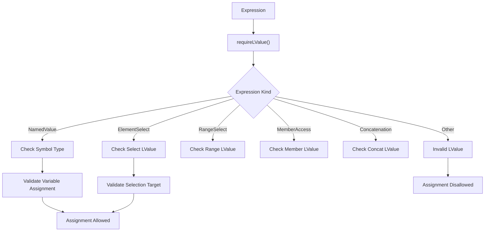
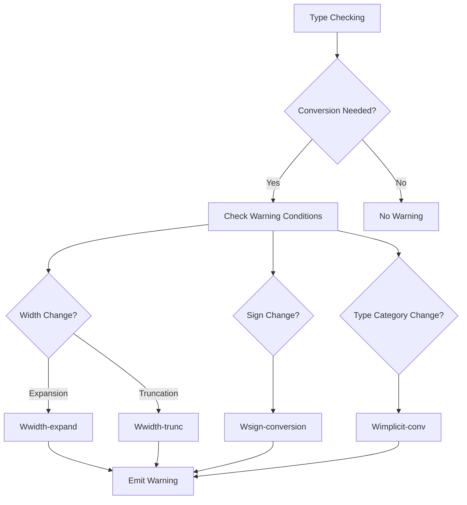

<!-- source: DeepWiki mcp.deepwiki.com · repo MikePopoloski/slang · page 4 Expression System · fetched 2026-10-30 -->

# Expression System

Relevant source files

The following files were used as context for generating this wiki page:

- [bindings/python/ASTBindings.cpp](bindings/python/ASTBindings.cpp)
- [bindings/python/NumericBindings.cpp](bindings/python/NumericBindings.cpp)
- [include/slang/ast/ASTContext.h](include/slang/ast/ASTContext.h)
- [include/slang/ast/Expression.h](include/slang/ast/Expression.h)
- [include/slang/ast/expressions/AssignmentExpressions.h](include/slang/ast/expressions/AssignmentExpressions.h)
- [include/slang/ast/expressions/ConversionExpression.h](include/slang/ast/expressions/ConversionExpression.h)
- [include/slang/ast/expressions/MiscExpressions.h](include/slang/ast/expressions/MiscExpressions.h)
- [include/slang/ast/expressions/OperatorExpressions.h](include/slang/ast/expressions/OperatorExpressions.h)
- [include/slang/ast/expressions/SelectExpressions.h](include/slang/ast/expressions/SelectExpressions.h)
- [scripts/diagnostics.txt](scripts/diagnostics.txt)
- [scripts/warning_docs.txt](scripts/warning_docs.txt)
- [source/ast/ASTContext.cpp](source/ast/ASTContext.cpp)
- [source/ast/Bitstream.cpp](source/ast/Bitstream.cpp)
- [source/ast/Expression.cpp](source/ast/Expression.cpp)
- [source/ast/TimingControl.cpp](source/ast/TimingControl.cpp)
- [source/ast/expressions/AssignmentExpressions.cpp](source/ast/expressions/AssignmentExpressions.cpp)
- [source/ast/expressions/ConversionExpression.cpp](source/ast/expressions/ConversionExpression.cpp)
- [source/ast/expressions/MiscExpressions.cpp](source/ast/expressions/MiscExpressions.cpp)
- [source/ast/expressions/OperatorExpressions.cpp](source/ast/expressions/OperatorExpressions.cpp)
- [source/ast/expressions/SelectExpressions.cpp](source/ast/expressions/SelectExpressions.cpp)
- [source/driver/CompatSettings.cpp](source/driver/CompatSettings.cpp)
- [tests/unittests/ast/ExpressionTests.cpp](tests/unittests/ast/ExpressionTests.cpp)
- [tests/unittests/ast/StatementTests.cpp](tests/unittests/ast/StatementTests.cpp)
- [tests/unittests/ast/WarningTests.cpp](tests/unittests/ast/WarningTests.cpp)

The Expression System handles the creation, binding, type checking, and evaluation of all expressions in SystemVerilog source code. This includes everything from simple literal values and variable references to complex operator expressions, function calls, and assignment operations. The system transforms syntax nodes into strongly-typed AST expression objects that can be evaluated for constant folding and simulation.

For information about the Symbol System that expressions reference, see [Symbol System](#3). For details about type checking and arithmetic operations, see [Type System and Arithmetic](#4.2).

## Expression Hierarchy and Classification

The expression system is built around a class hierarchy rooted at the `Expression` base class. Each expression has a specific `ExpressionKind` that determines its concrete type and behavior.

### Expression Class Hierarchy

```mermaid
graph TD
    Expression["Expression (base)"]
    Expression --> ValueExpressionBase["ValueExpressionBase"]
    Expression --> UnaryExpression["UnaryExpression"]
    Expression --> BinaryExpression["BinaryExpression"]
    Expression --> AssignmentExpression["AssignmentExpression"]
    Expression --> ElementSelectExpression["ElementSelectExpression"]
    Expression --> RangeSelectExpression["RangeSelectExpression"]
    Expression --> ConditionalExpression["ConditionalExpression"]
    Expression --> ConcatenationExpression["ConcatenationExpression"]
    Expression --> CallExpression["CallExpression"]
    Expression --> ConversionExpression["ConversionExpression"]
    Expression --> LiteralExpressions["Literal Expressions"]
    
    ValueExpressionBase --> NamedValueExpression["NamedValueExpression"]
    ValueExpressionBase --> HierarchicalValueExpression["HierarchicalValueExpression"]
    
    LiteralExpressions --> IntegerLiteral["IntegerLiteral"]
    LiteralExpressions --> RealLiteral["RealLiteral"]
    LiteralExpressions --> StringLiteral["StringLiteral"]
    LiteralExpressions --> NullLiteral["NullLiteral"]
```

Sources: [include/slang/ast/Expression.h:27-68](), [source/ast/expressions/MiscExpressions.cpp:53-152](), [source/ast/expressions/OperatorExpressions.cpp:51-144]()

### Expression Categories

Expressions are categorized into several major groups based on their functionality:

| Category | Examples | Primary Use |
|----------|----------|-------------|
| **Value References** | `NamedValueExpression`, `HierarchicalValueExpression` | Referencing variables, parameters, nets |
| **Operators** | `UnaryExpression`, `BinaryExpression` | Arithmetic, logical, bitwise operations |
| **Selections** | `ElementSelectExpression`, `RangeSelectExpression` | Array indexing, bit slicing |
| **Assignments** | `AssignmentExpression` | Variable assignments, port connections |
| **Literals** | `IntegerLiteral`, `RealLiteral`, `StringLiteral` | Constant values |
| **Conversions** | `ConversionExpression` | Type casting and implicit conversions |

Sources: [include/slang/ast/Expression.h:27-68](), [include/slang/ast/expressions/MiscExpressions.h:21-51]()

## Expression Binding Process

Expression binding transforms syntax nodes into typed AST expression objects through the `Expression::bind` method. This process involves syntax analysis, symbol lookup, type determination, and error checking.

### Binding Flow

Sources: [include/slang/ast/Expression.h:110-112](), [source/ast/Expression.cpp:159-204](), [tests/unittests/ast/ExpressionTests.cpp:38-39]()

### Context-Dependent Binding

The binding process uses `ASTContext` to control behavior based on the surrounding context via `ASTFlags`:

Sources: [include/slang/ast/ASTContext.h:33-186](), [source/ast/expressions/MiscExpressions.cpp:60-106]()

## Type Determination and Propagation

The expression system implements SystemVerilog's complex type determination rules, including context-determined and self-determined expressions.

### Type Propagation Process

The `PropagationVisitor` handles inserting implicit conversions into an expression tree, allowing types to "bubble up" and propagate back down branches.

Sources: [source/ast/Expression.cpp:159-204](), [source/ast/expressions/OperatorExpressions.cpp:76-144]()

### Self-Determined vs Context-Determined

| Determination Type | Description | Examples |
|-------------------|-------------|----------|
| **Self-Determined** | Expression type determined by operands alone | Literals, unary operators, comparisons |
| **Context-Determined** | Expression type influenced by surrounding context | Assignment RHS, function arguments |

Sources: [source/ast/Expression.cpp:849-867](), [source/ast/Expression.cpp:710-798]()

## Expression Evaluation

The expression system supports constant evaluation for compile-time computation and parameter resolution.

### Evaluation Architecture

Evaluation is driven by `EvalContext` and uses an internal `EvalVisitor`. Results are cached in the expression object if the compilation is not frozen.

Sources: [source/ast/Expression.cpp:25-52](), [tests/unittests/ast/ExpressionTests.cpp:43-50]()

### LValue Evaluation

For assignment targets, expressions support LValue evaluation via `LValueVisitor`, which calls `evalLValueImpl` on concrete expression types.

Sources: [source/ast/Expression.cpp:54-70](), [include/slang/ast/Expression.h:11-12]()

## LValue and Assignment Handling

The expression system enforces SystemVerilog's rules for assignable expressions (LValues). `Expression::bindLValue` is used to bind expressions specifically as assignment targets.

### LValue Requirements

Sources: [include/slang/ast/Expression.h:113-129](), [source/ast/expressions/SelectExpressions.cpp:82-124]()

### Variable Assignment Validation

The system performs extensive validation for variable assignments, checking for `const` modifiers, net vs variable usage, and automatic lifetime restrictions.

| Check | Description | Example Error |
|-------|-------------|---------------|
| **Const Variables** | Cannot modify const variables | `const int x = 5; x = 10;` |
| **Automatic in Static** | Automatic variables restricted in static contexts | Static initializer referencing automatic var |
| **Non-blocking Timing** | Non-blocking assignments to dynamic arrays restricted | NBA to dynamic array elements |

Sources: [source/ast/expressions/MiscExpressions.cpp:60-106](), [source/ast/expressions/SelectExpressions.cpp:102-110]()

## Warning and Diagnostic System Integration

The expression system generates warnings for potentially problematic operations, particularly around type conversions.

### Type Conversion Warnings

Warnings are triggered during type propagation and operator analysis.

Sources: [scripts/warning_docs.txt:4-106](), [source/ast/expressions/OperatorExpressions.cpp:121-143]()

### Common Expression Warnings

| Warning Code | Description | Example |
|--------------|-------------|---------|
| **Wconstant-conversion** | Constant value truncated by conversion | `logic [9:0] a = 9000;` |
| **Wsign-conversion** | Implicit sign conversion | `logic signed [31:0] a; logic [31:0] b; assign b = a;` |
| **Wwidth-expand** | Type expansion in expression | `logic [1:0] a; int b = a;` |
| **Wuseless-cast** | Cast to same type | `int i, j; assign i = int'(j);` |

Sources: [scripts/warning_docs.txt:6-25](), [scripts/warning_docs.txt:64-83](), [tests/unittests/ast/WarningTests.cpp:181-228]()

For details, see [Expression Binding and Evaluation](#4.1), [Type System and Arithmetic](#4.2), and [Assertion and Temporal Expressions](#4.3).

---

