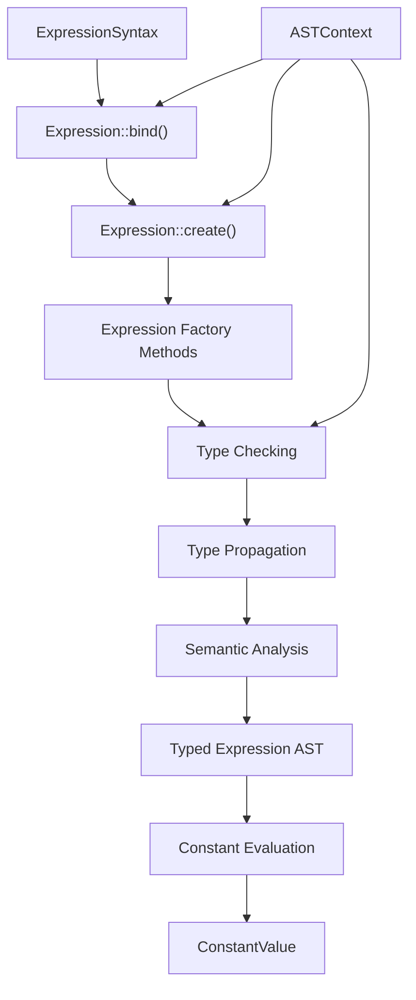
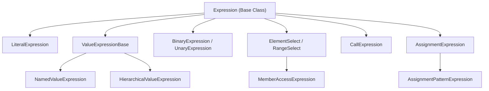

<!-- source: DeepWiki mcp.deepwiki.com · repo MikePopoloski/slang · page 4.1 Expression Binding and Evaluation · fetched 2026-10-30 -->

# Expression Binding and Evaluation

Relevant source files

The following files were used as context for generating this wiki page:

- [bindings/python/ASTBindings.cpp](bindings/python/ASTBindings.cpp)
- [bindings/python/NumericBindings.cpp](bindings/python/NumericBindings.cpp)
- [include/slang/ast/ASTContext.h](include/slang/ast/ASTContext.h)
- [include/slang/ast/Expression.h](include/slang/ast/Expression.h)
- [include/slang/ast/LValue.h](include/slang/ast/LValue.h)
- [include/slang/ast/SFormat.h](include/slang/ast/SFormat.h)
- [include/slang/ast/expressions/AssignmentExpressions.h](include/slang/ast/expressions/AssignmentExpressions.h)
- [include/slang/ast/expressions/ConversionExpression.h](include/slang/ast/expressions/ConversionExpression.h)
- [include/slang/ast/expressions/LiteralExpressions.h](include/slang/ast/expressions/LiteralExpressions.h)
- [include/slang/ast/expressions/MiscExpressions.h](include/slang/ast/expressions/MiscExpressions.h)
- [include/slang/ast/expressions/OperatorExpressions.h](include/slang/ast/expressions/OperatorExpressions.h)
- [include/slang/ast/expressions/SelectExpressions.h](include/slang/ast/expressions/SelectExpressions.h)
- [include/slang/numeric/ConstantValue.h](include/slang/numeric/ConstantValue.h)
- [scripts/diagnostics.txt](scripts/diagnostics.txt)
- [scripts/warning_docs.txt](scripts/warning_docs.txt)
- [source/ast/ASTContext.cpp](source/ast/ASTContext.cpp)
- [source/ast/Bitstream.cpp](source/ast/Bitstream.cpp)
- [source/ast/Expression.cpp](source/ast/Expression.cpp)
- [source/ast/FmtHelpers.cpp](source/ast/FmtHelpers.cpp)
- [source/ast/FmtHelpers.h](source/ast/FmtHelpers.h)
- [source/ast/LValue.cpp](source/ast/LValue.cpp)
- [source/ast/SFormat.cpp](source/ast/SFormat.cpp)
- [source/ast/TimingControl.cpp](source/ast/TimingControl.cpp)
- [source/ast/expressions/AssignmentExpressions.cpp](source/ast/expressions/AssignmentExpressions.cpp)
- [source/ast/expressions/ConversionExpression.cpp](source/ast/expressions/ConversionExpression.cpp)
- [source/ast/expressions/LiteralExpressions.cpp](source/ast/expressions/LiteralExpressions.cpp)
- [source/ast/expressions/MiscExpressions.cpp](source/ast/expressions/MiscExpressions.cpp)
- [source/ast/expressions/OperatorExpressions.cpp](source/ast/expressions/OperatorExpressions.cpp)
- [source/ast/expressions/SelectExpressions.cpp](source/ast/expressions/SelectExpressions.cpp)
- [source/driver/CompatSettings.cpp](source/driver/CompatSettings.cpp)
- [source/numeric/ConstantValue.cpp](source/numeric/ConstantValue.cpp)
- [tests/unittests/ast/EvalTests.cpp](tests/unittests/ast/EvalTests.cpp)
- [tests/unittests/ast/ExpressionTests.cpp](tests/unittests/ast/ExpressionTests.cpp)
- [tests/unittests/ast/MemberTests.cpp](tests/unittests/ast/MemberTests.cpp)
- [tests/unittests/ast/StatementTests.cpp](tests/unittests/ast/StatementTests.cpp)
- [tests/unittests/ast/WarningTests.cpp](tests/unittests/ast/WarningTests.cpp)

This document covers the expression binding and evaluation system in slang, which transforms syntax nodes into semantically analyzed Abstract Syntax Tree (AST) expression nodes with proper types and constant values. For information about the type system that expressions operate on, see [Type System and Arithmetic](4.2).

## Purpose and Scope

Expression binding is the process of taking parsed expression syntax and creating typed AST expression nodes that can be evaluated and analyzed. This system handles:

- **Semantic Analysis**: Converting syntax into typed expressions with proper symbol resolution [source/ast/Expression.cpp:8-19]().
- **Type Propagation**: Determining expression types through context-dependent and self-determined rules [source/ast/Expression.cpp:159-204]().
- **Constant Evaluation**: Computing compile-time constant values where possible [source/ast/Expression.cpp:25-52]().
- **LValue Handling**: Managing assignment targets and their specific constraints [source/ast/Expression.cpp:54-70]().
- **Select and Call Expressions**: Handling complex indexing, slicing, and subroutine invocations [source/ast/expressions/SelectExpressions.cpp:1-28]().

## Expression Binding Process

Expression binding follows a structured process that transforms syntax into fully analyzed AST nodes:

Title: Expression Binding Flow

The binding process starts with `Expression::bind()` and flows through several key stages of analysis. The `ASTContext` carries necessary state like the current scope and lookup flags [source/ast/Expression.cpp:534-589]().

### Key Binding Methods

The `Expression` class provides several binding entry points for different contexts:

| Method | Purpose | File Reference |
|--------|---------|----------------|
| `bind()` | General expression binding | [source/ast/Expression.cpp:534-537]() |
| `bindLValue()` | Assignment target binding | [source/ast/Expression.cpp:562-566]() |
| `bindRValue()` | Assignment source binding | [source/ast/Expression.cpp:552-556]() |
| `bindArgument()` | Subroutine argument binding | [source/ast/Expression.cpp:584-589]() |

Sources: [source/ast/Expression.cpp:534-589](), [include/slang/ast/Expression.h:107-139]()

## Expression Hierarchy and Implementation

The expression system uses a comprehensive hierarchy of expression types, each handling specific language constructs.

Title: AST Expression Class Space

### Value Expressions
Value expressions represent references to symbols. `ValueExpressionBase::fromSymbol` handles the logic of converting a found symbol (like a `VariableSymbol` or `ParameterSymbol`) into an expression, while enforcing access rules (e.g., automatic variables in non-procedural contexts) [source/ast/expressions/MiscExpressions.cpp:53-106]().

### Select Expressions
Selection expressions handle indexing into arrays and bit-vectors.
- **`ElementSelectExpression`**: Used for single index access `a[i]`. It validates that the index is within the fixed range of the type if known at compile-time [source/ast/expressions/SelectExpressions.cpp:126-175]().
- **`RangeSelectExpression`**: Handles slicing `a[i:j]`, `a[i+:width]`, or `a[i-:width]` [source/ast/expressions/SelectExpressions.cpp:214-250]().
- **Vectored Nets**: The system specifically checks for and disallows selects of vectored nets as per the standard [source/ast/expressions/SelectExpressions.cpp:70-79]().

Sources: [source/ast/expressions/MiscExpressions.cpp:53-147](), [source/ast/expressions/SelectExpressions.cpp:1-250]()

## Constant Evaluation

The expression system performs constant folding via `Expression::eval()`. This uses an `EvalVisitor` that traverses the tree and computes values using `ConstantValue` [source/ast/Expression.cpp:25-52]().

### Evaluation Mechanism
1. **Caching**: If a result is computed and the context allows caching, the `ConstantValue` is stored in the expression node to avoid re-computation [source/ast/Expression.cpp:28-30]().
2. **LValue Evaluation**: For assignments or `ref` arguments, the system evaluates an `LValue` object which acts as a pointer to the underlying storage in the `EvalContext` [source/ast/Expression.cpp:54-70]().
3. **Invalid Values**: If evaluation fails (e.g., due to a non-constant variable), an `Invalid` constant is returned and diagnostics are reported [source/ast/Expression.cpp:31-37]().

Sources: [source/ast/Expression.cpp:25-70](), [source/numeric/ConstantValue.cpp:24-104]()

## Type Propagation and Conversions

SystemVerilog features complex "bubbling up" and "propagating down" of types. Slang implements this using a `PropagationVisitor` [source/ast/Expression.cpp:159-204]().

- **Implicit Conversions**: When a type mismatch occurs, the system inserts `ConversionExpression` nodes.
- **Context-Determined Types**: In an expression like `assign logic[15:0] a = b + c;`, the 16-bit width of `a` propagates down to `b` and `c` before the addition is performed [tests/unittests/ast/ExpressionTests.cpp:58-86]().
- **Warnings**: The system generates warnings for potentially dangerous implicit conversions, such as `ConstantConversion` (truncating a literal) or `SignConversion` (mixing signed/unsigned) [scripts/warning_docs.txt:64-83](), [tests/unittests/ast/WarningTests.cpp:6-21]().

Sources: [source/ast/Expression.cpp:159-204](), [scripts/warning_docs.txt:4-131](), [tests/unittests/ast/ExpressionTests.cpp:58-121]()

## LValue Handling

Assignments require the left-hand side to be a valid "LValue". Slang enforces strict rules on what can be assigned:
- **Net Types**: User-defined net types cannot be partially driven (e.g., slicing a UDN is disallowed for assignments) [source/ast/expressions/SelectExpressions.cpp:95-100]().
- **Procedural vs. Continuous**: The `ASTFlags` in the `ASTContext` track whether the assignment is in a procedural block or a continuous assignment, affecting which symbols are valid targets [source/ast/expressions/MiscExpressions.cpp:76-93]().
- **Non-blocking**: Non-blocking assignments to dynamic arrays are restricted [source/ast/expressions/SelectExpressions.cpp:102-109]().

Sources: [source/ast/expressions/SelectExpressions.cpp:81-124](), [source/ast/expressions/AssignmentExpressions.cpp:947-1065]()

---

