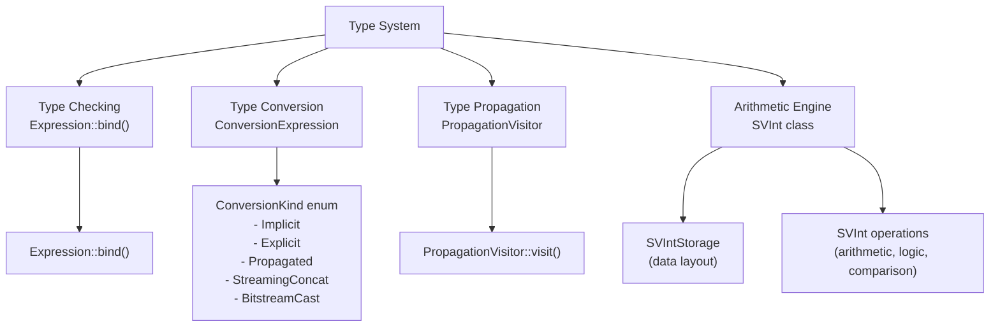
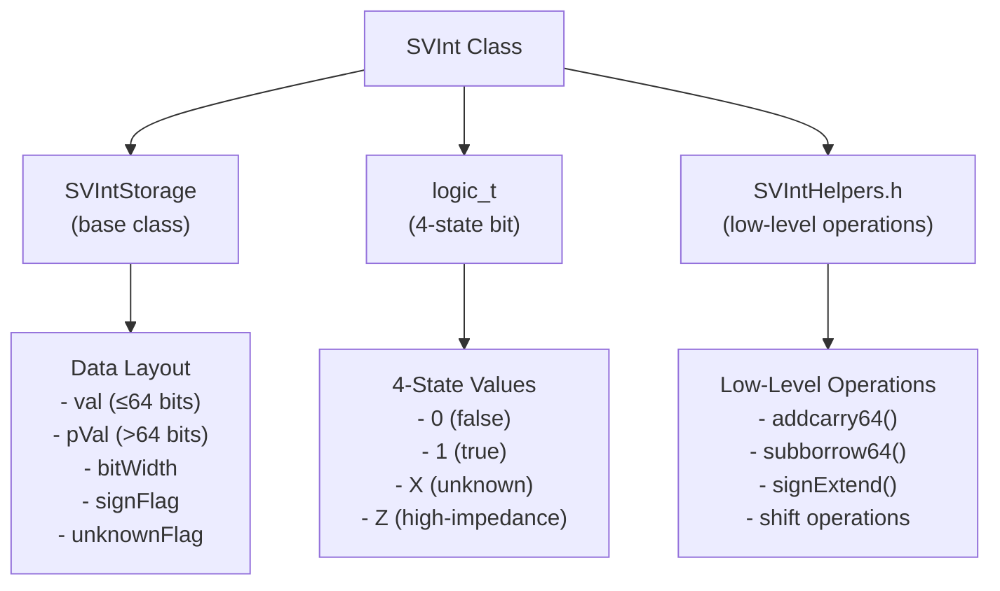
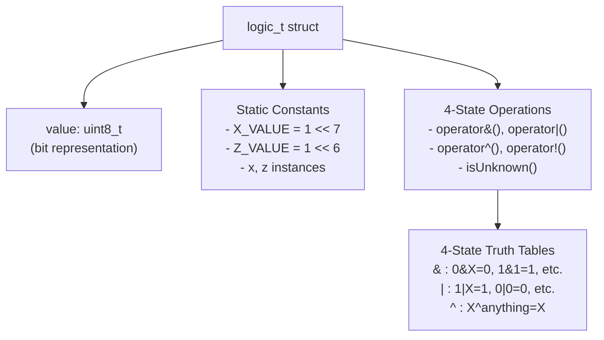

<!-- source: DeepWiki mcp.deepwiki.com · repo MikePopoloski/slang · page 4.2 Type System and Arithmetic · fetched 2026-10-30 -->

# Type System and Arithmetic

<details>
<summary>Relevant source files</summary>

The following files were used as context for generating this wiki page:

- [bindings/python/TypeBindings.cpp](bindings/python/TypeBindings.cpp)
- [include/slang/ast/types/AllTypes.h](include/slang/ast/types/AllTypes.h)
- [include/slang/ast/types/DeclaredType.h](include/slang/ast/types/DeclaredType.h)
- [include/slang/ast/types/Type.h](include/slang/ast/types/Type.h)
- [include/slang/numeric/MathUtils.h](include/slang/numeric/MathUtils.h)
- [include/slang/numeric/SVInt.h](include/slang/numeric/SVInt.h)
- [source/ast/types/AllTypes.cpp](source/ast/types/AllTypes.cpp)
- [source/ast/types/DeclaredType.cpp](source/ast/types/DeclaredType.cpp)
- [source/ast/types/Type.cpp](source/ast/types/Type.cpp)
- [source/numeric/SVInt.cpp](source/numeric/SVInt.cpp)
- [source/numeric/SVIntHelpers.h](source/numeric/SVIntHelpers.h)
- [tests/unittests/ast/TypeTests.cpp](tests/unittests/ast/TypeTests.cpp)

</details>


This page details how the slang compiler implements type checking, conversions, and arithmetic operations with arbitrary precision integers. The type system ensures SystemVerilog expressions are well-typed while the arithmetic system provides precise computation using the `SVInt` class for arbitrary precision integer values.

The type system integrates closely with the expression binding system and supports the full range of SystemVerilog data types and operations.

## Type System Architecture

The slang type system implements SystemVerilog's type checking and conversion rules through several key components:

### Type System Components



Sources: [source/ast/Expression.cpp:124-204](), [source/ast/expressions/ConversionExpression.cpp:1-50](), [source/numeric/SVInt.cpp:1-50]()

### Type Hierarchy and AllTypes

The type system is rooted in the `Type` base class, which provides a rich interface for querying type properties such as `isIntegral()`, `isFourState()`, and `getBitWidth()`. The `AllTypes.h` header defines the concrete hierarchy:

*   **IntegralType**: Base for all bit-vector like types (scalars, predefined integers, packed arrays/structs, enums).
*   **FloatingType**: Represents `real`, `shortreal`, and `realtime`.
*   **EnumType**: Manages a scope of `EnumValueSymbol` members.
*   **PackedArrayType / FixedSizeUnpackedArrayType**: Represent dimensions.

Sources: [include/slang/ast/types/Type.h:50-180](), [include/slang/ast/types/AllTypes.h:25-188](), [source/ast/types/Type.cpp:80-237]()

### DeclaredType Glue Logic

The `DeclaredType` class acts as the "glue" between a symbol (like a variable or parameter) and its type syntax. It handles:
1.  **Lazy Resolution**: Types are only resolved when `getType()` is called.
2.  **Type Inference**: For parameters where the type is inferred from the initializer (`InferImplicit` flag).
3.  **Linkage**: Linking one symbol's type to another (e.g., in port connections).

Sources: [include/slang/ast/types/DeclaredType.h:98-179](), [source/ast/types/DeclaredType.cpp:43-174]()

## Arbitrary Precision Integer Implementation

The heart of slang's arithmetic system is the `SVInt` class, which provides arbitrary precision integer arithmetic with 4-state logic support (0, 1, X, Z).

### SVInt Architecture



Sources: [include/slang/numeric/SVInt.h:137-151](), [source/numeric/SVInt.cpp:22-29](), [source/numeric/SVIntHelpers.h:28-40]()

### 4-State Logic Implementation

The `logic_t` structure represents a single 4-state bit. Both X and Z are treated as "unknown" for most computational purposes.



Sources: [include/slang/numeric/SVInt.h:40-112](), [source/numeric/SVInt.cpp:24-25](), [source/numeric/SVInt.cpp:53-71]()

### Memory Layout and Storage

`SVInt` inherits from `SVIntStorage`, which uses a union to optimize for small integers.

| Condition | Storage | Memory Layout |
|-----------|---------|---------------|
| `bitWidth ≤ 64` | `val` | 64-bit integer directly in the union. |
| `bitWidth > 64` | `pVal` | Pointer to a heap-allocated array of `uint64_t`. |
| `unknownFlag` | Double allocation | If bits are X/Z, the allocation size doubles to store the "mask" words alongside value words. |

Sources: [include/slang/numeric/SVInt.h:117-136](), [source/numeric/SVInt.cpp:188-215]()

## Type Checking and Conversion

Type checking in slang occurs during expression binding and ensures SystemVerilog type compatibility rules are enforced.

### Binary Operator Type Resolution

Slang implements the complex rules for "common" types in binary expressions (e.g., adding a signed 10-bit and unsigned 12-bit integer).

1.  **Self-Determined**: Operands are evaluated independently.
2.  **Context-Determined**: Operands are sized based on the maximum width of the operands and the context they are in.
3.  **Sign Propagation**: If both operands are signed, the result is signed. If either is unsigned, the result is unsigned.

Sources: [source/ast/types/Type.cpp:129-132](), [source/ast/types/AllTypes.cpp:162-200]()

### Evaluation of Enums

Enums are strictly typed in SystemVerilog. Slang enforces that enum values must be integral and checks for size mismatches or unknown bits during declaration.

```systemverilog
enum logic [2:0] { A, B = 'x } e1; // Error: unknown not allowed in 2-state base
```

Sources: [source/ast/types/AllTypes.cpp:108-133](), [tests/unittests/ast/TypeTests.cpp:90-114](), [tests/unittests/ast/TypeTests.cpp:116-150]()

## Arithmetic Expression Evaluation

Arithmetic evaluation uses the `SVInt` class to provide precise computation with proper 4-state logic handling.

### Constant Expression Evaluation

The `evalImpl()` methods in expression classes perform constant folding. For example, `SVInt::fromDigits` and `SVInt::fromString` handle the parsing of SystemVerilog literals like `16'shABCD`.

Sources: [source/numeric/SVInt.cpp:73-186](), [source/numeric/SVInt.cpp:188-240]()

### Arithmetic Operation Implementation

SVInt implements SystemVerilog arithmetic semantics using low-level helpers for performance:

| Operation | Implementation Detail |
|-----------|-----------------------|
| **Addition** | Uses `addcarry64` intrinsics for multi-word carry propagation. |
| **Shifts** | `lshrFar` and `shlFar` optimize whole-word shifts vs. bit-offset shifts. |
| **Sign Extension** | `signExtendCopy` fills high words based on the sign bit of the original width. |

Sources: [source/numeric/SVIntHelpers.h:22-40](), [source/numeric/SVIntHelpers.h:114-152](), [source/numeric/SVIntHelpers.h:154-166]()

### Unknown Value Propagation

SystemVerilog's 4-state logic requires that if any bit of an operand in an arithmetic operation (like `+` or `*`) is X or Z, the entire result typically becomes X.

Sources: [include/slang/numeric/SVInt.h:59-90](), [source/numeric/SVInt.cpp:152-177]()

## Summary of Key Classes

| Class | Role | File |
|-------|------|------|
| `Type` | Base class for all SV types. | [include/slang/ast/types/Type.h:50]() |
| `SVInt` | Arbitrary precision 4-state integer. | [include/slang/numeric/SVInt.h:152]() |
| `DeclaredType` | Manages syntax-to-symbol type resolution. | [include/slang/ast/types/DeclaredType.h:98]() |
| `TypePrinter` | Utility to convert types to string representations. | [bindings/python/TypeBindings.cpp:11]() |
| `IntegralType` | Specialized type for bit-vectors. | [include/slang/ast/types/AllTypes.h:25]() |

Sources: [include/slang/ast/types/Type.h](), [include/slang/numeric/SVInt.h](), [include/slang/ast/types/DeclaredType.h](), [include/slang/ast/types/AllTypes.h]()

---

