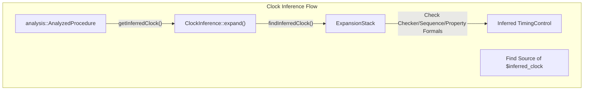

<!-- source: DeepWiki mcp.deepwiki.com · repo MikePopoloski/slang · page 4.3 Assertion and Temporal Expressions · fetched 2026-10-30 -->

# Assertion and Temporal Expressions

<details>
<summary>Relevant source files</summary>

The following files were used as context for generating this wiki page:

- [include/slang/analysis/AnalyzedAssertion.h](include/slang/analysis/AnalyzedAssertion.h)
- [include/slang/analysis/ClockInference.h](include/slang/analysis/ClockInference.h)
- [include/slang/ast/expressions/AssertionExpr.h](include/slang/ast/expressions/AssertionExpr.h)
- [source/analysis/AnalyzedAssertion.cpp](source/analysis/AnalyzedAssertion.cpp)
- [source/analysis/ClockInference.cpp](source/analysis/ClockInference.cpp)
- [source/ast/expressions/AssertionExpr.cpp](source/ast/expressions/AssertionExpr.cpp)
- [tests/unittests/analysis/AssertionAnalysisTests.cpp](tests/unittests/analysis/AssertionAnalysisTests.cpp)
- [tests/unittests/ast/AssertionTests.cpp](tests/unittests/ast/AssertionTests.cpp)

</details>


This document covers the SystemVerilog assertion and temporal expression system in slang, which handles the binding, instantiation, and evaluation of sequence expressions, property expressions, and temporal operators used in concurrent assertions. This system enables verification engineers to write temporal logic specifications that can be checked during simulation or formal verification.

For general expression binding and evaluation, see [Expression System](4.1). For static analysis of assertion expressions, see [Analysis and Diagnostics](5.1).

## Overview

The assertion and temporal expression system provides support for SystemVerilog's concurrent assertion features, including:

- **Sequence expressions**: Temporal patterns describing signal behavior over time (e.g., `a ##1 b`).
- **Property expressions**: Logical statements about sequences (e.g., `a |-> p1`).
- **Temporal operators**: Time-advancing (`##`), repetition (`[*]`, `[=]`, `[->]`), and implication (`|->`, `|=>`).
- **Assertion instances**: Parameterized sequences and properties expanded during elaboration.
- **Clock Inference**: Automatic determination of leading clocking events from procedural or clocking block contexts.

## System Architecture

The assertion system is divided into AST construction (binding) and post-binding analysis (clock inference and flow analysis).

```mermaid
graph TB
    subgraph "AST Construction (Code Entity Space)"
        AE["ast::AssertionExpr"]
        SAE["ast::SimpleAssertionExpr"]
        Bae["ast::BinaryAssertionExpr"]
        AIE["ast::AssertionInstanceExpression"]
        
        AE <|-- SAE
        AE <|-- Bae
        AE <|-- AIE
    end
    
    subgraph "Binding Logic (Natural Language Space)"
        Bind["AssertionExpr::bind()"]
        NonDeg["enforceNondegeneracy()"]
        ArgCheck["checkAssertionArg()"]
    end
    
    subgraph "Analysis & Inference"
        AA["analysis::AnalyzedAssertion"]
        CI["analysis::ClockInference"]
        BVV["analysis::BlockedVarsVisitor"]
    end
    
    Bind --> AE
    ArgCheck --> AIE
    AE --> AA
    AA --> CI
    AA --> BVV
```

**System Architecture Overview**

Sources: [include/slang/ast/expressions/AssertionExpr.h:116-152](), [source/ast/expressions/AssertionExpr.cpp:99-146](), [include/slang/analysis/AnalyzedAssertion.h:30-59](), [source/analysis/ClockInference.cpp:89-127]()

## Assertion Expression Hierarchy

All temporal constructs derive from `ast::AssertionExpr`. Unlike standard expressions which return a value, assertion expressions represent temporal sequences or properties.

| Class | Kind | Description |
|-------|------|-------------|
| `SimpleAssertionExpr` | `Simple` | Wraps a boolean expression or a sequence repetition. |
| `SequenceConcatExpr` | `SequenceConcat` | Implements the `##` delay operator. |
| `BinaryAssertionExpr` | `Binary` | Implements `and`, `or`, `intersect`, `throughout`, `within`, and implications. |
| `ClockingAssertionExpr`| `Clocking` | Explicit clocking events (e.g., `@(posedge clk) ...`). |
| `AssertionInstanceExpression` | `AssertionInstance` | A call to a named `sequence` or `property`. |

Sources: [include/slang/ast/expressions/AssertionExpr.h:20-34](), [source/ast/expressions/AssertionExpr.cpp:105-142]()

## Binding and Nondegeneracy

Binding is initiated via `AssertionExpr::bind`. During this process, slang enforces "nondegeneracy" requirements defined in the LRM (F.5).

### Nondegeneracy Requirements
The compiler checks if a sequence admits empty matches or no matches at all, which can lead to vacuous success or failure.

- **`NondegeneracyStatus::AdmitsEmpty`**: The sequence can match in zero clock cycles.
- **`NondegeneracyStatus::AdmitsNoMatch`**: The sequence can never match (e.g., `a ##1 1'b0`).

Slang uses the `NondegeneracyCheckVisitor` to traverse the expression tree and identify these states.

Sources: [include/slang/ast/expressions/AssertionExpr.h:73-87](), [source/ast/expressions/AssertionExpr.cpp:30-38](), [source/ast/expressions/AssertionExpr.cpp:148-175]()

## Clock Inference

Slang implements complex clock inference rules to determine the "leading clocking event" for assertions, especially when they are embedded in procedural blocks.

### Inference Sources
1. **Explicit**: `@(posedge clk)` within the assertion.
2. **Contextual**: Inferred from an `always @(posedge clk)` block.
3. **Default**: From a `default clocking` block in the module scope.

The `analysis::ClockInference` class handles the expansion of `$inferred_clock` calls, which are often used as default values for assertion formal ports.



**Clock Inference Logic**

Sources: [source/analysis/ClockInference.cpp:54-87](), [source/analysis/ClockInference.cpp:89-127](), [tests/unittests/analysis/AssertionAnalysisTests.cpp:48-160]()

## Local Variable Flow Analysis

SystemVerilog assertions allow local variables (e.g., `sequence s; int x; (a, x = data) ##1 (b == x); endsequence`). Slang performs flow analysis to ensure variables are properly assigned before use.

### Blocked Variables
The `analysis::BlockedVarsVisitor` implements the `sample()`, `block()`, and `flow()` functions defined in LRM Annex F.5.4. It identifies variables that are "blocked" from flowing out of a sequence due to operators like `or` where the variable is only assigned on one branch.

Key behaviors:
- **`SequenceConcatExpr`**: Resets flow between elements to track sequential assignment.
- **`BinaryAssertionExpr`**: For `or` / `and` / `intersect`, it computes the union of sampled variables and identifies blocked sets.
- **`SequenceWithMatchExpr`**: Tracks assignments in match items (e.g., `(seq, x = e)`).

Sources: [source/analysis/AnalyzedAssertion.cpp:37-173](), [source/analysis/AnalyzedAssertion.cpp:175-185]()

## Sequence Length Computation

Slang can compute the possible duration (in clock ticks) of a sequence using `computeSequenceLength()`. This returns a `SequenceRange` containing a `min` and an optional `max` (where `nullopt` represents `$`).

| Operator | Length Calculation |
|----------|--------------------|
| `##[n:m]` | `[min + n, max + m]` |
| `seq1 and seq2` | `[max(min1, min2), max(max1, max2)]` |
| `seq1 intersect seq2` | Lengths must be able to intersect |

Sources: [include/slang/ast/expressions/AssertionExpr.h:90-113](), [source/ast/expressions/AssertionExpr.cpp:40-48]()

## Diagnostics and Error Handling

The assertion system validates various semantic constraints:
- **Type Checking**: Boolean expressions in assertions must be integral and boolean-convertible [source/ast/expressions/AssertionExpr.cpp:84-93]().
- **Illegal Types**: `chandle` and class members are generally restricted in concurrent assertions [tests/unittests/ast/AssertionTests.cpp:103-106]().
- **Argument Matching**: Validates formal-to-actual mapping for sequence/property instances, including `untyped` and `local` arguments [tests/unittests/ast/AssertionTests.cpp:177-202]().

Sources: [tests/unittests/ast/AssertionTests.cpp:127-150](), [source/ast/expressions/AssertionExpr.cpp:74-97]()

---

