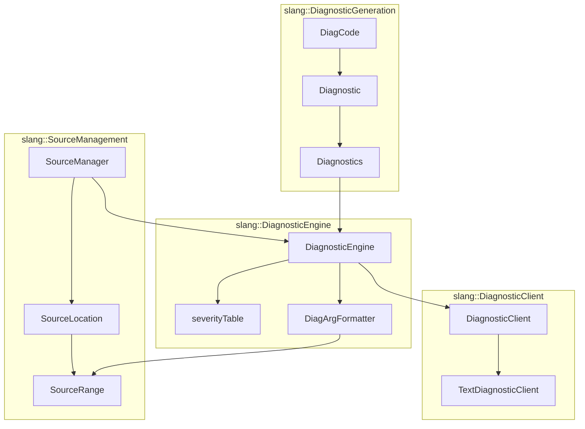
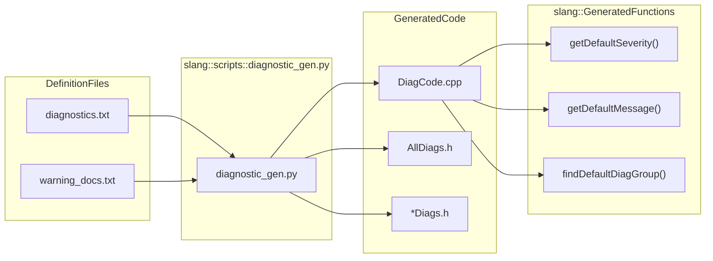
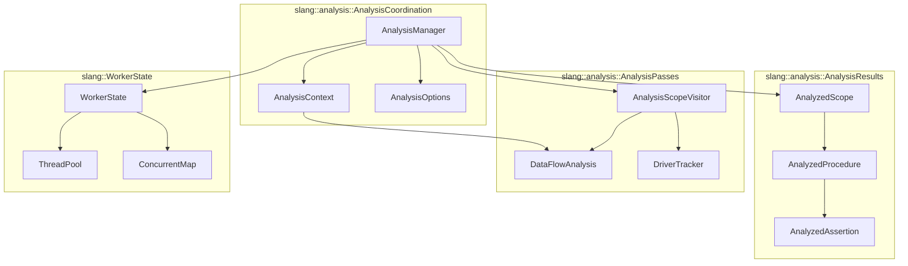
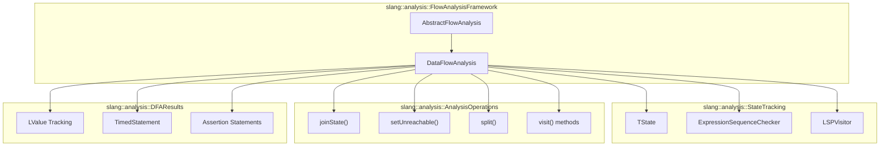

<!-- source: DeepWiki mcp.deepwiki.com · repo MikePopoloski/slang · page 5 Analysis and Diagnostics · fetched 2026-10-30 -->

# Analysis and Diagnostics

Relevant source files

The following files were used as context for generating this wiki page:

- [bindings/python/AnalysisBindings.cpp](bindings/python/AnalysisBindings.cpp)
- [include/slang/analysis/AbstractFlowAnalysis.h](include/slang/analysis/AbstractFlowAnalysis.h)
- [include/slang/analysis/AnalysisManager.h](include/slang/analysis/AnalysisManager.h)
- [include/slang/analysis/AnalysisOptions.h](include/slang/analysis/AnalysisOptions.h)
- [include/slang/analysis/AnalyzedProcedure.h](include/slang/analysis/AnalyzedProcedure.h)
- [include/slang/analysis/DFAResults.h](include/slang/analysis/DFAResults.h)
- [include/slang/analysis/DataFlowAnalysis.h](include/slang/analysis/DataFlowAnalysis.h)
- [include/slang/diagnostics/DiagnosticEngine.h](include/slang/diagnostics/DiagnosticEngine.h)
- [include/slang/diagnostics/Diagnostics.h](include/slang/diagnostics/Diagnostics.h)
- [pyslang/tests/test_analysis.py](pyslang/tests/test_analysis.py)
- [scripts/diagnostic_gen.py](scripts/diagnostic_gen.py)
- [source/analysis/AnalysisManager.cpp](source/analysis/AnalysisManager.cpp)
- [source/analysis/AnalysisScopeVisitor.h](source/analysis/AnalysisScopeVisitor.h)
- [source/analysis/AnalyzedProcedure.cpp](source/analysis/AnalyzedProcedure.cpp)
- [source/analysis/DFAResults.cpp](source/analysis/DFAResults.cpp)
- [source/analysis/DataFlowAnalysis.cpp](source/analysis/DataFlowAnalysis.cpp)
- [source/diagnostics/DiagnosticEngine.cpp](source/diagnostics/DiagnosticEngine.cpp)
- [source/diagnostics/Diagnostics.cpp](source/diagnostics/Diagnostics.cpp)
- [tests/unittests/analysis/UnusedTests.cpp](tests/unittests/analysis/UnusedTests.cpp)
- [tests/unittests/parsing/DiagnosticTests.cpp](tests/unittests/parsing/DiagnosticTests.cpp)

The Analysis and Diagnostics system provides static analysis capabilities and comprehensive diagnostic reporting for the slang SystemVerilog compiler. This system operates on elaborated ASTs to detect design issues, perform data flow analysis, track signal drivers, and report findings to users in various formats.

This system encompasses diagnostic message generation and formatting, static analysis passes for detecting multi-driven signals and timing violations, and data flow analysis for procedural code. For information about the compilation pipeline that precedes analysis, see [Compilation Pipeline](#2). For details about expression evaluation and type checking, see [Expression System](#4).

## Diagnostic System Architecture

The diagnostic system is built around the `DiagnosticEngine` class, which serves as the central coordinator for diagnostic processing and reporting. The engine manages severity mappings, message formatting, and client distribution.

### Diagnostic Flow Architecture

**Sources:** [source/diagnostics/DiagnosticEngine.cpp:35-106](), [include/slang/diagnostics/DiagnosticEngine.h:52-158](), [source/diagnostics/Diagnostics.cpp:27-100](), [include/slang/diagnostics/Diagnostics.h:122-184]()

The `DiagnosticEngine` processes diagnostics through several stages:

| Component | Purpose | Key Methods |
|-----------|---------|-------------|
| `DiagCode` | Compact diagnostic identifier | `getSubsystem()`, `getCode()` [include/slang/diagnostics/Diagnostics.h:70-113]() |
| `Diagnostic` | Individual diagnostic with location and arguments | `addNote()`, `operator<<()` [source/diagnostics/Diagnostics.cpp:42-99]() |
| `DiagnosticEngine` | Central processing and distribution | `issue()`, `setSeverity()`, `addClient()` [include/slang/diagnostics/DiagnosticEngine.h:63-122]() |
| `DiagnosticClient` | Output formatting interface | `report()` [include/slang/diagnostics/DiagnosticEngine.h:28-28]() |

For details, see [Diagnostic System](#5.2).

### Diagnostic Code Generation

The diagnostic system uses automated code generation via `diagnostic_gen.py` to manage diagnostic definitions and metadata:

**Sources:** [scripts/diagnostic_gen.py:25-108](), [source/diagnostics/DiagnosticEngine.cpp:25-31]()

## Static Analysis Framework

The analysis framework is coordinated by `AnalysisManager`, which manages parallel analysis of design scopes and tracks results in thread-safe data structures.

### Analysis Manager Architecture

**Sources:** [source/analysis/AnalysisManager.cpp:45-95](), [include/slang/analysis/AnalysisManager.h:90-179]()

The `AnalysisManager` provides several key capabilities:

- **Parallel Analysis**: Uses `ThreadPool` to analyze scopes concurrently [source/analysis/AnalysisManager.cpp:48-56]().
- **Result Caching**: Stores `AnalyzedScope` and subroutines in `ConcurrentMap` [include/slang/analysis/AnalysisManager.h:22-25]().
- **Driver Tracking**: Centralizes tracking of what drives each symbol via `DriverTracker` [include/slang/analysis/AnalysisManager.h:19-19]().
- **Diagnostic Collection**: Aggregates diagnostics from all analysis passes [include/slang/analysis/AnalysisContext.h:70-70]().

### Analysis Scope Visitor

The `AnalysisScopeVisitor` traverses AST symbols and applies appropriate analysis based on symbol types:

| Symbol Type | Analysis Action |
|-------------|-----------------|
| `InstanceSymbol` | Recursive scope analysis, port connection tracking [source/analysis/AnalysisScopeVisitor.h:41-51]() |
| `ProceduralBlockSymbol` | Data flow analysis, timing control validation [source/analysis/AnalysisScopeVisitor.h:116-121]() |
| `SubroutineSymbol` | Function/task analysis, driver propagation [source/analysis/AnalysisScopeVisitor.h:123-167]() |
| `ClassType` | Async analysis of class members [source/analysis/AnalysisScopeVisitor.h:175-180]() |

For details, see [Static Analysis Framework](#5.1).

## Data Flow Analysis

The data flow analysis system tracks the flow of data through procedural code, identifying assigned ranges of variables and detecting potential issues like uninitialized variables and inferred latches.

### Data Flow Analysis Architecture

**Sources:** [include/slang/analysis/DataFlowAnalysis.h:118-200](), [include/slang/analysis/AbstractFlowAnalysis.h:93-154]()

The data flow analysis operates on several key principles:

- **Interval Tracking**: Uses `IntervalMap` to track which bit ranges of variables are assigned.
- **Control Flow Modeling**: Tracks reachability and merges states at control flow joins [include/slang/analysis/AbstractFlowAnalysis.h:149-154]().
- **Sequence Checking**: The `ExpressionSequenceChecker` detects conflicting unsequenced operations [include/slang/analysis/DataFlowAnalysis.h:24-109]().

### Flow Analysis State Management

The `AbstractFlowAnalysis` template provides a framework for control flow analysis with these state operations:

| Operation | Purpose | Usage |
|-----------|---------|--------|
| `joinState()` | Merge states from alternative paths | Conditional branches [include/slang/analysis/AbstractFlowAnalysis.h:151-151]() |
| `split()` | Create conditional true/false states | Boolean expressions [include/slang/analysis/AbstractFlowAnalysis.h:140-145]() |
| `setUnreachable()` | Mark code as unreachable | After return statements [include/slang/analysis/AbstractFlowAnalysis.h:157-160]() |

## Warning System

The warning system manages diagnostic configuration, severity overrides, and compatibility modes.

- **Severity Overrides**: Users can remap diagnostics to `Ignored`, `Warning`, `Error`, or `Fatal` [include/slang/diagnostics/DiagnosticEngine.h:122-131]().
- **Compatibility Modes**: Adjusts diagnostic behavior based on specific tool compatibility settings [include/slang/diagnostics/DiagnosticEngine.h:131-131]().
- **Unused Checking**: Detects unused variables, nets, and definitions when `AnalysisFlags::CheckUnused` is enabled [source/analysis/AnalysisManager.cpp:87-95]().

For details, see [Warning System](#5.3).

**Sources:** [source/diagnostics/DiagnosticEngine.cpp:65-106](), [tests/unittests/analysis/UnusedTests.cpp:10-25]()

---

