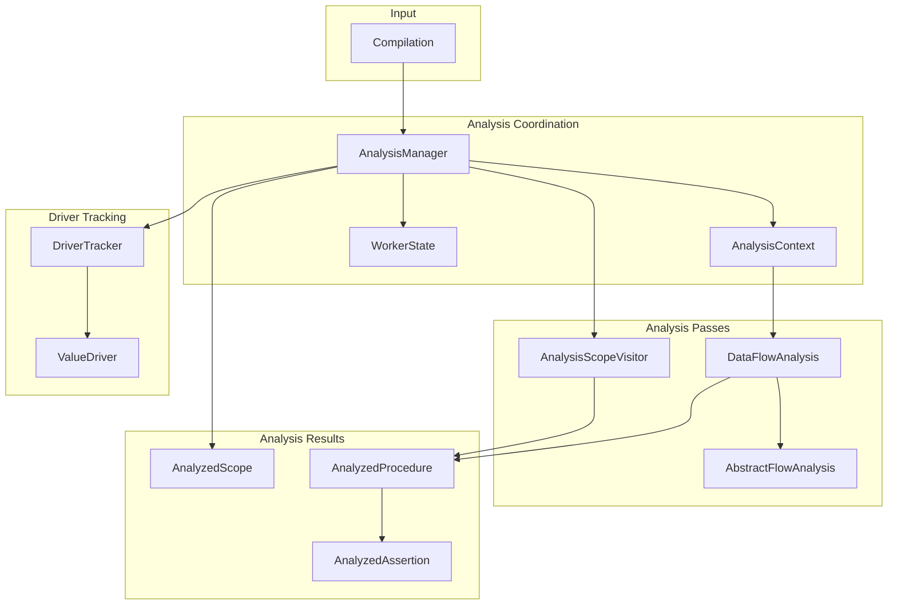

<!-- source: DeepWiki mcp.deepwiki.com · repo MikePopoloski/slang · page 5.1 Static Analysis Framework · fetched 2026-10-30 -->

# Static Analysis Framework

Relevant source files

The following files were used as context for generating this wiki page:

- [bindings/python/AnalysisBindings.cpp](bindings/python/AnalysisBindings.cpp)
- [include/slang/analysis/AbstractFlowAnalysis.h](include/slang/analysis/AbstractFlowAnalysis.h)
- [include/slang/analysis/AnalysisManager.h](include/slang/analysis/AnalysisManager.h)
- [include/slang/analysis/AnalysisOptions.h](include/slang/analysis/AnalysisOptions.h)
- [include/slang/analysis/AnalyzedAssertion.h](include/slang/analysis/AnalyzedAssertion.h)
- [include/slang/analysis/AnalyzedProcedure.h](include/slang/analysis/AnalyzedProcedure.h)
- [include/slang/analysis/CaseDecisionDag.h](include/slang/analysis/CaseDecisionDag.h)
- [include/slang/analysis/ClockInference.h](include/slang/analysis/ClockInference.h)
- [include/slang/analysis/DFAResults.h](include/slang/analysis/DFAResults.h)
- [include/slang/analysis/DataFlowAnalysis.h](include/slang/analysis/DataFlowAnalysis.h)
- [include/slang/analysis/DriverTracker.h](include/slang/analysis/DriverTracker.h)
- [include/slang/analysis/ValueDriver.h](include/slang/analysis/ValueDriver.h)
- [include/slang/ast/LSPUtilities.h](include/slang/ast/LSPUtilities.h)
- [include/slang/ast/Statement.h](include/slang/ast/Statement.h)
- [include/slang/ast/expressions/AssertionExpr.h](include/slang/ast/expressions/AssertionExpr.h)
- [include/slang/ast/statements/ConditionalStatements.h](include/slang/ast/statements/ConditionalStatements.h)
- [include/slang/ast/statements/LoopStatements.h](include/slang/ast/statements/LoopStatements.h)
- [include/slang/ast/statements/MiscStatements.h](include/slang/ast/statements/MiscStatements.h)
- [pyslang/tests/test_analysis.py](pyslang/tests/test_analysis.py)
- [source/analysis/AbstractFlowAnalysis.cpp](source/analysis/AbstractFlowAnalysis.cpp)
- [source/analysis/AnalysisManager.cpp](source/analysis/AnalysisManager.cpp)
- [source/analysis/AnalysisScopeVisitor.h](source/analysis/AnalysisScopeVisitor.h)
- [source/analysis/AnalyzedAssertion.cpp](source/analysis/AnalyzedAssertion.cpp)
- [source/analysis/AnalyzedProcedure.cpp](source/analysis/AnalyzedProcedure.cpp)
- [source/analysis/CaseDecisionDag.cpp](source/analysis/CaseDecisionDag.cpp)
- [source/analysis/ClockInference.cpp](source/analysis/ClockInference.cpp)
- [source/analysis/DFAResults.cpp](source/analysis/DFAResults.cpp)
- [source/analysis/DataFlowAnalysis.cpp](source/analysis/DataFlowAnalysis.cpp)
- [source/analysis/DriverTracker.cpp](source/analysis/DriverTracker.cpp)
- [source/analysis/ValueDriver.cpp](source/analysis/ValueDriver.cpp)
- [source/ast/LSPUtilities.cpp](source/ast/LSPUtilities.cpp)
- [source/ast/Statement.cpp](source/ast/Statement.cpp)
- [source/ast/expressions/AssertionExpr.cpp](source/ast/expressions/AssertionExpr.cpp)
- [source/ast/statements/ConditionalStatements.cpp](source/ast/statements/ConditionalStatements.cpp)
- [source/ast/statements/MiscStatements.cpp](source/ast/statements/MiscStatements.cpp)
- [tests/unittests/analysis/AssertionAnalysisTests.cpp](tests/unittests/analysis/AssertionAnalysisTests.cpp)
- [tests/unittests/analysis/CaseAnalysisTests.cpp](tests/unittests/analysis/CaseAnalysisTests.cpp)
- [tests/unittests/analysis/DFATests.cpp](tests/unittests/analysis/DFATests.cpp)
- [tests/unittests/analysis/MultiAssignTests.cpp](tests/unittests/analysis/MultiAssignTests.cpp)
- [tests/unittests/analysis/UnusedTests.cpp](tests/unittests/analysis/UnusedTests.cpp)
- [tests/unittests/ast/AssertionTests.cpp](tests/unittests/ast/AssertionTests.cpp)

The Static Analysis Framework provides comprehensive static analysis capabilities for SystemVerilog designs after elaboration. It performs data flow analysis, driver conflict detection, clock inference, and various design verification checks to identify potential issues before simulation or synthesis.

For diagnostic reporting and formatting, see [Diagnostic System](#5.2). For expression-level warning detection, see [Warning System](#5.3).

## Architecture Overview

The framework consists of several interconnected components that work together to analyze elaborated AST representations:

**Analysis Framework Architecture**

Sources: [include/slang/analysis/AnalysisManager.h:48-90](), [source/analysis/AnalysisManager.cpp:45-57](), [include/slang/analysis/AbstractFlowAnalysis.h:93-108]()

## Core Analysis Components

### AnalysisManager

The `AnalysisManager` serves as the central coordinator for all analysis passes. It manages parallel execution of analysis tasks via a `ThreadPool` and provides the main entry point for design analysis through the `analyze` method.

**Key Responsibilities:**
- Orchestrates analysis of entire designs through `analyze(compilation)` [source/analysis/AnalysisManager.cpp:59-95]().
- Manages per-thread `WorkerState` and concurrent execution [include/slang/analysis/AnalysisManager.h:185-195]().
- Coordinates `DriverTracker` across all procedures to detect multi-driven nets/variables [source/analysis/AnalysisManager.cpp:83-85]().
- Provides access to analyzed results like `getAnalyzedScope` and `getAnalyzedSubroutine` [source/analysis/AnalysisManager.cpp:97-112]().

Sources: [include/slang/analysis/AnalysisManager.h:90-145](), [source/analysis/AnalysisManager.cpp:45-95]()

### AbstractFlowAnalysis

The `AbstractFlowAnalysis` template provides a framework for implementing flow analysis passes using lattice-based data flow analysis. It models control flow through SystemVerilog constructs like `if`, `case`, and loops.

**Flow Analysis State Management:**
- Maintains current flow state `TState` with conditional branching support via `split()` and `unsplit()` [include/slang/analysis/AbstractFlowAnalysis.h:139-154]().
- Implements `visitStmt` and `visitExpr` overloads to propagate state through the AST [include/slang/analysis/AbstractFlowAnalysis.h:188-210]().
- Tracks reachability and provides unreachable code detection [include/slang/analysis/AbstractFlowAnalysis.h:157-160]().

Sources: [include/slang/analysis/AbstractFlowAnalysis.h:23-108](), [include/slang/analysis/AbstractFlowAnalysis.h:117-160]()

### DataFlowAnalysis  

`DataFlowAnalysis` extends `AbstractFlowAnalysis` to track variable assignments and references. It uses `SymbolBitMap` to track assigned bit ranges and `SymbolLSPMap` to associate ranges with source expressions.

**Key Features:**
- **Sequence Checking**: The `ExpressionSequenceChecker` identifies conflicting unsequenced operations (e.g., `i = i++`) [include/slang/analysis/DataFlowAnalysis.h:24-109]().
- **LValue Tracking**: Manages `LValueFrame` stacks to correctly model assignment sequencing where the RHS is evaluated before the LHS write [include/slang/analysis/DataFlowAnalysis.h:49-72]().
- **Assertion Collection**: Identifies concurrent assertions and checker instances within procedures for subsequent specialized analysis [source/analysis/AnalyzedProcedure.cpp:70-85]().

Sources: [include/slang/analysis/DataFlowAnalysis.h:118-164](), [source/analysis/DataFlowAnalysis.cpp:16-100]()

## Analysis Workflow

The analysis process follows a structured pipeline:

1. **Initialization**: `AnalysisManager` prepares worker states and checks compilation status [source/analysis/AnalysisManager.cpp:59-71]().
2. **Async Scope Analysis**: Compilation units and top-level instances are queued for analysis [source/analysis/AnalysisManager.cpp:73-80]().
3. **Scope Visitation**: `AnalysisScopeVisitor` traverses members. It kicks off async analysis for packages and instances [source/analysis/AnalysisScopeVisitor.h:41-88]().
4. **Procedure Analysis**: For each `ProceduralBlockSymbol` or `ContinuousAssignSymbol`, a `DataFlowAnalysis` pass is run [source/analysis/AnalysisScopeVisitor.h:115-121]().
5. **Driver Registration**: Drivers found during DFA are registered in the `DriverTracker` [source/analysis/AnalysisScopeVisitor.h:118]().
6. **Finalization**: `AnalysisManager` propagates indirect drivers and checks for unused definitions [source/analysis/AnalysisManager.cpp:82-94]().

Sources: [source/analysis/AnalysisManager.cpp:59-95](), [source/analysis/AnalysisScopeVisitor.h:28-121]()

## Driver Tracking System

The `DriverTracker` identifies and validates all sources that can assign values to SystemVerilog variables and nets.

### ValueDriver and Driver Types

Each `ValueDriver` represents a single source of assignment:
- **Kinds**: `Procedural` or `Continuous` [include/slang/analysis/ValueDriver.h:32-40]().
- **Conflict Detection**: Detects `MultipleContAssigns`, `MixedVarAssigns`, and `MultipleAlwaysAssigns` [tests/unittests/analysis/MultiAssignTests.cpp:55-125]().
- **Indirect Drivers**: Handles propagation through hierarchical references and modports [source/analysis/AnalysisManager.cpp:83-85]().

Sources: [include/slang/analysis/ValueDriver.h:32-122](), [tests/unittests/analysis/MultiAssignTests.cpp:55-125]()

## Assertion Analysis and Clock Inference

### AnalyzedAssertion

The `AnalyzedAssertion` class performs semantic checks on concurrent assertions.
- **Blocked Variables**: Uses `BlockedVarsVisitor` to find local assertion variables blocked from flowing out of a sequence according to IEEE 1800-2017 F.5.4 [source/analysis/AnalyzedAssertion.cpp:37-190]().
- **Nondegeneracy**: Validates that sequences are not "empty" or "always false" using `NondegeneracyCheckVisitor` [source/ast/expressions/AssertionExpr.cpp:30-38](), [source/ast/expressions/AssertionExpr.cpp:148-175]().

Sources: [source/analysis/AnalyzedAssertion.cpp:37-190](), [source/ast/expressions/AssertionExpr.cpp:148-175]()

### Clock Inference

The framework infers clocks for procedures and assertions:
- **Procedural Inference**: Analyzes timing controls in a procedure to find a unique leading clock [source/analysis/AnalyzedProcedure.cpp:53-56]().
- **Default Clocking**: If no procedural clock is found, it looks for a `default clocking` block in the scope [source/analysis/AnalyzedProcedure.cpp:59-65]().
- **Validation**: Ensures sampled value functions (like `$past`) have a valid inferred or explicit clock [source/analysis/AnalyzedProcedure.cpp:87-94]().

Sources: [source/analysis/AnalyzedProcedure.cpp:53-95](), [tests/unittests/analysis/AssertionAnalysisTests.cpp:48-160]()

## Case Decision DAG

For `case` statements, slang can construct a Decision Directed Acyclic Graph (DAG) to analyze coverage and overlap.
- **CaseDecisionDag**: Represents the logic of a case statement as a series of binary decisions [include/slang/analysis/CaseDecisionDag.h:1-20]().
- **Coverage**: Used to determine if a case statement is "fully covered" (i.e., all possible input values lead to a branch) [include/slang/analysis/AbstractFlowAnalysis.h:51-52]().

Sources: [include/slang/analysis/CaseDecisionDag.h:1-20](), [include/slang/analysis/AbstractFlowAnalysis.h:51-52]()

---

