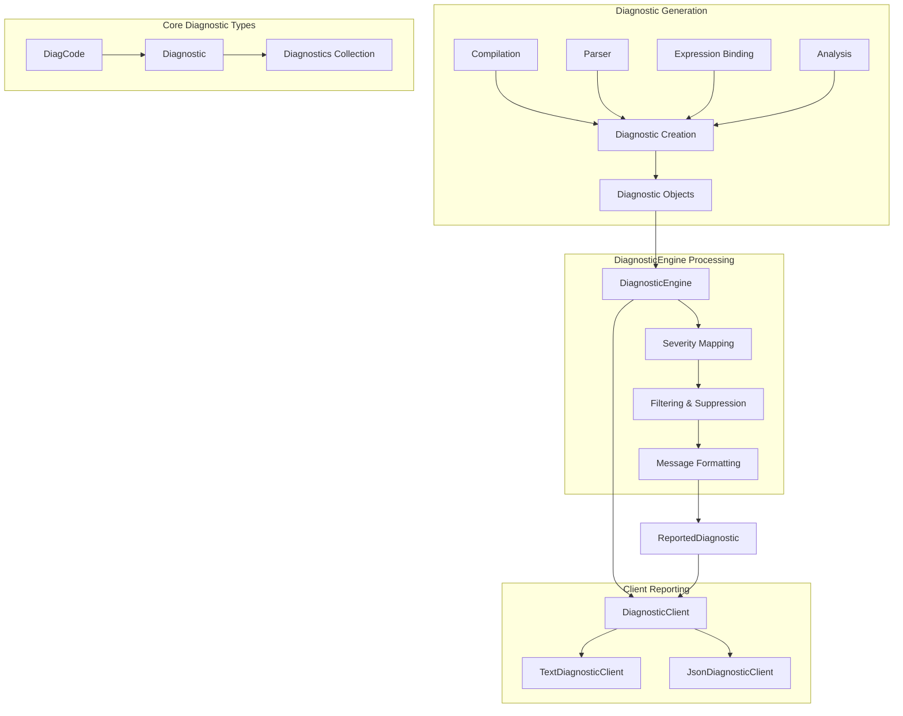
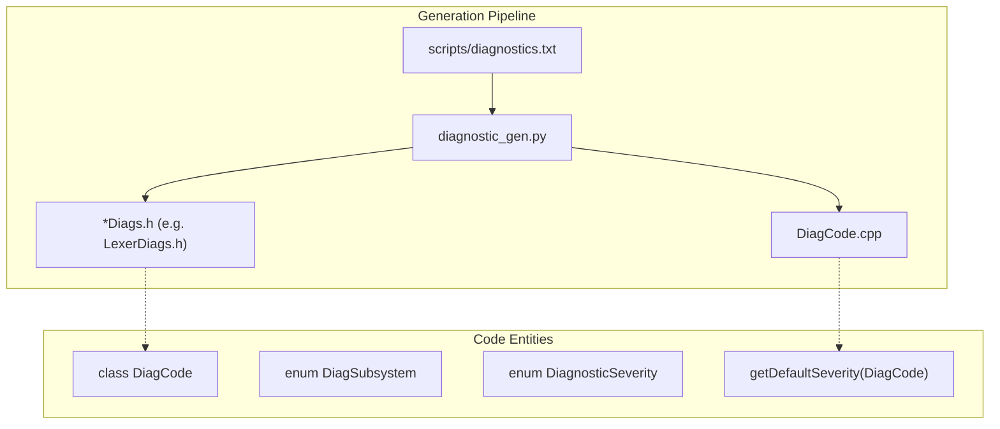
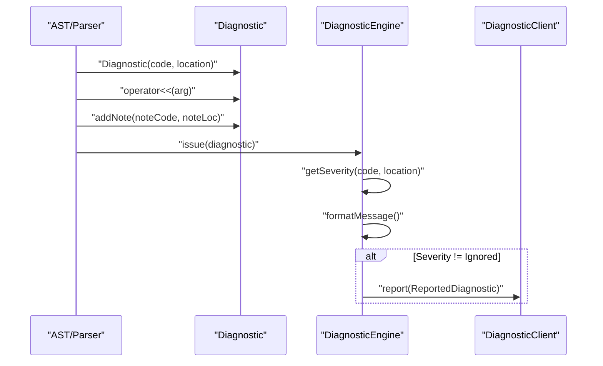
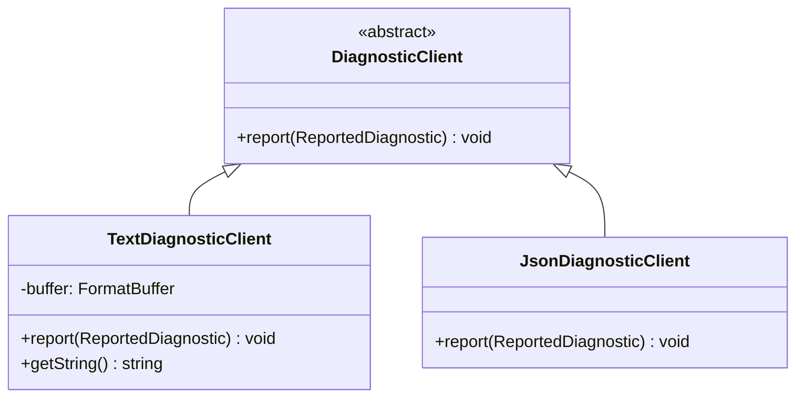

<!-- source: DeepWiki mcp.deepwiki.com · repo MikePopoloski/slang · page 5.2 Diagnostic System · fetched 2026-10-30 -->

# Diagnostic System

<details>
<summary>Relevant source files</summary>

The following files were used as context for generating this wiki page:

- [include/slang/ast/expressions/AssignmentExpressions.h](include/slang/ast/expressions/AssignmentExpressions.h)
- [include/slang/ast/expressions/ConversionExpression.h](include/slang/ast/expressions/ConversionExpression.h)
- [include/slang/ast/expressions/OperatorExpressions.h](include/slang/ast/expressions/OperatorExpressions.h)
- [include/slang/diagnostics/DiagnosticClient.h](include/slang/diagnostics/DiagnosticClient.h)
- [include/slang/diagnostics/DiagnosticEngine.h](include/slang/diagnostics/DiagnosticEngine.h)
- [include/slang/diagnostics/Diagnostics.h](include/slang/diagnostics/Diagnostics.h)
- [include/slang/diagnostics/TextDiagnosticClient.h](include/slang/diagnostics/TextDiagnosticClient.h)
- [include/slang/util/OS.h](include/slang/util/OS.h)
- [scripts/diagnostic_gen.py](scripts/diagnostic_gen.py)
- [scripts/diagnostics.txt](scripts/diagnostics.txt)
- [scripts/warning_docs.txt](scripts/warning_docs.txt)
- [source/ast/Bitstream.cpp](source/ast/Bitstream.cpp)
- [source/ast/TimingControl.cpp](source/ast/TimingControl.cpp)
- [source/ast/expressions/AssignmentExpressions.cpp](source/ast/expressions/AssignmentExpressions.cpp)
- [source/ast/expressions/ConversionExpression.cpp](source/ast/expressions/ConversionExpression.cpp)
- [source/ast/expressions/OperatorExpressions.cpp](source/ast/expressions/OperatorExpressions.cpp)
- [source/diagnostics/DiagnosticClient.cpp](source/diagnostics/DiagnosticClient.cpp)
- [source/diagnostics/DiagnosticEngine.cpp](source/diagnostics/DiagnosticEngine.cpp)
- [source/diagnostics/Diagnostics.cpp](source/diagnostics/Diagnostics.cpp)
- [source/diagnostics/JsonDiagnosticClient.cpp](source/diagnostics/JsonDiagnosticClient.cpp)
- [source/diagnostics/TextDiagnosticClient.cpp](source/diagnostics/TextDiagnosticClient.cpp)
- [source/driver/CompatSettings.cpp](source/driver/CompatSettings.cpp)
- [source/util/OS.cpp](source/util/OS.cpp)
- [tests/unittests/ast/ExpressionTests.cpp](tests/unittests/ast/ExpressionTests.cpp)
- [tests/unittests/ast/StatementTests.cpp](tests/unittests/ast/StatementTests.cpp)
- [tests/unittests/ast/WarningTests.cpp](tests/unittests/ast/WarningTests.cpp)
- [tests/unittests/parsing/DiagnosticTests.cpp](tests/unittests/parsing/DiagnosticTests.cpp)

</details>


The diagnostic system in slang is responsible for generating, categorizing, and reporting compiler diagnostics (errors, warnings, notes, and fatal errors) to users. This system provides a flexible framework for managing diagnostic severity levels, filtering diagnostics based on various criteria, and presenting diagnostic information through multiple output formats.

For information about static analysis that generates diagnostics, see [Static Analysis Framework](#5.1). For details about warning categories and configuration, see [Warning System](#5.3).

## Architecture Overview

The diagnostic system follows a producer-consumer pattern where diagnostics are generated throughout the compilation process, processed by a central engine, and delivered to various client implementations for user presentation.



Sources: [source/diagnostics/Diagnostics.cpp:1-187](), [include/slang/diagnostics/Diagnostics.h:1-236](), [source/diagnostics/DiagnosticEngine.cpp:1-106](), [source/diagnostics/DiagnosticEngine.cpp:195-212]()

## Diagnostic Code System

The diagnostic system uses a hierarchical code structure to organize and identify different types of diagnostics across subsystems. Diagnostics are defined in a domain-specific language in `diagnostics.txt` and processed by `diagnostic_gen.py`.

### DiagCode and Subsystems
A `DiagCode` is a compact representation of a diagnostic, consisting of a `DiagSubsystem` and a unique `uint16_t` code [include/slang/diagnostics/Diagnostics.h:70-113](). Subsystems include `Lexer`, `Parser`, `Numeric`, `Preprocessor`, and more [include/slang/diagnostics/Diagnostics.h:32-53]().

### Severity Levels
Diagnostics are assigned a `DiagnosticSeverity` [include/slang/diagnostics/Diagnostics.h:55-62]():
*   **Ignored**: The diagnostic is suppressed.
*   **Note**: Provides additional context for an error or warning.
*   **Warning**: Indicates potential issues that do not prevent compilation.
*   **Error**: Indicates a language violation that prevents successful compilation.
*   **Fatal**: An unrecoverable error that terminates processing.



Sources: [include/slang/diagnostics/Diagnostics.h:31-118](), [scripts/diagnostics.txt:1-107](), [scripts/diagnostic_gen.py:109-232]()

## Diagnostic Creation and Processing Flow

Diagnostics are typically created via the `Diagnostics::add` method or by directly constructing a `Diagnostic` object [source/diagnostics/Diagnostics.cpp:135-154]().

### The Diagnostic Object
The `Diagnostic` class stores the `DiagCode`, the `SourceLocation`, and any arguments needed to format the message [include/slang/diagnostics/Diagnostics.h:122-141](). Arguments are stored as a `std::variant` supporting strings, integers, and `ConstantValue` objects [include/slang/diagnostics/Diagnostics.h:127-128]().



The `Diagnostic` class supports method chaining for adding arguments and notes:
```cpp
// Example diagnostic creation
diagnostics.add(diag::RealLiteralUnderflow, location) << 1e-308;
```
Sources: [source/diagnostics/Diagnostics.cpp:57-100](), [source/diagnostics/DiagnosticEngine.cpp:195-212](), [scripts/diagnostics.txt:60-60]()

## DiagnosticEngine Architecture

The `DiagnosticEngine` is the central hub for diagnostic management. It maintains mappings for severity overrides, handles diagnostic limits, and coordinates with `DiagnosticClient` objects [source/diagnostics/DiagnosticEngine.cpp:35-44]().

### Severity Resolution
The engine determines the final severity of a diagnostic by checking multiple sources in order [source/diagnostics/DiagnosticEngine.cpp:65-106]():
1.  **In-source pragmas**: Mappings defined via `pragma diagnostic` in the source code.
2.  **Engine mappings**: Manual overrides set via `setSeverity`.
3.  **Global flags**: Settings like `warningsAsErrors` or `ignoreAllWarnings`.
4.  **Default severity**: The severity defined in the diagnostic metadata.

### Diagnostic Coalescing
The engine can coalesce diagnostics that occur across multiple instances of the same module to reduce output noise. This is controlled by `DiagCode::coalesceWithDifferingArgs()` [source/diagnostics/Diagnostics.cpp:20-25]().

Sources: [source/diagnostics/DiagnosticEngine.cpp:56-106](), [include/slang/diagnostics/DiagnosticEngine.h:1-308](), [source/diagnostics/Diagnostics.cpp:20-25]()

## Diagnostic Clients

Clients consume `ReportedDiagnostic` objects and present them to the user.

### TextDiagnosticClient
The `TextDiagnosticClient` formats diagnostics for console output. It includes:
*   **Source Snippets**: Displays the offending line of code with a caret (`^`) pointing to the error location [source/diagnostics/TextDiagnosticClient.cpp:192-210]().
*   **Color Support**: Uses ANSI colors for different severity levels [source/diagnostics/TextDiagnosticClient.cpp:18-26]().
*   **Macro Expansion**: Optionally shows the chain of macro expansions leading to the diagnostic [source/diagnostics/TextDiagnosticClient.cpp:86-100]().

### JsonDiagnosticClient
The `JsonDiagnosticClient` outputs diagnostics in a structured JSON format, suitable for IDE integration or automated post-processing.



Sources: [source/diagnostics/TextDiagnosticClient.cpp:8-101](), [include/slang/diagnostics/TextDiagnosticClient.h:1-100](), [source/diagnostics/JsonDiagnosticClient.cpp:1-50]()

## Diagnostic Code Generation

The system uses a Python script, `diagnostic_gen.py`, to generate C++ source and headers from `diagnostics.txt`. This ensures that diagnostic codes and default messages are synchronized across the codebase.

| Input File | Purpose |
| :--- | :--- |
| `diagnostics.txt` | Defines subsystems, error codes, default severities, and message templates [scripts/diagnostics.txt:1-107](). |
| `warning_docs.txt` | Provides detailed documentation and examples for specific warning flags [scripts/warning_docs.txt:1-50](). |

The script generates:
*   **Subsystem Headers**: (e.g., `LexerDiags.h`) containing `inline constexpr DiagCode` constants [scripts/diagnostic_gen.py:109-137]().
*   **DiagCode.cpp**: Contains the central mapping of codes to messages, severities, and option names [scripts/diagnostic_gen.py:140-232]().

Sources: [scripts/diagnostic_gen.py:1-107](), [scripts/diagnostics.txt:1-107](), [scripts/warning_docs.txt:1-100]()

---

