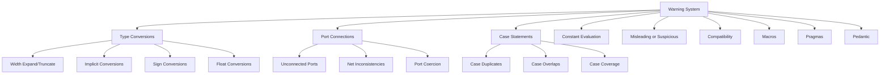
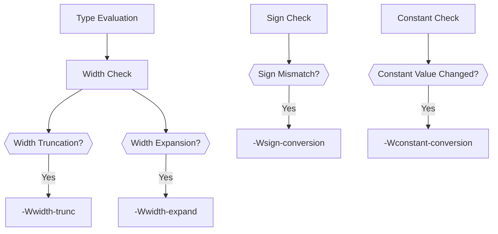
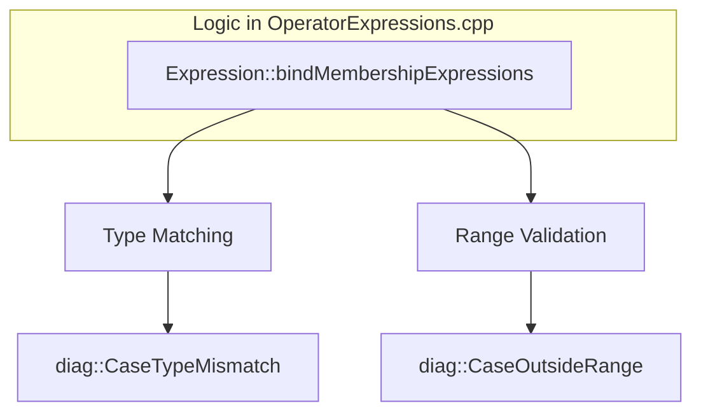
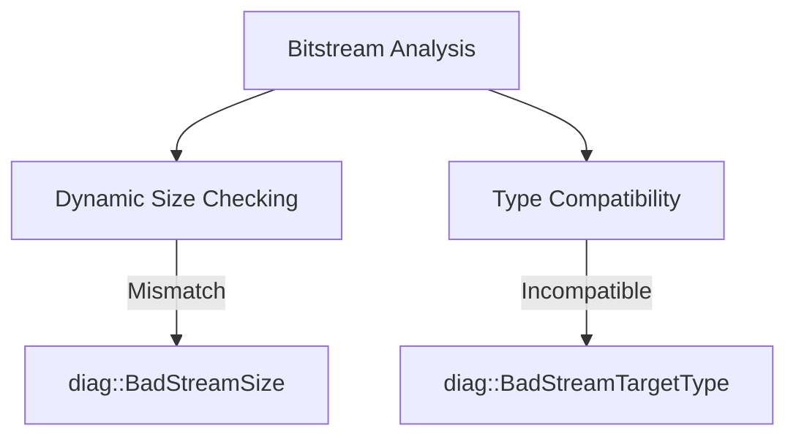

<!-- source: DeepWiki mcp.deepwiki.com · repo MikePopoloski/slang · page 5.3 Warning System · fetched 2026-10-30 -->

# Warning System

<details>
<summary>Relevant source files</summary>

The following files were used as context for generating this wiki page:

- [bindings/python/CompBindings.cpp](bindings/python/CompBindings.cpp)
- [docs/command-line-ref.dox](docs/command-line-ref.dox)
- [include/slang/ast/expressions/AssignmentExpressions.h](include/slang/ast/expressions/AssignmentExpressions.h)
- [include/slang/ast/expressions/ConversionExpression.h](include/slang/ast/expressions/ConversionExpression.h)
- [include/slang/ast/expressions/OperatorExpressions.h](include/slang/ast/expressions/OperatorExpressions.h)
- [include/slang/driver/Driver.h](include/slang/driver/Driver.h)
- [include/slang/driver/SourceLoader.h](include/slang/driver/SourceLoader.h)
- [include/slang/syntax/SyntaxPrinter.h](include/slang/syntax/SyntaxPrinter.h)
- [scripts/diagnostics.txt](scripts/diagnostics.txt)
- [scripts/warning_docs.txt](scripts/warning_docs.txt)
- [source/ast/Bitstream.cpp](source/ast/Bitstream.cpp)
- [source/ast/TimingControl.cpp](source/ast/TimingControl.cpp)
- [source/ast/expressions/AssignmentExpressions.cpp](source/ast/expressions/AssignmentExpressions.cpp)
- [source/ast/expressions/ConversionExpression.cpp](source/ast/expressions/ConversionExpression.cpp)
- [source/ast/expressions/OperatorExpressions.cpp](source/ast/expressions/OperatorExpressions.cpp)
- [source/driver/CompatSettings.cpp](source/driver/CompatSettings.cpp)
- [source/driver/Driver.cpp](source/driver/Driver.cpp)
- [source/driver/SourceLoader.cpp](source/driver/SourceLoader.cpp)
- [source/syntax/SyntaxPrinter.cpp](source/syntax/SyntaxPrinter.cpp)
- [tests/unittests/DriverTests.cpp](tests/unittests/DriverTests.cpp)
- [tests/unittests/ast/ExpressionTests.cpp](tests/unittests/ast/ExpressionTests.cpp)
- [tests/unittests/ast/StatementTests.cpp](tests/unittests/ast/StatementTests.cpp)
- [tests/unittests/ast/WarningTests.cpp](tests/unittests/ast/WarningTests.cpp)
- [tools/driver/slang_main.cpp](tools/driver/slang_main.cpp)

</details>


The Warning System in slang provides comprehensive diagnostic capabilities to help users identify potential issues, coding style violations, and compatibility problems in SystemVerilog code. This system generates configurable warnings across multiple categories including type conversions, suspicious constructs, and standards compliance issues.

For information about the broader diagnostic infrastructure, see [Diagnostic System](#5.2). For static analysis capabilities beyond warnings, see [Static Analysis Framework](#5.1).

## Warning Categories and Organization

The warning system is organized into distinct categories, each targeting specific types of potential issues. These categories are defined in the diagnostic metadata and used to group flags for user configuration.



Sources: [scripts/warning_docs.txt:4-1300](), [scripts/diagnostics.txt:39-120]()

## Warning Flag Structure

Individual warnings follow a consistent naming pattern with the `-W` prefix. These flags allow fine-grained control over which diagnostics are enabled, promoted to errors, or suppressed.

| Category | Flag | Description |
| :--- | :--- | :--- |
| **Type Conversions** | `-Wwidth-expand` | Implicit conversion expands a type's bit width. |
| | `-Wwidth-trunc` | Implicit conversion truncates a type, potentially losing data. |
| | `-Wsign-conversion` | Implicit conversion changes signedness. |
| | `-Wconstant-conversion` | Constant value is truncated by implicit conversion. |
| **Port Connections** | `-Wport-width-expand` | Width expansion specifically in port connections. |
| | `-Wunconnected-input-port` | Input port left unconnected with no default. |
| **Suspicious Code** | `-Wfloat-bool-conv` | Floating point used as a boolean predicate. |
| | `-Wint-bool-conv` | Multi-bit integer used as a boolean predicate. |
| | `-Wuseless-cast` | Explicit cast to the same type. |

Sources: [scripts/warning_docs.txt:6-126](), [scripts/warning_docs.txt:238-250]()

## Warning Generation Flow

The warning system integrates with expression evaluation and type checking to generate diagnostics. The `ASTContext` serves as the primary interface for reporting these issues during the binding phase.

```mermaid
sequenceDiagram
    participant P["Parser"]
    participant EB["Expression::bind()"]
    participant TC["Type::isAssignmentCompatible()"]
    participant DE["DiagnosticEngine"]
    participant WS["Warning Logic"]
    
    P->>EB: "Parse expression syntax"
    EB->>TC: "Check type compatibility"
    TC-->>EB: "Return compatibility status"
    EB->>WS: "Analyze for implicit conversion issues"
    WS->>DE: "addDiag(diag::SignConversion, range)"
    DE->>WS: "Formatted diagnostic"
    
    Note over WS: "Logic located in OperatorExpressions.cpp and AssignmentExpressions.cpp"
```

Sources: [source/ast/expressions/OperatorExpressions.cpp:121-143](), [source/ast/expressions/AssignmentExpressions.cpp:152-164](), [source/driver/Driver.cpp:40-44]()

## Type Conversion Warnings

Type conversion warnings detect potentially problematic implicit conversions during assignment, arithmetic, or bitwise operations.

### Width and Sign Analysis
The system analyzes expression types and detects mismatches. For example, `BinaryExpression::analyzeOpTypes` checks if operands require conversion to a common type that might change their meaning.



Sources: [source/ast/expressions/OperatorExpressions.cpp:121-143](), [tests/unittests/ast/WarningTests.cpp:6-21](), [tests/unittests/ast/WarningTests.cpp:104-127]()

### Constant Conversion
Special logic exists for constants. If a constant is assigned to a smaller width, the compiler checks if the value actually fits. If bits are lost, `diag::ConstantConversion` is issued.

Sources: [tests/unittests/ast/WarningTests.cpp:40-50](), [tests/unittests/ast/WarningTests.cpp:52-72]()

## Case Statement Analysis

The warning system performs sophisticated analysis of case statements to detect overlaps, duplicate items, and incomplete coverage of enumerated types.



Sources: [source/ast/expressions/OperatorExpressions.cpp:51-144](), [tests/unittests/ast/StatementTests.cpp:276-285]()

## Implementation Architecture

The warning system is implemented through several key classes and functions that perform static analysis during AST construction.

### Key Functions and Classes
- **`Expression::bindMembershipExpressions`**: Used by case statements and `inside` operators to validate that all items are compatible with the selector. [source/ast/expressions/OperatorExpressions.cpp:51-56]()
- **`BinaryExpression::analyzeOpTypes`**: Centralized logic for comparing two types in a binary operation and issuing mismatch warnings. [source/ast/expressions/OperatorExpressions.cpp:121-123]()
- **`Expression::buildPackedSelectTree`**: Handles complex bit-slicing which can trigger warnings if ranges are out of bounds. [source/ast/expressions/AssignmentExpressions.cpp:38-40]()

### Diagnostic Code Mapping
Warning flags map to internal diagnostic codes defined in `diagnostics.txt`.

| Flag | Internal Diagnostic Code |
| :--- | :--- |
| `-Wwidth-expand` | `diag::WidthExpand` |
| `-Wsign-conversion` | `diag::SignConversion` |
| `-Wconstant-conversion` | `diag::ConstantConversion` |
| `-Wimplicit-conv` | `diag::ImplicitConvert` |
| `-Wuseless-cast` | `diag::UselessCast` |

Sources: [tests/unittests/ast/WarningTests.cpp:17-21](), [tests/unittests/ast/WarningTests.cpp:100-102](), [tests/unittests/ast/WarningTests.cpp:224-228]()

## Compatibility Mode Adjustments

The `Driver` and `Compilation` objects allow for compatibility adjustments. When specific flags like `--std` are set, the diagnostic engine may suppress or promote certain warnings to match the expected behavior of legacy tools or specific standard versions.

```mermaid
graph LR
    D["Driver"] --> CO["CompilationOptions"]
    CO --> LV["LanguageVersion"]
    LV --> DE["DiagnosticEngine"]
    DE --> WS["Warning Filters"]
    
    Note right of LV: "1364-2005, 1800-2017, 1800-2023"
```

Sources: [source/driver/Driver.cpp:49-51](), [include/slang/driver/Driver.h:136-138](), [docs/command-line-ref.dox:20-25]()

## Bitstream and Conversion Warnings

Special handling exists for bitstream operations (`{>>{...}}`) and streaming concatenations. The compiler validates that the target type has a compatible size and that dynamic sizes are handled safely.



Sources: [source/ast/Bitstream.cpp:520-632]()

---

