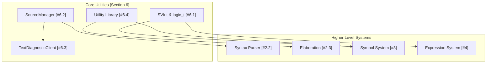
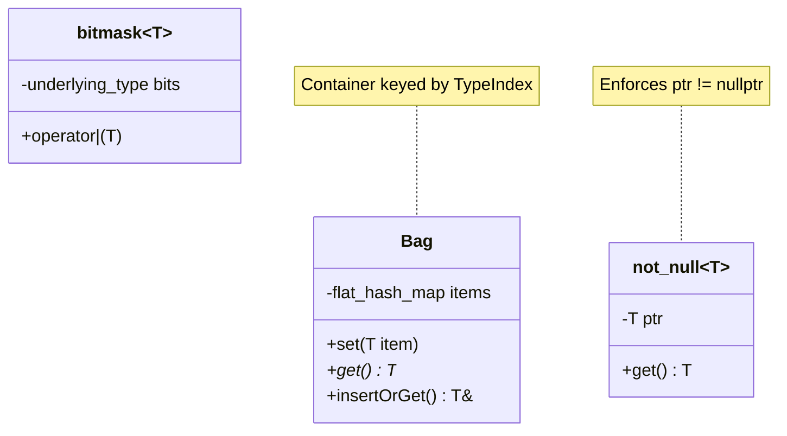

<!-- source: DeepWiki mcp.deepwiki.com · repo MikePopoloski/slang · page 6 Core Utilities · fetched 2026-10-30 -->

# Core Utilities

Relevant source files

The following files were used as context for generating this wiki page:

- [.pre-commit-config.yaml](.pre-commit-config.yaml)
- [external/expected.hpp](external/expected.hpp)
- [include/slang/diagnostics/DiagArgFormatter.h](include/slang/diagnostics/DiagArgFormatter.h)
- [include/slang/text/SourceLocation.h](include/slang/text/SourceLocation.h)
- [include/slang/util/Bag.h](include/slang/util/Bag.h)
- [include/slang/util/BumpAllocator.h](include/slang/util/BumpAllocator.h)
- [include/slang/util/Enum.h](include/slang/util/Enum.h)
- [include/slang/util/Function.h](include/slang/util/Function.h)
- [include/slang/util/Hash.h](include/slang/util/Hash.h)
- [include/slang/util/Iterator.h](include/slang/util/Iterator.h)
- [include/slang/util/TimeTrace.h](include/slang/util/TimeTrace.h)
- [include/slang/util/TypeTraits.h](include/slang/util/TypeTraits.h)
- [include/slang/util/Util.h](include/slang/util/Util.h)
- [source/ast/builtins/QueryFuncs.cpp](source/ast/builtins/QueryFuncs.cpp)
- [source/util/TimeTrace.cpp](source/util/TimeTrace.cpp)
- [source/util/Util.cpp](source/util/Util.cpp)
- [tests/unittests/util/NumericTests.cpp](tests/unittests/util/NumericTests.cpp)
- [tests/unittests/util/UtilTests.cpp](tests/unittests/util/UtilTests.cpp)

The Core Utilities in slang provide foundational data structures, memory management, and specialized algorithms used throughout the compiler. These utilities form the base layer of the architecture, enabling higher-level subsystems like the parser and elaboration engine to function efficiently.

## System Overview

The core utility layer is divided into several specialized domains:
- **Numeric Types**: Arbitrary precision arithmetic and 4-state logic.
- **Source Management**: Tracking file locations, buffers, and macro expansions.
- **Diagnostic Formatting**: Rendering errors and warnings for human or machine consumption.
- **Infrastructure Library**: High-performance containers, allocators, and threading utilities.

Sources: [include/slang/util/Util.h:1-125](), [include/slang/numeric/SVInt.h:1-60]()

## Numeric Implementation (SVInt)

The primary numeric utility is the `SVInt` class, which implements SystemVerilog's arbitrary precision integer type. Unlike standard C++ integers, `SVInt` supports the **4-state logic system** (0, 1, X, Z) required by the IEEE 1800 standard.

Key features include:
- **Arbitrary Bit Width**: Support for integers exceeding 64 bits.
- **4-State Logic**: The `logic_t` type represents individual bits that can be `0`, `1`, `x` (unknown), or `z` (high impedance) [include/slang/numeric/SVInt.h:37-60]().
- **Memory Optimization**: Small values (≤ 64 bits without X/Z) are stored inline, while larger or 4-state values use heap allocation [include/slang/numeric/SVInt.h:114-151]().

For details, see [SVInt Implementation](#6.1).

## Source Management

Slang tracks the origin of every token using a robust source management system. This system is responsible for:
- **SourceLocation**: A lightweight 64-bit value that encodes both a `BufferID` and a character offset [include/slang/text/SourceLocation.h:67-147]().
- **Macro Expansion Tracking**: Distinguishing between the location where a macro is defined and where it is expanded.
- **Library Management**: Organizing source buffers into `SourceLibrary` collections with associated include directories [include/slang/text/SourceLocation.h:180-200]().

For details, see [Source Management](#6.2).

## Text Diagnostic Client

The diagnostic system transforms internal error codes into readable output. The `TextDiagnosticClient` handles:
- **Source Snippets**: Printing the relevant lines of code with carets pointing to errors.
- **Colorized Output**: Utilizing terminal capabilities for highlighting severities (Error, Warning, Note).
- **Expansion Traces**: Showing the full chain of macro expansions or file includes that led to a diagnostic.

For details, see [Text Diagnostic Client](#6.3).

## Utility Library

Slang includes a suite of custom-built or integrated utility classes optimized for compiler workloads:

| Category | Key Entities | Purpose |
| :--- | :--- | :--- |
| **Memory** | `BumpAllocator` | Fast, arena-based allocation for AST nodes. |
| **Containers** | `SmallVector`, `FlatMap` | Cache-friendly alternatives to STL containers. |
| **Typing** | `Bag` | A type-keyed container for passing heterogeneous options [include/slang/util/Bag.h:25-86](). |
| **Logic** | `bitmask` | Type-safe bitwise operations for strongly-typed enums [include/slang/util/Enum.h:124-130](). |
| **Safety** | `not_null` | Pointer wrapper that enforces non-nullability via runtime asserts [include/slang/util/Util.h:154-204](). |

For details, see [Utility Library](#6.4).

## Foundational Macros and Assertions

The library provides a set of core macros in `Util.h` for platform abstraction and error handling:
- `SLANG_ASSERT(cond)`: Standard assertion that throws `AssertionException` if the condition fails [include/slang/util/Util.h:77-81](), [source/util/Util.cpp:18-29]().
- `SLANG_UNREACHABLE`: Marks code paths that should never be executed [include/slang/util/Util.h:83-83](), [source/util/Util.cpp:41-52]().
- `SLANG_ENUM`: Simplifies defining enums with string conversion and iteration traits [include/slang/util/Enum.h:20-44]().

Sources: [include/slang/util/Util.h:1-145](), [include/slang/util/Enum.h:1-75](), [include/slang/util/Bag.h:1-89](), [include/slang/text/SourceLocation.h:1-173]()

---

