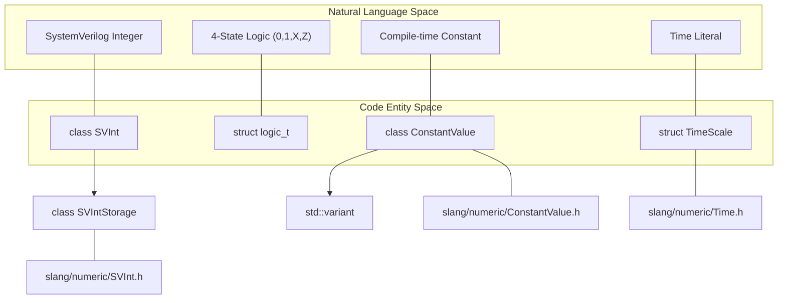
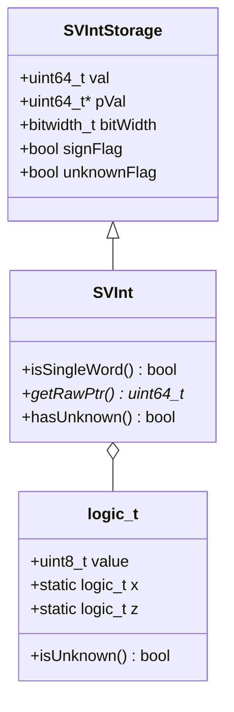
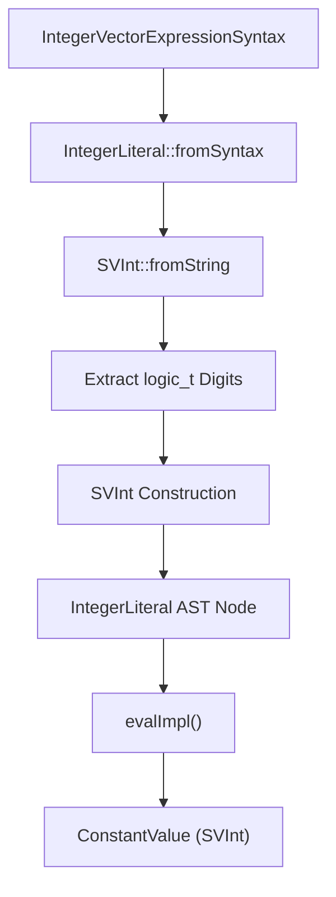

<!-- source: DeepWiki mcp.deepwiki.com · repo MikePopoloski/slang · page 6.1 SVInt Implementation · fetched 2026-10-30 -->

# SVInt Implementation

Relevant source files

The following files were used as context for generating this wiki page:

- [include/slang/ast/expressions/LiteralExpressions.h](include/slang/ast/expressions/LiteralExpressions.h)
- [include/slang/numeric/ConstantValue.h](include/slang/numeric/ConstantValue.h)
- [include/slang/numeric/MathUtils.h](include/slang/numeric/MathUtils.h)
- [include/slang/numeric/SVInt.h](include/slang/numeric/SVInt.h)
- [include/slang/numeric/Time.h](include/slang/numeric/Time.h)
- [source/ast/expressions/LiteralExpressions.cpp](source/ast/expressions/LiteralExpressions.cpp)
- [source/numeric/ConstantValue.cpp](source/numeric/ConstantValue.cpp)
- [source/numeric/SVInt.cpp](source/numeric/SVInt.cpp)
- [source/numeric/SVIntHelpers.h](source/numeric/SVIntHelpers.h)
- [source/numeric/Time.cpp](source/numeric/Time.cpp)

This page documents the arbitrary precision integer implementation used in slang for representing SystemVerilog integer values. The `SVInt` class provides support for integers of arbitrary size with a maximum bit width of 2^24-1 bits, and includes handling of 4-state logic values (0, 1, X, Z).

## Overview

SystemVerilog requires integers with specific widths and representations that go beyond what's available in native C++ types. The `SVInt` implementation serves several critical purposes:

1. Represent integers with arbitrary bit widths up to `MAX_BITS` (16,777,215) [include/slang/numeric/SVInt.h:139-142]().
2. Support for 4-state logic (0, 1, X, Z) via the `logic_t` struct [include/slang/numeric/SVInt.h:40-112]().
3. Perform efficient numeric operations according to SystemVerilog semantics.
4. Handle signed and unsigned values correctly.
5. Provide constant evaluation during compilation via `ConstantValue` [include/slang/numeric/ConstantValue.h:52-168]().

### System Architecture

The following diagram bridges the high-level SystemVerilog numeric concepts to the specific C++ entities in the codebase.

**Numeric System Entity Map**

Sources: [include/slang/numeric/SVInt.h:152-153](), [include/slang/numeric/ConstantValue.h:52-66](), [include/slang/numeric/Time.h:59-61]()

## Memory Representation

The `SVInt` class uses a flexible memory representation to handle values efficiently. It inherits from `SVIntStorage` to manage backing memory [include/slang/numeric/SVInt.h:152]().

1. **Small Integers** (≤64 bits without unknown values): Stored directly in a 64-bit word (`val`) [include/slang/numeric/SVInt.h:129]().
2. **Large Integers** (>64 bits or with unknown values): Stored in dynamically allocated memory (`pVal`) [include/slang/numeric/SVInt.h:130]().

**SVInt Data Layout**

When unknown values (X or Z) are present, `unknownFlag` is set to true. In the multi-word case, slang allocates double the number of data words: the first half contains the base values, and the second half contains the "mask" bits indicating if a bit is X or Z [include/slang/numeric/SVInt.h:148-151]().

Sources: [include/slang/numeric/SVInt.h:117-151]()

### 4-State Logic (logic_t)

The `logic_t` struct represents a single 4-state bit. It uses internal constants to track X and Z states:
- `X_VALUE = 1 << 7` [include/slang/numeric/SVInt.h:108]()
- `Z_VALUE = 1 << 6` [include/slang/numeric/SVInt.h:109]()

It implements standard logical operators (`!`, `&`, `|`, `^`, `==`) that follow SystemVerilog truth tables, where operations involving X or Z typically result in X [include/slang/numeric/SVInt.h:53-90]().

Sources: [include/slang/numeric/SVInt.h:40-112](), [source/numeric/SVInt.cpp:53-71]()

## ConstantValue and Literals

`ConstantValue` is a container used throughout the AST to represent evaluated results. It uses a `std::variant` to hold various types, including `SVInt`, `real_t`, `shortreal_t`, and containers like `Elements` (vector) or `Map` [include/slang/numeric/ConstantValue.h:65-66]().

### Integer Literals
When the compiler encounters an integer in source code, it uses `IntegerLiteral::fromSyntax` to produce an AST node [source/ast/expressions/LiteralExpressions.cpp:38]().
- **Sized Literals**: Created using the specified bit width.
- **Unsized Literals**: Defaults to 32 bits (signed) in older standards, or larger in SV 2023 if the value requires it [source/ast/expressions/LiteralExpressions.cpp:43-57]().

**Literal Evaluation Flow**

Sources: [source/ast/expressions/LiteralExpressions.cpp:62-75](), [source/numeric/SVInt.cpp:73-186](), [source/ast/expressions/LiteralExpressions.cpp:86-90]()

## Numeric Utilities and Performance

Slang implements several optimizations for arbitrary precision arithmetic in `SVIntHelpers.h`.

### Multi-precision Helpers
For operations spanning multiple 64-bit words, slang uses platform-specific intrinsics:
- **Addition/Subtraction**: Uses `addcarry64` and `subborrow64`. On x86_64, these map to `_addcarry_u64` and `_subborrow_u64` [source/numeric/SVIntHelpers.h:16-23]().
- **Multiplication**: Implements a standard $O(n^2)$ multiply and a Karatsuba algorithm for very large integers.
- **Division**: Implements Knuth's Algorithm D [source/numeric/SVInt.cpp:1033]().

### Memory Management
To avoid frequent heap allocations for temporary multi-word calculations, the `TempBuffer` utility is used. It attempts to allocate on the stack for small sizes (determined by `StackCount`) and only falls back to the heap for exceptionally large integers [source/numeric/SVIntHelpers.h:75-102]().

### Time Scaling
SystemVerilog time literals (e.g., `10ns`) are handled by the `TimeScale` and `TimeScaleValue` structs [include/slang/numeric/Time.h:38-75]().
- `TimeScaleValue`: Combines a `TimeUnit` (Seconds to Femtoseconds) with a `TimeScaleMagnitude` (1, 10, 100) [include/slang/numeric/Time.h:35-38]().
- `TimeScale::apply`: Scales a double value from one unit to another and optionally rounds to the precision of the current scope [source/numeric/Time.cpp:156-175]().

Sources: [source/numeric/SVIntHelpers.h:16-41](), [source/numeric/Time.cpp:156-175](), [include/slang/numeric/MathUtils.h:19-70]()

## Key Functions Summary

| Function | Description | File Location |
| :--- | :--- | :--- |
| `SVInt::fromString` | Parses SV literal strings into `SVInt` | [source/numeric/SVInt.cpp:73]() |
| `SVInt::extend` | Sign or zero extends the integer | [include/slang/numeric/SVInt.h:317]() |
| `ConstantValue::convertToInt` | Casts various constant types to `SVInt` | [source/numeric/ConstantValue.cpp:165]() |
| `IntegerLiteral::evalImpl` | Evaluates an AST literal node to a `ConstantValue` | [source/ast/expressions/LiteralExpressions.cpp:86]() |
| `TimeScale::fromString` | Parses strings like `"1ns / 1ps"` | [source/numeric/Time.cpp:125]() |

Sources: [source/numeric/SVInt.cpp:73](), [source/numeric/ConstantValue.cpp:165](), [source/ast/expressions/LiteralExpressions.cpp:86](), [source/numeric/Time.cpp:125]()

---

