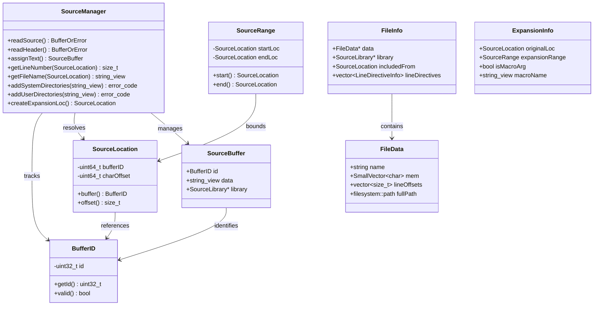
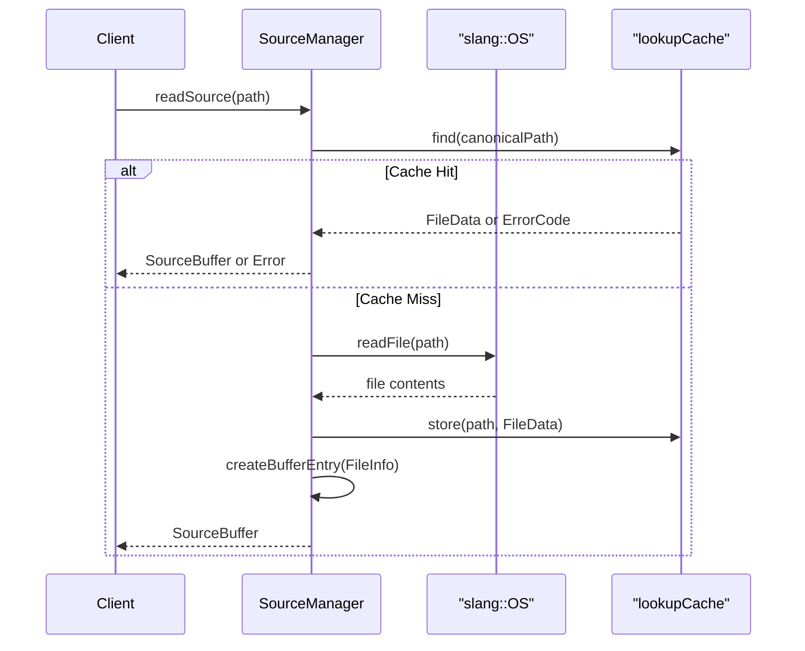
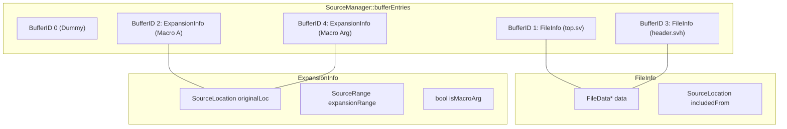

<!-- source: DeepWiki mcp.deepwiki.com · repo MikePopoloski/slang · page 6.2 Source Management · fetched 2026-10-30 -->

# Source Management

<details>
<summary>Relevant source files</summary>

The following files were used as context for generating this wiki page:

- [external/expected.hpp](external/expected.hpp)
- [include/slang/text/Glob.h](include/slang/text/Glob.h)
- [include/slang/text/SourceLocation.h](include/slang/text/SourceLocation.h)
- [include/slang/text/SourceManager.h](include/slang/text/SourceManager.h)
- [include/slang/util/Enum.h](include/slang/util/Enum.h)
- [include/slang/util/Hash.h](include/slang/util/Hash.h)
- [include/slang/util/TypeTraits.h](include/slang/util/TypeTraits.h)
- [include/slang/util/Util.h](include/slang/util/Util.h)
- [source/text/Glob.cpp](source/text/Glob.cpp)
- [source/text/SourceManager.cpp](source/text/SourceManager.cpp)
- [source/util/Util.cpp](source/util/Util.cpp)
- [tests/unittests/FileTests.cpp](tests/unittests/FileTests.cpp)

</details>


The Source Management system provides centralized facilities for loading, tracking, and managing source files throughout the compilation process. This system handles file I/O, include path resolution, location tracking for diagnostics, and mapping between logical source locations and actual file content. It abstracts the complexities of macro expansions, include files, and preprocessing directives to provide a unified view of source code locations.

For information about diagnostic output formatting, see [6.3 Text Diagnostic Client](). For details about compilation pipeline integration, see [2. Compilation Pipeline]().

## Core Architecture

The source management system is built around the `SourceManager` class, which serves as the central hub for all source-related operations [include/slang/text/SourceManager.h:41-41](). The system uses several key data structures to represent and track source content:

**Source Management Entity Relationship**

Sources: [include/slang/text/SourceManager.h:41-180](), [include/slang/text/SourceLocation.h:26-173](), [source/text/SourceManager.cpp:24-28]()

## Source Loading and Caching

The `SourceManager` provides multiple methods for loading source content, with automatic caching to avoid redundant file I/O operations. The system maintains a lookup cache that maps file paths to `FileData` objects.

### Loading Methods

| Method | Purpose | Use Case |
|--------|---------|----------|
| `readSource()` | Load primary source files | Main compilation units [source/text/SourceManager.cpp:408-412]() |
| `readHeader()` | Load included files | `include directives with path resolution [source/text/SourceManager.cpp:414-419]() |
| `assignText()` | Create buffers from in-memory text | Testing, generated content [source/text/SourceManager.cpp:586-590]() |
| `assignBuffer()` | Create buffers from existing memory | Pre-loaded content [source/text/SourceManager.cpp:605-609]() |

The caching mechanism uses canonical file paths as keys and stores both successful loads and error conditions.

**File Loading and Caching Data Flow**

Sources: [source/text/SourceManager.cpp:408-477](), [source/text/SourceManager.cpp:617-658]()

## Location Tracking System

The location tracking system provides a unified abstraction for representing positions in source code, whether in original files or within macro expansions. Each location is represented by a `SourceLocation` containing a `BufferID` and an offset [include/slang/text/SourceLocation.h:67-147]().

### Buffer Management

The system maintains a `bufferEntries` vector where each entry is a `std::variant` of either `FileInfo` (for actual files) or `ExpansionInfo` (for macro expansions) [source/text/SourceManager.cpp:196-203]().

**Buffer Hierarchy Tracking**

Sources: [source/text/SourceManager.cpp:24-28](), [include/slang/text/SourceLocation.h:26-61]()

### Location Resolution Methods

The `SourceManager` provides several methods for navigating between different representations of source locations:

| Method | Purpose | Example Use |
|--------|---------|-------------|
| `getExpansionLoc()` | Get where a macro was expanded | Error reporting [source/text/SourceManager.cpp:312-315]() |
| `getOriginalLoc()` | Get location in macro definition | Debugging [source/text/SourceManager.cpp:322-325]() |
| `getFullyExpandedLoc()` | Resolve through all expansions | Final file location [source/text/SourceManager.cpp:340-343]() |
| `getFullyOriginalLoc()` | Resolve to original source | Source analysis [source/text/SourceManager.cpp:330-333]() |

Sources: [include/slang/text/SourceManager.h:152-170](), [source/text/SourceManager.cpp:312-343]()

## Include Path Resolution

The include path resolution system handles `include directives by searching through configured directory lists in a specific order. The system maintains separate lists for `systemDirectories` and `userDirectories` [source/text/SourceManager.cpp:30-50]().

### Search Order

1. **Local includes**: Relative to the including file [source/text/SourceManager.cpp:425-435]().
2. **Additional include paths**: Passed per-request to `readHeader`.
3. **Library-specific include directories**: `SourceLibrary::includeDirs` [source/text/SourceManager.cpp:446-453]().
4. **User directories**: Configured via `addUserDirectories()` [source/text/SourceManager.cpp:455-462]().
5. **System directories**: Configured via `addSystemDirectories()` [source/text/SourceManager.cpp:464-471]().

Sources: [source/text/SourceManager.cpp:414-477](), [include/slang/text/SourceManager.h:55-62]()

## Macro Expansion Tracking

The system tracks macro expansions by creating `ExpansionInfo` entries that link expanded locations back to their original definitions. This enables proper diagnostic reporting and source navigation within macros.

### Expansion Location Creation

Macro expansions are tracked through two main overloads of `createExpansionLoc` in `SourceManager`:

- `createExpansionLoc(originalLoc, expansionRange, isMacroArg)`: Used for macro argument substitution [source/text/SourceManager.cpp:350-354]().
- `createExpansionLoc(originalLoc, expansionRange, macroName)`: Used for named macro expansions [source/text/SourceManager.cpp:357-361]().

Each expansion creates a new `BufferID` that maps to an `ExpansionInfo` structure containing the relationship between the expansion site and the original definition.

### Location Queries

The system provides several query methods for working with macro locations:

| Method | Returns | Purpose |
|--------|---------|---------|
| `isMacroLoc()` | `bool` | Check if location is in macro [source/text/SourceManager.cpp:218-221]() |
| `isMacroArgLoc()` | `bool` | Check if location is macro argument [source/text/SourceManager.cpp:224-227]() |
| `getMacroName()` | `string_view` | Get name of expanded macro [source/text/SourceManager.cpp:210-215]() |
| `isPreprocessedLoc()` | `bool` | Check if macro or include location [source/text/SourceManager.cpp:237-240]() |

Sources: [include/slang/text/SourceManager.h:129-144](), [source/text/SourceManager.cpp:210-240]()

## Line Directives and Preprocessing

The source manager handles `line directives that alter reported line numbers and file names for diagnostic purposes. These directives are stored per-file in `FileInfo` [source/text/SourceManager.cpp:479-527]().

### Line Directive Storage

Line directives are stored in the `FileInfo::lineDirectives` vector, which allows `getLineNumber` to calculate the adjusted line:

```cpp
// Logic for computing line number with directives
return lineDirective->lineOfDirective + (rawLineNumber - lineDirective->lineInFile) - 1;
```
Sources: [source/text/SourceManager.cpp:65-65](), [include/slang/text/SourceManager.h:244-255]()

## File Pattern Matching (Glob)

The source manager integrates with a file globbing system (`svGlob`) that supports SystemVerilog-style file pattern matching [source/text/Glob.cpp:96-172]().

### Glob Pattern Support

The glob implementation supports standard wildcards plus SystemVerilog-specific extensions:

| Pattern | Meaning | Example |
|---------|---------|---------|
| `*` | Match any characters | `*.sv` |
| `?` | Match single character | `test?.sv` |
| `...` | Recursive directory search | `.../src/*.sv` |

### Pattern Ranking

The system assigns `GlobRank` to matches to implement LRM-specified precedence [include/slang/text/Glob.h:21-34]():

1. **ExactPath**: A full match of an exact path without wildcards.
2. **SimpleName**: A plain textual name match.
3. **WildcardName**: A name with wildcards.
4. **Directory**: A directory name (implicitly includes all files).

Sources: [include/slang/text/Glob.h:21-34](), [source/text/Glob.cpp:155-171]()

## Thread Safety and Performance

The `SourceManager` is designed to be thread-safe for concurrent read operations while maintaining performance through several mechanisms:

### Locking Strategy

- **Shared mutex** (`mutex`): Used for most read operations like `getLineNumber`, `getFileName`, etc. [source/text/SourceManager.cpp:53-53]().
- **Include directory mutex** (`includeDirMutex`): Specifically protects `systemDirectories` and `userDirectories` during include resolution [source/text/SourceManager.cpp:36-36]().
- **IsLock concept**: Ensures methods can accept both `std::shared_lock` and `std::unique_lock` [include/slang/text/SourceManager.h:31-32]().

### Performance Optimizations

- **Lazy Line Offsets**: Line offsets for files are computed only when first requested and then cached in `FileData::lineOffsets`.
- **Display Column Calculation**: `getDisplayColumnNumber` accounts for UTF-8 character widths and tab expansion (to 8-column boundaries) [source/text/SourceManager.cpp:84-134]().
- **Memory Management**: Uses `SmallVector` and `FlatMap` for internal storage to minimize heap allocations [include/slang/text/SourceManager.h:22-23]().

Sources: [include/slang/text/SourceManager.h:40-41](), [source/text/SourceManager.cpp:53-134](), [source/text/SourceManager.cpp:35-50]()

---

