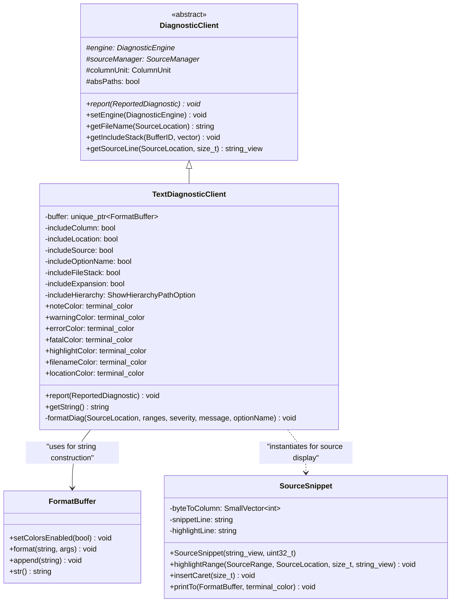
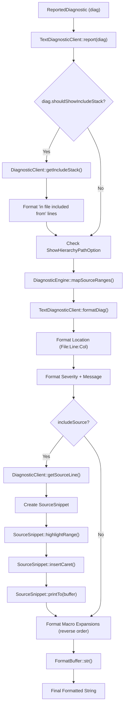
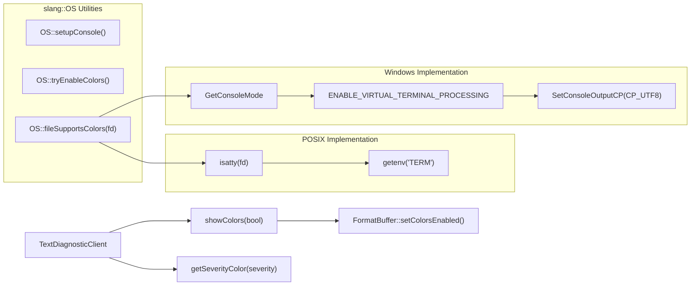
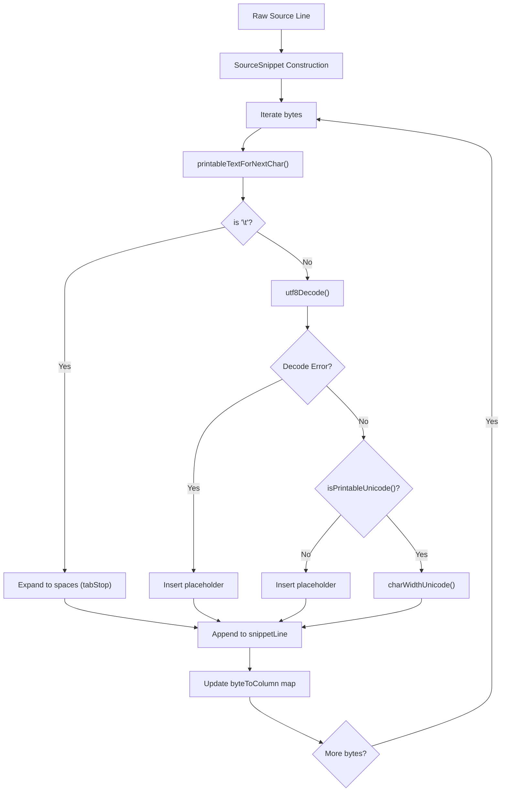

<!-- source: DeepWiki mcp.deepwiki.com · repo MikePopoloski/slang · page 6.3 Text Diagnostic Client · fetched 2026-10-30 -->

# Text Diagnostic Client

Relevant source files

The following files were used as context for generating this wiki page:

- [include/slang/diagnostics/DiagnosticClient.h](include/slang/diagnostics/DiagnosticClient.h)
- [include/slang/diagnostics/TextDiagnosticClient.h](include/slang/diagnostics/TextDiagnosticClient.h)
- [include/slang/util/OS.h](include/slang/util/OS.h)
- [source/diagnostics/DiagnosticClient.cpp](source/diagnostics/DiagnosticClient.cpp)
- [source/diagnostics/JsonDiagnosticClient.cpp](source/diagnostics/JsonDiagnosticClient.cpp)
- [source/diagnostics/TextDiagnosticClient.cpp](source/diagnostics/TextDiagnosticClient.cpp)
- [source/util/OS.cpp](source/util/OS.cpp)

The Text Diagnostic Client is responsible for formatting diagnostic messages into human-readable text output for console display. It converts structured diagnostic information from the diagnostic engine into formatted text with optional color highlighting, source code snippets, file location information, and contextual details like include stacks and macro expansions.

For information about the broader diagnostic system architecture, see [Diagnostic System](). For JSON-formatted diagnostic output, see the `JsonDiagnosticClient` implementation in [source/diagnostics/JsonDiagnosticClient.cpp:17-85]().

## Architecture and Class Relationships

The `TextDiagnosticClient` inherits from the abstract `DiagnosticClient` base class and integrates with several supporting systems for text formatting and console output.

### Diagnostic Client Class Hierarchy

Sources: [include/slang/diagnostics/DiagnosticClient.h:21-50](), [include/slang/diagnostics/TextDiagnosticClient.h:23-66](), [source/diagnostics/TextDiagnosticClient.cpp:18-28](), [source/diagnostics/TextDiagnosticClient.cpp:192-210]()

## Text Formatting Pipeline

The diagnostic formatting process involves multiple stages that transform structured diagnostic data into formatted text output. The entry point is `TextDiagnosticClient::report`.

### Diagnostic Reporting Flow

Sources: [source/diagnostics/TextDiagnosticClient.cpp:49-101](), [source/diagnostics/TextDiagnosticClient.cpp:302-361](), [source/diagnostics/DiagnosticClient.cpp:30-41]()

## Color and Terminal Support

The client integrates with the `OS` abstraction layer to provide cross-platform color support and terminal compatibility.

### OS Abstraction and Console Setup

Sources: [source/util/OS.cpp:44-87](), [source/util/OS.cpp:184-202](), [include/slang/util/OS.h:20-33](), [source/diagnostics/TextDiagnosticClient.cpp:30-47]()

## Source Code Display System

The `SourceSnippet` class handles the complexities of mapping byte offsets to visual columns, especially when dealing with tabs and Unicode.

### Unicode and Tab Expansion Logic

Sources: [source/diagnostics/TextDiagnosticClient.cpp:115-190](), [source/diagnostics/TextDiagnosticClient.cpp:192-221]()

## Configuration Options

The `TextDiagnosticClient` provides methods to toggle specific parts of the output:

| Option | Method | Description | Default |
|--------|--------|-------------|---------|
| Color Output | `showColors(bool)` | Enables/disables terminal colors via `FormatBuffer` | Platform dependent |
| Column Numbers | `showColumn(bool)` | Includes the column number in the location string | `true` |
| Location Info | `showLocation(bool)` | Includes file and line information | `true` |
| Source Lines | `showSourceLine(bool)` | Displays the source code snippet and caret | `true` |
| Option Names | `showOptionName(bool)` | Appends the diagnostic flag (e.g., `[-Wunused]`) | `true` |
| Include Stack | `showIncludeStack(bool)` | Shows the "in file included from" trace | `true` |
| Macro Expansion | `showMacroExpansion(bool)` | Shows the macro expansion stack | `true` |
| Hierarchy Path | `showHierarchyInstance()` | Controls display of the symbol hierarchy path | `Auto` |

Sources: [include/slang/diagnostics/TextDiagnosticClient.h:36-43](), [include/slang/diagnostics/TextDiagnosticClient.h:55-61]()

## JSON Diagnostic Output

In addition to the text client, slang provides a `JsonDiagnosticClient` that outputs diagnostics as a JSON array of objects. This is useful for IDE integration or automated tooling.

### JSON Schema Structure
- **severity**: String representation of `DiagnosticSeverity` [source/diagnostics/JsonDiagnosticClient.cpp:19-20]().
- **message**: The formatted diagnostic message [source/diagnostics/JsonDiagnosticClient.cpp:21-22]().
- **location**: A string in `file:line:col` format [source/diagnostics/JsonDiagnosticClient.cpp:30-35]().
- **optionName**: The diagnostic warning flag, if applicable [source/diagnostics/JsonDiagnosticClient.cpp:24-28]().
- **includeStack**: An array of file locations [source/diagnostics/JsonDiagnosticClient.cpp:37-51]().
- **symbolPath**: The hierarchical path to the symbol where the error occurred [source/diagnostics/JsonDiagnosticClient.cpp:54-59]().
- **macroStack**: An array of objects detailing macro expansion names and locations [source/diagnostics/JsonDiagnosticClient.cpp:62-83]().

Sources: [source/diagnostics/JsonDiagnosticClient.cpp:17-85]()

---

