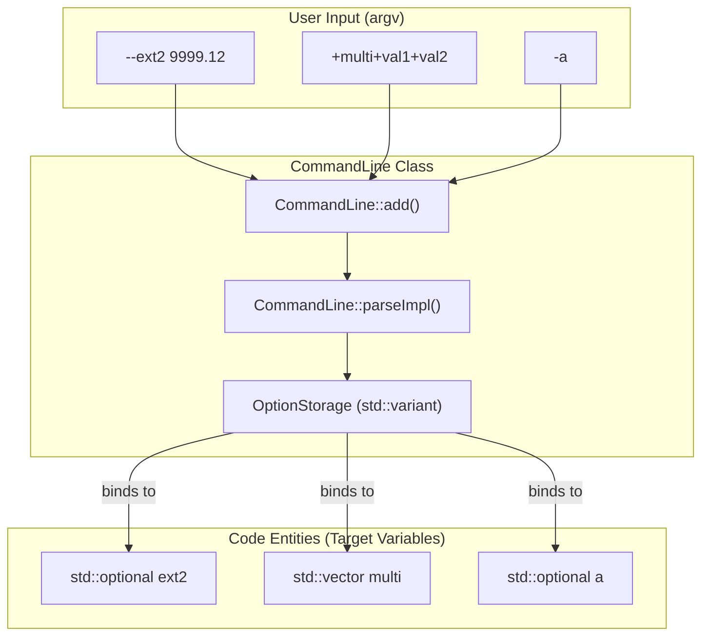
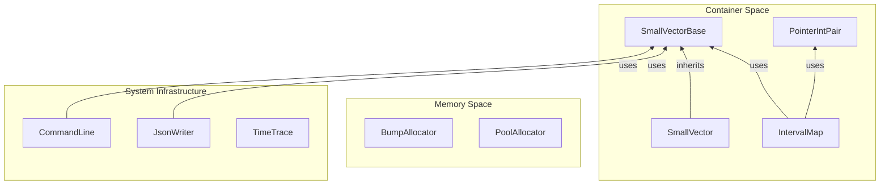

<!-- source: DeepWiki mcp.deepwiki.com · repo MikePopoloski/slang · page 6.4 Utility Library · fetched 2026-10-30 -->

# Utility Library

Relevant source files

The following files were used as context for generating this wiki page:

- [.pre-commit-config.yaml](.pre-commit-config.yaml)
- [external/BS_thread_pool.hpp](external/BS_thread_pool.hpp)
- [include/slang/diagnostics/DiagArgFormatter.h](include/slang/diagnostics/DiagArgFormatter.h)
- [include/slang/text/Json.h](include/slang/text/Json.h)
- [include/slang/util/Bag.h](include/slang/util/Bag.h)
- [include/slang/util/BumpAllocator.h](include/slang/util/BumpAllocator.h)
- [include/slang/util/CommandLine.h](include/slang/util/CommandLine.h)
- [include/slang/util/CopyPtr.h](include/slang/util/CopyPtr.h)
- [include/slang/util/Function.h](include/slang/util/Function.h)
- [include/slang/util/IntervalMap.h](include/slang/util/IntervalMap.h)
- [include/slang/util/Iterator.h](include/slang/util/Iterator.h)
- [include/slang/util/PointerIntPair.h](include/slang/util/PointerIntPair.h)
- [include/slang/util/PoolAllocator.h](include/slang/util/PoolAllocator.h)
- [include/slang/util/Random.h](include/slang/util/Random.h)
- [include/slang/util/SmallVector.h](include/slang/util/SmallVector.h)
- [include/slang/util/String.h](include/slang/util/String.h)
- [include/slang/util/ThreadPool.h](include/slang/util/ThreadPool.h)
- [include/slang/util/TimeTrace.h](include/slang/util/TimeTrace.h)
- [source/ast/builtins/QueryFuncs.cpp](source/ast/builtins/QueryFuncs.cpp)
- [source/text/Json.cpp](source/text/Json.cpp)
- [source/util/CommandLine.cpp](source/util/CommandLine.cpp)
- [source/util/IntervalMap.cpp](source/util/IntervalMap.cpp)
- [source/util/String.cpp](source/util/String.cpp)
- [source/util/TimeTrace.cpp](source/util/TimeTrace.cpp)
- [tests/unittests/util/CommandLineTests.cpp](tests/unittests/util/CommandLineTests.cpp)
- [tests/unittests/util/IntervalMapTests.cpp](tests/unittests/util/IntervalMapTests.cpp)
- [tests/unittests/util/NumericTests.cpp](tests/unittests/util/NumericTests.cpp)
- [tests/unittests/util/UtilTests.cpp](tests/unittests/util/UtilTests.cpp)

The slang utility library provides a suite of high-performance data structures and infrastructure components designed specifically for the requirements of a SystemVerilog compiler. These utilities focus on memory efficiency (via custom allocators), cache friendliness (via small-buffer optimizations), and specialized mapping for source code analysis (via interval maps).

## Memory Management

Slang employs specialized allocation strategies to manage the millions of small objects created during parsing and elaboration.

### BumpAllocator
The `BumpAllocator` is the primary mechanism for fast, arena-based allocation. It allocates large blocks of memory and "bumps" a pointer for each request. This makes allocation nearly free and allows for bulk deallocation when a compilation phase finishes.
*   **Implementation**: It maintains a linked list of memory blocks. Each allocation is aligned to a specified boundary.
*   **Key Function**: `allocate(size_t size, size_t alignment)` provides raw memory.

### PoolAllocator
For objects of a fixed size that need to be individualy deallocated or reused, `PoolAllocator` maintains a free list of slots within blocks.
*   **Implementation**: Uses a linked list of blocks, where each block is partitioned into equal-sized slots.

Sources: `[include/slang/util/BumpAllocator.h:1-20]()`, `[include/slang/util/PoolAllocator.h:1-20]()`

## Specialized Containers

### SmallVector
`SmallVector<T, N>` is a fast, growable array that stores its first `N` elements on the stack. It avoids heap allocation entirely if the number of elements remains small, which is a common pattern for port lists, dimensions, and small scopes in SystemVerilog.
*   **Implementation**: Inherits from `SmallVectorBase<T>`, which erases the stack size `N` to allow functions to accept any `SmallVector` via reference.
*   **Behavior**: When `size()` exceeds `N`, it transitions to heap-allocated storage.

### IntervalMap
The `IntervalMap` is a specialized data structure used to map ranges (intervals) to values. This is critical for mapping source locations to macro expansions or finding overlapping address ranges in memory maps.
*   **Implementation**: A B+-tree-like structure optimized for cache lines (64 bytes). Unlike standard interval trees, slang's implementation allows for overlapping intervals.
*   **Data Flow**: `NodeRef` uses `PointerIntPair` to store child pointers and metadata in a single machine word.

### Bag
`Bag` is a heterogenous container used to pass around a collection of arbitrary configuration objects or compiler options.
*   **Mechanism**: It uses type-based indexing to store and retrieve unique instances of different classes.

Sources: `[include/slang/util/SmallVector.h:29-158]()`, `[include/slang/util/IntervalMap.h:58-198]()`, `[include/slang/util/Bag.h:9-65]()`

## Command Line Parsing

The `CommandLine` class handles GNU-style long options, SystemVerilog-style plus-args (`+opt+val`), and positional arguments.

### Logic and Data Flow
The parser operates in two phases:
1.  **Tokenization**: The input string is split into tokens, handling quotes, escapes, and comments.
2.  **Binding**: Tokens are matched against registered options.

### Code Entity Space to Utility Space
The following diagram illustrates how the `CommandLine` class maps user input to internal storage.

Title: CommandLine Argument Mapping

Sources: `[source/util/CommandLine.cpp:22-142]()`, `[include/slang/util/CommandLine.h:79-150]()`

## String Utilities

Slang provides ASCII-optimized string manipulation routines to avoid the overhead of locale-aware standard library functions.

| Function | Purpose | Implementation Detail |
| :--- | :--- | :--- |
| `strToInt` / `strToUInt` | Fast numeric parsing | Uses `std::from_chars` for performance `[source/util/String.cpp:35-55]()` |
| `editDistance` | "Did you mean?" suggestions | Levenshtein distance algorithm `[source/util/String.cpp:97-125]()` |
| `uintToStr` | Efficient integer to string | Uses a `SmallVector` buffer to avoid heap `[source/util/String.cpp:18-33]()` |
| `splitString` | Delimiter-based splitting | Returns `std::string_view` to avoid copies `[source/util/String.cpp:81-95]()` |

Sources: `[include/slang/util/String.h:1-78]()`, `[source/util/String.cpp:1-125]()`

## Infrastructure Support

### ThreadPool
Slang integrates `BS::thread_pool` for parallelizing compilation tasks like independent file parsing or diagnostic reporting.
*   **Integration**: Accessed via `ThreadPool` wrappers to manage task detachment and synchronization.

### JsonWriter
A lightweight, non-allocating (where possible) JSON serializer used for exporting ASTs and diagnostic reports.
*   **Key Functions**: `startObject()`, `writeProperty()`, `writeValue()`.
*   **Implementation**: Writes directly to a `FormatBuffer` which can be flushed to an `std::ostream`.

### Diagnostic Formatting
The `DiagArgFormatter` provides the logic for turning internal types (like `Type`, `Symbol`, or `SVInt`) into human-readable strings within diagnostic messages.

Sources: `[include/slang/util/ThreadPool.h:1-15]()`, `[source/text/Json.cpp:18-115]()`, `[include/slang/diagnostics/DiagArgFormatter.h:1-20]()`

## Utility Library Architecture

The following diagram bridges the gap between the high-level utility concepts and the specific C++ classes that implement them.

Title: Utility Library Class Hierarchy and Roles

Sources: `[include/slang/util/SmallVector.h:35-36]()`, `[include/slang/util/IntervalMap.h:142-192]()`, `[include/slang/util/PointerIntPair.h:1-20]()`

---

