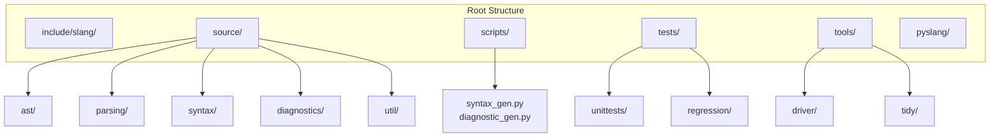
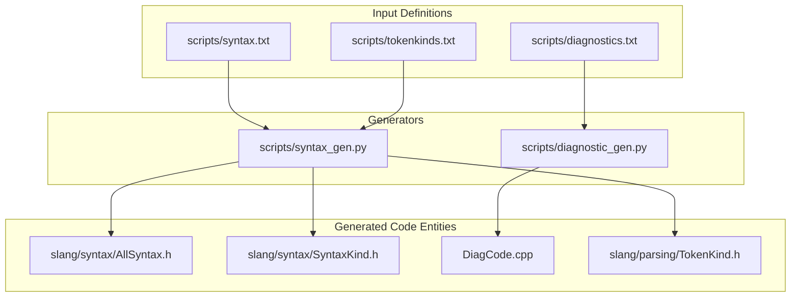

<!-- source: DeepWiki mcp.deepwiki.com · repo MikePopoloski/slang · page 7 Developer Guide · fetched 2026-10-30 -->

# Developer Guide

<details>
<summary>Relevant source files</summary>

The following files were used as context for generating this wiki page:

- [.clang-tidy](.clang-tidy)
- [.github/copilot-instructions.md](.github/copilot-instructions.md)
- [.github/workflows/build.yml](.github/workflows/build.yml)
- [.github/workflows/copilot-setup-steps.yml](.github/workflows/copilot-setup-steps.yml)
- [.github/workflows/coverage.yml](.github/workflows/coverage.yml)
- [.github/workflows/docs.yml](.github/workflows/docs.yml)
- [.github/workflows/python-build.yml](.github/workflows/python-build.yml)
- [.github/workflows/python-dist.yml](.github/workflows/python-dist.yml)
- [CMakeLists.txt](CMakeLists.txt)
- [CMakePresets.json](CMakePresets.json)
- [docs/building.dox](docs/building.dox)
- [pyslang/docs/pages/index.rst](pyslang/docs/pages/index.rst)
- [pyslang/pyslang/py.typed](pyslang/pyslang/py.typed)
- [source/CMakeLists.txt](source/CMakeLists.txt)
- [tests/regression/CMakeLists.txt](tests/regression/CMakeLists.txt)
- [tests/regression/delayed_reg.v](tests/regression/delayed_reg.v)
- [tests/regression/wire_module.v](tests/regression/wire_module.v)
- [tests/unittests/CMakeLists.txt](tests/unittests/CMakeLists.txt)
- [tests/unittests/Test.h](tests/unittests/Test.h)
- [tests/unittests/main.cpp](tests/unittests/main.cpp)
- [tools/CMakeLists.txt](tools/CMakeLists.txt)

</details>


This guide provides practical information for developers who want to contribute to or extend the slang SystemVerilog compiler. It covers the development environment, code organization, and extension points.

## Development Environment Setup

### Prerequisites

To develop slang, you'll need the following tools:

- **C++20 compatible compiler**
    - GCC 11 or later [[docs/building.dox:20-20]()]
    - Clang 17 or later [[docs/building.dox:21-21]()]
    - MSVC (Visual Studio 2022) [[docs/building.dox:23-23]()]
    - Xcode 16 or later [[docs/building.dox:22-22]()]
- **CMake** 3.20 or later [[docs/building.dox:18-18]()]
- **Python 3** [[docs/building.dox:17-17]()]
- **Git**

### Building for Development

slang uses CMake's preset feature to define standard build configurations. These are defined in `CMakePresets.json` and include configurations for different compilers and analysis tools.

```bash
# Configure using a preset
cmake --preset win64-debug      # Windows MSVC debug build
cmake --preset clang-sanitize   # Linux clang with sanitizers
cmake --preset gcc-debug-shared # Linux GCC debug with shared libs

# Build
cmake --build build/preset-name -j8

# Run tests
ctest --test-dir build/preset-name --output-on-failure
```

#### Available Build Presets

| Preset | Platform | Compiler | Features |
|--------|----------|----------|----------|
| `win64-debug` | Windows | `cl.exe` | Debug build, `/Zi /Od /RTC1` [[CMakePresets.json:29-39]()] |
| `win64-release` | Windows | `cl.exe` | Release build, includes threadtest [[CMakePresets.json:60-70]()] |
| `clang-sanitize` | Linux | `clang++-21` | ASan, UBSan, clang-tidy-21 [[CMakePresets.json:134-150]()] |
| `gcc-debug-shared` | Linux | `g++-14` | Shared libs, `cpptrace` enabled [[CMakePresets.json:152-163]()] |
| `gcc-coverage` | Linux | `g++-14` | Code coverage instrumentation [[CMakePresets.json:203-212]()] |

Sources: [CMakePresets.json:1-212](), [.github/workflows/build.yml:11-34]()

### Common Build Options

Key CMake options for development:

| Option | Description | Default |
|--------|-------------|---------|
| `SLANG_INCLUDE_TESTS` | Include test targets | `ON` [[CMakeLists.txt:60-61]()] |
| `SLANG_USE_MIMALLOC` | Use mimalloc allocator | `ON` [[CMakeLists.txt:76-76]()] |
| `SLANG_CLANG_TIDY` | Run clang-tidy during build | `""` [[CMakeLists.txt:83-85]()] |
| `SLANG_INCLUDE_PYLIB` | Include Python bindings | `OFF` [[CMakeLists.txt:63-63]()] |
| `SLANG_CI_BUILD` | Enable longer running tests | `OFF` [[CMakeLists.txt:71-71]()] |

Sources: [CMakeLists.txt:58-81]()

## Code Organization

### Repository Structure



Sources: [source/CMakeLists.txt:67-121](), [tools/CMakeLists.txt:6-10](), [tests/unittests/CMakeLists.txt:8-53]()

## Code Generation System

slang uses automated C++ code generation for syntax nodes and diagnostics. This is managed via Python scripts during the build process. For detailed extension instructions, see [Code Generation](#7.1).

### Code Generation Pipeline



The build system invokes these generators using `add_custom_command` in CMake [[source/CMakeLists.txt:9-52]()].

Sources: [source/CMakeLists.txt:9-52](), [docs/building.dox:82-91]()

## Testing and CI

slang uses a comprehensive testing strategy combining unit tests and regression tests. For details on the CI pipeline and coverage, see [Documentation and CI System](#7.2).

### Test Framework
- **Unit Tests**: Built using Catch2 [[tests/unittests/CMakeLists.txt:56-56]()]. Located in `tests/unittests/` [[tests/unittests/CMakeLists.txt:8-53]()].
- **Regression Tests**: Located in `tests/regression/`. Includes UVM support [[tests/regression/CMakeLists.txt:6-43]()].
- **Python Tests**: Executed via `pytest` [[docs/building.dox:143-147]()].

### Continuous Integration
The CI system runs on GitHub Actions, executing the build matrix across Linux, macOS, and Windows [[.github/workflows/build.yml:11-34]()]. It includes:
- **Sanitizers**: `clang-sanitize` preset enables Address and Undefined Behavior sanitizers [[CMakePresets.json:134-150]()].
- **Linting**: `clang-tidy` checks are enforced [[.clang-tidy:1-55]()].
- **Coverage**: Automated coverage reporting via `gcc-coverage` [[.github/workflows/coverage.yml]()].

Sources: [tests/unittests/CMakeLists.txt:1-93](), [.github/workflows/build.yml:1-74](), [docs/building.dox:137-147]()

## Python Bindings (pyslang)

The `pyslang` module provides Python bindings for the slang library using `pybind11`. This allows developers to interact with the AST, syntax tree, and compilation objects from Python scripts. For detailed API usage, see [Python Bindings (pyslang)](#7.3).

- **Build**: Enabled via `SLANG_INCLUDE_PYLIB=ON` [[docs/building.dox:111-135]()].
- **Incompatibility**: `mimalloc` is automatically disabled when building Python bindings [[CMakeLists.txt:194-196]()].

Sources: [CMakeLists.txt:63-65](), [docs/building.dox:111-135]()

## Auxiliary Tools

slang includes a suite of tools built on top of the core library. For details on each tool, see [Auxiliary Tools](#7.4).

| Tool | Directory | Purpose |
|------|-----------|---------|
| `slang-tidy` | `tools/tidy` | Linter for SystemVerilog code [[tools/CMakeLists.txt:10-10]()] |
| `slang-hier` | `tools/hier` | Hierarchy viewer [[tools/CMakeLists.txt:7-7]()] |
| `slang-reflect` | `tools/reflect` | C++ type generator [[tools/CMakeLists.txt:8-8]()] |
| `slang-rewriter` | `tools/rewriter` | Source code transformer [[tools/CMakeLists.txt:9-9]()] |

Sources: [tools/CMakeLists.txt:1-15]()

---

