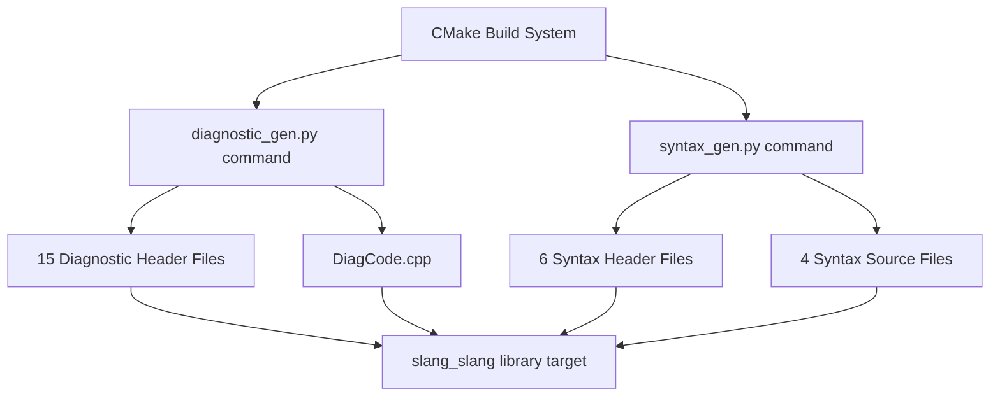
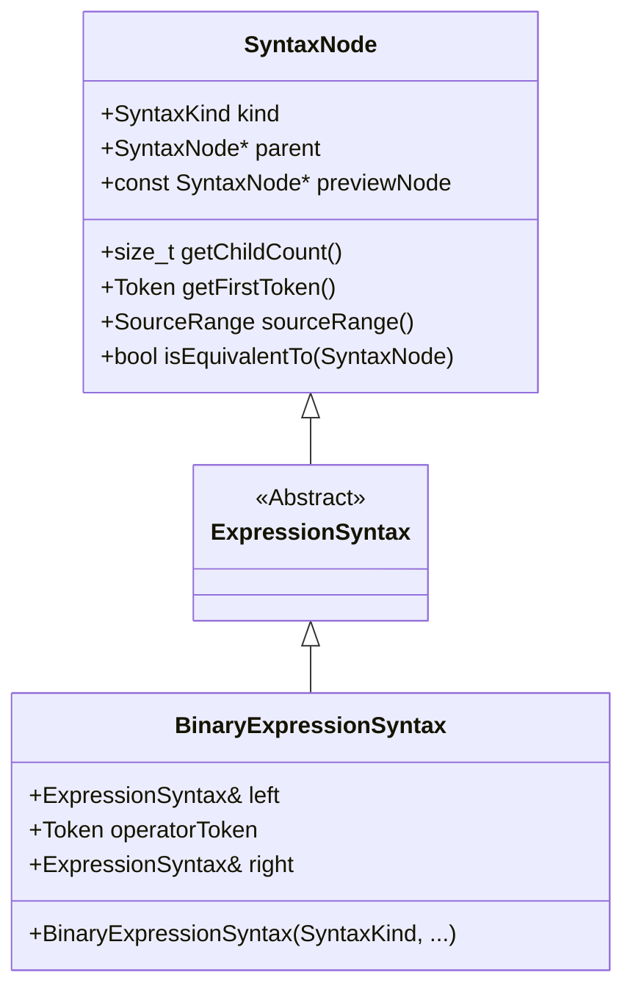

<!-- source: DeepWiki mcp.deepwiki.com · repo MikePopoloski/slang · page 7.1 Code Generation · fetched 2026-10-30 -->

# Code Generation

<details>
<summary>Relevant source files</summary>

The following files were used as context for generating this wiki page:

- [CMakeLists.txt](CMakeLists.txt)
- [include/slang/ast/expressions/AssignmentExpressions.h](include/slang/ast/expressions/AssignmentExpressions.h)
- [include/slang/ast/expressions/ConversionExpression.h](include/slang/ast/expressions/ConversionExpression.h)
- [include/slang/ast/expressions/OperatorExpressions.h](include/slang/ast/expressions/OperatorExpressions.h)
- [include/slang/syntax/SyntaxNode.h](include/slang/syntax/SyntaxNode.h)
- [scripts/diagnostics.txt](scripts/diagnostics.txt)
- [scripts/syntax_gen.py](scripts/syntax_gen.py)
- [scripts/warning_docs.txt](scripts/warning_docs.txt)
- [source/CMakeLists.txt](source/CMakeLists.txt)
- [source/ast/Bitstream.cpp](source/ast/Bitstream.cpp)
- [source/ast/TimingControl.cpp](source/ast/TimingControl.cpp)
- [source/ast/expressions/AssignmentExpressions.cpp](source/ast/expressions/AssignmentExpressions.cpp)
- [source/ast/expressions/ConversionExpression.cpp](source/ast/expressions/ConversionExpression.cpp)
- [source/ast/expressions/OperatorExpressions.cpp](source/ast/expressions/OperatorExpressions.cpp)
- [source/driver/CompatSettings.cpp](source/driver/CompatSettings.cpp)
- [source/syntax/SyntaxNode.cpp](source/syntax/SyntaxNode.cpp)
- [tests/regression/CMakeLists.txt](tests/regression/CMakeLists.txt)
- [tests/regression/delayed_reg.v](tests/regression/delayed_reg.v)
- [tests/regression/wire_module.v](tests/regression/wire_module.v)
- [tests/unittests/CMakeLists.txt](tests/unittests/CMakeLists.txt)
- [tests/unittests/Test.h](tests/unittests/Test.h)
- [tests/unittests/ast/ExpressionTests.cpp](tests/unittests/ast/ExpressionTests.cpp)
- [tests/unittests/ast/StatementTests.cpp](tests/unittests/ast/StatementTests.cpp)
- [tests/unittests/ast/WarningTests.cpp](tests/unittests/ast/WarningTests.cpp)
- [tests/unittests/main.cpp](tests/unittests/main.cpp)
- [tools/CMakeLists.txt](tools/CMakeLists.txt)

</details>


This page explains how Slang automates the generation of C++ source code for syntax nodes and diagnostic messages from definition files. Code generation allows Slang to maintain a clean separation between the definition of language structures and their implementation, making the codebase more maintainable and less error-prone.

## Overview of Code Generation System

Slang uses automated code generation to maintain consistency and reduce manual coding errors across its syntax tree and diagnostic systems. The generation process is integrated into the CMake build system and produces multiple C++ files from compact definition files.

### Generated Code Components

```mermaid
graph TD
    subgraph "Definition Files"
        syntax_txt["scripts/syntax.txt"]
        diagnostics_txt["scripts/diagnostics.txt"]
        tokenkinds_txt["scripts/tokenkinds.txt"]
        triviakinds_txt["scripts/triviakinds.txt"]
        systemnames_txt["scripts/systemnames.txt"]
    end
    
    subgraph "Generator Scripts"
        syntax_gen_py["scripts/syntax_gen.py"]
        diagnostic_gen_py["scripts/diagnostic_gen.py"]
    end
    
    subgraph "Generated Headers"
        AllSyntax_h["slang/syntax/AllSyntax.h"]
        SyntaxKind_h["slang/syntax/SyntaxKind.h"]
        SyntaxFwd_h["slang/syntax/SyntaxFwd.h"]
        TokenKind_h["slang/parsing/TokenKind.h"]
        KnownSystemName_h["slang/parsing/KnownSystemName.h"]
        CSTJsonVisitorGen_h["slang/syntax/CSTJsonVisitorGen.h"]
        AllDiags_h["slang/diagnostics/AllDiags.h"]
    end
    
    subgraph "Generated Source Files"
        AllSyntax_cpp["AllSyntax.cpp"]
        SyntaxClone_cpp["SyntaxClone.cpp"]
        TokenKind_cpp["TokenKind.cpp"]
        KnownSystemName_cpp["KnownSystemName.cpp"]
        DiagCode_cpp["DiagCode.cpp"]
    end
    
    syntax_txt --> syntax_gen_py
    tokenkinds_txt --> syntax_gen_py
    triviakinds_txt --> syntax_gen_py
    systemnames_txt --> syntax_gen_py
    diagnostics_txt --> diagnostic_gen_py
    
    syntax_gen_py --> AllSyntax_h
    syntax_gen_py --> SyntaxKind_h
    syntax_gen_py --> SyntaxFwd_h
    syntax_gen_py --> TokenKind_h
    syntax_gen_py --> KnownSystemName_h
    syntax_gen_py --> CSTJsonVisitorGen_h
    syntax_gen_py --> AllSyntax_cpp
    syntax_gen_py --> SyntaxClone_cpp
    syntax_gen_py --> TokenKind_cpp
    syntax_gen_py --> KnownSystemName_cpp
    
    diagnostic_gen_py --> AllDiags_h
    diagnostic_gen_py --> DiagCode_cpp
```



Sources: [source/CMakeLists.txt:9-51](), [scripts/syntax_gen.py:53-72]()

## Syntax Node Generation

### Syntax Definition Language

The syntax node system is defined in `syntax.txt`, which uses a concise domain-specific language to describe the structure of all syntax nodes in the parser. Each syntax node is defined with its name, optional attributes, and member variables.

Here's an example of a syntax node definition:

```
BinaryExpression base=Expression multiKind=true
Expression left
token operatorToken
list<AttributeInstance> attributes
Expression right
```

This defines a `BinaryExpression` that:
- Inherits from `Expression` (via `base=Expression`)
- Has multiple implementations (`multiKind=true`)
- Contains members: `left`, `operatorToken`, `attributes`, and `right`

Key features of the syntax definition language include:

| Feature | Example | Description |
|---------|---------|-------------|
| Inheritance | `base=Expression` | Specifies the base class |
| Final class | `final=false` | Controls whether the class can be inherited from |
| Multi-kind | `multiKind=true` | Used for nodes with multiple concrete kinds |
| Token member | `token name` | A reference to a token in the source code |
| List member | `list<Type> name` | A list of syntax nodes |
| Separated list | `separated_list<Type> items` | List of nodes separated by tokens |
| Optional member | `Type? name` | An optional node that might be null |

Sources: [scripts/syntax_gen.py:75-118](), [scripts/syntax_gen.py:121-194]()

### Build System Integration

The code generation is integrated into CMake as custom commands that run during the build process:



Sources: [source/CMakeLists.txt:9-51]()

### Syntax Generation Process

The `syntax_gen.py` script processes syntax definitions through several key functions:

| Function | Purpose | Output Files |
|----------|---------|--------------|
| `loadalltypes()` | Parse syntax.txt and build TypeInfo objects | Internal data structures |
| `generateSyntax()` | Generate main syntax node classes | AllSyntax.h, AllSyntax.cpp |
| `generateSyntaxClone()` | Generate cloning functionality | SyntaxClone.cpp |
| `generateTokenKinds()` | Generate token enumeration | TokenKind.h, TokenKind.cpp |
| `generateSystemNames()` | Generate system name constants | KnownSystemName.h, KnownSystemName.cpp |
| `generateCSTJson()` | Generate JSON visitor | CSTJsonVisitorGen.h |

1. **TypeInfo Construction**: Each syntax node creates a `TypeInfo` object containing:
   - `processedMembers`: C++ member declarations  
   - `constructorArgs`: Constructor parameter list
   - `optionalMembers`: Set of nullable pointer members
   - `notNullMembers`: Set of non-null reference members
   - `kindValue`: Associated SyntaxKind enum value

2. **Inheritance Resolution**: Base class relationships are processed to propagate members and build kind mappings via the `createtype` function.

3. **Code Generation**: Multiple specialized generators create the final C++ files.

Sources: [scripts/syntax_gen.py:18-48](), [scripts/syntax_gen.py:75-118](), [scripts/syntax_gen.py:121-194](), [source/CMakeLists.txt:35-51]()

### Generated Code Architecture

The syntax generation produces a comprehensive class hierarchy with multiple supporting systems:



Sources: [include/slang/syntax/SyntaxNode.h:89-183](), [scripts/syntax_gen.py:121-194]()

### Key Generated Components

| Component | Files | Purpose |
|-----------|-------|---------|
| **Syntax Classes** | AllSyntax.h/cpp | 200+ syntax node class definitions |
| **Kind Enums** | SyntaxKind.h | Enumeration of all syntax node types |
| **Token System** | TokenKind.h/cpp | Token type definitions and utilities |
| **Factory Methods** | AllSyntax.h | `SyntaxFactory` class for node creation |
| **Cloning System** | SyntaxClone.cpp | Deep and shallow cloning implementations |
| **Visitor Support** | CSTJsonVisitorGen.h | Generated visitor pattern support |

The generated classes include:
- **Parent/child relationships**: Automatic parent pointer management [include/slang/syntax/SyntaxNode.h:97-99]()
- **Type-safe accessors**: `childNode()` and `childToken()` methods [include/slang/syntax/SyntaxNode.h:128-144]()
- **Memory management**: Integration with `BumpAllocator` [source/CMakeLists.txt:112]()
- **Traversal support**: `token_iterator` for walking tokens [include/slang/syntax/SyntaxNode.h:150-171]()

Sources: [source/CMakeLists.txt:38-47](), [include/slang/syntax/SyntaxNode.h:89-183]()

## Diagnostic Message Generation

### Diagnostic Definition System

The diagnostic system generates organized error, warning, and note messages across subsystems. The `diagnostic_gen.py` script processes definitions in `diagnostics.txt` to create both header files and implementation code.

Example definition from `diagnostics.txt`:
```
subsystem Lexer
error NonPrintableChar "non-printable control character in source text"
warning unknown-escape-code UnknownEscapeCode "unknown character escape sequence '\\\\{}'"
```

Sources: [scripts/diagnostics.txt:20-39](), [source/CMakeLists.txt:8-32]()

### CMake Integration

The diagnostic generation is triggered by CMake custom commands that specify dependencies and outputs:

```
add_custom_command(
  COMMAND ${Python_EXECUTABLE} ${SCRIPTS_DIR}/diagnostic_gen.py 
          --outDir ${CMAKE_CURRENT_BINARY_DIR} 
          --srcDir ${CMAKE_CURRENT_SOURCE_DIR} 
          --incDir ${CMAKE_CURRENT_SOURCE_DIR}/../include/slang 
          --diagnostics ${SCRIPTS_DIR}/diagnostics.txt
  OUTPUT [15 diagnostic header files] DiagCode.cpp
  DEPENDS diagnostic_gen.py diagnostics.txt
)
```

Sources: [source/CMakeLists.txt:9-32]()

## Development Workflow

### Adding New Syntax Nodes

The development process integrates directly with the CMake build system:

1. **Add definition to syntax.txt**: Define the node name, its base class, and its members.
2. **Trigger regeneration**: The CMake build system automatically detects changes to input files and reruns `syntax_gen.py` [source/CMakeLists.txt:48-51]().
3. **Implement parser logic**: Add parsing code in files like `Parser_expressions.cpp` to create the new syntax nodes [source/CMakeLists.txt:92]().

### Adding New Diagnostics  

1. **Add to appropriate subsystem in diagnostics.txt**:
   ```
   subsystem Numeric
   error LiteralSizeIsZero "size of vector literal cannot be zero"
   ```
2. **Automatic regeneration**: CMake detects the change and regenerates all diagnostic files [source/CMakeLists.txt:31-32]().
3. **Use in codebase**: Reference the new diagnostic codes (e.g., `diag::LiteralSizeIsZero`) in the relevant compiler phase.

Sources: [scripts/diagnostics.txt:48-49](), [source/CMakeLists.txt:9-32]()

## Benefits of Code Generation

The code generation approach provides several key benefits:

1. **Consistency**: All related code (headers, sources, visitors) is generated from a single definition.
2. **Maintainability**: Changes to node structures or diagnostic messages are made in text files rather than scattered C++ code.
3. **Conciseness**: The definition files are significantly more compact than the equivalent C++ boilerplate.
4. **Documentation**: Files like `warning_docs.txt` provide a central place for compiler flag documentation [scripts/warning_docs.txt:1-12]().

Sources: [scripts/syntax_gen.py](), [scripts/diagnostics.txt](), [scripts/warning_docs.txt]()

---

