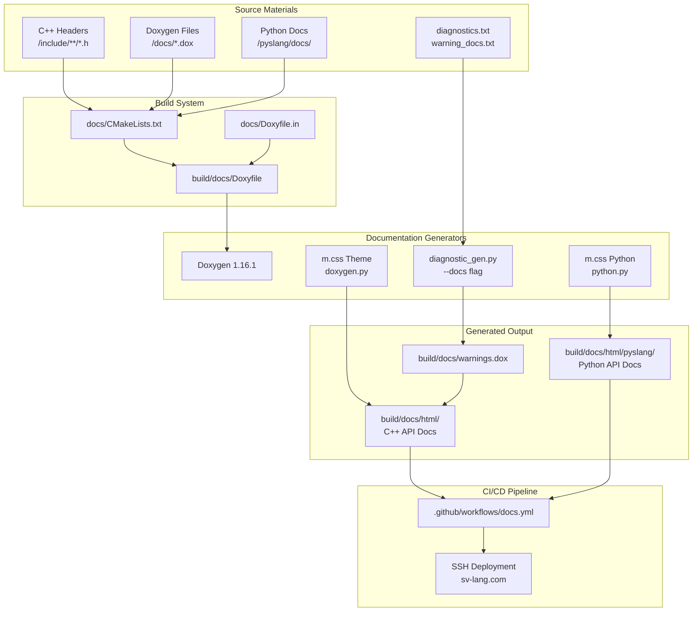
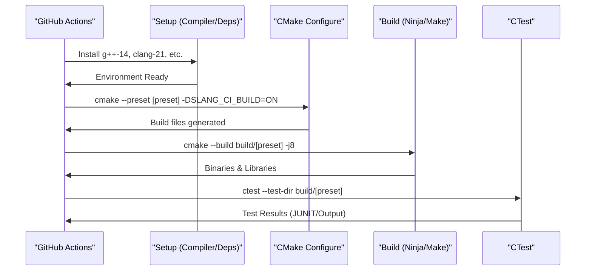

<!-- source: DeepWiki mcp.deepwiki.com · repo MikePopoloski/slang · page 7.2 Documentation and CI System · fetched 2026-10-30 -->

# Documentation and CI System

Relevant source files

The following files were used as context for generating this wiki page:

- [.clang-tidy](.clang-tidy)
- [.github/copilot-instructions.md](.github/copilot-instructions.md)
- [.github/workflows/build.yml](.github/workflows/build.yml)
- [.github/workflows/copilot-setup-steps.yml](.github/workflows/copilot-setup-steps.yml)
- [.github/workflows/coverage.yml](.github/workflows/coverage.yml)
- [.github/workflows/docs.yml](.github/workflows/docs.yml)
- [.github/workflows/python-build.yml](.github/workflows/python-build.yml)
- [.github/workflows/python-dist.yml](.github/workflows/python-dist.yml)
- [.lcovrc](.lcovrc)
- [CHANGELOG.md](CHANGELOG.md)
- [CMakePresets.json](CMakePresets.json)
- [LICENSE](LICENSE)
- [README.md](README.md)
- [cmake/coverage.cmake](cmake/coverage.cmake)
- [docs/CMakeLists.txt](docs/CMakeLists.txt)
- [docs/Doxyfile.in](docs/Doxyfile.in)
- [docs/building.dox](docs/building.dox)
- [docs/index.html](docs/index.html)
- [docs/language-support.dox](docs/language-support.dox)
- [docs/namespaces.dox](docs/namespaces.dox)
- [docs/user-manual.dox](docs/user-manual.dox)
- [pyproject.toml](pyproject.toml)
- [pyslang/docs/pages/index.rst](pyslang/docs/pages/index.rst)
- [pyslang/pyslang/py.typed](pyslang/pyslang/py.typed)

This page details the automated documentation generation, continuous integration (CI) pipeline, and quality assurance systems for the slang SystemVerilog compiler. The system integrates C++ API documentation, Python binding documentation, multi-platform builds, and coverage reporting.

## Documentation Architecture

The slang documentation system is a multi-stage pipeline that transforms source code comments, standalone Doxygen files, and diagnostic definitions into a unified website.

### Documentation Data Flow

The following diagram illustrates how various source materials are processed by different generators to produce the final documentation hosted at [sv-lang.com](https://sv-lang.com).

**Sources:** `docs/CMakeLists.txt:1-101`, `docs/Doxyfile.in:1-150`, `.github/workflows/docs.yml:1-62`

### C++ API Documentation

The C++ documentation uses **Doxygen** combined with the **m.css** theme for a modern, searchable interface.

*   **Configuration**: The `Doxyfile.in` template is processed by CMake to inject paths and project versions `[docs/Doxyfile.in:1-102]`.
*   **Input Scopes**: Documentation is gathered from `/include`, `/docs`, and generated source directories like `build/source/slang/syntax` `[docs/CMakeLists.txt:18-23]`.
*   **Warning Reference**: A custom step invokes `diagnostic_gen.py` with the `--docs` flag to transform `diagnostics.txt` into `warnings.dox`, creating the [Warning Reference](https://sv-lang.com/warning-ref.html) page `[docs/CMakeLists.txt:49-57]`.

### Python Documentation (pyslang)

When `SLANG_INCLUDE_PYTHON_DOCS` is enabled, the build system creates an isolated virtual environment to generate documentation for the Python bindings `[docs/CMakeLists.txt:76-100]`.

| Step | Implementation | File Reference |
| :--- | :--- | :--- |
| **Venv Setup** | Creates `${PROJECT_BINARY_DIR}/venv` | `[docs/CMakeLists.txt:78-82]` |
| **Dependencies** | Installs `jinja2`, `pygments`, `docutils` | `[docs/CMakeLists.txt:84-85]` |
| **Installation** | Installs `pyslang` in-place | `[docs/CMakeLists.txt:87-88]` |
| **Generation** | Executes `m.css` `python.py` generator | `[docs/CMakeLists.txt:89-90]` |

## Continuous Integration (CI) System

Slang uses GitHub Actions for comprehensive validation across multiple operating systems and compiler toolchains.

### Multi-Platform Build Matrix

The primary CI build `[.github/workflows/build.yml]` executes a matrix of configurations to ensure compatibility and performance.

| OS | Compiler/Toolchain | Preset Name | Purpose |
| :--- | :--- | :--- | :--- |
| Ubuntu | Clang 21 | `clang-sanitize` | ASan/UBSan memory and UB checking |
| Ubuntu | GCC 14 | `gcc-release` | Standard Linux release build |
| Ubuntu | GCC 11 | `gcc-11-release` | Minimum supported GCC version |
| macOS | Xcode (latest) | `macos-release` | Apple Silicon/Intel validation |
| Windows | MSVC (VS 2022) | `win64-release` | Windows native validation |
| WASI | WASI SDK 32 | `wasi-sdk` | WebAssembly/WASI compatibility |

**Sources:** `.github/workflows/build.yml:11-33`, `CMakePresets.json:1-220`

### CI Build Pipeline Logic

The CI workflow automates the environment setup, compilation, and testing phases.

**Sources:** `.github/workflows/build.yml:35-74`, `docs/building.dox:46-70`

## Code Coverage and Static Analysis

### Coverage Reporting

Slang tracks code coverage using GCC's `--coverage` flags and reports results to Codecov.

*   **Configuration**: The `gcc-coverage` preset in `CMakePresets.json` enables coverage instrumentation with optimized-out assertions `[CMakePresets.json:203-212]`.
*   **Workflow**: The `coverage.yml` workflow runs the test suite, processes `.gcda` files using `lcov`, and uploads the results `[.github/workflows/coverage.yml]`.
*   **Exclusions**: The `.lcovrc` file and `cmake/coverage.cmake` define filters to exclude third-party code and generated files from the coverage metrics.

### Static Analysis (Clang-Tidy)

The project enforces code quality through `clang-tidy`. The `clang-sanitize` preset integrates `clang-tidy-21` directly into the build process `[CMakePresets.json:147]`.

*   **Ruleset**: Defined in `.clang-tidy`, enabling `bugprone-*`, `performance-*`, `modernize-*`, and `portability-*` checks while disabling specific noisy rules like `modernize-use-auto` `[.clang-tidy:1-55]`.

## Deployment Pipeline

The documentation is automatically deployed to the production server upon successful merges to the `master` branch.

1.  **Build**: The `docs.yml` workflow builds the C++ and Python documentation `[.github/workflows/docs.yml:28-31]`.
2.  **Artifact**: The docs are compressed into `slang.tar.gz` `[.github/workflows/docs.yml:33-34]`.
3.  **Transfer**: The archive is uploaded to the deployment host via SCP `[.github/workflows/docs.yml:41-51]`.
4.  **Activation**: An SSH command triggers the `deploy_docs.sh` script on the server to unpack and rotate the website content `[.github/workflows/docs.yml:52-61]`.

**Sources:** `.github/workflows/docs.yml:1-62`

---

