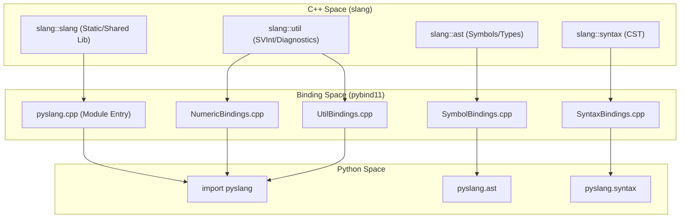
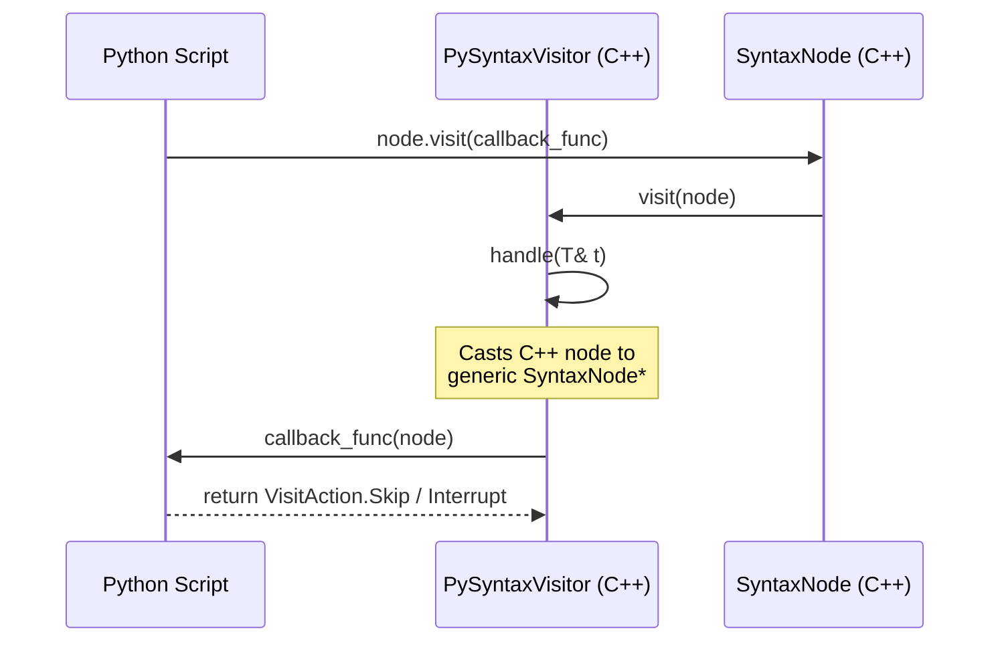

<!-- source: DeepWiki mcp.deepwiki.com · repo MikePopoloski/slang · page 7.3 Python Bindings (pyslang) · fetched 2026-10-30 -->

# Python Bindings (pyslang)

<details>
<summary>Relevant source files</summary>

The following files were used as context for generating this wiki page:

- [LICENSES/BSL-1.0.txt](LICENSES/BSL-1.0.txt)
- [bindings/CMakeLists.txt](bindings/CMakeLists.txt)
- [bindings/python/ExpressionBindings.cpp](bindings/python/ExpressionBindings.cpp)
- [bindings/python/PyVisitors.h](bindings/python/PyVisitors.h)
- [bindings/python/StatementBindings.cpp](bindings/python/StatementBindings.cpp)
- [bindings/python/SyntaxBindings.cpp](bindings/python/SyntaxBindings.cpp)
- [bindings/python/UtilBindings.cpp](bindings/python/UtilBindings.cpp)
- [bindings/python/pyslang.cpp](bindings/python/pyslang.cpp)
- [bindings/python/pyslang.h](bindings/python/pyslang.h)
- [external/CMakeLists.txt](external/CMakeLists.txt)
- [include/slang/ast/ASTVisitor.h](include/slang/ast/ASTVisitor.h)
- [include/slang/ast/Symbol.h](include/slang/ast/Symbol.h)
- [include/slang/ast/symbols/MemberSymbols.h](include/slang/ast/symbols/MemberSymbols.h)
- [pyslang/examples/driver.py](pyslang/examples/driver.py)
- [pyslang/tests/some_file.svh](pyslang/tests/some_file.svh)
- [pyslang/tests/test_basics.py](pyslang/tests/test_basics.py)
- [pyslang/tests/test_custom_systasks.py](pyslang/tests/test_custom_systasks.py)
- [pyslang/tests/test_extract_comments.py](pyslang/tests/test_extract_comments.py)
- [pyslang/tests/test_syntax_factory.py](pyslang/tests/test_syntax_factory.py)
- [pyslang/tests/test_syntax_tree_equality.py](pyslang/tests/test_syntax_tree_equality.py)
- [pyslang/tests/test_visitors.py](pyslang/tests/test_visitors.py)
- [source/ast/CMakeLists.txt](source/ast/CMakeLists.txt)
- [source/ast/symbols/MemberSymbols.cpp](source/ast/symbols/MemberSymbols.cpp)
- [tests/CMakeLists.txt](tests/CMakeLists.txt)

</details>


The `pyslang` module provides comprehensive Python bindings for the slang SystemVerilog compiler. These bindings expose the core compiler infrastructure—including the source manager, diagnostic engine, syntax tree (CST), and elaborated symbol hierarchy (AST)—to Python. This allows developers to perform design analysis, linting, and source transformation using Python's high-level syntax while leveraging slang's high-performance C++ backend.

The bindings are implemented using [pybind11](https://github.com/pybind/pybind11) and are structured to mirror the C++ API closely, including support for the visitor pattern and arbitrary-precision numeric types.

## Implementation Architecture

The `pyslang` module is built as a single shared library that links against the core `slang` library. The implementation is split across several specialized binding files to maintain manageability.

### Data Flow and Binding Structure

The following diagram illustrates how C++ entities are exposed to the Python environment through the binding layer.

**Binding Layer Data Flow**

Sources: [bindings/CMakeLists.txt:41-59](), [bindings/python/pyslang.cpp:1-50]()

### Automated Binding Generation
While many bindings are hand-written to provide a "Pythonic" feel, the vast hierarchy of SystemVerilog syntax nodes is automatically generated. The script `syntax_gen.py` processes `syntax.txt` to produce multiple C++ files (e.g., `PySyntaxBindings0.cpp` through `PySyntaxBindings3.cpp`) that register every `SyntaxNode` subclass with pybind11.

Sources: [bindings/CMakeLists.txt:27-38]()

## Key Components

### Compilation and Analysis
The `pyslang.ast.Compilation` class serves as the central hub for design elaboration. Users can add `SyntaxTree` objects and retrieve the elaborated `RootSymbol`.

| Python Class | C++ Equivalent | Purpose |
| :--- | :--- | :--- |
| `pyslang.ast.Compilation` | `slang::ast::Compilation` | Manages the lifecycle of a design elaboration. |
| `pyslang.ast.ScriptSession` | `slang::ast::ScriptSession` | Allows interactive evaluation of SV snippets. |
| `pyslang.SourceManager` | `slang::SourceManager` | Tracks source files, locations, and macro expansions. |

Sources: [bindings/python/CompBindings.cpp:1-20](), [pyslang/tests/test_basics.py:80-89](), [pyslang/tests/test_basics.py:110-121]()

### Numeric Types
SystemVerilog's 4-state logic and arbitrary-precision integers are exposed via `SVInt` and `ConstantValue`. These types integrate with Python's native numeric operators.

*   **`SVInt`**: Supports bit-widths beyond 64-bit and 4-state logic (`X`, `Z`). [pyslang/tests/test_basics.py:30-36]()
*   **`ConstantValue`**: A variant type that can hold integers, reals, strings, or arrays. [pyslang/tests/test_basics.py:37-41]()

## The Visitor Pattern in Python

A critical feature of `pyslang` is the ability to use the Visitor Pattern to traverse the CST or AST. Because Python lacks C++ template metaprogramming, `pyslang` provides specialized visitor wrappers (`PySyntaxVisitor` and `PyASTVisitor`).

### Syntax Visitor Usage
The `pyslang.syntax.SyntaxNode.visit()` method accepts a Python function or a lookup table (dictionary) mapping `SyntaxKind` to handler functions.

**Syntax Visitor Implementation Mapping**

Sources: [bindings/python/SyntaxBindings.cpp:26-56](), [bindings/python/SyntaxBindings.cpp:79-90]()

### Syntax Rewriter
The `PySyntaxRewriter` class allows for source-to-source transformations by providing methods like `replace`, `insertBefore`, and `insertAfter` within a Python callback. It utilizes a `SyntaxFactory` and `BumpAllocator` to create new nodes during the rewrite process.

Sources: [bindings/python/SyntaxBindings.cpp:92-129](), [bindings/python/SyntaxBindings.cpp:133-158]()

## Example Usage

### Analyzing a Module
The following example demonstrates loading a design and inspecting its symbols.

```python
import pyslang

# 1. Parse source text into a SyntaxTree
tree = pyslang.syntax.SyntaxTree.fromText("module m; endmodule")

# 2. Compile and elaborate
comp = pyslang.ast.Compilation()
comp.addSyntaxTree(tree)

# 3. Access the AST
root = comp.getRoot()
module = root.lookupName("m")
print(f"Found symbol: {module.name}, Kind: {module.kind}")
```
Sources: [pyslang/tests/test_basics.py:80-84](), [pyslang/tests/test_basics.py:130-136]()

### Diagnostic Reporting
Diagnostics generated during compilation can be formatted and printed using the `DiagnosticEngine`.

```python
diags = comp.getAllDiagnostics()
report = pyslang.DiagnosticEngine.reportAll(comp.sourceManager, diags)
print(report)
```
Sources: [pyslang/tests/test_basics.py:85-90](), [bindings/python/UtilBindings.cpp:25-51]()

## Installation and Build Requirements

The Python bindings are enabled via the `SLANG_INCLUDE_PYLIB` CMake option. 

*   **Dependencies**: Requires `pybind11` (v3.0.2 or later). [bindings/CMakeLists.txt:12-14]()
*   **Stubs**: The build process generates Python stubs (`.pyi` files) to provide type hints and autocompletion in IDEs. [bindings/CMakeLists.txt:78-85]()
*   **Compliance**: Includes a `py.typed` marker for PEP 561 compliance. [bindings/CMakeLists.txt:71-76]()

Sources: [bindings/CMakeLists.txt:41-65](), [external/CMakeLists.txt:42-44]()

---

