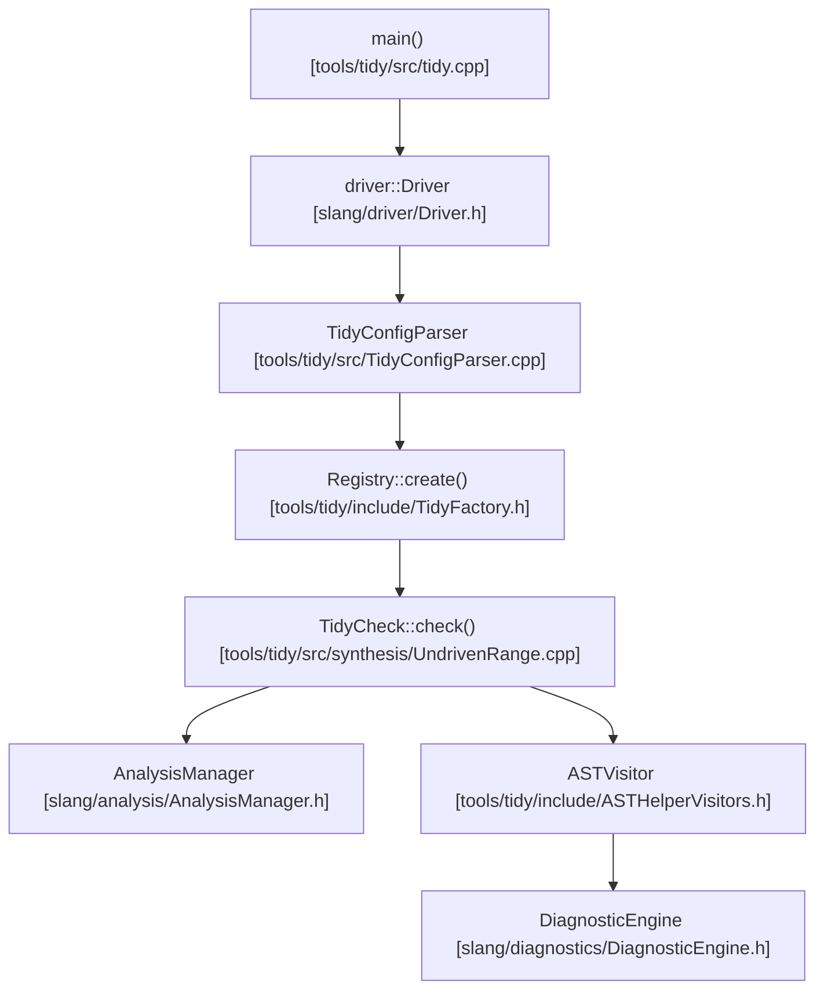
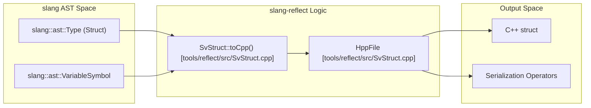

<!-- source: DeepWiki mcp.deepwiki.com · repo MikePopoloski/slang · page 7.4 Auxiliary Tools · fetched 2026-10-30 -->

# Auxiliary Tools

Relevant source files

The following files were used as context for generating this wiki page:

- [tests/unittests/Test.cpp](tests/unittests/Test.cpp)
- [tests/unittests/parsing/RewriterExpandTests.cpp](tests/unittests/parsing/RewriterExpandTests.cpp)
- [tools/reflect/CMakeLists.txt](tools/reflect/CMakeLists.txt)
- [tools/reflect/include/ASTVisitors.h](tools/reflect/include/ASTVisitors.h)
- [tools/reflect/include/CppEmitter.h](tools/reflect/include/CppEmitter.h)
- [tools/reflect/include/SvEnum.h](tools/reflect/include/SvEnum.h)
- [tools/reflect/include/SvGeneric.h](tools/reflect/include/SvGeneric.h)
- [tools/reflect/include/SvLocalParam.h](tools/reflect/include/SvLocalParam.h)
- [tools/reflect/include/SvStruct.h](tools/reflect/include/SvStruct.h)
- [tools/reflect/include/SvType.h](tools/reflect/include/SvType.h)
- [tools/reflect/include/SvTypeReflector.h](tools/reflect/include/SvTypeReflector.h)
- [tools/reflect/src/SvEnum.cpp](tools/reflect/src/SvEnum.cpp)
- [tools/reflect/src/SvLocalParam.cpp](tools/reflect/src/SvLocalParam.cpp)
- [tools/reflect/src/SvStruct.cpp](tools/reflect/src/SvStruct.cpp)
- [tools/reflect/src/SvType.cpp](tools/reflect/src/SvType.cpp)
- [tools/reflect/src/SvUnion.cpp](tools/reflect/src/SvUnion.cpp)
- [tools/reflect/src/reflect.cpp](tools/reflect/src/reflect.cpp)
- [tools/rewriter/README.md](tools/rewriter/README.md)
- [tools/rewriter/rewriter.cpp](tools/rewriter/rewriter.cpp)
- [tools/threadtest/CMakeLists.txt](tools/threadtest/CMakeLists.txt)
- [tools/threadtest/threadtest.cpp](tools/threadtest/threadtest.cpp)
- [tools/tidy/CMakeLists.txt](tools/tidy/CMakeLists.txt)
- [tools/tidy/README.md](tools/tidy/README.md)
- [tools/tidy/include/ASTHelperVisitors.h](tools/tidy/include/ASTHelperVisitors.h)
- [tools/tidy/include/TidyConfig.h](tools/tidy/include/TidyConfig.h)
- [tools/tidy/include/TidyConfigParser.h](tools/tidy/include/TidyConfigParser.h)
- [tools/tidy/include/TidyDiags.h](tools/tidy/include/TidyDiags.h)
- [tools/tidy/include/TidyFactory.h](tools/tidy/include/TidyFactory.h)
- [tools/tidy/include/TidyKind.h](tools/tidy/include/TidyKind.h)
- [tools/tidy/src/TidyConfig.cpp](tools/tidy/src/TidyConfig.cpp)
- [tools/tidy/src/TidyConfigParser.cpp](tools/tidy/src/TidyConfigParser.cpp)
- [tools/tidy/src/style/AlwaysCombNamed.cpp](tools/tidy/src/style/AlwaysCombNamed.cpp)
- [tools/tidy/src/style/AlwaysCombNonBlocking.cpp](tools/tidy/src/style/AlwaysCombNonBlocking.cpp)
- [tools/tidy/src/style/AlwaysFFBlocking.cpp](tools/tidy/src/style/AlwaysFFBlocking.cpp)
- [tools/tidy/src/style/EnforceModuleInstantiationPrefix.cpp](tools/tidy/src/style/EnforceModuleInstantiationPrefix.cpp)
- [tools/tidy/src/style/EnforcePortSuffix.cpp](tools/tidy/src/style/EnforcePortSuffix.cpp)
- [tools/tidy/src/style/GenerateNamed.cpp](tools/tidy/src/style/GenerateNamed.cpp)
- [tools/tidy/src/style/NoDotStarInPortConnection.cpp](tools/tidy/src/style/NoDotStarInPortConnection.cpp)
- [tools/tidy/src/style/NoDotVarInPortConnection.cpp](tools/tidy/src/style/NoDotVarInPortConnection.cpp)
- [tools/tidy/src/style/NoImplicitPortNameInPortConnection.cpp](tools/tidy/src/style/NoImplicitPortNameInPortConnection.cpp)
- [tools/tidy/src/style/NoLegacyGenerate.cpp](tools/tidy/src/style/NoLegacyGenerate.cpp)
- [tools/tidy/src/style/NoOldAlwaysSyntax.cpp](tools/tidy/src/style/NoOldAlwaysSyntax.cpp)
- [tools/tidy/src/synthesis/AlwaysFFAssignmentOutsideConditional.cpp](tools/tidy/src/synthesis/AlwaysFFAssignmentOutsideConditional.cpp)
- [tools/tidy/src/synthesis/LoopBeforeResetCheck.cpp](tools/tidy/src/synthesis/LoopBeforeResetCheck.cpp)
- [tools/tidy/src/synthesis/NoLatchesOnDesign.cpp](tools/tidy/src/synthesis/NoLatchesOnDesign.cpp)
- [tools/tidy/src/synthesis/OnlyAssignedOnReset.cpp](tools/tidy/src/synthesis/OnlyAssignedOnReset.cpp)
- [tools/tidy/src/synthesis/RegisterHasNoReset.cpp](tools/tidy/src/synthesis/RegisterHasNoReset.cpp)
- [tools/tidy/src/synthesis/UndrivenRange.cpp](tools/tidy/src/synthesis/UndrivenRange.cpp)
- [tools/tidy/src/tidy.cpp](tools/tidy/src/tidy.cpp)
- [tools/tidy/tests/CMakeLists.txt](tools/tidy/tests/CMakeLists.txt)
- [tools/tidy/tests/EnforceModuleInstantiationTest.cpp](tools/tidy/tests/EnforceModuleInstantiationTest.cpp)
- [tools/tidy/tests/EnforcePortSuffixTest.cpp](tools/tidy/tests/EnforcePortSuffixTest.cpp)
- [tools/tidy/tests/LoopBeforeResetCheckTest.cpp](tools/tidy/tests/LoopBeforeResetCheckTest.cpp)
- [tools/tidy/tests/NoOldAlwaysSyntaxTest.cpp](tools/tidy/tests/NoOldAlwaysSyntaxTest.cpp)
- [tools/tidy/tests/TidyConfigParserTest.cpp](tools/tidy/tests/TidyConfigParserTest.cpp)
- [tools/tidy/tests/UndrivenRangeTest.cpp](tools/tidy/tests/UndrivenRangeTest.cpp)

The slang repository provides a suite of auxiliary tools built on top of the core compiler infrastructure. these tools leverage the `slang::driver::Driver` [tools/tidy/src/tidy.cpp:32-33](), the AST, and the analysis framework to provide linting, source transformation, and C++ type generation.

## slang-tidy (Linter)

`slang-tidy` is a static analysis and linting tool for SystemVerilog. It implements a variety of checks categorized into `Style` and `Synthesis` groups [tools/tidy/src/TidyConfig.cpp:25-52]().

### Architecture and Implementation
The tool uses a plugin-like architecture where each check is a class inheriting from `TidyCheck` [tools/tidy/src/synthesis/UndrivenRange.cpp:85](). Checks are registered in a central `Registry` using the `REGISTER` macro [tools/tidy/src/synthesis/UndrivenRange.cpp:113]().

The core logic of a check typically involves:
1.  **AST Visitation**: Implementing a visitor (often derived from `TidyVisitor` and `slang::ast::ASTVisitor`) to traverse the elaborated design [tools/tidy/src/synthesis/UndrivenRange.cpp:16-17]().
2.  **Analysis Integration**: Some checks, such as `UndrivenRange`, utilize the `slang::analysis::AnalysisManager` to query driver information for variables [tools/tidy/src/synthesis/UndrivenRange.cpp:52]().
3.  **Diagnostic Reporting**: When a violation is found, it reports a custom `DiagCode` defined in `TidyDiags.h` [tools/tidy/include/TidyDiags.h:12-37]().

### Configuration
`slang-tidy` is configured via a `.slang-tidy` file. The configuration is managed by the `TidyConfig` class [tools/tidy/include/TidyConfig.h:23]() and parsed by `TidyConfigParser`.

| Category | Configuration Keys (Examples) | Role |
| :--- | :--- | :--- |
| **Check Control** | `Checks: -*, style-*` | Enables/disables specific checks or groups [tools/tidy/README.md:84-88](). |
| **Check Options** | `clkName`, `resetName` | Parameters used by synthesis checks to identify control signals [tools/tidy/include/TidyConfig.h:28-41](). |
| **Path Control** | `skip-file`, `skip-path` | Excludes specific files or directories from analysis [tools/tidy/src/tidy.cpp:55-60](). |

### Tidy Data Flow
The following diagram illustrates how `slang-tidy` processes a design.

**slang-tidy Execution Flow**

Sources: [tools/tidy/src/tidy.cpp:29-182](), [tools/tidy/include/TidyConfig.h:23-41](), [tools/tidy/src/synthesis/UndrivenRange.cpp:85-113]().

---

## slang-rewriter (Source Transformer)

`slang-rewriter` is a tool designed to parse SystemVerilog source and write it back out, optionally applying transformations [tools/rewriter/rewriter.cpp:2-5]().

### Key Capabilities
-   **Macro/Include Expansion**: Uses `slang::syntax::SyntaxPrinter` to expand `` `include `` and `` `define `` directives into the output stream [tools/rewriter/rewriter.cpp:142-145]().
-   **Trivia Stripping**: Can remove comments or other non-syntactic tokens (trivia) [tools/rewriter/rewriter.cpp:147-150]().
-   **Formatting**: Includes a `squashBlankLines` utility to normalize vertical whitespace [tools/rewriter/rewriter.cpp:33-60]().

### Implementation
The tool follows a straightforward pipeline:
1.  **Parse**: Loads and parses all source files into `SyntaxTree` objects via the `Driver` [tools/rewriter/rewriter.cpp:121]().
2.  **Configure**: Sets up a `SyntaxPrinter` with options derived from command-line arguments like `--expand-macros` or `--exclude-comments` [tools/rewriter/rewriter.cpp:136-155]().
3.  **Print**: The `SyntaxPrinter::print` method traverses the concrete syntax tree (CST) and regenerates source text [tools/rewriter/rewriter.cpp:162]().

Sources: [tools/rewriter/rewriter.cpp:62-176]().

---

## slang-reflect (C++ Type Generator)

`slang-reflect` generates C++ representations of SystemVerilog types (structs, enums, unions). This is particularly useful for hardware-software co-simulation or testbench verification where C++ models must match RTL data structures.

### Type Mapping
The tool maps SystemVerilog types to C++ or SystemC types:
-   **Structs**: Converted to C++ `struct` with members and a constructor that accepts a bit-packed representation [tools/reflect/src/SvStruct.cpp:14-118]().
-   **SystemC Integration**: If enabled, it generates constructors for `sc_dt::sc_bv` and uses SystemC range operators for bit manipulation [tools/reflect/src/SvStruct.cpp:124-150]().
-   **Bit-Width Handling**: Uses a `CppType` helper to determine if a type fits in a standard `uint64_t` or requires a large bit-vector [tools/reflect/src/SvStruct.cpp:21-32]().

### C++ Generation Logic
The generation is handled by specialized classes for each SV entity:
-   `SvStruct`: Handles member declaration and serialization/deserialization logic [tools/reflect/src/SvStruct.cpp:11]().
-   `HppFile`: A utility to manage indentation and include guards during code generation [tools/reflect/src/SvStruct.cpp:11-17]().

**Type Reflection Logic**

Sources: [tools/reflect/src/SvStruct.cpp:11-170]().

---

## Other Tools

### slang-hier
A hierarchy viewer that prints the elaborated instance tree of a design. It uses the `slang::ast::RootSymbol` to traverse module instances, interfaces, and blocks.

### Netlist Tool
The netlist tool provides a foundation for converting the elaborated AST into a gate-level or module-level netlist representation. It relies on the `AnalysisManager` to track connectivity and signal drivers.

### threadtest
A utility used for stress-testing the multi-threaded aspects of the slang compiler, ensuring that concurrent compilation and elaboration remain deterministic and thread-safe [tools/threadtest/threadtest.cpp:1]().

Sources: [tools/threadtest/threadtest.cpp:1-10](), [tools/tidy/src/synthesis/UndrivenRange.cpp:91-94]().

---

