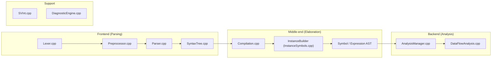
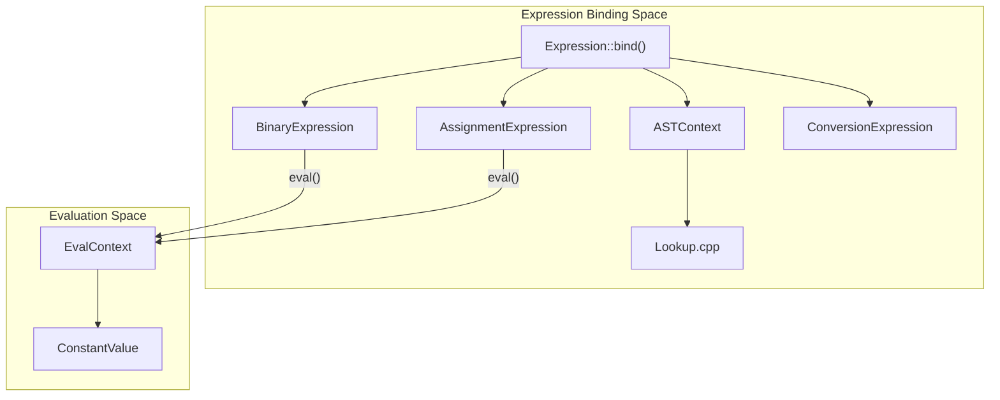

<!-- source: DeepWiki mcp.deepwiki.com · repo MikePopoloski/slang · page 8 Glossary · fetched 2026-10-30 -->

# Glossary

<details>
<summary>Relevant source files</summary>

The following files were used as context for generating this wiki page:

- [CMakeLists.txt](CMakeLists.txt)
- [bindings/python/AnalysisBindings.cpp](bindings/python/AnalysisBindings.cpp)
- [include/slang/analysis/AbstractFlowAnalysis.h](include/slang/analysis/AbstractFlowAnalysis.h)
- [include/slang/analysis/AnalysisManager.h](include/slang/analysis/AnalysisManager.h)
- [include/slang/analysis/AnalysisOptions.h](include/slang/analysis/AnalysisOptions.h)
- [include/slang/analysis/AnalyzedProcedure.h](include/slang/analysis/AnalyzedProcedure.h)
- [include/slang/analysis/DFAResults.h](include/slang/analysis/DFAResults.h)
- [include/slang/analysis/DataFlowAnalysis.h](include/slang/analysis/DataFlowAnalysis.h)
- [include/slang/ast/Compilation.h](include/slang/ast/Compilation.h)
- [include/slang/ast/Scope.h](include/slang/ast/Scope.h)
- [include/slang/ast/expressions/AssignmentExpressions.h](include/slang/ast/expressions/AssignmentExpressions.h)
- [include/slang/ast/expressions/ConversionExpression.h](include/slang/ast/expressions/ConversionExpression.h)
- [include/slang/ast/expressions/OperatorExpressions.h](include/slang/ast/expressions/OperatorExpressions.h)
- [include/slang/ast/symbols/CompilationUnitSymbols.h](include/slang/ast/symbols/CompilationUnitSymbols.h)
- [include/slang/ast/symbols/InstanceSymbols.h](include/slang/ast/symbols/InstanceSymbols.h)
- [include/slang/numeric/MathUtils.h](include/slang/numeric/MathUtils.h)
- [include/slang/numeric/SVInt.h](include/slang/numeric/SVInt.h)
- [include/slang/parsing/Lexer.h](include/slang/parsing/Lexer.h)
- [include/slang/parsing/Preprocessor.h](include/slang/parsing/Preprocessor.h)
- [pyslang/tests/test_analysis.py](pyslang/tests/test_analysis.py)
- [scripts/diagnostics.txt](scripts/diagnostics.txt)
- [scripts/warning_docs.txt](scripts/warning_docs.txt)
- [source/CMakeLists.txt](source/CMakeLists.txt)
- [source/analysis/AnalysisManager.cpp](source/analysis/AnalysisManager.cpp)
- [source/analysis/AnalysisScopeVisitor.h](source/analysis/AnalysisScopeVisitor.h)
- [source/analysis/AnalyzedProcedure.cpp](source/analysis/AnalyzedProcedure.cpp)
- [source/analysis/DFAResults.cpp](source/analysis/DFAResults.cpp)
- [source/analysis/DataFlowAnalysis.cpp](source/analysis/DataFlowAnalysis.cpp)
- [source/ast/Bitstream.cpp](source/ast/Bitstream.cpp)
- [source/ast/Compilation.cpp](source/ast/Compilation.cpp)
- [source/ast/ElabVisitors.h](source/ast/ElabVisitors.h)
- [source/ast/Scope.cpp](source/ast/Scope.cpp)
- [source/ast/TimingControl.cpp](source/ast/TimingControl.cpp)
- [source/ast/expressions/AssignmentExpressions.cpp](source/ast/expressions/AssignmentExpressions.cpp)
- [source/ast/expressions/ConversionExpression.cpp](source/ast/expressions/ConversionExpression.cpp)
- [source/ast/expressions/OperatorExpressions.cpp](source/ast/expressions/OperatorExpressions.cpp)
- [source/ast/symbols/CompilationUnitSymbols.cpp](source/ast/symbols/CompilationUnitSymbols.cpp)
- [source/ast/symbols/InstanceSymbols.cpp](source/ast/symbols/InstanceSymbols.cpp)
- [source/driver/CompatSettings.cpp](source/driver/CompatSettings.cpp)
- [source/numeric/SVInt.cpp](source/numeric/SVInt.cpp)
- [source/numeric/SVIntHelpers.h](source/numeric/SVIntHelpers.h)
- [source/parsing/Lexer.cpp](source/parsing/Lexer.cpp)
- [source/parsing/Preprocessor.cpp](source/parsing/Preprocessor.cpp)
- [source/parsing/Preprocessor_macros.cpp](source/parsing/Preprocessor_macros.cpp)
- [tests/regression/CMakeLists.txt](tests/regression/CMakeLists.txt)
- [tests/regression/delayed_reg.v](tests/regression/delayed_reg.v)
- [tests/regression/wire_module.v](tests/regression/wire_module.v)
- [tests/unittests/CMakeLists.txt](tests/unittests/CMakeLists.txt)
- [tests/unittests/Test.h](tests/unittests/Test.h)
- [tests/unittests/analysis/UnusedTests.cpp](tests/unittests/analysis/UnusedTests.cpp)
- [tests/unittests/ast/ConfigTests.cpp](tests/unittests/ast/ConfigTests.cpp)
- [tests/unittests/ast/ExpressionTests.cpp](tests/unittests/ast/ExpressionTests.cpp)
- [tests/unittests/ast/HierarchyTests.cpp](tests/unittests/ast/HierarchyTests.cpp)
- [tests/unittests/ast/StatementTests.cpp](tests/unittests/ast/StatementTests.cpp)
- [tests/unittests/ast/WarningTests.cpp](tests/unittests/ast/WarningTests.cpp)
- [tests/unittests/main.cpp](tests/unittests/main.cpp)
- [tests/unittests/parsing/LexerTests.cpp](tests/unittests/parsing/LexerTests.cpp)
- [tests/unittests/parsing/PreprocessorTests.cpp](tests/unittests/parsing/PreprocessorTests.cpp)
- [tools/CMakeLists.txt](tools/CMakeLists.txt)

</details>


This glossary defines codebase-specific terms, jargon, and domain concepts used within the slang compiler. It provides a mapping from SystemVerilog language concepts to their internal C++ implementations.

## Core Compilation Concepts

### Compilation
The central manager for the compilation process. It owns the `RootSymbol`, manages the lifecycle of all symbols, types, and net types, and acts as the owner for all memory allocated during elaboration via its internal `BumpAllocator`.
*   **Implementation:** `Compilation` class in [include/slang/ast/Compilation.h:28-28]().
*   **Key Function:** `addSyntaxTree` [source/ast/Compilation.cpp:164-164]() attaches a parsed `SyntaxTree` to the compilation.

### Elaboration
The process of traversing the Concrete Syntax Tree (CST) to create a hierarchical symbol tree (AST). This involves resolving parameters, instantiating modules, and binding expressions.
*   **Implementation:** Driven by the `Compilation` object and various visitors like `DiagnosticVisitor` [source/ast/ElabVisitors.h:22-22]().
*   **Data Flow:**
    ```mermaid
    graph TD
        A["SyntaxTree (CST)"] --> B["Compilation::getRoot()"]
        B --> C["RootSymbol"]
        C --> D["CompilationUnitSymbol"]
        D --> E["InstanceSymbol / DefinitionSymbol"]
        E --> F["Expression::bind()"]
        F --> G["AST / Symbol Hierarchy"]
    ```
*   **Sources:** [source/ast/Compilation.cpp:1-160](), [source/ast/ElabVisitors.h:1-30]()

### Diagnostic
An error, warning, or note generated by the compiler. Diagnostics are defined in metadata files and generated into C++ headers during the build.
*   **Implementation:** `DiagnosticEngine` [source/ast/Compilation.cpp:151-151]() and `Diagnostic` structs.
*   **Definition File:** [scripts/diagnostics.txt:1-18]()
*   **Generated Headers:** `AllDiags.h`, `LexerDiags.h`, etc. [source/CMakeLists.txt:15-29]()

---

## Lexical and Syntax Analysis

### Token
The smallest unit of the language (e.g., keywords, identifiers, operators).
*   **Implementation:** `Token` class [source/parsing/Token.cpp:1-10]().
*   **Kinds:** Defined in `TokenKind.h` (generated from `tokenkinds.txt`) [source/CMakeLists.txt:44-46]().

### Trivia
Elements of the source text that are not functionally part of the grammar, such as whitespace, comments, and preprocessor directives.
*   **Implementation:** `Trivia` class.
*   **Processing:** Handled by the `Lexer` [source/parsing/Lexer.cpp:122-130]() and `Preprocessor`.

### CST (Concrete Syntax Tree)
A high-fidelity tree representing the exact structure of the source code, including all tokens and trivia.
*   **Base Class:** `SyntaxNode` [source/syntax/SyntaxNode.cpp:103-103]().
*   **Root:** `SyntaxTree` [source/syntax/SyntaxTree.cpp:105-105]().

---

## Symbol and Type System

### Symbol
The base class for all named entities in the design (modules, variables, types, etc.).
*   **Implementation:** `Symbol` class.
*   **Hierarchy:** `InstanceSymbol`, `VariableSymbol`, `SubroutineSymbol`, etc. [source/ast/symbols/InstanceSymbols.cpp:114-114]().

### Instance
A concrete realization of a module, interface, or program definition.
*   **Implementation:** `InstanceSymbol` [source/ast/symbols/InstanceSymbols.cpp:114-114]().
*   **Creation:** Managed by `InstanceBuilder` [source/ast/symbols/InstanceSymbols.cpp:43-43]().

### SVInt
An arbitrary-precision integer type used for SystemVerilog constant evaluation. It supports 4-state logic (0, 1, X, Z).
*   **Implementation:** `SVInt` class [source/numeric/SVInt.cpp:8-8]().
*   **Logic States:** `logic_t` [source/numeric/SVInt.cpp:24-25]().

---

## System Mapping: Natural Language to Code

The following diagrams map conceptual compiler stages and components to their specific C++ classes and file locations.

### Pipeline Mapping
| Concept | Code Entity | File Pointer |
| :--- | :--- | :--- |
| **Lexer** | `slang::parsing::Lexer` | [source/parsing/Lexer.cpp:33-33]() |
| **Preprocessor** | `slang::parsing::Preprocessor` | [source/parsing/Preprocessor.cpp:26-26]() |
| **Parser** | `slang::parsing::Parser` | [source/parsing/Parser.cpp:91-91]() |
| **AST Node** | `slang::ast::Expression` | [tests/unittests/ast/ExpressionTests.cpp:7-7]() |
| **Symbol** | `slang::ast::Symbol` | [include/slang/ast/Compilation.h:47-47]() |

### System Architecture Diagram

**Sources:** [source/CMakeLists.txt:60-119](), [source/ast/Compilation.cpp:1-160](), [source/ast/symbols/InstanceSymbols.cpp:1-130]()

---

## Domain Jargon

| Term | Definition | Code Pointer |
| :--- | :--- | :--- |
| **4-State** | Logic values including `0`, `1`, `X` (unknown), and `Z` (high impedance). | [source/numeric/SVInt.cpp:24-25]() |
| **Bag** | A heterogenous container used to pass options and parameters throughout the compiler. | [include/slang/ast/Compilation.h:19-19]() |
| **BumpAllocator** | A fast, arena-based memory allocator used for AST nodes to avoid individual `malloc` calls. | [source/ast/Compilation.cpp:41-41]() |
| **Hierarchy Override** | The mechanism by which parameters or configurations change the structure of a sub-module. | [source/ast/symbols/InstanceSymbols.cpp:77-84]() |
| **NetType** | Defines the resolution behavior of a net (e.g., `wire`, `wand`, `trireg`). | [source/ast/Compilation.cpp:97-118]() |
| **SourceManager** | Manages loading files from disk and tracking `SourceLocation` offsets back to original files/macros. | [source/ast/Compilation.cpp:173-180]() |

### Code Entity Space: Expression Binding

**Sources:** [tests/unittests/ast/ExpressionTests.cpp:22-56](), [source/ast/Compilation.cpp:147-153]()

---
**Sources:**
*   `Compilation` and `RootSymbol`: [source/ast/Compilation.cpp:40-160](), [include/slang/ast/Compilation.h:130-160]()
*   `InstanceBuilder` and `InstanceSymbol`: [source/ast/symbols/InstanceSymbols.cpp:35-130]()
*   `SVInt` and `logic_t`: [source/numeric/SVInt.cpp:1-186]()
*   `Lexer` and `Token`: [source/parsing/Lexer.cpp:33-108]()
*   `Preprocessor`: [source/parsing/Preprocessor.cpp:26-151]()
*   `Diagnostics`: [scripts/diagnostics.txt:1-100](), [source/CMakeLists.txt:8-32]()
*   `Expression Binding`: [tests/unittests/ast/ExpressionTests.cpp:22-171]()