# Page: Overview

# Overview

<details>
<summary>Relevant source files</summary>

The following files were used as context for generating this wiki page:

- [CHANGELOG.md](CHANGELOG.md)
- [CMakeLists.txt](CMakeLists.txt)
- [LICENSE](LICENSE)
- [README.md](README.md)
- [bindings/python/CompBindings.cpp](bindings/python/CompBindings.cpp)
- [docs/CMakeLists.txt](docs/CMakeLists.txt)
- [docs/Doxyfile.in](docs/Doxyfile.in)
- [docs/command-line-ref.dox](docs/command-line-ref.dox)
- [docs/index.html](docs/index.html)
- [docs/language-support.dox](docs/language-support.dox)
- [docs/namespaces.dox](docs/namespaces.dox)
- [docs/user-manual.dox](docs/user-manual.dox)
- [include/slang/driver/Driver.h](include/slang/driver/Driver.h)
- [include/slang/driver/SourceLoader.h](include/slang/driver/SourceLoader.h)
- [include/slang/syntax/SyntaxPrinter.h](include/slang/syntax/SyntaxPrinter.h)
- [pyproject.toml](pyproject.toml)
- [source/CMakeLists.txt](source/CMakeLists.txt)
- [source/driver/Driver.cpp](source/driver/Driver.cpp)
- [source/driver/SourceLoader.cpp](source/driver/SourceLoader.cpp)
- [source/syntax/SyntaxPrinter.cpp](source/syntax/SyntaxPrinter.cpp)
- [tests/regression/CMakeLists.txt](tests/regression/CMakeLists.txt)
- [tests/regression/delayed_reg.v](tests/regression/delayed_reg.v)
- [tests/regression/wire_module.v](tests/regression/wire_module.v)
- [tests/unittests/CMakeLists.txt](tests/unittests/CMakeLists.txt)
- [tests/unittests/DriverTests.cpp](tests/unittests/DriverTests.cpp)
- [tests/unittests/Test.h](tests/unittests/Test.h)
- [tests/unittests/main.cpp](tests/unittests/main.cpp)
- [tools/CMakeLists.txt](tools/CMakeLists.txt)
- [tools/driver/slang_main.cpp](tools/driver/slang_main.cpp)

</details>


slang is a high-performance SystemVerilog compiler and language services library. It provides a complete implementation of the IEEE 1800-2023 standard, offering components for lexical analysis, parsing, semantic elaboration, and static analysis. Beyond being a standalone compiler and linter, slang is designed as a modular library to power synthesis tools, simulators, IDE language servers, and refactoring engines.

For specific language feature support, see [SystemVerilog Language Support](#1.1). For build instructions, see [Build and Installation](#1.2). For using the command-line tool, see [Command Line Usage](#1.3).

## Purpose and Scope

slang is engineered to be the fastest and most compliant SystemVerilog frontend. It addresses the complexity of the SystemVerilog language by providing a robust pipeline that transforms source text into a fully elaborated Abstract Syntax Tree (AST).

Key design goals include:
- **Standard Compliance**: Full support for IEEE 1800-2023 [docs/language-support.dox:6-9]().
- **Resilience**: The parser is designed to handle malformed or incomplete code, essential for interactive editor features [README.md:15-16]().
- **High Fidelity**: The Concrete Syntax Tree (CST) supports round-tripping, allowing tools to reconstruct the original source including comments and whitespace [README.md:17-18]().
- **Extensibility**: Python bindings (`pyslang`) expose the internal AST and diagnostic engine for rapid tool development [README.md:49-54]().

Sources: [README.md:8-19](), [docs/language-support.dox:6-12]()

## High-Level Architecture

### System Component Map
The following diagram maps the logical compilation stages to the primary C++ classes and namespaces defined in the codebase.

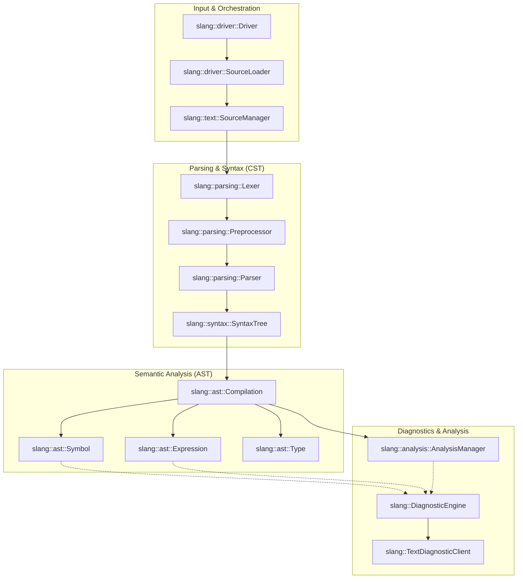
Sources: [source/driver/Driver.cpp:40-44](), [include/slang/driver/Driver.h:110-134](), [source/CMakeLists.txt:67-119]()

### The Compilation Pipeline
The compilation process is managed by the `Driver` class, which orchestrates the transition from raw files to an elaborated design hierarchy.

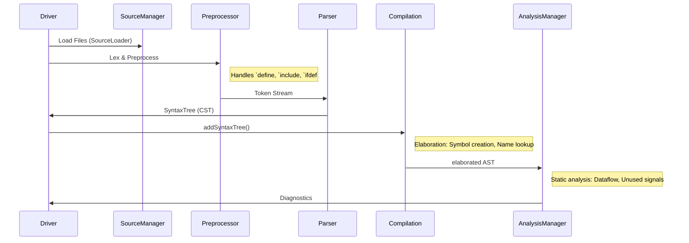
Sources: [source/driver/Driver.cpp:40-44](), [include/slang/driver/Driver.h:84-100](), [bindings/python/CompBindings.cpp:98-125]()

## Major System Components

### Driver and Input Processing
The `slang::driver::Driver` class provides a high-level API for CLI tools. it manages the `SourceManager` for file tracking and `SourceLoader` for resolving include paths and library files [include/slang/driver/Driver.h:110-127](). It also populates `CompilationOptions` and `PreprocessorOptions` based on command-line arguments [source/driver/Driver.cpp:48-156]().

### Parsing and Syntax System
The `slang::parsing::Parser` is a recursive-descent parser that generates a `SyntaxTree` [source/CMakeLists.txt:91-95](). Unlike many compilers, slang maintains a full Concrete Syntax Tree (CST) where every token, including "trivia" (whitespace/comments), is preserved [README.md:17-18]().

### Semantic Analysis (AST)
The `slang::ast::Compilation` object is the central hub for the semantic model [include/slang/ast/Compilation.h](). It manages:
- **Symbols**: Hierarchical representation of modules, interfaces, variables, and subroutines [bindings/python/CompBindings.cpp:24-36]().
- **Expressions**: Bound expressions with full type information and constant folding capabilities [bindings/python/CompBindings.cpp:79-81]().
- **Types**: A comprehensive type system covering nets, integers, arrays, classes, and user-defined types [docs/language-support.dox:42-78]().

### Analysis and Diagnostics
Diagnostics are handled by the `DiagnosticEngine`, which collects errors and warnings from all pipeline stages [include/slang/driver/Driver.h:118](). The `AnalysisManager` performs post-elaboration checks such as data-flow analysis to detect uninitialized variables or multiple drivers on a single net [source/CMakeLists.txt:68-76]().

## Code Generation and Build Infrastructure

slang uses Python scripts to generate repetitive C++ code for syntax nodes and diagnostics during the build process:
- **`syntax_gen.py`**: Processes `syntax.txt` to generate `AllSyntax.h`, `SyntaxKind.h`, and visitor patterns [source/CMakeLists.txt:35-51]().
- **`diagnostic_gen.py`**: Processes `diagnostics.txt` to generate unique `DiagCode` identifiers and formatting logic [source/CMakeLists.txt:9-32]().

The project uses CMake and requires a C++20 compliant compiler [CMakeLists.txt:143-145]().

Sources: [source/CMakeLists.txt:6-55](), [CMakeLists.txt:1-100]()

## Use Cases

1.  **Linter/Compiler**: Standalone usage via the `slang` driver for syntax and semantic verification [README.md:23-24]().
2.  **Language Server**: Providing the backend for IDE features like go-to-definition and real-time error reporting [README.md:27]().
3.  **Refactoring Tools**: Using the `SyntaxRewriter` to perform automated code transformations [README.md:26]().
4.  **Python Scripting**: Using `pyslang` to inspect design hierarchies or evaluate expressions for verification scripts [README.md:99-121]().

Sources: [README.md:21-30](), [bindings/python/CompBindings.cpp:117-121]()

---

# Page: SystemVerilog Language Support

# SystemVerilog Language Support

<details>
<summary>Relevant source files</summary>

The following files were used as context for generating this wiki page:

- [CHANGELOG.md](CHANGELOG.md)
- [CMakeLists.txt](CMakeLists.txt)
- [LICENSE](LICENSE)
- [README.md](README.md)
- [docs/CMakeLists.txt](docs/CMakeLists.txt)
- [docs/Doxyfile.in](docs/Doxyfile.in)
- [docs/index.html](docs/index.html)
- [docs/language-support.dox](docs/language-support.dox)
- [docs/namespaces.dox](docs/namespaces.dox)
- [docs/user-manual.dox](docs/user-manual.dox)
- [pyproject.toml](pyproject.toml)
- [source/CMakeLists.txt](source/CMakeLists.txt)
- [tests/regression/CMakeLists.txt](tests/regression/CMakeLists.txt)
- [tests/regression/delayed_reg.v](tests/regression/delayed_reg.v)
- [tests/regression/wire_module.v](tests/regression/wire_module.v)
- [tests/unittests/CMakeLists.txt](tests/unittests/CMakeLists.txt)
- [tests/unittests/Test.h](tests/unittests/Test.h)
- [tests/unittests/main.cpp](tests/unittests/main.cpp)
- [tools/CMakeLists.txt](tools/CMakeLists.txt)

</details>


This document details the SystemVerilog language features supported by slang and its compliance status with IEEE standards. It covers feature support across all major language constructs, standard compliance levels, and slang-specific extensions.

For information about building and installing slang, see [Build and Installation](#1.2). For details about the compilation pipeline that processes these language features, see [Compilation Pipeline](#2).

## Compliance Overview

slang provides complete support for the entirety of the IEEE 1800-2023 SystemVerilog language standard, covering all phases from lexical analysis through compilation and elaboration [docs/language-support.dox:6-9](). The implementation spans lexical conventions, data types, expressions, statements, modules, classes, assertions, and all other major language constructs.

**Language Coverage by Phase:**

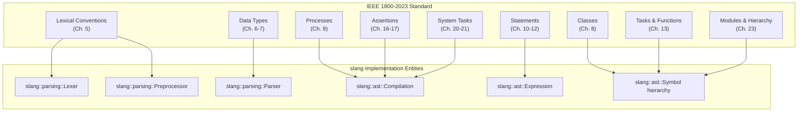

Sources: [docs/language-support.dox:6-13](), [source/CMakeLists.txt:67-119]()

## Core Language Features

### Lexical and Syntactic Support

slang provides complete support for SystemVerilog lexical conventions and syntax parsing, implemented through a robust multi-stage pipeline [docs/language-support.dox:25-41]().

**Lexical Analysis Coverage:**

| Feature Category | LRM Section | Implementation | Status |
|------------------|-------------|----------------|--------|
| Tokens & Operators | 5.2-5.5 | `Lexer.cpp` | ✅ Complete |
| Identifiers & Keywords | 5.6 | `TokenKind.h` | ✅ Complete |
| Number Literals | 5.7 | `NumberParser.cpp` | ✅ Complete |
| Time Literals | 5.8 | `Time.cpp` | ✅ Complete |
| String & Array Literals | 5.9-5.11 | `Lexer.cpp` | ✅ Complete |
| Attributes | 5.12 | `Parser_members.cpp` | ✅ Complete |

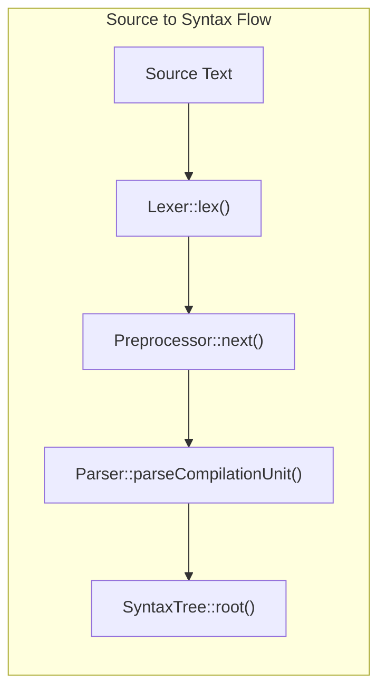

Sources: [docs/language-support.dox:25-41](), [source/CMakeLists.txt:88-100]()

### Data Types and Expressions

The type system provides comprehensive support for all SystemVerilog data types, from basic integer types to complex aggregate structures [docs/language-support.dox:42-96]().

**Data Type Implementation:**

| Type Category | Key Classes | Features Supported |
|---------------|-------------|-------------------|
| Basic Types | `IntegralType`, `FloatingType` | All integer widths, real types, time |
| Aggregate Types | `StructType`, `UnionType`, `ArrayType` | Packed/unpacked structures, unions, arrays |
| Class Types | `ClassType` | Inheritance, polymorphism, interfaces |
| User-Defined | `TypedefType`, `NetType` | Custom types, user-defined nettypes |

Recent additions include support for **Generic Interconnect** (LRM 6.6.8) and **User-defined nettypes** (LRM 6.6.7) [docs/language-support.dox:50-52]().

Sources: [docs/language-support.dox:42-79](), [docs/language-support.dox:80-96]()

### Control Flow and Procedural Constructs

All SystemVerilog procedural programming constructs are fully supported, including process blocks, conditional statements, and loops [docs/language-support.dox:130-154]().

**Process and Statement Support:**

| Construct Type | LRM Section | Key Features |
|----------------|-------------|--------------|
| Process Blocks | 9.2 | initial, always (all variants), final |
| Control Flow | 12.4-12.5 | if-else, case/casex/casez |
| Loops | 12.7 | for, while, do-while, foreach, repeat |
| Timing | 9.4 | delays (#), event controls (@), wait |
| Parallel Blocks | 9.3.2 | fork-join, join_any, join_none |

Sources: [docs/language-support.dox:130-154](), [docs/language-support.dox:185-199]()

## Advanced Language Features

### Object-Oriented Programming (OOP)

slang provides complete support for SystemVerilog's object-oriented features, including classes, inheritance, polymorphism, and interface classes [docs/language-support.dox:97-129]().

**Class System Implementation:**

| Feature | LRM Section | Implementation Status |
|---------|-------------|-----------------------|
| Inheritance | 8.13 | ✅ Supported (v0.5) |
| Virtual Methods | 8.20 | ✅ Supported (v0.5) |
| Interface Classes | 8.26 | ✅ Supported (v0.5) |
| Out-of-block decls | 8.24 | ✅ Supported (v0.5) |
| Weak References | 8.30 | ✅ Supported (v6.0) |

Sources: [docs/language-support.dox:97-129](), [CHANGELOG.md:13-15]()

### Assertions and Temporal Logic

Full support for SystemVerilog Assertions (SVA) including immediate assertions, concurrent assertions, sequences, and properties [docs/language-support.dox:240-275]().

**Assertion System Architecture:**

| Component | LRM Section | Implementation |
|-----------|-------------|----------------|
| Immediate Assertions | 16.3 | `ImmediateAssertionStatement` |
| Concurrent Assertions | 16.12 | `ConcurrentAssertionStatement` |
| Sequences | 16.7 | `SequenceSymbol` |
| Properties | 16.12 | `PropertySymbol` |
| Checkers | 17 | `CheckerSymbol` |

Sources: [docs/language-support.dox:240-275](), [tests/unittests/CMakeLists.txt:8-16]()

## Language Extensions and Compatibility

### Compatibility Modes

slang includes a robust compatibility system to handle non-standard behaviors common in industrial tools like VCS [driver/CompatSettings.cpp:1-50]().

**Recent Compatibility Enhancements:**
- Added `--allow-virtual-iface-with-override` for bind/defparam targets [CHANGELOG.md:9-10]().
- Downgradeable errors for `std::randomize` arguments via `-Wnonstandard-randomize` [CHANGELOG.md:10-11]().
- Support for non-standard string concatenation with `+` operator [CHANGELOG.md:11-12]().
- Relaxed implementation for `extern` and `pure` method implicit return types [CHANGELOG.md:13-14]().

### Built-in Extensions
slang provides several non-standard but highly useful extensions:
- **`$static_assert`**: For compile-time elaboration checks.
- **`(* maybe_unknown *)` attribute**: Allows ignoring unknown module instantiations [CHANGELOG.md:35-36]().
- **`$deposit` system task**: Support for legacy codebases [CHANGELOG.md:26-27]().

Sources: [CHANGELOG.md:8-28](), [driver/CompatSettings.cpp:1-80]()

## Implementation Status

### Feature Completion Matrix

| Language Area | Chapters | Implementation Status |
|---------------|----------|----------------------|
| Lexical Conventions | 5 | ✅ Complete |
| Data Types | 6-7 | ✅ Complete |
| Classes | 8 | ✅ Complete |
| Processes | 9 | ✅ Complete |
| Assignment | 10 | ✅ Complete |
| Operators/Exprs | 11 | ✅ Complete |
| Tasks/Functions | 13 | ✅ Complete |
| Assertions | 16-17 | ✅ Complete |
| Hierarchy | 23 | ✅ Complete |

### Known Limitations
Current limitations are tracked via the `lang-compliance` label on GitHub [docs/language-support.dox:7-9]().
- **SDF backannotation** (Chapter 32): Partial support.
- **Strength modeling** (Chapter 28): Limited, as slang focuses on compilation/elaboration rather than gate-level simulation.

Sources: [docs/language-support.dox:6-9](), [docs/language-support.dox:482-529]()

---

# Page: Build and Installation

# Build and Installation

<details>
<summary>Relevant source files</summary>

The following files were used as context for generating this wiki page:

- [.clang-tidy](.clang-tidy)
- [.github/copilot-instructions.md](.github/copilot-instructions.md)
- [.github/workflows/build.yml](.github/workflows/build.yml)
- [.github/workflows/copilot-setup-steps.yml](.github/workflows/copilot-setup-steps.yml)
- [.github/workflows/coverage.yml](.github/workflows/coverage.yml)
- [.github/workflows/docs.yml](.github/workflows/docs.yml)
- [.github/workflows/python-build.yml](.github/workflows/python-build.yml)
- [.github/workflows/python-dist.yml](.github/workflows/python-dist.yml)
- [CMakeLists.txt](CMakeLists.txt)
- [CMakePresets.json](CMakePresets.json)
- [LICENSES/BSL-1.0.txt](LICENSES/BSL-1.0.txt)
- [LICENSES/CC-BY-SA-3.0.txt](LICENSES/CC-BY-SA-3.0.txt)
- [REUSE.toml](REUSE.toml)
- [bindings/CMakeLists.txt](bindings/CMakeLists.txt)
- [bindings/generate_stubs.cmake](bindings/generate_stubs.cmake)
- [bindings/python/pyslang.cpp](bindings/python/pyslang.cpp)
- [bindings/python/pyslang.h](bindings/python/pyslang.h)
- [cmake/install-rules.cmake](cmake/install-rules.cmake)
- [cmake/slangConfig.cmake.in](cmake/slangConfig.cmake.in)
- [docs/building.dox](docs/building.dox)
- [external/CMakeLists.txt](external/CMakeLists.txt)
- [pyslang/docs/conf.py](pyslang/docs/conf.py)
- [pyslang/docs/pages/index.rst](pyslang/docs/pages/index.rst)
- [pyslang/pyslang/__init__.py](pyslang/pyslang/__init__.py)
- [pyslang/pyslang/py.typed](pyslang/pyslang/py.typed)
- [pyslang/tests/test_accessing_spans.py](pyslang/tests/test_accessing_spans.py)
- [pyslang/tests/test_lexer.py](pyslang/tests/test_lexer.py)
- [pyslang/tests/test_syntax_factory.py](pyslang/tests/test_syntax_factory.py)
- [pyslang/tests/test_syntax_rewriter.py](pyslang/tests/test_syntax_rewriter.py)
- [source/CMakeLists.txt](source/CMakeLists.txt)
- [tests/CMakeLists.txt](tests/CMakeLists.txt)
- [tests/regression/CMakeLists.txt](tests/regression/CMakeLists.txt)
- [tests/regression/delayed_reg.v](tests/regression/delayed_reg.v)
- [tests/regression/wire_module.v](tests/regression/wire_module.v)
- [tests/unittests/CMakeLists.txt](tests/unittests/CMakeLists.txt)
- [tests/unittests/Test.h](tests/unittests/Test.h)
- [tests/unittests/main.cpp](tests/unittests/main.cpp)
- [tools/CMakeLists.txt](tools/CMakeLists.txt)

</details>


This page provides comprehensive instructions for building, installing, and integrating the slang SystemVerilog compiler and language services library into your projects. For information about command-line usage after installation, see [Command Line Usage](#1.3).

## Getting the Source Code

The slang source code is hosted on GitHub:

```bash
git clone https://github.com/MikePopoloski/slang.git
```

Sources: [docs/building.dox:7-12]()

## Build Requirements

Before building slang, ensure you have the following prerequisites installed:

- **Python 3**: Required for code generation scripts. [docs/building.dox:17-17]()
- **CMake 3.20 or later**: The primary build system. [docs/building.dox:18-18]()
- **C++20 compatible compiler**: slang uses modern C++20 features. [CMakeLists.txt:143-145]()
  - GCC 11 or later [docs/building.dox:20-20]()
  - Clang 17 or later [docs/building.dox:21-21]()
  - Xcode 16 or later [docs/building.dox:22-22]()
  - Visual Studio 2022 (latest update recommended) [docs/building.dox:23-23]()

Sources: [docs/building.dox:14-24](), [CMakeLists.txt:143-145]()

## Quick Start Building

The build process is designed to work consistently across all supported platforms:

```bash
cmake -B build
cmake --build build -j
```

To run the tests (included by default):

```bash
cd build && ctest --output-on-failure
```

Sources: [docs/building.dox:26-38]()

## Build Process Overview

The slang build involves a significant code generation phase before compiling the main library. Python scripts transform text definitions into C++ headers and source files to manage the complexity of SystemVerilog syntax and diagnostics.

### Code Generation Flow
The following diagram illustrates how "Natural Language Space" definitions in `.txt` files are mapped to "Code Entity Space" C++ files.

Title: Code Generation Pipeline
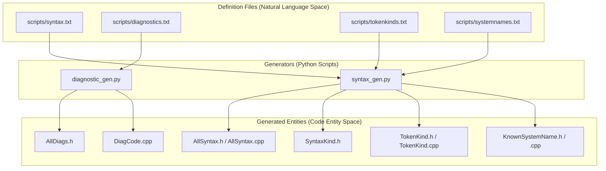

Sources: [source/CMakeLists.txt:9-51](), [docs/building.dox:82-90]()

### Library Target Structure
The primary output of the build is the `slang_slang` library, which is aliased as `slang::slang` for consumer use.

Title: slang Target Architecture
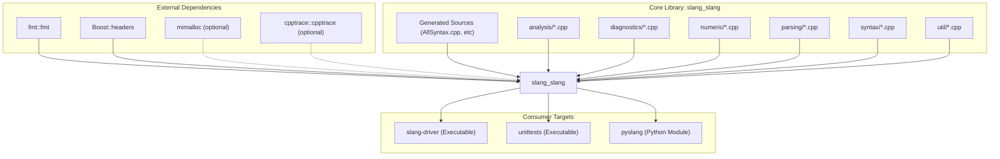

Sources: [source/CMakeLists.txt:58-123](), [source/CMakeLists.txt:148-165](), [tools/CMakeLists.txt:1-10](), [tests/unittests/CMakeLists.txt:56-56]()

## Dependencies

slang manages dependencies via `FetchContent`. If a dependency is not found on the system, it is automatically downloaded and built from source.

| Dependency | Minimum Version | Purpose |
|------------|-----------------|---------|
| `fmt` | 12.1 | Text formatting |
| `mimalloc` | 2.2 | High-performance memory allocation |
| `cpptrace` | 1.0 | Stack trace generation |
| `Catch2` | 3.13 | Unit testing framework |
| `pybind11` | 3.0 | Python bindings |
| `Boost` | 1.87.0 | Header-only utilities (unordered maps) |

Sources: [external/CMakeLists.txt:6-10](), [external/CMakeLists.txt:58-58](), [bindings/CMakeLists.txt:14-14]()

## Build Options

The following CMake options allow customization of the slang build:

| Option | Description | Default |
|--------|-------------|---------|
| `SLANG_INCLUDE_TOOLS` | Include tools like the `slang` driver | `ON` |
| `SLANG_INCLUDE_TESTS` | Include unit tests | `ON` |
| `SLANG_INCLUDE_PYLIB` | Build `pyslang` Python bindings | `OFF` |
| `SLANG_USE_MIMALLOC` | Use mimalloc for faster allocation | `ON` |
| `SLANG_USE_THREADS` | Enable multi-threading support | `ON` |
| `BUILD_SHARED_LIBS` | Build shared libraries instead of static | `OFF` |
| `SLANG_USE_CPPTRACE` | Enable stack traces on crashes | `OFF` |

Sources: [CMakeLists.txt:58-78](), [docs/building.dox:50-68]()

## CMake Presets

slang includes a `CMakePresets.json` file to simplify configuration for various environments.

### Key Presets:
- **Linux (GCC/Clang)**:
  - `gcc-release`: Standard optimized build. [CMakePresets.json:179-189]()
  - `clang-sanitize`: Build with AddressSanitizer and UndefinedBehaviorSanitizer. [CMakePresets.json:134-150]()
  - `gcc-coverage`: Build with code coverage instrumentation. [CMakePresets.json:203-212]()
- **Windows (MSVC)**:
  - `win64-release`: Optimized 64-bit Windows build. [CMakePresets.json:41-49]()
  - `win64-debug-noexcept`: Debug build with C++ exceptions disabled. [CMakePresets.json:72-80]()
- **Specialized**:
  - `wasi-sdk`: Build for WebAssembly via WASI. [CMakePresets.json:237-246]()

Sources: [CMakePresets.json:1-262]()

## Building Python Bindings

The `pyslang` module is built using `pybind11`. Note that `SLANG_USE_MIMALLOC` is automatically disabled when building Python bindings due to compatibility issues. [CMakeLists.txt:194-196]()

### Build via pip
To install `pyslang` into your current Python environment:
```bash
pip install .
```
Sources: [docs/building.dox:126-135]()

### Manual CMake Build
```bash
cmake -B build -DSLANG_INCLUDE_PYLIB=ON
cmake --build build --target pyslang
```
Sources: [bindings/CMakeLists.txt:41-59]()

## Installation and Integration

### Installing slang
```bash
cmake --install build --prefix /your/install/path
```
Sources: [docs/building.dox:153-157]()

### Integrating as a Library
Consumers can link against slang using the `slang::slang` target. If slang was installed via CMake, it can be found using `find_package(slang)`.

```cmake
find_package(slang 10.0 REQUIRED)
target_link_libraries(my_tool PRIVATE slang::slang)
```
Sources: [docs/building.dox:171-181](), [cmake/slangConfig.cmake.in:1-11]()

## Continuous Integration
slang uses GitHub Actions for CI, testing across multiple presets (Clang, GCC, MSVC, WASI) on every push to master. [build.yml:11-33]()

Sources: [.github/workflows/build.yml:1-74]()

---

# Page: Command Line Usage

# Command Line Usage

<details>
<summary>Relevant source files</summary>

The following files were used as context for generating this wiki page:

- [bindings/python/CompBindings.cpp](bindings/python/CompBindings.cpp)
- [docs/command-line-ref.dox](docs/command-line-ref.dox)
- [include/slang/diagnostics/DiagnosticClient.h](include/slang/diagnostics/DiagnosticClient.h)
- [include/slang/diagnostics/TextDiagnosticClient.h](include/slang/diagnostics/TextDiagnosticClient.h)
- [include/slang/driver/Driver.h](include/slang/driver/Driver.h)
- [include/slang/driver/SourceLoader.h](include/slang/driver/SourceLoader.h)
- [include/slang/syntax/SyntaxPrinter.h](include/slang/syntax/SyntaxPrinter.h)
- [include/slang/util/OS.h](include/slang/util/OS.h)
- [source/diagnostics/DiagnosticClient.cpp](source/diagnostics/DiagnosticClient.cpp)
- [source/diagnostics/JsonDiagnosticClient.cpp](source/diagnostics/JsonDiagnosticClient.cpp)
- [source/diagnostics/TextDiagnosticClient.cpp](source/diagnostics/TextDiagnosticClient.cpp)
- [source/driver/Driver.cpp](source/driver/Driver.cpp)
- [source/driver/SourceLoader.cpp](source/driver/SourceLoader.cpp)
- [source/syntax/SyntaxPrinter.cpp](source/syntax/SyntaxPrinter.cpp)
- [source/util/OS.cpp](source/util/OS.cpp)
- [tests/unittests/DriverTests.cpp](tests/unittests/DriverTests.cpp)
- [tools/driver/slang_main.cpp](tools/driver/slang_main.cpp)

</details>


This document explains how to use the slang command line interface, detailing available options, input file handling, and common usage patterns. slang provides a comprehensive command line interface for compiling, analyzing, and preprocessing SystemVerilog code, implemented primarily through the `Driver` class.

## Overview

The slang driver tool acts as a high-level orchestrator for the compiler pipeline. It handles argument parsing, source file discovery via globbing, and coordinates the transition from source text to an elaborated design hierarchy.

### Basic Command Line Structure

```bash
slang [options] [source_files...]
```

Where:
- `options` are command line flags that control compilation behavior.
- `source_files` are SystemVerilog source files (supports file patterns with wildcards).

Sources: [source/driver/Driver.cpp:48-336](), [docs/command-line-ref.dox:30-32]()

## Driver Architecture

The `slang::driver::Driver` class encapsulates the state required to run a compilation from the command line. It manages the `SourceManager` for file tracking, the `DiagnosticEngine` for error reporting, and the `SourceLoader` for file discovery.

### System Entity Map

The following diagram associates the primary C++ classes with their roles in the command-line execution flow.

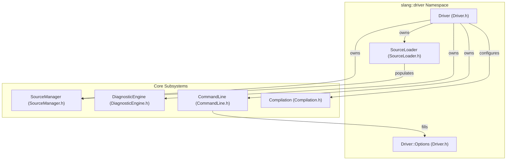

Sources: [include/slang/driver/Driver.h:102-134](), [source/driver/Driver.cpp:40-44]()

## Command Line Processing Flow

Slang follows a multi-stage initialization process before starting the compilation pipeline.

1.  **Argument Registration**: The `Driver::addStandardArgs` function populates the `CommandLine` object with all supported SystemVerilog flags [source/driver/Driver.cpp:48-336]().
2.  **Parsing**: The `CommandLine::parse` method processes the `argc/argv` input [source/driver/Driver.cpp:372-380]().
3.  **Option Processing**: `Driver::processOptions` validates the input and configures internal state, such as language versions and include paths [source/driver/Driver.cpp:445-623]().
4.  **Source Loading**: The `SourceLoader` resolves file patterns and library mappings [source/driver/SourceLoader.cpp:172-190]().

### Data Flow Diagram

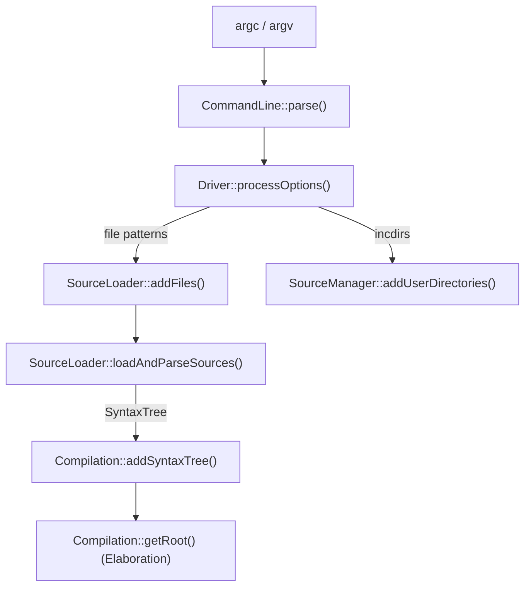

Sources: [source/driver/Driver.cpp:445-623](), [source/driver/SourceLoader.cpp:158-160](), [include/slang/driver/Driver.h:93-99]()

## Core Command Line Options

### General and Language Versioning
| Option | Description | Code Reference |
| :--- | :--- | :--- |
| `-h, --help` | Display help text and exit. | [docs/command-line-ref.dox:8-10]() |
| `--version` | Display version information. | [docs/command-line-ref.dox:12-14]() |
| `--std` | Set language version: `1364-2005`, `1800-2017`, `1800-2023`, or `latest`. | [source/driver/Driver.cpp:49-51]() |
| `-j, --threads` | Number of threads for parallel parsing. | [source/driver/Driver.cpp:136-137]() |

### Input File Handling
Slang supports several ways to organize input files:
- **Positional Arguments**: Treated as primary source files [docs/command-line-ref.dox:30-32]().
- **`--single-unit`**: Concatenates all input files into a single compilation unit [docs/command-line-ref.dox:34-39]().
- **`-v, --libfile`**: Adds files as source libraries. Modules within are only instantiated if referenced [docs/command-line-ref.dox:41-47]().
- **`-f / -F`**: Command files containing lists of arguments. `-F` makes paths relative to the command file itself [source/driver/Driver.cpp:338-356]().
- **`-C`**: Compilation unit listing files for independent unit definitions [source/driver/Driver.cpp:143-151]().

### Preprocessor and Include Paths
| Option | Description | Code Reference |
| :--- | :--- | :--- |
| `-I, +incdir` | Add directory to search for \`include "..."`. | [source/driver/Driver.cpp:54-62]() |
| `--isystem` | Add directory to search for \`include <...>`. | [source/driver/Driver.cpp:64-73]() |
| `-D, +define` | Define a macro for all source files. | [source/driver/Driver.cpp:80-82]() |
| `-U` | Undefine a macro. | [source/driver/Driver.cpp:83-85]() |

Sources: [source/driver/Driver.cpp:48-151](), [docs/command-line-ref.dox:1-150]()

## Action Modes

Slang can stop at various stages of the pipeline based on the provided flags:

- **Preprocess Only (`-E, --preprocess`)**: Runs the preprocessor and prints the result to stdout. Supports flags like `--comments` and `--directives` [docs/command-line-ref.dox:96-99]().
- **Macros Only (`--macros-only`)**: Prints all discovered macros and exits [docs/command-line-ref.dox:102-104]().
- **Parse Only (`--parse-only`)**: Stops after generating the Concrete Syntax Tree (CST); does not perform type checking or elaboration [docs/command-line-ref.dox:121-123]().
- **Lint Only (`--lint-only`)**: Performs semantic analysis but skips full design elaboration to save time [docs/command-line-ref.dox:126-128]().

Sources: [tools/driver/slang_main.cpp:149-164](), [docs/command-line-ref.dox:89-136]()

## Library Mapping and Search

Slang implements the standard Verilog library search mechanism:

1.  **Library Directories (`-y, --libdir`)**: Specifies directories to search for missing module definitions [source/driver/Driver.cpp:298-301]().
2.  **Library Extensions (`-Y, --libext`)**: Specifies file extensions to check during search (e.g., `.v`, `.sv`) [source/driver/Driver.cpp:302-305]().
3.  **Library Maps (`--libmap`)**: Supports Verilog Library Map files for mapping specific modules to files [source/driver/Driver.cpp:314-317]().

The `SourceLoader` class handles the logic for resolving these missing references by iterating through registered search directories and extensions [source/driver/SourceLoader.cpp:192-205]().

Sources: [source/driver/Driver.cpp:298-317](), [source/driver/SourceLoader.cpp:58-77]()

## Diagnostic Configuration

The diagnostic system is highly configurable via the command line:

- **Severity Control**: Use `-W<warning>` to enable or `-Wno-<warning>` to disable specific diagnostics. `-Werror` treats all warnings as errors [source/driver/Driver.cpp:239-242]().
- **Formatting**:
    - `--diag-column`: Include column numbers [source/driver/Driver.cpp:230]().
    - `--diag-source`: Show the source code snippet and caret [source/driver/Driver.cpp:232]().
    - `--diag-macro-expansion`: Show the backtrace of macro expansions [source/driver/Driver.cpp:236]().
- **JSON Output**: `--diag-json <file>` redirects diagnostics to a machine-readable JSON format via `JsonDiagnosticClient` [source/driver/Driver.cpp:253-257]().

Sources: [source/driver/Driver.cpp:223-257](), [source/diagnostics/TextDiagnosticClient.cpp:49-101]()

## Compatibility Modes

To ease migration from other tools, slang provides compatibility flags:

- **`--compat <tool>`**: Adjusts default behaviors to match specific vendors (e.g., `vcs`) [source/driver/Driver.cpp:164-167]().
- **`--allow-use-before-declare`**: Relaxes the requirement that names must be declared before use [source/driver/Driver.cpp:173-175]().
- **`--relax-enum-conversions`**: Allows implicit conversions from integers to enums [source/driver/Driver.cpp:170-172]().
- **`--cmd-ignore <cmd>,<N>`**: Allows the command-line parser to skip vendor-specific flags that slang does not recognize [source/driver/Driver.cpp:114-119]().

Sources: [source/driver/Driver.cpp:114-205](), [docs/command-line-ref.dox:402-509]()

---

# Page: Compilation Pipeline

# Compilation Pipeline

<details>
<summary>Relevant source files</summary>

The following files were used as context for generating this wiki page:

- [CMakeLists.txt](CMakeLists.txt)
- [bindings/python/CompBindings.cpp](bindings/python/CompBindings.cpp)
- [docs/command-line-ref.dox](docs/command-line-ref.dox)
- [include/slang/driver/Driver.h](include/slang/driver/Driver.h)
- [include/slang/driver/SourceLoader.h](include/slang/driver/SourceLoader.h)
- [include/slang/syntax/SyntaxPrinter.h](include/slang/syntax/SyntaxPrinter.h)
- [source/CMakeLists.txt](source/CMakeLists.txt)
- [source/driver/Driver.cpp](source/driver/Driver.cpp)
- [source/driver/SourceLoader.cpp](source/driver/SourceLoader.cpp)
- [source/syntax/SyntaxPrinter.cpp](source/syntax/SyntaxPrinter.cpp)
- [tests/regression/CMakeLists.txt](tests/regression/CMakeLists.txt)
- [tests/regression/delayed_reg.v](tests/regression/delayed_reg.v)
- [tests/regression/wire_module.v](tests/regression/wire_module.v)
- [tests/unittests/CMakeLists.txt](tests/unittests/CMakeLists.txt)
- [tests/unittests/DriverTests.cpp](tests/unittests/DriverTests.cpp)
- [tests/unittests/Test.h](tests/unittests/Test.h)
- [tests/unittests/main.cpp](tests/unittests/main.cpp)
- [tools/CMakeLists.txt](tools/CMakeLists.txt)
- [tools/driver/slang_main.cpp](tools/driver/slang_main.cpp)

</details>


This document details the multi-stage compilation process that transforms SystemVerilog source code into an elaborated design representation. The pipeline handles lexical analysis, syntax parsing, semantic analysis, module elaboration, and diagnostic reporting. For information about specific symbol types and their management, see [Symbol System](#3). For details about expression processing and evaluation, see [Expression System](#4).

## Overview

The slang compilation pipeline transforms SystemVerilog source files through several distinct stages to produce a fully elaborated design. The process is managed by the central `Compilation` class and involves multiple specialized components working together.

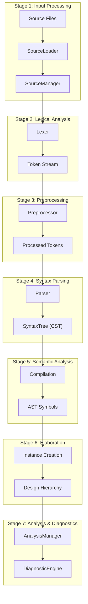

**Pipeline Flow Diagram**

Sources: [source/ast/Compilation.cpp:1-1000](), [include/slang/ast/Compilation.h:1-500](), [source/parsing/Parser.cpp:1-100]()

## Source Loading and Preprocessing

The compilation process begins with loading source files and preprocessing them to handle SystemVerilog's textual preprocessing features. The `Driver` class typically orchestrates this by using a `SourceLoader` to discover files via patterns and a `SourceManager` to maintain the buffers.

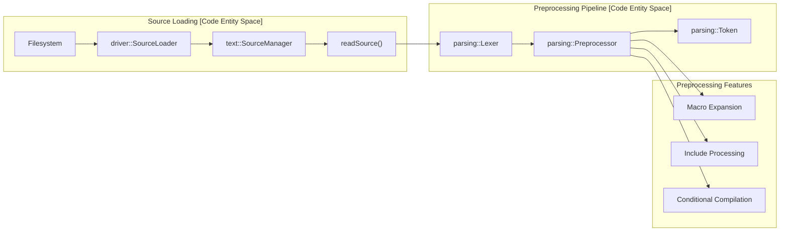

**Source Loading and Preprocessing Components**

The `SourceManager` tracks all source files and their contents [source/text/SourceManager.cpp:1-100](), while the `Preprocessor` handles SystemVerilog's textual preprocessing features including macro expansion, file inclusion, and conditional compilation directives like `` `ifdef`` [source/parsing/Preprocessor.cpp:1-100](). The `Lexer` tokenizes the raw source text before preprocessing occurs [source/parsing/Lexer.cpp:1-100]().

For details, see [Preprocessing and Lexical Analysis](#2.1).

Sources: [source/driver/SourceLoader.cpp:25-50](), [include/slang/driver/SourceLoader.h:61-90](), [source/driver/Driver.cpp:40-60](), [source/parsing/Preprocessor.cpp:1-100]()

## Syntax Parsing

The `Parser` class transforms the preprocessed token stream into a concrete syntax tree (CST) representation. The parser is implemented as a recursive descent parser with multiple specialized parsing methods for different language constructs.

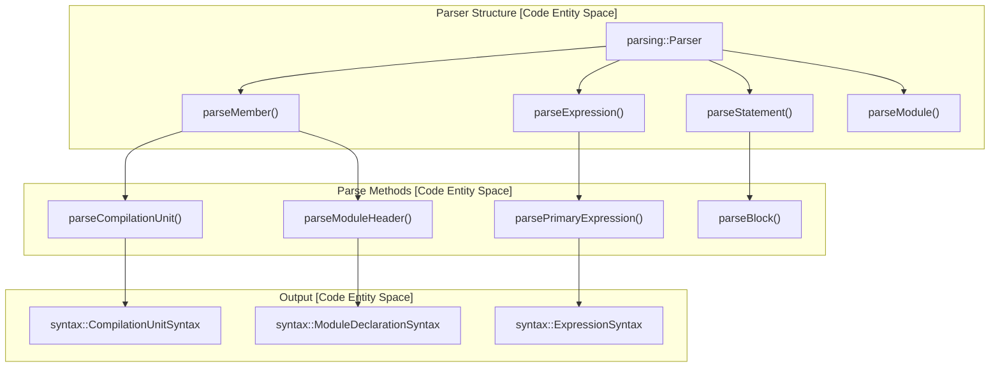

**Parser Architecture and Methods**

The parser constructs `SyntaxNode` hierarchies that represent the structure of the source code. The main entry point `parseCompilationUnit()` builds a complete `CompilationUnitSyntax` tree [source/parsing/Parser_members.cpp:17-50]().

| Parse Method | Output Type | Purpose |
|--------------|-------------|---------|
| `parseCompilationUnit()` | `CompilationUnitSyntax` | Top-level compilation unit |
| `parseModule()` | `ModuleDeclarationSyntax` | Module, interface, or program |
| `parseExpression()` | `ExpressionSyntax` | Expressions and operators |
| `parseStatement()` | `StatementSyntax` | Procedural statements |

For details, see [Syntax Parsing](#2.2).

Sources: [source/parsing/Parser.cpp:17-100](), [include/slang/parsing/Parser.h:138-170](), [source/parsing/Parser_members.cpp:17-50](), [source/parsing/Parser_expressions.cpp:17-50]()

## Semantic Analysis and Elaboration

The `Compilation` class manages the transformation from concrete syntax trees to semantic Abstract Syntax Trees (AST). This process involves symbol creation, name resolution, and design elaboration where module instances are created and parameters are resolved.

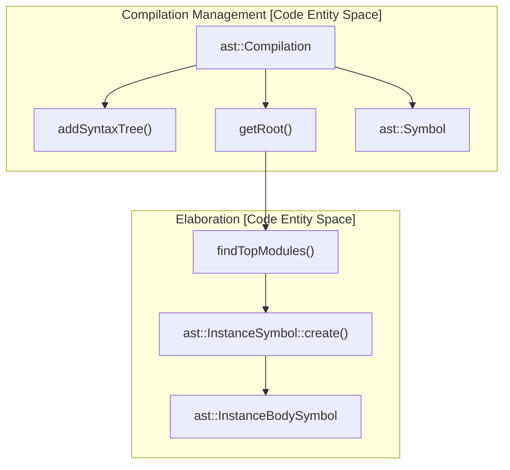

**Semantic Analysis and Elaboration Pipeline**

The `addSyntaxTree()` method adds syntax trees to the compilation [include/slang/ast/Compilation.h:281-295](). The `getRoot()` method triggers finalization, which resolves all deferred symbols and creates the complete AST hierarchy, including identifying top-level modules and resolving parameter overrides [source/ast/Compilation.cpp:298-568]().

For details, see [Elaboration and Compilation](#2.3).

Sources: [source/ast/Compilation.cpp:178-256](), [source/ast/symbols/InstanceSymbols.cpp:350-500](), [include/slang/ast/Compilation.h:281-295]()

## Analysis and Diagnostics

The final stage involves running static analysis passes and generating diagnostic reports. The `DiagnosticEngine` collects and formats errors, warnings, and notes throughout the compilation process.

The `AnalysisManager` performs post-elaboration checks such as data flow analysis and driver tracking [source/analysis/AnalysisManager.cpp:1-50](). Diagnostics are reported via `DiagnosticEngine` and can be rendered by various clients, such as `TextDiagnosticClient` for console output or `JsonDiagnosticClient` for machine-readable formats [source/driver/Driver.cpp:40-45]().

Sources: [source/analysis/AnalysisManager.cpp:1-50](), [source/diagnostics/DiagnosticEngine.cpp:1-100](), [source/diagnostics/TextDiagnosticClient.cpp:1-100]()

## Key Classes and Control Flow

The compilation pipeline is orchestrated by several key classes:

| Class | File | Primary Responsibility |
|-------|------|----------------------|
| `Compilation` | [source/ast/Compilation.cpp]() | Central compilation manager, coordinates all phases |
| `Driver` | [source/driver/Driver.cpp]() | CLI entry point and high-level orchestrator |
| `SourceLoader` | [source/driver/SourceLoader.cpp]() | Discovers and loads source files from patterns |
| `Parser` | [source/parsing/Parser.cpp]() | Syntax parsing, CST construction |
| `Preprocessor` | [source/parsing/Preprocessor.cpp]() | Macro expansion, include processing |
| `SourceManager` | [source/text/SourceManager.cpp]() | Source file management, location tracking |
| `DiagnosticEngine` | [source/diagnostics/DiagnosticEngine.cpp]() | Error and warning management |

Sources: [source/driver/Driver.cpp:40-100](), [source/ast/Compilation.cpp:40-176](), [include/slang/driver/SourceLoader.h:61-100]()

---

# Page: Preprocessing and Lexical Analysis

# Preprocessing and Lexical Analysis

<details>
<summary>Relevant source files</summary>

The following files were used as context for generating this wiki page:

- [include/slang/parsing/Lexer.h](include/slang/parsing/Lexer.h)
- [include/slang/parsing/LexerFacts.h](include/slang/parsing/LexerFacts.h)
- [include/slang/parsing/NumberParser.h](include/slang/parsing/NumberParser.h)
- [include/slang/parsing/ParserBase.h](include/slang/parsing/ParserBase.h)
- [include/slang/parsing/Preprocessor.h](include/slang/parsing/Preprocessor.h)
- [include/slang/parsing/Token.h](include/slang/parsing/Token.h)
- [source/parsing/Lexer.cpp](source/parsing/Lexer.cpp)
- [source/parsing/LexerFacts.cpp](source/parsing/LexerFacts.cpp)
- [source/parsing/NumberParser.cpp](source/parsing/NumberParser.cpp)
- [source/parsing/ParserBase.cpp](source/parsing/ParserBase.cpp)
- [source/parsing/Preprocessor.cpp](source/parsing/Preprocessor.cpp)
- [source/parsing/Preprocessor_macros.cpp](source/parsing/Preprocessor_macros.cpp)
- [source/parsing/Token.cpp](source/parsing/Token.cpp)
- [tests/unittests/parsing/ExpressionParsingTests.cpp](tests/unittests/parsing/ExpressionParsingTests.cpp)
- [tests/unittests/parsing/LexerTests.cpp](tests/unittests/parsing/LexerTests.cpp)
- [tests/unittests/parsing/PreprocessorTests.cpp](tests/unittests/parsing/PreprocessorTests.cpp)

</details>


This document covers the first stage of the slang compilation pipeline: preprocessing and lexical analysis. This stage transforms raw source text into a stream of tokens, handling SystemVerilog preprocessing directives including macro expansion, file inclusion, and conditional compilation. For information about parsing these tokens into syntax trees, see [Syntax Parsing](2.2). For the overall compilation pipeline overview, see [Compilation Pipeline](2).

## Overview

The preprocessing and lexical analysis stage consists of two main phases that work together to process SystemVerilog source text:

1. **Lexical Analysis**: Converting raw source text into individual tokens via the `Lexer`.
2. **Preprocessing**: Handling directives like macro expansion, include processing, and conditional compilation via the `Preprocessor`.

### Architecture Flow

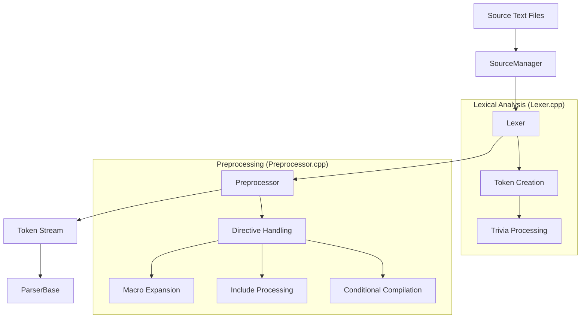

Sources: [source/parsing/Lexer.cpp:33-43](), [source/parsing/Preprocessor.cpp:26-32](), [include/slang/parsing/Preprocessor.h:88-92]()

## Core Components

### Lexer Class

The `Lexer` class is responsible for converting raw source text into tokens. It operates on a `SourceBuffer` and handles character-level processing, including Unicode BOM detection and encoding validation.

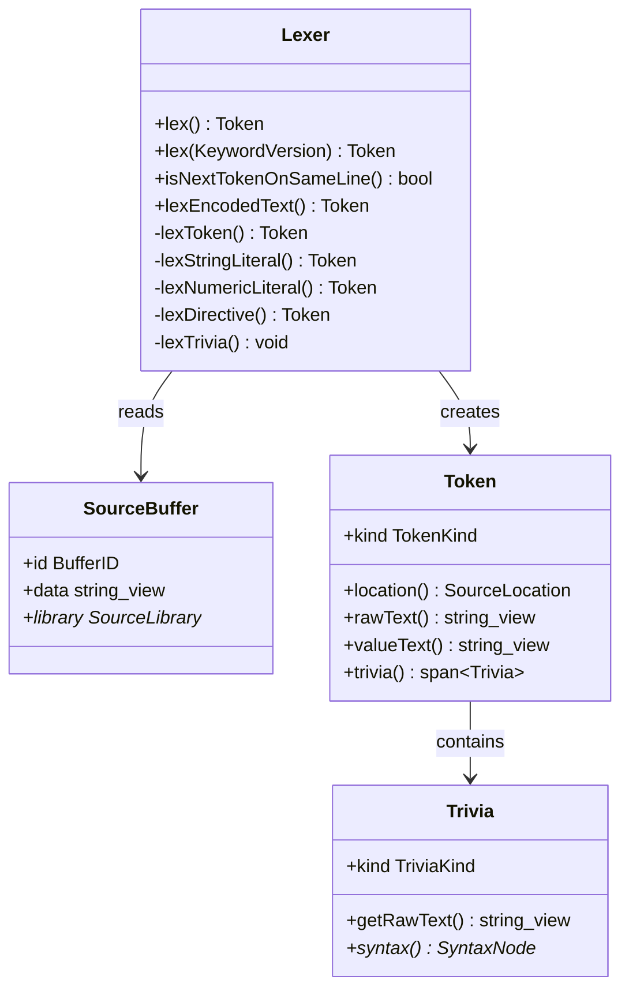

Sources: [include/slang/parsing/Lexer.h:95-119](), [source/parsing/Lexer.cpp:33-63](), [source/parsing/Lexer.cpp:107-108]()

### Preprocessor Class

The `Preprocessor` class acts as the interface between the `Lexer` and the `Parser`. It manages a stack of lexers (to handle includes) and performs macro expansion on the fly.

| Feature | Implementation |
|---------|----------------|
| **Macro Storage** | Uses a map of `MacroDef` (containing `DefineDirectiveSyntax*`) [source/parsing/Preprocessor_macros.cpp:27-31]() |
| **Include Stack** | Managed via `lexerStack` and `includeDepth` [source/parsing/Preprocessor.cpp:131-132]() |
| **Keyword Versioning** | Tracked via `keywordVersionStack` to support `` `begin_keywords `` [source/parsing/Preprocessor.cpp:34-35]() |

Sources: [include/slang/parsing/Preprocessor.h:88-167](), [source/parsing/Preprocessor.cpp:131-151]()

## Token and Trivia System

### Token Representation
Tokens in slang are lightweight, immutable structures. Most data is stored in a heap-allocated `Token::Info` block to keep the `Token` object small (typically just the `TokenKind` and a pointer).

- **Raw Text**: The exact characters from the source [source/parsing/Token.cpp:26-26]().
- **Value Text**: Processed text (e.g., string literals with escape sequences resolved) [include/slang/parsing/Token.h:164-164]().
- **Location**: A `SourceLocation` which can point to a physical file or a virtual macro expansion location [source/parsing/Token.cpp:28-30]().

### Trivia
Trivia represents source text that is not a functional token but must be preserved for tools like linters or formatters. This includes whitespace, comments, and preprocessor directives that were consumed.

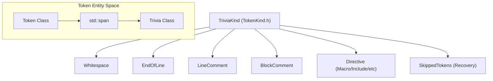

Sources: [include/slang/parsing/Token.h:52-88](), [source/parsing/Token.cpp:87-120]()

## Macro System

The macro system handles definition, undefinition, and complex expansion involving arguments and operators.

### Macro Expansion Logic
When the `Preprocessor` encounters a `MacroUsage` token, it looks up the `MacroDef`. If the macro is function-like, it parses arguments before expanding.

- **Stringification**: Handled by `Lexer::stringify` [source/parsing/Lexer.cpp:110-112]().
- **Token Concatenation**: Handled by `Lexer::concatenateTokens`, which re-lexes the combined string [source/parsing/Lexer.cpp:65-67]().
- **Macro Operators**: The `MacroOpEvaluator` class in `Preprocessor_macros.cpp` applies `` `"` ``, `` `""" `` and `` `` `` during expansion [source/parsing/Preprocessor_macros.cpp:60-82]().

Sources: [source/parsing/Preprocessor_macros.cpp:60-129](), [source/parsing/Lexer.cpp:65-108]()

## Numeric Literal Parsing

Slang uses a dedicated `NumberParser` to handle the complexities of SystemVerilog number literals (e.g., `32'hdead_beef`, `1.2e3`).

| Component | Role |
|-----------|------|
| **Lexer** | Identifies the start of a number and slices the raw text [source/parsing/Lexer.cpp:162-162](). |
| **NumberParser** | Accumulates digits, handles bases (Binary, Octal, Decimal, Hex), and validates width [source/parsing/NumberParser.cpp:86-169](). |
| **SVInt** | Stores the resulting arbitrary-precision integer value [source/parsing/NumberParser.cpp:175-180](). |

Sources: [source/parsing/NumberParser.cpp:35-63](), [include/slang/parsing/NumberParser.h:18-50]()

## Include and Conditional Compilation

### File Inclusion
The `Preprocessor` handles `` `include `` by requesting a `SourceBuffer` from the `SourceManager`. It then pushes a new `Lexer` onto its stack [source/parsing/Preprocessor.cpp:131-132]().

### Conditional Branches
The preprocessor maintains a `branchStack` of `BranchEntry` objects to track nested `` `ifdef ``, `` `ifndef ``, and `` `elsif `` blocks.

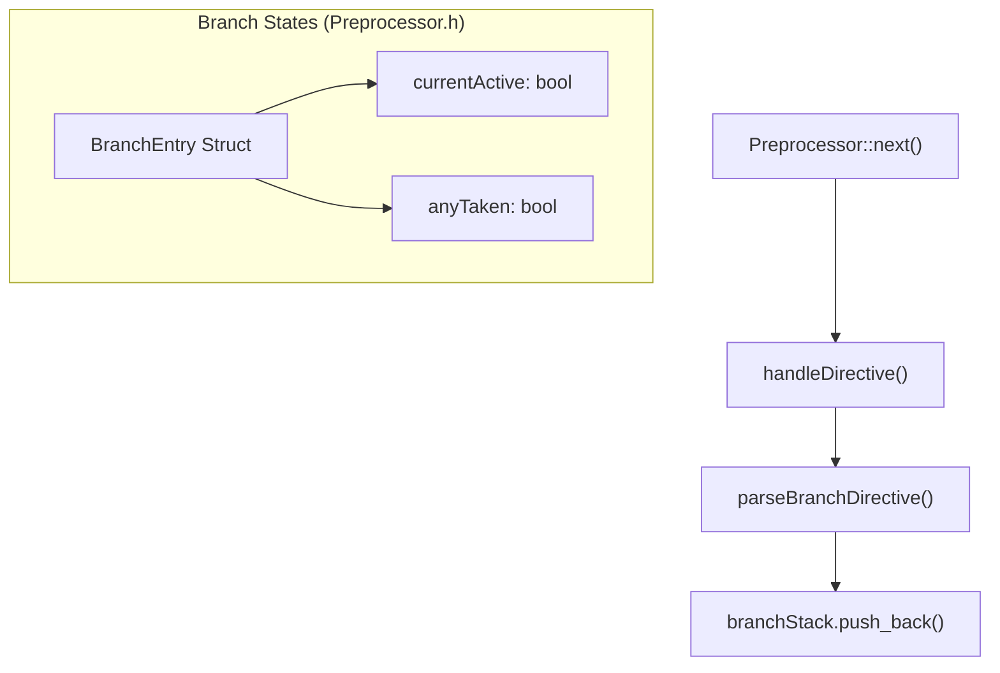

Sources: [include/slang/parsing/Preprocessor.h:341-357](), [source/parsing/Preprocessor.cpp:134-134]()

## Pragmas and Protection

Slang supports standard pragmas and "protected envelopes" (encrypted/hidden source regions).
- **Pragma Once**: Optimized include handling via `headerGuardStack` [source/parsing/Preprocessor.cpp:134-134]().
- **Pragma Protect**: Handled by a table of handlers for directives like `begin`, `end`, `data_block` [source/parsing/Preprocessor.cpp:46-79]().

Sources: [source/parsing/Preprocessor.cpp:46-81](), [source/parsing/Preprocessor_pragmas.cpp:18-133]()

---

# Page: Syntax Parsing

# Syntax Parsing

<details>
<summary>Relevant source files</summary>

The following files were used as context for generating this wiki page:

- [include/slang/parsing/Parser.h](include/slang/parsing/Parser.h)
- [include/slang/parsing/ParserMetadata.h](include/slang/parsing/ParserMetadata.h)
- [include/slang/syntax/SyntaxFacts.h](include/slang/syntax/SyntaxFacts.h)
- [include/slang/syntax/SyntaxNode.h](include/slang/syntax/SyntaxNode.h)
- [include/slang/syntax/SyntaxTree.h](include/slang/syntax/SyntaxTree.h)
- [include/slang/syntax/SyntaxVisitor.h](include/slang/syntax/SyntaxVisitor.h)
- [scripts/syntax.txt](scripts/syntax.txt)
- [scripts/syntax_gen.py](scripts/syntax_gen.py)
- [source/parsing/Parser.cpp](source/parsing/Parser.cpp)
- [source/parsing/ParserMetadata.cpp](source/parsing/ParserMetadata.cpp)
- [source/parsing/Parser_expressions.cpp](source/parsing/Parser_expressions.cpp)
- [source/parsing/Parser_members.cpp](source/parsing/Parser_members.cpp)
- [source/parsing/Parser_statements.cpp](source/parsing/Parser_statements.cpp)
- [source/syntax/SyntaxFacts.cpp](source/syntax/SyntaxFacts.cpp)
- [source/syntax/SyntaxNode.cpp](source/syntax/SyntaxNode.cpp)
- [source/syntax/SyntaxTree.cpp](source/syntax/SyntaxTree.cpp)
- [source/syntax/SyntaxVisitor.cpp](source/syntax/SyntaxVisitor.cpp)
- [tests/regression/all.sv](tests/regression/all.sv)
- [tests/unittests/parsing/MemberParsingTests.cpp](tests/unittests/parsing/MemberParsingTests.cpp)
- [tests/unittests/parsing/VisitorTests.cpp](tests/unittests/parsing/VisitorTests.cpp)

</details>


This document covers the syntax parsing subsystem of the slang SystemVerilog compiler, which transforms a stream of preprocessed tokens into a concrete syntax tree (CST). The parser implements a recursive-descent parsing algorithm with error recovery mechanisms and produces strongly-typed syntax nodes representing all language constructs.

## Parser Architecture

The syntax parsing system is built around the `Parser` class, which implements a recursive-descent parser with integrated error recovery. The parser consumes tokens from the `Preprocessor` and produces a concrete syntax tree using auto-generated syntax node classes.

### Parser Components and Data Flow
```mermaid
graph TD
    subgraph "Input Layer"
        PP["Preprocessor"]
    end

    subgraph "Parsing Engine (Recursive Descent)"
        P["Parser Class"]
        PB["ParserBase"]
        SF["SyntaxFacts (Utilities)"]
        NP["NumberParser"]
    end

    subgraph "Syntax Construction"
        Fac["SyntaxFactory"]
        Alloc["BumpAllocator"]
        Meta["ParserMetadata"]
    end

    subgraph "Output Space"
        CST["Concrete Syntax Tree (CST)"]
        CU["CompilationUnitSyntax"]
        Diag["Diagnostics"]
    end

    PP -->|Token Stream| P
    P --|> PB
    P --|> SF
    P -->|Uses| NP
    P -->|Allocates via| Fac
    Fac -->|Stores in| Alloc
    P -->|Records| Meta
    P -->|Produces| CU
    P -->|Reports| Diag
```
Sources: [include/slang/parsing/Parser.h:141-143](), [source/parsing/Parser.cpp:17-21](), [include/slang/syntax/SyntaxNode.h:89-95]()

The `Parser` class is initialized with a `Preprocessor` and a `Bag` of options. It uses a `BumpAllocator` for high-performance memory management of syntax nodes.

| Class | Responsibility | Source |
| :--- | :--- | :--- |
| `Parser` | Main entry point for recursive-descent parsing. | [include/slang/parsing/Parser.h:141]() |
| `ParserBase` | Base class providing token consumption and lookahead primitives (`peek`, `consume`, `expect`). | [include/slang/parsing/ParserBase.h:1-20]() |
| `SyntaxFactory` | Factory for creating specific `SyntaxNode` instances. | [source/parsing/Parser.cpp:18]() |
| `NumberParser` | Specialized logic for parsing SystemVerilog numeric literals. | [source/parsing/Parser.cpp:20]() |

Sources: [source/parsing/Parser.cpp:17-21](), [include/slang/parsing/Parser.h:141-143]()

## Syntax Tree Construction

The parser constructs a concrete syntax tree using auto-generated syntax node classes. All syntax nodes inherit from `SyntaxNode` and contain both tokens and child syntax nodes, preserving the complete source text structure including whitespace and comments (trivia).

### SyntaxNode Hierarchy
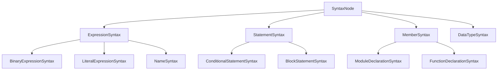
Sources: [include/slang/syntax/SyntaxNode.h:89-100](), [scripts/syntax.txt:1-50]()

### Token and Syntax Variants
To handle the heterogeneous nature of tree children, slang uses variant types to represent either a `Token` or a `SyntaxNode`.

*   **`TokenOrSyntax`**: A variant used for lists and children that can be either a leaf (token) or a subtree. [include/slang/syntax/SyntaxNode.h:75-87]()
*   **`SyntaxList<T>`**: A collection of syntax nodes of type `T`. [scripts/syntax_gen.py:154-161]()
*   **`SeparatedSyntaxList<T>`**: A collection of syntax nodes separated by tokens (usually commas). [scripts/syntax_gen.py:162-169]()

## Parsing Process

The `Parser` uses a recursive-descent approach, where methods correspond to grammar rules. It frequently employs "speculative" parsing using lookahead to disambiguate constructs.

### Entry Points
The primary entry point for a full file is `parseCompilationUnit`. For snippets or testing, `parseGuess` attempts to identify the construct based on lookahead.

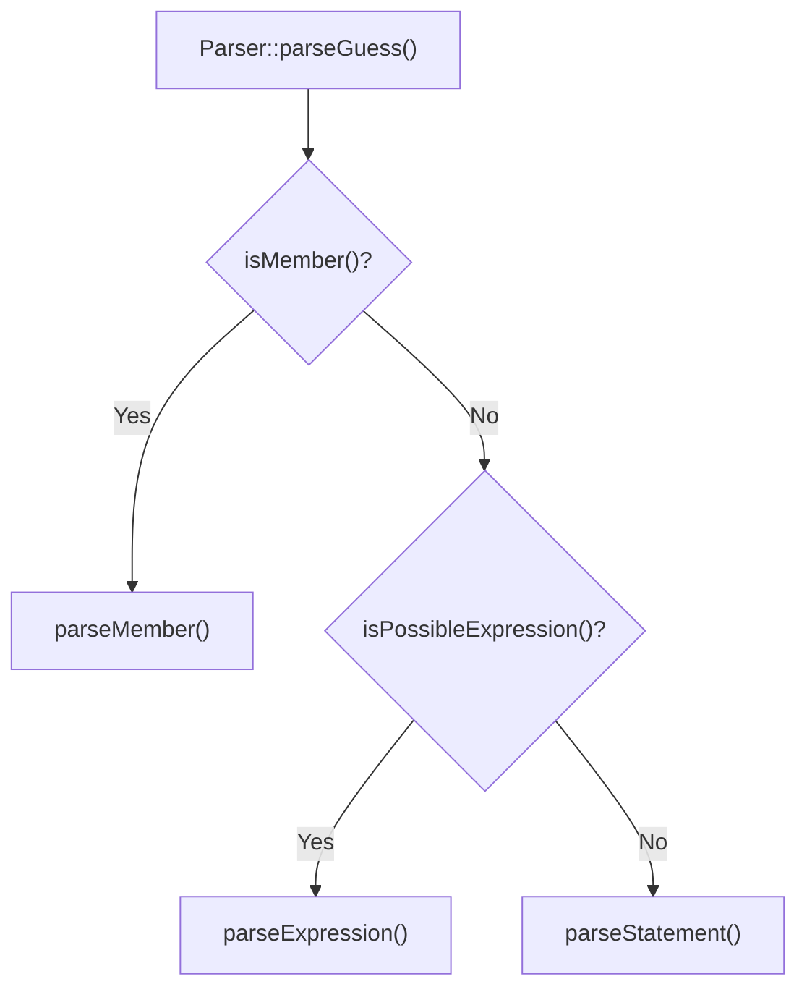
Sources: [source/parsing/Parser.cpp:23-61](), [source/parsing/Parser_members.cpp:18-31]()

### Member and Module Parsing
Members include modules, interfaces, programs, and package items. The parser tracks the `currentDefinitionKind` to handle nested scopes correctly.

*   **`parseModule`**: Handles module, interface, and program declarations. It pushes a "design element stack" to the preprocessor to handle directives like `` `default_nettype ``. [source/parsing/Parser_members.cpp:52-102]()
*   **`parseMemberList`**: A template function that parses a sequence of members until a specific `endKind` token is found. [source/parsing/Parser_members.cpp:18-25]()

Sources: [source/parsing/Parser_members.cpp:52-102](), [source/parsing/Parser_members.cpp:158-165]()

### Expression Parsing
Expression parsing uses a precedence-climbing algorithm implemented in `parseBinaryExpression`.

| Function | Role | Source |
| :--- | :--- | :--- |
| `parseExpression` | Top-level expression entry point. | [source/parsing/Parser_expressions.cpp:17-19]() |
| `parseSubExpression` | Handles unary operators and primary expressions. | [source/parsing/Parser_expressions.cpp:50-105]() |
| `parseBinaryExpression` | Implements operator precedence and associativity. | [source/parsing/Parser_expressions.cpp:107-175]() |
| `getPrecedence` | Returns the precedence level for a `SyntaxKind`. | [source/parsing/Parser_expressions.cpp:146-147]() |

Sources: [source/parsing/Parser_expressions.cpp:17-175]()

## Error Recovery

The parser is designed to be resilient to malformed input. It uses several strategies to recover and continue parsing to find subsequent errors.

### Recovery Mechanisms
1.  **Missing Tokens**: When an expected token (like a semicolon) is missing, `expect()` creates a "missing" token at the current location and continues. [source/parsing/Parser_statements.cpp:122]()
2.  **Depth Guard**: To prevent stack overflow on deeply nested code, `setDepthGuard()` tracks recursion depth and throws a `RecursionException` if `maxRecursionDepth` is exceeded. [source/parsing/Parser_statements.cpp:17](), [include/slang/parsing/Parser.h:131-134]()
3.  **Synchronization Points**: In lists (like port lists), if a member fails to parse, the parser skips tokens until it finds a delimiter (e.g., a comma) or the end of the list. [source/parsing/Parser.cpp:84-87]()

Sources: [source/parsing/Parser_statements.cpp:16-25](), [include/slang/parsing/Parser.h:131-134](), [source/parsing/Parser_members.cpp:19-31]()

## Code Generation System

A significant portion of the syntax infrastructure is generated from `scripts/syntax.txt` using `scripts/syntax_gen.py`. This script produces:
*   `AllSyntax.h`: Definitions for all `SyntaxNode` subclasses.
*   `SyntaxKind.h`: The `SyntaxKind` enumeration.
*   Factory methods for `SyntaxFactory`.

### Syntax Definition Format
The `syntax.txt` file defines nodes using a domain-specific language:
```text
BinaryExpression base=Expression multiKind=true
    Expression left
    token operatorToken
    list<AttributeInstance> attributes
    Expression right
```
Sources: [scripts/syntax.txt:192-196](), [scripts/syntax_gen.py:121-145]()

The generator uses `TypeInfo` to track members, base classes, and whether a node is "final" (leaf in the class hierarchy). [scripts/syntax_gen.py:18-48]()

---

# Page: Elaboration and Compilation

# Elaboration and Compilation

<details>
<summary>Relevant source files</summary>

The following files were used as context for generating this wiki page:

- [bindings/python/SymbolBindings.cpp](bindings/python/SymbolBindings.cpp)
- [include/slang/ast/Compilation.h](include/slang/ast/Compilation.h)
- [include/slang/ast/Lookup.h](include/slang/ast/Lookup.h)
- [include/slang/ast/Scope.h](include/slang/ast/Scope.h)
- [include/slang/ast/symbols/CompilationUnitSymbols.h](include/slang/ast/symbols/CompilationUnitSymbols.h)
- [include/slang/ast/symbols/InstanceSymbols.h](include/slang/ast/symbols/InstanceSymbols.h)
- [include/slang/ast/symbols/ParameterSymbols.h](include/slang/ast/symbols/ParameterSymbols.h)
- [source/ast/Compilation.cpp](source/ast/Compilation.cpp)
- [source/ast/ElabVisitors.h](source/ast/ElabVisitors.h)
- [source/ast/Lookup.cpp](source/ast/Lookup.cpp)
- [source/ast/Scope.cpp](source/ast/Scope.cpp)
- [source/ast/symbols/CompilationUnitSymbols.cpp](source/ast/symbols/CompilationUnitSymbols.cpp)
- [source/ast/symbols/InstanceSymbols.cpp](source/ast/symbols/InstanceSymbols.cpp)
- [source/ast/symbols/ParameterBuilder.cpp](source/ast/symbols/ParameterBuilder.cpp)
- [source/ast/symbols/ParameterSymbols.cpp](source/ast/symbols/ParameterSymbols.cpp)
- [tests/unittests/ast/ConfigTests.cpp](tests/unittests/ast/ConfigTests.cpp)
- [tests/unittests/ast/HierarchyTests.cpp](tests/unittests/ast/HierarchyTests.cpp)
- [tests/unittests/ast/LookupTests.cpp](tests/unittests/ast/LookupTests.cpp)
- [tests/unittests/ast/ParameterTests.cpp](tests/unittests/ast/ParameterTests.cpp)

</details>


This document explains the symbol creation, name resolution, type checking, and design elaboration processes that transform parsed syntax trees into a fully elaborated Abstract Syntax Tree (AST). This phase occurs after preprocessing and parsing (see [Elaboration and Compilation](#2.3)) and creates the symbol hierarchy used by static analysis (see [Static Analysis Framework](#5.1)).

## Overview

Elaboration transforms the collection of parsed syntax trees into a coherent design hierarchy with fully resolved symbols, types, and connections. The process is managed by the `Compilation` class and involves several key phases:

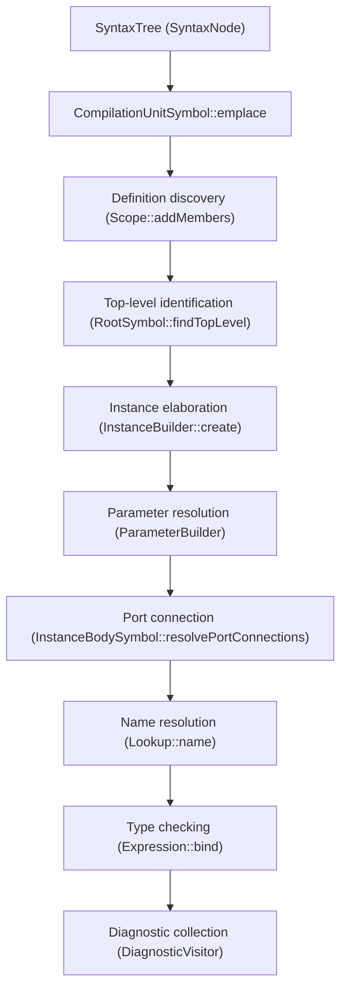

**Elaboration Flow**
Sources: [source/ast/Compilation.cpp:164-202](), [include/slang/ast/Compilation.h:130-195](), [source/ast/symbols/InstanceSymbols.cpp:43-88]()

The `Compilation::getRoot()` method triggers the elaboration process, which creates the final `RootSymbol` containing all top-level instances and compilation units.

## Symbol Creation from Syntax

The elaboration process begins by creating symbols from syntax nodes. Each `SyntaxTree` is wrapped in a `CompilationUnitSymbol` that manages the symbols defined in that compilation unit.

```mermaid
classDiagram
    class Compilation {
        +addSyntaxTree(tree)
        +getRoot()
        +createDefinition(scope, ll, syntax)
        +emplace~T~(args)
    }
    
    class CompilationUnitSymbol {
        +SourceLibrary sourceLibrary
        +TimeScale timeScale
        +addMembers(syntax)
    }
    
    class DefinitionSymbol {
        +DefinitionKind definitionKind
        +ParameterBuilder parameters
        +NetType defaultNetType
    }
    
    class Scope {
        +addMembers(syntax)
        +find(name)
        +lookupName(syntax)
    }
    
    Compilation --> CompilationUnitSymbol : "creates via emplace"
    CompilationUnitSymbol --> DefinitionSymbol : "contains"
    CompilationUnitSymbol --|> Scope
    DefinitionSymbol --> Scope : "has body"
```

**Symbol Hierarchy**
Sources: [source/ast/Compilation.cpp:197-200](), [source/ast/Scope.cpp:62-83](), [source/ast/Scope.cpp:194-210]()

The `Scope::addMembers()` method processes `SyntaxNode` objects and creates appropriate symbol types:
- Module/interface/program declarations become `DefinitionSymbol` objects [source/ast/Scope.cpp:199-203]()
- Package declarations become `PackageSymbol` objects [source/ast/Scope.cpp:211-213]()
- Variable declarations become `VariableSymbol` objects [source/ast/Scope.cpp:235-237]()
- Function/task declarations become `SubroutineSymbol` objects [source/ast/Scope.cpp:222-224]()

## Scope Management and Name Resolution

Scopes provide hierarchical name lookup following SystemVerilog's scoping rules. Each scope maintains a `SymbolMap` for efficient symbol lookup and supports wildcard imports from packages.

```mermaid
flowchart TD
    LookupRequest["Lookup::name(syntax, context)"] --> LocalScope["Search Scope::nameMap"]
    LocalScope --> Found{Found?}
    Found -->|Yes| Return["Return LookupResult"]
    Found -->|No| Imports["Check WildcardImportSymbol"]
    Imports --> ImportFound{Found?}
    ImportFound -->|Yes| Return
    ImportFound -->|No| Parent["Search Scope::getParentScope()"]
    Parent --> ParentFound{Found?}
    ParentFound -->|Yes| Return  
    ParentFound -->|No| Error["LookupResult::addDiag"]
```

**Name Resolution Process**
Sources: [source/ast/Lookup.cpp:34-80](), [source/ast/Scope.cpp:62-64](), [source/ast/Scope.cpp:106-114]()

The lookup process implements SystemVerilog's name resolution rules:
1. Search the local scope's `nameMap` [source/ast/Scope.cpp:63]()
2. Check wildcard imports for matching symbols [source/ast/Lookup.cpp:47-52]()
3. Recursively search parent scopes using `getParentScope()` [source/ast/Scope.cpp:118-125]()
4. Apply qualified name resolution for hierarchical references via `splitScopedName` [source/ast/Lookup.cpp:183-201]()

## Instance Elaboration and Caching

Instance elaboration creates `InstanceSymbol` objects from instantiation syntax and recursively elaborates their bodies. To optimize performance, slang uses an instance cache to skip duplicate bodies.

```mermaid
sequenceDiagram
    participant C as Compilation
    participant IB as InstanceBuilder  
    participant PB as ParameterBuilder
    participant IS as InstanceSymbol
    participant IBS as InstanceBodySymbol
    
    C->>IB: create(HierarchicalInstanceSyntax)
    IB->>PB: setOverrides(overrideNode)
    PB->>PB: resolveParameters()
    IB->>IS: emplace<InstanceSymbol>()
    IS->>IBS: getCanonicalBody()
    Note over IS, IBS: If cached, reuse body. Else create new.
    IBS->>C: addDiag() for errors
```

**Instance Creation Sequence**
Sources: [source/ast/symbols/InstanceSymbols.cpp:43-128](), [source/ast/symbols/InstanceSymbols.cpp:110-128](), [include/slang/ast/symbols/InstanceSymbols.h:120-128]()

The `InstanceBuilder::create()` method orchestrates instance creation:
1. Evaluates array dimensions if the instance is an array [source/ast/symbols/InstanceSymbols.cpp:143-158]().
2. Uses `ParameterBuilder` to resolve parameter assignments [source/ast/symbols/InstanceSymbols.cpp:112-115]().
3. Checks `CompilationFlags::DisableInstanceCaching` to decide whether to reuse an existing `InstanceBodySymbol` [include/slang/ast/Compilation.h:109]().
4. Resolves `resolvedConfig` based on any applicable configuration rules [source/ast/symbols/InstanceSymbols.cpp:120-126]().

## Parameter Resolution

Parameter resolution evaluates parameter assignments and creates specialized instance bodies. The `ParameterBuilder` class manages this process and handles both value and type parameters.

```mermaid
classDiagram
    class ParameterBuilder {
        +setAssignments(syntax)
        +setOverrides(node)
        +createParams(scope)
        -resolveOverrides()
    }
    
    class ParameterSymbol {
        +getValue(referencingRange)
        +isOverridden()
        +getInitializer()
    }
    
    class TypeParameterSymbol {
        +targetType
        +checkTypeRestriction()
    }
    
    ParameterBuilder --> ParameterSymbol : "creates"
    ParameterBuilder --> TypeParameterSymbol : "creates"
    ParameterSymbol --> ConstantValue : "evaluates via getValue()"
    TypeParameterSymbol --> Type : "resolves target"
```

**Parameter System**
Sources: [source/ast/symbols/ParameterSymbols.cpp:94-121](), [source/ast/symbols/ParameterSymbols.cpp:123-174](), [source/ast/symbols/ParameterSymbols.cpp:53-92]()

Parameter resolution handles:
- Default value evaluation for unassigned parameters [source/ast/symbols/ParameterSymbols.cpp:146-150]().
- Detecting circular dependencies via `evaluating` flag in `getValue()` [source/ast/symbols/ParameterSymbols.cpp:132-142]().
- Type parameter specialization and restriction checking [source/ast/symbols/ParameterSymbols.cpp:126-133]().
- Name resolution within default expressions using `ParameterSymbolBase::checkDefaultExpression` [source/ast/symbols/ParameterSymbols.cpp:53-92]().

## Diagnostic Collection and Finalization

After the design is elaborated, slang performs a final pass to collect diagnostics and ensure all lazy members are realized.

```mermaid
classDiagram
    class DiagnosticVisitor {
        +handle(InstanceSymbol)
        +handle(ParameterSymbol)
        +handle(SubroutineSymbol)
        +finishedEarly()
        -compilation
    }
    
    class Compilation {
        +addDiagnostics(Diagnostics)
        +getAllDiagnostics()
        +isFrozen()
    }
    
    class Scope {
        +addDiag(code, location)
        +addDiags(Diagnostics)
    }
    
    DiagnosticVisitor --> Compilation : "reports to"
    Scope --> Compilation : "proxies diagnostics"
```

**Diagnostic Collection System**
Sources: [source/ast/ElabVisitors.h:22-59](), [source/ast/Compilation.cpp:147-153](), [source/ast/Scope.cpp:176-192]()

The diagnostic collection process:
1. `DiagnosticVisitor` visits every symbol in the elaborated design [source/ast/ElabVisitors.h:22-31]().
2. Forces evaluation of lazy-evaluated constructs like `DeclaredType::getType()` and `getInitializer()` [source/ast/ElabVisitors.h:39-43]().
3. Checks for invalid initializers in nets and variables [source/ast/ElabVisitors.h:227-239]().
4. Validates interface port connections and modport exports [source/ast/ElabVisitors.h:79-102]().
5. Short-circuits if the `errorLimit` is exceeded [source/ast/ElabVisitors.h:23-26]().

This completes the elaboration process, producing a fully resolved AST ready for analysis.
Sources: [source/ast/Compilation.cpp:164-202](), [source/ast/ElabVisitors.h:22-59](), [source/ast/symbols/InstanceSymbols.cpp:43-128]()

---

# Page: Symbol System

# Symbol System

<details>
<summary>Relevant source files</summary>

The following files were used as context for generating this wiki page:

- [include/slang/ast/ASTVisitor.h](include/slang/ast/ASTVisitor.h)
- [include/slang/ast/Symbol.h](include/slang/ast/Symbol.h)
- [include/slang/ast/symbols/MemberSymbols.h](include/slang/ast/symbols/MemberSymbols.h)
- [source/ast/CMakeLists.txt](source/ast/CMakeLists.txt)
- [source/ast/symbols/MemberSymbols.cpp](source/ast/symbols/MemberSymbols.cpp)

</details>


The Symbol System provides the AST symbol hierarchy and symbol management for slang's SystemVerilog compiler. It represents all named entities in a SystemVerilog design through a hierarchical structure of symbol classes, manages their relationships, and enables name resolution and lookup operations throughout the compilation pipeline.

## AST Symbol Hierarchy

The Symbol System implements a hierarchical representation through the base `Symbol` class and specialized symbol types. The `SymbolKind` enum identifies over 100 different symbol types, from basic constructs like variables to complex structures like module instances.

### Core Symbol Architecture

```mermaid
classDiagram
    class "Symbol" {
        +name: string_view
        +kind: SymbolKind
        +location: SourceLocation
        +getParentScope(): Scope*
        +getSyntax(): SyntaxNode*
        +visit(TVisitor): void
    }
    
    class "Scope" {
        +find(name): Symbol*
        +lookupName(name, LookupLocation, LookupFlags): Symbol*
        +addMember(symbol): void
        +members(): iterator_range
        +getNameMap(): DenseMap
    }
    
    class "ValueSymbol" {
        +getType(): Type&
        +getInitializer(): Expression*
        +getDeclaredType(): DeclaredType*
    }
    
    class "MemberSymbols" {
        EmptyMemberSymbol
        ExplicitImportSymbol
        WildcardImportSymbol
        ModportPortSymbol
        ContinuousAssignSymbol
    }
    
    class "BlockSymbols" {
        StatementBlockSymbol
        ProceduralBlockSymbol
        GenerateBlockSymbol
        GenerateBlockArraySymbol
    }
    
    "Symbol" <|-- "Scope"
    "Symbol" <|-- "ValueSymbol" 
    "Symbol" <|-- "MemberSymbols"
    "Symbol" <|-- "BlockSymbols"
```

Sources:
- [include/slang/ast/Symbol.h:135-218]()
- [include/slang/ast/Scope.h:44-158]()
- [include/slang/ast/symbols/MemberSymbols.h:26-181]()

## Symbol Types and Categories

### Base Symbol Classes

The `Symbol` class provides fundamental functionality through a `SymbolKind` enum with over 100 distinct types. Key base classes include:

- **Symbol**: Base class with `name`, `kind`, `location`, and parent scope relationships. [include/slang/ast/Symbol.h:135-146]()
- **Scope**: Extends `Symbol` to contain other symbols and manage lookups via name maps. [include/slang/ast/Scope.h:44-50]()
- **ValueSymbol**: Base for symbols with types, including variables and parameters. [include/slang/ast/symbols/ValueSymbol.h:18-25]()

For a detailed breakdown of specific symbol types, see **[Symbol Creation and Management](#3.1)**.

### Member Symbols

Member symbols represent various declaration constructs within scopes, such as imports and port specifications.
- **ExplicitImportSymbol**: Represents an explicit `import pkg::name`. [include/slang/ast/symbols/MemberSymbols.h:57-66]()
- **WildcardImportSymbol**: Represents a `import pkg::*` declaration. [include/slang/ast/symbols/MemberSymbols.h:89-95]()
- **ModportPortSymbol**: Represents a port within a modport declaration. [include/slang/ast/symbols/MemberSymbols.h:109-123]()

### Block Symbols

Block symbols represent hierarchical and statement scopes, such as `initial` or `always` blocks and generate constructs.
- **StatementBlockSymbol**: Sequential and parallel statement blocks.
- **ProceduralBlockSymbol**: Procedural containers like `always_ff`.
- **GenerateBlockSymbol**: Blocks created by `if` or `for` generate constructs.

Sources:
- [include/slang/ast/Symbol.h:21-127]()
- [source/ast/symbols/MemberSymbols.cpp:40-164]()

## Scope Management and Lookup

The symbol system implements sophisticated name resolution through the `Lookup` class. It handles hierarchical references, package imports, and upward name searching.

### Lookup Process

The `Lookup::name()` function handles complex resolution:
1. **Unqualified Lookup**: Searching the current and parent lexical scopes.
2. **Qualified Lookup**: Resolving dotted names (e.g., `top.sub.signal`). [source/ast/Lookup.cpp:269-579]()
3. **Package Resolution**: Handling `::` operators and `import` directives. [source/ast/symbols/MemberSymbols.cpp:98-126]()

For details on scoping rules and the lookup engine, see **[Scope Management and Lookup](#3.2)**.

Sources:
- [source/ast/Lookup.cpp:39-83]()
- [include/slang/ast/Lookup.h:10-40]()

## Instance and Module Symbols

Module instantiation uses a two-level approach separating the definition (template) from the realization (instance).

```mermaid
graph TD
    subgraph "Code Entity Space"
        ModuleDef["module MyModule #(parameter P=1) (input clk); ... endmodule"]
        InstStmt["MyModule #(.P(2)) inst1 (.clk(top_clk));"]
    end

    subgraph "System Name Space"
        DefinitionSymbol["DefinitionSymbol (MyModule)"]
        InstanceSymbol["InstanceSymbol (inst1)"]
        InstanceBodySymbol["InstanceBodySymbol"]
        ParameterSymbol["ParameterSymbol (P)"]
    end

    ModuleDef -.-> DefinitionSymbol
    InstStmt -.-> InstanceSymbol
    InstanceSymbol --> InstanceBodySymbol
    DefinitionSymbol --> ParameterSymbol
    InstanceBodySymbol -.-> |"Contains realized members"| Signal["VariableSymbol (clk)"]
```

### Instance Hierarchy
- **InstanceSymbol**: Represents the instantiation site. [include/slang/ast/symbols/InstanceSymbols.h:150-160]()
- **InstanceBodySymbol**: Contains the actual members of the instance, allowing different instances of the same module to have different parameter values. [include/slang/ast/symbols/InstanceSymbols.h:95-105]()
- **InstanceArraySymbol**: Represents an array of instances (e.g., `my_mod inst[4]();`). [include/slang/ast/symbols/InstanceSymbols.h:233-240]()

For details on elaboration and instance construction, see **[Instance and Module Symbols](#3.3)**.

Sources:
- [include/slang/ast/symbols/InstanceSymbols.h:30-254]()
- [source/ast/symbols/InstanceSymbols.cpp:417-632]()

## Symbol Management and Lifecycle

Symbols are managed by the `Compilation` object, which acts as a factory and owner.

```mermaid
flowchart TD
    subgraph "Natural Language Space"
        User["Developer writes SystemVerilog"]
        Parser["Parser generates CST"]
    end

    subgraph "Code Entity Space"
        Comp["Compilation::emplace<T>()"]
        Sym["Symbol Instance"]
        Syntax["SyntaxNode (from CST)"]
    end

    User --> Parser
    Parser --> Syntax
    Syntax --> Comp
    Comp --> Sym
    Sym --> |"originatingSyntax"| Syntax
```

### Allocation and Lifetime
- **Compilation::emplace<T>()**: Symbols are allocated in memory pools owned by the `Compilation` object. [source/ast/Compilation.cpp:23-40]()
- **ASTVisitor**: A template-based mechanism for traversing the symbol tree, statements, and expressions. [include/slang/ast/ASTVisitor.h:101-175]()

Sources:
- [include/slang/ast/ASTVisitor.h:56-81]()
- [source/ast/symbols/MemberSymbols.cpp:40-63]()

---

# Page: Symbol Creation and Management

# Symbol Creation and Management

<details>
<summary>Relevant source files</summary>

The following files were used as context for generating this wiki page:

- [include/slang/ast/ASTVisitor.h](include/slang/ast/ASTVisitor.h)
- [include/slang/ast/LValue.h](include/slang/ast/LValue.h)
- [include/slang/ast/SFormat.h](include/slang/ast/SFormat.h)
- [include/slang/ast/SemanticFacts.h](include/slang/ast/SemanticFacts.h)
- [include/slang/ast/Symbol.h](include/slang/ast/Symbol.h)
- [include/slang/ast/expressions/CallExpression.h](include/slang/ast/expressions/CallExpression.h)
- [include/slang/ast/symbols/MemberSymbols.h](include/slang/ast/symbols/MemberSymbols.h)
- [include/slang/ast/symbols/SpecifySymbols.h](include/slang/ast/symbols/SpecifySymbols.h)
- [include/slang/ast/symbols/ValueSymbol.h](include/slang/ast/symbols/ValueSymbol.h)
- [include/slang/ast/symbols/VariableSymbols.h](include/slang/ast/symbols/VariableSymbols.h)
- [source/ast/CMakeLists.txt](source/ast/CMakeLists.txt)
- [source/ast/FmtHelpers.cpp](source/ast/FmtHelpers.cpp)
- [source/ast/FmtHelpers.h](source/ast/FmtHelpers.h)
- [source/ast/LValue.cpp](source/ast/LValue.cpp)
- [source/ast/SFormat.cpp](source/ast/SFormat.cpp)
- [source/ast/SemanticFacts.cpp](source/ast/SemanticFacts.cpp)
- [source/ast/expressions/CallExpression.cpp](source/ast/expressions/CallExpression.cpp)
- [source/ast/symbols/MemberSymbols.cpp](source/ast/symbols/MemberSymbols.cpp)
- [source/ast/symbols/ParameterBuilder.h](source/ast/symbols/ParameterBuilder.h)
- [source/ast/symbols/SpecifySymbols.cpp](source/ast/symbols/SpecifySymbols.cpp)
- [source/ast/symbols/ValueSymbol.cpp](source/ast/symbols/ValueSymbol.cpp)
- [source/ast/symbols/VariableSymbols.cpp](source/ast/symbols/VariableSymbols.cpp)
- [tests/unittests/ast/EvalTests.cpp](tests/unittests/ast/EvalTests.cpp)
- [tests/unittests/ast/MemberTests.cpp](tests/unittests/ast/MemberTests.cpp)

</details>


This document describes how symbols are created from syntax nodes and managed within the slang AST. It covers the symbol creation process, the various types of member symbols, variable symbols, value symbols, and the infrastructure for AST node construction.

For information about symbol lookup and scope resolution, see [Scope Management and Lookup](3.2). For details about specific instance and module symbols, see [Instance and Module Symbols](3.3).

## Symbol Creation Process

The symbol creation process transforms parsed syntax nodes into concrete AST symbol objects. This process occurs during the semantic analysis phase of compilation, after parsing has produced a complete syntax tree.

### From Syntax to Symbols

Symbol creation follows a consistent pattern where static factory methods on symbol classes accept syntax nodes and produce corresponding symbol instances:

Title: Symbol Creation Data Flow
```mermaid
flowchart TD
    SyntaxNode["syntax::SyntaxNode<br/>(from parser)"] --> Factory["Static fromSyntax()<br/>methods"]
    Factory --> Compilation["ast::Compilation::emplace&lt;T&gt;()"]
    Compilation --> Symbol["ast::Symbol instance<br/>in AST"]
    
    Factory --> ASTContext["ast::ASTContext<br/>(scope + location)"]
    ASTContext --> ExprBind["ast::Expression::bind()"]
    ExprBind --> Symbol
    
    Symbol --> Scope["Added to parent<br/>ast::Scope"]
    Symbol --> Attrs["ast::Symbol::setAttributes()"]
```

Sources: [source/ast/symbols/MemberSymbols.cpp:40-63](), [include/slang/ast/symbols/MemberSymbols.h:26-37](), [source/ast/symbols/VariableSymbols.cpp:48-76]()

### Symbol Factory Pattern

Most symbols implement the factory pattern using static `fromSyntax` methods that handle the creation logic and diagnostic reporting:

Title: Symbol Factory Hierarchy
```mermaid
classDiagram
    class Symbol {
        +SymbolKind kind
        +string_view name  
        +SourceLocation location
        +setSyntax(SyntaxNode)
        +setParent(Scope)
    }
    
    class EmptyMemberSymbol {
        +fromSyntax(Compilation, Scope, EmptyMemberSyntax)$
    }
    
    class VariableSymbol {
        +fromSyntax(Compilation, DataDeclarationSyntax, Scope, isCheckerFreeVar, results)$
    }
    
    class ModportSymbol {
        +fromSyntax(ASTContext, ModportDeclarationSyntax, results)$
    }
    
    Symbol <|-- EmptyMemberSymbol
    Symbol <|-- VariableSymbol
    Symbol <|-- ModportSymbol  
```

Sources: [source/ast/symbols/MemberSymbols.cpp:40-63](), [source/ast/symbols/VariableSymbols.cpp:48-118](), [source/ast/symbols/MemberSymbols.cpp:297-380]()

## Symbol Hierarchy and Base Classes

The symbol system is built around a deep hierarchy starting from the base `Symbol` class.

### Core Symbol Infrastructure

All symbols inherit from `slang::ast::Symbol`, which provides basic identification and structural properties.

| Property | Description | Source |
|----------|-------------|--------|
| `kind` | `SymbolKind` enum identifying the concrete type. | [include/slang/ast/Symbol.h:138-138]() |
| `name` | The identifier name or empty string for anonymous symbols. | [include/slang/ast/Symbol.h:142-142]() |
| `location` | `SourceLocation` where the symbol was declared. | [include/slang/ast/Symbol.h:146-146]() |
| `parentScope` | Pointer to the `Scope` containing this symbol. | [include/slang/ast/Symbol.h:152-152]() |

### Value and Variable Symbols

`ValueSymbol` is a base class for symbols that represent a value (variables, parameters, nets). It manages a `DeclaredType` which handles type resolution and initializers.

*   **ValueSymbol**: Base class for symbols with a type. [source/ast/symbols/ValueSymbol.cpp:20-23]()
*   **VariableSymbol**: Represents a SystemVerilog variable with a lifetime (Static/Automatic). [source/ast/symbols/VariableSymbols.cpp:138-140]()

Title: Value Symbol Implementation
```mermaid
graph TB
    subgraph "Value Hierarchy"
        Symbol["ast::Symbol"] --> ValueSymbol["ast::ValueSymbol"]
        ValueSymbol --> VariableSymbol["ast::VariableSymbol"]
        ValueSymbol --> NetSymbol["ast::NetSymbol"]
        ValueSymbol --> ParameterSymbol["ast::ParameterSymbol"]
    end
    
    subgraph "Type Management"
        ValueSymbol --> DeclaredType["ast::DeclaredType"]
        DeclaredType --> Type["ast::Type"]
        DeclaredType --> Initializer["ast::Expression (Initializer)"]
    end
```

Sources: [include/slang/ast/symbols/ValueSymbol.h:19-81](), [source/ast/symbols/ValueSymbol.cpp:20-42](), [source/ast/symbols/VariableSymbols.cpp:138-148]()

## Member Symbol Categories

Member symbols represent various declarative constructs that can appear within scopes.

### Variable Creation
`VariableSymbol::fromSyntax` handles the complexities of SystemVerilog variable declarations, including:
*   **Modifiers**: Handling `const`, `var`, `static`, and `automatic`. [source/ast/symbols/VariableSymbols.cpp:54-76]()
*   **Lifetimes**: Determining default lifetimes based on the parent scope (e.g., `Automatic` in subroutines, `Static` in modules). [source/ast/symbols/VariableSymbols.cpp:34-46]()
*   **Initializers**: Validating that constants have initializers and reporting self-referential initialization. [source/ast/symbols/VariableSymbols.cpp:114-117](), [source/ast/symbols/VariableSymbols.cpp:150-173]()

### Import and Export Symbols
*   **ExplicitImportSymbol**: Represents `import pkg::item;`. It lazily resolves the package and the imported symbol upon first access. [source/ast/symbols/MemberSymbols.cpp:98-126]()
*   **WildcardImportSymbol**: Represents `import pkg::*;`. These are handled specially during lookup and do not appear in the standard name map. [source/ast/symbols/MemberSymbols.cpp:141-153]()

### Interface and Modport Symbols
Modports define interface access patterns with directional port specifications:
*   **ModportSymbol**: A scope containing modport ports. [source/ast/symbols/MemberSymbols.cpp:297-300]()
*   **ModportPortSymbol**: Represents an individual port within a modport, tracking `ArgumentDirection` and internal symbol connections. [source/ast/symbols/MemberSymbols.cpp:161-164]()

## AST Node Construction and Memory

### Compilation and Allocators
Symbols are never allocated with `new`. Instead, they are created using `Compilation::emplace<T>`, which uses a `PoolAllocator` (specifically a `BumpAllocator` internally) to manage memory. This ensures that all AST nodes are destroyed together when the `Compilation` object is destroyed.

Sources: [source/ast/symbols/MemberSymbols.cpp:42](), [source/ast/symbols/VariableSymbols.cpp:91-92](), [source/ast/Compilation.cpp:57]()

### Specify and Timing Symbols
The `SpecifyBlockSymbol` manages SystemVerilog `specify` blocks. It creates `TransparentMemberSymbol` wrappers for `specparams` so they are visible in the parent module scope. [source/ast/symbols/SpecifySymbols.cpp:28-58]()

Title: Specify Block Symbol Structure
```mermaid
graph LR
    SpecifyBlock["ast::SpecifyBlockSymbol"] --> TimingPath["ast::TimingPathSymbol"]
    SpecifyBlock --> SystemTimingCheck["ast::SystemTimingCheckSymbol"]
    SpecifyBlock --> Specparam["ast::SpecparamSymbol"]
    
    Specparam --> Transparent["ast::TransparentMemberSymbol<br/>(Hoisted to parent scope)"]
```

Sources: [source/ast/symbols/SpecifySymbols.cpp:28-58](), [include/slang/ast/symbols/SpecifySymbols.h:25-40]()

## Visitor Pattern Support

The AST supports traversal through the `ASTVisitor` template. The visitor automatically descends into scopes and follows links (like `MethodPrototypeSymbol` to its `SubroutineSymbol`).

Title: AST Traversal Logic
```mermaid
flowchart TD
    Visit["ASTVisitor::visit(T& node)"] --> Handle["TDerived::handle(T& node)"]
    Handle --> Default["ASTVisitor::visitDefault(T& node)"]
    
    Default --> Exprs["node.visitExprs(visitor)"]
    Default --> Stmts["node.visitStmts(visitor)"]
    Default --> Members["node.members() loop"]
    
    subgraph "Special Traversal"
        Instance["InstanceSymbol -> Body"]
        Subroutine["MethodPrototype -> Subroutine"]
    end
    
    Default -.-> Instance
    Default -.-> Subroutine
```

Sources: [include/slang/ast/ASTVisitor.h:101-175](), [source/ast/symbols/MemberSymbols.cpp:195-200]()

### Key Visitor Functions
*   `visitExprs`: Traverses expressions associated with a symbol (e.g., initializers, timing delays). [include/slang/ast/ASTVisitor.h:126-134]()
*   `visitStmts`: Traverses procedural statements (e.g., subroutine bodies). [include/slang/ast/ASTVisitor.h:136-138]()

Sources: [include/slang/ast/ASTVisitor.h:125-150](), [source/ast/symbols/MemberSymbols.cpp:211-216]()

---

# Page: Scope Management and Lookup

# Scope Management and Lookup

<details>
<summary>Relevant source files</summary>

The following files were used as context for generating this wiki page:

- [bindings/python/SymbolBindings.cpp](bindings/python/SymbolBindings.cpp)
- [include/slang/ast/Compilation.h](include/slang/ast/Compilation.h)
- [include/slang/ast/Lookup.h](include/slang/ast/Lookup.h)
- [include/slang/ast/Scope.h](include/slang/ast/Scope.h)
- [include/slang/ast/symbols/BlockSymbols.h](include/slang/ast/symbols/BlockSymbols.h)
- [include/slang/ast/symbols/ClassSymbols.h](include/slang/ast/symbols/ClassSymbols.h)
- [include/slang/ast/symbols/CompilationUnitSymbols.h](include/slang/ast/symbols/CompilationUnitSymbols.h)
- [include/slang/ast/symbols/InstanceSymbols.h](include/slang/ast/symbols/InstanceSymbols.h)
- [include/slang/ast/symbols/ParameterSymbols.h](include/slang/ast/symbols/ParameterSymbols.h)
- [include/slang/ast/symbols/SubroutineSymbols.h](include/slang/ast/symbols/SubroutineSymbols.h)
- [source/ast/Compilation.cpp](source/ast/Compilation.cpp)
- [source/ast/Constraints.cpp](source/ast/Constraints.cpp)
- [source/ast/ElabVisitors.h](source/ast/ElabVisitors.h)
- [source/ast/Lookup.cpp](source/ast/Lookup.cpp)
- [source/ast/Scope.cpp](source/ast/Scope.cpp)
- [source/ast/symbols/BlockSymbols.cpp](source/ast/symbols/BlockSymbols.cpp)
- [source/ast/symbols/ClassSymbols.cpp](source/ast/symbols/ClassSymbols.cpp)
- [source/ast/symbols/CompilationUnitSymbols.cpp](source/ast/symbols/CompilationUnitSymbols.cpp)
- [source/ast/symbols/InstanceSymbols.cpp](source/ast/symbols/InstanceSymbols.cpp)
- [source/ast/symbols/ParameterBuilder.cpp](source/ast/symbols/ParameterBuilder.cpp)
- [source/ast/symbols/ParameterSymbols.cpp](source/ast/symbols/ParameterSymbols.cpp)
- [source/ast/symbols/SubroutineSymbols.cpp](source/ast/symbols/SubroutineSymbols.cpp)
- [tests/unittests/ast/ClassTests.cpp](tests/unittests/ast/ClassTests.cpp)
- [tests/unittests/ast/ConfigTests.cpp](tests/unittests/ast/ConfigTests.cpp)
- [tests/unittests/ast/HierarchyTests.cpp](tests/unittests/ast/HierarchyTests.cpp)
- [tests/unittests/ast/LookupTests.cpp](tests/unittests/ast/LookupTests.cpp)
- [tests/unittests/ast/ParameterTests.cpp](tests/unittests/ast/ParameterTests.cpp)

</details>


This document describes the symbol lookup and scope management system in slang, which is responsible for resolving identifier names to their corresponding symbols within the SystemVerilog language hierarchy. The lookup system handles name resolution across different scopes, manages visibility rules, and supports complex SystemVerilog features like hierarchical references, package imports, and class member access.

## Core Lookup System Architecture

The lookup system is built around several key components that work together to resolve names according to SystemVerilog semantics. The central entry point for most resolution tasks is the `Lookup` class, which interacts with `Scope` objects and uses `ASTContext` to maintain state.

### Lookup System Components

```mermaid
graph TB
    subgraph "Lookup Interface [Lookup.h]"
        LookupClass["class Lookup"]
        LookupResult["struct LookupResult"]
        LookupLocation["struct LookupLocation"]
    end
    
    subgraph "Core Functions [Lookup.cpp]"
        NameLookup["Lookup::name()"]
        UnqualifiedLookup["Lookup::unqualified()"]
        LookupDownward["lookupDownward()"]
        LookupUpward["lookupUpward()"]
    end
    
    subgraph "Scope System [Scope.h]"
        Scope["class Scope"]
        Symbol["class Symbol"]
        ASTContext["class ASTContext"]
    end
    
    subgraph "Configuration"
        LookupFlags["enum LookupFlags"]
        LookupResultFlags["enum LookupResultFlags"]
    end
    
    LookupClass --> NameLookup
    LookupClass --> UnqualifiedLookup
    NameLookup --> LookupDownward
    NameLookup --> LookupUpward
    LookupResult --> LookupResultFlags
    
    NameLookup --> ASTContext
    UnqualifiedLookup --> Scope
    LookupDownward --> Symbol
    LookupUpward --> Symbol
```

**Sources:** [include/slang/ast/Lookup.h:242-347](), [source/ast/Lookup.cpp:34-98](), [include/slang/ast/Scope.h:35-50]()

### Key Data Structures

The lookup system uses several important data structures to manage the resolution process:

| Component | Purpose | Key Fields |
|-----------|---------|------------|
| `LookupResult` | Contains lookup results and diagnostics | `found`, `systemSubroutine`, `flags`, `selectors`, `diagnostics` |
| `LookupLocation` | Represents position within a scope for visibility | `scope`, `index` |
| `LookupFlags` | Modifies lookup behavior | `Type`, `AllowDeclaredAfter`, `NoUndeclaredError`, `Static` |
| `ASTContext` | Provides lookup context and scope information | `scope`, `lookupIndex`, `flags` |

**Sources:** [include/slang/ast/Lookup.h:165-240](), [include/slang/ast/Lookup.h:127-163](), [include/slang/ast/Lookup.h:30-92](), [source/ast/Lookup.cpp:39-84]()

## Lookup Process Flow

The name resolution process follows a systematic approach that handles different types of names (simple, scoped, hierarchical) and lookup contexts.

### Name Resolution Flow

```mermaid
flowchart TD
    Start["NameSyntax Input"] --> ParseComp["NameComponents Helper"]
    ParseComp --> CheckScoped{"Scoped Name?"}
    
    CheckScoped -->|Yes| ColonCheck{"Separator == '::'?"}
    CheckScoped -->|No| SimpleCheck{"Simple Identifier?"}
    
    ColonCheck -->|Yes| PackageLookup["resolveColonNames()"]
    ColonCheck -->|No| HierarchicalLookup["lookupDownward()"]
    
    SimpleCheck -->|Yes| UnqualifiedLookup["Lookup::unqualified()"]
    SimpleCheck -->|No| HierarchicalStart["lookupUpward()"]
    
    PackageLookup --> ValidateResult["validateSymbol()"]
    HierarchicalLookup --> ValidateResult
    UnqualifiedLookup --> ValidateResult
    HierarchicalStart --> HierarchicalLookup
    
    ValidateResult --> CheckVisibility["checkVisibility()"]
    CheckVisibility --> Result["LookupResult"]
```

**Sources:** [source/ast/Lookup.cpp:102-156](), [source/ast/Lookup.cpp:183-201](), [source/ast/Lookup.cpp:584-654](), [source/ast/Lookup.cpp:269-579]()

### Lookup Strategy Selection

The lookup system chooses different strategies based on the `SyntaxKind` of the name:

*   **Simple Names (`IdentifierName`):** Uses `Lookup::unqualified` to search up the scope chain starting from the current `LookupLocation`.
*   **Scoped Names (`ScopedName`):**
    *   If using `::`, it calls `resolveColonNames` for package or class-scoped lookup.
    *   If using `.`, it performs a hierarchical lookup (upward then downward).
*   **Special Handles:** `this`, `super`, `$root`, and `$unit` are resolved to their specific scope pointers.

**Sources:** [source/ast/Lookup.cpp:583-654](), [source/ast/Lookup.cpp:725-892](), [source/ast/Lookup.cpp:109-144]()

## Scope Hierarchy and Visibility

The `Scope` class is the base for any symbol that can contain other symbols. It manages a `SymbolMap` for fast identifier lookup and handles the rules of SystemVerilog lexical and hierarchical scoping.

### Scope Relationships and Navigation

```mermaid
graph TB
    subgraph "Global/Unit Space"
        Root["RootSymbol"]
        CU["CompilationUnitSymbol"]
        Pkg["PackageSymbol"]
    end
    
    subgraph "Design Hierarchy"
        Inst["InstanceSymbol"]
        Body["InstanceBodySymbol"]
        Gen["GenerateBlockSymbol"]
    end
    
    subgraph "Class Space"
        Class["ClassType"]
        Prop["ClassPropertySymbol"]
    end
    
    subgraph "Procedural Space"
        Sub["SubroutineSymbol"]
        Block["StatementBlockSymbol"]
    end
    
    Root --> CU
    CU --> Pkg
    Inst --> Body
    Body --> Gen
    Body --> Sub
    Sub --> Block
    Class --> Prop
```

**Sources:** [source/ast/Scope.cpp:62-83](), [include/slang/ast/Scope.h:35-60](), [source/ast/symbols/InstanceSymbols.cpp:110-128]()

### Visibility and Access Control

SystemVerilog visibility rules (local, protected, public) are enforced primarily during class member lookup.

*   **`Visibility` Enum:** Defines `Public`, `Protected`, and `Local`.
*   **`checkVisibility` function:** Validates if the current scope has permission to access a symbol. For example, `Local` members are only accessible if the lookup scope is the same class as the member's parent.
*   **Import Handling:** `LookupResultFlags::WasImported` tracks if a symbol was brought into scope via a package import.

**Sources:** [source/ast/symbols/ClassSymbols.cpp:34-37](), [source/ast/Lookup.cpp:656-723](), [source/ast/Lookup.cpp:60-69]()

## Name Resolution Strategies

### Hierarchical Lookup (`lookupUpward` and `lookupDownward`)

Hierarchical names like `top.sub.signal` are resolved in two phases:
1.  **Upward Search:** Find the first component of the name (`top`) by searching up the lexical scope chain and then searching for top-level instances.
2.  **Downward Search:** Once the base is found, traverse down through members (instances, blocks, variables) using `lookupDownward`.

**Sources:** [source/ast/Lookup.cpp:269-579](), [source/ast/Lookup.cpp:584-654]()

### Package and Class Resolution (`resolveColonNames`)

When a name contains `::`, the system resolves the left-hand side as a `PackageSymbol` or a `Type` (class).
*   **Packages:** Lookup continues in the package's scope.
*   **Classes:** Handles static members, parameters, and nested types. It also handles the `super` keyword to look into base classes.

**Sources:** [source/ast/Lookup.cpp:725-892](), [source/ast/symbols/ClassSymbols.cpp:141-180]()

## Special Lookup Cases

### Generate Blocks and Arrays

Generate blocks can be named or unnamed. Unnamed blocks are assigned internal names like `genblk01`.
*   **`GenerateBlockArraySymbol`:** Represents a loop generate. Lookup into an array requires an index selector.
*   **`getExternalName`:** Returns the name used for hierarchical lookup, handling the difference between internal names and user-defined labels.

**Sources:** [source/ast/symbols/BlockSymbols.cpp:499-566](), [source/ast/Lookup.cpp:447-483]()

### Class Properties and Methods

Classes introduce complex lookup rules involving inheritance and specialization.
*   **`ClassType`:** Inherits from `Scope`. Lookup in a class automatically searches its base classes.
*   **`GenericClassDefSymbol`:** Represents a parameterized class. Lookup here resolves to the generic definition until it is specialized.

**Sources:** [source/ast/symbols/ClassSymbols.cpp:141-180](), [source/ast/symbols/ClassSymbols.cpp:171-174]()

## Error Handling and Diagnostics

The lookup system populates a `Diagnostic` collection within the `LookupResult` if resolution fails or violates language rules.

| Diagnostic | Cause |
|-----------|-------|
| `diag::UndeclaredIdentifier` | Identifier not found in any valid scope. |
| `diag::NotAHierarchicalScope` | Attempting to dot-select into a non-scope symbol. |
| `diag::LocalMemberAccess` | Accessing a `local` class member from outside the class. |
| `diag::ImportNameCollision` | A wildcard import conflicts with a local declaration. |

**Sources:** [source/ast/Lookup.cpp:50-83](), [source/ast/Lookup.cpp:894-969](), [tests/unittests/ast/LookupTests.cpp:98-132]()

### Error Recovery
The system often continues lookup even after an error is found to provide more comprehensive diagnostics. If a lookup is entirely unsuccessful, it may return an `ErrorType` or a placeholder symbol to prevent cascading errors in the expression binder.

**Sources:** [source/ast/Compilation.cpp:55-95](), [source/ast/Lookup.cpp:71-80]()

---

# Page: Instance and Module Symbols

# Instance and Module Symbols

<details>
<summary>Relevant source files</summary>

The following files were used as context for generating this wiki page:

- [include/slang/ast/Compilation.h](include/slang/ast/Compilation.h)
- [include/slang/ast/HierarchicalReference.h](include/slang/ast/HierarchicalReference.h)
- [include/slang/ast/Scope.h](include/slang/ast/Scope.h)
- [include/slang/ast/symbols/CompilationUnitSymbols.h](include/slang/ast/symbols/CompilationUnitSymbols.h)
- [include/slang/ast/symbols/InstanceSymbols.h](include/slang/ast/symbols/InstanceSymbols.h)
- [include/slang/ast/symbols/PortSymbols.h](include/slang/ast/symbols/PortSymbols.h)
- [source/ast/Compilation.cpp](source/ast/Compilation.cpp)
- [source/ast/ElabVisitors.h](source/ast/ElabVisitors.h)
- [source/ast/HierarchicalReference.cpp](source/ast/HierarchicalReference.cpp)
- [source/ast/Scope.cpp](source/ast/Scope.cpp)
- [source/ast/symbols/CompilationUnitSymbols.cpp](source/ast/symbols/CompilationUnitSymbols.cpp)
- [source/ast/symbols/InstanceSymbols.cpp](source/ast/symbols/InstanceSymbols.cpp)
- [source/ast/symbols/PortSymbols.cpp](source/ast/symbols/PortSymbols.cpp)
- [tests/unittests/ast/ConfigTests.cpp](tests/unittests/ast/ConfigTests.cpp)
- [tests/unittests/ast/HierarchyTests.cpp](tests/unittests/ast/HierarchyTests.cpp)
- [tests/unittests/ast/InterfaceTests.cpp](tests/unittests/ast/InterfaceTests.cpp)
- [tests/unittests/ast/PortTests.cpp](tests/unittests/ast/PortTests.cpp)

</details>


This page covers the symbol types and mechanisms used to represent module definitions and their instantiations in the slang AST. Instance and module symbols form the backbone of the design hierarchy, representing both the definitions (templates) and their concrete instantiations throughout the design.

For information about symbol lookup and scoping mechanisms, see [Scope Management and Lookup](#3.2). For details about parameter resolution during instantiation, see [Symbol Creation and Management](#3.1).

## Core Symbol Types

The instance and module system in slang is built around several key symbol types that represent different aspects of SystemVerilog design hierarchy:

### Definition Symbols

`DefinitionSymbol` ([source/ast/symbols/CompilationUnitSymbols.cpp:207-217]()) represents the declaration of a module, interface, or program. It serves as a template that can be instantiated multiple times throughout the design. Key properties include:

- `definitionKind` - whether it's a module, interface, or program.
- `parameters` - list of parameter declarations.
- `portList` - port declarations from the definition.
- `defaultNetType` - default net type for the definition ([source/ast/Scope.cpp:66-83]()).
- `sourceLibrary` - which library contains this definition ([source/ast/symbols/CompilationUnitSymbols.cpp:27-29]()).

`PackageSymbol` ([source/ast/symbols/CompilationUnitSymbols.cpp:65-69]()) represents SystemVerilog packages, which provide a namespace for types, functions, and other declarations that can be imported into other scopes.

### Instance Symbols

`InstanceSymbol` ([include/slang/ast/symbols/InstanceSymbols.h:93-138]()) represents a concrete instantiation of a definition within the design hierarchy. Each instance has:

- Reference to its `InstanceBodySymbol` ([include/slang/ast/symbols/InstanceSymbols.h:95]()) containing the elaborated contents.
- `resolvedConfig` ([include/slang/ast/symbols/InstanceSymbols.h:99]()) pointing to any configuration rules that apply.
- `arrayPath` ([include/slang/ast/symbols/InstanceSymbols.h:73]()) for instances within generate arrays.
- `instanceDepth` ([include/slang/ast/symbols/InstanceSymbols.h:102]()) to detect infinite recursion during elaboration ([include/slang/ast/Compilation.h:134-136]()).

`InstanceBodySymbol` ([include/slang/ast/symbols/InstanceSymbols.h:176-232]()) contains the elaborated body of an instance, including all resolved parameters, ports, and child members. It acts as both a `Symbol` and a `Scope`.

`InstanceArraySymbol` ([include/slang/ast/symbols/InstanceSymbols.h:234-254]()) represents arrays of instances created through generate constructs or instance arrays.

Sources: [include/slang/ast/symbols/InstanceSymbols.h:1-260](), [source/ast/symbols/CompilationUnitSymbols.cpp:1-120](), [source/ast/symbols/InstanceSymbols.cpp:1-128]()

## Symbol Type Hierarchy

The following diagram maps the logical SystemVerilog entities to the specific C++ classes used in the slang implementation.

**Class Hierarchy and Entity Mapping**
```mermaid
graph TD
    Symbol["Symbol (base class)"]
    Scope["Scope (base class)"]
    
    Symbol --> DefinitionSymbol["DefinitionSymbol<br/>(Module/Interface/Program definitions)"]
    Symbol --> PackageSymbol["PackageSymbol<br/>(Package declarations)"]
    Symbol --> RootSymbol["RootSymbol<br/>(Design root)"]
    Symbol --> CompilationUnitSymbol["CompilationUnitSymbol<br/>(Source file units)"]
    
    Symbol --> InstanceSymbolBase["InstanceSymbolBase<br/>(Common instance functionality)"]
    InstanceSymbolBase --> InstanceSymbol["InstanceSymbol<br/>(Concrete instances)"]
    
    Symbol --> InstanceBodySymbol["InstanceBodySymbol<br/>(Elaborated contents)"]
    Symbol --> InstanceArraySymbol["InstanceArraySymbol<br/>(Instance arrays)"]
    
    Scope --> InstanceBodySymbol
    Scope --> InstanceArraySymbol
    Scope --> PackageSymbol
    Scope --> RootSymbol
    Scope --> CompilationUnitSymbol
    
    InstanceSymbol --> |"body"| InstanceBodySymbol
    DefinitionSymbol --> |"instantiated as"| InstanceSymbol
```
Sources: [include/slang/ast/symbols/InstanceSymbols.h:66-93](), [include/slang/ast/Scope.h:15-30](), [source/ast/symbols/InstanceSymbols.cpp:110-128]()

## Instance Creation Process

Instance creation in slang follows a multi-step process that resolves definitions, applies parameter overrides, and builds the instance hierarchy.

### Definition Lookup and Resolution

The `Compilation` class manages the overall design state. The lookup process involves:

1. **Name Resolution**: `tryGetDefinition()` searches for definitions by name within the appropriate scope context.
2. **Library Priority**: When multiple definitions exist with the same name in different libraries, priority rules determine which one to use ([source/tests/unittests/ast/ConfigTests.cpp:13-44]()).
3. **Configuration Rules**: `ConfigBlockSymbol` can override which definition gets selected for specific instances ([source/tests/unittests/ast/ConfigTests.cpp:115-138]()).

### Parameter Resolution

Before instantiation, parameters must be resolved through the `ParameterBuilder` class ([source/ast/symbols/InstanceSymbols.cpp:10-11]()):

1. **Parameter Declarations**: Extracted from the definition.
2. **Value Assignment**: Parameter values are assigned from instantiation syntax or defaults.
3. **Hierarchy Overrides**: `HierarchyOverrideNode` handles overrides from `defparam` or CLI ([source/ast/symbols/InstanceSymbols.cpp:112]()).

### Instance Elaboration

The `InstanceBuilder::createInstance` method ([source/ast/symbols/InstanceSymbols.cpp:110-128]()) creates the instance by:

1. **Allocating Symbol**: Using `comp.emplace<InstanceSymbol>`.
2. **Setting Attributes**: Applying `AttributeInstanceSyntax` to the scope ([source/ast/symbols/InstanceSymbols.cpp:118]()).
3. **Resolving Config**: Applying `ResolvedConfig` if a configuration block is active ([source/ast/symbols/InstanceSymbols.cpp:120-125]()).

Sources: [source/ast/symbols/InstanceSymbols.cpp:43-128](), [source/ast/Compilation.cpp:122-160](), [source/ast/symbols/CompilationUnitSymbols.cpp:65-116]()

## Instance Creation Flow

This diagram illustrates the data flow from syntax nodes to the creation of internal AST symbols.

**Instantiation Data Flow**
```mermaid
sequenceDiagram
    participant Syntax as "HierarchicalInstanceSyntax"
    participant Builder as "InstanceBuilder"
    participant ParamB as "ParameterBuilder"
    participant Comp as "Compilation"
    participant Inst as "InstanceSymbol"

    Builder->>+ParamB: "setOverrides(overrideNode)"
    Builder->>+Comp: "emplace<InstanceSymbol>(name, loc, definition, paramBuilder)"
    Comp->>+Inst: "constructor()"
    Inst->>Inst: "elaborate InstanceBodySymbol"
    Inst-->>-Comp: "InstanceSymbol*"
    Comp-->>-Builder: "Symbol*"
    Builder->>Inst: "setAttributes(scope, attributes)"
    Builder->>Inst: "setSyntax(syntax)"
```
Sources: [source/ast/symbols/InstanceSymbols.cpp:110-128](), [include/slang/ast/symbols/InstanceSymbols.h:104-109]()

## Port Symbols and Connections

Ports bridge the boundary between an instance and its parent scope.

### Port Types
- **PortSymbol**: Represents a standard logic port ([source/ast/ElabVisitors.h:104-109]()).
- **InterfacePortSymbol**: Represents a port that connects to an interface instance ([source/ast/ElabVisitors.h:79-102]()).
- **MultiPortSymbol**: Represents a port with multiple internal connections ([source/ast/ElabVisitors.h:111-115]()).

### ANSI Port Construction
The `AnsiPortListBuilder` ([source/ast/symbols/PortSymbols.cpp:94-98]()) manages the creation of ports from ANSI-style declarations:
1. **Direction Inheritance**: If direction/type are omitted, they are inherited from the previous port ([source/ast/symbols/PortSymbols.cpp:118-120]()).
2. **Interface Detection**: The builder checks if a port type identifier refers to an interface definition ([source/ast/symbols/PortSymbols.cpp:132-135]()).
3. **Implicit Nets**: Automatically creates implicit net symbols for ports when required ([source/ast/symbols/PortSymbols.cpp:127-130]()).

Sources: [source/ast/symbols/PortSymbols.cpp:94-156](), [source/ast/ElabVisitors.h:79-115]()

## Instantiation Context and Flags

Instance creation behavior is controlled through `InstanceFlags` ([include/slang/ast/symbols/InstanceSymbols.h:40-63]()):

| Flag | Purpose |
|------|---------|
| `Uninstantiated` | Instance exists for analysis but isn't part of the active design (e.g., inside an unselected `generate` branch). |
| `FromBind` | Instance was created from a `bind` directive. |
| `ParentFromBind` | The instance is nested within a bound hierarchy. |
| `TargetedByBind` | The instance is the target of a `bind` instantiation. |
| `PreventsCaching` | Combines flags that prevent the instance from being cached in the `Compilation` elaboration cache. |

Sources: [include/slang/ast/symbols/InstanceSymbols.h:40-63](), [source/ast/Scope.cpp:150-174](), [include/slang/ast/Compilation.h:107-109]()

---

# Page: Expression System

# Expression System

<details>
<summary>Relevant source files</summary>

The following files were used as context for generating this wiki page:

- [bindings/python/ASTBindings.cpp](bindings/python/ASTBindings.cpp)
- [bindings/python/NumericBindings.cpp](bindings/python/NumericBindings.cpp)
- [include/slang/ast/ASTContext.h](include/slang/ast/ASTContext.h)
- [include/slang/ast/Expression.h](include/slang/ast/Expression.h)
- [include/slang/ast/expressions/AssignmentExpressions.h](include/slang/ast/expressions/AssignmentExpressions.h)
- [include/slang/ast/expressions/ConversionExpression.h](include/slang/ast/expressions/ConversionExpression.h)
- [include/slang/ast/expressions/MiscExpressions.h](include/slang/ast/expressions/MiscExpressions.h)
- [include/slang/ast/expressions/OperatorExpressions.h](include/slang/ast/expressions/OperatorExpressions.h)
- [include/slang/ast/expressions/SelectExpressions.h](include/slang/ast/expressions/SelectExpressions.h)
- [scripts/diagnostics.txt](scripts/diagnostics.txt)
- [scripts/warning_docs.txt](scripts/warning_docs.txt)
- [source/ast/ASTContext.cpp](source/ast/ASTContext.cpp)
- [source/ast/Bitstream.cpp](source/ast/Bitstream.cpp)
- [source/ast/Expression.cpp](source/ast/Expression.cpp)
- [source/ast/TimingControl.cpp](source/ast/TimingControl.cpp)
- [source/ast/expressions/AssignmentExpressions.cpp](source/ast/expressions/AssignmentExpressions.cpp)
- [source/ast/expressions/ConversionExpression.cpp](source/ast/expressions/ConversionExpression.cpp)
- [source/ast/expressions/MiscExpressions.cpp](source/ast/expressions/MiscExpressions.cpp)
- [source/ast/expressions/OperatorExpressions.cpp](source/ast/expressions/OperatorExpressions.cpp)
- [source/ast/expressions/SelectExpressions.cpp](source/ast/expressions/SelectExpressions.cpp)
- [source/driver/CompatSettings.cpp](source/driver/CompatSettings.cpp)
- [tests/unittests/ast/ExpressionTests.cpp](tests/unittests/ast/ExpressionTests.cpp)
- [tests/unittests/ast/StatementTests.cpp](tests/unittests/ast/StatementTests.cpp)
- [tests/unittests/ast/WarningTests.cpp](tests/unittests/ast/WarningTests.cpp)

</details>


The Expression System handles the creation, binding, type checking, and evaluation of all expressions in SystemVerilog source code. This includes everything from simple literal values and variable references to complex operator expressions, function calls, and assignment operations. The system transforms syntax nodes into strongly-typed AST expression objects that can be evaluated for constant folding and simulation.

For information about the Symbol System that expressions reference, see [Symbol System](#3). For details about type checking and arithmetic operations, see [Type System and Arithmetic](#4.2).

## Expression Hierarchy and Classification

The expression system is built around a class hierarchy rooted at the `Expression` base class. Each expression has a specific `ExpressionKind` that determines its concrete type and behavior.

### Expression Class Hierarchy

```mermaid
graph TD
    Expression["Expression (base)"]
    Expression --> ValueExpressionBase["ValueExpressionBase"]
    Expression --> UnaryExpression["UnaryExpression"]
    Expression --> BinaryExpression["BinaryExpression"]
    Expression --> AssignmentExpression["AssignmentExpression"]
    Expression --> ElementSelectExpression["ElementSelectExpression"]
    Expression --> RangeSelectExpression["RangeSelectExpression"]
    Expression --> ConditionalExpression["ConditionalExpression"]
    Expression --> ConcatenationExpression["ConcatenationExpression"]
    Expression --> CallExpression["CallExpression"]
    Expression --> ConversionExpression["ConversionExpression"]
    Expression --> LiteralExpressions["Literal Expressions"]
    
    ValueExpressionBase --> NamedValueExpression["NamedValueExpression"]
    ValueExpressionBase --> HierarchicalValueExpression["HierarchicalValueExpression"]
    
    LiteralExpressions --> IntegerLiteral["IntegerLiteral"]
    LiteralExpressions --> RealLiteral["RealLiteral"]
    LiteralExpressions --> StringLiteral["StringLiteral"]
    LiteralExpressions --> NullLiteral["NullLiteral"]
```

Sources: [include/slang/ast/Expression.h:27-68](), [source/ast/expressions/MiscExpressions.cpp:53-152](), [source/ast/expressions/OperatorExpressions.cpp:51-144]()

### Expression Categories

Expressions are categorized into several major groups based on their functionality:

| Category | Examples | Primary Use |
|----------|----------|-------------|
| **Value References** | `NamedValueExpression`, `HierarchicalValueExpression` | Referencing variables, parameters, nets |
| **Operators** | `UnaryExpression`, `BinaryExpression` | Arithmetic, logical, bitwise operations |
| **Selections** | `ElementSelectExpression`, `RangeSelectExpression` | Array indexing, bit slicing |
| **Assignments** | `AssignmentExpression` | Variable assignments, port connections |
| **Literals** | `IntegerLiteral`, `RealLiteral`, `StringLiteral` | Constant values |
| **Conversions** | `ConversionExpression` | Type casting and implicit conversions |

Sources: [include/slang/ast/Expression.h:27-68](), [include/slang/ast/expressions/MiscExpressions.h:21-51]()

## Expression Binding Process

Expression binding transforms syntax nodes into typed AST expression objects through the `Expression::bind` method. This process involves syntax analysis, symbol lookup, type determination, and error checking.

### Binding Flow

```mermaid
graph TD
    Syntax["ExpressionSyntax"] --> Bind["Expression::bind()"]
    Bind --> Create["Expression::create()"]
    Create --> SelfDetermined["Expression::selfDetermined()"]
    
    Create --> CheckKind{"Check Syntax Kind"}
    CheckKind -->|"Literal"| CreateLiteral["Create Literal Expression"]
    CheckKind -->|"Identifier"| LookupSymbol["Symbol Lookup"]
    CheckKind -->|"Operator"| CreateOperator["Create Operator Expression"]
    CheckKind -->|"Select"| CreateSelect["Create Select Expression"]
    
    LookupSymbol --> CreateValue["Create Value Expression"]
    CreateOperator --> TypeCheck["Operator Type Checking"]
    CreateSelect --> IndexTypeCheck["Index Type Checking"]
    
    CreateLiteral --> SelfDetermined
    CreateValue --> SelfDetermined
    TypeCheck --> SelfDetermined
    IndexTypeCheck --> SelfDetermined
    
    SelfDetermined --> TypePropagate["Type Propagation"]
    TypePropagate --> Result["Typed Expression"]
```

Sources: [include/slang/ast/Expression.h:110-112](), [source/ast/Expression.cpp:159-204](), [tests/unittests/ast/ExpressionTests.cpp:38-39]()

### Context-Dependent Binding

The binding process uses `ASTContext` to control behavior based on the surrounding context via `ASTFlags`:

```mermaid
graph LR
    ASTContext["ASTContext"] --> Flags["ASTFlags"]
    Flags --> NonProcedural["NonProcedural"]
    Flags --> LValue["LValue"]
    Flags --> AssignmentAllowed["AssignmentAllowed"]
    Flags --> AssertionExpr["AssertionExpr"]
    
    NonProcedural --> RestrictOps["Restrict Operations"]
    LValue --> EnableAssign["Enable Assignment Checking"]
    AssignmentAllowed --> AllowModify["Allow Variable Modification"]
    AssertionExpr --> LimitTypes["Limit Allowed Types"]
```

Sources: [include/slang/ast/ASTContext.h:33-186](), [source/ast/expressions/MiscExpressions.cpp:60-106]()

## Type Determination and Propagation

The expression system implements SystemVerilog's complex type determination rules, including context-determined and self-determined expressions.

### Type Propagation Process

The `PropagationVisitor` handles inserting implicit conversions into an expression tree, allowing types to "bubble up" and propagate back down branches.

```mermaid
graph TD
    ParentExpr["Parent Expression"] --> ChildTypes["Determine Child Types"]
    ChildTypes --> CommonType["Find Common Type"]
    CommonType --> Propagate["Type Propagation"]
    
    Propagate --> PropagationVisitor["PropagationVisitor"]
    PropagationVisitor --> CheckEquivalent{"Types Equivalent?"}
    CheckEquivalent -->|"Yes"| NoConversion["No Conversion Needed"]
    CheckEquivalent -->|"No"| NeedConversion["Conversion Required"]
    
    NeedConversion --> CanPropagate{"Can Propagate Down?"}
    CanPropagate -->|"Yes"| RecursivePropagate["Recursive Propagation"]
    CanPropagate -->|"No"| InsertConversion["Insert ConversionExpression"]
    
    NoConversion --> Result["Final Expression"]
    RecursivePropagate --> Result
    InsertConversion --> Result
```

Sources: [source/ast/Expression.cpp:159-204](), [source/ast/expressions/OperatorExpressions.cpp:76-144]()

### Self-Determined vs Context-Determined

| Determination Type | Description | Examples |
|-------------------|-------------|----------|
| **Self-Determined** | Expression type determined by operands alone | Literals, unary operators, comparisons |
| **Context-Determined** | Expression type influenced by surrounding context | Assignment RHS, function arguments |

Sources: [source/ast/Expression.cpp:849-867](), [source/ast/Expression.cpp:710-798]()

## Expression Evaluation

The expression system supports constant evaluation for compile-time computation and parameter resolution.

### Evaluation Architecture

Evaluation is driven by `EvalContext` and uses an internal `EvalVisitor`. Results are cached in the expression object if the compilation is not frozen.

```mermaid
graph TD
    Expression["Expression"] --> Eval["eval(EvalContext)"]
    Eval --> EvalVisitor["EvalVisitor"]
    EvalVisitor --> CheckConstant["Check if Constant Cached"]
    CheckConstant -->|"Yes"| ReturnCached["Return Cached Value"]
    CheckConstant -->|"No"| EvalImpl["evalImpl()"]
    
    EvalImpl --> ConstantValue["ConstantValue Result"]
    ConstantValue --> CacheResult{"Cache Results?"}
    CacheResult -->|"Yes"| StoreCache["Store in Expression"]
    CacheResult -->|"No"| Return["Return Value"]
    
    StoreCache --> Return
    ReturnCached --> Return
```

Sources: [source/ast/Expression.cpp:25-52](), [tests/unittests/ast/ExpressionTests.cpp:43-50]()

### LValue Evaluation

For assignment targets, expressions support LValue evaluation via `LValueVisitor`, which calls `evalLValueImpl` on concrete expression types.

```mermaid
graph TD
    LValueExpr["LValue Expression"] --> EvalLValue["evalLValue()"]
    EvalLValue --> LValueVisitor["LValueVisitor"]
    LValueVisitor --> CheckLValueImpl{"Has evalLValueImpl?"}
    CheckLValueImpl -->|"Yes"| CallImpl["Call evalLValueImpl()"]
    CheckLValueImpl -->|"No"| BadLValue["Report Error"]
    
    CallImpl --> LValue["LValue Result"]
    BadLValue --> Null["Return nullptr"]
```

Sources: [source/ast/Expression.cpp:54-70](), [include/slang/ast/Expression.h:11-12]()

## LValue and Assignment Handling

The expression system enforces SystemVerilog's rules for assignable expressions (LValues). `Expression::bindLValue` is used to bind expressions specifically as assignment targets.

### LValue Requirements

```mermaid
graph TD
    Expression["Expression"] --> RequireLValue["requireLValue()"]
    RequireLValue --> CheckKind{"Expression Kind"}
    
    CheckKind -->|"NamedValue"| CheckSymbol["Check Symbol Type"]
    CheckKind -->|"ElementSelect"| CheckSelectLValue["Check Select LValue"]
    CheckKind -->|"RangeSelect"| CheckRangeLValue["Check Range LValue"]
    CheckKind -->|"MemberAccess"| CheckMemberLValue["Check Member LValue"]
    CheckKind -->|"Concatenation"| CheckConcatLValue["Check Concat LValue"]
    CheckKind -->|"Other"| InvalidLValue["Invalid LValue"]
    
    CheckSymbol --> ValidateVar["Validate Variable Assignment"]
    CheckSelectLValue --> ValidateSelect["Validate Selection Target"]
    ValidateVar --> Success["Assignment Allowed"]
    ValidateSelect --> Success
    InvalidLValue --> Failure["Assignment Disallowed"]
```

Sources: [include/slang/ast/Expression.h:113-129](), [source/ast/expressions/SelectExpressions.cpp:82-124]()

### Variable Assignment Validation

The system performs extensive validation for variable assignments, checking for `const` modifiers, net vs variable usage, and automatic lifetime restrictions.

| Check | Description | Example Error |
|-------|-------------|---------------|
| **Const Variables** | Cannot modify const variables | `const int x = 5; x = 10;` |
| **Automatic in Static** | Automatic variables restricted in static contexts | Static initializer referencing automatic var |
| **Non-blocking Timing** | Non-blocking assignments to dynamic arrays restricted | NBA to dynamic array elements |

Sources: [source/ast/expressions/MiscExpressions.cpp:60-106](), [source/ast/expressions/SelectExpressions.cpp:102-110]()

## Warning and Diagnostic System Integration

The expression system generates warnings for potentially problematic operations, particularly around type conversions.

### Type Conversion Warnings

Warnings are triggered during type propagation and operator analysis.

```mermaid
graph TD
    TypeCheck["Type Checking"] --> ConversionNeeded{"Conversion Needed?"}
    ConversionNeeded -->|"Yes"| CheckWarnings["Check Warning Conditions"]
    ConversionNeeded -->|"No"| NoWarning["No Warning"]
    
    CheckWarnings --> WidthChange{"Width Change?"}
    CheckWarnings --> SignChange{"Sign Change?"}
    CheckWarnings --> TypeChange{"Type Category Change?"}
    
    WidthChange -->|"Expansion"| WidthExpand["Wwidth-expand"]
    WidthChange -->|"Truncation"| WidthTrunc["Wwidth-trunc"]
    SignChange --> SignConv["Wsign-conversion"]
    TypeChange --> ImplicitConv["Wimplicit-conv"]
    
    WidthExpand --> EmitWarning["Emit Warning"]
    WidthTrunc --> EmitWarning
    SignConv --> EmitWarning
    ImplicitConv --> EmitWarning
```

Sources: [scripts/warning_docs.txt:4-106](), [source/ast/expressions/OperatorExpressions.cpp:121-143]()

### Common Expression Warnings

| Warning Code | Description | Example |
|--------------|-------------|---------|
| **Wconstant-conversion** | Constant value truncated by conversion | `logic [9:0] a = 9000;` |
| **Wsign-conversion** | Implicit sign conversion | `logic signed [31:0] a; logic [31:0] b; assign b = a;` |
| **Wwidth-expand** | Type expansion in expression | `logic [1:0] a; int b = a;` |
| **Wuseless-cast** | Cast to same type | `int i, j; assign i = int'(j);` |

Sources: [scripts/warning_docs.txt:6-25](), [scripts/warning_docs.txt:64-83](), [tests/unittests/ast/WarningTests.cpp:181-228]()

For details, see [Expression Binding and Evaluation](#4.1), [Type System and Arithmetic](#4.2), and [Assertion and Temporal Expressions](#4.3).

---

# Page: Expression Binding and Evaluation

# Expression Binding and Evaluation

<details>
<summary>Relevant source files</summary>

The following files were used as context for generating this wiki page:

- [bindings/python/ASTBindings.cpp](bindings/python/ASTBindings.cpp)
- [bindings/python/NumericBindings.cpp](bindings/python/NumericBindings.cpp)
- [include/slang/ast/ASTContext.h](include/slang/ast/ASTContext.h)
- [include/slang/ast/Expression.h](include/slang/ast/Expression.h)
- [include/slang/ast/LValue.h](include/slang/ast/LValue.h)
- [include/slang/ast/SFormat.h](include/slang/ast/SFormat.h)
- [include/slang/ast/expressions/AssignmentExpressions.h](include/slang/ast/expressions/AssignmentExpressions.h)
- [include/slang/ast/expressions/ConversionExpression.h](include/slang/ast/expressions/ConversionExpression.h)
- [include/slang/ast/expressions/LiteralExpressions.h](include/slang/ast/expressions/LiteralExpressions.h)
- [include/slang/ast/expressions/MiscExpressions.h](include/slang/ast/expressions/MiscExpressions.h)
- [include/slang/ast/expressions/OperatorExpressions.h](include/slang/ast/expressions/OperatorExpressions.h)
- [include/slang/ast/expressions/SelectExpressions.h](include/slang/ast/expressions/SelectExpressions.h)
- [include/slang/numeric/ConstantValue.h](include/slang/numeric/ConstantValue.h)
- [scripts/diagnostics.txt](scripts/diagnostics.txt)
- [scripts/warning_docs.txt](scripts/warning_docs.txt)
- [source/ast/ASTContext.cpp](source/ast/ASTContext.cpp)
- [source/ast/Bitstream.cpp](source/ast/Bitstream.cpp)
- [source/ast/Expression.cpp](source/ast/Expression.cpp)
- [source/ast/FmtHelpers.cpp](source/ast/FmtHelpers.cpp)
- [source/ast/FmtHelpers.h](source/ast/FmtHelpers.h)
- [source/ast/LValue.cpp](source/ast/LValue.cpp)
- [source/ast/SFormat.cpp](source/ast/SFormat.cpp)
- [source/ast/TimingControl.cpp](source/ast/TimingControl.cpp)
- [source/ast/expressions/AssignmentExpressions.cpp](source/ast/expressions/AssignmentExpressions.cpp)
- [source/ast/expressions/ConversionExpression.cpp](source/ast/expressions/ConversionExpression.cpp)
- [source/ast/expressions/LiteralExpressions.cpp](source/ast/expressions/LiteralExpressions.cpp)
- [source/ast/expressions/MiscExpressions.cpp](source/ast/expressions/MiscExpressions.cpp)
- [source/ast/expressions/OperatorExpressions.cpp](source/ast/expressions/OperatorExpressions.cpp)
- [source/ast/expressions/SelectExpressions.cpp](source/ast/expressions/SelectExpressions.cpp)
- [source/driver/CompatSettings.cpp](source/driver/CompatSettings.cpp)
- [source/numeric/ConstantValue.cpp](source/numeric/ConstantValue.cpp)
- [tests/unittests/ast/EvalTests.cpp](tests/unittests/ast/EvalTests.cpp)
- [tests/unittests/ast/ExpressionTests.cpp](tests/unittests/ast/ExpressionTests.cpp)
- [tests/unittests/ast/MemberTests.cpp](tests/unittests/ast/MemberTests.cpp)
- [tests/unittests/ast/StatementTests.cpp](tests/unittests/ast/StatementTests.cpp)
- [tests/unittests/ast/WarningTests.cpp](tests/unittests/ast/WarningTests.cpp)

</details>


This document covers the expression binding and evaluation system in slang, which transforms syntax nodes into semantically analyzed Abstract Syntax Tree (AST) expression nodes with proper types and constant values. For information about the type system that expressions operate on, see [Type System and Arithmetic](4.2).

## Purpose and Scope

Expression binding is the process of taking parsed expression syntax and creating typed AST expression nodes that can be evaluated and analyzed. This system handles:

- **Semantic Analysis**: Converting syntax into typed expressions with proper symbol resolution [source/ast/Expression.cpp:8-19]().
- **Type Propagation**: Determining expression types through context-dependent and self-determined rules [source/ast/Expression.cpp:159-204]().
- **Constant Evaluation**: Computing compile-time constant values where possible [source/ast/Expression.cpp:25-52]().
- **LValue Handling**: Managing assignment targets and their specific constraints [source/ast/Expression.cpp:54-70]().
- **Select and Call Expressions**: Handling complex indexing, slicing, and subroutine invocations [source/ast/expressions/SelectExpressions.cpp:1-28]().

## Expression Binding Process

Expression binding follows a structured process that transforms syntax into fully analyzed AST nodes:

Title: Expression Binding Flow
```mermaid
flowchart TD
    Syntax["ExpressionSyntax"] --> Bind["Expression::bind()"]
    Bind --> Create["Expression::create()"]
    Create --> Factory["Expression Factory Methods"]
    Factory --> TypeCheck["Type Checking"]
    TypeCheck --> Propagate["Type Propagation"]
    Propagate --> Analyze["Semantic Analysis"]
    Analyze --> Result["Typed Expression AST"]
    
    Context["ASTContext"] --> Bind
    Context --> Create
    Context --> TypeCheck
    
    Result --> Eval["Constant Evaluation"]
    Eval --> ConstValue["ConstantValue"]
```

The binding process starts with `Expression::bind()` and flows through several key stages of analysis. The `ASTContext` carries necessary state like the current scope and lookup flags [source/ast/Expression.cpp:534-589]().

### Key Binding Methods

The `Expression` class provides several binding entry points for different contexts:

| Method | Purpose | File Reference |
|--------|---------|----------------|
| `bind()` | General expression binding | [source/ast/Expression.cpp:534-537]() |
| `bindLValue()` | Assignment target binding | [source/ast/Expression.cpp:562-566]() |
| `bindRValue()` | Assignment source binding | [source/ast/Expression.cpp:552-556]() |
| `bindArgument()` | Subroutine argument binding | [source/ast/Expression.cpp:584-589]() |

Sources: [source/ast/Expression.cpp:534-589](), [include/slang/ast/Expression.h:107-139]()

## Expression Hierarchy and Implementation

The expression system uses a comprehensive hierarchy of expression types, each handling specific language constructs.

Title: AST Expression Class Space
```mermaid
graph TD
    Expression["Expression (Base Class)"] --> Literal["LiteralExpression"]
    Expression --> Value["ValueExpressionBase"]
    Expression --> Operator["BinaryExpression / UnaryExpression"]
    Expression --> Select["ElementSelect / RangeSelect"]
    Expression --> Call["CallExpression"]
    Expression --> Assign["AssignmentExpression"]
    
    Value --> Named["NamedValueExpression"]
    Value --> Hier["HierarchicalValueExpression"]
    
    Select --> Member["MemberAccessExpression"]
    
    Assign --> Pattern["AssignmentPatternExpression"]
```

### Value Expressions
Value expressions represent references to symbols. `ValueExpressionBase::fromSymbol` handles the logic of converting a found symbol (like a `VariableSymbol` or `ParameterSymbol`) into an expression, while enforcing access rules (e.g., automatic variables in non-procedural contexts) [source/ast/expressions/MiscExpressions.cpp:53-106]().

### Select Expressions
Selection expressions handle indexing into arrays and bit-vectors.
- **`ElementSelectExpression`**: Used for single index access `a[i]`. It validates that the index is within the fixed range of the type if known at compile-time [source/ast/expressions/SelectExpressions.cpp:126-175]().
- **`RangeSelectExpression`**: Handles slicing `a[i:j]`, `a[i+:width]`, or `a[i-:width]` [source/ast/expressions/SelectExpressions.cpp:214-250]().
- **Vectored Nets**: The system specifically checks for and disallows selects of vectored nets as per the standard [source/ast/expressions/SelectExpressions.cpp:70-79]().

Sources: [source/ast/expressions/MiscExpressions.cpp:53-147](), [source/ast/expressions/SelectExpressions.cpp:1-250]()

## Constant Evaluation

The expression system performs constant folding via `Expression::eval()`. This uses an `EvalVisitor` that traverses the tree and computes values using `ConstantValue` [source/ast/Expression.cpp:25-52]().

### Evaluation Mechanism
1. **Caching**: If a result is computed and the context allows caching, the `ConstantValue` is stored in the expression node to avoid re-computation [source/ast/Expression.cpp:28-30]().
2. **LValue Evaluation**: For assignments or `ref` arguments, the system evaluates an `LValue` object which acts as a pointer to the underlying storage in the `EvalContext` [source/ast/Expression.cpp:54-70]().
3. **Invalid Values**: If evaluation fails (e.g., due to a non-constant variable), an `Invalid` constant is returned and diagnostics are reported [source/ast/Expression.cpp:31-37]().

Sources: [source/ast/Expression.cpp:25-70](), [source/numeric/ConstantValue.cpp:24-104]()

## Type Propagation and Conversions

SystemVerilog features complex "bubbling up" and "propagating down" of types. Slang implements this using a `PropagationVisitor` [source/ast/Expression.cpp:159-204]().

- **Implicit Conversions**: When a type mismatch occurs, the system inserts `ConversionExpression` nodes.
- **Context-Determined Types**: In an expression like `assign logic[15:0] a = b + c;`, the 16-bit width of `a` propagates down to `b` and `c` before the addition is performed [tests/unittests/ast/ExpressionTests.cpp:58-86]().
- **Warnings**: The system generates warnings for potentially dangerous implicit conversions, such as `ConstantConversion` (truncating a literal) or `SignConversion` (mixing signed/unsigned) [scripts/warning_docs.txt:64-83](), [tests/unittests/ast/WarningTests.cpp:6-21]().

Sources: [source/ast/Expression.cpp:159-204](), [scripts/warning_docs.txt:4-131](), [tests/unittests/ast/ExpressionTests.cpp:58-121]()

## LValue Handling

Assignments require the left-hand side to be a valid "LValue". Slang enforces strict rules on what can be assigned:
- **Net Types**: User-defined net types cannot be partially driven (e.g., slicing a UDN is disallowed for assignments) [source/ast/expressions/SelectExpressions.cpp:95-100]().
- **Procedural vs. Continuous**: The `ASTFlags` in the `ASTContext` track whether the assignment is in a procedural block or a continuous assignment, affecting which symbols are valid targets [source/ast/expressions/MiscExpressions.cpp:76-93]().
- **Non-blocking**: Non-blocking assignments to dynamic arrays are restricted [source/ast/expressions/SelectExpressions.cpp:102-109]().

Sources: [source/ast/expressions/SelectExpressions.cpp:81-124](), [source/ast/expressions/AssignmentExpressions.cpp:947-1065]()

---

# Page: Type System and Arithmetic

# Type System and Arithmetic

<details>
<summary>Relevant source files</summary>

The following files were used as context for generating this wiki page:

- [bindings/python/TypeBindings.cpp](bindings/python/TypeBindings.cpp)
- [include/slang/ast/types/AllTypes.h](include/slang/ast/types/AllTypes.h)
- [include/slang/ast/types/DeclaredType.h](include/slang/ast/types/DeclaredType.h)
- [include/slang/ast/types/Type.h](include/slang/ast/types/Type.h)
- [include/slang/numeric/MathUtils.h](include/slang/numeric/MathUtils.h)
- [include/slang/numeric/SVInt.h](include/slang/numeric/SVInt.h)
- [source/ast/types/AllTypes.cpp](source/ast/types/AllTypes.cpp)
- [source/ast/types/DeclaredType.cpp](source/ast/types/DeclaredType.cpp)
- [source/ast/types/Type.cpp](source/ast/types/Type.cpp)
- [source/numeric/SVInt.cpp](source/numeric/SVInt.cpp)
- [source/numeric/SVIntHelpers.h](source/numeric/SVIntHelpers.h)
- [tests/unittests/ast/TypeTests.cpp](tests/unittests/ast/TypeTests.cpp)

</details>


This page details how the slang compiler implements type checking, conversions, and arithmetic operations with arbitrary precision integers. The type system ensures SystemVerilog expressions are well-typed while the arithmetic system provides precise computation using the `SVInt` class for arbitrary precision integer values.

The type system integrates closely with the expression binding system and supports the full range of SystemVerilog data types and operations.

## Type System Architecture

The slang type system implements SystemVerilog's type checking and conversion rules through several key components:

### Type System Components

```mermaid
graph TB
    TypeSystem["Type System"]
    TypeChecking["Type Checking\nExpression::bind()"]
    TypeConversion["Type Conversion\nConversionExpression"]
    TypePropagation["Type Propagation\nPropagationVisitor"]
    ArithmeticEngine["Arithmetic Engine\nSVInt class"]
    
    TypeSystem --> TypeChecking
    TypeSystem --> TypeConversion
    TypeSystem --> TypePropagation
    TypeSystem --> ArithmeticEngine
    
    TypeChecking --> ExpressionBind["Expression::bind()"]
    TypeConversion --> ConversionKinds["ConversionKind enum\n- Implicit\n- Explicit\n- Propagated\n- StreamingConcat\n- BitstreamCast"]
    TypePropagation --> PropagationVisitor["PropagationVisitor::visit()"]
    ArithmeticEngine --> SVIntStorage["SVIntStorage\n(data layout)"]
    ArithmeticEngine --> SVIntOps["SVInt operations\n(arithmetic, logic, comparison)"]
```

Sources: [source/ast/Expression.cpp:124-204](), [source/ast/expressions/ConversionExpression.cpp:1-50](), [source/numeric/SVInt.cpp:1-50]()

### Type Hierarchy and AllTypes

The type system is rooted in the `Type` base class, which provides a rich interface for querying type properties such as `isIntegral()`, `isFourState()`, and `getBitWidth()`. The `AllTypes.h` header defines the concrete hierarchy:

*   **IntegralType**: Base for all bit-vector like types (scalars, predefined integers, packed arrays/structs, enums).
*   **FloatingType**: Represents `real`, `shortreal`, and `realtime`.
*   **EnumType**: Manages a scope of `EnumValueSymbol` members.
*   **PackedArrayType / FixedSizeUnpackedArrayType**: Represent dimensions.

Sources: [include/slang/ast/types/Type.h:50-180](), [include/slang/ast/types/AllTypes.h:25-188](), [source/ast/types/Type.cpp:80-237]()

### DeclaredType Glue Logic

The `DeclaredType` class acts as the "glue" between a symbol (like a variable or parameter) and its type syntax. It handles:
1.  **Lazy Resolution**: Types are only resolved when `getType()` is called.
2.  **Type Inference**: For parameters where the type is inferred from the initializer (`InferImplicit` flag).
3.  **Linkage**: Linking one symbol's type to another (e.g., in port connections).

Sources: [include/slang/ast/types/DeclaredType.h:98-179](), [source/ast/types/DeclaredType.cpp:43-174]()

## Arbitrary Precision Integer Implementation

The heart of slang's arithmetic system is the `SVInt` class, which provides arbitrary precision integer arithmetic with 4-state logic support (0, 1, X, Z).

### SVInt Architecture

```mermaid
graph TB
    SVInt["SVInt Class"]
    Storage["SVIntStorage\n(base class)"]
    LogicT["logic_t\n(4-state bit)"]
    Helpers["SVIntHelpers.h\n(low-level operations)"]
    
    SVInt --> Storage
    SVInt --> LogicT
    SVInt --> Helpers
    
    Storage --> DataLayout["Data Layout\n- val (≤64 bits)\n- pVal (>64 bits)\n- bitWidth\n- signFlag\n- unknownFlag"]
    
    LogicT --> States["4-State Values\n- 0 (false)\n- 1 (true)\n- X (unknown)\n- Z (high-impedance)"]
    
    Helpers --> LowLevel["Low-Level Operations\n- addcarry64()\n- subborrow64()\n- signExtend()\n- shift operations"]
```

Sources: [include/slang/numeric/SVInt.h:137-151](), [source/numeric/SVInt.cpp:22-29](), [source/numeric/SVIntHelpers.h:28-40]()

### 4-State Logic Implementation

The `logic_t` structure represents a single 4-state bit. Both X and Z are treated as "unknown" for most computational purposes.

```mermaid
graph TD
    LogicT["logic_t struct"]
    
    LogicT --> Value["value: uint8_t\n(bit representation)"]
    LogicT --> Constants["Static Constants\n- X_VALUE = 1 << 7\n- Z_VALUE = 1 << 6\n- x, z instances"]
    LogicT --> Operations["4-State Operations\n- operator&(), operator|()\n- operator^(), operator!()\n- isUnknown()"]
    
    Operations --> TruthTable["4-State Truth Tables\n& : 0&X=0, 1&1=1, etc.\n| : 1|X=1, 0|0=0, etc.\n^ : X^anything=X"]
```

Sources: [include/slang/numeric/SVInt.h:40-112](), [source/numeric/SVInt.cpp:24-25](), [source/numeric/SVInt.cpp:53-71]()

### Memory Layout and Storage

`SVInt` inherits from `SVIntStorage`, which uses a union to optimize for small integers.

| Condition | Storage | Memory Layout |
|-----------|---------|---------------|
| `bitWidth ≤ 64` | `val` | 64-bit integer directly in the union. |
| `bitWidth > 64` | `pVal` | Pointer to a heap-allocated array of `uint64_t`. |
| `unknownFlag` | Double allocation | If bits are X/Z, the allocation size doubles to store the "mask" words alongside value words. |

Sources: [include/slang/numeric/SVInt.h:117-136](), [source/numeric/SVInt.cpp:188-215]()

## Type Checking and Conversion

Type checking in slang occurs during expression binding and ensures SystemVerilog type compatibility rules are enforced.

### Binary Operator Type Resolution

Slang implements the complex rules for "common" types in binary expressions (e.g., adding a signed 10-bit and unsigned 12-bit integer).

1.  **Self-Determined**: Operands are evaluated independently.
2.  **Context-Determined**: Operands are sized based on the maximum width of the operands and the context they are in.
3.  **Sign Propagation**: If both operands are signed, the result is signed. If either is unsigned, the result is unsigned.

Sources: [source/ast/types/Type.cpp:129-132](), [source/ast/types/AllTypes.cpp:162-200]()

### Evaluation of Enums

Enums are strictly typed in SystemVerilog. Slang enforces that enum values must be integral and checks for size mismatches or unknown bits during declaration.

```systemverilog
enum logic [2:0] { A, B = 'x } e1; // Error: unknown not allowed in 2-state base
```

Sources: [source/ast/types/AllTypes.cpp:108-133](), [tests/unittests/ast/TypeTests.cpp:90-114](), [tests/unittests/ast/TypeTests.cpp:116-150]()

## Arithmetic Expression Evaluation

Arithmetic evaluation uses the `SVInt` class to provide precise computation with proper 4-state logic handling.

### Constant Expression Evaluation

The `evalImpl()` methods in expression classes perform constant folding. For example, `SVInt::fromDigits` and `SVInt::fromString` handle the parsing of SystemVerilog literals like `16'shABCD`.

Sources: [source/numeric/SVInt.cpp:73-186](), [source/numeric/SVInt.cpp:188-240]()

### Arithmetic Operation Implementation

SVInt implements SystemVerilog arithmetic semantics using low-level helpers for performance:

| Operation | Implementation Detail |
|-----------|-----------------------|
| **Addition** | Uses `addcarry64` intrinsics for multi-word carry propagation. |
| **Shifts** | `lshrFar` and `shlFar` optimize whole-word shifts vs. bit-offset shifts. |
| **Sign Extension** | `signExtendCopy` fills high words based on the sign bit of the original width. |

Sources: [source/numeric/SVIntHelpers.h:22-40](), [source/numeric/SVIntHelpers.h:114-152](), [source/numeric/SVIntHelpers.h:154-166]()

### Unknown Value Propagation

SystemVerilog's 4-state logic requires that if any bit of an operand in an arithmetic operation (like `+` or `*`) is X or Z, the entire result typically becomes X.

Sources: [include/slang/numeric/SVInt.h:59-90](), [source/numeric/SVInt.cpp:152-177]()

## Summary of Key Classes

| Class | Role | File |
|-------|------|------|
| `Type` | Base class for all SV types. | [include/slang/ast/types/Type.h:50]() |
| `SVInt` | Arbitrary precision 4-state integer. | [include/slang/numeric/SVInt.h:152]() |
| `DeclaredType` | Manages syntax-to-symbol type resolution. | [include/slang/ast/types/DeclaredType.h:98]() |
| `TypePrinter` | Utility to convert types to string representations. | [bindings/python/TypeBindings.cpp:11]() |
| `IntegralType` | Specialized type for bit-vectors. | [include/slang/ast/types/AllTypes.h:25]() |

Sources: [include/slang/ast/types/Type.h](), [include/slang/numeric/SVInt.h](), [include/slang/ast/types/DeclaredType.h](), [include/slang/ast/types/AllTypes.h]()

---

# Page: Assertion and Temporal Expressions

# Assertion and Temporal Expressions

<details>
<summary>Relevant source files</summary>

The following files were used as context for generating this wiki page:

- [include/slang/analysis/AnalyzedAssertion.h](include/slang/analysis/AnalyzedAssertion.h)
- [include/slang/analysis/ClockInference.h](include/slang/analysis/ClockInference.h)
- [include/slang/ast/expressions/AssertionExpr.h](include/slang/ast/expressions/AssertionExpr.h)
- [source/analysis/AnalyzedAssertion.cpp](source/analysis/AnalyzedAssertion.cpp)
- [source/analysis/ClockInference.cpp](source/analysis/ClockInference.cpp)
- [source/ast/expressions/AssertionExpr.cpp](source/ast/expressions/AssertionExpr.cpp)
- [tests/unittests/analysis/AssertionAnalysisTests.cpp](tests/unittests/analysis/AssertionAnalysisTests.cpp)
- [tests/unittests/ast/AssertionTests.cpp](tests/unittests/ast/AssertionTests.cpp)

</details>


This document covers the SystemVerilog assertion and temporal expression system in slang, which handles the binding, instantiation, and evaluation of sequence expressions, property expressions, and temporal operators used in concurrent assertions. This system enables verification engineers to write temporal logic specifications that can be checked during simulation or formal verification.

For general expression binding and evaluation, see [Expression System](4.1). For static analysis of assertion expressions, see [Analysis and Diagnostics](5.1).

## Overview

The assertion and temporal expression system provides support for SystemVerilog's concurrent assertion features, including:

- **Sequence expressions**: Temporal patterns describing signal behavior over time (e.g., `a ##1 b`).
- **Property expressions**: Logical statements about sequences (e.g., `a |-> p1`).
- **Temporal operators**: Time-advancing (`##`), repetition (`[*]`, `[=]`, `[->]`), and implication (`|->`, `|=>`).
- **Assertion instances**: Parameterized sequences and properties expanded during elaboration.
- **Clock Inference**: Automatic determination of leading clocking events from procedural or clocking block contexts.

## System Architecture

The assertion system is divided into AST construction (binding) and post-binding analysis (clock inference and flow analysis).

```mermaid
graph TB
    subgraph "AST Construction (Code Entity Space)"
        AE["ast::AssertionExpr"]
        SAE["ast::SimpleAssertionExpr"]
        Bae["ast::BinaryAssertionExpr"]
        AIE["ast::AssertionInstanceExpression"]
        
        AE <|-- SAE
        AE <|-- Bae
        AE <|-- AIE
    end
    
    subgraph "Binding Logic (Natural Language Space)"
        Bind["AssertionExpr::bind()"]
        NonDeg["enforceNondegeneracy()"]
        ArgCheck["checkAssertionArg()"]
    end
    
    subgraph "Analysis & Inference"
        AA["analysis::AnalyzedAssertion"]
        CI["analysis::ClockInference"]
        BVV["analysis::BlockedVarsVisitor"]
    end
    
    Bind --> AE
    ArgCheck --> AIE
    AE --> AA
    AA --> CI
    AA --> BVV
```

**System Architecture Overview**

Sources: [include/slang/ast/expressions/AssertionExpr.h:116-152](), [source/ast/expressions/AssertionExpr.cpp:99-146](), [include/slang/analysis/AnalyzedAssertion.h:30-59](), [source/analysis/ClockInference.cpp:89-127]()

## Assertion Expression Hierarchy

All temporal constructs derive from `ast::AssertionExpr`. Unlike standard expressions which return a value, assertion expressions represent temporal sequences or properties.

| Class | Kind | Description |
|-------|------|-------------|
| `SimpleAssertionExpr` | `Simple` | Wraps a boolean expression or a sequence repetition. |
| `SequenceConcatExpr` | `SequenceConcat` | Implements the `##` delay operator. |
| `BinaryAssertionExpr` | `Binary` | Implements `and`, `or`, `intersect`, `throughout`, `within`, and implications. |
| `ClockingAssertionExpr`| `Clocking` | Explicit clocking events (e.g., `@(posedge clk) ...`). |
| `AssertionInstanceExpression` | `AssertionInstance` | A call to a named `sequence` or `property`. |

Sources: [include/slang/ast/expressions/AssertionExpr.h:20-34](), [source/ast/expressions/AssertionExpr.cpp:105-142]()

## Binding and Nondegeneracy

Binding is initiated via `AssertionExpr::bind`. During this process, slang enforces "nondegeneracy" requirements defined in the LRM (F.5).

### Nondegeneracy Requirements
The compiler checks if a sequence admits empty matches or no matches at all, which can lead to vacuous success or failure.

- **`NondegeneracyStatus::AdmitsEmpty`**: The sequence can match in zero clock cycles.
- **`NondegeneracyStatus::AdmitsNoMatch`**: The sequence can never match (e.g., `a ##1 1'b0`).

Slang uses the `NondegeneracyCheckVisitor` to traverse the expression tree and identify these states.

Sources: [include/slang/ast/expressions/AssertionExpr.h:73-87](), [source/ast/expressions/AssertionExpr.cpp:30-38](), [source/ast/expressions/AssertionExpr.cpp:148-175]()

## Clock Inference

Slang implements complex clock inference rules to determine the "leading clocking event" for assertions, especially when they are embedded in procedural blocks.

### Inference Sources
1. **Explicit**: `@(posedge clk)` within the assertion.
2. **Contextual**: Inferred from an `always @(posedge clk)` block.
3. **Default**: From a `default clocking` block in the module scope.

The `analysis::ClockInference` class handles the expansion of `$inferred_clock` calls, which are often used as default values for assertion formal ports.

```mermaid
graph TD
    subgraph "Clock Inference Flow"
        Proc["analysis::AnalyzedProcedure"]
        Inf["ClockInference::expand()"]
        Target["Find Source of $inferred_clock"]
        
        Proc -- "getInferredClock()" --> Inf
        Inf -- "findInferredClock()" --> Stack["ExpansionStack"]
        Stack -- "Check Checker/Sequence/Property Formals" --> Result["Inferred TimingControl"]
    end
```

**Clock Inference Logic**

Sources: [source/analysis/ClockInference.cpp:54-87](), [source/analysis/ClockInference.cpp:89-127](), [tests/unittests/analysis/AssertionAnalysisTests.cpp:48-160]()

## Local Variable Flow Analysis

SystemVerilog assertions allow local variables (e.g., `sequence s; int x; (a, x = data) ##1 (b == x); endsequence`). Slang performs flow analysis to ensure variables are properly assigned before use.

### Blocked Variables
The `analysis::BlockedVarsVisitor` implements the `sample()`, `block()`, and `flow()` functions defined in LRM Annex F.5.4. It identifies variables that are "blocked" from flowing out of a sequence due to operators like `or` where the variable is only assigned on one branch.

Key behaviors:
- **`SequenceConcatExpr`**: Resets flow between elements to track sequential assignment.
- **`BinaryAssertionExpr`**: For `or` / `and` / `intersect`, it computes the union of sampled variables and identifies blocked sets.
- **`SequenceWithMatchExpr`**: Tracks assignments in match items (e.g., `(seq, x = e)`).

Sources: [source/analysis/AnalyzedAssertion.cpp:37-173](), [source/analysis/AnalyzedAssertion.cpp:175-185]()

## Sequence Length Computation

Slang can compute the possible duration (in clock ticks) of a sequence using `computeSequenceLength()`. This returns a `SequenceRange` containing a `min` and an optional `max` (where `nullopt` represents `$`).

| Operator | Length Calculation |
|----------|--------------------|
| `##[n:m]` | `[min + n, max + m]` |
| `seq1 and seq2` | `[max(min1, min2), max(max1, max2)]` |
| `seq1 intersect seq2` | Lengths must be able to intersect |

Sources: [include/slang/ast/expressions/AssertionExpr.h:90-113](), [source/ast/expressions/AssertionExpr.cpp:40-48]()

## Diagnostics and Error Handling

The assertion system validates various semantic constraints:
- **Type Checking**: Boolean expressions in assertions must be integral and boolean-convertible [source/ast/expressions/AssertionExpr.cpp:84-93]().
- **Illegal Types**: `chandle` and class members are generally restricted in concurrent assertions [tests/unittests/ast/AssertionTests.cpp:103-106]().
- **Argument Matching**: Validates formal-to-actual mapping for sequence/property instances, including `untyped` and `local` arguments [tests/unittests/ast/AssertionTests.cpp:177-202]().

Sources: [tests/unittests/ast/AssertionTests.cpp:127-150](), [source/ast/expressions/AssertionExpr.cpp:74-97]()

---

# Page: Analysis and Diagnostics

# Analysis and Diagnostics

<details>
<summary>Relevant source files</summary>

The following files were used as context for generating this wiki page:

- [bindings/python/AnalysisBindings.cpp](bindings/python/AnalysisBindings.cpp)
- [include/slang/analysis/AbstractFlowAnalysis.h](include/slang/analysis/AbstractFlowAnalysis.h)
- [include/slang/analysis/AnalysisManager.h](include/slang/analysis/AnalysisManager.h)
- [include/slang/analysis/AnalysisOptions.h](include/slang/analysis/AnalysisOptions.h)
- [include/slang/analysis/AnalyzedProcedure.h](include/slang/analysis/AnalyzedProcedure.h)
- [include/slang/analysis/DFAResults.h](include/slang/analysis/DFAResults.h)
- [include/slang/analysis/DataFlowAnalysis.h](include/slang/analysis/DataFlowAnalysis.h)
- [include/slang/diagnostics/DiagnosticEngine.h](include/slang/diagnostics/DiagnosticEngine.h)
- [include/slang/diagnostics/Diagnostics.h](include/slang/diagnostics/Diagnostics.h)
- [pyslang/tests/test_analysis.py](pyslang/tests/test_analysis.py)
- [scripts/diagnostic_gen.py](scripts/diagnostic_gen.py)
- [source/analysis/AnalysisManager.cpp](source/analysis/AnalysisManager.cpp)
- [source/analysis/AnalysisScopeVisitor.h](source/analysis/AnalysisScopeVisitor.h)
- [source/analysis/AnalyzedProcedure.cpp](source/analysis/AnalyzedProcedure.cpp)
- [source/analysis/DFAResults.cpp](source/analysis/DFAResults.cpp)
- [source/analysis/DataFlowAnalysis.cpp](source/analysis/DataFlowAnalysis.cpp)
- [source/diagnostics/DiagnosticEngine.cpp](source/diagnostics/DiagnosticEngine.cpp)
- [source/diagnostics/Diagnostics.cpp](source/diagnostics/Diagnostics.cpp)
- [tests/unittests/analysis/UnusedTests.cpp](tests/unittests/analysis/UnusedTests.cpp)
- [tests/unittests/parsing/DiagnosticTests.cpp](tests/unittests/parsing/DiagnosticTests.cpp)

</details>


The Analysis and Diagnostics system provides static analysis capabilities and comprehensive diagnostic reporting for the slang SystemVerilog compiler. This system operates on elaborated ASTs to detect design issues, perform data flow analysis, track signal drivers, and report findings to users in various formats.

This system encompasses diagnostic message generation and formatting, static analysis passes for detecting multi-driven signals and timing violations, and data flow analysis for procedural code. For information about the compilation pipeline that precedes analysis, see [Compilation Pipeline](#2). For details about expression evaluation and type checking, see [Expression System](#4).

## Diagnostic System Architecture

The diagnostic system is built around the `DiagnosticEngine` class, which serves as the central coordinator for diagnostic processing and reporting. The engine manages severity mappings, message formatting, and client distribution.

### Diagnostic Flow Architecture

```mermaid
graph TB
    subgraph "slang::DiagnosticGeneration"
        DCODE["DiagCode"]
        DIAG["Diagnostic"]
        DIAGS["Diagnostics"]
        DCODE --> DIAG
        DIAG --> DIAGS
    end
    
    subgraph "slang::DiagnosticEngine"
        DENGINE["DiagnosticEngine"]
        SEVERITY["severityTable"]
        FORMATTER["DiagArgFormatter"]
        DENGINE --> SEVERITY
        DENGINE --> FORMATTER
    end
    
    subgraph "slang::DiagnosticClient"
        DCLIENT["DiagnosticClient"]
        TEXTCLIENT["TextDiagnosticClient"]
        DCLIENT --> TEXTCLIENT
    end
    
    subgraph "slang::SourceManagement"
        SRCMGR["SourceManager"]
        SRCRANGE["SourceRange"]
        SRCLOC["SourceLocation"]
        SRCMGR --> SRCLOC
        SRCLOC --> SRCRANGE
    end
    
    DIAGS --> DENGINE
    DENGINE --> DCLIENT
    SRCMGR --> DENGINE
    FORMATTER --> SRCRANGE
```

**Sources:** [source/diagnostics/DiagnosticEngine.cpp:35-106](), [include/slang/diagnostics/DiagnosticEngine.h:52-158](), [source/diagnostics/Diagnostics.cpp:27-100](), [include/slang/diagnostics/Diagnostics.h:122-184]()

The `DiagnosticEngine` processes diagnostics through several stages:

| Component | Purpose | Key Methods |
|-----------|---------|-------------|
| `DiagCode` | Compact diagnostic identifier | `getSubsystem()`, `getCode()` [include/slang/diagnostics/Diagnostics.h:70-113]() |
| `Diagnostic` | Individual diagnostic with location and arguments | `addNote()`, `operator<<()` [source/diagnostics/Diagnostics.cpp:42-99]() |
| `DiagnosticEngine` | Central processing and distribution | `issue()`, `setSeverity()`, `addClient()` [include/slang/diagnostics/DiagnosticEngine.h:63-122]() |
| `DiagnosticClient` | Output formatting interface | `report()` [include/slang/diagnostics/DiagnosticEngine.h:28-28]() |

For details, see [Diagnostic System](#5.2).

### Diagnostic Code Generation

The diagnostic system uses automated code generation via `diagnostic_gen.py` to manage diagnostic definitions and metadata:

```mermaid
graph LR
    subgraph "DefinitionFiles"
        DIAGTXT["diagnostics.txt"]
        WARNDOCS["warning_docs.txt"]
    end
    
    subgraph "slang::scripts::diagnostic_gen.py"
        DIAGGEN["diagnostic_gen.py"]
        DIAGTXT --> DIAGGEN
        WARNDOCS --> DIAGGEN
    end
    
    subgraph "GeneratedCode"
        DIAGCODE["DiagCode.cpp"]
        ALLDIAGS["AllDiags.h"]
        SUBSYSDIAGS["*Diags.h"]
        DIAGGEN --> DIAGCODE
        DIAGGEN --> ALLDIAGS
        DIAGGEN --> SUBSYSDIAGS
    end
    
    subgraph "slang::GeneratedFunctions"
        GETSEVERITY["getDefaultSeverity()"]
        GETMESSAGE["getDefaultMessage()"]
        FINDGROUP["findDefaultDiagGroup()"]
        DIAGCODE --> GETSEVERITY
        DIAGCODE --> GETMESSAGE
        DIAGCODE --> FINDGROUP
    end
```

**Sources:** [scripts/diagnostic_gen.py:25-108](), [source/diagnostics/DiagnosticEngine.cpp:25-31]()

## Static Analysis Framework

The analysis framework is coordinated by `AnalysisManager`, which manages parallel analysis of design scopes and tracks results in thread-safe data structures.

### Analysis Manager Architecture

```mermaid
graph TB
    subgraph "slang::analysis::AnalysisCoordination"
        AMGR["AnalysisManager"]
        ACONTEXT["AnalysisContext"]
        AOPTIONS["AnalysisOptions"]
        AMGR --> ACONTEXT
        AMGR --> AOPTIONS
    end
    
    subgraph "slang::analysis::AnalysisResults"
        ASCOPE["AnalyzedScope"]
        APROC["AnalyzedProcedure"]
        AASSERT["AnalyzedAssertion"]
        ASCOPE --> APROC
        APROC --> AASSERT
    end
    
    subgraph "slang::analysis::AnalysisPasses"
        SCOPEVISITOR["AnalysisScopeVisitor"]
        DATAFLOW["DataFlowAnalysis"]
        DRIVERTRACK["DriverTracker"]
        SCOPEVISITOR --> DATAFLOW
        SCOPEVISITOR --> DRIVERTRACK
    end
    
    subgraph "slang::WorkerState"
        WORKERSTATE["WorkerState"]
        THREADPOOL["ThreadPool"]
        CONCURRENT["ConcurrentMap"]
        WORKERSTATE --> THREADPOOL
        WORKERSTATE --> CONCURRENT
    end
    
    AMGR --> ASCOPE
    AMGR --> SCOPEVISITOR
    AMGR --> WORKERSTATE
    ACONTEXT --> DATAFLOW
```

**Sources:** [source/analysis/AnalysisManager.cpp:45-95](), [include/slang/analysis/AnalysisManager.h:90-179]()

The `AnalysisManager` provides several key capabilities:

- **Parallel Analysis**: Uses `ThreadPool` to analyze scopes concurrently [source/analysis/AnalysisManager.cpp:48-56]().
- **Result Caching**: Stores `AnalyzedScope` and subroutines in `ConcurrentMap` [include/slang/analysis/AnalysisManager.h:22-25]().
- **Driver Tracking**: Centralizes tracking of what drives each symbol via `DriverTracker` [include/slang/analysis/AnalysisManager.h:19-19]().
- **Diagnostic Collection**: Aggregates diagnostics from all analysis passes [include/slang/analysis/AnalysisContext.h:70-70]().

### Analysis Scope Visitor

The `AnalysisScopeVisitor` traverses AST symbols and applies appropriate analysis based on symbol types:

| Symbol Type | Analysis Action |
|-------------|-----------------|
| `InstanceSymbol` | Recursive scope analysis, port connection tracking [source/analysis/AnalysisScopeVisitor.h:41-51]() |
| `ProceduralBlockSymbol` | Data flow analysis, timing control validation [source/analysis/AnalysisScopeVisitor.h:116-121]() |
| `SubroutineSymbol` | Function/task analysis, driver propagation [source/analysis/AnalysisScopeVisitor.h:123-167]() |
| `ClassType` | Async analysis of class members [source/analysis/AnalysisScopeVisitor.h:175-180]() |

For details, see [Static Analysis Framework](#5.1).

## Data Flow Analysis

The data flow analysis system tracks the flow of data through procedural code, identifying assigned ranges of variables and detecting potential issues like uninitialized variables and inferred latches.

### Data Flow Analysis Architecture

```mermaid
graph TB
    subgraph "slang::analysis::FlowAnalysisFramework"
        ABSTRACT["AbstractFlowAnalysis"]
        DATAFLOW["DataFlowAnalysis"]
        ABSTRACT --> DATAFLOW
    end
    
    subgraph "slang::analysis::StateTracking"
        DFSTATE["TState"]
        SEQCHECK["ExpressionSequenceChecker"]
        LSPVISITOR["LSPVisitor"]
        DATAFLOW --> DFSTATE
        DATAFLOW --> SEQCHECK
        DATAFLOW --> LSPVISITOR
    end
    
    subgraph "slang::analysis::AnalysisOperations"
        JOINSTATE["joinState()"]
        SETUNREACHABLE["setUnreachable()"]
        SPLIT["split()"]
        VISIT["visit() methods"]
        DATAFLOW --> JOINSTATE
        DATAFLOW --> SETUNREACHABLE
        DATAFLOW --> SPLIT
        DATAFLOW --> VISIT
    end
    
    subgraph "slang::analysis::DFAResults"
        LVALUES["LValue Tracking"]
        TIMEDSTMTS["TimedStatement"]
        ASSERTIONS["Assertion Statements"]
        DATAFLOW --> LVALUES
        DATAFLOW --> TIMEDSTMTS
        DATAFLOW --> ASSERTIONS
    end
```

**Sources:** [include/slang/analysis/DataFlowAnalysis.h:118-200](), [include/slang/analysis/AbstractFlowAnalysis.h:93-154]()

The data flow analysis operates on several key principles:

- **Interval Tracking**: Uses `IntervalMap` to track which bit ranges of variables are assigned.
- **Control Flow Modeling**: Tracks reachability and merges states at control flow joins [include/slang/analysis/AbstractFlowAnalysis.h:149-154]().
- **Sequence Checking**: The `ExpressionSequenceChecker` detects conflicting unsequenced operations [include/slang/analysis/DataFlowAnalysis.h:24-109]().

### Flow Analysis State Management

The `AbstractFlowAnalysis` template provides a framework for control flow analysis with these state operations:

| Operation | Purpose | Usage |
|-----------|---------|--------|
| `joinState()` | Merge states from alternative paths | Conditional branches [include/slang/analysis/AbstractFlowAnalysis.h:151-151]() |
| `split()` | Create conditional true/false states | Boolean expressions [include/slang/analysis/AbstractFlowAnalysis.h:140-145]() |
| `setUnreachable()` | Mark code as unreachable | After return statements [include/slang/analysis/AbstractFlowAnalysis.h:157-160]() |

## Warning System

The warning system manages diagnostic configuration, severity overrides, and compatibility modes.

- **Severity Overrides**: Users can remap diagnostics to `Ignored`, `Warning`, `Error`, or `Fatal` [include/slang/diagnostics/DiagnosticEngine.h:122-131]().
- **Compatibility Modes**: Adjusts diagnostic behavior based on specific tool compatibility settings [include/slang/diagnostics/DiagnosticEngine.h:131-131]().
- **Unused Checking**: Detects unused variables, nets, and definitions when `AnalysisFlags::CheckUnused` is enabled [source/analysis/AnalysisManager.cpp:87-95]().

For details, see [Warning System](#5.3).

**Sources:** [source/diagnostics/DiagnosticEngine.cpp:65-106](), [tests/unittests/analysis/UnusedTests.cpp:10-25]()

---

# Page: Static Analysis Framework

# Static Analysis Framework

<details>
<summary>Relevant source files</summary>

The following files were used as context for generating this wiki page:

- [bindings/python/AnalysisBindings.cpp](bindings/python/AnalysisBindings.cpp)
- [include/slang/analysis/AbstractFlowAnalysis.h](include/slang/analysis/AbstractFlowAnalysis.h)
- [include/slang/analysis/AnalysisManager.h](include/slang/analysis/AnalysisManager.h)
- [include/slang/analysis/AnalysisOptions.h](include/slang/analysis/AnalysisOptions.h)
- [include/slang/analysis/AnalyzedAssertion.h](include/slang/analysis/AnalyzedAssertion.h)
- [include/slang/analysis/AnalyzedProcedure.h](include/slang/analysis/AnalyzedProcedure.h)
- [include/slang/analysis/CaseDecisionDag.h](include/slang/analysis/CaseDecisionDag.h)
- [include/slang/analysis/ClockInference.h](include/slang/analysis/ClockInference.h)
- [include/slang/analysis/DFAResults.h](include/slang/analysis/DFAResults.h)
- [include/slang/analysis/DataFlowAnalysis.h](include/slang/analysis/DataFlowAnalysis.h)
- [include/slang/analysis/DriverTracker.h](include/slang/analysis/DriverTracker.h)
- [include/slang/analysis/ValueDriver.h](include/slang/analysis/ValueDriver.h)
- [include/slang/ast/LSPUtilities.h](include/slang/ast/LSPUtilities.h)
- [include/slang/ast/Statement.h](include/slang/ast/Statement.h)
- [include/slang/ast/expressions/AssertionExpr.h](include/slang/ast/expressions/AssertionExpr.h)
- [include/slang/ast/statements/ConditionalStatements.h](include/slang/ast/statements/ConditionalStatements.h)
- [include/slang/ast/statements/LoopStatements.h](include/slang/ast/statements/LoopStatements.h)
- [include/slang/ast/statements/MiscStatements.h](include/slang/ast/statements/MiscStatements.h)
- [pyslang/tests/test_analysis.py](pyslang/tests/test_analysis.py)
- [source/analysis/AbstractFlowAnalysis.cpp](source/analysis/AbstractFlowAnalysis.cpp)
- [source/analysis/AnalysisManager.cpp](source/analysis/AnalysisManager.cpp)
- [source/analysis/AnalysisScopeVisitor.h](source/analysis/AnalysisScopeVisitor.h)
- [source/analysis/AnalyzedAssertion.cpp](source/analysis/AnalyzedAssertion.cpp)
- [source/analysis/AnalyzedProcedure.cpp](source/analysis/AnalyzedProcedure.cpp)
- [source/analysis/CaseDecisionDag.cpp](source/analysis/CaseDecisionDag.cpp)
- [source/analysis/ClockInference.cpp](source/analysis/ClockInference.cpp)
- [source/analysis/DFAResults.cpp](source/analysis/DFAResults.cpp)
- [source/analysis/DataFlowAnalysis.cpp](source/analysis/DataFlowAnalysis.cpp)
- [source/analysis/DriverTracker.cpp](source/analysis/DriverTracker.cpp)
- [source/analysis/ValueDriver.cpp](source/analysis/ValueDriver.cpp)
- [source/ast/LSPUtilities.cpp](source/ast/LSPUtilities.cpp)
- [source/ast/Statement.cpp](source/ast/Statement.cpp)
- [source/ast/expressions/AssertionExpr.cpp](source/ast/expressions/AssertionExpr.cpp)
- [source/ast/statements/ConditionalStatements.cpp](source/ast/statements/ConditionalStatements.cpp)
- [source/ast/statements/MiscStatements.cpp](source/ast/statements/MiscStatements.cpp)
- [tests/unittests/analysis/AssertionAnalysisTests.cpp](tests/unittests/analysis/AssertionAnalysisTests.cpp)
- [tests/unittests/analysis/CaseAnalysisTests.cpp](tests/unittests/analysis/CaseAnalysisTests.cpp)
- [tests/unittests/analysis/DFATests.cpp](tests/unittests/analysis/DFATests.cpp)
- [tests/unittests/analysis/MultiAssignTests.cpp](tests/unittests/analysis/MultiAssignTests.cpp)
- [tests/unittests/analysis/UnusedTests.cpp](tests/unittests/analysis/UnusedTests.cpp)
- [tests/unittests/ast/AssertionTests.cpp](tests/unittests/ast/AssertionTests.cpp)

</details>


The Static Analysis Framework provides comprehensive static analysis capabilities for SystemVerilog designs after elaboration. It performs data flow analysis, driver conflict detection, clock inference, and various design verification checks to identify potential issues before simulation or synthesis.

For diagnostic reporting and formatting, see [Diagnostic System](#5.2). For expression-level warning detection, see [Warning System](#5.3).

## Architecture Overview

The framework consists of several interconnected components that work together to analyze elaborated AST representations:

**Analysis Framework Architecture**
```mermaid
graph TB
    subgraph "Analysis Coordination"
        AM["AnalysisManager"]
        AC["AnalysisContext"]
        WS["WorkerState"]
    end
    
    subgraph "Analysis Passes"
        DFA["DataFlowAnalysis"]
        AFA["AbstractFlowAnalysis"]
        ASVIS["AnalysisScopeVisitor"]
    end
    
    subgraph "Analysis Results"
        AS["AnalyzedScope"]  
        AP["AnalyzedProcedure"]
        AA["AnalyzedAssertion"]
    end
    
    subgraph "Driver Tracking"
        DT["DriverTracker"]
        VD["ValueDriver"]
    end
    
    subgraph "Input"
        COMP["Compilation"]
    end
    
    COMP --> AM
    AM --> AC
    AM --> WS
    AM --> DT
    AC --> DFA
    DFA --> AFA
    AM --> ASVIS
    ASVIS --> AP
    DFA --> AP
    AP --> AA
    AM --> AS
    DT --> VD
```

Sources: [include/slang/analysis/AnalysisManager.h:48-90](), [source/analysis/AnalysisManager.cpp:45-57](), [include/slang/analysis/AbstractFlowAnalysis.h:93-108]()

## Core Analysis Components

### AnalysisManager

The `AnalysisManager` serves as the central coordinator for all analysis passes. It manages parallel execution of analysis tasks via a `ThreadPool` and provides the main entry point for design analysis through the `analyze` method.

**Key Responsibilities:**
- Orchestrates analysis of entire designs through `analyze(compilation)` [source/analysis/AnalysisManager.cpp:59-95]().
- Manages per-thread `WorkerState` and concurrent execution [include/slang/analysis/AnalysisManager.h:185-195]().
- Coordinates `DriverTracker` across all procedures to detect multi-driven nets/variables [source/analysis/AnalysisManager.cpp:83-85]().
- Provides access to analyzed results like `getAnalyzedScope` and `getAnalyzedSubroutine` [source/analysis/AnalysisManager.cpp:97-112]().

Sources: [include/slang/analysis/AnalysisManager.h:90-145](), [source/analysis/AnalysisManager.cpp:45-95]()

### AbstractFlowAnalysis

The `AbstractFlowAnalysis` template provides a framework for implementing flow analysis passes using lattice-based data flow analysis. It models control flow through SystemVerilog constructs like `if`, `case`, and loops.

**Flow Analysis State Management:**
- Maintains current flow state `TState` with conditional branching support via `split()` and `unsplit()` [include/slang/analysis/AbstractFlowAnalysis.h:139-154]().
- Implements `visitStmt` and `visitExpr` overloads to propagate state through the AST [include/slang/analysis/AbstractFlowAnalysis.h:188-210]().
- Tracks reachability and provides unreachable code detection [include/slang/analysis/AbstractFlowAnalysis.h:157-160]().

Sources: [include/slang/analysis/AbstractFlowAnalysis.h:23-108](), [include/slang/analysis/AbstractFlowAnalysis.h:117-160]()

### DataFlowAnalysis  

`DataFlowAnalysis` extends `AbstractFlowAnalysis` to track variable assignments and references. It uses `SymbolBitMap` to track assigned bit ranges and `SymbolLSPMap` to associate ranges with source expressions.

**Key Features:**
- **Sequence Checking**: The `ExpressionSequenceChecker` identifies conflicting unsequenced operations (e.g., `i = i++`) [include/slang/analysis/DataFlowAnalysis.h:24-109]().
- **LValue Tracking**: Manages `LValueFrame` stacks to correctly model assignment sequencing where the RHS is evaluated before the LHS write [include/slang/analysis/DataFlowAnalysis.h:49-72]().
- **Assertion Collection**: Identifies concurrent assertions and checker instances within procedures for subsequent specialized analysis [source/analysis/AnalyzedProcedure.cpp:70-85]().

Sources: [include/slang/analysis/DataFlowAnalysis.h:118-164](), [source/analysis/DataFlowAnalysis.cpp:16-100]()

## Analysis Workflow

The analysis process follows a structured pipeline:

1. **Initialization**: `AnalysisManager` prepares worker states and checks compilation status [source/analysis/AnalysisManager.cpp:59-71]().
2. **Async Scope Analysis**: Compilation units and top-level instances are queued for analysis [source/analysis/AnalysisManager.cpp:73-80]().
3. **Scope Visitation**: `AnalysisScopeVisitor` traverses members. It kicks off async analysis for packages and instances [source/analysis/AnalysisScopeVisitor.h:41-88]().
4. **Procedure Analysis**: For each `ProceduralBlockSymbol` or `ContinuousAssignSymbol`, a `DataFlowAnalysis` pass is run [source/analysis/AnalysisScopeVisitor.h:115-121]().
5. **Driver Registration**: Drivers found during DFA are registered in the `DriverTracker` [source/analysis/AnalysisScopeVisitor.h:118]().
6. **Finalization**: `AnalysisManager` propagates indirect drivers and checks for unused definitions [source/analysis/AnalysisManager.cpp:82-94]().

Sources: [source/analysis/AnalysisManager.cpp:59-95](), [source/analysis/AnalysisScopeVisitor.h:28-121]()

## Driver Tracking System

The `DriverTracker` identifies and validates all sources that can assign values to SystemVerilog variables and nets.

### ValueDriver and Driver Types

Each `ValueDriver` represents a single source of assignment:
- **Kinds**: `Procedural` or `Continuous` [include/slang/analysis/ValueDriver.h:32-40]().
- **Conflict Detection**: Detects `MultipleContAssigns`, `MixedVarAssigns`, and `MultipleAlwaysAssigns` [tests/unittests/analysis/MultiAssignTests.cpp:55-125]().
- **Indirect Drivers**: Handles propagation through hierarchical references and modports [source/analysis/AnalysisManager.cpp:83-85]().

Sources: [include/slang/analysis/ValueDriver.h:32-122](), [tests/unittests/analysis/MultiAssignTests.cpp:55-125]()

## Assertion Analysis and Clock Inference

### AnalyzedAssertion

The `AnalyzedAssertion` class performs semantic checks on concurrent assertions.
- **Blocked Variables**: Uses `BlockedVarsVisitor` to find local assertion variables blocked from flowing out of a sequence according to IEEE 1800-2017 F.5.4 [source/analysis/AnalyzedAssertion.cpp:37-190]().
- **Nondegeneracy**: Validates that sequences are not "empty" or "always false" using `NondegeneracyCheckVisitor` [source/ast/expressions/AssertionExpr.cpp:30-38](), [source/ast/expressions/AssertionExpr.cpp:148-175]().

Sources: [source/analysis/AnalyzedAssertion.cpp:37-190](), [source/ast/expressions/AssertionExpr.cpp:148-175]()

### Clock Inference

The framework infers clocks for procedures and assertions:
- **Procedural Inference**: Analyzes timing controls in a procedure to find a unique leading clock [source/analysis/AnalyzedProcedure.cpp:53-56]().
- **Default Clocking**: If no procedural clock is found, it looks for a `default clocking` block in the scope [source/analysis/AnalyzedProcedure.cpp:59-65]().
- **Validation**: Ensures sampled value functions (like `$past`) have a valid inferred or explicit clock [source/analysis/AnalyzedProcedure.cpp:87-94]().

Sources: [source/analysis/AnalyzedProcedure.cpp:53-95](), [tests/unittests/analysis/AssertionAnalysisTests.cpp:48-160]()

## Case Decision DAG

For `case` statements, slang can construct a Decision Directed Acyclic Graph (DAG) to analyze coverage and overlap.
- **CaseDecisionDag**: Represents the logic of a case statement as a series of binary decisions [include/slang/analysis/CaseDecisionDag.h:1-20]().
- **Coverage**: Used to determine if a case statement is "fully covered" (i.e., all possible input values lead to a branch) [include/slang/analysis/AbstractFlowAnalysis.h:51-52]().

Sources: [include/slang/analysis/CaseDecisionDag.h:1-20](), [include/slang/analysis/AbstractFlowAnalysis.h:51-52]()

---

# Page: Diagnostic System

# Diagnostic System

<details>
<summary>Relevant source files</summary>

The following files were used as context for generating this wiki page:

- [include/slang/ast/expressions/AssignmentExpressions.h](include/slang/ast/expressions/AssignmentExpressions.h)
- [include/slang/ast/expressions/ConversionExpression.h](include/slang/ast/expressions/ConversionExpression.h)
- [include/slang/ast/expressions/OperatorExpressions.h](include/slang/ast/expressions/OperatorExpressions.h)
- [include/slang/diagnostics/DiagnosticClient.h](include/slang/diagnostics/DiagnosticClient.h)
- [include/slang/diagnostics/DiagnosticEngine.h](include/slang/diagnostics/DiagnosticEngine.h)
- [include/slang/diagnostics/Diagnostics.h](include/slang/diagnostics/Diagnostics.h)
- [include/slang/diagnostics/TextDiagnosticClient.h](include/slang/diagnostics/TextDiagnosticClient.h)
- [include/slang/util/OS.h](include/slang/util/OS.h)
- [scripts/diagnostic_gen.py](scripts/diagnostic_gen.py)
- [scripts/diagnostics.txt](scripts/diagnostics.txt)
- [scripts/warning_docs.txt](scripts/warning_docs.txt)
- [source/ast/Bitstream.cpp](source/ast/Bitstream.cpp)
- [source/ast/TimingControl.cpp](source/ast/TimingControl.cpp)
- [source/ast/expressions/AssignmentExpressions.cpp](source/ast/expressions/AssignmentExpressions.cpp)
- [source/ast/expressions/ConversionExpression.cpp](source/ast/expressions/ConversionExpression.cpp)
- [source/ast/expressions/OperatorExpressions.cpp](source/ast/expressions/OperatorExpressions.cpp)
- [source/diagnostics/DiagnosticClient.cpp](source/diagnostics/DiagnosticClient.cpp)
- [source/diagnostics/DiagnosticEngine.cpp](source/diagnostics/DiagnosticEngine.cpp)
- [source/diagnostics/Diagnostics.cpp](source/diagnostics/Diagnostics.cpp)
- [source/diagnostics/JsonDiagnosticClient.cpp](source/diagnostics/JsonDiagnosticClient.cpp)
- [source/diagnostics/TextDiagnosticClient.cpp](source/diagnostics/TextDiagnosticClient.cpp)
- [source/driver/CompatSettings.cpp](source/driver/CompatSettings.cpp)
- [source/util/OS.cpp](source/util/OS.cpp)
- [tests/unittests/ast/ExpressionTests.cpp](tests/unittests/ast/ExpressionTests.cpp)
- [tests/unittests/ast/StatementTests.cpp](tests/unittests/ast/StatementTests.cpp)
- [tests/unittests/ast/WarningTests.cpp](tests/unittests/ast/WarningTests.cpp)
- [tests/unittests/parsing/DiagnosticTests.cpp](tests/unittests/parsing/DiagnosticTests.cpp)

</details>


The diagnostic system in slang is responsible for generating, categorizing, and reporting compiler diagnostics (errors, warnings, notes, and fatal errors) to users. This system provides a flexible framework for managing diagnostic severity levels, filtering diagnostics based on various criteria, and presenting diagnostic information through multiple output formats.

For information about static analysis that generates diagnostics, see [Static Analysis Framework](#5.1). For details about warning categories and configuration, see [Warning System](#5.3).

## Architecture Overview

The diagnostic system follows a producer-consumer pattern where diagnostics are generated throughout the compilation process, processed by a central engine, and delivered to various client implementations for user presentation.

```mermaid
graph TB
    subgraph "Diagnostic Generation"
        COMP["Compilation"] --> DIAG_CREATE["Diagnostic Creation"]
        PARSE["Parser"] --> DIAG_CREATE
        EXPR["Expression Binding"] --> DIAG_CREATE
        ANALYSIS["Analysis"] --> DIAG_CREATE
        DIAG_CREATE --> DIAGNOSTIC["Diagnostic Objects"]
    end
    
    subgraph "Core Diagnostic Types"
        DIAGCODE["DiagCode"]
        DIAGNOSTIC_OBJ["Diagnostic"]
        DIAG_COLL["Diagnostics Collection"]
        DIAGCODE --> DIAGNOSTIC_OBJ
        DIAGNOSTIC_OBJ --> DIAG_COLL
    end
    
    subgraph "DiagnosticEngine Processing"
        ENGINE["DiagnosticEngine"]
        SEV_MAP["Severity Mapping"]
        FILTER["Filtering & Suppression"]
        MSG_FORMAT["Message Formatting"]
        ENGINE --> SEV_MAP
        SEV_MAP --> FILTER
        FILTER --> MSG_FORMAT
    end
    
    subgraph "Client Reporting"
        CLIENT_BASE["DiagnosticClient"]
        TEXT_CLIENT["TextDiagnosticClient"]
        JSON_CLIENT["JsonDiagnosticClient"]
        CLIENT_BASE --> TEXT_CLIENT
        CLIENT_BASE --> JSON_CLIENT
    end
    
    DIAGNOSTIC --> ENGINE
    ENGINE --> CLIENT_BASE
    MSG_FORMAT --> REPORTED["ReportedDiagnostic"]
    REPORTED --> CLIENT_BASE
```

Sources: [source/diagnostics/Diagnostics.cpp:1-187](), [include/slang/diagnostics/Diagnostics.h:1-236](), [source/diagnostics/DiagnosticEngine.cpp:1-106](), [source/diagnostics/DiagnosticEngine.cpp:195-212]()

## Diagnostic Code System

The diagnostic system uses a hierarchical code structure to organize and identify different types of diagnostics across subsystems. Diagnostics are defined in a domain-specific language in `diagnostics.txt` and processed by `diagnostic_gen.py`.

### DiagCode and Subsystems
A `DiagCode` is a compact representation of a diagnostic, consisting of a `DiagSubsystem` and a unique `uint16_t` code [include/slang/diagnostics/Diagnostics.h:70-113](). Subsystems include `Lexer`, `Parser`, `Numeric`, `Preprocessor`, and more [include/slang/diagnostics/Diagnostics.h:32-53]().

### Severity Levels
Diagnostics are assigned a `DiagnosticSeverity` [include/slang/diagnostics/Diagnostics.h:55-62]():
*   **Ignored**: The diagnostic is suppressed.
*   **Note**: Provides additional context for an error or warning.
*   **Warning**: Indicates potential issues that do not prevent compilation.
*   **Error**: Indicates a language violation that prevents successful compilation.
*   **Fatal**: An unrecoverable error that terminates processing.

```mermaid
graph TB
    subgraph "Generation Pipeline"
        DIAG_TXT["scripts/diagnostics.txt"] --> GEN_SCRIPT["diagnostic_gen.py"]
        GEN_SCRIPT --> DIAG_HEADERS["*Diags.h (e.g. LexerDiags.h)"]
        GEN_SCRIPT --> DIAGCODE_CPP["DiagCode.cpp"]
    end
    
    subgraph "Code Entities"
        class_DiagCode["class DiagCode"]
        enum_DiagSubsystem["enum DiagSubsystem"]
        enum_DiagnosticSeverity["enum DiagnosticSeverity"]
        func_getDefaultSeverity["getDefaultSeverity(DiagCode)"]
        
        DIAG_HEADERS -.-> class_DiagCode
        DIAGCODE_CPP -.-> func_getDefaultSeverity
    end
```

Sources: [include/slang/diagnostics/Diagnostics.h:31-118](), [scripts/diagnostics.txt:1-107](), [scripts/diagnostic_gen.py:109-232]()

## Diagnostic Creation and Processing Flow

Diagnostics are typically created via the `Diagnostics::add` method or by directly constructing a `Diagnostic` object [source/diagnostics/Diagnostics.cpp:135-154]().

### The Diagnostic Object
The `Diagnostic` class stores the `DiagCode`, the `SourceLocation`, and any arguments needed to format the message [include/slang/diagnostics/Diagnostics.h:122-141](). Arguments are stored as a `std::variant` supporting strings, integers, and `ConstantValue` objects [include/slang/diagnostics/Diagnostics.h:127-128]().

```mermaid
sequenceDiagram
    participant AST as "AST/Parser"
    participant DiagObj as "Diagnostic"
    participant Engine as "DiagnosticEngine"
    participant Client as "DiagnosticClient"
    
    AST->>DiagObj: "Diagnostic(code, location)"
    AST->>DiagObj: "operator<<(arg)"
    AST->>DiagObj: "addNote(noteCode, noteLoc)"
    AST->>Engine: "issue(diagnostic)"
    
    Engine->>Engine: "getSeverity(code, location)"
    Engine->>Engine: "formatMessage()"
    
    alt Severity != Ignored
        Engine->>Client: "report(ReportedDiagnostic)"
    end
```

The `Diagnostic` class supports method chaining for adding arguments and notes:
```cpp
// Example diagnostic creation
diagnostics.add(diag::RealLiteralUnderflow, location) << 1e-308;
```
Sources: [source/diagnostics/Diagnostics.cpp:57-100](), [source/diagnostics/DiagnosticEngine.cpp:195-212](), [scripts/diagnostics.txt:60-60]()

## DiagnosticEngine Architecture

The `DiagnosticEngine` is the central hub for diagnostic management. It maintains mappings for severity overrides, handles diagnostic limits, and coordinates with `DiagnosticClient` objects [source/diagnostics/DiagnosticEngine.cpp:35-44]().

### Severity Resolution
The engine determines the final severity of a diagnostic by checking multiple sources in order [source/diagnostics/DiagnosticEngine.cpp:65-106]():
1.  **In-source pragmas**: Mappings defined via `pragma diagnostic` in the source code.
2.  **Engine mappings**: Manual overrides set via `setSeverity`.
3.  **Global flags**: Settings like `warningsAsErrors` or `ignoreAllWarnings`.
4.  **Default severity**: The severity defined in the diagnostic metadata.

### Diagnostic Coalescing
The engine can coalesce diagnostics that occur across multiple instances of the same module to reduce output noise. This is controlled by `DiagCode::coalesceWithDifferingArgs()` [source/diagnostics/Diagnostics.cpp:20-25]().

Sources: [source/diagnostics/DiagnosticEngine.cpp:56-106](), [include/slang/diagnostics/DiagnosticEngine.h:1-308](), [source/diagnostics/Diagnostics.cpp:20-25]()

## Diagnostic Clients

Clients consume `ReportedDiagnostic` objects and present them to the user.

### TextDiagnosticClient
The `TextDiagnosticClient` formats diagnostics for console output. It includes:
*   **Source Snippets**: Displays the offending line of code with a caret (`^`) pointing to the error location [source/diagnostics/TextDiagnosticClient.cpp:192-210]().
*   **Color Support**: Uses ANSI colors for different severity levels [source/diagnostics/TextDiagnosticClient.cpp:18-26]().
*   **Macro Expansion**: Optionally shows the chain of macro expansions leading to the diagnostic [source/diagnostics/TextDiagnosticClient.cpp:86-100]().

### JsonDiagnosticClient
The `JsonDiagnosticClient` outputs diagnostics in a structured JSON format, suitable for IDE integration or automated post-processing.

```mermaid
classDiagram
    class DiagnosticClient {
        <<abstract>>
        +report(ReportedDiagnostic) void
    }
    class TextDiagnosticClient {
        -buffer: FormatBuffer
        +report(ReportedDiagnostic) void
        +getString() string
    }
    class JsonDiagnosticClient {
        +report(ReportedDiagnostic) void
    }
    DiagnosticClient <|-- TextDiagnosticClient
    DiagnosticClient <|-- JsonDiagnosticClient
```

Sources: [source/diagnostics/TextDiagnosticClient.cpp:8-101](), [include/slang/diagnostics/TextDiagnosticClient.h:1-100](), [source/diagnostics/JsonDiagnosticClient.cpp:1-50]()

## Diagnostic Code Generation

The system uses a Python script, `diagnostic_gen.py`, to generate C++ source and headers from `diagnostics.txt`. This ensures that diagnostic codes and default messages are synchronized across the codebase.

| Input File | Purpose |
| :--- | :--- |
| `diagnostics.txt` | Defines subsystems, error codes, default severities, and message templates [scripts/diagnostics.txt:1-107](). |
| `warning_docs.txt` | Provides detailed documentation and examples for specific warning flags [scripts/warning_docs.txt:1-50](). |

The script generates:
*   **Subsystem Headers**: (e.g., `LexerDiags.h`) containing `inline constexpr DiagCode` constants [scripts/diagnostic_gen.py:109-137]().
*   **DiagCode.cpp**: Contains the central mapping of codes to messages, severities, and option names [scripts/diagnostic_gen.py:140-232]().

Sources: [scripts/diagnostic_gen.py:1-107](), [scripts/diagnostics.txt:1-107](), [scripts/warning_docs.txt:1-100]()

---

# Page: Warning System

# Warning System

<details>
<summary>Relevant source files</summary>

The following files were used as context for generating this wiki page:

- [bindings/python/CompBindings.cpp](bindings/python/CompBindings.cpp)
- [docs/command-line-ref.dox](docs/command-line-ref.dox)
- [include/slang/ast/expressions/AssignmentExpressions.h](include/slang/ast/expressions/AssignmentExpressions.h)
- [include/slang/ast/expressions/ConversionExpression.h](include/slang/ast/expressions/ConversionExpression.h)
- [include/slang/ast/expressions/OperatorExpressions.h](include/slang/ast/expressions/OperatorExpressions.h)
- [include/slang/driver/Driver.h](include/slang/driver/Driver.h)
- [include/slang/driver/SourceLoader.h](include/slang/driver/SourceLoader.h)
- [include/slang/syntax/SyntaxPrinter.h](include/slang/syntax/SyntaxPrinter.h)
- [scripts/diagnostics.txt](scripts/diagnostics.txt)
- [scripts/warning_docs.txt](scripts/warning_docs.txt)
- [source/ast/Bitstream.cpp](source/ast/Bitstream.cpp)
- [source/ast/TimingControl.cpp](source/ast/TimingControl.cpp)
- [source/ast/expressions/AssignmentExpressions.cpp](source/ast/expressions/AssignmentExpressions.cpp)
- [source/ast/expressions/ConversionExpression.cpp](source/ast/expressions/ConversionExpression.cpp)
- [source/ast/expressions/OperatorExpressions.cpp](source/ast/expressions/OperatorExpressions.cpp)
- [source/driver/CompatSettings.cpp](source/driver/CompatSettings.cpp)
- [source/driver/Driver.cpp](source/driver/Driver.cpp)
- [source/driver/SourceLoader.cpp](source/driver/SourceLoader.cpp)
- [source/syntax/SyntaxPrinter.cpp](source/syntax/SyntaxPrinter.cpp)
- [tests/unittests/DriverTests.cpp](tests/unittests/DriverTests.cpp)
- [tests/unittests/ast/ExpressionTests.cpp](tests/unittests/ast/ExpressionTests.cpp)
- [tests/unittests/ast/StatementTests.cpp](tests/unittests/ast/StatementTests.cpp)
- [tests/unittests/ast/WarningTests.cpp](tests/unittests/ast/WarningTests.cpp)
- [tools/driver/slang_main.cpp](tools/driver/slang_main.cpp)

</details>


The Warning System in slang provides comprehensive diagnostic capabilities to help users identify potential issues, coding style violations, and compatibility problems in SystemVerilog code. This system generates configurable warnings across multiple categories including type conversions, suspicious constructs, and standards compliance issues.

For information about the broader diagnostic infrastructure, see [Diagnostic System](#5.2). For static analysis capabilities beyond warnings, see [Static Analysis Framework](#5.1).

## Warning Categories and Organization

The warning system is organized into distinct categories, each targeting specific types of potential issues. These categories are defined in the diagnostic metadata and used to group flags for user configuration.

```mermaid
graph TD
    WS["Warning System"] --> TC["Type Conversions"]
    WS --> PC["Port Connections"] 
    WS --> CS["Case Statements"]
    WS --> CE["Constant Evaluation"]
    WS --> MS["Misleading or Suspicious"]
    WS --> CP["Compatibility"]
    WS --> MC["Macros"]
    WS --> PR["Pragmas"] 
    WS --> PD["Pedantic"]
    
    TC --> WE["Width Expand/Truncate"]
    TC --> IC["Implicit Conversions"]
    TC --> SC["Sign Conversions"]
    TC --> FC["Float Conversions"]
    
    PC --> UP["Unconnected Ports"]
    PC --> NI["Net Inconsistencies"]
    PC --> PC2["Port Coercion"]
    
    CS --> CD["Case Duplicates"]
    CS --> CO["Case Overlaps"]
    CS --> CR["Case Coverage"]
```

Sources: [scripts/warning_docs.txt:4-1300](), [scripts/diagnostics.txt:39-120]()

## Warning Flag Structure

Individual warnings follow a consistent naming pattern with the `-W` prefix. These flags allow fine-grained control over which diagnostics are enabled, promoted to errors, or suppressed.

| Category | Flag | Description |
| :--- | :--- | :--- |
| **Type Conversions** | `-Wwidth-expand` | Implicit conversion expands a type's bit width. |
| | `-Wwidth-trunc` | Implicit conversion truncates a type, potentially losing data. |
| | `-Wsign-conversion` | Implicit conversion changes signedness. |
| | `-Wconstant-conversion` | Constant value is truncated by implicit conversion. |
| **Port Connections** | `-Wport-width-expand` | Width expansion specifically in port connections. |
| | `-Wunconnected-input-port` | Input port left unconnected with no default. |
| **Suspicious Code** | `-Wfloat-bool-conv` | Floating point used as a boolean predicate. |
| | `-Wint-bool-conv` | Multi-bit integer used as a boolean predicate. |
| | `-Wuseless-cast` | Explicit cast to the same type. |

Sources: [scripts/warning_docs.txt:6-126](), [scripts/warning_docs.txt:238-250]()

## Warning Generation Flow

The warning system integrates with expression evaluation and type checking to generate diagnostics. The `ASTContext` serves as the primary interface for reporting these issues during the binding phase.

```mermaid
sequenceDiagram
    participant P["Parser"]
    participant EB["Expression::bind()"]
    participant TC["Type::isAssignmentCompatible()"]
    participant DE["DiagnosticEngine"]
    participant WS["Warning Logic"]
    
    P->>EB: "Parse expression syntax"
    EB->>TC: "Check type compatibility"
    TC-->>EB: "Return compatibility status"
    EB->>WS: "Analyze for implicit conversion issues"
    WS->>DE: "addDiag(diag::SignConversion, range)"
    DE->>WS: "Formatted diagnostic"
    
    Note over WS: "Logic located in OperatorExpressions.cpp and AssignmentExpressions.cpp"
```

Sources: [source/ast/expressions/OperatorExpressions.cpp:121-143](), [source/ast/expressions/AssignmentExpressions.cpp:152-164](), [source/driver/Driver.cpp:40-44]()

## Type Conversion Warnings

Type conversion warnings detect potentially problematic implicit conversions during assignment, arithmetic, or bitwise operations.

### Width and Sign Analysis
The system analyzes expression types and detects mismatches. For example, `BinaryExpression::analyzeOpTypes` checks if operands require conversion to a common type that might change their meaning.

```mermaid
graph TD
    TE["Type Evaluation"] --> WC["Width Check"]
    WC --> WT{{"Width Truncation?"}}
    WC --> WE{{"Width Expansion?"}}
    WT -->|Yes| WTW["-Wwidth-trunc"]
    WE -->|Yes| WEW["-Wwidth-expand"] 
    
    SC["Sign Check"] --> SM{{"Sign Mismatch?"}}
    SM -->|Yes| SCW["-Wsign-conversion"]
    
    CC["Constant Check"] --> CV{{"Constant Value Changed?"}}
    CV -->|Yes| CCW["-Wconstant-conversion"]
```

Sources: [source/ast/expressions/OperatorExpressions.cpp:121-143](), [tests/unittests/ast/WarningTests.cpp:6-21](), [tests/unittests/ast/WarningTests.cpp:104-127]()

### Constant Conversion
Special logic exists for constants. If a constant is assigned to a smaller width, the compiler checks if the value actually fits. If bits are lost, `diag::ConstantConversion` is issued.

Sources: [tests/unittests/ast/WarningTests.cpp:40-50](), [tests/unittests/ast/WarningTests.cpp:52-72]()

## Case Statement Analysis

The warning system performs sophisticated analysis of case statements to detect overlaps, duplicate items, and incomplete coverage of enumerated types.

```mermaid
graph TD
    CSA["Expression::bindMembershipExpressions"] --> TypeCheck["Type Matching"]
    CSA --> RangeCheck["Range Validation"]
    
    TypeCheck --> CaseType["diag::CaseTypeMismatch"]
    RangeCheck --> CaseOutside["diag::CaseOutsideRange"]
    
    subgraph "Logic in OperatorExpressions.cpp"
        CSA
    end
```

Sources: [source/ast/expressions/OperatorExpressions.cpp:51-144](), [tests/unittests/ast/StatementTests.cpp:276-285]()

## Implementation Architecture

The warning system is implemented through several key classes and functions that perform static analysis during AST construction.

### Key Functions and Classes
- **`Expression::bindMembershipExpressions`**: Used by case statements and `inside` operators to validate that all items are compatible with the selector. [source/ast/expressions/OperatorExpressions.cpp:51-56]()
- **`BinaryExpression::analyzeOpTypes`**: Centralized logic for comparing two types in a binary operation and issuing mismatch warnings. [source/ast/expressions/OperatorExpressions.cpp:121-123]()
- **`Expression::buildPackedSelectTree`**: Handles complex bit-slicing which can trigger warnings if ranges are out of bounds. [source/ast/expressions/AssignmentExpressions.cpp:38-40]()

### Diagnostic Code Mapping
Warning flags map to internal diagnostic codes defined in `diagnostics.txt`.

| Flag | Internal Diagnostic Code |
| :--- | :--- |
| `-Wwidth-expand` | `diag::WidthExpand` |
| `-Wsign-conversion` | `diag::SignConversion` |
| `-Wconstant-conversion` | `diag::ConstantConversion` |
| `-Wimplicit-conv` | `diag::ImplicitConvert` |
| `-Wuseless-cast` | `diag::UselessCast` |

Sources: [tests/unittests/ast/WarningTests.cpp:17-21](), [tests/unittests/ast/WarningTests.cpp:100-102](), [tests/unittests/ast/WarningTests.cpp:224-228]()

## Compatibility Mode Adjustments

The `Driver` and `Compilation` objects allow for compatibility adjustments. When specific flags like `--std` are set, the diagnostic engine may suppress or promote certain warnings to match the expected behavior of legacy tools or specific standard versions.

```mermaid
graph LR
    D["Driver"] --> CO["CompilationOptions"]
    CO --> LV["LanguageVersion"]
    LV --> DE["DiagnosticEngine"]
    DE --> WS["Warning Filters"]
    
    Note right of LV: "1364-2005, 1800-2017, 1800-2023"
```

Sources: [source/driver/Driver.cpp:49-51](), [include/slang/driver/Driver.h:136-138](), [docs/command-line-ref.dox:20-25]()

## Bitstream and Conversion Warnings

Special handling exists for bitstream operations (`{>>{...}}`) and streaming concatenations. The compiler validates that the target type has a compatible size and that dynamic sizes are handled safely.

```mermaid
graph TD
    BSO["Bitstream Analysis"] --> DS["Dynamic Size Checking"]
    BSO --> TC["Type Compatibility"]
    
    DS -->|Mismatch| BSS["diag::BadStreamSize"]
    TC -->|Incompatible| BST["diag::BadStreamTargetType"]
```

Sources: [source/ast/Bitstream.cpp:520-632]()

---

# Page: Core Utilities

# Core Utilities

<details>
<summary>Relevant source files</summary>

The following files were used as context for generating this wiki page:

- [.pre-commit-config.yaml](.pre-commit-config.yaml)
- [external/expected.hpp](external/expected.hpp)
- [include/slang/diagnostics/DiagArgFormatter.h](include/slang/diagnostics/DiagArgFormatter.h)
- [include/slang/text/SourceLocation.h](include/slang/text/SourceLocation.h)
- [include/slang/util/Bag.h](include/slang/util/Bag.h)
- [include/slang/util/BumpAllocator.h](include/slang/util/BumpAllocator.h)
- [include/slang/util/Enum.h](include/slang/util/Enum.h)
- [include/slang/util/Function.h](include/slang/util/Function.h)
- [include/slang/util/Hash.h](include/slang/util/Hash.h)
- [include/slang/util/Iterator.h](include/slang/util/Iterator.h)
- [include/slang/util/TimeTrace.h](include/slang/util/TimeTrace.h)
- [include/slang/util/TypeTraits.h](include/slang/util/TypeTraits.h)
- [include/slang/util/Util.h](include/slang/util/Util.h)
- [source/ast/builtins/QueryFuncs.cpp](source/ast/builtins/QueryFuncs.cpp)
- [source/util/TimeTrace.cpp](source/util/TimeTrace.cpp)
- [source/util/Util.cpp](source/util/Util.cpp)
- [tests/unittests/util/NumericTests.cpp](tests/unittests/util/NumericTests.cpp)
- [tests/unittests/util/UtilTests.cpp](tests/unittests/util/UtilTests.cpp)

</details>


The Core Utilities in slang provide foundational data structures, memory management, and specialized algorithms used throughout the compiler. These utilities form the base layer of the architecture, enabling higher-level subsystems like the parser and elaboration engine to function efficiently.

## System Overview

The core utility layer is divided into several specialized domains:
- **Numeric Types**: Arbitrary precision arithmetic and 4-state logic.
- **Source Management**: Tracking file locations, buffers, and macro expansions.
- **Diagnostic Formatting**: Rendering errors and warnings for human or machine consumption.
- **Infrastructure Library**: High-performance containers, allocators, and threading utilities.

```mermaid
graph TD
    subgraph "Core Utilities [Section 6]"
        SVInt["SVInt & logic_t [#6.1]"]
        SourceMan["SourceManager [#6.2]"]
        DiagClient["TextDiagnosticClient [#6.3]"]
        UtilLib["Utility Library [#6.4]"]
    end

    subgraph "Higher Level Systems"
        Parser["Syntax Parser [#2.2]"]
        Elab["Elaboration [#2.3]"]
        Symbols["Symbol System [#3]"]
        Expr["Expression System [#4]"]
    end

    SVInt --> Expr
    SVInt --> Symbols
    SourceMan --> Parser
    SourceMan --> DiagClient
    UtilLib --> Elab
    UtilLib --> Symbols
```
Sources: [include/slang/util/Util.h:1-125](), [include/slang/numeric/SVInt.h:1-60]()

## Numeric Implementation (SVInt)

The primary numeric utility is the `SVInt` class, which implements SystemVerilog's arbitrary precision integer type. Unlike standard C++ integers, `SVInt` supports the **4-state logic system** (0, 1, X, Z) required by the IEEE 1800 standard.

Key features include:
- **Arbitrary Bit Width**: Support for integers exceeding 64 bits.
- **4-State Logic**: The `logic_t` type represents individual bits that can be `0`, `1`, `x` (unknown), or `z` (high impedance) [include/slang/numeric/SVInt.h:37-60]().
- **Memory Optimization**: Small values (≤ 64 bits without X/Z) are stored inline, while larger or 4-state values use heap allocation [include/slang/numeric/SVInt.h:114-151]().

For details, see [SVInt Implementation](#6.1).

## Source Management

Slang tracks the origin of every token using a robust source management system. This system is responsible for:
- **SourceLocation**: A lightweight 64-bit value that encodes both a `BufferID` and a character offset [include/slang/text/SourceLocation.h:67-147]().
- **Macro Expansion Tracking**: Distinguishing between the location where a macro is defined and where it is expanded.
- **Library Management**: Organizing source buffers into `SourceLibrary` collections with associated include directories [include/slang/text/SourceLocation.h:180-200]().

For details, see [Source Management](#6.2).

## Text Diagnostic Client

The diagnostic system transforms internal error codes into readable output. The `TextDiagnosticClient` handles:
- **Source Snippets**: Printing the relevant lines of code with carets pointing to errors.
- **Colorized Output**: Utilizing terminal capabilities for highlighting severities (Error, Warning, Note).
- **Expansion Traces**: Showing the full chain of macro expansions or file includes that led to a diagnostic.

For details, see [Text Diagnostic Client](#6.3).

## Utility Library

Slang includes a suite of custom-built or integrated utility classes optimized for compiler workloads:

| Category | Key Entities | Purpose |
| :--- | :--- | :--- |
| **Memory** | `BumpAllocator` | Fast, arena-based allocation for AST nodes. |
| **Containers** | `SmallVector`, `FlatMap` | Cache-friendly alternatives to STL containers. |
| **Typing** | `Bag` | A type-keyed container for passing heterogeneous options [include/slang/util/Bag.h:25-86](). |
| **Logic** | `bitmask` | Type-safe bitwise operations for strongly-typed enums [include/slang/util/Enum.h:124-130](). |
| **Safety** | `not_null` | Pointer wrapper that enforces non-nullability via runtime asserts [include/slang/util/Util.h:154-204](). |

```mermaid
classDiagram
    class Bag {
        -flat_hash_map items
        +set(T item)
        +get() T*
        +insertOrGet() T&
    }
    class not_null~T~ {
        -T ptr
        +get() T
    }
    class bitmask~T~ {
        -underlying_type bits
        +operator|(T)
    }
    note for Bag "Container keyed by TypeIndex"
    note for not_null "Enforces ptr != nullptr"
```

For details, see [Utility Library](#6.4).

## Foundational Macros and Assertions

The library provides a set of core macros in `Util.h` for platform abstraction and error handling:
- `SLANG_ASSERT(cond)`: Standard assertion that throws `AssertionException` if the condition fails [include/slang/util/Util.h:77-81](), [source/util/Util.cpp:18-29]().
- `SLANG_UNREACHABLE`: Marks code paths that should never be executed [include/slang/util/Util.h:83-83](), [source/util/Util.cpp:41-52]().
- `SLANG_ENUM`: Simplifies defining enums with string conversion and iteration traits [include/slang/util/Enum.h:20-44]().

Sources: [include/slang/util/Util.h:1-145](), [include/slang/util/Enum.h:1-75](), [include/slang/util/Bag.h:1-89](), [include/slang/text/SourceLocation.h:1-173]()

---

# Page: SVInt Implementation

# SVInt Implementation

<details>
<summary>Relevant source files</summary>

The following files were used as context for generating this wiki page:

- [include/slang/ast/expressions/LiteralExpressions.h](include/slang/ast/expressions/LiteralExpressions.h)
- [include/slang/numeric/ConstantValue.h](include/slang/numeric/ConstantValue.h)
- [include/slang/numeric/MathUtils.h](include/slang/numeric/MathUtils.h)
- [include/slang/numeric/SVInt.h](include/slang/numeric/SVInt.h)
- [include/slang/numeric/Time.h](include/slang/numeric/Time.h)
- [source/ast/expressions/LiteralExpressions.cpp](source/ast/expressions/LiteralExpressions.cpp)
- [source/numeric/ConstantValue.cpp](source/numeric/ConstantValue.cpp)
- [source/numeric/SVInt.cpp](source/numeric/SVInt.cpp)
- [source/numeric/SVIntHelpers.h](source/numeric/SVIntHelpers.h)
- [source/numeric/Time.cpp](source/numeric/Time.cpp)

</details>


This page documents the arbitrary precision integer implementation used in slang for representing SystemVerilog integer values. The `SVInt` class provides support for integers of arbitrary size with a maximum bit width of 2^24-1 bits, and includes handling of 4-state logic values (0, 1, X, Z).

## Overview

SystemVerilog requires integers with specific widths and representations that go beyond what's available in native C++ types. The `SVInt` implementation serves several critical purposes:

1. Represent integers with arbitrary bit widths up to `MAX_BITS` (16,777,215) [include/slang/numeric/SVInt.h:139-142]().
2. Support for 4-state logic (0, 1, X, Z) via the `logic_t` struct [include/slang/numeric/SVInt.h:40-112]().
3. Perform efficient numeric operations according to SystemVerilog semantics.
4. Handle signed and unsigned values correctly.
5. Provide constant evaluation during compilation via `ConstantValue` [include/slang/numeric/ConstantValue.h:52-168]().

### System Architecture

The following diagram bridges the high-level SystemVerilog numeric concepts to the specific C++ entities in the codebase.

**Numeric System Entity Map**
```mermaid
graph TD
    subgraph "Natural Language Space"
        SV_Int["SystemVerilog Integer"]
        FourState["4-State Logic (0,1,X,Z)"]
        ConstVal["Compile-time Constant"]
        TimeVal["Time Literal"]
    end

    subgraph "Code Entity Space"
        SV_Int --- SVInt["class SVInt"]
        FourState --- logic_t["struct logic_t"]
        ConstVal --- ConstantValue["class ConstantValue"]
        TimeVal --- TimeScale["struct TimeScale"]
    end

    SVInt --> SVIntStorage["class SVIntStorage"]
    ConstantValue --> Variant["std::variant<SVInt, real_t, ...>"]
    
    SVIntStorage --- SVInt_h["slang/numeric/SVInt.h"]
    ConstantValue --- ConstantValue_h["slang/numeric/ConstantValue.h"]
    TimeScale --- Time_h["slang/numeric/Time.h"]
```
Sources: [include/slang/numeric/SVInt.h:152-153](), [include/slang/numeric/ConstantValue.h:52-66](), [include/slang/numeric/Time.h:59-61]()

## Memory Representation

The `SVInt` class uses a flexible memory representation to handle values efficiently. It inherits from `SVIntStorage` to manage backing memory [include/slang/numeric/SVInt.h:152]().

1. **Small Integers** (≤64 bits without unknown values): Stored directly in a 64-bit word (`val`) [include/slang/numeric/SVInt.h:129]().
2. **Large Integers** (>64 bits or with unknown values): Stored in dynamically allocated memory (`pVal`) [include/slang/numeric/SVInt.h:130]().

**SVInt Data Layout**
```mermaid
classDiagram
    class SVIntStorage {
        +uint64_t val
        +uint64_t* pVal
        +bitwidth_t bitWidth
        +bool signFlag
        +bool unknownFlag
    }
    
    class SVInt {
        +isSingleWord() bool
        +getRawPtr() uint64_t*
        +hasUnknown() bool
    }
    
    class logic_t {
        +uint8_t value
        +static logic_t x
        +static logic_t z
        +isUnknown() bool
    }
    
    SVIntStorage <|-- SVInt
    SVInt o-- logic_t
```

When unknown values (X or Z) are present, `unknownFlag` is set to true. In the multi-word case, slang allocates double the number of data words: the first half contains the base values, and the second half contains the "mask" bits indicating if a bit is X or Z [include/slang/numeric/SVInt.h:148-151]().

Sources: [include/slang/numeric/SVInt.h:117-151]()

### 4-State Logic (logic_t)

The `logic_t` struct represents a single 4-state bit. It uses internal constants to track X and Z states:
- `X_VALUE = 1 << 7` [include/slang/numeric/SVInt.h:108]()
- `Z_VALUE = 1 << 6` [include/slang/numeric/SVInt.h:109]()

It implements standard logical operators (`!`, `&`, `|`, `^`, `==`) that follow SystemVerilog truth tables, where operations involving X or Z typically result in X [include/slang/numeric/SVInt.h:53-90]().

Sources: [include/slang/numeric/SVInt.h:40-112](), [source/numeric/SVInt.cpp:53-71]()

## ConstantValue and Literals

`ConstantValue` is a container used throughout the AST to represent evaluated results. It uses a `std::variant` to hold various types, including `SVInt`, `real_t`, `shortreal_t`, and containers like `Elements` (vector) or `Map` [include/slang/numeric/ConstantValue.h:65-66]().

### Integer Literals
When the compiler encounters an integer in source code, it uses `IntegerLiteral::fromSyntax` to produce an AST node [source/ast/expressions/LiteralExpressions.cpp:38]().
- **Sized Literals**: Created using the specified bit width.
- **Unsized Literals**: Defaults to 32 bits (signed) in older standards, or larger in SV 2023 if the value requires it [source/ast/expressions/LiteralExpressions.cpp:43-57]().

**Literal Evaluation Flow**
```mermaid
flowchart TD
    Syntax["IntegerVectorExpressionSyntax"] --> FromSyntax["IntegerLiteral::fromSyntax"]
    FromSyntax --> SVInt_FromString["SVInt::fromString"]
    SVInt_FromString --> Digits["Extract logic_t Digits"]
    Digits --> Construct["SVInt Construction"]
    Construct --> LitNode["IntegerLiteral AST Node"]
    LitNode --> Eval["evalImpl()"]
    Eval --> CV["ConstantValue (SVInt)"]
```
Sources: [source/ast/expressions/LiteralExpressions.cpp:62-75](), [source/numeric/SVInt.cpp:73-186](), [source/ast/expressions/LiteralExpressions.cpp:86-90]()

## Numeric Utilities and Performance

Slang implements several optimizations for arbitrary precision arithmetic in `SVIntHelpers.h`.

### Multi-precision Helpers
For operations spanning multiple 64-bit words, slang uses platform-specific intrinsics:
- **Addition/Subtraction**: Uses `addcarry64` and `subborrow64`. On x86_64, these map to `_addcarry_u64` and `_subborrow_u64` [source/numeric/SVIntHelpers.h:16-23]().
- **Multiplication**: Implements a standard $O(n^2)$ multiply and a Karatsuba algorithm for very large integers.
- **Division**: Implements Knuth's Algorithm D [source/numeric/SVInt.cpp:1033]().

### Memory Management
To avoid frequent heap allocations for temporary multi-word calculations, the `TempBuffer` utility is used. It attempts to allocate on the stack for small sizes (determined by `StackCount`) and only falls back to the heap for exceptionally large integers [source/numeric/SVIntHelpers.h:75-102]().

### Time Scaling
SystemVerilog time literals (e.g., `10ns`) are handled by the `TimeScale` and `TimeScaleValue` structs [include/slang/numeric/Time.h:38-75]().
- `TimeScaleValue`: Combines a `TimeUnit` (Seconds to Femtoseconds) with a `TimeScaleMagnitude` (1, 10, 100) [include/slang/numeric/Time.h:35-38]().
- `TimeScale::apply`: Scales a double value from one unit to another and optionally rounds to the precision of the current scope [source/numeric/Time.cpp:156-175]().

Sources: [source/numeric/SVIntHelpers.h:16-41](), [source/numeric/Time.cpp:156-175](), [include/slang/numeric/MathUtils.h:19-70]()

## Key Functions Summary

| Function | Description | File Location |
| :--- | :--- | :--- |
| `SVInt::fromString` | Parses SV literal strings into `SVInt` | [source/numeric/SVInt.cpp:73]() |
| `SVInt::extend` | Sign or zero extends the integer | [include/slang/numeric/SVInt.h:317]() |
| `ConstantValue::convertToInt` | Casts various constant types to `SVInt` | [source/numeric/ConstantValue.cpp:165]() |
| `IntegerLiteral::evalImpl` | Evaluates an AST literal node to a `ConstantValue` | [source/ast/expressions/LiteralExpressions.cpp:86]() |
| `TimeScale::fromString` | Parses strings like `"1ns / 1ps"` | [source/numeric/Time.cpp:125]() |

Sources: [source/numeric/SVInt.cpp:73](), [source/numeric/ConstantValue.cpp:165](), [source/ast/expressions/LiteralExpressions.cpp:86](), [source/numeric/Time.cpp:125]()

---

# Page: Source Management

# Source Management

<details>
<summary>Relevant source files</summary>

The following files were used as context for generating this wiki page:

- [external/expected.hpp](external/expected.hpp)
- [include/slang/text/Glob.h](include/slang/text/Glob.h)
- [include/slang/text/SourceLocation.h](include/slang/text/SourceLocation.h)
- [include/slang/text/SourceManager.h](include/slang/text/SourceManager.h)
- [include/slang/util/Enum.h](include/slang/util/Enum.h)
- [include/slang/util/Hash.h](include/slang/util/Hash.h)
- [include/slang/util/TypeTraits.h](include/slang/util/TypeTraits.h)
- [include/slang/util/Util.h](include/slang/util/Util.h)
- [source/text/Glob.cpp](source/text/Glob.cpp)
- [source/text/SourceManager.cpp](source/text/SourceManager.cpp)
- [source/util/Util.cpp](source/util/Util.cpp)
- [tests/unittests/FileTests.cpp](tests/unittests/FileTests.cpp)

</details>


The Source Management system provides centralized facilities for loading, tracking, and managing source files throughout the compilation process. This system handles file I/O, include path resolution, location tracking for diagnostics, and mapping between logical source locations and actual file content. It abstracts the complexities of macro expansions, include files, and preprocessing directives to provide a unified view of source code locations.

For information about diagnostic output formatting, see [6.3 Text Diagnostic Client](). For details about compilation pipeline integration, see [2. Compilation Pipeline]().

## Core Architecture

The source management system is built around the `SourceManager` class, which serves as the central hub for all source-related operations [include/slang/text/SourceManager.h:41-41](). The system uses several key data structures to represent and track source content:

**Source Management Entity Relationship**
```mermaid
classDiagram
    class SourceManager {
        +readSource() BufferOrError
        +readHeader() BufferOrError
        +assignText() SourceBuffer
        +getLineNumber(SourceLocation) size_t
        +getFileName(SourceLocation) string_view
        +addSystemDirectories(string_view) error_code
        +addUserDirectories(string_view) error_code
        +createExpansionLoc() SourceLocation
    }
    
    class BufferID {
        -uint32_t id
        +getId() uint32_t
        +valid() bool
    }
    
    class SourceLocation {
        -uint64_t bufferID
        -uint64_t charOffset
        +buffer() BufferID
        +offset() size_t
    }
    
    class SourceRange {
        -SourceLocation startLoc
        -SourceLocation endLoc
        +start() SourceLocation
        +end() SourceLocation
    }
    
    class SourceBuffer {
        +BufferID id
        +string_view data
        +SourceLibrary* library
    }
    
    class FileData {
        +string name
        +SmallVector~char~ mem
        +vector~size_t~ lineOffsets
        +filesystem::path fullPath
    }
    
    class FileInfo {
        +FileData* data
        +SourceLibrary* library
        +SourceLocation includedFrom
        +vector~LineDirectiveInfo~ lineDirectives
    }
    
    class ExpansionInfo {
        +SourceLocation originalLoc
        +SourceRange expansionRange
        +bool isMacroArg
        +string_view macroName
    }
    
    SourceManager --> BufferID : tracks
    SourceManager --> SourceLocation : resolves
    SourceManager --> SourceBuffer : manages
    SourceLocation --> BufferID : references
    SourceRange --> SourceLocation : bounds
    SourceBuffer --> BufferID : identifies
    FileInfo --> FileData : contains
```
Sources: [include/slang/text/SourceManager.h:41-180](), [include/slang/text/SourceLocation.h:26-173](), [source/text/SourceManager.cpp:24-28]()

## Source Loading and Caching

The `SourceManager` provides multiple methods for loading source content, with automatic caching to avoid redundant file I/O operations. The system maintains a lookup cache that maps file paths to `FileData` objects.

### Loading Methods

| Method | Purpose | Use Case |
|--------|---------|----------|
| `readSource()` | Load primary source files | Main compilation units [source/text/SourceManager.cpp:408-412]() |
| `readHeader()` | Load included files | `include directives with path resolution [source/text/SourceManager.cpp:414-419]() |
| `assignText()` | Create buffers from in-memory text | Testing, generated content [source/text/SourceManager.cpp:586-590]() |
| `assignBuffer()` | Create buffers from existing memory | Pre-loaded content [source/text/SourceManager.cpp:605-609]() |

The caching mechanism uses canonical file paths as keys and stores both successful loads and error conditions.

**File Loading and Caching Data Flow**
```mermaid
sequenceDiagram
    participant Client
    participant SourceManager
    participant OS as "slang::OS"
    participant Cache as "lookupCache"
    
    Client->>SourceManager: readSource(path)
    SourceManager->>Cache: find(canonicalPath)
    
    alt Cache Hit
        Cache-->>SourceManager: FileData or ErrorCode
        SourceManager-->>Client: SourceBuffer or Error
    else Cache Miss
        SourceManager->>OS: readFile(path)
        OS-->>SourceManager: file contents
        SourceManager->>Cache: store(path, FileData)
        SourceManager->>SourceManager: createBufferEntry(FileInfo)
        SourceManager-->>Client: SourceBuffer
    end
```
Sources: [source/text/SourceManager.cpp:408-477](), [source/text/SourceManager.cpp:617-658]()

## Location Tracking System

The location tracking system provides a unified abstraction for representing positions in source code, whether in original files or within macro expansions. Each location is represented by a `SourceLocation` containing a `BufferID` and an offset [include/slang/text/SourceLocation.h:67-147]().

### Buffer Management

The system maintains a `bufferEntries` vector where each entry is a `std::variant` of either `FileInfo` (for actual files) or `ExpansionInfo` (for macro expansions) [source/text/SourceManager.cpp:196-203]().

**Buffer Hierarchy Tracking**
```mermaid
graph TD
    subgraph "SourceManager::bufferEntries"
        B0["BufferID 0 (Dummy)"]
        B1["BufferID 1: FileInfo (top.sv)"]
        B2["BufferID 2: ExpansionInfo (Macro A)"]
        B3["BufferID 3: FileInfo (header.svh)"]
        B4["BufferID 4: ExpansionInfo (Macro Arg)"]
    end
    
    subgraph "FileInfo"
        FI1["FileData* data"]
        FI2["SourceLocation includedFrom"]
    end
    
    subgraph "ExpansionInfo"
        EI1["SourceLocation originalLoc"]
        EI2["SourceRange expansionRange"]
        EI3["bool isMacroArg"]
    end
    
    B1 --- FI1
    B2 --- EI1
    B3 --- FI1
    B4 --- EI1
```
Sources: [source/text/SourceManager.cpp:24-28](), [include/slang/text/SourceLocation.h:26-61]()

### Location Resolution Methods

The `SourceManager` provides several methods for navigating between different representations of source locations:

| Method | Purpose | Example Use |
|--------|---------|-------------|
| `getExpansionLoc()` | Get where a macro was expanded | Error reporting [source/text/SourceManager.cpp:312-315]() |
| `getOriginalLoc()` | Get location in macro definition | Debugging [source/text/SourceManager.cpp:322-325]() |
| `getFullyExpandedLoc()` | Resolve through all expansions | Final file location [source/text/SourceManager.cpp:340-343]() |
| `getFullyOriginalLoc()` | Resolve to original source | Source analysis [source/text/SourceManager.cpp:330-333]() |

Sources: [include/slang/text/SourceManager.h:152-170](), [source/text/SourceManager.cpp:312-343]()

## Include Path Resolution

The include path resolution system handles `include directives by searching through configured directory lists in a specific order. The system maintains separate lists for `systemDirectories` and `userDirectories` [source/text/SourceManager.cpp:30-50]().

### Search Order

1. **Local includes**: Relative to the including file [source/text/SourceManager.cpp:425-435]().
2. **Additional include paths**: Passed per-request to `readHeader`.
3. **Library-specific include directories**: `SourceLibrary::includeDirs` [source/text/SourceManager.cpp:446-453]().
4. **User directories**: Configured via `addUserDirectories()` [source/text/SourceManager.cpp:455-462]().
5. **System directories**: Configured via `addSystemDirectories()` [source/text/SourceManager.cpp:464-471]().

Sources: [source/text/SourceManager.cpp:414-477](), [include/slang/text/SourceManager.h:55-62]()

## Macro Expansion Tracking

The system tracks macro expansions by creating `ExpansionInfo` entries that link expanded locations back to their original definitions. This enables proper diagnostic reporting and source navigation within macros.

### Expansion Location Creation

Macro expansions are tracked through two main overloads of `createExpansionLoc` in `SourceManager`:

- `createExpansionLoc(originalLoc, expansionRange, isMacroArg)`: Used for macro argument substitution [source/text/SourceManager.cpp:350-354]().
- `createExpansionLoc(originalLoc, expansionRange, macroName)`: Used for named macro expansions [source/text/SourceManager.cpp:357-361]().

Each expansion creates a new `BufferID` that maps to an `ExpansionInfo` structure containing the relationship between the expansion site and the original definition.

### Location Queries

The system provides several query methods for working with macro locations:

| Method | Returns | Purpose |
|--------|---------|---------|
| `isMacroLoc()` | `bool` | Check if location is in macro [source/text/SourceManager.cpp:218-221]() |
| `isMacroArgLoc()` | `bool` | Check if location is macro argument [source/text/SourceManager.cpp:224-227]() |
| `getMacroName()` | `string_view` | Get name of expanded macro [source/text/SourceManager.cpp:210-215]() |
| `isPreprocessedLoc()` | `bool` | Check if macro or include location [source/text/SourceManager.cpp:237-240]() |

Sources: [include/slang/text/SourceManager.h:129-144](), [source/text/SourceManager.cpp:210-240]()

## Line Directives and Preprocessing

The source manager handles `line directives that alter reported line numbers and file names for diagnostic purposes. These directives are stored per-file in `FileInfo` [source/text/SourceManager.cpp:479-527]().

### Line Directive Storage

Line directives are stored in the `FileInfo::lineDirectives` vector, which allows `getLineNumber` to calculate the adjusted line:

```cpp
// Logic for computing line number with directives
return lineDirective->lineOfDirective + (rawLineNumber - lineDirective->lineInFile) - 1;
```
Sources: [source/text/SourceManager.cpp:65-65](), [include/slang/text/SourceManager.h:244-255]()

## File Pattern Matching (Glob)

The source manager integrates with a file globbing system (`svGlob`) that supports SystemVerilog-style file pattern matching [source/text/Glob.cpp:96-172]().

### Glob Pattern Support

The glob implementation supports standard wildcards plus SystemVerilog-specific extensions:

| Pattern | Meaning | Example |
|---------|---------|---------|
| `*` | Match any characters | `*.sv` |
| `?` | Match single character | `test?.sv` |
| `...` | Recursive directory search | `.../src/*.sv` |

### Pattern Ranking

The system assigns `GlobRank` to matches to implement LRM-specified precedence [include/slang/text/Glob.h:21-34]():

1. **ExactPath**: A full match of an exact path without wildcards.
2. **SimpleName**: A plain textual name match.
3. **WildcardName**: A name with wildcards.
4. **Directory**: A directory name (implicitly includes all files).

Sources: [include/slang/text/Glob.h:21-34](), [source/text/Glob.cpp:155-171]()

## Thread Safety and Performance

The `SourceManager` is designed to be thread-safe for concurrent read operations while maintaining performance through several mechanisms:

### Locking Strategy

- **Shared mutex** (`mutex`): Used for most read operations like `getLineNumber`, `getFileName`, etc. [source/text/SourceManager.cpp:53-53]().
- **Include directory mutex** (`includeDirMutex`): Specifically protects `systemDirectories` and `userDirectories` during include resolution [source/text/SourceManager.cpp:36-36]().
- **IsLock concept**: Ensures methods can accept both `std::shared_lock` and `std::unique_lock` [include/slang/text/SourceManager.h:31-32]().

### Performance Optimizations

- **Lazy Line Offsets**: Line offsets for files are computed only when first requested and then cached in `FileData::lineOffsets`.
- **Display Column Calculation**: `getDisplayColumnNumber` accounts for UTF-8 character widths and tab expansion (to 8-column boundaries) [source/text/SourceManager.cpp:84-134]().
- **Memory Management**: Uses `SmallVector` and `FlatMap` for internal storage to minimize heap allocations [include/slang/text/SourceManager.h:22-23]().

Sources: [include/slang/text/SourceManager.h:40-41](), [source/text/SourceManager.cpp:53-134](), [source/text/SourceManager.cpp:35-50]()

---

# Page: Text Diagnostic Client

# Text Diagnostic Client

<details>
<summary>Relevant source files</summary>

The following files were used as context for generating this wiki page:

- [include/slang/diagnostics/DiagnosticClient.h](include/slang/diagnostics/DiagnosticClient.h)
- [include/slang/diagnostics/TextDiagnosticClient.h](include/slang/diagnostics/TextDiagnosticClient.h)
- [include/slang/util/OS.h](include/slang/util/OS.h)
- [source/diagnostics/DiagnosticClient.cpp](source/diagnostics/DiagnosticClient.cpp)
- [source/diagnostics/JsonDiagnosticClient.cpp](source/diagnostics/JsonDiagnosticClient.cpp)
- [source/diagnostics/TextDiagnosticClient.cpp](source/diagnostics/TextDiagnosticClient.cpp)
- [source/util/OS.cpp](source/util/OS.cpp)

</details>


The Text Diagnostic Client is responsible for formatting diagnostic messages into human-readable text output for console display. It converts structured diagnostic information from the diagnostic engine into formatted text with optional color highlighting, source code snippets, file location information, and contextual details like include stacks and macro expansions.

For information about the broader diagnostic system architecture, see [Diagnostic System](). For JSON-formatted diagnostic output, see the `JsonDiagnosticClient` implementation in [source/diagnostics/JsonDiagnosticClient.cpp:17-85]().

## Architecture and Class Relationships

The `TextDiagnosticClient` inherits from the abstract `DiagnosticClient` base class and integrates with several supporting systems for text formatting and console output.

### Diagnostic Client Class Hierarchy
```mermaid
classDiagram
    class DiagnosticClient {
        <<abstract>>
        #engine: DiagnosticEngine*
        #sourceManager: SourceManager*
        #columnUnit: ColumnUnit
        #absPaths: bool
        +report(ReportedDiagnostic) void*
        +setEngine(DiagnosticEngine) void
        +getFileName(SourceLocation) string
        +getIncludeStack(BufferID, vector) void
        +getSourceLine(SourceLocation, size_t) string_view
    }
    
    class TextDiagnosticClient {
        -buffer: unique_ptr~FormatBuffer~
        -includeColumn: bool
        -includeLocation: bool
        -includeSource: bool
        -includeOptionName: bool
        -includeFileStack: bool
        -includeExpansion: bool
        -includeHierarchy: ShowHierarchyPathOption
        +noteColor: terminal_color
        +warningColor: terminal_color
        +errorColor: terminal_color
        +fatalColor: terminal_color
        +highlightColor: terminal_color
        +filenameColor: terminal_color
        +locationColor: terminal_color
        +report(ReportedDiagnostic) void
        +getString() string
        -formatDiag(SourceLocation, ranges, severity, message, optionName) void
    }
    
    class FormatBuffer {
        +setColorsEnabled(bool) void
        +format(string, args) void
        +append(string) void
        +str() string
    }
    
    class SourceSnippet {
        -byteToColumn: SmallVector~int~
        -snippetLine: string
        -highlightLine: string
        +SourceSnippet(string_view, uint32_t)
        +highlightRange(SourceRange, SourceLocation, size_t, string_view) void
        +insertCaret(size_t) void
        +printTo(FormatBuffer, terminal_color) void
    }

    DiagnosticClient <|-- TextDiagnosticClient
    TextDiagnosticClient --> FormatBuffer : "uses for string construction"
    TextDiagnosticClient ..> SourceSnippet : "instantiates for source display"
```

Sources: [include/slang/diagnostics/DiagnosticClient.h:21-50](), [include/slang/diagnostics/TextDiagnosticClient.h:23-66](), [source/diagnostics/TextDiagnosticClient.cpp:18-28](), [source/diagnostics/TextDiagnosticClient.cpp:192-210]()

## Text Formatting Pipeline

The diagnostic formatting process involves multiple stages that transform structured diagnostic data into formatted text output. The entry point is `TextDiagnosticClient::report`.

### Diagnostic Reporting Flow
```mermaid
flowchart TD
    RD["ReportedDiagnostic (diag)"] --> TDC["TextDiagnosticClient::report(diag)"]
    
    TDC --> IFS{"diag.shouldShowIncludeStack?"}
    IFS -->|Yes| GIS["DiagnosticClient::getIncludeStack()"]
    GIS --> FIS["Format 'in file included from' lines"]
    FIS --> HP
    IFS -->|No| HP
    
    HP["Check ShowHierarchyPathOption"] --> MSR["DiagnosticEngine::mapSourceRanges()"]
    MSR --> FD["TextDiagnosticClient::formatDiag()"]
    
    FD --> FL["Format Location (File:Line:Col)"]
    FL --> FSev["Format Severity + Message"]
    FSev --> FSrc{"includeSource?"}
    
    FSrc -->|Yes| GSL["DiagnosticClient::getSourceLine()"]
    GSL --> SS["Create SourceSnippet"]
    SS --> HR["SourceSnippet::highlightRange()"]
    HR --> IC["SourceSnippet::insertCaret()"]
    IC --> PT["SourceSnippet::printTo(buffer)"]
    PT --> ME
    FSrc -->|No| ME
    
    ME["Format Macro Expansions (reverse order)"] --> FB["FormatBuffer::str()"]
    FB --> OUT["Final Formatted String"]
```

Sources: [source/diagnostics/TextDiagnosticClient.cpp:49-101](), [source/diagnostics/TextDiagnosticClient.cpp:302-361](), [source/diagnostics/DiagnosticClient.cpp:30-41]()

## Color and Terminal Support

The client integrates with the `OS` abstraction layer to provide cross-platform color support and terminal compatibility.

### OS Abstraction and Console Setup
```mermaid
flowchart LR
    subgraph "slang::OS Utilities"
        OS_SC["OS::setupConsole()"]
        OS_TEC["OS::tryEnableColors()"]
        OS_FSC["OS::fileSupportsColors(fd)"]
    end

    TDC["TextDiagnosticClient"] --> SC["showColors(bool)"]
    SC --> FB["FormatBuffer::setColorsEnabled()"]
    
    TDC --> GSC["getSeverityColor(severity)"]
    
    subgraph "Windows Implementation"
        WIN["GetConsoleMode"] --> VTERM["ENABLE_VIRTUAL_TERMINAL_PROCESSING"]
        VTERM --> UTF8["SetConsoleOutputCP(CP_UTF8)"]
    end
    
    subgraph "POSIX Implementation"
        POS["isatty(fd)"] --> TERM_ENV["getenv('TERM')"]
    end

    OS_FSC --> WIN
    OS_FSC --> POS
```

Sources: [source/util/OS.cpp:44-87](), [source/util/OS.cpp:184-202](), [include/slang/util/OS.h:20-33](), [source/diagnostics/TextDiagnosticClient.cpp:30-47]()

## Source Code Display System

The `SourceSnippet` class handles the complexities of mapping byte offsets to visual columns, especially when dealing with tabs and Unicode.

### Unicode and Tab Expansion Logic
```mermaid
flowchart TD
    SL["Raw Source Line"] --> SS["SourceSnippet Construction"]
    SS --> LOOP["Iterate bytes"]
    
    LOOP --> PTNC["printableTextForNextChar()"]
    
    PTNC --> TAB{"is '\t'?"}
    TAB -->|Yes| TE["Expand to spaces (tabStop)"]
    
    TAB -->|No| UTF8D["utf8Decode()"]
    UTF8D --> ERR{"Decode Error?"}
    ERR -->|Yes| HEX["Insert <XX> placeholder"]
    
    ERR -->|No| PRINT{"isPrintableUnicode()?"}
    PRINT -->|No| UCODE["Insert <U+XXXX> placeholder"]
    PRINT -->|Yes| WIDTH["charWidthUnicode()"]
    
    WIDTH --> APPEND["Append to snippetLine"]
    TE --> APPEND
    HEX --> APPEND
    UCODE --> APPEND
    
    APPEND --> BTC["Update byteToColumn map"]
    BTC --> MORE{"More bytes?"}
    MORE -->|Yes| LOOP
```

Sources: [source/diagnostics/TextDiagnosticClient.cpp:115-190](), [source/diagnostics/TextDiagnosticClient.cpp:192-221]()

## Configuration Options

The `TextDiagnosticClient` provides methods to toggle specific parts of the output:

| Option | Method | Description | Default |
|--------|--------|-------------|---------|
| Color Output | `showColors(bool)` | Enables/disables terminal colors via `FormatBuffer` | Platform dependent |
| Column Numbers | `showColumn(bool)` | Includes the column number in the location string | `true` |
| Location Info | `showLocation(bool)` | Includes file and line information | `true` |
| Source Lines | `showSourceLine(bool)` | Displays the source code snippet and caret | `true` |
| Option Names | `showOptionName(bool)` | Appends the diagnostic flag (e.g., `[-Wunused]`) | `true` |
| Include Stack | `showIncludeStack(bool)` | Shows the "in file included from" trace | `true` |
| Macro Expansion | `showMacroExpansion(bool)` | Shows the macro expansion stack | `true` |
| Hierarchy Path | `showHierarchyInstance()` | Controls display of the symbol hierarchy path | `Auto` |

Sources: [include/slang/diagnostics/TextDiagnosticClient.h:36-43](), [include/slang/diagnostics/TextDiagnosticClient.h:55-61]()

## JSON Diagnostic Output

In addition to the text client, slang provides a `JsonDiagnosticClient` that outputs diagnostics as a JSON array of objects. This is useful for IDE integration or automated tooling.

### JSON Schema Structure
- **severity**: String representation of `DiagnosticSeverity` [source/diagnostics/JsonDiagnosticClient.cpp:19-20]().
- **message**: The formatted diagnostic message [source/diagnostics/JsonDiagnosticClient.cpp:21-22]().
- **location**: A string in `file:line:col` format [source/diagnostics/JsonDiagnosticClient.cpp:30-35]().
- **optionName**: The diagnostic warning flag, if applicable [source/diagnostics/JsonDiagnosticClient.cpp:24-28]().
- **includeStack**: An array of file locations [source/diagnostics/JsonDiagnosticClient.cpp:37-51]().
- **symbolPath**: The hierarchical path to the symbol where the error occurred [source/diagnostics/JsonDiagnosticClient.cpp:54-59]().
- **macroStack**: An array of objects detailing macro expansion names and locations [source/diagnostics/JsonDiagnosticClient.cpp:62-83]().

Sources: [source/diagnostics/JsonDiagnosticClient.cpp:17-85]()

---

# Page: Utility Library

# Utility Library

<details>
<summary>Relevant source files</summary>

The following files were used as context for generating this wiki page:

- [.pre-commit-config.yaml](.pre-commit-config.yaml)
- [external/BS_thread_pool.hpp](external/BS_thread_pool.hpp)
- [include/slang/diagnostics/DiagArgFormatter.h](include/slang/diagnostics/DiagArgFormatter.h)
- [include/slang/text/Json.h](include/slang/text/Json.h)
- [include/slang/util/Bag.h](include/slang/util/Bag.h)
- [include/slang/util/BumpAllocator.h](include/slang/util/BumpAllocator.h)
- [include/slang/util/CommandLine.h](include/slang/util/CommandLine.h)
- [include/slang/util/CopyPtr.h](include/slang/util/CopyPtr.h)
- [include/slang/util/Function.h](include/slang/util/Function.h)
- [include/slang/util/IntervalMap.h](include/slang/util/IntervalMap.h)
- [include/slang/util/Iterator.h](include/slang/util/Iterator.h)
- [include/slang/util/PointerIntPair.h](include/slang/util/PointerIntPair.h)
- [include/slang/util/PoolAllocator.h](include/slang/util/PoolAllocator.h)
- [include/slang/util/Random.h](include/slang/util/Random.h)
- [include/slang/util/SmallVector.h](include/slang/util/SmallVector.h)
- [include/slang/util/String.h](include/slang/util/String.h)
- [include/slang/util/ThreadPool.h](include/slang/util/ThreadPool.h)
- [include/slang/util/TimeTrace.h](include/slang/util/TimeTrace.h)
- [source/ast/builtins/QueryFuncs.cpp](source/ast/builtins/QueryFuncs.cpp)
- [source/text/Json.cpp](source/text/Json.cpp)
- [source/util/CommandLine.cpp](source/util/CommandLine.cpp)
- [source/util/IntervalMap.cpp](source/util/IntervalMap.cpp)
- [source/util/String.cpp](source/util/String.cpp)
- [source/util/TimeTrace.cpp](source/util/TimeTrace.cpp)
- [tests/unittests/util/CommandLineTests.cpp](tests/unittests/util/CommandLineTests.cpp)
- [tests/unittests/util/IntervalMapTests.cpp](tests/unittests/util/IntervalMapTests.cpp)
- [tests/unittests/util/NumericTests.cpp](tests/unittests/util/NumericTests.cpp)
- [tests/unittests/util/UtilTests.cpp](tests/unittests/util/UtilTests.cpp)

</details>


The slang utility library provides a suite of high-performance data structures and infrastructure components designed specifically for the requirements of a SystemVerilog compiler. These utilities focus on memory efficiency (via custom allocators), cache friendliness (via small-buffer optimizations), and specialized mapping for source code analysis (via interval maps).

## Memory Management

Slang employs specialized allocation strategies to manage the millions of small objects created during parsing and elaboration.

### BumpAllocator
The `BumpAllocator` is the primary mechanism for fast, arena-based allocation. It allocates large blocks of memory and "bumps" a pointer for each request. This makes allocation nearly free and allows for bulk deallocation when a compilation phase finishes.
*   **Implementation**: It maintains a linked list of memory blocks. Each allocation is aligned to a specified boundary.
*   **Key Function**: `allocate(size_t size, size_t alignment)` provides raw memory.

### PoolAllocator
For objects of a fixed size that need to be individualy deallocated or reused, `PoolAllocator` maintains a free list of slots within blocks.
*   **Implementation**: Uses a linked list of blocks, where each block is partitioned into equal-sized slots.

Sources: `[include/slang/util/BumpAllocator.h:1-20]()`, `[include/slang/util/PoolAllocator.h:1-20]()`

## Specialized Containers

### SmallVector
`SmallVector<T, N>` is a fast, growable array that stores its first `N` elements on the stack. It avoids heap allocation entirely if the number of elements remains small, which is a common pattern for port lists, dimensions, and small scopes in SystemVerilog.
*   **Implementation**: Inherits from `SmallVectorBase<T>`, which erases the stack size `N` to allow functions to accept any `SmallVector` via reference.
*   **Behavior**: When `size()` exceeds `N`, it transitions to heap-allocated storage.

### IntervalMap
The `IntervalMap` is a specialized data structure used to map ranges (intervals) to values. This is critical for mapping source locations to macro expansions or finding overlapping address ranges in memory maps.
*   **Implementation**: A B+-tree-like structure optimized for cache lines (64 bytes). Unlike standard interval trees, slang's implementation allows for overlapping intervals.
*   **Data Flow**: `NodeRef` uses `PointerIntPair` to store child pointers and metadata in a single machine word.

### Bag
`Bag` is a heterogenous container used to pass around a collection of arbitrary configuration objects or compiler options.
*   **Mechanism**: It uses type-based indexing to store and retrieve unique instances of different classes.

Sources: `[include/slang/util/SmallVector.h:29-158]()`, `[include/slang/util/IntervalMap.h:58-198]()`, `[include/slang/util/Bag.h:9-65]()`

## Command Line Parsing

The `CommandLine` class handles GNU-style long options, SystemVerilog-style plus-args (`+opt+val`), and positional arguments.

### Logic and Data Flow
The parser operates in two phases:
1.  **Tokenization**: The input string is split into tokens, handling quotes, escapes, and comments.
2.  **Binding**: Tokens are matched against registered options.

### Code Entity Space to Utility Space
The following diagram illustrates how the `CommandLine` class maps user input to internal storage.

Title: CommandLine Argument Mapping
```mermaid
graph TD
    subgraph "User Input (argv)"
        A["--ext2 9999.12"]
        B["+multi+val1+val2"]
        C["-a"]
    end

    subgraph "CommandLine Class"
        D["CommandLine::add()"]
        E["CommandLine::parseImpl()"]
        F["OptionStorage (std::variant)"]
    end

    subgraph "Code Entities (Target Variables)"
        G["std::optional<double> ext2"]
        H["std::vector<std::string> multi"]
        I["std::optional<bool> a"]
    end

    A --> D
    B --> D
    C --> D
    D --> E
    E --> F
    F -->|binds to| G
    F -->|binds to| H
    F -->|binds to| I
```
Sources: `[source/util/CommandLine.cpp:22-142]()`, `[include/slang/util/CommandLine.h:79-150]()`

## String Utilities

Slang provides ASCII-optimized string manipulation routines to avoid the overhead of locale-aware standard library functions.

| Function | Purpose | Implementation Detail |
| :--- | :--- | :--- |
| `strToInt` / `strToUInt` | Fast numeric parsing | Uses `std::from_chars` for performance `[source/util/String.cpp:35-55]()` |
| `editDistance` | "Did you mean?" suggestions | Levenshtein distance algorithm `[source/util/String.cpp:97-125]()` |
| `uintToStr` | Efficient integer to string | Uses a `SmallVector` buffer to avoid heap `[source/util/String.cpp:18-33]()` |
| `splitString` | Delimiter-based splitting | Returns `std::string_view` to avoid copies `[source/util/String.cpp:81-95]()` |

Sources: `[include/slang/util/String.h:1-78]()`, `[source/util/String.cpp:1-125]()`

## Infrastructure Support

### ThreadPool
Slang integrates `BS::thread_pool` for parallelizing compilation tasks like independent file parsing or diagnostic reporting.
*   **Integration**: Accessed via `ThreadPool` wrappers to manage task detachment and synchronization.

### JsonWriter
A lightweight, non-allocating (where possible) JSON serializer used for exporting ASTs and diagnostic reports.
*   **Key Functions**: `startObject()`, `writeProperty()`, `writeValue()`.
*   **Implementation**: Writes directly to a `FormatBuffer` which can be flushed to an `std::ostream`.

### Diagnostic Formatting
The `DiagArgFormatter` provides the logic for turning internal types (like `Type`, `Symbol`, or `SVInt`) into human-readable strings within diagnostic messages.

Sources: `[include/slang/util/ThreadPool.h:1-15]()`, `[source/text/Json.cpp:18-115]()`, `[include/slang/diagnostics/DiagArgFormatter.h:1-20]()`

## Utility Library Architecture

The following diagram bridges the gap between the high-level utility concepts and the specific C++ classes that implement them.

Title: Utility Library Class Hierarchy and Roles
```mermaid
graph BT
    subgraph "Memory Space"
        BA["BumpAllocator"]
        PA["PoolAllocator"]
    end

    subgraph "Container Space"
        SV["SmallVectorBase<T>"]
        SV_N["SmallVector<T, N>"]
        IM["IntervalMap<K, V>"]
        PIP["PointerIntPair<P, I>"]
    end

    subgraph "System Infrastructure"
        CL["CommandLine"]
        JW["JsonWriter"]
        TT["TimeTrace"]
    end

    SV_N -- inherits --> SV
    IM -- uses --> PIP
    IM -- uses --> SV
    CL -- uses --> SV
    JW -- uses --> SV
```
Sources: `[include/slang/util/SmallVector.h:35-36]()`, `[include/slang/util/IntervalMap.h:142-192]()`, `[include/slang/util/PointerIntPair.h:1-20]()`

---

# Page: Developer Guide

# Developer Guide

<details>
<summary>Relevant source files</summary>

The following files were used as context for generating this wiki page:

- [.clang-tidy](.clang-tidy)
- [.github/copilot-instructions.md](.github/copilot-instructions.md)
- [.github/workflows/build.yml](.github/workflows/build.yml)
- [.github/workflows/copilot-setup-steps.yml](.github/workflows/copilot-setup-steps.yml)
- [.github/workflows/coverage.yml](.github/workflows/coverage.yml)
- [.github/workflows/docs.yml](.github/workflows/docs.yml)
- [.github/workflows/python-build.yml](.github/workflows/python-build.yml)
- [.github/workflows/python-dist.yml](.github/workflows/python-dist.yml)
- [CMakeLists.txt](CMakeLists.txt)
- [CMakePresets.json](CMakePresets.json)
- [docs/building.dox](docs/building.dox)
- [pyslang/docs/pages/index.rst](pyslang/docs/pages/index.rst)
- [pyslang/pyslang/py.typed](pyslang/pyslang/py.typed)
- [source/CMakeLists.txt](source/CMakeLists.txt)
- [tests/regression/CMakeLists.txt](tests/regression/CMakeLists.txt)
- [tests/regression/delayed_reg.v](tests/regression/delayed_reg.v)
- [tests/regression/wire_module.v](tests/regression/wire_module.v)
- [tests/unittests/CMakeLists.txt](tests/unittests/CMakeLists.txt)
- [tests/unittests/Test.h](tests/unittests/Test.h)
- [tests/unittests/main.cpp](tests/unittests/main.cpp)
- [tools/CMakeLists.txt](tools/CMakeLists.txt)

</details>


This guide provides practical information for developers who want to contribute to or extend the slang SystemVerilog compiler. It covers the development environment, code organization, and extension points.

## Development Environment Setup

### Prerequisites

To develop slang, you'll need the following tools:

- **C++20 compatible compiler**
    - GCC 11 or later [[docs/building.dox:20-20]()]
    - Clang 17 or later [[docs/building.dox:21-21]()]
    - MSVC (Visual Studio 2022) [[docs/building.dox:23-23]()]
    - Xcode 16 or later [[docs/building.dox:22-22]()]
- **CMake** 3.20 or later [[docs/building.dox:18-18]()]
- **Python 3** [[docs/building.dox:17-17]()]
- **Git**

### Building for Development

slang uses CMake's preset feature to define standard build configurations. These are defined in `CMakePresets.json` and include configurations for different compilers and analysis tools.

```bash
# Configure using a preset
cmake --preset win64-debug      # Windows MSVC debug build
cmake --preset clang-sanitize   # Linux clang with sanitizers
cmake --preset gcc-debug-shared # Linux GCC debug with shared libs

# Build
cmake --build build/preset-name -j8

# Run tests
ctest --test-dir build/preset-name --output-on-failure
```

#### Available Build Presets

| Preset | Platform | Compiler | Features |
|--------|----------|----------|----------|
| `win64-debug` | Windows | `cl.exe` | Debug build, `/Zi /Od /RTC1` [[CMakePresets.json:29-39]()] |
| `win64-release` | Windows | `cl.exe` | Release build, includes threadtest [[CMakePresets.json:60-70]()] |
| `clang-sanitize` | Linux | `clang++-21` | ASan, UBSan, clang-tidy-21 [[CMakePresets.json:134-150]()] |
| `gcc-debug-shared` | Linux | `g++-14` | Shared libs, `cpptrace` enabled [[CMakePresets.json:152-163]()] |
| `gcc-coverage` | Linux | `g++-14` | Code coverage instrumentation [[CMakePresets.json:203-212]()] |

Sources: [CMakePresets.json:1-212](), [.github/workflows/build.yml:11-34]()

### Common Build Options

Key CMake options for development:

| Option | Description | Default |
|--------|-------------|---------|
| `SLANG_INCLUDE_TESTS` | Include test targets | `ON` [[CMakeLists.txt:60-61]()] |
| `SLANG_USE_MIMALLOC` | Use mimalloc allocator | `ON` [[CMakeLists.txt:76-76]()] |
| `SLANG_CLANG_TIDY` | Run clang-tidy during build | `""` [[CMakeLists.txt:83-85]()] |
| `SLANG_INCLUDE_PYLIB` | Include Python bindings | `OFF` [[CMakeLists.txt:63-63]()] |
| `SLANG_CI_BUILD` | Enable longer running tests | `OFF` [[CMakeLists.txt:71-71]()] |

Sources: [CMakeLists.txt:58-81]()

## Code Organization

### Repository Structure

```mermaid
graph TD
    subgraph "Root Structure"
        include["include/slang/"]
        source["source/"]
        scripts["scripts/"]
        tests["tests/"]
        tools["tools/"]
        pyslang["pyslang/"]
    end
    
    source --> ast["ast/"]
    source --> parsing["parsing/"]
    source --> syntax["syntax/"]
    source --> diag["diagnostics/"]
    source --> util["util/"]
    
    scripts --> gen["syntax_gen.py\ndiagnostic_gen.py"]
    
    tests --> unit["unittests/"]
    tests --> reg["regression/"]
    
    tools --> driver["driver/"]
    tools --> tidy["tidy/"]
```

Sources: [source/CMakeLists.txt:67-121](), [tools/CMakeLists.txt:6-10](), [tests/unittests/CMakeLists.txt:8-53]()

## Code Generation System

slang uses automated C++ code generation for syntax nodes and diagnostics. This is managed via Python scripts during the build process. For detailed extension instructions, see [Code Generation](#7.1).

### Code Generation Pipeline

```mermaid
flowchart TD
    subgraph "Input Definitions"
        syntax_txt["scripts/syntax.txt"]
        diag_txt["scripts/diagnostics.txt"]
        tokens_txt["scripts/tokenkinds.txt"]
    end
    
    subgraph "Generators"
        syntax_gen["scripts/syntax_gen.py"]
        diag_gen["scripts/diagnostic_gen.py"]
    end
    
    subgraph "Generated Code Entities"
        AllSyntax["slang/syntax/AllSyntax.h"]
        SyntaxKind["slang/syntax/SyntaxKind.h"]
        DiagCode["DiagCode.cpp"]
        TokenKind["slang/parsing/TokenKind.h"]
    end
    
    syntax_txt --> syntax_gen
    tokens_txt --> syntax_gen
    diag_txt --> diag_gen
    
    syntax_gen --> AllSyntax
    syntax_gen --> SyntaxKind
    syntax_gen --> TokenKind
    diag_gen --> DiagCode
```

The build system invokes these generators using `add_custom_command` in CMake [[source/CMakeLists.txt:9-52]()].

Sources: [source/CMakeLists.txt:9-52](), [docs/building.dox:82-91]()

## Testing and CI

slang uses a comprehensive testing strategy combining unit tests and regression tests. For details on the CI pipeline and coverage, see [Documentation and CI System](#7.2).

### Test Framework
- **Unit Tests**: Built using Catch2 [[tests/unittests/CMakeLists.txt:56-56]()]. Located in `tests/unittests/` [[tests/unittests/CMakeLists.txt:8-53]()].
- **Regression Tests**: Located in `tests/regression/`. Includes UVM support [[tests/regression/CMakeLists.txt:6-43]()].
- **Python Tests**: Executed via `pytest` [[docs/building.dox:143-147]()].

### Continuous Integration
The CI system runs on GitHub Actions, executing the build matrix across Linux, macOS, and Windows [[.github/workflows/build.yml:11-34]()]. It includes:
- **Sanitizers**: `clang-sanitize` preset enables Address and Undefined Behavior sanitizers [[CMakePresets.json:134-150]()].
- **Linting**: `clang-tidy` checks are enforced [[.clang-tidy:1-55]()].
- **Coverage**: Automated coverage reporting via `gcc-coverage` [[.github/workflows/coverage.yml]()].

Sources: [tests/unittests/CMakeLists.txt:1-93](), [.github/workflows/build.yml:1-74](), [docs/building.dox:137-147]()

## Python Bindings (pyslang)

The `pyslang` module provides Python bindings for the slang library using `pybind11`. This allows developers to interact with the AST, syntax tree, and compilation objects from Python scripts. For detailed API usage, see [Python Bindings (pyslang)](#7.3).

- **Build**: Enabled via `SLANG_INCLUDE_PYLIB=ON` [[docs/building.dox:111-135]()].
- **Incompatibility**: `mimalloc` is automatically disabled when building Python bindings [[CMakeLists.txt:194-196]()].

Sources: [CMakeLists.txt:63-65](), [docs/building.dox:111-135]()

## Auxiliary Tools

slang includes a suite of tools built on top of the core library. For details on each tool, see [Auxiliary Tools](#7.4).

| Tool | Directory | Purpose |
|------|-----------|---------|
| `slang-tidy` | `tools/tidy` | Linter for SystemVerilog code [[tools/CMakeLists.txt:10-10]()] |
| `slang-hier` | `tools/hier` | Hierarchy viewer [[tools/CMakeLists.txt:7-7]()] |
| `slang-reflect` | `tools/reflect` | C++ type generator [[tools/CMakeLists.txt:8-8]()] |
| `slang-rewriter` | `tools/rewriter` | Source code transformer [[tools/CMakeLists.txt:9-9]()] |

Sources: [tools/CMakeLists.txt:1-15]()

---

# Page: Code Generation

# Code Generation

<details>
<summary>Relevant source files</summary>

The following files were used as context for generating this wiki page:

- [CMakeLists.txt](CMakeLists.txt)
- [include/slang/ast/expressions/AssignmentExpressions.h](include/slang/ast/expressions/AssignmentExpressions.h)
- [include/slang/ast/expressions/ConversionExpression.h](include/slang/ast/expressions/ConversionExpression.h)
- [include/slang/ast/expressions/OperatorExpressions.h](include/slang/ast/expressions/OperatorExpressions.h)
- [include/slang/syntax/SyntaxNode.h](include/slang/syntax/SyntaxNode.h)
- [scripts/diagnostics.txt](scripts/diagnostics.txt)
- [scripts/syntax_gen.py](scripts/syntax_gen.py)
- [scripts/warning_docs.txt](scripts/warning_docs.txt)
- [source/CMakeLists.txt](source/CMakeLists.txt)
- [source/ast/Bitstream.cpp](source/ast/Bitstream.cpp)
- [source/ast/TimingControl.cpp](source/ast/TimingControl.cpp)
- [source/ast/expressions/AssignmentExpressions.cpp](source/ast/expressions/AssignmentExpressions.cpp)
- [source/ast/expressions/ConversionExpression.cpp](source/ast/expressions/ConversionExpression.cpp)
- [source/ast/expressions/OperatorExpressions.cpp](source/ast/expressions/OperatorExpressions.cpp)
- [source/driver/CompatSettings.cpp](source/driver/CompatSettings.cpp)
- [source/syntax/SyntaxNode.cpp](source/syntax/SyntaxNode.cpp)
- [tests/regression/CMakeLists.txt](tests/regression/CMakeLists.txt)
- [tests/regression/delayed_reg.v](tests/regression/delayed_reg.v)
- [tests/regression/wire_module.v](tests/regression/wire_module.v)
- [tests/unittests/CMakeLists.txt](tests/unittests/CMakeLists.txt)
- [tests/unittests/Test.h](tests/unittests/Test.h)
- [tests/unittests/ast/ExpressionTests.cpp](tests/unittests/ast/ExpressionTests.cpp)
- [tests/unittests/ast/StatementTests.cpp](tests/unittests/ast/StatementTests.cpp)
- [tests/unittests/ast/WarningTests.cpp](tests/unittests/ast/WarningTests.cpp)
- [tests/unittests/main.cpp](tests/unittests/main.cpp)
- [tools/CMakeLists.txt](tools/CMakeLists.txt)

</details>


This page explains how Slang automates the generation of C++ source code for syntax nodes and diagnostic messages from definition files. Code generation allows Slang to maintain a clean separation between the definition of language structures and their implementation, making the codebase more maintainable and less error-prone.

## Overview of Code Generation System

Slang uses automated code generation to maintain consistency and reduce manual coding errors across its syntax tree and diagnostic systems. The generation process is integrated into the CMake build system and produces multiple C++ files from compact definition files.

### Generated Code Components

```mermaid
graph TD
    subgraph "Definition Files"
        syntax_txt["scripts/syntax.txt"]
        diagnostics_txt["scripts/diagnostics.txt"]
        tokenkinds_txt["scripts/tokenkinds.txt"]
        triviakinds_txt["scripts/triviakinds.txt"]
        systemnames_txt["scripts/systemnames.txt"]
    end
    
    subgraph "Generator Scripts"
        syntax_gen_py["scripts/syntax_gen.py"]
        diagnostic_gen_py["scripts/diagnostic_gen.py"]
    end
    
    subgraph "Generated Headers"
        AllSyntax_h["slang/syntax/AllSyntax.h"]
        SyntaxKind_h["slang/syntax/SyntaxKind.h"]
        SyntaxFwd_h["slang/syntax/SyntaxFwd.h"]
        TokenKind_h["slang/parsing/TokenKind.h"]
        KnownSystemName_h["slang/parsing/KnownSystemName.h"]
        CSTJsonVisitorGen_h["slang/syntax/CSTJsonVisitorGen.h"]
        AllDiags_h["slang/diagnostics/AllDiags.h"]
    end
    
    subgraph "Generated Source Files"
        AllSyntax_cpp["AllSyntax.cpp"]
        SyntaxClone_cpp["SyntaxClone.cpp"]
        TokenKind_cpp["TokenKind.cpp"]
        KnownSystemName_cpp["KnownSystemName.cpp"]
        DiagCode_cpp["DiagCode.cpp"]
    end
    
    syntax_txt --> syntax_gen_py
    tokenkinds_txt --> syntax_gen_py
    triviakinds_txt --> syntax_gen_py
    systemnames_txt --> syntax_gen_py
    diagnostics_txt --> diagnostic_gen_py
    
    syntax_gen_py --> AllSyntax_h
    syntax_gen_py --> SyntaxKind_h
    syntax_gen_py --> SyntaxFwd_h
    syntax_gen_py --> TokenKind_h
    syntax_gen_py --> KnownSystemName_h
    syntax_gen_py --> CSTJsonVisitorGen_h
    syntax_gen_py --> AllSyntax_cpp
    syntax_gen_py --> SyntaxClone_cpp
    syntax_gen_py --> TokenKind_cpp
    syntax_gen_py --> KnownSystemName_cpp
    
    diagnostic_gen_py --> AllDiags_h
    diagnostic_gen_py --> DiagCode_cpp
```

Sources: [source/CMakeLists.txt:9-51](), [scripts/syntax_gen.py:53-72]()

## Syntax Node Generation

### Syntax Definition Language

The syntax node system is defined in `syntax.txt`, which uses a concise domain-specific language to describe the structure of all syntax nodes in the parser. Each syntax node is defined with its name, optional attributes, and member variables.

Here's an example of a syntax node definition:

```
BinaryExpression base=Expression multiKind=true
Expression left
token operatorToken
list<AttributeInstance> attributes
Expression right
```

This defines a `BinaryExpression` that:
- Inherits from `Expression` (via `base=Expression`)
- Has multiple implementations (`multiKind=true`)
- Contains members: `left`, `operatorToken`, `attributes`, and `right`

Key features of the syntax definition language include:

| Feature | Example | Description |
|---------|---------|-------------|
| Inheritance | `base=Expression` | Specifies the base class |
| Final class | `final=false` | Controls whether the class can be inherited from |
| Multi-kind | `multiKind=true` | Used for nodes with multiple concrete kinds |
| Token member | `token name` | A reference to a token in the source code |
| List member | `list<Type> name` | A list of syntax nodes |
| Separated list | `separated_list<Type> items` | List of nodes separated by tokens |
| Optional member | `Type? name` | An optional node that might be null |

Sources: [scripts/syntax_gen.py:75-118](), [scripts/syntax_gen.py:121-194]()

### Build System Integration

The code generation is integrated into CMake as custom commands that run during the build process:

```mermaid
flowchart TD
    CMAKE["CMake Build System"] --> diagnostic_cmd["diagnostic_gen.py command"]
    CMAKE --> syntax_cmd["syntax_gen.py command"]
    
    diagnostic_cmd --> diag_files["15 Diagnostic Header Files"]
    diagnostic_cmd --> DiagCode_cpp["DiagCode.cpp"]
    
    syntax_cmd --> syntax_headers["6 Syntax Header Files"]
    syntax_cmd --> syntax_sources["4 Syntax Source Files"]
    
    diag_files --> slang_lib["slang_slang library target"]
    DiagCode_cpp --> slang_lib
    syntax_headers --> slang_lib
    syntax_sources --> slang_lib
```

Sources: [source/CMakeLists.txt:9-51]()

### Syntax Generation Process

The `syntax_gen.py` script processes syntax definitions through several key functions:

| Function | Purpose | Output Files |
|----------|---------|--------------|
| `loadalltypes()` | Parse syntax.txt and build TypeInfo objects | Internal data structures |
| `generateSyntax()` | Generate main syntax node classes | AllSyntax.h, AllSyntax.cpp |
| `generateSyntaxClone()` | Generate cloning functionality | SyntaxClone.cpp |
| `generateTokenKinds()` | Generate token enumeration | TokenKind.h, TokenKind.cpp |
| `generateSystemNames()` | Generate system name constants | KnownSystemName.h, KnownSystemName.cpp |
| `generateCSTJson()` | Generate JSON visitor | CSTJsonVisitorGen.h |

1. **TypeInfo Construction**: Each syntax node creates a `TypeInfo` object containing:
   - `processedMembers`: C++ member declarations  
   - `constructorArgs`: Constructor parameter list
   - `optionalMembers`: Set of nullable pointer members
   - `notNullMembers`: Set of non-null reference members
   - `kindValue`: Associated SyntaxKind enum value

2. **Inheritance Resolution**: Base class relationships are processed to propagate members and build kind mappings via the `createtype` function.

3. **Code Generation**: Multiple specialized generators create the final C++ files.

Sources: [scripts/syntax_gen.py:18-48](), [scripts/syntax_gen.py:75-118](), [scripts/syntax_gen.py:121-194](), [source/CMakeLists.txt:35-51]()

### Generated Code Architecture

The syntax generation produces a comprehensive class hierarchy with multiple supporting systems:

```mermaid
classDiagram
    class SyntaxNode {
        +SyntaxKind kind
        +SyntaxNode* parent
        +const SyntaxNode* previewNode
        +size_t getChildCount()
        +Token getFirstToken()
        +SourceRange sourceRange()
        +bool isEquivalentTo(SyntaxNode)
    }
    
    class ExpressionSyntax {
        <<Abstract>>
    }
    
    class BinaryExpressionSyntax {
        +ExpressionSyntax& left
        +Token operatorToken  
        +ExpressionSyntax& right
        +BinaryExpressionSyntax(SyntaxKind, ...)
    }
    
    SyntaxNode <|-- ExpressionSyntax
    ExpressionSyntax <|-- BinaryExpressionSyntax
```

Sources: [include/slang/syntax/SyntaxNode.h:89-183](), [scripts/syntax_gen.py:121-194]()

### Key Generated Components

| Component | Files | Purpose |
|-----------|-------|---------|
| **Syntax Classes** | AllSyntax.h/cpp | 200+ syntax node class definitions |
| **Kind Enums** | SyntaxKind.h | Enumeration of all syntax node types |
| **Token System** | TokenKind.h/cpp | Token type definitions and utilities |
| **Factory Methods** | AllSyntax.h | `SyntaxFactory` class for node creation |
| **Cloning System** | SyntaxClone.cpp | Deep and shallow cloning implementations |
| **Visitor Support** | CSTJsonVisitorGen.h | Generated visitor pattern support |

The generated classes include:
- **Parent/child relationships**: Automatic parent pointer management [include/slang/syntax/SyntaxNode.h:97-99]()
- **Type-safe accessors**: `childNode()` and `childToken()` methods [include/slang/syntax/SyntaxNode.h:128-144]()
- **Memory management**: Integration with `BumpAllocator` [source/CMakeLists.txt:112]()
- **Traversal support**: `token_iterator` for walking tokens [include/slang/syntax/SyntaxNode.h:150-171]()

Sources: [source/CMakeLists.txt:38-47](), [include/slang/syntax/SyntaxNode.h:89-183]()

## Diagnostic Message Generation

### Diagnostic Definition System

The diagnostic system generates organized error, warning, and note messages across subsystems. The `diagnostic_gen.py` script processes definitions in `diagnostics.txt` to create both header files and implementation code.

Example definition from `diagnostics.txt`:
```
subsystem Lexer
error NonPrintableChar "non-printable control character in source text"
warning unknown-escape-code UnknownEscapeCode "unknown character escape sequence '\\\\{}'"
```

Sources: [scripts/diagnostics.txt:20-39](), [source/CMakeLists.txt:8-32]()

### CMake Integration

The diagnostic generation is triggered by CMake custom commands that specify dependencies and outputs:

```
add_custom_command(
  COMMAND ${Python_EXECUTABLE} ${SCRIPTS_DIR}/diagnostic_gen.py 
          --outDir ${CMAKE_CURRENT_BINARY_DIR} 
          --srcDir ${CMAKE_CURRENT_SOURCE_DIR} 
          --incDir ${CMAKE_CURRENT_SOURCE_DIR}/../include/slang 
          --diagnostics ${SCRIPTS_DIR}/diagnostics.txt
  OUTPUT [15 diagnostic header files] DiagCode.cpp
  DEPENDS diagnostic_gen.py diagnostics.txt
)
```

Sources: [source/CMakeLists.txt:9-32]()

## Development Workflow

### Adding New Syntax Nodes

The development process integrates directly with the CMake build system:

1. **Add definition to syntax.txt**: Define the node name, its base class, and its members.
2. **Trigger regeneration**: The CMake build system automatically detects changes to input files and reruns `syntax_gen.py` [source/CMakeLists.txt:48-51]().
3. **Implement parser logic**: Add parsing code in files like `Parser_expressions.cpp` to create the new syntax nodes [source/CMakeLists.txt:92]().

### Adding New Diagnostics  

1. **Add to appropriate subsystem in diagnostics.txt**:
   ```
   subsystem Numeric
   error LiteralSizeIsZero "size of vector literal cannot be zero"
   ```
2. **Automatic regeneration**: CMake detects the change and regenerates all diagnostic files [source/CMakeLists.txt:31-32]().
3. **Use in codebase**: Reference the new diagnostic codes (e.g., `diag::LiteralSizeIsZero`) in the relevant compiler phase.

Sources: [scripts/diagnostics.txt:48-49](), [source/CMakeLists.txt:9-32]()

## Benefits of Code Generation

The code generation approach provides several key benefits:

1. **Consistency**: All related code (headers, sources, visitors) is generated from a single definition.
2. **Maintainability**: Changes to node structures or diagnostic messages are made in text files rather than scattered C++ code.
3. **Conciseness**: The definition files are significantly more compact than the equivalent C++ boilerplate.
4. **Documentation**: Files like `warning_docs.txt` provide a central place for compiler flag documentation [scripts/warning_docs.txt:1-12]().

Sources: [scripts/syntax_gen.py](), [scripts/diagnostics.txt](), [scripts/warning_docs.txt]()

---

# Page: Documentation and CI System

# Documentation and CI System

<details>
<summary>Relevant source files</summary>

The following files were used as context for generating this wiki page:

- [.clang-tidy](.clang-tidy)
- [.github/copilot-instructions.md](.github/copilot-instructions.md)
- [.github/workflows/build.yml](.github/workflows/build.yml)
- [.github/workflows/copilot-setup-steps.yml](.github/workflows/copilot-setup-steps.yml)
- [.github/workflows/coverage.yml](.github/workflows/coverage.yml)
- [.github/workflows/docs.yml](.github/workflows/docs.yml)
- [.github/workflows/python-build.yml](.github/workflows/python-build.yml)
- [.github/workflows/python-dist.yml](.github/workflows/python-dist.yml)
- [.lcovrc](.lcovrc)
- [CHANGELOG.md](CHANGELOG.md)
- [CMakePresets.json](CMakePresets.json)
- [LICENSE](LICENSE)
- [README.md](README.md)
- [cmake/coverage.cmake](cmake/coverage.cmake)
- [docs/CMakeLists.txt](docs/CMakeLists.txt)
- [docs/Doxyfile.in](docs/Doxyfile.in)
- [docs/building.dox](docs/building.dox)
- [docs/index.html](docs/index.html)
- [docs/language-support.dox](docs/language-support.dox)
- [docs/namespaces.dox](docs/namespaces.dox)
- [docs/user-manual.dox](docs/user-manual.dox)
- [pyproject.toml](pyproject.toml)
- [pyslang/docs/pages/index.rst](pyslang/docs/pages/index.rst)
- [pyslang/pyslang/py.typed](pyslang/pyslang/py.typed)

</details>


This page details the automated documentation generation, continuous integration (CI) pipeline, and quality assurance systems for the slang SystemVerilog compiler. The system integrates C++ API documentation, Python binding documentation, multi-platform builds, and coverage reporting.

## Documentation Architecture

The slang documentation system is a multi-stage pipeline that transforms source code comments, standalone Doxygen files, and diagnostic definitions into a unified website.

### Documentation Data Flow

The following diagram illustrates how various source materials are processed by different generators to produce the final documentation hosted at [sv-lang.com](https://sv-lang.com).

```mermaid
graph TB
    subgraph "Source Materials"
        Headers["C++ Headers<br/>/include/**/*.h"]
        DoxFiles["Doxygen Files<br/>/docs/*.dox"]
        PyDocs["Python Docs<br/>/pyslang/docs/"]
        DiagTxt["diagnostics.txt<br/>warning_docs.txt"]
    end
    
    subgraph "Documentation Generators"
        Doxygen["Doxygen 1.16.1"]
        MCSS["m.css Theme<br/>doxygen.py"]
        MCSSPy["m.css Python<br/>python.py"]
        DiagGen["diagnostic_gen.py<br/>--docs flag"]
    end
    
    subgraph "Build System"
        CMakeDocs["docs/CMakeLists.txt"]
        DoxyfileIn["docs/Doxyfile.in"]
        DoxyfileOut["build/docs/Doxyfile"]
    end
    
    subgraph "Generated Output"
        HTMLDocs["build/docs/html/<br/>C++ API Docs"]
        PyHTMLDocs["build/docs/html/pyslang/<br/>Python API Docs"]
        WarningDocs["build/docs/warnings.dox"]
    end
    
    subgraph "CI/CD Pipeline"
        GHActions[".github/workflows/docs.yml"]
        Deploy["SSH Deployment<br/>sv-lang.com"]
    end
    
    Headers --> CMakeDocs
    DoxFiles --> CMakeDocs
    PyDocs --> CMakeDocs
    DiagTxt --> DiagGen
    
    DiagGen --> WarningDocs
    CMakeDocs --> DoxyfileOut
    DoxyfileIn --> DoxyfileOut
    
    DoxyfileOut --> Doxygen
    MCSS --> HTMLDocs
    MCSSPy --> PyHTMLDocs
    WarningDocs --> HTMLDocs
    
    HTMLDocs --> GHActions
    PyHTMLDocs --> GHActions
    GHActions --> Deploy
```

**Sources:** `docs/CMakeLists.txt:1-101`, `docs/Doxyfile.in:1-150`, `.github/workflows/docs.yml:1-62`

### C++ API Documentation

The C++ documentation uses **Doxygen** combined with the **m.css** theme for a modern, searchable interface.

*   **Configuration**: The `Doxyfile.in` template is processed by CMake to inject paths and project versions `[docs/Doxyfile.in:1-102]`.
*   **Input Scopes**: Documentation is gathered from `/include`, `/docs`, and generated source directories like `build/source/slang/syntax` `[docs/CMakeLists.txt:18-23]`.
*   **Warning Reference**: A custom step invokes `diagnostic_gen.py` with the `--docs` flag to transform `diagnostics.txt` into `warnings.dox`, creating the [Warning Reference](https://sv-lang.com/warning-ref.html) page `[docs/CMakeLists.txt:49-57]`.

### Python Documentation (pyslang)

When `SLANG_INCLUDE_PYTHON_DOCS` is enabled, the build system creates an isolated virtual environment to generate documentation for the Python bindings `[docs/CMakeLists.txt:76-100]`.

| Step | Implementation | File Reference |
| :--- | :--- | :--- |
| **Venv Setup** | Creates `${PROJECT_BINARY_DIR}/venv` | `[docs/CMakeLists.txt:78-82]` |
| **Dependencies** | Installs `jinja2`, `pygments`, `docutils` | `[docs/CMakeLists.txt:84-85]` |
| **Installation** | Installs `pyslang` in-place | `[docs/CMakeLists.txt:87-88]` |
| **Generation** | Executes `m.css` `python.py` generator | `[docs/CMakeLists.txt:89-90]` |

## Continuous Integration (CI) System

Slang uses GitHub Actions for comprehensive validation across multiple operating systems and compiler toolchains.

### Multi-Platform Build Matrix

The primary CI build `[.github/workflows/build.yml]` executes a matrix of configurations to ensure compatibility and performance.

| OS | Compiler/Toolchain | Preset Name | Purpose |
| :--- | :--- | :--- | :--- |
| Ubuntu | Clang 21 | `clang-sanitize` | ASan/UBSan memory and UB checking |
| Ubuntu | GCC 14 | `gcc-release` | Standard Linux release build |
| Ubuntu | GCC 11 | `gcc-11-release` | Minimum supported GCC version |
| macOS | Xcode (latest) | `macos-release` | Apple Silicon/Intel validation |
| Windows | MSVC (VS 2022) | `win64-release` | Windows native validation |
| WASI | WASI SDK 32 | `wasi-sdk` | WebAssembly/WASI compatibility |

**Sources:** `.github/workflows/build.yml:11-33`, `CMakePresets.json:1-220`

### CI Build Pipeline Logic

The CI workflow automates the environment setup, compilation, and testing phases.

```mermaid
sequenceDiagram
    participant GHA as "GitHub Actions"
    participant Setup as "Setup (Compiler/Deps)"
    participant CMake as "CMake Configure"
    participant Build as "Build (Ninja/Make)"
    participant Test as "CTest"

    GHA->>Setup: Install g++-14, clang-21, etc.
    Setup->>GHA: Environment Ready
    GHA->>CMake: cmake --preset [preset] -DSLANG_CI_BUILD=ON
    CMake->>GHA: Build files generated
    GHA->>Build: cmake --build build/[preset] -j8
    Build->>GHA: Binaries & Libraries
    GHA->>Test: ctest --test-dir build/[preset]
    Test->>GHA: Test Results (JUNIT/Output)
```

**Sources:** `.github/workflows/build.yml:35-74`, `docs/building.dox:46-70`

## Code Coverage and Static Analysis

### Coverage Reporting

Slang tracks code coverage using GCC's `--coverage` flags and reports results to Codecov.

*   **Configuration**: The `gcc-coverage` preset in `CMakePresets.json` enables coverage instrumentation with optimized-out assertions `[CMakePresets.json:203-212]`.
*   **Workflow**: The `coverage.yml` workflow runs the test suite, processes `.gcda` files using `lcov`, and uploads the results `[.github/workflows/coverage.yml]`.
*   **Exclusions**: The `.lcovrc` file and `cmake/coverage.cmake` define filters to exclude third-party code and generated files from the coverage metrics.

### Static Analysis (Clang-Tidy)

The project enforces code quality through `clang-tidy`. The `clang-sanitize` preset integrates `clang-tidy-21` directly into the build process `[CMakePresets.json:147]`.

*   **Ruleset**: Defined in `.clang-tidy`, enabling `bugprone-*`, `performance-*`, `modernize-*`, and `portability-*` checks while disabling specific noisy rules like `modernize-use-auto` `[.clang-tidy:1-55]`.

## Deployment Pipeline

The documentation is automatically deployed to the production server upon successful merges to the `master` branch.

1.  **Build**: The `docs.yml` workflow builds the C++ and Python documentation `[.github/workflows/docs.yml:28-31]`.
2.  **Artifact**: The docs are compressed into `slang.tar.gz` `[.github/workflows/docs.yml:33-34]`.
3.  **Transfer**: The archive is uploaded to the deployment host via SCP `[.github/workflows/docs.yml:41-51]`.
4.  **Activation**: An SSH command triggers the `deploy_docs.sh` script on the server to unpack and rotate the website content `[.github/workflows/docs.yml:52-61]`.

**Sources:** `.github/workflows/docs.yml:1-62`

---

# Page: Python Bindings (pyslang)

# Python Bindings (pyslang)

<details>
<summary>Relevant source files</summary>

The following files were used as context for generating this wiki page:

- [LICENSES/BSL-1.0.txt](LICENSES/BSL-1.0.txt)
- [bindings/CMakeLists.txt](bindings/CMakeLists.txt)
- [bindings/python/ExpressionBindings.cpp](bindings/python/ExpressionBindings.cpp)
- [bindings/python/PyVisitors.h](bindings/python/PyVisitors.h)
- [bindings/python/StatementBindings.cpp](bindings/python/StatementBindings.cpp)
- [bindings/python/SyntaxBindings.cpp](bindings/python/SyntaxBindings.cpp)
- [bindings/python/UtilBindings.cpp](bindings/python/UtilBindings.cpp)
- [bindings/python/pyslang.cpp](bindings/python/pyslang.cpp)
- [bindings/python/pyslang.h](bindings/python/pyslang.h)
- [external/CMakeLists.txt](external/CMakeLists.txt)
- [include/slang/ast/ASTVisitor.h](include/slang/ast/ASTVisitor.h)
- [include/slang/ast/Symbol.h](include/slang/ast/Symbol.h)
- [include/slang/ast/symbols/MemberSymbols.h](include/slang/ast/symbols/MemberSymbols.h)
- [pyslang/examples/driver.py](pyslang/examples/driver.py)
- [pyslang/tests/some_file.svh](pyslang/tests/some_file.svh)
- [pyslang/tests/test_basics.py](pyslang/tests/test_basics.py)
- [pyslang/tests/test_custom_systasks.py](pyslang/tests/test_custom_systasks.py)
- [pyslang/tests/test_extract_comments.py](pyslang/tests/test_extract_comments.py)
- [pyslang/tests/test_syntax_factory.py](pyslang/tests/test_syntax_factory.py)
- [pyslang/tests/test_syntax_tree_equality.py](pyslang/tests/test_syntax_tree_equality.py)
- [pyslang/tests/test_visitors.py](pyslang/tests/test_visitors.py)
- [source/ast/CMakeLists.txt](source/ast/CMakeLists.txt)
- [source/ast/symbols/MemberSymbols.cpp](source/ast/symbols/MemberSymbols.cpp)
- [tests/CMakeLists.txt](tests/CMakeLists.txt)

</details>


The `pyslang` module provides comprehensive Python bindings for the slang SystemVerilog compiler. These bindings expose the core compiler infrastructure—including the source manager, diagnostic engine, syntax tree (CST), and elaborated symbol hierarchy (AST)—to Python. This allows developers to perform design analysis, linting, and source transformation using Python's high-level syntax while leveraging slang's high-performance C++ backend.

The bindings are implemented using [pybind11](https://github.com/pybind/pybind11) and are structured to mirror the C++ API closely, including support for the visitor pattern and arbitrary-precision numeric types.

## Implementation Architecture

The `pyslang` module is built as a single shared library that links against the core `slang` library. The implementation is split across several specialized binding files to maintain manageability.

### Data Flow and Binding Structure

The following diagram illustrates how C++ entities are exposed to the Python environment through the binding layer.

**Binding Layer Data Flow**
```mermaid
graph TD
    subgraph "C++ Space (slang)"
        Core["slang::slang (Static/Shared Lib)"]
        AST["slang::ast (Symbols/Types)"]
        Syntax["slang::syntax (CST)"]
        Util["slang::util (SVInt/Diagnostics)"]
    end

    subgraph "Binding Space (pybind11)"
        PB["pyslang.cpp (Module Entry)"]
        SB["SymbolBindings.cpp"]
        SyntB["SyntaxBindings.cpp"]
        NB["NumericBindings.cpp"]
        UB["UtilBindings.cpp"]
    end

    subgraph "Python Space"
        PY["import pyslang"]
        PY_AST["pyslang.ast"]
        PY_SYN["pyslang.syntax"]
    end

    Core --> PB
    AST --> SB
    Syntax --> SyntB
    Util --> NB
    Util --> UB

    PB --> PY
    SB --> PY_AST
    SyntB --> PY_SYN
    NB --> PY
    UB --> PY
```
Sources: [bindings/CMakeLists.txt:41-59](), [bindings/python/pyslang.cpp:1-50]()

### Automated Binding Generation
While many bindings are hand-written to provide a "Pythonic" feel, the vast hierarchy of SystemVerilog syntax nodes is automatically generated. The script `syntax_gen.py` processes `syntax.txt` to produce multiple C++ files (e.g., `PySyntaxBindings0.cpp` through `PySyntaxBindings3.cpp`) that register every `SyntaxNode` subclass with pybind11.

Sources: [bindings/CMakeLists.txt:27-38]()

## Key Components

### Compilation and Analysis
The `pyslang.ast.Compilation` class serves as the central hub for design elaboration. Users can add `SyntaxTree` objects and retrieve the elaborated `RootSymbol`.

| Python Class | C++ Equivalent | Purpose |
| :--- | :--- | :--- |
| `pyslang.ast.Compilation` | `slang::ast::Compilation` | Manages the lifecycle of a design elaboration. |
| `pyslang.ast.ScriptSession` | `slang::ast::ScriptSession` | Allows interactive evaluation of SV snippets. |
| `pyslang.SourceManager` | `slang::SourceManager` | Tracks source files, locations, and macro expansions. |

Sources: [bindings/python/CompBindings.cpp:1-20](), [pyslang/tests/test_basics.py:80-89](), [pyslang/tests/test_basics.py:110-121]()

### Numeric Types
SystemVerilog's 4-state logic and arbitrary-precision integers are exposed via `SVInt` and `ConstantValue`. These types integrate with Python's native numeric operators.

*   **`SVInt`**: Supports bit-widths beyond 64-bit and 4-state logic (`X`, `Z`). [pyslang/tests/test_basics.py:30-36]()
*   **`ConstantValue`**: A variant type that can hold integers, reals, strings, or arrays. [pyslang/tests/test_basics.py:37-41]()

## The Visitor Pattern in Python

A critical feature of `pyslang` is the ability to use the Visitor Pattern to traverse the CST or AST. Because Python lacks C++ template metaprogramming, `pyslang` provides specialized visitor wrappers (`PySyntaxVisitor` and `PyASTVisitor`).

### Syntax Visitor Usage
The `pyslang.syntax.SyntaxNode.visit()` method accepts a Python function or a lookup table (dictionary) mapping `SyntaxKind` to handler functions.

**Syntax Visitor Implementation Mapping**
```mermaid
sequenceDiagram
    participant P as Python Script
    participant B as PySyntaxVisitor (C++)
    participant S as SyntaxNode (C++)

    P->>S: node.visit(callback_func)
    S->>B: visit(node)
    B->>B: handle(T& t)
    Note over B: Casts C++ node to<br/>generic SyntaxNode*
    B->>P: callback_func(node)
    P-->>B: return VisitAction.Skip / Interrupt
```
Sources: [bindings/python/SyntaxBindings.cpp:26-56](), [bindings/python/SyntaxBindings.cpp:79-90]()

### Syntax Rewriter
The `PySyntaxRewriter` class allows for source-to-source transformations by providing methods like `replace`, `insertBefore`, and `insertAfter` within a Python callback. It utilizes a `SyntaxFactory` and `BumpAllocator` to create new nodes during the rewrite process.

Sources: [bindings/python/SyntaxBindings.cpp:92-129](), [bindings/python/SyntaxBindings.cpp:133-158]()

## Example Usage

### Analyzing a Module
The following example demonstrates loading a design and inspecting its symbols.

```python
import pyslang

# 1. Parse source text into a SyntaxTree
tree = pyslang.syntax.SyntaxTree.fromText("module m; endmodule")

# 2. Compile and elaborate
comp = pyslang.ast.Compilation()
comp.addSyntaxTree(tree)

# 3. Access the AST
root = comp.getRoot()
module = root.lookupName("m")
print(f"Found symbol: {module.name}, Kind: {module.kind}")
```
Sources: [pyslang/tests/test_basics.py:80-84](), [pyslang/tests/test_basics.py:130-136]()

### Diagnostic Reporting
Diagnostics generated during compilation can be formatted and printed using the `DiagnosticEngine`.

```python
diags = comp.getAllDiagnostics()
report = pyslang.DiagnosticEngine.reportAll(comp.sourceManager, diags)
print(report)
```
Sources: [pyslang/tests/test_basics.py:85-90](), [bindings/python/UtilBindings.cpp:25-51]()

## Installation and Build Requirements

The Python bindings are enabled via the `SLANG_INCLUDE_PYLIB` CMake option. 

*   **Dependencies**: Requires `pybind11` (v3.0.2 or later). [bindings/CMakeLists.txt:12-14]()
*   **Stubs**: The build process generates Python stubs (`.pyi` files) to provide type hints and autocompletion in IDEs. [bindings/CMakeLists.txt:78-85]()
*   **Compliance**: Includes a `py.typed` marker for PEP 561 compliance. [bindings/CMakeLists.txt:71-76]()

Sources: [bindings/CMakeLists.txt:41-65](), [external/CMakeLists.txt:42-44]()

---

# Page: Auxiliary Tools

# Auxiliary Tools

<details>
<summary>Relevant source files</summary>

The following files were used as context for generating this wiki page:

- [tests/unittests/Test.cpp](tests/unittests/Test.cpp)
- [tests/unittests/parsing/RewriterExpandTests.cpp](tests/unittests/parsing/RewriterExpandTests.cpp)
- [tools/reflect/CMakeLists.txt](tools/reflect/CMakeLists.txt)
- [tools/reflect/include/ASTVisitors.h](tools/reflect/include/ASTVisitors.h)
- [tools/reflect/include/CppEmitter.h](tools/reflect/include/CppEmitter.h)
- [tools/reflect/include/SvEnum.h](tools/reflect/include/SvEnum.h)
- [tools/reflect/include/SvGeneric.h](tools/reflect/include/SvGeneric.h)
- [tools/reflect/include/SvLocalParam.h](tools/reflect/include/SvLocalParam.h)
- [tools/reflect/include/SvStruct.h](tools/reflect/include/SvStruct.h)
- [tools/reflect/include/SvType.h](tools/reflect/include/SvType.h)
- [tools/reflect/include/SvTypeReflector.h](tools/reflect/include/SvTypeReflector.h)
- [tools/reflect/src/SvEnum.cpp](tools/reflect/src/SvEnum.cpp)
- [tools/reflect/src/SvLocalParam.cpp](tools/reflect/src/SvLocalParam.cpp)
- [tools/reflect/src/SvStruct.cpp](tools/reflect/src/SvStruct.cpp)
- [tools/reflect/src/SvType.cpp](tools/reflect/src/SvType.cpp)
- [tools/reflect/src/SvUnion.cpp](tools/reflect/src/SvUnion.cpp)
- [tools/reflect/src/reflect.cpp](tools/reflect/src/reflect.cpp)
- [tools/rewriter/README.md](tools/rewriter/README.md)
- [tools/rewriter/rewriter.cpp](tools/rewriter/rewriter.cpp)
- [tools/threadtest/CMakeLists.txt](tools/threadtest/CMakeLists.txt)
- [tools/threadtest/threadtest.cpp](tools/threadtest/threadtest.cpp)
- [tools/tidy/CMakeLists.txt](tools/tidy/CMakeLists.txt)
- [tools/tidy/README.md](tools/tidy/README.md)
- [tools/tidy/include/ASTHelperVisitors.h](tools/tidy/include/ASTHelperVisitors.h)
- [tools/tidy/include/TidyConfig.h](tools/tidy/include/TidyConfig.h)
- [tools/tidy/include/TidyConfigParser.h](tools/tidy/include/TidyConfigParser.h)
- [tools/tidy/include/TidyDiags.h](tools/tidy/include/TidyDiags.h)
- [tools/tidy/include/TidyFactory.h](tools/tidy/include/TidyFactory.h)
- [tools/tidy/include/TidyKind.h](tools/tidy/include/TidyKind.h)
- [tools/tidy/src/TidyConfig.cpp](tools/tidy/src/TidyConfig.cpp)
- [tools/tidy/src/TidyConfigParser.cpp](tools/tidy/src/TidyConfigParser.cpp)
- [tools/tidy/src/style/AlwaysCombNamed.cpp](tools/tidy/src/style/AlwaysCombNamed.cpp)
- [tools/tidy/src/style/AlwaysCombNonBlocking.cpp](tools/tidy/src/style/AlwaysCombNonBlocking.cpp)
- [tools/tidy/src/style/AlwaysFFBlocking.cpp](tools/tidy/src/style/AlwaysFFBlocking.cpp)
- [tools/tidy/src/style/EnforceModuleInstantiationPrefix.cpp](tools/tidy/src/style/EnforceModuleInstantiationPrefix.cpp)
- [tools/tidy/src/style/EnforcePortSuffix.cpp](tools/tidy/src/style/EnforcePortSuffix.cpp)
- [tools/tidy/src/style/GenerateNamed.cpp](tools/tidy/src/style/GenerateNamed.cpp)
- [tools/tidy/src/style/NoDotStarInPortConnection.cpp](tools/tidy/src/style/NoDotStarInPortConnection.cpp)
- [tools/tidy/src/style/NoDotVarInPortConnection.cpp](tools/tidy/src/style/NoDotVarInPortConnection.cpp)
- [tools/tidy/src/style/NoImplicitPortNameInPortConnection.cpp](tools/tidy/src/style/NoImplicitPortNameInPortConnection.cpp)
- [tools/tidy/src/style/NoLegacyGenerate.cpp](tools/tidy/src/style/NoLegacyGenerate.cpp)
- [tools/tidy/src/style/NoOldAlwaysSyntax.cpp](tools/tidy/src/style/NoOldAlwaysSyntax.cpp)
- [tools/tidy/src/synthesis/AlwaysFFAssignmentOutsideConditional.cpp](tools/tidy/src/synthesis/AlwaysFFAssignmentOutsideConditional.cpp)
- [tools/tidy/src/synthesis/LoopBeforeResetCheck.cpp](tools/tidy/src/synthesis/LoopBeforeResetCheck.cpp)
- [tools/tidy/src/synthesis/NoLatchesOnDesign.cpp](tools/tidy/src/synthesis/NoLatchesOnDesign.cpp)
- [tools/tidy/src/synthesis/OnlyAssignedOnReset.cpp](tools/tidy/src/synthesis/OnlyAssignedOnReset.cpp)
- [tools/tidy/src/synthesis/RegisterHasNoReset.cpp](tools/tidy/src/synthesis/RegisterHasNoReset.cpp)
- [tools/tidy/src/synthesis/UndrivenRange.cpp](tools/tidy/src/synthesis/UndrivenRange.cpp)
- [tools/tidy/src/tidy.cpp](tools/tidy/src/tidy.cpp)
- [tools/tidy/tests/CMakeLists.txt](tools/tidy/tests/CMakeLists.txt)
- [tools/tidy/tests/EnforceModuleInstantiationTest.cpp](tools/tidy/tests/EnforceModuleInstantiationTest.cpp)
- [tools/tidy/tests/EnforcePortSuffixTest.cpp](tools/tidy/tests/EnforcePortSuffixTest.cpp)
- [tools/tidy/tests/LoopBeforeResetCheckTest.cpp](tools/tidy/tests/LoopBeforeResetCheckTest.cpp)
- [tools/tidy/tests/NoOldAlwaysSyntaxTest.cpp](tools/tidy/tests/NoOldAlwaysSyntaxTest.cpp)
- [tools/tidy/tests/TidyConfigParserTest.cpp](tools/tidy/tests/TidyConfigParserTest.cpp)
- [tools/tidy/tests/UndrivenRangeTest.cpp](tools/tidy/tests/UndrivenRangeTest.cpp)

</details>


The slang repository provides a suite of auxiliary tools built on top of the core compiler infrastructure. these tools leverage the `slang::driver::Driver` [tools/tidy/src/tidy.cpp:32-33](), the AST, and the analysis framework to provide linting, source transformation, and C++ type generation.

## slang-tidy (Linter)

`slang-tidy` is a static analysis and linting tool for SystemVerilog. It implements a variety of checks categorized into `Style` and `Synthesis` groups [tools/tidy/src/TidyConfig.cpp:25-52]().

### Architecture and Implementation
The tool uses a plugin-like architecture where each check is a class inheriting from `TidyCheck` [tools/tidy/src/synthesis/UndrivenRange.cpp:85](). Checks are registered in a central `Registry` using the `REGISTER` macro [tools/tidy/src/synthesis/UndrivenRange.cpp:113]().

The core logic of a check typically involves:
1.  **AST Visitation**: Implementing a visitor (often derived from `TidyVisitor` and `slang::ast::ASTVisitor`) to traverse the elaborated design [tools/tidy/src/synthesis/UndrivenRange.cpp:16-17]().
2.  **Analysis Integration**: Some checks, such as `UndrivenRange`, utilize the `slang::analysis::AnalysisManager` to query driver information for variables [tools/tidy/src/synthesis/UndrivenRange.cpp:52]().
3.  **Diagnostic Reporting**: When a violation is found, it reports a custom `DiagCode` defined in `TidyDiags.h` [tools/tidy/include/TidyDiags.h:12-37]().

### Configuration
`slang-tidy` is configured via a `.slang-tidy` file. The configuration is managed by the `TidyConfig` class [tools/tidy/include/TidyConfig.h:23]() and parsed by `TidyConfigParser`.

| Category | Configuration Keys (Examples) | Role |
| :--- | :--- | :--- |
| **Check Control** | `Checks: -*, style-*` | Enables/disables specific checks or groups [tools/tidy/README.md:84-88](). |
| **Check Options** | `clkName`, `resetName` | Parameters used by synthesis checks to identify control signals [tools/tidy/include/TidyConfig.h:28-41](). |
| **Path Control** | `skip-file`, `skip-path` | Excludes specific files or directories from analysis [tools/tidy/src/tidy.cpp:55-60](). |

### Tidy Data Flow
The following diagram illustrates how `slang-tidy` processes a design.

**slang-tidy Execution Flow**
```mermaid
graph TD
    A["main() [tools/tidy/src/tidy.cpp]"] --> B["driver::Driver [slang/driver/Driver.h]"]
    B --> C["TidyConfigParser [tools/tidy/src/TidyConfigParser.cpp]"]
    C --> D["Registry::create() [tools/tidy/include/TidyFactory.h]"]
    D --> E["TidyCheck::check() [tools/tidy/src/synthesis/UndrivenRange.cpp]"]
    E --> F["AnalysisManager [slang/analysis/AnalysisManager.h]"]
    E --> G["ASTVisitor [tools/tidy/include/ASTHelperVisitors.h]"]
    G --> H["DiagnosticEngine [slang/diagnostics/DiagnosticEngine.h]"]
```

Sources: [tools/tidy/src/tidy.cpp:29-182](), [tools/tidy/include/TidyConfig.h:23-41](), [tools/tidy/src/synthesis/UndrivenRange.cpp:85-113]().

---

## slang-rewriter (Source Transformer)

`slang-rewriter` is a tool designed to parse SystemVerilog source and write it back out, optionally applying transformations [tools/rewriter/rewriter.cpp:2-5]().

### Key Capabilities
-   **Macro/Include Expansion**: Uses `slang::syntax::SyntaxPrinter` to expand `` `include `` and `` `define `` directives into the output stream [tools/rewriter/rewriter.cpp:142-145]().
-   **Trivia Stripping**: Can remove comments or other non-syntactic tokens (trivia) [tools/rewriter/rewriter.cpp:147-150]().
-   **Formatting**: Includes a `squashBlankLines` utility to normalize vertical whitespace [tools/rewriter/rewriter.cpp:33-60]().

### Implementation
The tool follows a straightforward pipeline:
1.  **Parse**: Loads and parses all source files into `SyntaxTree` objects via the `Driver` [tools/rewriter/rewriter.cpp:121]().
2.  **Configure**: Sets up a `SyntaxPrinter` with options derived from command-line arguments like `--expand-macros` or `--exclude-comments` [tools/rewriter/rewriter.cpp:136-155]().
3.  **Print**: The `SyntaxPrinter::print` method traverses the concrete syntax tree (CST) and regenerates source text [tools/rewriter/rewriter.cpp:162]().

Sources: [tools/rewriter/rewriter.cpp:62-176]().

---

## slang-reflect (C++ Type Generator)

`slang-reflect` generates C++ representations of SystemVerilog types (structs, enums, unions). This is particularly useful for hardware-software co-simulation or testbench verification where C++ models must match RTL data structures.

### Type Mapping
The tool maps SystemVerilog types to C++ or SystemC types:
-   **Structs**: Converted to C++ `struct` with members and a constructor that accepts a bit-packed representation [tools/reflect/src/SvStruct.cpp:14-118]().
-   **SystemC Integration**: If enabled, it generates constructors for `sc_dt::sc_bv` and uses SystemC range operators for bit manipulation [tools/reflect/src/SvStruct.cpp:124-150]().
-   **Bit-Width Handling**: Uses a `CppType` helper to determine if a type fits in a standard `uint64_t` or requires a large bit-vector [tools/reflect/src/SvStruct.cpp:21-32]().

### C++ Generation Logic
The generation is handled by specialized classes for each SV entity:
-   `SvStruct`: Handles member declaration and serialization/deserialization logic [tools/reflect/src/SvStruct.cpp:11]().
-   `HppFile`: A utility to manage indentation and include guards during code generation [tools/reflect/src/SvStruct.cpp:11-17]().

**Type Reflection Logic**
```mermaid
graph LR
    subgraph "slang AST Space"
        SV_Struct["slang::ast::Type (Struct)"]
        SV_Member["slang::ast::VariableSymbol"]
    end

    subgraph "slang-reflect Logic"
        Reflect["SvStruct::toCpp() [tools/reflect/src/SvStruct.cpp]"]
        Emitter["HppFile [tools/reflect/src/SvStruct.cpp]"]
    end

    subgraph "Output Space"
        CPP_Struct["C++ struct"]
        CPP_Ops["Serialization Operators"]
    end

    SV_Struct --> Reflect
    SV_Member --> Reflect
    Reflect --> Emitter
    Emitter --> CPP_Struct
    Emitter --> CPP_Ops
```

Sources: [tools/reflect/src/SvStruct.cpp:11-170]().

---

## Other Tools

### slang-hier
A hierarchy viewer that prints the elaborated instance tree of a design. It uses the `slang::ast::RootSymbol` to traverse module instances, interfaces, and blocks.

### Netlist Tool
The netlist tool provides a foundation for converting the elaborated AST into a gate-level or module-level netlist representation. It relies on the `AnalysisManager` to track connectivity and signal drivers.

### threadtest
A utility used for stress-testing the multi-threaded aspects of the slang compiler, ensuring that concurrent compilation and elaboration remain deterministic and thread-safe [tools/threadtest/threadtest.cpp:1]().

Sources: [tools/threadtest/threadtest.cpp:1-10](), [tools/tidy/src/synthesis/UndrivenRange.cpp:91-94]().

---

# Page: Glossary

# Glossary

<details>
<summary>Relevant source files</summary>

The following files were used as context for generating this wiki page:

- [CMakeLists.txt](CMakeLists.txt)
- [bindings/python/AnalysisBindings.cpp](bindings/python/AnalysisBindings.cpp)
- [include/slang/analysis/AbstractFlowAnalysis.h](include/slang/analysis/AbstractFlowAnalysis.h)
- [include/slang/analysis/AnalysisManager.h](include/slang/analysis/AnalysisManager.h)
- [include/slang/analysis/AnalysisOptions.h](include/slang/analysis/AnalysisOptions.h)
- [include/slang/analysis/AnalyzedProcedure.h](include/slang/analysis/AnalyzedProcedure.h)
- [include/slang/analysis/DFAResults.h](include/slang/analysis/DFAResults.h)
- [include/slang/analysis/DataFlowAnalysis.h](include/slang/analysis/DataFlowAnalysis.h)
- [include/slang/ast/Compilation.h](include/slang/ast/Compilation.h)
- [include/slang/ast/Scope.h](include/slang/ast/Scope.h)
- [include/slang/ast/expressions/AssignmentExpressions.h](include/slang/ast/expressions/AssignmentExpressions.h)
- [include/slang/ast/expressions/ConversionExpression.h](include/slang/ast/expressions/ConversionExpression.h)
- [include/slang/ast/expressions/OperatorExpressions.h](include/slang/ast/expressions/OperatorExpressions.h)
- [include/slang/ast/symbols/CompilationUnitSymbols.h](include/slang/ast/symbols/CompilationUnitSymbols.h)
- [include/slang/ast/symbols/InstanceSymbols.h](include/slang/ast/symbols/InstanceSymbols.h)
- [include/slang/numeric/MathUtils.h](include/slang/numeric/MathUtils.h)
- [include/slang/numeric/SVInt.h](include/slang/numeric/SVInt.h)
- [include/slang/parsing/Lexer.h](include/slang/parsing/Lexer.h)
- [include/slang/parsing/Preprocessor.h](include/slang/parsing/Preprocessor.h)
- [pyslang/tests/test_analysis.py](pyslang/tests/test_analysis.py)
- [scripts/diagnostics.txt](scripts/diagnostics.txt)
- [scripts/warning_docs.txt](scripts/warning_docs.txt)
- [source/CMakeLists.txt](source/CMakeLists.txt)
- [source/analysis/AnalysisManager.cpp](source/analysis/AnalysisManager.cpp)
- [source/analysis/AnalysisScopeVisitor.h](source/analysis/AnalysisScopeVisitor.h)
- [source/analysis/AnalyzedProcedure.cpp](source/analysis/AnalyzedProcedure.cpp)
- [source/analysis/DFAResults.cpp](source/analysis/DFAResults.cpp)
- [source/analysis/DataFlowAnalysis.cpp](source/analysis/DataFlowAnalysis.cpp)
- [source/ast/Bitstream.cpp](source/ast/Bitstream.cpp)
- [source/ast/Compilation.cpp](source/ast/Compilation.cpp)
- [source/ast/ElabVisitors.h](source/ast/ElabVisitors.h)
- [source/ast/Scope.cpp](source/ast/Scope.cpp)
- [source/ast/TimingControl.cpp](source/ast/TimingControl.cpp)
- [source/ast/expressions/AssignmentExpressions.cpp](source/ast/expressions/AssignmentExpressions.cpp)
- [source/ast/expressions/ConversionExpression.cpp](source/ast/expressions/ConversionExpression.cpp)
- [source/ast/expressions/OperatorExpressions.cpp](source/ast/expressions/OperatorExpressions.cpp)
- [source/ast/symbols/CompilationUnitSymbols.cpp](source/ast/symbols/CompilationUnitSymbols.cpp)
- [source/ast/symbols/InstanceSymbols.cpp](source/ast/symbols/InstanceSymbols.cpp)
- [source/driver/CompatSettings.cpp](source/driver/CompatSettings.cpp)
- [source/numeric/SVInt.cpp](source/numeric/SVInt.cpp)
- [source/numeric/SVIntHelpers.h](source/numeric/SVIntHelpers.h)
- [source/parsing/Lexer.cpp](source/parsing/Lexer.cpp)
- [source/parsing/Preprocessor.cpp](source/parsing/Preprocessor.cpp)
- [source/parsing/Preprocessor_macros.cpp](source/parsing/Preprocessor_macros.cpp)
- [tests/regression/CMakeLists.txt](tests/regression/CMakeLists.txt)
- [tests/regression/delayed_reg.v](tests/regression/delayed_reg.v)
- [tests/regression/wire_module.v](tests/regression/wire_module.v)
- [tests/unittests/CMakeLists.txt](tests/unittests/CMakeLists.txt)
- [tests/unittests/Test.h](tests/unittests/Test.h)
- [tests/unittests/analysis/UnusedTests.cpp](tests/unittests/analysis/UnusedTests.cpp)
- [tests/unittests/ast/ConfigTests.cpp](tests/unittests/ast/ConfigTests.cpp)
- [tests/unittests/ast/ExpressionTests.cpp](tests/unittests/ast/ExpressionTests.cpp)
- [tests/unittests/ast/HierarchyTests.cpp](tests/unittests/ast/HierarchyTests.cpp)
- [tests/unittests/ast/StatementTests.cpp](tests/unittests/ast/StatementTests.cpp)
- [tests/unittests/ast/WarningTests.cpp](tests/unittests/ast/WarningTests.cpp)
- [tests/unittests/main.cpp](tests/unittests/main.cpp)
- [tests/unittests/parsing/LexerTests.cpp](tests/unittests/parsing/LexerTests.cpp)
- [tests/unittests/parsing/PreprocessorTests.cpp](tests/unittests/parsing/PreprocessorTests.cpp)
- [tools/CMakeLists.txt](tools/CMakeLists.txt)

</details>


This glossary defines codebase-specific terms, jargon, and domain concepts used within the slang compiler. It provides a mapping from SystemVerilog language concepts to their internal C++ implementations.

## Core Compilation Concepts

### Compilation
The central manager for the compilation process. It owns the `RootSymbol`, manages the lifecycle of all symbols, types, and net types, and acts as the owner for all memory allocated during elaboration via its internal `BumpAllocator`.
*   **Implementation:** `Compilation` class in [include/slang/ast/Compilation.h:28-28]().
*   **Key Function:** `addSyntaxTree` [source/ast/Compilation.cpp:164-164]() attaches a parsed `SyntaxTree` to the compilation.

### Elaboration
The process of traversing the Concrete Syntax Tree (CST) to create a hierarchical symbol tree (AST). This involves resolving parameters, instantiating modules, and binding expressions.
*   **Implementation:** Driven by the `Compilation` object and various visitors like `DiagnosticVisitor` [source/ast/ElabVisitors.h:22-22]().
*   **Data Flow:**
    ```mermaid
    graph TD
        A["SyntaxTree (CST)"] --> B["Compilation::getRoot()"]
        B --> C["RootSymbol"]
        C --> D["CompilationUnitSymbol"]
        D --> E["InstanceSymbol / DefinitionSymbol"]
        E --> F["Expression::bind()"]
        F --> G["AST / Symbol Hierarchy"]
    ```
*   **Sources:** [source/ast/Compilation.cpp:1-160](), [source/ast/ElabVisitors.h:1-30]()

### Diagnostic
An error, warning, or note generated by the compiler. Diagnostics are defined in metadata files and generated into C++ headers during the build.
*   **Implementation:** `DiagnosticEngine` [source/ast/Compilation.cpp:151-151]() and `Diagnostic` structs.
*   **Definition File:** [scripts/diagnostics.txt:1-18]()
*   **Generated Headers:** `AllDiags.h`, `LexerDiags.h`, etc. [source/CMakeLists.txt:15-29]()

---

## Lexical and Syntax Analysis

### Token
The smallest unit of the language (e.g., keywords, identifiers, operators).
*   **Implementation:** `Token` class [source/parsing/Token.cpp:1-10]().
*   **Kinds:** Defined in `TokenKind.h` (generated from `tokenkinds.txt`) [source/CMakeLists.txt:44-46]().

### Trivia
Elements of the source text that are not functionally part of the grammar, such as whitespace, comments, and preprocessor directives.
*   **Implementation:** `Trivia` class.
*   **Processing:** Handled by the `Lexer` [source/parsing/Lexer.cpp:122-130]() and `Preprocessor`.

### CST (Concrete Syntax Tree)
A high-fidelity tree representing the exact structure of the source code, including all tokens and trivia.
*   **Base Class:** `SyntaxNode` [source/syntax/SyntaxNode.cpp:103-103]().
*   **Root:** `SyntaxTree` [source/syntax/SyntaxTree.cpp:105-105]().

---

## Symbol and Type System

### Symbol
The base class for all named entities in the design (modules, variables, types, etc.).
*   **Implementation:** `Symbol` class.
*   **Hierarchy:** `InstanceSymbol`, `VariableSymbol`, `SubroutineSymbol`, etc. [source/ast/symbols/InstanceSymbols.cpp:114-114]().

### Instance
A concrete realization of a module, interface, or program definition.
*   **Implementation:** `InstanceSymbol` [source/ast/symbols/InstanceSymbols.cpp:114-114]().
*   **Creation:** Managed by `InstanceBuilder` [source/ast/symbols/InstanceSymbols.cpp:43-43]().

### SVInt
An arbitrary-precision integer type used for SystemVerilog constant evaluation. It supports 4-state logic (0, 1, X, Z).
*   **Implementation:** `SVInt` class [source/numeric/SVInt.cpp:8-8]().
*   **Logic States:** `logic_t` [source/numeric/SVInt.cpp:24-25]().

---

## System Mapping: Natural Language to Code

The following diagrams map conceptual compiler stages and components to their specific C++ classes and file locations.

### Pipeline Mapping
| Concept | Code Entity | File Pointer |
| :--- | :--- | :--- |
| **Lexer** | `slang::parsing::Lexer` | [source/parsing/Lexer.cpp:33-33]() |
| **Preprocessor** | `slang::parsing::Preprocessor` | [source/parsing/Preprocessor.cpp:26-26]() |
| **Parser** | `slang::parsing::Parser` | [source/parsing/Parser.cpp:91-91]() |
| **AST Node** | `slang::ast::Expression` | [tests/unittests/ast/ExpressionTests.cpp:7-7]() |
| **Symbol** | `slang::ast::Symbol` | [include/slang/ast/Compilation.h:47-47]() |

### System Architecture Diagram
```mermaid
graph LR
    subgraph "Frontend (Parsing)"
        Lex["Lexer.cpp"] --> Pre["Preprocessor.cpp"]
        Pre --> Par["Parser.cpp"]
        Par --> CST["SyntaxTree.cpp"]
    end

    subgraph "Middle-end (Elaboration)"
        CST --> Comp["Compilation.cpp"]
        Comp --> IB["InstanceBuilder (InstanceSymbols.cpp)"]
        IB --> AST["Symbol / Expression AST"]
    end

    subgraph "Backend (Analysis)"
        AST --> AM["AnalysisManager.cpp"]
        AM --> DFA["DataFlowAnalysis.cpp"]
    end

    subgraph "Support"
        SVInt["SVInt.cpp"]
        Diag["DiagnosticEngine.cpp"]
    end
```
**Sources:** [source/CMakeLists.txt:60-119](), [source/ast/Compilation.cpp:1-160](), [source/ast/symbols/InstanceSymbols.cpp:1-130]()

---

## Domain Jargon

| Term | Definition | Code Pointer |
| :--- | :--- | :--- |
| **4-State** | Logic values including `0`, `1`, `X` (unknown), and `Z` (high impedance). | [source/numeric/SVInt.cpp:24-25]() |
| **Bag** | A heterogenous container used to pass options and parameters throughout the compiler. | [include/slang/ast/Compilation.h:19-19]() |
| **BumpAllocator** | A fast, arena-based memory allocator used for AST nodes to avoid individual `malloc` calls. | [source/ast/Compilation.cpp:41-41]() |
| **Hierarchy Override** | The mechanism by which parameters or configurations change the structure of a sub-module. | [source/ast/symbols/InstanceSymbols.cpp:77-84]() |
| **NetType** | Defines the resolution behavior of a net (e.g., `wire`, `wand`, `trireg`). | [source/ast/Compilation.cpp:97-118]() |
| **SourceManager** | Manages loading files from disk and tracking `SourceLocation` offsets back to original files/macros. | [source/ast/Compilation.cpp:173-180]() |

### Code Entity Space: Expression Binding
```mermaid
graph TD
    subgraph "Expression Binding Space"
        EB["Expression::bind()"] --> AC["ASTContext"]
        AC --> LS["Lookup.cpp"]
        EB --> AT["AssignmentExpression"]
        EB --> BE["BinaryExpression"]
        EB --> CE["ConversionExpression"]
    end

    subgraph "Evaluation Space"
        EC["EvalContext"] --> CV["ConstantValue"]
        BE --"eval()"--> EC
        AT --"eval()"--> EC
    end
```
**Sources:** [tests/unittests/ast/ExpressionTests.cpp:22-56](), [source/ast/Compilation.cpp:147-153]()

---
**Sources:**
*   `Compilation` and `RootSymbol`: [source/ast/Compilation.cpp:40-160](), [include/slang/ast/Compilation.h:130-160]()
*   `InstanceBuilder` and `InstanceSymbol`: [source/ast/symbols/InstanceSymbols.cpp:35-130]()
*   `SVInt` and `logic_t`: [source/numeric/SVInt.cpp:1-186]()
*   `Lexer` and `Token`: [source/parsing/Lexer.cpp:33-108]()
*   `Preprocessor`: [source/parsing/Preprocessor.cpp:26-151]()
*   `Diagnostics`: [scripts/diagnostics.txt:1-100](), [source/CMakeLists.txt:8-32]()
*   `Expression Binding`: [tests/unittests/ast/ExpressionTests.cpp:22-171]()