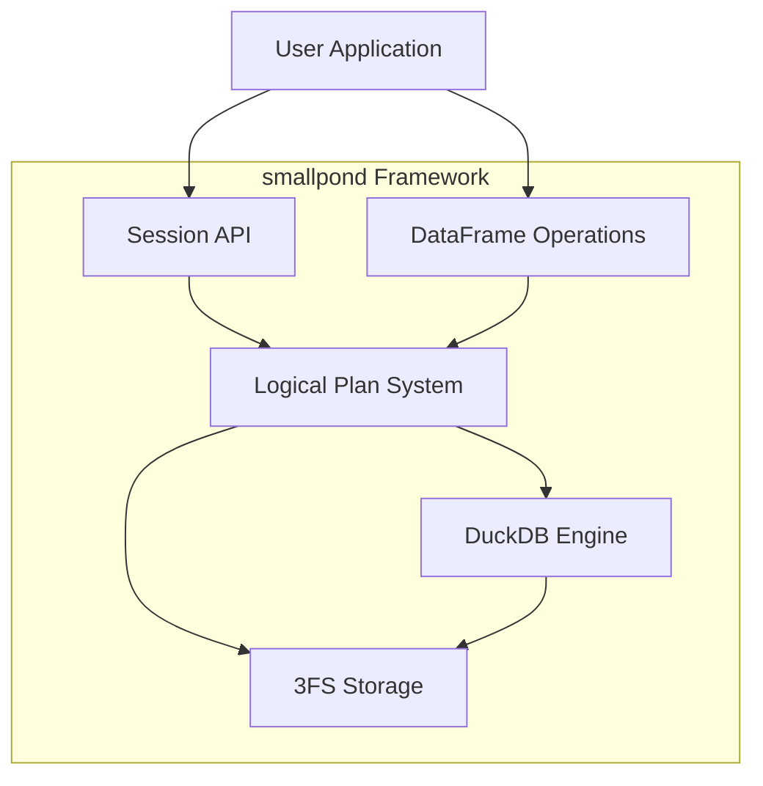
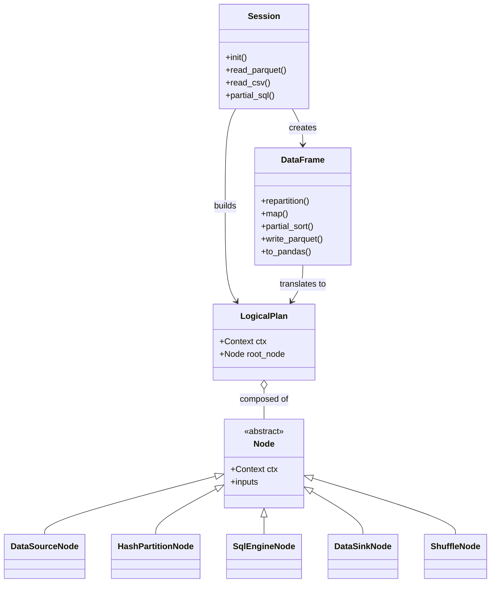
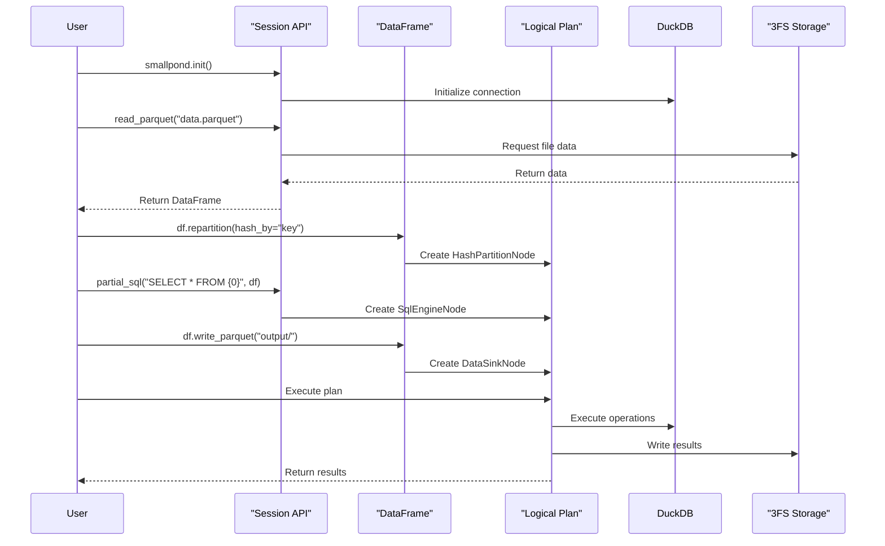

<!-- source: DeepWiki mcp.deepwiki.com · repo deepseek-ai/smallpond · page 1 Overview · fetched 2026-10-30 -->

# Overview

Relevant source files

The following files were used as context for generating this wiki page:

- [README.md](README.md)
- [smallpond/common.py](smallpond/common.py)

This page provides an introduction to Smallpond, a lightweight, high-performance data processing framework built on DuckDB and 3FS. Smallpond enables efficient processing of large-scale datasets without requiring long-running services, making it suitable for both batch processing and analytical workloads.

For detailed architecture information, see [Architecture](#1.1). For installation and basic usage, see [Getting Started](#1.2).

## What is Smallpond?

Smallpond is a Python-based data processing framework designed to handle large-scale data operations efficiently. By leveraging DuckDB for query processing and 3FS for distributed storage, Smallpond provides a scalable solution for data operations ranging from gigabytes to petabytes in size.

Title: Core Components of Smallpond

Sources: [README.md:8-15](), [smallpond/common.py:10-29]()

## Key Features

Smallpond offers several distinctive features that make it powerful for data processing tasks:

- **High Performance**: Built on DuckDB's columnar query engine for fast analytical processing.
- **Scalability**: Capable of handling datasets from megabytes to petabytes.
- **Simple Deployment**: No need for long-running services or complex cluster setup.
- **Flexible Processing**: Supports operations like partitioning, shuffling, and sorting large datasets.
- **SQL Integration**: Seamless integration with SQL through DuckDB.
- **Distributed Processing**: Works with 3FS distributed file system for large-scale processing.

The framework has been proven to handle massive workloads, such as sorting 110.5TiB of data in approximately 30 minutes using the GraySort benchmark.

Sources: [README.md:10-15](), [README.md:57-60]()

## System Architecture

Smallpond's architecture consists of several layers working together to provide a complete data processing solution.

Title: Smallpond Component Architecture

Sources: [README.md:32-47](), [smallpond/common.py:9-29]()

### Key Components

1. **Session API**: The primary interface for users, providing methods to initialize a session, read data, and perform SQL operations.

2. **DataFrame**: Represents a distributed dataset with operations like repartition, map, and sort.

3. **Logical Plan System**: The execution framework that transforms high-level operations into a directed acyclic graph (DAG) of processing nodes.

4. **DuckDB Engine**: The underlying query execution engine that provides SQL processing capabilities.

5. **3FS Storage**: The distributed file system that enables large-scale data processing.

Sources: [README.md:32-47]()

## Data Processing Flow

A typical data processing workflow in Smallpond follows these steps:

Title: Smallpond Data Processing Flow

Sources: [README.md:32-47]()

## Usage Example

Here's a basic example of using Smallpond to process data:

1. Initialize a session
2. Read data from a Parquet file
3. Repartition the data based on a column
4. Execute SQL on the data
5. Write results or convert to pandas

The framework provides constants for common size units (`KB`, `MB`, `GB`, `TB`) and default configuration values that can be used when processing data.

Sources: [README.md:26-48](), [smallpond/common.py:10-29]()

## Performance Characteristics

Smallpond is designed for high-performance data processing, with several optimizations:

- **Partitioning and Shuffling**: Efficient redistribution of data for parallel processing
- **Row Group Optimization**: Configurable row group sizes for Parquet files
- **Memory Management**: Controls to manage memory usage during processing
- **Batch Processing**: Default batch sizes optimized for performance

The framework has been evaluated using the GraySort benchmark on a cluster of 50 compute nodes and 25 storage nodes, achieving an impressive throughput of 3.66TiB/min when sorting 110.5TiB of data.

Sources: [README.md:57-60](), [smallpond/common.py:10-29]()

## Related Documentation

Smallpond's documentation is organized into several sections:

- [Architecture](#1.1): Detailed architectural overview
- [Getting Started](#1.2): Installation and basic usage
- [Key Concepts](#1.3): Fundamental concepts like sessions and DataFrames
- [Core API](#2): Main API components and interfaces
- [Logical Plan System](#3): Execution framework for data operations
- [Data Processing](#4): Reading, writing, and transforming data
- [Benchmarking](#5): Performance measurement tools
- [Examples](#6): Sample applications demonstrating usage

## Summary

Smallpond is a lightweight yet powerful data processing framework that combines the analytical capabilities of DuckDB with the distributed storage of 3FS. It provides a flexible and efficient solution for processing large datasets without the complexity of traditional big data systems. The framework's architecture enables seamless scaling from small datasets to petabyte-scale processing with minimal configuration.

Sources: [README.md:8-15](), [README.md:57-60]()

---

