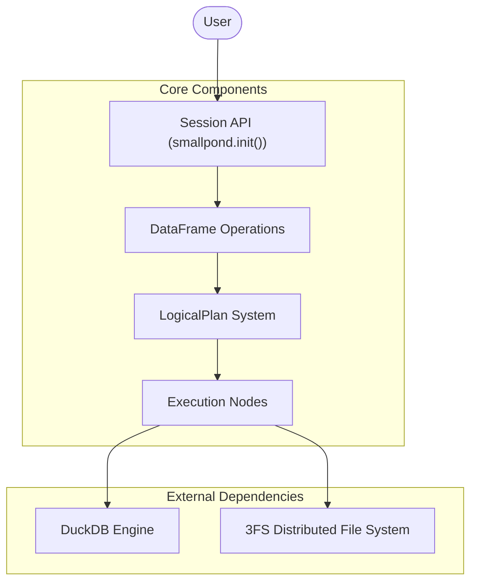
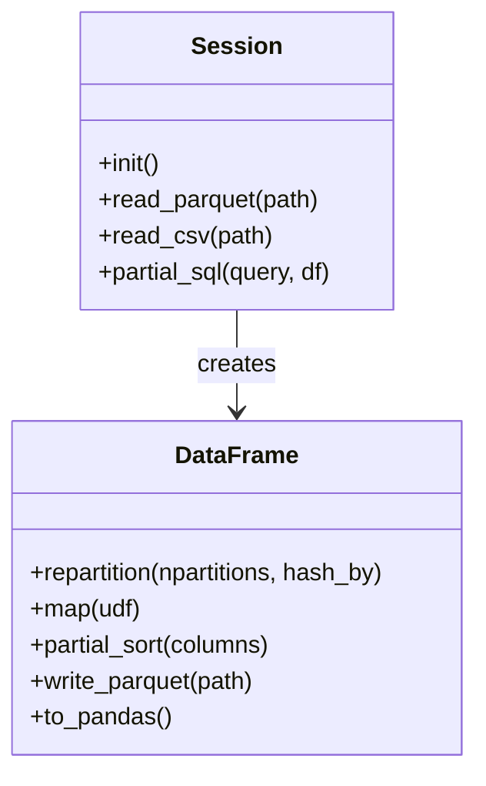
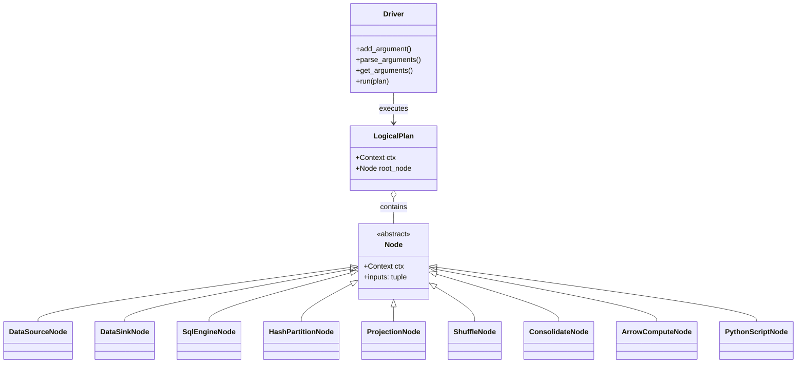
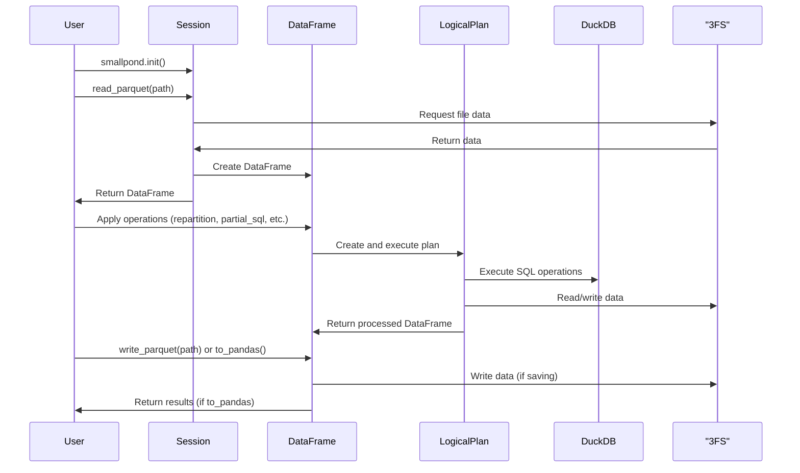
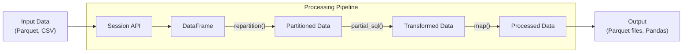
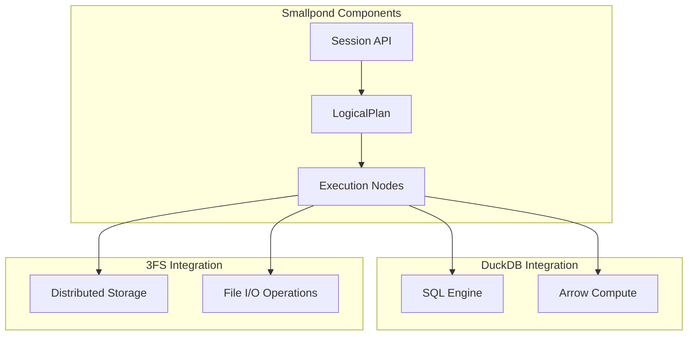
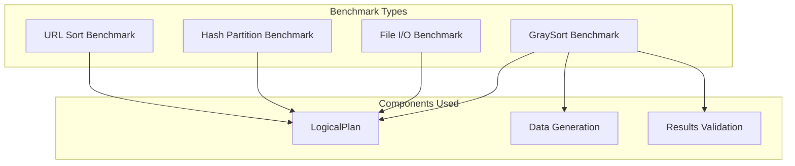

<!-- source: DeepWiki mcp.deepwiki.com · repo deepseek-ai/smallpond · page 1.1 Architecture · fetched 2026-10-30 -->

# Architecture

<details>
<summary>Relevant source files</summary>

The following files were used as context for generating this wiki page:

- [README.md](README.md)
- [smallpond/common.py](smallpond/common.py)

</details>


This document provides a detailed overview of the smallpond framework architecture, explaining its components, interactions, and design principles. For information about installation and basic usage, see [Getting Started](#1.2). For an explanation of fundamental concepts, see [Key Concepts](#1.3).

## System Overview

Smallpond is a lightweight data processing framework built on [DuckDB](https://duckdb.org/) and [3FS](https://github.com/deepseek-ai/3FS), designed for high-performance data processing at scale without requiring long-running services. The architecture follows a layered approach, separating high-level APIs from execution planning and underlying storage and compute engines.

### High-Level Architecture



Sources: [README.md:8-15]()

## Core Components

### Session API

The Session API provides the primary entry point for users to interact with smallpond. It offers methods for initializing a session, reading data, creating DataFrames, executing SQL queries, and writing results.

```python
# Example usage
import smallpond
sp = smallpond.init()
df = sp.read_parquet("data.parquet")
df = df.repartition(3, hash_by="column_name")
df = sp.partial_sql("SELECT * FROM {0} WHERE value > 100", df)
df.write_parquet("output/")
```

Sources: [README.md:34-47]()

### DataFrame Operations

The DataFrame abstraction represents a dataset that can be processed and transformed through a variety of operations. The DataFrame is not loaded entirely into memory; instead, it represents a reference to data that may be distributed across multiple files and partitions.



Sources: Based on examples in [README.md:34-48]()

### Logical Plan System

The LogicalPlan system is the core execution framework for complex data operations in smallpond. It represents the execution plan as a directed acyclic graph (DAG) of nodes, where each node represents a specific operation.



Sources: From the provided high-level diagrams

### Node Types

The Logical Plan system includes various node types, each handling specific operations in the data processing pipeline:

| Node Type | Purpose |
|-----------|---------|
| DataSourceNode | Reads data from storage (files, etc.) |
| DataSinkNode | Writes data to storage |
| SqlEngineNode | Executes SQL queries via DuckDB |
| HashPartitionNode | Partitions data based on hash values |
| ProjectionNode | Selects specific columns |
| ShuffleNode | Redistributes data across partitions |
| ConsolidateNode | Combines partitioned data |
| ArrowComputeNode | Performs operations using Apache Arrow |
| PythonScriptNode | Executes Python code on data |
| DataSetPartitionNode | Partitions datasets |
| StreamCopy | Copies data between streams |

Sources: From the provided high-level diagrams

## Data Flow

### Typical Processing Workflow

A typical data processing workflow in smallpond follows these steps:



Sources: Based on examples in [README.md:32-48]()

### Flow Through Components



Sources: Based on workflow in [README.md:32-48]()

## Integration with External Systems

### DuckDB Integration

Smallpond leverages DuckDB as its SQL execution engine, providing:
- In-process SQL processing capabilities
- Efficient columnar data operations
- SQL query execution via the `partial_sql` method

### 3FS Integration

3FS serves as the distributed file system for smallpond, offering:
- Scalable storage for large datasets
- Distributed file operations
- Support for handling petabyte-scale data



Sources: [README.md:8]() and provided diagrams

## System Constants and Configuration

Smallpond defines several important constants for system configuration:

| Constant | Value | Purpose |
|----------|-------|---------|
| KB, MB, GB, TB | Size units | Memory and storage size units |
| MAX_ROW_GROUP_SIZE | 10 * 1024 * 1024 | Maximum row group size for Parquet files |
| MAX_ROW_GROUP_BYTES | 2 * GB | Maximum row group size in bytes |
| MAX_PARQUET_FILE_BYTES | 8 * GB | Maximum size for a single Parquet file |
| DEFAULT_ROW_GROUP_SIZE | 122880 | Default row group size |
| DEFAULT_BATCH_SIZE | 122880 | Default batch size for processing |

Sources: [smallpond/common.py:10-29]()

## Design Principles

Smallpond's architecture is guided by several key design principles:

### 1. Layered Architecture

Clear separation between high-level APIs (Session), execution planning (LogicalPlan), and underlying engines (DuckDB, 3FS).

### 2. Composability

The node-based logical plan system allows complex data processing pipelines to be built from simple, composable operations.

### 3. Multiple API Styles

- A high-level, fluent API through the Session object (e.g., `df.repartition().partial_sort()`)
- A lower-level, more explicit API through the LogicalPlan system

### 4. Performance Focus

The architecture emphasizes performance for large-scale data processing, demonstrated by benchmarks like GraySort:



Sources: [README.md:56-60]() and provided diagrams

### 5. Extensibility

Various node types and engine options (DuckDB, Arrow, custom) allow for extending the system's capabilities.

## Performance Characteristics

Smallpond is designed for high-performance data processing, demonstrated by its GraySort benchmark results:

- Sorted 110.5TiB of data in 30 minutes and 14 seconds
- Achieved an average throughput of 3.66TiB/min
- Utilized a cluster of 50 compute nodes and 25 storage nodes

Sources: [README.md:56-60]()

## Conclusion

Smallpond provides a lightweight yet powerful data processing framework by combining:

1. A user-friendly Session API
2. A flexible LogicalPlan execution system
3. Efficient integration with DuckDB for SQL processing
4. Scalable storage through 3FS

This architecture enables processing of petabyte-scale datasets with high performance while maintaining a simple interface for users.

For more information on using the framework, see the [Core API](#2) section of the documentation.

---

