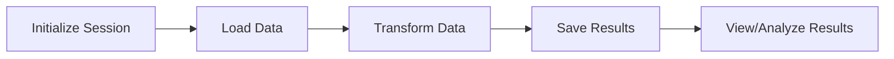
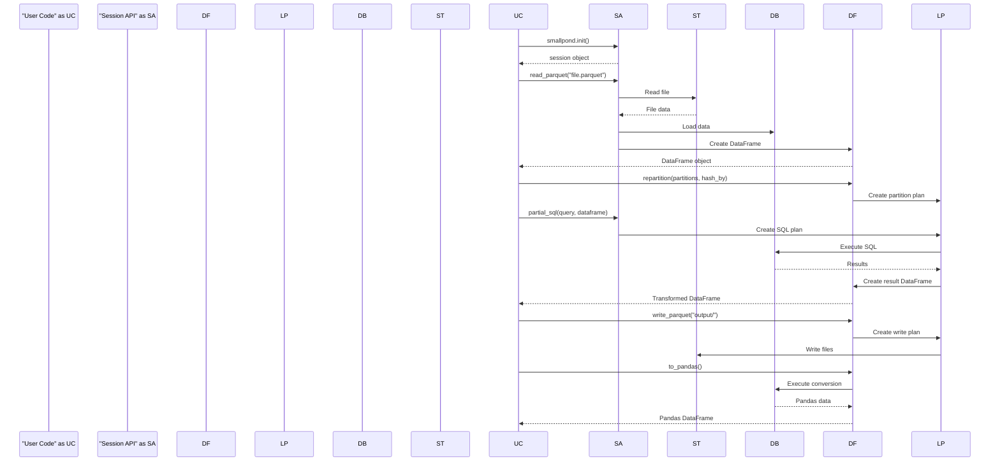

<!-- source: DeepWiki mcp.deepwiki.com · repo deepseek-ai/smallpond · page 1.2 Getting Started · fetched 2026-10-30 -->

# Getting Started

<details>
<summary>Relevant source files</summary>

The following files were used as context for generating this wiki page:

- [LICENSE](LICENSE)
- [README.md](README.md)

</details>


This guide provides step-by-step instructions for installing and running your first Smallpond data processing workflow. It covers installation, basic usage patterns, and demonstrates how to load, transform, and save data. For more detailed information about core concepts and the API, see [Key Concepts](#1.3) and [Core API](#2).

## Installation

Smallpond supports Python 3.8 to 3.12. Installation is straightforward using pip:

```bash
pip install smallpond
```

To install with development tools for contributing to the project:

```bash
pip install .[dev]
```

For documentation development:

```bash
pip install .[docs]
```

Sources: [README.md:16-22](), [README.md:69-81]()

## Basic Usage Flow

A typical Smallpond workflow follows these steps:



Let's walk through this workflow with a simple example using each step.

Sources: [README.md:24-48]()

### Step 1: Initialize a Session

The first step in any Smallpond workflow is to create a session:

```python
import smallpond

# Initialize session
sp = smallpond.init()
```

This initializes a session that serves as your entry point to the Smallpond framework. The session object manages connections to the underlying DuckDB engine and provides access to data loading and processing capabilities.

Sources: [README.md:31-35]()

### Step 2: Load Data

After initializing a session, you can load data from various sources. Here's an example loading a Parquet file:

```python
# Load data from Parquet file
df = sp.read_parquet("prices.parquet")
```

You can download sample data for this example:

```bash
wget https://duckdb.org/data/prices.parquet
```

Sources: [README.md:26-38]()

### Step 3: Transform Data

Smallpond provides various operations for data transformation. Here's an example that:
1. Repartitions the data based on a specific column
2. Runs a SQL query to calculate statistics

```python
# Repartition by ticker symbol with 3 partitions
df = df.repartition(3, hash_by="ticker")

# Run a SQL query to calculate min and max prices by ticker
df = sp.partial_sql("SELECT ticker, min(price), max(price) FROM {0} GROUP BY ticker", df)
```

Sources: [README.md:40-42]()

### Step 4: Save and View Results

Once you've transformed your data, you can save the results to disk and/or convert them to a pandas DataFrame for further analysis:

```python
# Save to Parquet files
df.write_parquet("output/")

# Convert to pandas DataFrame and display
print(df.to_pandas())
```

Sources: [README.md:44-47]()

## System Components Interaction

The following diagram shows how your code interacts with the Smallpond framework's components during a typical workflow:



Sources: [README.md:24-48]()

## Code Entity Relationships

This diagram shows the relationship between key code entities in the Smallpond API that you'll interact with:

```mermaid
classDiagram
    class "smallpond" {
        +init() Session
    }
    
    class "Session" {
        +read_parquet(path) DataFrame
        +read_csv(path) DataFrame
        +partial_sql(query, df) DataFrame
    }
    
    class "DataFrame" {
        +repartition(n_parts, hash_by) DataFrame
        +map(map_fn) DataFrame
        +partial_sort(by, asc) DataFrame
        +write_parquet(path) None
        +to_pandas() pandas.DataFrame
    }
    
    smallpond ..> Session : creates
    Session ..> DataFrame : produces
    DataFrame ..> DataFrame : transforms
```

Sources: [README.md:31-47]()

## Complete Example

Here's a complete example that demonstrates a basic Smallpond workflow from start to finish:

```python
import smallpond

# Initialize session
sp = smallpond.init()

# Load data
df = sp.read_parquet("prices.parquet")

# Process data
df = df.repartition(3, hash_by="ticker")
df = sp.partial_sql("SELECT ticker, min(price), max(price) FROM {0} GROUP BY ticker", df)

# Save results
df.write_parquet("output/")

# Show results
print(df.to_pandas())
```

This example:
1. Initializes a Smallpond session
2. Loads stock price data from a Parquet file
3. Repartitions the data into 3 partitions based on the ticker symbol
4. Runs a SQL query to calculate the minimum and maximum price for each ticker
5. Saves the results to Parquet files in an "output" directory
6. Converts the results to a pandas DataFrame and displays them

Sources: [README.md:31-47]()

## Next Steps

Now that you have a basic understanding of how to use Smallpond, you can explore more advanced features:

- Learn about [Key Concepts](#1.3) to understand sessions, DataFrames, and partitioning in more detail
- Explore the [Session API](#2.1) for more detailed information on session initialization and operations
- Discover [DataFrame Operations](#2.2) for a comprehensive list of data transformation methods
- See how to use [SQL Integration](#2.3) for complex data processing tasks
- Read about [Reading and Writing Data](#4.1) for working with different file formats

For examples of real-world applications built with Smallpond, check out the [Examples](#6) section.

---

