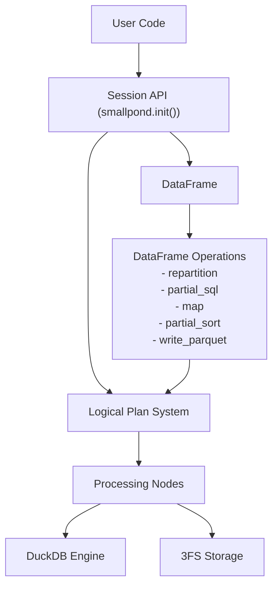
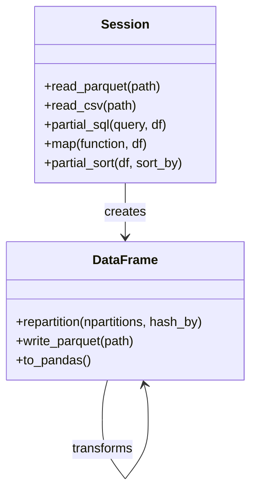
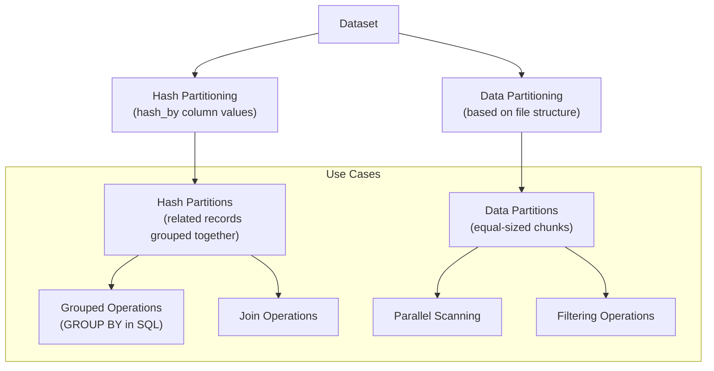
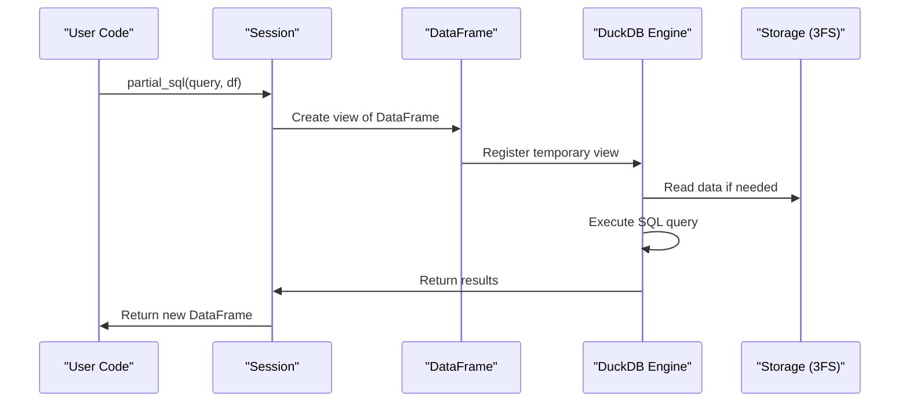
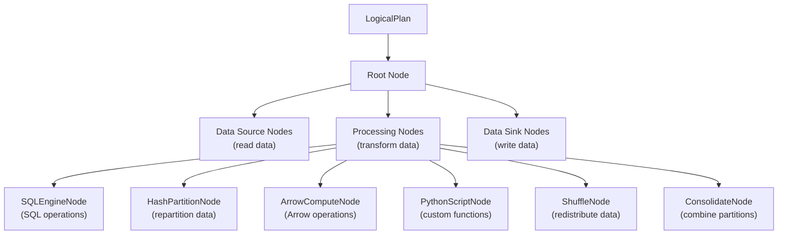
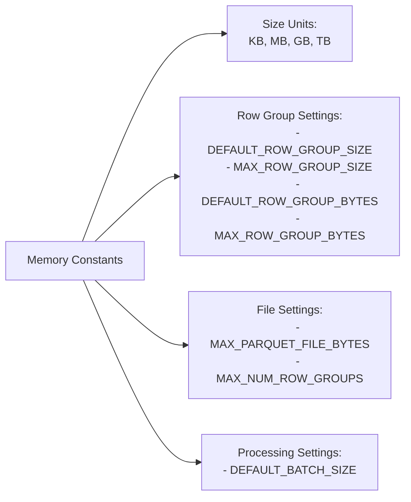
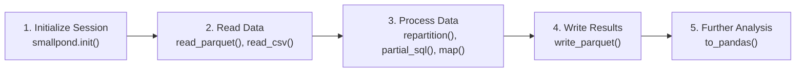
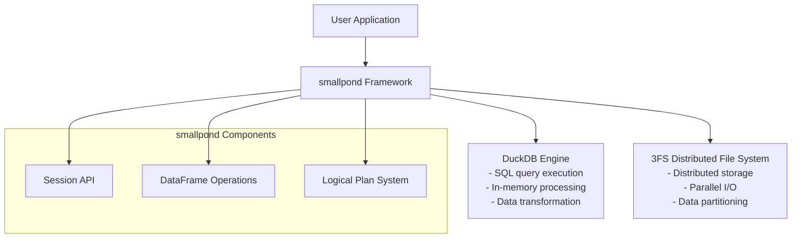

<!-- source: DeepWiki mcp.deepwiki.com · repo deepseek-ai/smallpond · page 1.3 Key Concepts · fetched 2026-10-30 -->

# Key Concepts

<details>
<summary>Relevant source files</summary>

The following files were used as context for generating this wiki page:

- [README.md](README.md)
- [smallpond/common.py](smallpond/common.py)

</details>


This page explains the fundamental concepts in smallpond, such as sessions, DataFrames, partitioning, and SQL integration. Understanding these concepts is essential for effectively using the smallpond framework. For details on specific APIs, see [Core API](#2), and for information about the execution framework, see [Logical Plan System](#3).

## Core Components Overview

Smallpond is built around several key components that work together to provide a lightweight yet powerful data processing framework.



Sources: [README.md:32-47]()

## Session

A session is the entry point to smallpond and serves as the context for all data operations. Sessions manage connections to the underlying DuckDB engine and provide methods for creating DataFrames.

### Creating a Session

Sessions are created using the `smallpond.init()` function, which returns a session object:

```python
import smallpond

# Initialize a new session
sp = smallpond.init()
```

The session provides methods for reading data (like `read_parquet`, `read_csv`) and creating DataFrames, as well as executing SQL queries directly.

Sources: [README.md:34-35]()

## DataFrame

A DataFrame in smallpond is a tabular data structure similar to pandas DataFrames but optimized for distributed processing. It represents a collection of rows and columns that can be processed using various operations.

### DataFrame Operations

DataFrames support various operations:



Example of using DataFrame operations:

```python
# Read data into a DataFrame
df = sp.read_parquet("prices.parquet")

# Repartition the data
df = df.repartition(3, hash_by="ticker")

# Run SQL operation
df = sp.partial_sql("SELECT ticker, min(price), max(price) FROM {0} GROUP BY ticker", df)

# Write results
df.write_parquet("output/")

# Convert to pandas DataFrame for further analysis
pandas_df = df.to_pandas()
```

Sources: [README.md:37-47]()

## Partitioning

Partitioning is a key concept in smallpond that enables distributed processing of large datasets by splitting them into manageable chunks.

### Types of Partitioning



The framework implements partitioning through functions like `split_into_rows`, `split_into_cols`, and `get_nth_partition` in the common module.

Sources: [smallpond/common.py:72-101]()

### Partition Constants

Smallpond defines several constants related to partitioning and file handling:

- `DATA_PARTITION_COLUMN_NAME`: Special column name used for partitioning (`__data_partition__`)
- `DEFAULT_ROW_GROUP_SIZE`: Default size for Parquet row groups (122880 rows)
- `MAX_ROW_GROUP_SIZE`: Maximum row group size (10MB)
- `MAX_PARQUET_FILE_BYTES`: Maximum size for Parquet files (8GB)

Sources: [smallpond/common.py:10-29]()

## SQL Integration

Smallpond tightly integrates with SQL through DuckDB, allowing SQL queries to be executed on DataFrames.

### Partial SQL Execution

The `partial_sql` method enables executing SQL queries on DataFrames:



Example:
```python
# Execute SQL on a DataFrame
result_df = sp.partial_sql("SELECT ticker, AVG(price) as avg_price FROM {0} GROUP BY ticker", df)
```

The SQL integration allows for complex data transformations and aggregations using familiar SQL syntax, leveraging DuckDB's high-performance SQL engine.

Sources: [README.md:42]()

## Logical Plan

The Logical Plan is the execution framework that underpins all operations in smallpond. It represents a directed acyclic graph of processing nodes that describe how data should be transformed.

### Node Types and Processing Flow



When executing DataFrame operations like `repartition()` or `partial_sql()`, smallpond creates a logical plan behind the scenes and executes it using the appropriate nodes.

Sources: [README.md:35-47]()

## Memory and Resource Management

Smallpond defines constants for memory management and resource allocation that affect performance:



These constants help control how smallpond processes data and allocates resources, which is important for handling large datasets efficiently.

Sources: [smallpond/common.py:10-29]()

## Data Flow in Smallpond

The typical data flow in smallpond follows this pattern:



This flow represents the standard pattern for data processing in smallpond, from initialization to final output or analysis.

Sources: [README.md:32-47]()

## Error Handling

Smallpond defines several error classes for handling different failure scenarios:

- `SmallpondError`: Base class for all errors in smallpond
- `InjectedFault`: Used for testing fault scenarios
- `OutOfMemory`: Indicates memory allocation failures
- `NonzeroExitCode`: Indicates a process exited with an error code

These error classes help with proper error handling and debugging in smallpond applications.

Sources: [smallpond/common.py:48-61]()

## Relationship with Underlying Technologies

Smallpond is built on top of DuckDB for query processing and 3FS for distributed storage. Understanding this relationship is important for effective use of the framework.



The integration with DuckDB provides high-performance SQL processing, while 3FS enables scalable distributed storage, allowing smallpond to process large datasets efficiently.

Sources: [README.md:8-14]()

---

