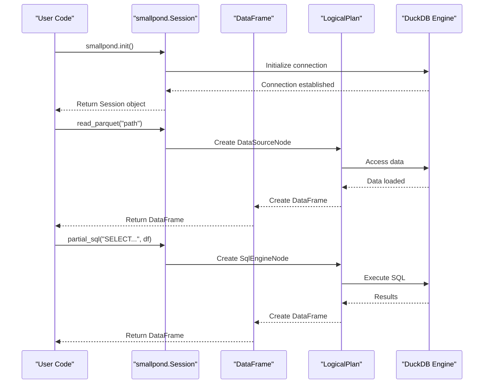
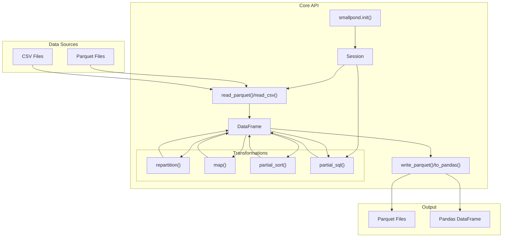
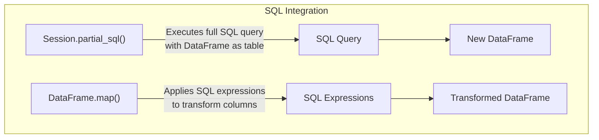

<!-- source: DeepWiki mcp.deepwiki.com · repo deepseek-ai/smallpond · page 2 Core API · fetched 2026-10-30 -->

# Core API

<details>
<summary>Relevant source files</summary>

The following files were used as context for generating this wiki page:

- [README.md](README.md)
- [examples/sort_mock_urls_v2.py](examples/sort_mock_urls_v2.py)

</details>


The Core API of smallpond provides the primary interfaces that applications use to interact with the framework. It serves as the foundation for data processing operations, enabling users to efficiently work with large-scale datasets without dealing with the complexities of the underlying systems. For detailed information about the implementation of the logical plan system that powers these operations, see [Logical Plan System](#3).

## Overview of the Core API

The smallpond Core API is designed as a layered architecture that provides both high-level, user-friendly interfaces and lower-level components for advanced use cases. It abstracts the complexity of distributed data processing while leveraging the performance capabilities of DuckDB and 3FS.

```mermaid
classDiagram
    class "User Application" {
        Uses smallpond API
    }
    
    class "Core API" {
        Entry point for framework
    }
    
    class "Session" {
        +init()
        +read_parquet()
        +read_csv()
        +partial_sql()
    }
    
    class "DataFrame" {
        +repartition()
        +map()
        +partial_sort()
        +write_parquet()
        +to_pandas()
    }
    
    class "SQL Interface" {
        +partial_sql()
        SQL execution
    }
    
    class "LogicalPlan System" {
        Execution engine
    }
    
    class "Storage Backends" {
        DuckDB
        3FS
    }
    
    "User Application" --> "Core API"
    "Core API" --> "Session"
    "Session" --> "DataFrame"
    "Session" --> "SQL Interface"
    "DataFrame" --> "LogicalPlan System"
    "SQL Interface" --> "LogicalPlan System"
    "LogicalPlan System" --> "Storage Backends"
```

Sources: [README.md:8-48](), [examples/sort_mock_urls_v2.py:4-20]()

## Key Components

### Session

The Session is the primary entry point to the smallpond framework. It provides methods for initializing the framework, reading data from various sources, and executing SQL operations.



Key Session API methods:
- `smallpond.init()`: Initializes a new smallpond session
- `read_parquet()`: Reads Parquet files into a DataFrame
- `read_csv()`: Reads CSV files into a DataFrame
- `partial_sql()`: Executes SQL queries on DataFrames

Sources: [README.md:32-42](), [examples/sort_mock_urls_v2.py:8-9](), [examples/sort_mock_urls_v2.py:29-30]()

### DataFrame

The DataFrame is the core data abstraction in smallpond, representing a distributed collection of data that can be transformed through various operations.

| Operation | Description | Example Usage |
|-----------|-------------|--------------|
| `repartition()` | Redistributes data into specified number of partitions | `df.repartition(3, hash_by="ticker")` |
| `map()` | Applies transformations using SQL expressions | `df.map("column1 + column2 as sum")` |
| `partial_sort()` | Sorts data within partitions | `df.partial_sort(by=["column1", "column2"])` |
| `write_parquet()` | Writes DataFrame to Parquet files | `df.write_parquet("output/")` |
| `to_pandas()` | Converts DataFrame to pandas DataFrame | `df.to_pandas()` |

Sources: [README.md:41-47](), [examples/sort_mock_urls_v2.py:9-19]()

## Data Processing Flow

The following diagram illustrates the typical flow of data through the smallpond Core API:



Sources: [README.md:32-47](), [examples/sort_mock_urls_v2.py:8-19]()

## SQL Integration

A key strength of smallpond is its integration with SQL through the DuckDB engine. This allows users to leverage SQL's power for data transformations while maintaining the distributed processing capabilities of the framework.

SQL operations can be performed in two primary ways:
1. Using `partial_sql()` from the Session object to execute SQL on DataFrames
2. Using `map()` on DataFrames to apply SQL expressions for transformations



Examples of SQL usage:

1. Using `partial_sql()`:
   ```
   df = sp.partial_sql("SELECT ticker, min(price), max(price) FROM {0} GROUP BY ticker", df)
   ```

2. Using `map()`:
   ```
   urls = dataset.map("""
       split_part(urlstr, '/', 1) as host,
       split_part(urlstr, ' ', 1) as url,
       from_base64(valstr) AS payload
   """)
   ```

Sources: [README.md:42](), [examples/sort_mock_urls_v2.py:10-16]()

## Relationship with Logical Plan System

The Core API provides a high-level interface that abstracts the underlying Logical Plan system. Every operation performed through the Core API is translated into a logical plan that is then executed by the framework.

```mermaid
classDiagram
    class "Core API" {
        High-level interface
    }
    
    class "Session" {
        +init()
        +read_parquet()
        +partial_sql()
    }
    
    class "DataFrame" {
        +repartition()
        +map()
        +partial_sort()
    }
    
    class "LogicalPlan" {
        +Node root_node
        Execution plan
    }
    
    class "Node" {
        <<abstract>>
    }
    
    class "DataSourceNode" {
        Reading data
    }
    
    class "HashPartitionNode" {
        Partitioning data
    }
    
    class "SqlEngineNode" {
        SQL execution
    }
    
    class "DataSinkNode" {
        Writing data
    }
    
    "Core API" --> "Session"
    "Core API" --> "DataFrame"
    "Session" --|> "LogicalPlan" : creates
    "DataFrame" --|> "LogicalPlan" : translated to
    "LogicalPlan" o-- "Node"
    "Node" <|-- "DataSourceNode"
    "Node" <|-- "HashPartitionNode"
    "Node" <|-- "SqlEngineNode"
    "Node" <|-- "DataSinkNode"
```

For more details on the Logical Plan system, see [Logical Plan System](#3).

Sources: [README.md:32-47]()

## Common Usage Patterns

The Core API is designed to support common data processing patterns in a clean, intuitive way. Here are the most common usage patterns:

1. **Basic workflow**: Initialize, read, transform, write
   ```python
   sp = smallpond.init()
   df = sp.read_parquet("input.parquet")
   # Perform transformations
   df.write_parquet("output/")
   ```

2. **Partitioning and transformation**:
   ```python
   df = df.repartition(10, hash_by="key_column")
   df = df.map("column1, column2 * 2 as doubled")
   ```

3. **SQL-based analytics**:
   ```python
   result = sp.partial_sql("SELECT col1, SUM(col2) FROM {0} GROUP BY col1", df)
   ```

4. **Distributed sorting**:
   ```python
   df = df.repartition(10, hash_by="sort_key")
   sorted_df = df.partial_sort(by=["sort_key"])
   ```

Sources: [README.md:32-47](), [examples/sort_mock_urls_v2.py:8-19]()

## Summary

The Core API of smallpond provides a user-friendly interface for distributed data processing, built on top of the more advanced Logical Plan system. Through the Session and DataFrame interfaces, users can perform complex data operations with simple, intuitive syntax while leveraging the performance benefits of DuckDB and 3FS.

Key components include:
- Session: Primary entry point and factory for DataFrames
- DataFrame: Core data abstraction with transformation operations
- SQL Integration: Powerful SQL capabilities through DuckDB

For more specific information about each component, refer to:
- [Session API](#2.1)
- [DataFrame Operations](#2.2)
- [SQL Integration](#2.3)

Sources: [README.md:8-15]()

---

