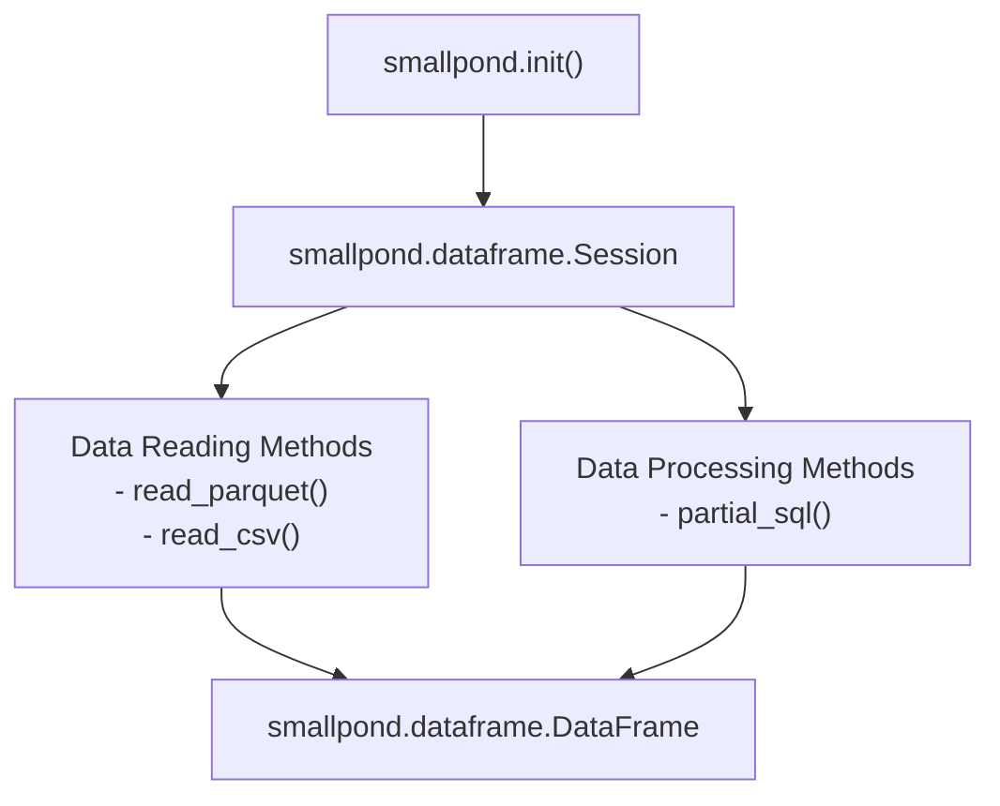
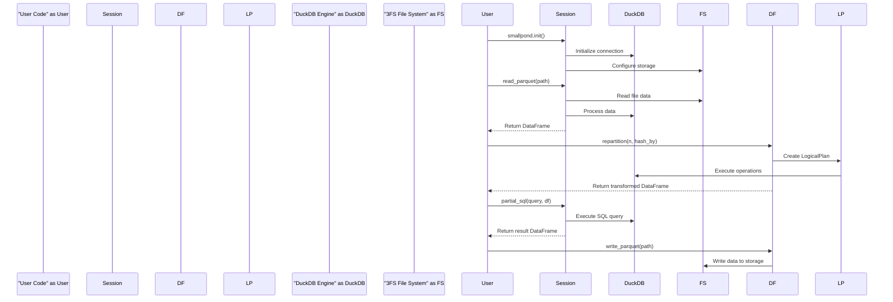
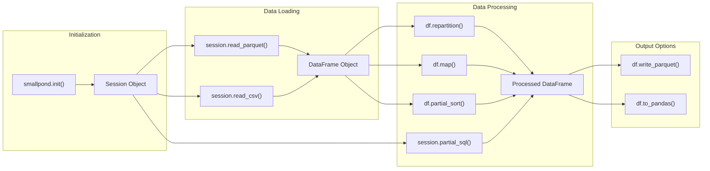

<!-- source: DeepWiki mcp.deepwiki.com · repo deepseek-ai/smallpond · page 2.1 Session API · fetched 2026-10-30 -->

# Session API

<details>
<summary>Relevant source files</summary>

The following files were used as context for generating this wiki page:

- [README.md](README.md)
- [examples/sort_mock_urls_v2.py](examples/sort_mock_urls_v2.py)

</details>


## Purpose and Scope

The Session API provides the primary entry point and high-level interface for interacting with the smallpond framework. It serves as the bridge between user applications and the underlying data processing capabilities of DuckDB and the 3FS distributed file system. For information about operations available on DataFrame objects returned by the Session API, see [DataFrame Operations](#2.2).

Sources: [README.md:32-47]()

## Initialization

The Session API is initialized through the `smallpond.init()` function, which returns a Session object that provides access to all framework capabilities:



**Title: Session API Initialization and Core Methods**

Sources: [README.md:34-35](), [examples/sort_mock_urls_v2.py:29]()

## Core Components

The Session API is built around two primary classes that facilitate data processing:

```mermaid
classDiagram
    class "smallpond" {
        +init() Session
    }
    
    class "smallpond.dataframe.Session" {
        +read_parquet(path: str|List[str]) DataFrame
        +read_csv(path: str|List[str], schema: dict, delim: str) DataFrame
        +partial_sql(query: str, *dataframes: DataFrame) DataFrame
    }
    
    class "smallpond.dataframe.DataFrame" {
        +repartition(n: int, hash_by: str) DataFrame
        +map(sql_expr: str) DataFrame
        +partial_sort(by: List[str]) DataFrame
        +write_parquet(path: str) None
        +to_pandas() pandas.DataFrame
    }
    
    note for "smallpond" "Entry point module"
    note for "smallpond.dataframe.Session" "Main interface"
    note for "smallpond.dataframe.DataFrame" "Data container"
    
    smallpond --> "smallpond.dataframe.Session" : creates
    "smallpond.dataframe.Session" --> "smallpond.dataframe.DataFrame" : returns
    "smallpond.dataframe.DataFrame" --> "smallpond.dataframe.DataFrame" : transforms
```

**Title: Session and DataFrame Class Structure**

Sources: [README.md:32-47](), [examples/sort_mock_urls_v2.py:5-19]()

## Data Loading Methods

The Session object provides methods for loading data from various file formats:

| Method | Description | Parameters | Returns |
|--------|-------------|------------|---------|
| `read_parquet` | Reads Parquet files | `path`: str or list of str | DataFrame |
| `read_csv` | Reads CSV files | `path`: str or list of str, `schema`: dict, `delim`: str | DataFrame |

Example usage:
```python
# Read a Parquet file
df = sp.read_parquet("prices.parquet")

# Read CSV with schema definition
df = sp.read_csv(
    ["data/*.tsv"], 
    schema={"urlstr": "varchar", "valstr": "varchar"}, 
    delim="\t"
)
```

Sources: [README.md:38](), [examples/sort_mock_urls_v2.py:9]()

## Data Processing Methods

The Session API includes the following method for data manipulation:

| Method | Description | Parameters | Returns |
|--------|-------------|------------|---------|
| `partial_sql` | Executes SQL queries against DataFrames | `query`: str, `*dataframes`: DataFrame | DataFrame |

The `partial_sql` method allows SQL operations to be performed on DataFrames, with placeholders ({0}, {1}, etc.) in the query string referring to the provided DataFrame objects.

Example:
```python
# Execute SQL on a DataFrame
result_df = sp.partial_sql(
    "SELECT ticker, min(price), max(price) FROM {0} GROUP BY ticker", 
    df
)
```

Sources: [README.md:42]()

## System Integration

The Session API integrates with other components of the smallpond framework:



**Title: Session API Interaction with Framework Components**

Sources: [README.md:32-47](), [examples/sort_mock_urls_v2.py:8-19]()

## Typical Data Flow

This diagram illustrates the standard data processing flow when using the Session API:



**Title: Session API Data Processing Pipeline**

Sources: [README.md:32-47](), [examples/sort_mock_urls_v2.py:8-19]()

## Example Usage Patterns

### Basic Data Processing

```python
import smallpond

# Initialize session
sp = smallpond.init()

# Load data
df = sp.read_parquet("prices.parquet")

# Process data
df = df.repartition(3, hash_by="ticker")
df = sp.partial_sql("SELECT ticker, min(price), max(price) FROM {0} GROUP BY ticker", df)

# Save results
df.write_parquet("output/")
# Show results
print(df.to_pandas())
```

Sources: [README.md:32-47]()

### URL Data Processing

```python
def sort_mock_urls_v2(sp: Session, input_paths: List[str], output_path: str, npartitions: int):
    # Read CSV data with tab delimiter and schema definition
    dataset = sp.read_csv(
        input_paths, 
        schema={"urlstr": "varchar", "valstr": "varchar"}, 
        delim=r"\t"
    ).repartition(npartitions)
    
    # Transform using SQL expressions
    urls = dataset.map(
        """
    split_part(urlstr, '/', 1) as host,
    split_part(urlstr, ' ', 1) as url,
    from_base64(valstr) AS payload
  """
    )
    
    # Repartition by host column
    urls = urls.repartition(npartitions, hash_by="host")
    
    # Sort URLs by host
    sorted_urls = urls.partial_sort(by=["host"])
    
    # Write results to Parquet format
    sorted_urls.write_parquet(output_path)
```

Sources: [examples/sort_mock_urls_v2.py:8-19]()

---

