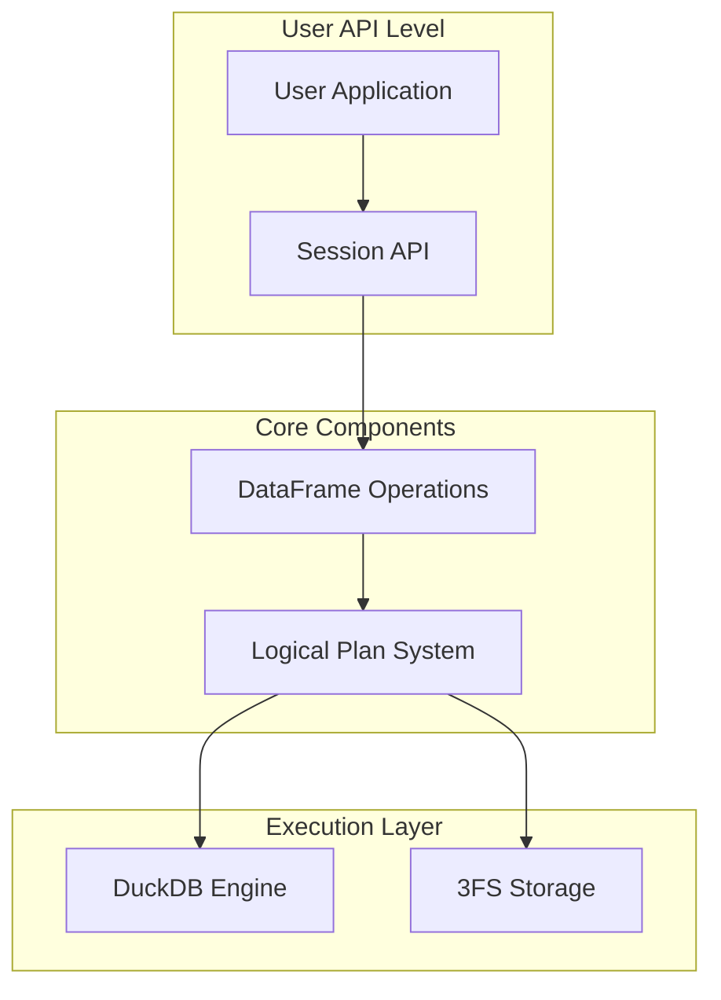
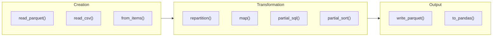
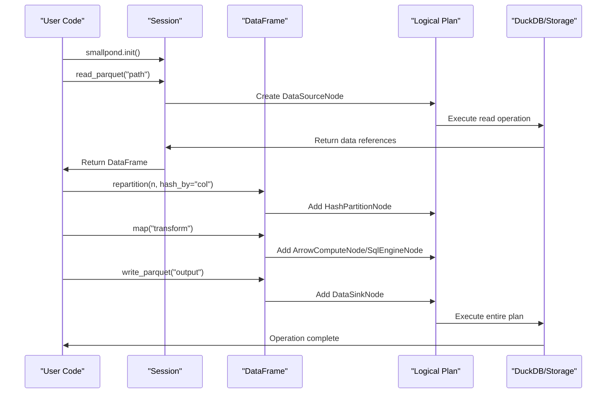

<!-- source: DeepWiki mcp.deepwiki.com · repo deepseek-ai/smallpond · page 2.2 DataFrame Operations · fetched 2026-10-30 -->

# DataFrame Operations

<details>
<summary>Relevant source files</summary>

The following files were used as context for generating this wiki page:

- [README.md](README.md)
- [examples/fstest.py](examples/fstest.py)
- [examples/sort_mock_urls_v2.py](examples/sort_mock_urls_v2.py)

</details>


## Purpose and Scope

This document details the DataFrame operations available in smallpond, a lightweight data processing framework. DataFrames in smallpond represent distributed tabular data that can be processed across multiple partitions. These operations provide a high-level API for data manipulation, transformation, and I/O operations while leveraging DuckDB for SQL processing and 3FS for distributed storage.

For information about SQL integration, see [SQL Integration](#2.3). For details on the underlying execution system, see [Logical Plan System](#3).

## DataFrames in smallpond Architecture



Sources: [README.md:32-47]()

## DataFrame Life Cycle



Sources: [README.md:38-46](), [examples/sort_mock_urls_v2.py:9-19]()

## Creating DataFrames

DataFrames in smallpond are typically created through the Session API, which provides methods for reading data from various sources.

### Reading From Files

```
# Read from Parquet files
df = sp.read_parquet("path/to/data.parquet")

# Read from CSV files with schema definition
df = sp.read_csv(paths, schema={"column1": "varchar", "column2": "integer"}, delim="\t")
```

The `read_csv()` method supports specifying a schema and delimiter, allowing for detailed control over how the data is interpreted.

### Creating From Python Objects

```
# Create a DataFrame from a list of dictionaries
df = sp.from_items([{"id": 1, "name": "Alice"}, {"id": 2, "name": "Bob"}])
```

Sources: [examples/sort_mock_urls_v2.py:9](), [examples/fstest.py:156-157](), [examples/fstest.py:162-163]()

## Core DataFrame Operations

### Repartitioning

The `repartition()` method redistributes data across a specified number of partitions:

```
# Repartition by hashing on a column
df = df.repartition(npartitions, hash_by="column_name")

# Repartition evenly by row count
df = df.repartition(npartitions, by_rows=True)
```

Repartitioning is fundamental for:
- Balancing workload across workers
- Co-locating related data for operations like joins or aggregations
- Controlling memory usage per partition

Sources: [README.md:41](), [examples/sort_mock_urls_v2.py:9](), [examples/sort_mock_urls_v2.py:17](), [examples/fstest.py:157](), [examples/fstest.py:164]()

### Data Transformation

#### Map Operations

The `map()` method applies transformations to each partition:

```
# Using a lambda function
df = df.map(lambda x: transform_data(x))

# Using SQL-like expressions
df = df.map("""
    column1 as renamed_column,
    function(column2) as transformed_column
""")
```

In the first form, a Python function is applied to each row. In the second form, SQL-like expressions define the transformation.

Sources: [examples/fstest.py:158](), [examples/sort_mock_urls_v2.py:10-16]()

#### SQL Operations

While not strictly a DataFrame method, `partial_sql()` from the Session API is commonly used with DataFrames:

```
# Apply SQL query with DataFrame as a placeholder
df = sp.partial_sql("SELECT column1, SUM(column2) FROM {0} GROUP BY column1", df)
```

The placeholder `{0}` is replaced with a reference to the DataFrame.

Sources: [README.md:42]()

#### Sorting

The `partial_sort()` method sorts data within each partition:

```
# Sort data within partitions by specified columns
df = df.partial_sort(by=["column1", "column2"])
```

This performs a local sort within each partition, not a global sort across all partitions.

Sources: [examples/sort_mock_urls_v2.py:18]()

### Data Output

#### Writing to Storage

```
# Write DataFrame to Parquet files
df.write_parquet("output_directory/")
```

Each partition is written as a separate Parquet file in the specified directory.

Sources: [README.md:45](), [examples/sort_mock_urls_v2.py:19]()

#### Converting to pandas

```
# Convert to pandas DataFrame for local analysis
pandas_df = df.to_pandas()
```

This operation collects all data to the driver node and should only be used for small to medium-sized result sets.

Sources: [README.md:47]()

## DataFrame Operation Flow



Sources: [README.md:34-47](), [examples/sort_mock_urls_v2.py:9-19]()

## Common Use Cases

### ETL Pipeline

```python
# Extract
df = sp.read_parquet("input_data/")

# Transform
df = df.repartition(10, hash_by="category")
df = df.map("transform_column(col1) as new_col, col2 * 2 as doubled")
df = sp.partial_sql("SELECT category, AVG(new_col) FROM {0} GROUP BY category", df)

# Load
df.write_parquet("output_data/")
```

### URL Processing Example

The following example demonstrates processing and sorting URLs:

```python
# Read tab-delimited data with schema
dataset = sp.read_csv(input_paths, schema={"urlstr": "varchar", "valstr": "varchar"}, delim=r"\t")

# Repartition for initial processing
dataset = dataset.repartition(npartitions)

# Transform data using map with SQL expressions
urls = dataset.map("""
    split_part(urlstr, '/', 1) as host,
    split_part(urlstr, ' ', 1) as url,
    from_base64(valstr) AS payload
""")

# Repartition by host for sorting
urls = urls.repartition(npartitions, hash_by="host")

# Sort within each partition
sorted_urls = urls.partial_sort(by=["host"])

# Write results to Parquet
sorted_urls.write_parquet(output_path)
```

Sources: [examples/sort_mock_urls_v2.py:9-19]()

## Performance Considerations

When working with DataFrame operations, consider:

1. **Partition Count**: Choose based on cluster size and data volume
   - Too few: limits parallelism
   - Too many: increases overhead

2. **Partition Key Selection**: 
   - For hash-based partitioning, choose columns with good distribution characteristics
   - Avoid columns with skewed values that would create imbalanced partitions

3. **Data Locality**: 
   - Operations are faster when data is processed locally
   - Minimize unnecessary data movement between nodes

4. **Memory Management**:
   - Consider available RAM when determining partition sizes
   - Monitor memory usage for operations that materialize data

5. **Conversion to pandas**:
   - Use `to_pandas()` only for reasonably sized results
   - For large datasets, write to storage and process in chunks

Sources: [README.md:41-46]()

## Integration with Logical Plan System

Under the hood, DataFrame operations create and modify a logical plan, which defines the execution flow. For more complex scenarios requiring fine-grained control, users can work directly with the Logical Plan API as described in [Logical Plan System](#3).

The translation from DataFrame operations to logical plan nodes is as follows:

| DataFrame Operation | Logical Plan Node |
|---------------------|-------------------|
| read_parquet/csv    | DataSourceNode    |
| repartition         | HashPartitionNode |
| map                 | ArrowComputeNode or SqlEngineNode |
| partial_sql         | SqlEngineNode     |
| partial_sort        | ArrowComputeNode  |
| write_parquet       | DataSinkNode      |

Sources: [README.md:34-47]()

---

