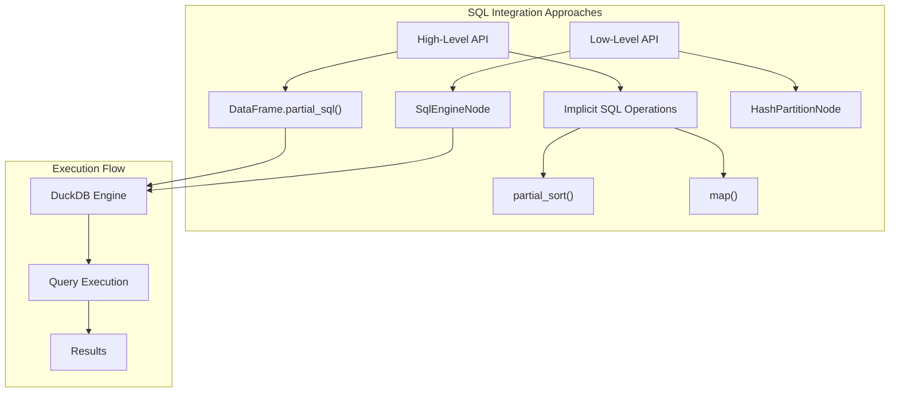
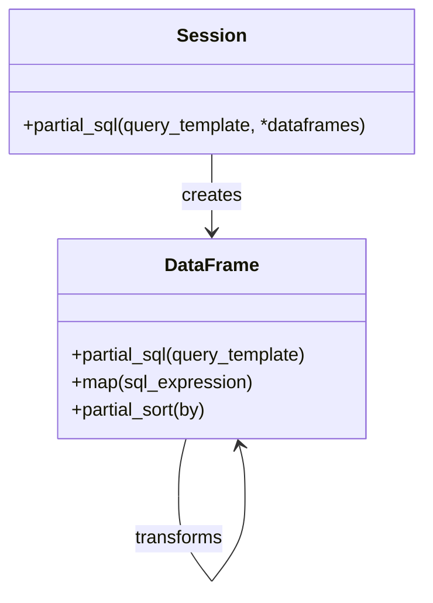
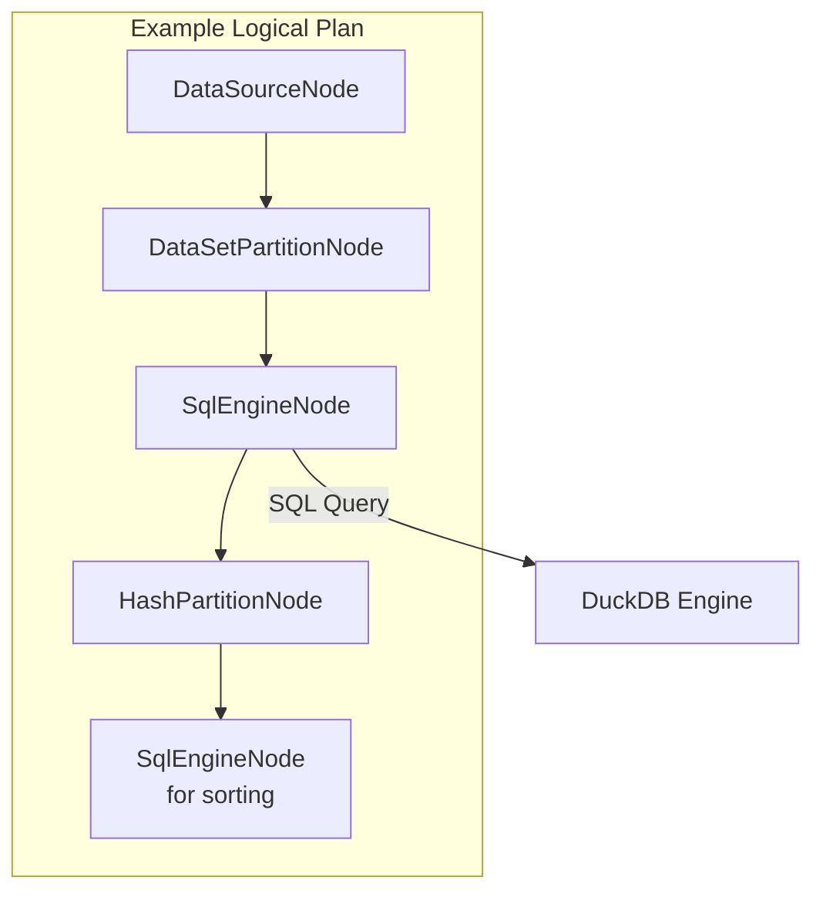
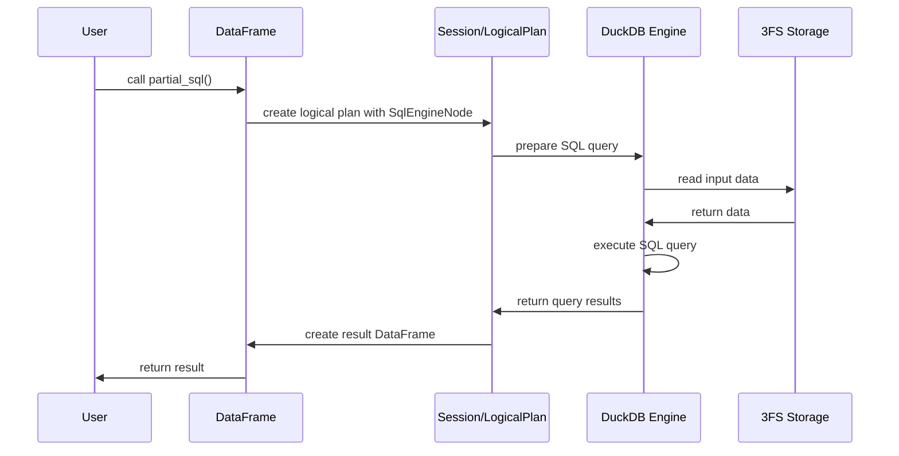

<!-- source: DeepWiki mcp.deepwiki.com · repo deepseek-ai/smallpond · page 2.3 SQL Integration · fetched 2026-10-30 -->

# SQL Integration

<details>
<summary>Relevant source files</summary>

The following files were used as context for generating this wiki page:

- [README.md](README.md)
- [examples/sort_mock_urls.py](examples/sort_mock_urls.py)
- [examples/sort_mock_urls_v2.py](examples/sort_mock_urls_v2.py)

</details>


This document explains how smallpond integrates with SQL capabilities via DuckDB and provides guidance on executing SQL queries on data. The integration enables users to leverage powerful SQL operations while maintaining smallpond's distributed processing capabilities. For information about general DataFrame operations, see [DataFrame Operations](#2.2).

## Overview

Smallpond provides seamless SQL integration through DuckDB, offering both high-level DataFrame API methods and lower-level logical plan components for SQL execution. This integration allows users to combine the expressiveness of SQL with smallpond's performance and scalability features.



Sources: [README.md:41-42](), [examples/sort_mock_urls.py:42-67](), [examples/sort_mock_urls_v2.py:17-18]()

## High-Level SQL API

### The partial_sql Method

The primary way to execute SQL queries in smallpond is through the `partial_sql` method available in the Session API. This method allows you to execute SQL queries on DataFrame objects.



The `partial_sql` method accepts:
- A SQL query template with placeholders (`{0}`, `{1}`, etc.)
- One or more DataFrame objects that will be substituted into the placeholders

### Example Usage

```python
# Initialize session
sp = smallpond.init()

# Load data
df = sp.read_parquet("prices.parquet")

# Process data with SQL
result = sp.partial_sql("SELECT ticker, min(price), max(price) FROM {0} GROUP BY ticker", df)
```

Sources: [README.md:34-42]()

### SQL Syntax and Features

Smallpond's SQL integration supports the full DuckDB SQL dialect, which is PostgreSQL-compatible with extensions. This includes:

- Standard SQL operations (SELECT, WHERE, GROUP BY, etc.)
- Window functions
- Common Table Expressions (CTEs)
- DuckDB's specialized functions (e.g., `split_part`, `from_base64`)
- Regular expressions and pattern matching

### Implicit SQL Operations

Several DataFrame methods implicitly use SQL for their implementation:

| Method | Description | Underlying SQL Operation |
|--------|-------------|--------------------------|
| `map()` | Transforms data using SQL expressions | SELECT with expressions |
| `partial_sort()` | Sorts data within partitions | ORDER BY |
| `repartition()` | Redistributes data | Hash functions and partitioning |

Example of `map()` with SQL expressions:

```python
urls = dataset.map("""
    split_part(urlstr, '/', 1) as host,
    split_part(urlstr, ' ', 1) as url,
    from_base64(valstr) AS payload
""")
```

Sources: [examples/sort_mock_urls_v2.py:10-16]()

## Low-Level SQL Integration

For more control over SQL execution, smallpond provides low-level components in its Logical Plan system.

### SqlEngineNode

The `SqlEngineNode` is a core component for SQL execution in logical plans. It takes input nodes and executes a SQL query against their data.



Example of `SqlEngineNode` usage:

```python
imported_urls = SqlEngineNode(
    ctx,
    (data_partitions,),
    r"""
select split_part(urlstr, '/', 1) as host, split_part(urlstr, ' ', 1) as url, from_base64(valstr) AS payload from {0}
""",
    output_name="imported_urls",
    output_path=external_output_path,
)
```

Sources: [examples/sort_mock_urls.py:42-50]()

### SQL Engine Options

Smallpond supports multiple execution engines for certain operations. The engine_type parameter (with default value "duckdb") controls which engine is used:

```python
urls_partitions = HashPartitionNode(
    ctx,
    (imported_urls,),
    npartitions=npartitions,
    hash_columns=["host"],
    engine_type=engine_type,  # Controls which engine is used
    output_name="urls_partitions",
    output_path=external_output_path,
)
```

This allows for flexibility in choosing between DuckDB SQL execution and alternative engines (e.g., Arrow Compute) based on the specific requirements of the operation.

Sources: [examples/sort_mock_urls.py:51-59](), [examples/sort_mock_urls.py:61-74]()

## SQL Execution Flow

The following sequence diagram illustrates how SQL queries are processed within smallpond:



When executing SQL queries, smallpond:

1. Translates high-level API calls into logical plan operations
2. Creates appropriate nodes (e.g., `SqlEngineNode`)
3. Passes SQL queries to DuckDB for execution
4. Manages data movement between storage and the engine
5. Returns results as DataFrame objects

Sources: [README.md:41-42](), [examples/sort_mock_urls.py:42-67]()

## Best Practices

### Working with Partitioned Data

When working with partitioned data, consider these SQL integration patterns:

1. **Partition-aware operations**: Use `partial_sql` to perform operations within each partition independently
2. **Global operations**: Consolidate partitions before operations that need to see all data
3. **Hybrid approach**: Use partitioning for initial filtering and aggregation, then consolidate for final processing

### Example: URL Sorting

The following example shows a complete workflow using SQL integration at different stages:

```python
# High-level API approach
dataset = sp.read_csv(input_paths, schema={"urlstr": "varchar", "valstr": "varchar"}, delim=r"\t").repartition(npartitions)

# Use map() with SQL expressions
urls = dataset.map("""
    split_part(urlstr, '/', 1) as host,
    split_part(urlstr, ' ', 1) as url,
    from_base64(valstr) AS payload
""")

# Repartition based on SQL column
urls = urls.repartition(npartitions, hash_by="host")

# Sort within partitions (uses SQL ORDER BY internally)
sorted_urls = urls.partial_sort(by=["host"])
```

Sources: [examples/sort_mock_urls_v2.py:8-19]()

## Performance Considerations

- SQL operations within smallpond leverage DuckDB's optimized query engine
- Partitioning is key to balancing SQL execution across multiple processes
- Consider using SQL for computationally intensive operations while using Python for workflow orchestration
- When possible, push filtering operations down to the SQL layer to reduce data movement

Sources: [README.md:12-14](), [examples/sort_mock_urls.py:61-74]()

---

