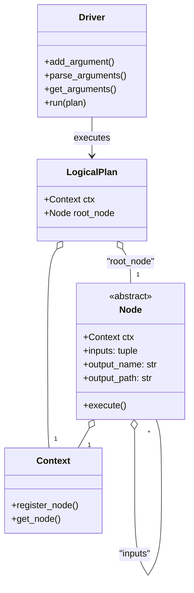
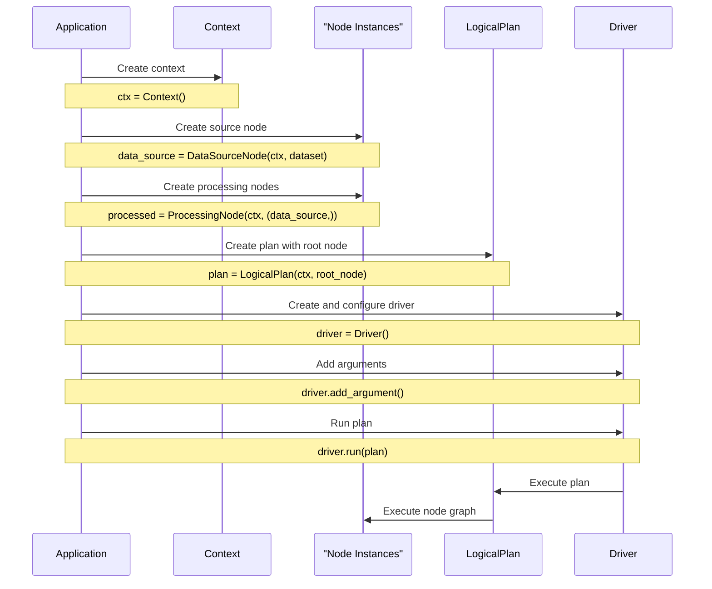
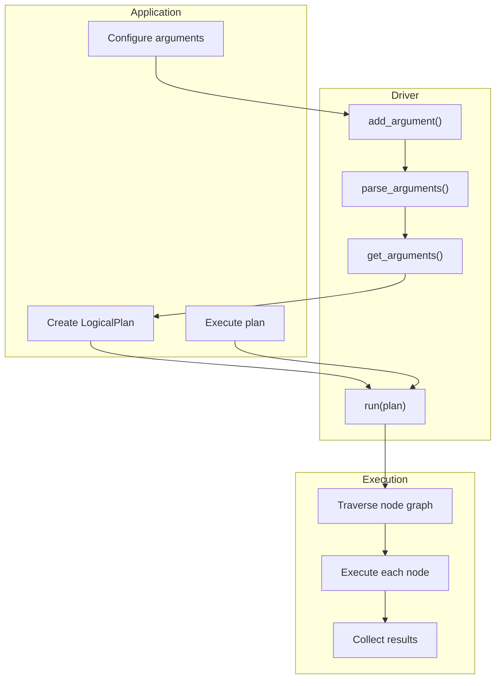
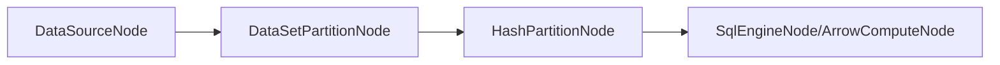
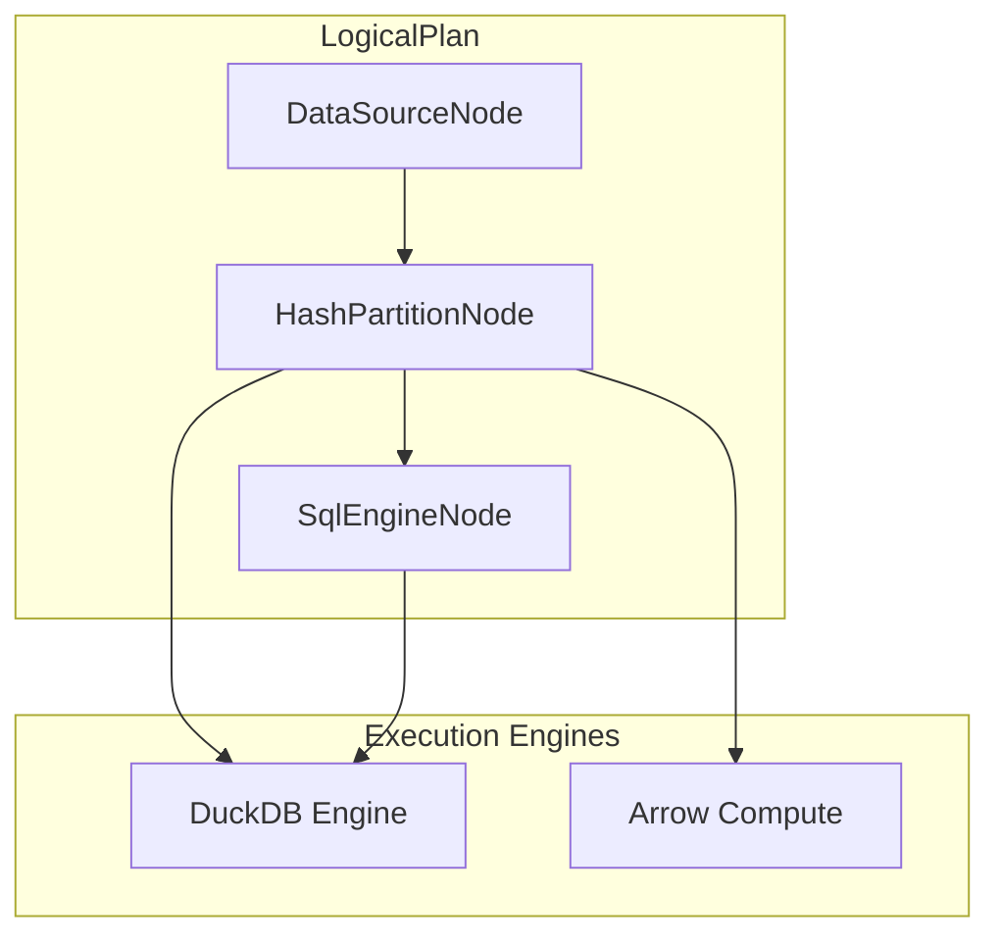

<!-- source: DeepWiki mcp.deepwiki.com · repo deepseek-ai/smallpond · page 3 Logical Plan System · fetched 2026-10-30 -->

# Logical Plan System

<details>
<summary>Relevant source files</summary>

The following files were used as context for generating this wiki page:

- [benchmarks/hash_partition_benchmark.py](benchmarks/hash_partition_benchmark.py)
- [examples/shuffle_data.py](examples/shuffle_data.py)
- [examples/sort_mock_urls.py](examples/sort_mock_urls.py)

</details>


The Logical Plan System forms the core execution framework of the smallpond data processing platform. It provides a mechanism for constructing and executing directed acyclic graphs (DAGs) of data processing operations. This document explains the architecture, components, and usage of the Logical Plan System in smallpond.

For information about the high-level Session API that builds on top of this system, see [Core API](#2) and [Session API](#2.1).

## System Purpose and Architecture

The Logical Plan System enables the definition of complex data processing workflows through a composable node-based architecture. It serves as the foundation for all data operations in smallpond, providing a flexible and extensible framework for tasks such as data loading, transformation, partitioning, and output.



The system consists of four primary components:

1. **LogicalPlan**: The top-level container that holds a directed acyclic graph of processing nodes with a single root node representing the final output.

2. **Context**: Maintains the registry of all nodes in a plan, enabling node lookup and management.

3. **Node**: The abstract base class for all operation types, with subclasses for specific operations like data loading, SQL execution, partitioning, etc.

4. **Driver**: Handles command-line argument parsing and plan execution, providing the entry point for running logical plans.

Sources: [benchmarks/hash_partition_benchmark.py:10-11](), [benchmarks/hash_partition_benchmark.py:61-63](), [examples/shuffle_data.py:8-10]()

## Node Types and Hierarchy

The Logical Plan System includes a variety of specialized node types, each providing specific data processing functionality. These nodes can be composed to create complex data processing pipelines.

```mermaid
classDiagram
    class Node {
        <<abstract>>
        +Context ctx
        +inputs: tuple
        +output_name: str
        +execute()
    }
    
    Node <|-- DataSourceNode
    Node <|-- DataSinkNode
    Node <|-- ProcessingNode
    
    class DataSourceNode {
        +dataset
    }
    
    class DataSinkNode {
        +output_path
    }
    
    ProcessingNode <|-- DataSetPartitionNode
    ProcessingNode <|-- HashPartitionNode
    ProcessingNode <|-- SqlEngineNode
    ProcessingNode <|-- ArrowComputeNode
    ProcessingNode <|-- StreamCopy
    ProcessingNode <|-- ProjectionNode
    ProcessingNode <|-- ShuffleNode
    ProcessingNode <|-- ConsolidateNode
    ProcessingNode <|-- PythonScriptNode
    
    class DataSetPartitionNode {
        +npartitions
        +partition_by_rows
        +random_shuffle
    }
    
    class HashPartitionNode {
        +npartitions
        +hash_columns
        +engine_type
    }
    
    class SqlEngineNode {
        +sql_template
        +cpu_limit
        +memory_limit
    }
    
    class ArrowComputeNode {
        +process()
    }
    
    class ConsolidateNode {
        +consolidate inputs
    }
}
```

### Key Node Types:

1. **DataSourceNode**: Loads data from sources like Parquet or CSV files into the processing pipeline
2. **DataSetPartitionNode**: Divides datasets into multiple partitions for parallel processing
3. **HashPartitionNode**: Partitions data based on hash values of specified columns
4. **SqlEngineNode**: Executes SQL queries on input data using DuckDB
5. **ArrowComputeNode**: Performs custom operations on Apache Arrow tables
6. **ConsolidateNode**: Combines multiple data partitions into a single dataset
7. **DataSinkNode**: Writes processed data to storage
8. **StreamCopy**: Copies data streams between nodes
9. **PythonScriptNode**: Executes custom Python code on data
10. **ProjectionNode**: Selects specific columns from datasets
11. **ShuffleNode**: Randomizes data ordering

Sources: [examples/sort_mock_urls.py:10-19](), [examples/shuffle_data.py:4-10](), [benchmarks/hash_partition_benchmark.py:5-12]()

## Building and Executing Logical Plans

Creating and executing a logical plan involves three main steps:

1. Creating a Context
2. Building a node graph with a root node
3. Constructing a LogicalPlan and executing it via a Driver



### Example Plan Construction

Here's how a typical logical plan is built:

```python
# Create context
ctx = Context()

# Create dataset and source node
dataset = ParquetDataSet(input_paths)
data_files = DataSourceNode(ctx, dataset)

# Add processing nodes
partitioned = HashPartitionNode(
    ctx, 
    (data_files,), 
    npartitions=10, 
    hash_columns=["column_name"]
)

processed = SqlEngineNode(
    ctx,
    (partitioned,),
    "SELECT * FROM {0} WHERE value > 100"
)

# Create logical plan with the final node as root
plan = LogicalPlan(ctx, processed)

# Execute with driver
driver = Driver()
driver.run(plan)
```

Sources: [benchmarks/hash_partition_benchmark.py:27-64](), [examples/shuffle_data.py:22-58](), [examples/sort_mock_urls.py:28-86]()

## Driver and Execution

The Driver component manages the execution of logical plans and provides utilities for handling command-line arguments. It serves as the entry point for running logical plans from command-line applications.



### Driver Features:

1. **Argument Management**:
   - Define command-line arguments with `add_argument()`
   - Parse arguments with `parse_arguments()`
   - Retrieve parsed arguments with `get_arguments()`

2. **Plan Execution**:
   - Execute the plan with `run(plan)`
   - Handle execution context and resource management
   - Process the node graph in the correct dependency order

3. **Resource Control**:
   - Specify CPU and memory limits for operations
   - Configure execution environment parameters

Sources: [benchmarks/hash_partition_benchmark.py:69-87](), [examples/shuffle_data.py:61-70](), [examples/sort_mock_urls.py:89-96]()

## Common Usage Patterns

The Logical Plan System supports several common data processing patterns that appear frequently in smallpond applications.

### Data Partitioning and Distribution



This pattern divides data into partitions for parallel processing, improving performance for large datasets.

### ETL Pipeline


This pattern represents a standard Extract-Transform-Load pipeline for data processing.

### Sort and Aggregate


This pattern enables efficient sorting and aggregation of large datasets.

Sources: [examples/sort_mock_urls.py:28-86](), [benchmarks/hash_partition_benchmark.py:15-65](), [examples/shuffle_data.py:14-58]()

## Resource Management

Nodes in the Logical Plan System can be configured with resource constraints to control their execution:

| Parameter | Description | Example |
|-----------|-------------|---------|
| `cpu_limit` | Maximum CPU cores to use | `cpu_limit=16` |
| `memory_limit` | Maximum memory allocation | `memory_limit=10 * GB` |
| `output_name` | Name for tracking output | `output_name="sorted_data"` |
| `output_path` | Path for persisting output | `output_path="/tmp/results"` |

These parameters can be specified when creating nodes, allowing fine-grained control over resource utilization throughout the plan.

Sources: [benchmarks/hash_partition_benchmark.py:42-43](), [examples/sort_mock_urls.py:66](), [benchmarks/hash_partition_benchmark.py:54]()

## Integration with Execution Engines

The Logical Plan System can use different execution engines for data processing:



The system primarily supports two execution engines:

1. **DuckDB**: Used for SQL-based operations and general data processing
2. **Arrow**: Used for specialized compute operations or when custom processing logic is needed

The engine can be specified through the `engine_type` parameter in nodes like `HashPartitionNode`, allowing selection between "duckdb" and "arrow" based on processing requirements.

Sources: [examples/sort_mock_urls.py:61-74](), [benchmarks/hash_partition_benchmark.py:19](), [examples/shuffle_data.py:67]()

## Extending the System

The Logical Plan System can be extended by creating custom node types that inherit from existing node classes:

1. **Custom Processing Nodes**: Extend `ArrowComputeNode` or other node types
2. **Custom Data Sources/Sinks**: Extend `DataSourceNode` or `DataSinkNode`
3. **Specialized Operations**: Create dedicated node classes for domain-specific operations

Example of a custom node extension:

```python
class SortUrlsNode(ArrowComputeNode):
    def process(self, runtime_ctx: RuntimeContext, input_tables: List[arrow.Table]) -> arrow.Table:
        logging.info(f"sorting urls by 'host', table shape: {input_tables[0].shape}")
        return input_tables[0].sort_by("host")
```

Sources: [examples/sort_mock_urls.py:22-25]()

## Summary

The Logical Plan System provides a flexible, extensible framework for defining and executing complex data processing workflows in smallpond. By composing different node types into directed acyclic graphs, users can create sophisticated data processing pipelines that efficiently handle large-scale data operations.

The system's integration with the Driver component enables easy execution from command-line applications, while its support for different execution engines allows selection of the most appropriate processing technology for each operation.

---

