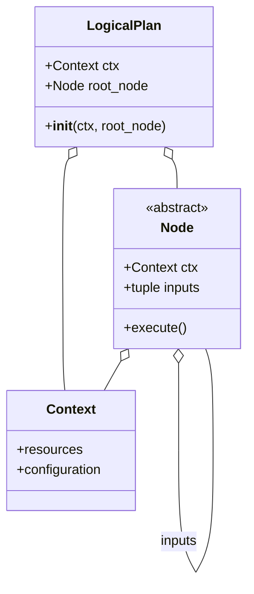
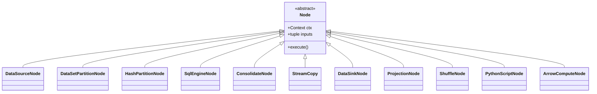
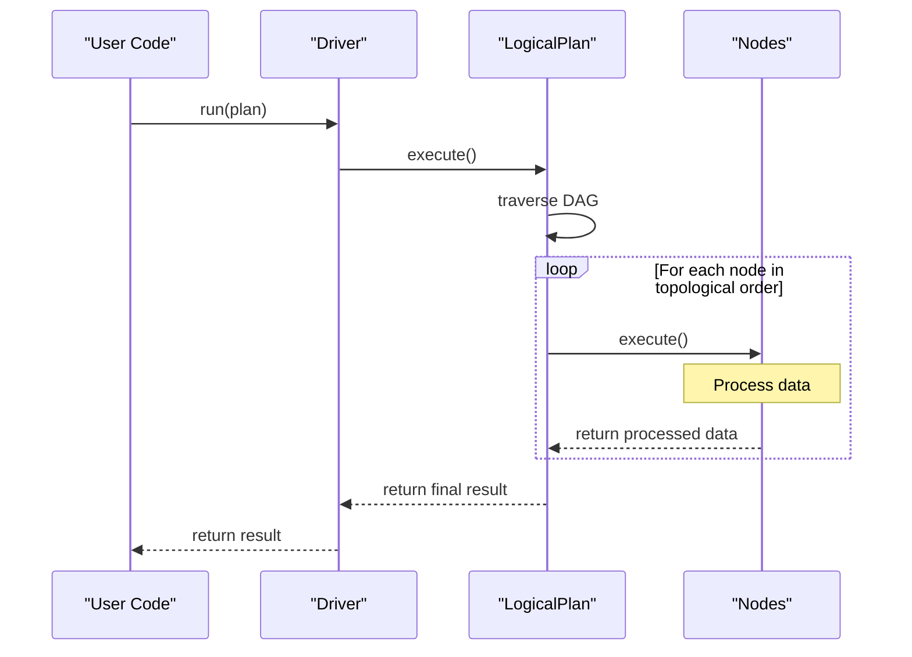
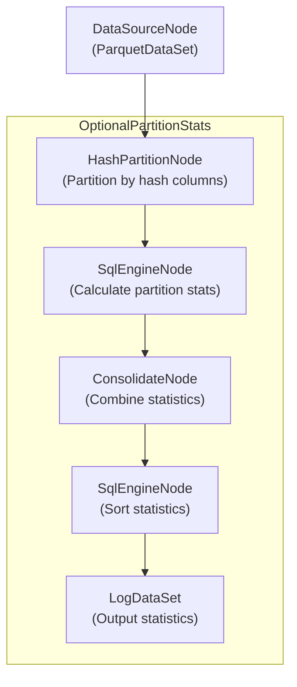
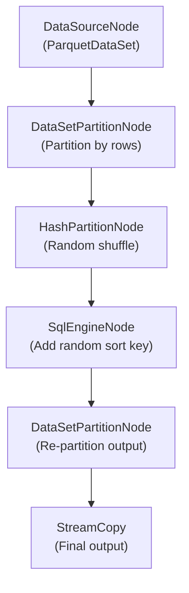
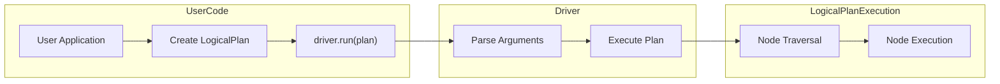

<!-- source: DeepWiki mcp.deepwiki.com · repo deepseek-ai/smallpond · page 3.1 LogicalPlan Overview · fetched 2026-10-30 -->

# LogicalPlan Overview

<details>
<summary>Relevant source files</summary>

The following files were used as context for generating this wiki page:

- [benchmarks/hash_partition_benchmark.py](benchmarks/hash_partition_benchmark.py)
- [examples/shuffle_data.py](examples/shuffle_data.py)

</details>


The LogicalPlan is the core execution framework in the smallpond system, representing a directed acyclic graph (DAG) of data processing operations. It encapsulates the entire workflow from data source to data sink, providing a flexible way to express complex data transformations through a series of connected nodes.

For information about specific node types used within a LogicalPlan, see [Node Types](#3.2).
For details on how LogicalPlans are executed, see [Driver and Execution](#3.3).

## Structure of LogicalPlan

### LogicalPlan Class Diagram



The LogicalPlan consists of two main components:

1. A **Context** object that provides shared resources and configuration
2. A **root_node** that serves as the entry point to the DAG of operations

The LogicalPlan class has a simple structure - it primarily holds these two references and serves as the execution entry point. When executed, the plan traverses the node graph and produces the final result.

Sources: [benchmarks/hash_partition_benchmark.py:10-11](), [benchmarks/hash_partition_benchmark.py:61-63](), [examples/shuffle_data.py:9-10](), [examples/shuffle_data.py:57-58]()

## Node Types in the LogicalPlan

### Node Inheritance Hierarchy



The smallpond framework defines various node types that can be used in a LogicalPlan. Each node represents a specific operation in the data processing pipeline:

| Node Type | Purpose |
|-----------|---------|
| DataSourceNode | Loads data from a dataset (e.g., ParquetDataSet) |
| DataSetPartitionNode | Partitions data by rows or other criteria |
| HashPartitionNode | Distributes data based on hash values of columns |
| SqlEngineNode | Executes SQL queries on input data |
| ConsolidateNode | Combines data from multiple partitions |
| StreamCopy | Copies data between streams |
| DataSinkNode | Writes data to a destination |
| ProjectionNode | Selects specific columns from data |
| ShuffleNode | Redistributes data across partitions |
| PythonScriptNode | Executes custom Python code |
| ArrowComputeNode | Performs Arrow-based operations |

The nodes are connected in a directed acyclic graph (DAG) where each node can have multiple input nodes, specified in the `inputs` tuple parameter during node creation.

Sources: [benchmarks/hash_partition_benchmark.py:5-12](), [examples/shuffle_data.py:4-11]()

## Creating a LogicalPlan

To create a LogicalPlan, you typically follow this pattern:

1. Create a Context object:
```python
ctx = Context()
```

2. Create a data source node:
```python
dataset = ParquetDataSet(input_paths)
data_files = DataSourceNode(ctx, dataset)
```

3. Add processing nodes, connecting them in a DAG:
```python
processed_data = SomeOperationNode(ctx, (data_files,), parameters...)
```

4. Create the LogicalPlan with the final node as root:
```python
plan = LogicalPlan(ctx, processed_data)
```

Each node takes a tuple of input nodes as its second parameter, establishing the connections in the DAG. The final node in the processing pipeline becomes the root node of the LogicalPlan.

Sources: [benchmarks/hash_partition_benchmark.py:27-63](), [examples/shuffle_data.py:22-58]()

## Execution Flow

### LogicalPlan Execution Sequence



When a LogicalPlan is executed, the system traverses the node DAG in topological order (dependencies first), executing each node's operation. The execution typically follows these steps:

1. The Driver's `run()` method is called with the LogicalPlan
2. The LogicalPlan determines the execution order of nodes
3. Each node is executed in order, with dependencies executing first
4. Results flow from upstream nodes to downstream nodes
5. The final result is produced by the root node

Sources: [benchmarks/hash_partition_benchmark.py:86-87](), [examples/shuffle_data.py:69-70]()

## Example: Hash Partition Benchmark

### Hash Partition Benchmark Logical Plan



The hash partition benchmark creates a LogicalPlan that:
1. Loads Parquet data using a DataSourceNode
2. Partitions the data using a HashPartitionNode based on specified hash columns
3. Optionally calculates statistics about the partitions using SqlEngineNode and ConsolidateNode

This benchmark is particularly useful for testing the performance of hash-based data partitioning operations, which are common in distributed data processing.

Source: [benchmarks/hash_partition_benchmark.py:15-65]()

## Example: Shuffle Data

### Shuffle Data Logical Plan



The shuffle data example creates a LogicalPlan that:
1. Loads Parquet data using a DataSourceNode
2. Partitions the data by rows using a DataSetPartitionNode
3. Shuffles the data using a HashPartitionNode with random_shuffle=True
4. Adds a random sort key and sorts using a SqlEngineNode
5. Re-partitions the output using another DataSetPartitionNode
6. Copies the data using StreamCopy

This example demonstrates how to randomize a dataset, which is useful for creating test datasets or ensuring random distribution of data.

Source: [examples/shuffle_data.py:14-58]()

## Integration with Driver

### Driver and LogicalPlan Integration



The LogicalPlan is typically executed using the Driver component, which handles command-line arguments and manages the execution process. The typical workflow is:

1. Create a Driver instance (`driver = Driver()`)
2. Add arguments to the driver (`driver.add_argument()`)
3. Parse arguments (`driver.parse_arguments()` or `driver.get_arguments()`)
4. Create a LogicalPlan using those arguments
5. Execute the plan with `driver.run(plan)`

This pattern is consistent across various examples and benchmarks in the smallpond codebase.

Sources: [benchmarks/hash_partition_benchmark.py:68-87](), [examples/shuffle_data.py:61-70]()

## Resource Management in LogicalPlan

An important aspect of the LogicalPlan system is its ability to manage computational resources. Many node types accept parameters like `cpu_limit` and `memory_limit` to control resource usage during execution:

```python
partitioned_datasets = HashPartitionNode(
    ctx,
    (data_files,),
    npartitions=npartitions,
    hash_columns=hash_columns,
    cpu_limit=cpu_limit,
    memory_limit=memory_limit,
)
```

This allows for fine-grained control over resource allocation, which is particularly important for large-scale data processing tasks.

Source: [benchmarks/hash_partition_benchmark.py:31-43]()

## Conclusion

The LogicalPlan system is the core execution framework in smallpond, providing a flexible and powerful way to express complex data operations as a directed acyclic graph of nodes. By composing different types of nodes, users can create sophisticated data processing pipelines while the framework handles the execution details.

The LogicalPlan works closely with:
- The Context object for resource management
- Various Node types for specific operations
- The Driver component for execution management
- Dataset abstractions for data access

For more information on the specific node types available in LogicalPlans, see [Node Types](#3.2).
For details on how the Driver component executes LogicalPlans, see [Driver and Execution](#3.3).

---

