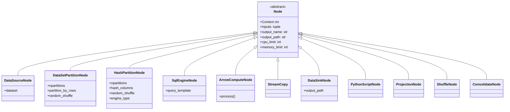
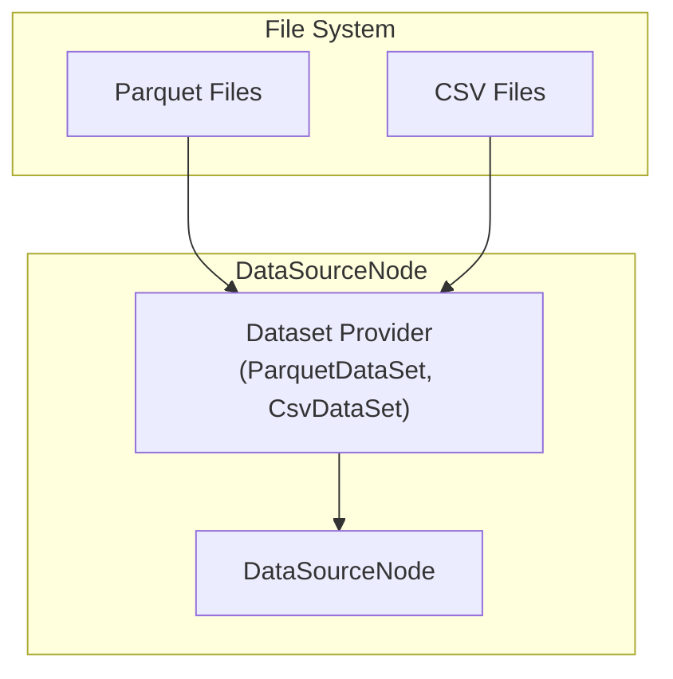
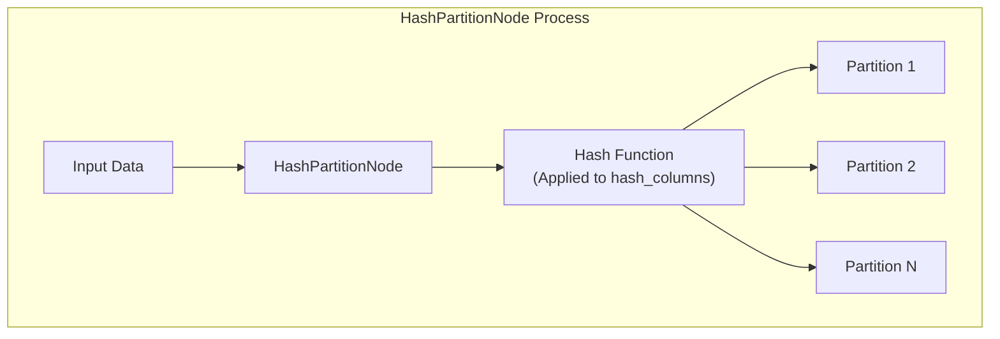
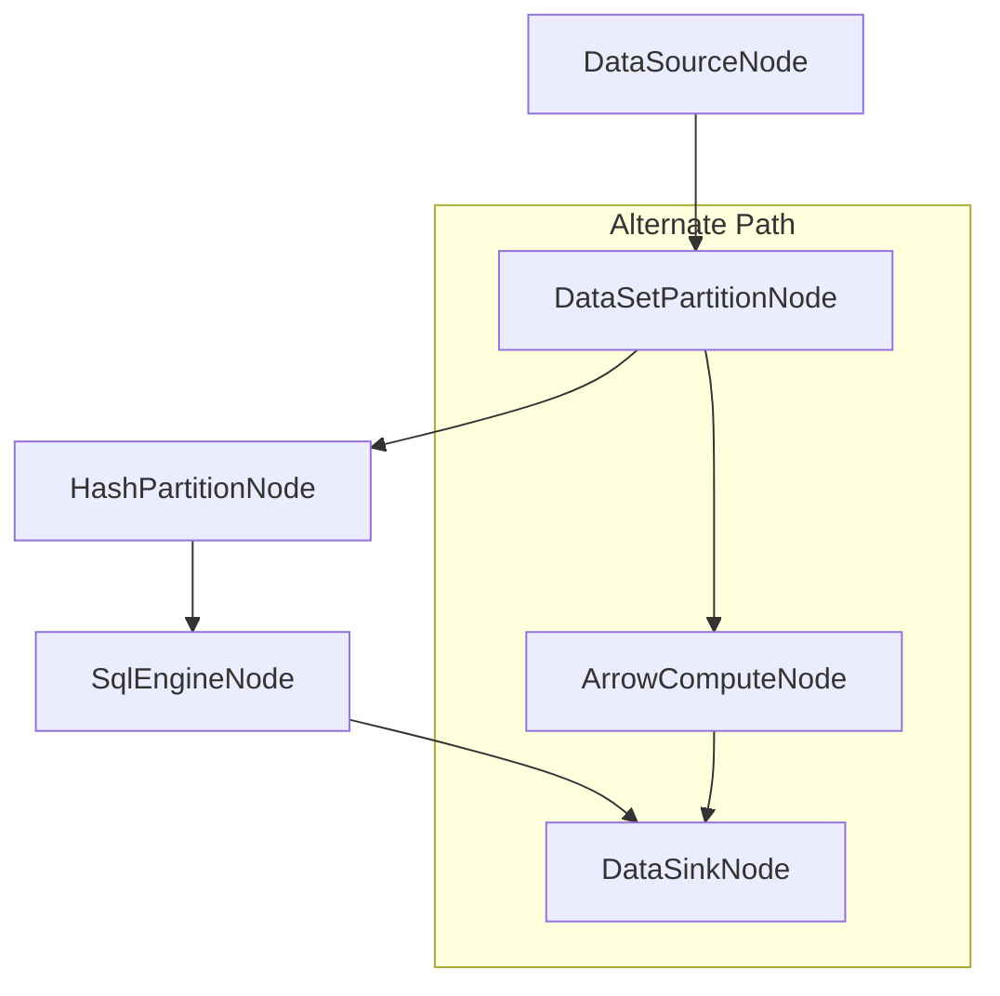
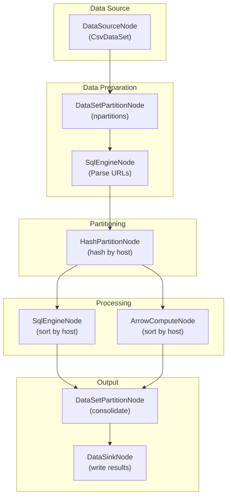

<!-- source: DeepWiki mcp.deepwiki.com · repo deepseek-ai/smallpond · page 3.2 Node Types · fetched 2026-10-30 -->

# Node Types

<details>
<summary>Relevant source files</summary>

The following files were used as context for generating this wiki page:

- [benchmarks/hash_partition_benchmark.py](benchmarks/hash_partition_benchmark.py)
- [examples/shuffle_data.py](examples/shuffle_data.py)
- [examples/shuffle_mock_urls.py](examples/shuffle_mock_urls.py)
- [examples/sort_mock_urls.py](examples/sort_mock_urls.py)

</details>


## Purpose and Scope

This document details the various node types available in the smallpond Logical Plan system. These nodes are the building blocks for constructing data processing pipelines in smallpond. Each node represents a specific operation or transformation on data, and they can be composed together to form complex workflows.

For an overview of the Logical Plan system itself, see [LogicalPlan Overview](#3.1). For information about how LogicalPlans are executed, see [Driver and Execution](#3.3).

## Node Hierarchy

The Node class is the abstract base class for all node types in smallpond's Logical Plan system. Each specific node type implements particular data processing functionality.



Sources: [examples/sort_mock_urls.py:10-19](), [examples/shuffle_data.py:3-11](), [examples/shuffle_mock_urls.py:3-11](), [benchmarks/hash_partition_benchmark.py:5-12]()

## Core Node Characteristics

All node types in smallpond share certain common properties:

- **Context**: Each node has a context that provides shared environment information
- **Inputs**: Most nodes accept one or more input nodes, forming a directed acyclic graph
- **Resource Limits**: Nodes can specify CPU and memory limits
- **Output Configuration**: Nodes can have specified output names and paths

### Common Node Parameters

| Parameter | Description | Default |
|-----------|-------------|---------|
| `ctx` | Context object for the node | Required |
| `inputs` | Tuple of input nodes | Varies by node type |
| `output_name` | Name for the node's output | Generated if not specified |
| `output_path` | Path for node's output files | None |
| `cpu_limit` | CPU limit for node execution | Node-specific default |
| `memory_limit` | Memory limit for node execution | Node-specific default |

Sources: [benchmarks/hash_partition_benchmark.py:30-43](), [examples/shuffle_mock_urls.py:18-30]()

## Data Source Nodes

### DataSourceNode

The `DataSourceNode` is the entry point for data in a logical plan. It connects to various data sources like Parquet files or CSV files.



**Key Parameters:**
- `ctx`: Context object
- `dataset`: Dataset object (e.g., ParquetDataSet, CsvDataSet)

**Usage Example:**
```python
dataset = ParquetDataSet(input_paths)
data_files = DataSourceNode(ctx, dataset)
```

Sources: [benchmarks/hash_partition_benchmark.py:28-29](), [examples/shuffle_data.py:23-24](), [examples/sort_mock_urls.py:39-40]()

## Data Processing Nodes

### DataSetPartitionNode

The `DataSetPartitionNode` divides a dataset into multiple partitions, either by rows or using other strategies.

**Key Parameters:**
- `inputs`: Tuple containing a single input node
- `npartitions`: Number of partitions to create
- `partition_by_rows`: If True, partitions data evenly by row count
- `random_shuffle`: If True, randomly shuffles data during partitioning

**Usage Example:**
```python
data_partitions = DataSetPartitionNode(ctx, (data_files,), npartitions=npartitions)
```

Sources: [examples/shuffle_data.py:25-31](), [examples/sort_mock_urls.py:76]()

### HashPartitionNode

The `HashPartitionNode` partitions data based on hash values of specified columns, enabling data to be distributed for parallel processing.



**Key Parameters:**
- `inputs`: Tuple containing a single input node
- `npartitions`: Number of partitions to create
- `hash_columns`: List of column names to use for hashing
- `random_shuffle`: If True, randomly shuffles data instead of using hash columns
- `engine_type`: Engine to use for partitioning ("duckdb" or "arrow")
- `use_parquet_writer`: Whether to use Parquet writer
- `hive_partitioning`: Whether to use Hive partitioning

**Usage Example:**
```python
urls_partitions = HashPartitionNode(
    ctx,
    (imported_urls,),
    npartitions=npartitions,
    hash_columns=["host"],
    engine_type=engine_type,
    output_name="urls_partitions",
)
```

Sources: [benchmarks/hash_partition_benchmark.py:31-43](), [examples/shuffle_mock_urls.py:20-30](), [examples/sort_mock_urls.py:51-59]()

### SqlEngineNode

The `SqlEngineNode` executes SQL queries on input data using a SQL engine (typically DuckDB).

**Key Parameters:**
- `inputs`: Tuple containing one or more input nodes
- `query_template`: SQL query template with `{N}` placeholders that reference input nodes
- `output_name`: Name for the query output
- `output_path`: Optional path for output files

**Usage Example:**
```python
sorted_urls = SqlEngineNode(
    ctx,
    (urls_partitions,),
    r"select * from {0} order by host",
    output_name="sorted_urls",
)
```

Sources: [benchmarks/hash_partition_benchmark.py:46-55](), [examples/shuffle_data.py:43-48](), [examples/sort_mock_urls.py:42-50](), [examples/sort_mock_urls.py:62-67]()

### ArrowComputeNode

The `ArrowComputeNode` provides an interface for custom processing using PyArrow. It can be subclassed to implement specific data transformations.

**Key Features:**
- Allows custom processing logic via the `process` method
- Works with PyArrow Tables as input and output
- Useful for operations not easily expressible in SQL

**Example Implementation:**
```python
class SortUrlsNode(ArrowComputeNode):
    def process(self, runtime_ctx: RuntimeContext, input_tables: List[arrow.Table]) -> arrow.Table:
        logging.info(f"sorting urls by 'host', table shape: {input_tables[0].shape}")
        return input_tables[0].sort_by("host")
```

Sources: [examples/sort_mock_urls.py:22-25](), [examples/sort_mock_urls.py:69-74]()

## Data Movement Nodes

### StreamCopy

The `StreamCopy` node copies data from its input to its output, potentially with format conversion.

**Key Parameters:**
- `inputs`: Tuple containing a single input node
- `output_name`: Name for the output
- `cpu_limit`: CPU limit for the copy operation

**Usage Example:**
```python
shuffled_urls = StreamCopy(ctx, (repartitioned,), output_name="data_copy", cpu_limit=1)
```

Sources: [examples/shuffle_data.py:55]()

### ConsolidateNode

The `ConsolidateNode` combines multiple partitions into a single consolidated dataset.

**Key Parameters:**
- `inputs`: Input node to consolidate
- `shuffle_input_partitions`: List specifying how to shuffle input partitions (optional)

**Usage Example:**
```python
sorted_stats = SqlEngineNode(
    ctx,
    (ConsolidateNode(ctx, partition_stats, []),),
    r"select * from {0} order by row_cnt desc",
)
```

Sources: [benchmarks/hash_partition_benchmark.py:58]()

## Data Sink Nodes

### DataSinkNode

The `DataSinkNode` writes data to a specified output location. It serves as a terminal node in the logical plan.

**Key Parameters:**
- `inputs`: Tuple containing a single input node
- `output_path`: Path where data will be written

**Usage Example:**
```python
final_result = DataSinkNode(
    ctx,
    (final_result,),
    output_path=os.path.join(external_output_path, "data_sink"),
)
```

Sources: [examples/sort_mock_urls.py:79-83]()

## Other Node Types

The smallpond framework also includes the following node types that are not demonstrated in the provided file examples:

- **ProjectionNode**: Selects specific columns from input data
- **ShuffleNode**: Redistributes data across partitions
- **PythonScriptNode**: Executes custom Python code on data

## Node Composition Patterns

Nodes in smallpond are composed together to form directed acyclic graphs (DAGs) that represent data processing workflows. Here are common patterns:



### Common Node Composition Patterns

1. **Extract-Transform-Load (ETL)**:
   - DataSourceNode → Processing Nodes → DataSinkNode

2. **Partitioning and Shuffling**:
   - DataSourceNode → DataSetPartitionNode → HashPartitionNode → Processing Nodes

3. **Partition-Process-Consolidate**:
   - DataSourceNode → Partitioning Nodes → Processing Nodes → ConsolidateNode → DataSinkNode

Sources: [examples/sort_mock_urls.py:39-85](), [benchmarks/hash_partition_benchmark.py:27-65]()

## Example Node Workflow: URL Sorting

The following diagram illustrates a complete workflow for sorting URLs using various node types:



Sources: [examples/sort_mock_urls.py:28-86]()

## Performance Considerations

Nodes in smallpond can specify resource constraints that are important for performance optimization:

- **CPU Limits**: Control parallelism per node
- **Memory Limits**: Prevent out-of-memory errors
- **Partitioning Strategy**: Affects data distribution and processing efficiency

For example, the `HashPartitionNode` in the hash_partition_benchmark accepts both CPU and memory limits:

```python
partitioned_datasets = HashPartitionNode(
    ctx,
    (data_files,),
    npartitions=npartitions,
    hash_columns=hash_columns,
    cpu_limit=cpu_limit,
    memory_limit=memory_limit,
)
```

Sources: [benchmarks/hash_partition_benchmark.py:31-43](), [examples/shuffle_mock_urls.py:27-30]()

---

